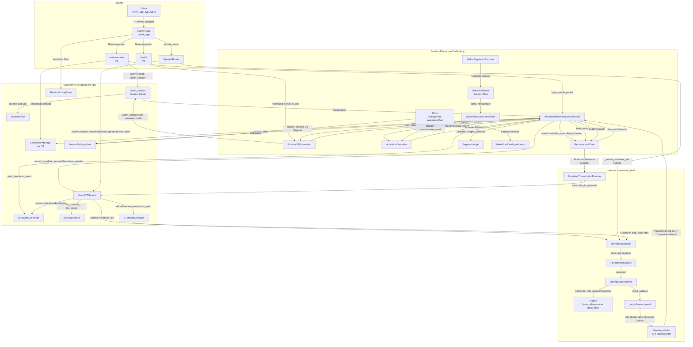

# 01.02 – Architekturübersicht

## 1. Worum geht es?

Dieses Kapitel ist der Stadtplan des Voice-STT-Servers V2. Es beantwortet nicht, *wie* eine bestimmte Funktion im Detail arbeitet – das tun die Folgekapitel –, sondern **wer im System welche Aufgabe hat, wer wen direkt aufruft und wo die Grenzen zwischen den Teilen verlaufen**. Wer diese Karte im Kopf hat, kann Fehlerbilder richtig zuordnen: „Der Client bekommt keine Ereignisse" ist ein anderer Fehler als „die Transkription ist langsam", und beides ist wieder etwas anderes als „der Server nimmt keine neue Sitzung an".

Die Grundform ist überraschend einfach: **ein Prozess, eine ASGI-App, ein Einstiegspunkt** (C-01). `main()` startet uvicorn, und uvicorn betreibt genau die App, die `create_app()` gebaut hat (C-01, C-02). Es gibt keinen Worker-Verbund, keinen Broker, keine Out-of-Process-Inferenz im Serverbetrieb (C-17, N-01). Auch der Paketname täuscht nicht: `VoiceSTT_server/server.py` ist ein reiner Re-Export von `api_fastapi_server/server.py`, und die Console-Scripts `voice-stt-server`/`stt-server` zeigen beide auf denselben `main()` (C-01).

In dieser einen App lebt **ein** Service-Objekt, das den ganzen geteilten Besitz hält: Security, ConnectionManager, SessionStore, Settings-Zustand, Modellverwaltung, Scheduler, Event-Hub, Audit-/Performance-Logging, Wake-Word-Katalog, die beiden Ergebnis-Registries und den Runtime-Config-Store (C-03). Alles, was sitzungsübergreifend ist, hängt an diesem Objekt; alles, was zu genau einer Verbindung gehört, hängt an einem Session-Objekt, das eine Fabrik pro Verbindung erzeugt (C-04).

Herein kommt man durch **drei Türen mit unterschiedlichen Verträgen**:

- **V1** über den WebSocket `/ws/transcribe`: Konfiguration kommt als Query-Parameter, die Sitzung wird direkt am Endpoint aufgenommen, und der Endpoint registriert die Verbindung im ConnectionManager (C-06, C-08).
- **V2** über den WebSocket `/ws/v2`: Hier wird zuerst ein `ProtocolV2Connection`-Objekt konstruiert, das den Protokollzustand hält; die Sitzung entsteht erst nach einem validierten `hello` (C-09, C-10).
- **OpenAI-kompatibel** über einen separaten HTTP-Router, der ohne Import von `server.py` auskommt und alle Kollaborateure injiziert bekommt (C-25).

Diese drei Türen teilen sich **eine** Inferenz-Maschine: einen Scheduler mit fairen Warteschlangen und Arbeitern, die auf genau zwei Engine-Typen zeigen – `faster_whisper` und `kroko_onnx`, beide auf CPU festgelegt (C-18, C-30). Das ist der praktisch wichtigste Punkt der ganzen Übersicht: Ein Diktat über `/ws/v2` und ein OpenAI-Auftrag sind **keine getrennten Welten**. Sie laufen durch dieselben Queues und konkurrieren um dieselben Arbeiter (C-18, C-26). Wer die Kapazität plant oder ein „warum ist das plötzlich langsam?" untersucht, muss deshalb immer beide Zugänge zusammen betrachten.

Ein zweiter praktischer Punkt betrifft die Ausgabe. Der Server hat **zwei verschiedene Ausgabekanäle** für Domänenereignisse, und sie sind nicht austauschbar: V1 schickt über den ConnectionManager, V2 über einen Callback am `ProtocolV2Connection`. Eine V2-Sitzung taucht im ConnectionManager **nie** auf (C-08, C-09, K-02). Ein Betriebswerkzeug, das „verbundene Clients" aus dem ConnectionManager liest, sieht also nur die V1-Hälfte – die Sitzungen selbst stehen im SessionStore (C-05).

**Was dieses Kapitel bewusst nicht tut:** Es nennt keine Fristen und keine Standard-Zeitwerte. Der ActivationController hat vier Deadline-Arten, und deren Semantik, Defaults und Grenzen sind Gegenstand von 02.03 und 08.06 (C-12). Hier zählt nur, *dass* es sie gibt und *wer* sie besitzt. Ebenso werden keine Wire-Formate beschrieben – dafür stehen 04.x und 09.03 bereit.

## 2. Das Wesentliche auf einen Blick

- **Ein Prozess, eine App, ein Service.** `main()` → uvicorn → `create_app()`; die App hängt den Service unter `app.state.voicestt_service` und startet/stoppt ihn im Lifespan (C-01, C-02).
- **Der Service besitzt den geteilten Zustand, die Session besitzt den Vordergrund.** Was sitzungsübergreifend ist, liegt in `VoiceSTTService` (C-03); was zu einer Verbindung gehört, in `RecorderBackedRealtimeSession` (C-04, C-16).
- **Beide WebSocket-Wege münden in dieselbe Fabrik.** V1 ruft `admit_session` direkt, V2 erst nach validiertem `hello` mit `canonical_ids=True` (C-04, C-06, C-10).
- **V1 hat einen Kanal, V2 hat einen Callback.** `Session → ConnectionManager` gilt nur für V1; V2 spricht über `set_protocol_observer` (C-08, C-10, C-21).
- **Ein Funnel, drei Verbraucher.** Jedes Timeline-Ereignis geht an V1-Wire, an den StructuredEventHub und – falls vorhanden – an den Protokollbeobachter (C-21).
- **Der Recorder kennt nur „Gate offen/zu".** Er weiß nichts von Triggerquellen; die Entscheidung fällt im ActivationController, das Gate ist an `(activation_id, generation)` gebunden (C-12, C-15).
- **Kein Kindprozess für die Transkription.** Im Serverbetrieb läuft sie über die externen Executoren in den Scheduler, nicht über einen Recorder-Worker (C-17).
- **Rückwege laufen nie direkt vom Scheduler in eine Sitzung.** Ergebnisse gehen über `_on_inference_result` und die Pending-Holder zurück (C-19).
- **Eine Modellautorität kann den Scheduler austauschen** – aber nur, wenn niemand aktiv spricht und keine Ergebnisse ausstehen (C-27).
- **Zwei Engines, ein CPU-Zwang.** Andere Engine-Pfade werden mit `UnsupportedTranscriptionEngineError` abgewiesen (C-30).

### Komponentenübersicht

### So liest man das Bild

**Zugang (Kanten 1–4 und 44).** Alles beginnt beim Client und landet als HTTP- oder WebSocket-Anfrage in der einen FastAPI-App (Kante 1, C-01/C-02). Die App ist keine Logik, sondern eine Registrierungsstelle: Sie hängt drei Routen ein – `/ws/transcribe` (Kante 2, C-06), `/ws/v2` (Kante 3, C-09) und den OpenAI-Router über `include_router(create_openai_router(...))` (Kante 4, C-25). Beim Start lädt `create_app()` zusätzlich die Laufzeitkonfiguration (Kante 44, C-02/C-23). Dass der OpenAI-Router als eigene Kante direkt an der App hängt und **nicht** unter dem Service, ist beabsichtigt: Das Modul importiert `server.py` nicht, sondern bekommt Service, Settings, Authentifizierung und Decoder injiziert (C-25).

**Aufnahme (Kanten 5–9).** V1 geht mit geparster Query-Konfiguration direkt in `admit_session` (Kante 5, C-06/C-04). V2 konstruiert am Endpoint zuerst ein `ProtocolV2Connection` und setzt einen Sink, also den thread-sicheren Weg in eine `asyncio.Queue` mit eigenem Writer-Task (Kante 6, C-09). Erst wenn das `hello` validiert ist, ruft diese Verbindung `admit_session(..., canonical_ids=True)` (Kante 7, C-10/C-04). Beide Wege treffen sich in derselben Fabrik, die die Wake-/Activation-Konfiguration auflöst, im SessionStore reserviert, die Session konstruiert und sie einträgt – bei Fehlern wird die Reservierung freigegeben und die Session geschlossen (Kanten 8 und 9, C-04). Das ist die Stelle, an der der Unterschied der beiden Welten sichtbar wird: V1 vergibt `uuid4().hex`, V2 kanonische UUIDs (C-31).

**Zwei Ausgabekanäle (Kanten 10–14).** Der V1-Endpoint meldet die Verbindung am ConnectionManager an und wieder ab (Kante 11, C-06/C-08). Die Session veröffentlicht ihre V1-Nutzlast über `publish_session` (Kante 10, C-08/C-21) – das ist der *einzige* Weg zu diesem Kanal. Für V2 existiert stattdessen die Bindung des Beobachters plus Streamstart (Kante 12, C-10/C-11) und der Rückruf `_notify_protocol_observer` (Kante 13, C-21/C-10). Alle Ausgabewege werden von derselben Quelle gespeist, nämlich dem Ereignis-Funnel, der zusätzlich in den StructuredEventHub emittiert (Kante 14, C-21/C-22). Merke: Die Pfeile aus der Session heraus sind mehrere Verbraucher **eines** Ereignisses, nicht mehrere Ereignisse.

**Vordergrund: Activation, Gate, Audio (Kanten 15–20).** Die Session ruft den Controller mit `activate/refresh/finish/cancel/input_closed` (Kante 15, C-13/C-12) und erhält eine `ActivationDecision` mit `accepted`, Grund und Snapshot zurück (Kante 16, C-13/C-12). Erst danach wird das Gate bedient – öffnen mit `replace=True`, schließen, abbrechen (Kante 17, C-13/C-14/C-15). Der V1-Endpoint schiebt Audiopakete als `ingest_audio_packet` in die Session (Kante 18, C-06/C-07), die sie als `feed_audio` an den Recorder weiterreicht (Kante 19, C-07). Der Recorder meldet sich über Lifecycle-Callbacks zurück – Aufnahmestart/-ende, Wake- und VAD-Ereignisse, fertige Chunks (Kante 20, C-16). Die Richtung dieses Pfeils ist wichtig: Der Recorder *ruft* die Session, er wird nicht von ihr abgefragt.

**Inferenz (Kanten 21–29).** Der Recorder gibt Final- und Realtime-Aufträge an seine beiden Executoren (Kante 21, C-16/C-17), die über `transcribe_for_recorder` im Service landen (Kante 22, C-16). Der Service reicht sie mit `_submit_scheduler_job` in den Scheduler (Kante 23, C-18/C-19), der sie auf die Haupt- und gegebenenfalls eine separate Realtime-Queue verteilt (Kante 24, C-18). Die Worker holen sich Arbeit mit `queue.get()` (Kante 25, C-18), rufen die Engine über `transcribe_with_options` bzw. `transcribe` (Kante 26, C-18/C-30) und liefern das Ergebnis per `result_callback` an das Routing (Kante 27, C-18/C-19). Von dort geht es in die Pending-Holder – erst der API-Holder, dann der Recorder-Holder (Kante 28, C-19) – und erst der Holder weckt den wartenden Aufrufer (Kante 29, C-19). **Der Scheduler kennt keine Session**; das ist keine Auslassung im Bild, sondern die Architektur.

**Buchhaltung, Betrieb und Sonderwege (Kanten 30–45).** Der SegmentLedger bekommt seine Operationen über die Session (Kante 30, C-20/C-21) und gibt nichts direkt nach draußen. Beim Abbau ruft die Session den Service (Kante 31, C-33) und den Recorder (`shutdown`/`abort`, Kante 32, C-33). Der Service benutzt die Security-Fassade (Kante 33, C-24), der OpenAI-Router ruft den Service für Modellauflösung, Transkription und Audioarchivierung (Kante 34, C-25/C-26) und stößt indirekt denselben Scheduler an (Kante 35, C-26). Die Modellautorität kann den Scheduler austauschen (Kanten 36 und 37, C-27). Settings laufen über den Session-Zustand (Kante 38, C-28/C-11) und über die Ports (Kante 39, C-11/C-28 bzw. Kante 40, C-11/C-03). Der Wake-Pfad beginnt in der Wake-Engine des Recorders (Kante 41), geht über Evaluator (Kante 42) und Admission-Koordinator in denselben Controller wie ein manueller Trigger (Kante 43, C-29/C-12). Und der Service meldet seine Lebenszyklus-Ereignisse in den Hub (Kante 45, C-32/C-22).

**Kurzbeschreibung in Worten, falls Mermaid nicht rendert:** Links der Client, der in die FastAPI-App mündet. Diese verteilt auf drei Routen: V1-Endpoint, V2-Endpoint und OpenAI-Router. Beide WebSocket-Endpoints führen in die gemeinsame Session-Fabrik `admit_session`, die im SessionStore reserviert und die Session baut. Die Session ist der Knoten mit den meisten Kanten: Sie spricht den ConnectionManager nur im V1-Fall, den ProtocolV2Connection nur im V2-Fall, den Event-Hub immer, den ActivationController für Entscheidungen, den Recorder für Gate und Audio, den SegmentLedger für die Buchhaltung und den Service für Teardown und Ergebnisregistries. Der Recorder ruft Executoren, die Executoren rufen den Service, der Service füttert Scheduler, Queue, Worker und Engine; das Ergebnis läuft über das Routing und die Pending-Holder zurück in die wartende Session. Getrennt davon hängen Settings-, Wake- und Modellverwaltungszweige am Service bzw. an den Ports der V2-Verbindung.

### Kantentabelle

| # | Von → Nach | Code-Operation | Fakten |
|---|---|---|---|
| 1 | Client → FastAPI-App | HTTP/WS-Request | C-01, C-02 |
| 2 | App → `/ws/transcribe` | Route registriert | C-06 |
| 3 | App → `/ws/v2` | Route registriert | C-09 |
| 4 | App → OpenAI-Router | `include_router(create_openai_router(...))` | C-25 |
| 5 | V1-Endpoint → `admit_session` | Query-Config → `admit_session` | C-06, C-04 |
| 6 | V2-Endpoint → ProtocolV2Connection | Konstruktion + `set_sink` | C-09 |
| 7 | ProtocolV2Connection → `admit_session` | `_admit` nach validiertem `hello`, `canonical_ids=True` | C-10, C-04 |
| 8 | `admit_session` → SessionStore | `reserve`/`add` | C-04, C-05 |
| 9 | `admit_session` → Session | Konstruktion | C-04 |
| 10 | Session → ConnectionManager | `publish_session` (V1-Nutzlast) | C-08, C-21 |
| 11 | V1-Endpoint → ConnectionManager | `connect`/`disconnect` | C-06, C-08 |
| 12 | ProtocolV2Connection → Session | `set_protocol_observer` + `start_streaming` | C-10, C-11 |
| 13 | Session → ProtocolV2Connection | `_notify_protocol_observer(event, payload)` | C-21, C-10 |
| 14 | Session → StructuredEventHub | `_emit_structured_event` | C-21, C-22 |
| 15 | Session → ActivationController | `activate`/`refresh`/`finish`/`cancel`/`input_closed` | C-13, C-12 |
| 16 | ActivationController → Session | `ActivationDecision` | C-13, C-12 |
| 17 | Session → Recorder (Gate) | `open`/`close`/`abort_controlled_activation` | C-13, C-14, C-15 |
| 18 | V1-Endpoint → Session (Audio) | `ingest_audio_packet` | C-06, C-07 |
| 19 | Session → Recorder (Audio) | `feed_audio(samples, original_sample_rate=16000)` | C-07 |
| 20 | Recorder → Session | Lifecycle-Callbacks (`on_recording_*`, `on_wakeword_*`, `on_vad_*`, `on_recorded_chunk`) | C-16 |
| 21 | Recorder → SchedulerTranscriptionExecutor | Final-/Realtime-Executor | C-16, C-17 |
| 22 | Executor → `transcribe_for_recorder` | Session-/Kind-Kontext | C-16 |
| 23 | VoiceSTTService → InferenceScheduler | `_submit_scheduler_job` | C-18, C-19 |
| 24 | InferenceScheduler → FairInferenceQueue | `main`, ggf. `realtime` | C-18 |
| 25 | FairInferenceQueue → SharedEngineWorker | `queue.get()` | C-18 |
| 26 | SharedEngineWorker → Engine | `transcribe_with_options`/`transcribe` | C-18, C-30 |
| 27 | SharedEngineWorker → `_on_inference_result` | `result_callback(InferenceResult)` | C-18, C-19 |
| 28 | `_on_inference_result` → Pending-Holder | API-Holder, dann Recorder-Holder | C-19 |
| 29 | Pending-Holder → wartender Aufrufer | `threading.Event.set()` → `TranscriptionResult` | C-19 |
| 30 | Session → SegmentLedger | `_dispatch_ledger_operation` | C-20, C-21 |
| 31 | Session → VoiceSTTService | `cancel_scheduler_session`/`deactivate_speaker` (Teardown) | C-33 |
| 32 | Session → Recorder | `shutdown()`/`abort()` (Teardown) | C-33 |
| 33 | VoiceSTTService → SecurityService | `admin_http_error`/`openai_http_error`/`log_*_scope` | C-24 |
| 34 | OpenAI-Router → VoiceSTTService | `resolve_openai_model`/`transcribe_openai`/`audit.archive_audio` | C-25, C-26 |
| 35 | OpenAI-Router → InferenceScheduler | indirekt über `transcribe_openai` → `_submit_scheduler_job` | C-26 |
| 36 | VoiceSTTService → STTModelManager | `refresh`/`restore_last_known_good` | C-27 |
| 37 | STTModelManager → Scheduler | Austausch `stop` → `build` → `start` | C-27 |
| 38 | Session → SessionSettingsState | `settings_state` (Patch/Effective) | C-28, C-11 |
| 39 | V2-SettingsPort → SessionSettingsState | Delegation | C-11, C-28 |
| 40 | WakeWordPort → WakeWordCatalogAuthority | Katalog/Resolver | C-11, C-03 |
| 41 | Recorder-Wake-Engine → Evaluator | `evaluator.process(chunk, end_sample)` | C-29 |
| 42 | Evaluator/Session → WakeAdmissionCoordinator | `admit(hit, boundary)` | C-29 |
| 43 | WakeAdmissionCoordinator → ActivationController | `activate(source=wake_word)` über `_activate_from_wake_candidate` | C-29, C-12 |
| 44 | `create_app` → RuntimeConfigStore | `load()` beim Start | C-02, C-23 |
| 45 | VoiceSTTService → StructuredEventHub | `server.starting`/`ready`/`stopping` | C-32, C-22 |

## 3. Komponentenverantwortung

### 3.0 Verantwortung und Nicht-Verantwortung

| Komponente | Verantwortung | Ausdrücklich **nicht** ihre Aufgabe | Fakten |
|---|---|---|---|
| `VoiceSTTService` | hält allen geteilten Besitz, koordiniert Start/Stop, Ergebnisregistries, Modellwechsel | keine Per-Session-Zustandsführung | C-02, C-03 |
| `SessionStore` | Inventar aller Sitzungen, Reservierungen, Sprecher, Ablehnungen, Snapshots | kein Transport, keine Zustellung | C-05 |
| `ConnectionManager` | V1-WebSocket-Registry und JSON-Versand | **kein** V2-Kanal | C-08, K-02 |
| `ProtocolV2Connection` | V2-Protokollzustand, Handshake, Kommando- und Ereignisprojektion | keine Domänenentscheidung | C-10 |
| Ports | entkoppeln Wire von Session/Service | keine eigene Fachlogik | C-11 |
| `ActivationController` | Phasen, Quellen, Deadlines, Entscheidungshoheit | kein Audio, kein Gate | C-12, C-15 |
| Recorder + Gate | Aufnahme, VAD, Wake-Erkennung, Gate-Zustand | keine Trigger-Semantik | C-15, C-16 |
| Executoren | Brücke Recorder → Service → Scheduler | keine Inferenz | C-16, C-17 |
| `InferenceScheduler` | faire Queues, Koaleszenz, Worker | **kein** Sitzungswissen | C-18 |
| Ergebnisrouting | Zuordnung Ergebnis → Holder → Aufrufer | kein Scheduling | C-19 |
| `SegmentLedger` | Final-Buchhaltung nach dem Vordergrund | **kein** Wire-Ausgang | C-20 |
| Ereignis-Funnel | ein Ereignis, drei Verbraucher | keine Filterlogik | C-21 |
| `StructuredEventHub` | Normalisierung, Senken, Cursor-Subscriptions | kein Domänenzustand | C-22 |
| Persistenz | versionierte JSON-Konfiguration, Log- und Event-Ablage | keine Laufzeitentscheidung | C-23 |
| Security | vier getrennte Zugangsschranken | keine Autorisierungslogik im Fachcode | C-24 |
| OpenAI-Router | HTTP-API, Injektion aller Kollaborateure | kein Modellbesitz | C-25, C-26 |
| `STTModelManager` | Modellauflösung, Scheduler-Austausch, Idle-Entladung | keine Transkription | C-27 |
| Settings-Plane | Scopes, Policies, Revisionen | keine Ausführung | C-28 |
| Wake-Pfad | Erkennung → Bewertung → Admission → Controller | keine zweite Trigger-Welt | C-29 |
| Engines | eigentliche Transkription, CPU-erzwungen | keine Queue-Politik | C-30 |

### 3.1 Der Serverkern

`create_app()` ist die einzige Stelle, an der die großen Teile zusammengesteckt werden: optionale Laufzeitkonfiguration laden, Settings nachinitialisieren, CPU-Modellpolitik erzwingen, ConnectionManager bauen, Service bauen, FastAPI mit Lifespan erzeugen (C-02). Der Lifespan startet den Service mit der Event-Loop und stoppt ihn im `finally` (C-02). Das ist der Grund, warum es genau eine Instanz jedes geteilten Objekts gibt: Sie werden hier gebaut, nicht pro Anfrage.

Der Service selbst ist ein Container plus Koordinator (C-03). Er hält Security, ConnectionManager, SessionStore, den serverseitigen Settings-Zustand samt Registry, die Modellverwaltung mit ihrer Registry-Sicht, den Scheduler, den Event-Hub, das Audit-/Performance-Logging, den Wake-Word-Katalog samt Registry, **zwei** Pending-Result-Registries und den Runtime-Config-Store. Praktisch heißt das: Wer nach „dem Zustand des Servers" sucht, sucht in diesem Objekt – und wer ein neues serverweites Feature baut, hängt es hier an, nicht an eine Sitzung.

### 3.2 SessionStore: das Inventar

Der SessionStore ist ein thread-sicherer Katalog mit dem Mapping Sitzungs-ID → Session, dazu Reservierungen, aktive Sprecher und abgelehnte Sitzungsversuche sowie konfigurierbare Obergrenzen für Sitzungen und aktive Sprecher (C-05). Seine `snapshots()`-Methode liefert genau die Kennzahlen, die Betrieb und Diagnose brauchen: aktive Sitzungen, aktive Sprecher, laufende Aufnahmeversuche, abgelehnte Versuche – und je Sitzung einen eigenen Snapshot (C-05).

Die Reservierung ist der interessante Teil. Zwischen „Ich habe vor, eine Sitzung zu bauen" und „die Sitzung existiert" liegt eine Lücke, in der ein zweiter Aufnahmeversuch dieselbe ID-Kollision auslösen könnte. `admit_session` reserviert deshalb zuerst und trägt erst danach ein; scheitert irgendetwas dazwischen, wird die Reservierung freigegeben und die halbfertige Session geschlossen (C-04).

### 3.3 Zwei Ausgabekanäle und die häufigste Fehlerquelle

Der ConnectionManager ist eine schlichte Registry Sitzungs-ID → WebSocket mit JSON-Versand, Einzel- und Rundnachricht; veröffentlicht wird über `asyncio.run_coroutine_threadsafe` in die Event-Loop, weil die Aufrufer aus anderen Threads kommen (C-08). Angebunden wird er ausschließlich im V1-Endpoint – dort beim Aufbau und im `finally` beim Abbau (C-06, C-08).

Für V2 gibt es diese Anbindung nicht. Der V2-Endpoint baut stattdessen ein `ProtocolV2Connection`, das den Protokollzustand hält und **keine** Domänenentscheidungen trifft (C-09, C-10). Es bekommt beim Aktivieren einen `SettingsPort`, einen Protokoll-Sessionzustand, einen Ereignisprojektor, setzt die Laufzeitunterdrückung, registriert `_on_domain_event` als Beobachter und startet den Stream (C-10). Die Ausgabe läuft über eine thread-sichere Einspeisung in eine `asyncio.Queue` mit eigenem Writer-Task; die Verbindung wartet vor dem „accepted" mit Zeitlimit auf das `hello` und danach parallel auf Empfang bzw. Transportende (C-09).

Das ist die praktisch relevanteste Einzelaussage dieses Kapitels: **V1 und V2 haben verschiedene Ausgabekanäle, aber dieselbe Ereignisquelle.** Wer nach dem Muster „ein Client, ein Kanal" baut, wird bei V2 scheitern; wer umgekehrt im ConnectionManager nach V2-Clients sucht, findet sie nie (K-02).

### 3.4 Activation und Gate

Der ActivationController existiert **nur** im kontrollierten Modus und wird im Session-Init instanziiert, wenn die Activation-Konfiguration `controlled` sagt (C-12). Er kennt fünf Phasen (`idle`, `waiting_first_speech`, `segment_active`, `followup_wait`, `closing_input`), zwei Quellen (`manual`, `wake_word`) und vier Deadline-Arten (`initial_speech`, `followup`, `segment_watchdog`, `closing_recovery`) (C-12).

Die Aufrufkette ist bewusst asymmetrisch: Die Session fragt den Controller, der Controller antwortet mit einer Entscheidung, **die Session** führt sie aus. Konkret läuft ein Trigger erst durch Vorbereitung und Replay-Prüfung, dann durch `activate`/`refresh`/`finish`, dann durch die Anwendung der Entscheidung; erst dort wird bei offenem Fenster das Gate geöffnet, bei `closing_input` nur ein Schließplan gebaut (C-13). Der Abschluss ist zweiphasig: unter dem Lock entsteht der Plan ohne Recorder-Berührung; außerhalb wird Gate geschlossen, gespült, das Ledger geschlossen, das Abschlussereignis reserviert, `input_closed` aufgerufen und veröffentlicht – scheitert das, bleibt die Session in `closing_input` und die Recovery greift (C-14).

Der Recorder selbst ist dabei absichtlich dumm: Er kennt nur „Gate offen" oder „Gate zu", gebunden an `(activation_id, generation)`, und weiß nichts von Triggerquellen (C-15). Diese Trennung ist der Grund, warum ein verspätetes Gate-Kommando keine neuere Activation treffen kann – und warum man beim Debuggen nie im Recorder nach „wer hat das ausgelöst?" sucht.

Die konkreten Fristen, Defaults und Grenzwerte sind **nicht** Teil dieser Übersicht; sie gehören zur Semantik des Controllers und werden in 02.03 und 08.06 behandelt (C-12).

### 3.5 Recorder und Executoren: der Serverbetrieb ist kein Kindprozess-Betrieb

Die Session baut ihren Recorder mit `use_microphone=False`, ohne Callback-Threads, dafür mit allen Lifecycle-Callbacks und **zwei** Transkriptions-Executoren: einem für Final- und einem für Realtime-Aufträge, beide zeigen auf `service.transcribe_for_recorder` (C-16).

Im Serverbetrieb läuft die Transkription deshalb nicht im Recorder-Kindprozess: Weil ein externer Executor gesetzt ist, wird kein `run_transcription_worker` gestartet, das „Main-Transcription-Ready"-Ereignis ist sofort gesetzt, und fertiges Audio geht über einen Thread in den Executor und damit in den Scheduler – Realtime genauso (C-17). Das ist keine Optimierung, sondern eine Architekturentscheidung mit Folgen: Es gibt genau **einen** Ort, an dem Inferenz stattfindet, und der ist serverweit geteilt.

### 3.6 Inferenz: Scheduler, Queue, Worker, Engine

Der Scheduler hat immer eine Haupt-Queue; die Realtime-Queue ist entweder dieselbe (wenn das Hauptmodell auch für Realtime verwendet wird) oder eine eigene Queue mit eigenem Worker (C-18). Beim Einreichen gilt: Final-Aufträge prüfen die Tiefe auf Sitzungs- und globaler Ebene; Realtime-Aufträge ersetzen einen vorhandenen Auftrag (Koaleszenz) oder werden abgelehnt; beim Abholen wird ein Realtime-Auftrag, dessen Deadline überschritten ist, als veraltet verworfen (C-18). Der Worker ruft die Engine mit Optionen, sonst ohne, und liefert ein `InferenceResult` über den Result-Callback (C-18).

Die Engines sind auf zwei Pfade beschränkt: `faster_whisper` und `kroko_onnx`; die Fabrik erzwingt `device=cpu` und `gpu_device_index=0` und wirft sonst `UnsupportedTranscriptionEngineError` (C-30).

### 3.7 Ergebnisrouting

Die Rückrichtung ist bewusst umständlich, und das ist der Preis für Entkopplung. Ein Ergebnis löst zuerst ein Performance-Ereignis aus, dann wird ein API-Holder bedient, dann ein Recorder-Holder, und erst wenn beides nicht greift, geht das Ergebnis an `session.handle_inference_result` (C-19). Der wartende Aufrufer blockiert währenddessen in kurzen Intervallen auf einem `threading.Event` und bricht ab, wenn die Sitzung verschwunden ist oder die Generation gewechselt hat (C-19). Der Kommentar im Code, der den letzten Zweig als Testartefakt darstellt, ist dabei unpräzise – tatsächlich ist er der reguläre Fallback (K-01).

### 3.8 SegmentLedger

Das Ledger ist die vom Vordergrund entkoppelte Final-Buchhaltung (C-20). Der Vordergrund ist nach sicherem Input-Close wieder `idle`, während das Ledger akzeptierte Final-Segmente in sitzungsweiter Reihenfolge führt. Es wird über `_open_ledger_activation`, `_close_ledger_activation`, `_dispatch_ledger_operation` und `_apply_ledger_update` von der Session bedient (C-20).

Für Architekturleser ist wichtig: Das Ledger ist **keine** Ausgabeschnittstelle. Es hat keinen Draht nach außen; was ein Client davon sieht, geht über den Ereignis-Funnel (C-20, C-21).

### 3.9 Ereignis-Funnel und EventHub

Jedes Timeline-Ereignis läuft durch **einen** Funnel und wird dort an drei Stellen verteilt: an `manager.publish_session` (V1-Draht), an den StructuredEventHub und – falls registriert – an den optionalen Protokollbeobachter für V2, der nur benachrichtigt und fehlertolerant ist (C-21). Dieser Funnel ist der höchste Knoten für die Aussage „Session geht nach V1, V2 und in den Hub" – er ist die einzige Stelle, an der alle drei Verbraucher zusammenlaufen (C-21).

Der StructuredEventHub normalisiert Ereignisse und fächert sie an Senken: bei aktiviertem Event-Store an einen SQLite-Store, dazu getrennte Queues und Threads für Datei, Standardausgabe und Steuerung sowie Cursor-Subscriptions (C-22).

### 3.10 Persistenz

Persistiert wird an klar benannten Orten: der versionierte Laufzeitzustand (Settings, Settings-Control-Overlay, Settings-Revision) als JSON per Read-Modify-Write mit `os.replace`; dazu Log-Verzeichnisse für Audit, Performance, Transkription und System, eine SQLite-Datei für Ereignisse, ein Audio-Verzeichnis und die Laufzeitkonfiguration unter dem Datenwurzelverzeichnis (C-23).

### 3.11 Security

Die Security-Fassade bündelt **vier unabhängige** Mechanismen: Admin-Gate für HTTP-Admin, OpenAI-Gate für Bearer-Token, Log-Token-Autorität mit Log-Gate und ein Kroko-Lizenz-Gate (C-24). „Unabhängig" heißt: Ein Log-Token öffnet keine Admin-Route, und eine Kroko-Lizenz ist kein OpenAI-Schlüssel. Der Service benutzt diese Fassade an den Randstellen, nicht im Fachcode (C-24).

### 3.12 OpenAI-Zugang

Der OpenAI-Router ist ein eigenes Modul ohne Import von `server.py`; Service, Settings, Authentifizierung und Decoder werden injiziert (C-25). Die Transkriptionsroute löst das Modell auf, archiviert optional Audio und ruft `transcribe_openai` (C-25). Intern laufen diese Aufträge durch **dieselben** fairen Queues: mit einer Pseudo-Sitzung `openai-<id>`, einem Auftrag mit `request_options`, Einreichung über `_submit_scheduler_job` und Warten mit Zeitlimit – bei Überschreitung wird die Scheduler-Sitzung abgebrochen (C-26).

### 3.13 Modellautorität

Der `STTModelManager` löst Modelle auf und schreibt sie in die Settings; ändert sich etwas, wird unter einem Scheduler-Lock der alte Scheduler gestoppt, ein neuer gebaut, gestartet und auf „ready" geprüft (C-27). Der Austausch blockiert, solange aktive Sprecher existieren oder Ergebnisse ausstehen; ein Idle-Thread entlädt Modelle nach der konfigurierten Leerlaufzeit (C-27). Praktische Folge: Ein Modellwechsel ist ein **Betriebsvorgang**, kein Hot-Swap im laufenden Diktat.

### 3.14 Settings-Plane

Settings kennen drei Scopes (Server, Session, Client-lokal), vier Policies (`live`, `next_activation`, `next_session`, `server_restart`) und ein festes Ergebnisvokabular (`applied`, `no_change`, `settings_revision_conflict`, `settings_rejected`, `internal_error`) (C-28). Jede V2-Sitzung bekommt eine eigene Zustandsinstanz mit eigener `settingsRevision`, die zum Aufnahmezeitpunkt aus den Server-Defaults abgeleitet wird (C-28). Der V2-Zugriff läuft über einen Port, der an genau diesen Zustand delegiert (C-11).

### 3.15 Wake-Pfad

Der Wake-Pfad ist kein zweiter Trigger-Mechanismus, sondern eine zweite **Quelle** desselben Controllers. Der Aufnahmethread reicht Chunks an den Evaluator, bei einem Treffer geht es synchron über `on_wakeword_detected`, dann über den Admission-Koordinator (`admit(hit, boundary)`), dann über `_activate_from_wake_candidate` in `controller.activate(source=wake_word)` (C-29). Eine Ablehnung hinterlässt keinen Latch und kein Ereignis (C-29), und der Katalog, gegen den aufgelöst wird, hängt an einer serverweiten Autorität, die die V2-Verbindung über einen Port erreicht (C-11, C-03).

### 3.16 V1 und V2 in einem Prozess

| Aspekt | V1 (`/ws/transcribe`) | V2 (`/ws/v2`) | Fakten |
|---|---|---|---|
| Aufnahme | Query-Parameter → `admit_session` | validiertes `hello` → `admit_session(canonical_ids=True)` | C-06, C-10, C-31 |
| Sitzungs-ID | `uuid4().hex` | kanonische UUID | C-31 |
| Umschlagprüfung | protokolleigen | strenge Envelope-Prüfung | C-31 |
| Ausgabekanal | ConnectionManager | Beobachter am ProtocolV2Connection | C-08, C-10, C-31 |
| Gemeinsam genutzt | Prozess, Service, SessionStore, Scheduler, Engines | dito | C-01, C-03, C-18, C-31 |

Die Trennung ist also **nicht** eine Prozess- oder Diensttrennung, sondern eine Vertrags- und Kanaltrennung innerhalb desselben Prozesses (C-31).

### 3.17 Start, Ready und Health

`start()` startet den Scheduler, einen Ready-Thread und einen Idle-Thread; der Ready-Thread wartet auf `scheduler.wait_ready()`, setzt „ready", emittiert `server.ready` und schickt die Ready-Nutzlast an alle V1-Sitzungen (C-32). `/health` aggregiert Metriken, den Event-Store-Status und die Modellverwaltung; daneben existiert `/api/config` (C-32). „Bereit" ist damit ein Zustand des **Schedulers**, nicht der WebSocket-Annahme.

### 3.18 Teardown

Der Abbau ist geordnet und berührt vier Fremdsysteme: Session als geschlossen markieren, Activation zurücksetzen, Ledger alle Aufträge abbrechen, Scheduler-Sitzung abbrechen, ausstehende Recorder-Transkriptionen abbrechen, Sprecher deaktivieren, Recorder herunterfahren, Text-Thread joinen, Replay-Cache leeren (C-33). Beide Endpoints rufen das in ihrem `finally` (C-33).

## 4. Konflikte, Grenzen und offene Punkte

### 4.1 K-01: Ein Kommentar, der die Architektur falsch beschreibt

Im Code steht bei `handle_inference_result` ein Kommentar, der Zweig werde „nur von älteren Inline-Session-Tests" genutzt. Tatsächlich ruft `_on_inference_result` diesen Fallback regulär auf, wenn weder ein API- noch ein Recorder-Holder das Ergebnis übernommen hat (K-01, C-19). Die Auflösung: Der Fallback **existiert und ist regulär**, die Kommentaraussage ist unpräzise. Für dieses Kapitel folgt daraus, dass die Kette „Routing → Holder → Session-Fallback" als normaler Pfad gezeichnet und erklärt wird – nicht als Testartefakt.

### 4.2 K-02: V2 ist nicht im ConnectionManager

Die Behauptung „V2 wird nicht im ConnectionManager registriert" wird vom Code bestätigt: Im V2-Pfad gibt es kein `manager.connect` (K-02, C-09). Praktische Konsequenz: Betriebswerkzeuge und Metriken, die auf dem ConnectionManager aufsetzen, beschreiben nur V1. V2-Sitzungen sind im SessionStore sichtbar (C-05), nicht dort.

### 4.3 Unbekannte, die keine Garantien sind

- **U-01:** Ob ein V1-Client nach dem `hello` ohne `start`-Befehl Audio senden darf, ist offen. Das Verhalten gehört in 04.x und ist **keine** Architekturzusage dieses Kapitels.
- **U-02:** Ob ein Settings-Control-Overlay ohne gesetzten Laufzeitkonfigurationspfad dauerhaft gespeichert wird, ist offen. Das Zielverhalten gehört zu 03.10.
- **U-03:** Die Anzahl und Reihenfolge der Threads zur Laufzeit ist **nicht** als garantierte Architektur zu formulieren.

### 4.4 Was es nicht gibt

- **Kein Broker, keine Out-of-Process-Inferenz im Serverbetrieb.** Ein Python-Prozess, Threads, In-Process-Queues (C-01, C-17, C-18).
- **Keine explizite Architektur- oder Interface-Schicht, kein DI-Container.** Die Entkopplung passiert über Konstruktor-Injektion und die Ports in `protocol_v2/ports.py` (C-02, C-11).
- **Keine Prozessisolation pro Sitzung.** Sitzungen sind Objekte in einem Dict im SessionStore (C-05).

### 4.5 Was das Diagramm bewusst nicht zeichnet

Vier Kanten fehlen absichtlich – nicht aus Platzmangel, sondern weil sie falsch wären:

1. **Recorder → Kindprozess `run_transcription_worker`**: Im Serverbetrieb gibt es diesen Worker nicht (C-17).
2. **V2 → ConnectionManager**: existiert nicht (C-08, C-09, K-02).
3. **InferenceScheduler → Session direkt**: Der Rückweg führt ausschließlich über das Ergebnisrouting im Service (C-19).
4. **SegmentLedger → Draht**: Das Ledger wird von der Session ausgewertet und schreibt nie selbst (C-20, C-21).

## 5. Siehe auch / Nachweise

**Faktenakte:** `workflow/research/01.02.json`, Quellcommit `a8993c5c68042d996eab680d84a5b138a214bb5d`.

**Verwandte Kapitel:** [01.01 (Einordnung und Begriffe)](01.01-produktueberblick.md) · [01.03 (Schichten und Zuständigkeiten)](01.03-komponenten-und-schichten.md) · [02.01 (Session-Management)](../02-funktionsweise/02.01-session-management.md) · [02.02 (Audioverarbeitung)](../02-funktionsweise/02.02-audioverarbeitung.md) · [02.03 (Activation – Fristen und Phasen)](../02-funktionsweise/02.03-activation.md) · [02.04 (Wake Word)](../02-funktionsweise/02.04-wake-word.md) · [04.03 (WebSocket V2)](../04-schnittstellen/04.03-websocket-v2.md) · [04.10 (OpenAI-kompatible API)](../04-schnittstellen/04.10-openai-kompatible-api.md) · [04.12 (Legacy V1)](../04-schnittstellen/04.12-legacy-v1.md) · [05.01 (Sicherheitsarchitektur)](../05-administration/05.01-sicherheitsarchitektur.md) · [08.06 (Timing-Katalog)](../08-referenzen/08.06-timing-katalog.md) · [09.03 (V1/V2-Unterschiede)](../09-anhaenge/09.03-v1-v2-unterschiede.md)

*Grenzen dieser Darstellung: Das Diagramm enthält ausschließlich die 45 belegten Kanten; keine ergänzten Phasen, keine geschätzten Zeiten. Zeitwerte des ActivationControllers sind Semantik und gehören zu 02.03/08.06. Die drei Unbekannten U-01 bis U-03 sind offene Punkte, keine Systemeigenschaften.*
