# 01.03 – Komponenten und Schichten

*Alle technischen Aussagen stammen aus der freigegebenen Faktenakte `workflow/research/01.03.json` (Commit `a8993c5c68042d996eab680d84a5b138a214bb5d`); jede Behauptung trägt ihre Fakten-ID.*

Kapitel [01.02](01.02-architekturuebersicht.md) hat den Stadtplan gezeichnet: wer wen aufruft, welche Tür wohin führt, wo die Kanäle verlaufen. Dieses Kapitel schneidet dieselbe Landschaft ein zweites Mal – diesmal **senkrecht**. Es fragt nicht „wer ruft wen", sondern: **Wer darf entscheiden? Wer führt nur aus? Und wer zählt am Ende bloß mit?**

## 1. Worum geht es?

Ein Bahnhof lässt sich auf zwei Arten beschreiben. Einmal als Wegenetz: von welchem Bahnsteig fährt welcher Zug, wo steigt man um. Genau das war 01.02. Man kann ihn aber auch nach **Rollen** beschreiben: Der Fahrdienstleiter entscheidet, ob und wann ein Zug fährt. Der Zugführer führt aus, was entschieden wurde. Die Anzeigetafel entscheidet gar nichts – sie zeigt an, was entschieden wurde, und nummeriert die Anzeige durch.

Diese drei Rollen sind der Gegenstand dieses Kapitels. Sie sind im Voice-STT-Server scharf getrennt: Eine Fehlentscheidung führt zu einer falschen Activation, ein Ausführungsfehler zu verlorenem Audio, ein Nummerierungsfehler zu einem Client, der Ereignisse verwirft.

**„Schicht" heißt hier Verantwortung, nicht Verzeichnis.** Wer im Code nach `domain/`, `application/` oder `infrastructure/` sucht, findet nichts. Der gesamte Kern steckt in einer einzigen Datei mit rund 11 000 Zeilen, und die Kern-API-Handler sind keine eigenen Module, sondern **Closures in `create_app`**, die direkt auf `service` und `settings` zugreifen – `/health` liest `service.metrics`, `/api/config` liest `service.limits_dict` (K-03). Im HTTP-Pfad gibt es nur zwei Router-Fundstellen: die FastAPI-App selbst und den OpenAI-Router (K-03). Und der OpenAI-Router ist die einzige echte Modultrennung in diesem Pfad: Er importiert `server.py` nicht, sondern bekommt Service, Settings, Authentifizierung und Decoder explizit übergeben (K-04).

Die Schichtung existiert also **als Autoritätsordnung**, nicht als Dateiordnung. Das ist keine Schwäche, sondern die Erklärung dafür, warum man Zuständigkeiten nicht am Dateibaum ablesen kann – und warum dieses Kapitel sie explizit benennt.

**Die Kernaussage.** Im System gibt es genau drei Arten von Verantwortung, und sie sind fast nie in derselben Komponente vereint:

| Rolle | Wer nimmt sie wahr | Was das praktisch bedeutet | Fakten |
|---|---|---|---|
| **Entscheiden** | `ActivationController`, `SegmentLedger`, `InferenceScheduler`/`FairInferenceQueue`, die Settings-Zustände, `STTModelManager`, `SessionStore` | Diese Objekte besitzen Regeln, Reihenfolgen und Grenzen. Wer eine Regel ändern will, ändert hier – nicht im Recorder und nicht am Draht. | K-08, K-16, K-19, K-22, K-24, K-29 |
| **Ausführen** | `AudioToTextRecorder`, die beiden Transkriptions-Executoren, `SharedEngineWorker` mit der Engine, `ConnectionManager` beim Senden | Diese Objekte tun genau das, was ihnen gesagt wurde. Sie enthalten keine Quellen-, Policy- oder Sitzungskenntnis. | K-10, K-23, K-26, K-27, K-31 |
| **Nummerieren und projizieren** | `ProtocolSessionState`, `EventProjector`, `StructuredEventHub` (Cursor und Senken), die JSON-Nutzlast im `ConnectionManager` | Diese Objekte erzeugen Versionsnummern, Sequenzen und Wire-Formen. Sie treffen keine Fachentscheidung und können keine erzwingen. | K-10, K-13, K-25, K-35 |

Dazu kommt eine vierte, negative Regel: **Nicht-Wissen ist Absicht.** Der Recorder weiß nicht, ob ein Mensch oder ein Wake Word die Aufnahme ausgelöst hat – er kennt nur „Gate offen" oder „Gate zu", gebunden an `(activationId, generation)` (K-23). Der Scheduler weiß nicht, zu welcher Sitzung ein Auftrag gehört – der Rückweg läuft ausschließlich über Holder im Service (K-33). Und der V2-Protokollzustand weiß ausdrücklich nichts über Phasen, Deadlines, Trigger-Locks, Ledger, Wake-Latch oder Recorder (K-13).

**Nicht Gegenstand dieses Kapitels:** konkrete Fristen und ihre Semantik (siehe [02.03](../02-funktionsweise/02.03-activation.md)), Wire-Formate (04.x), die vollständige Settings-Matrix (03.x) und die Betriebsverfahren (06.x). Hier zählt nur, *wer* etwas besitzt.

## 2. Das Wesentliche auf einen Blick

> **Kernsatz.** Entscheidungen fallen in Domänenobjekten – `ActivationController`, `SegmentLedger`, `InferenceScheduler` und den Settings-Zuständen. Die Wire-Schicht nummeriert und projiziert nur – `ProtocolSessionState` und `EventProjector` besitzen keine Autorität. Der Recorder führt aus, ohne Quellen- oder Policy-Wissen.

- **Eine Fabrik, ein Service.** `create_app()` baut in einer Funktion Settings, CPU-Policy, `ConnectionManager`, den einen `VoiceSTTService`, die FastAPI-App mit Lifespan und die Routen; der Service hängt danach unter `app.state.voicestt_service`. Es gibt keinen globalen Singleton (K-01).
- **Zwei Wire-Schichten, ein Kern.** V1 nimmt die Sitzung direkt aus der Query auf und registriert die Verbindung im `ConnectionManager` (K-11); V2 konstruiert pro Socket eine `ProtocolV2Connection` und ruft `admit_session` erst nach dem Client-`hello` (K-12, K-13). Beide münden in dieselbe Aufnahmegrenze (K-17).
- **Die Wire-Schicht hält Protokollzustand, keinen Domänenzustand.** `ProtocolSessionState` führt `protocolVersion`, `sessionId`, `stateVersion`, `eventSeq`, `eventId`, `settingsRevision` – und ausdrücklich keine Phase, keine Deadline, keinen Ledger (K-13).
- **Der Service besitzt alles Geteilte.** Security, ConnectionManager, SessionStore, Settings-Zustand, Modellverwaltung, Scheduler, Event-Hub, Audit/Performance, Wake-Katalog, zwei Pending-Registries, Config-Store (K-15).
- **Die Session besitzt den Vordergrund.** Settings-Kopie, Segmentzustand, Timeline, Lock, Ledger, Settings-State, Replay-Cache, Recorder, eigener Text-Thread – alles pro Verbindung (K-21).
- **Der Recorder kennt nur das Gate.** Im kontrollierten Modus ist ausschließlich das gesetzte Gate-Ereignis maßgeblich; `wakeword_detected` wird dort bewusst nicht befragt (K-23).
- **Eine Engine je Lane, nicht je Sitzung.** Der Worker hält genau eine Engine-Instanz pro Lane; Sitzungen konkurrieren um dieselbe Maschine (K-31, K-29).
- **Ergebnisse laufen nie direkt in eine Sitzung.** Der Rückweg geht über API-Holder, dann Recorder-Holder, dann den Session-Fallback – in genau dieser Reihenfolge (K-33).
- **Persistiert wird Konfiguration und Ereignis, nicht die Sitzung.** Die Sitzungen liegen in einem einfachen Dict im `SessionStore` (K-16).
- **Security sitzt am HTTP-Rand.** Der V2-Handshake prüft keine Admin-Credentials (K-39, N-4).

### Schichten und ihre belegten Kanten

Das folgende Bild verwendet **alle 46 Kanten** der Faktenakte. Jede Kante trägt ihre Fakten-IDs.

```mermaid
flowchart TB
    CL["Client"]

    subgraph LA["A · Start und App-Fabrik"]
        CS["console_script<br/>voice-stt-server / stt-server"]
        DK["Docker ENTRYPOINT"]
        MAIN["VoiceSTT_server.server:main"]
        APP["create_app()"]
        FAPI["FastAPI-App<br/>+ lifespan"]
    end

    subgraph LB["B · Transport"]
        V1["/ws/transcribe · V1"]
        V2["/ws/v2 · V2"]
        P2["ProtocolV2Connection<br/>ProtocolSessionState + EventProjector"]
        SP["SettingsPort"]
        WP["WakeWordPort"]
        OAI["OpenAI-Router<br/>eigenes Modul"]
        CM["ConnectionManager<br/>nur V1"]
    end

    subgraph LC["C · Service (ein Objekt pro Prozess)"]
        SVC["VoiceSTTService"]
        STORE["SessionStore"]
        WCA["WakeWordCatalogAuthority"]
        SCHED["InferenceScheduler"]
        QUEUE["FairInferenceQueue"]
    end

    subgraph LD["D · Session (eine pro Verbindung)"]
        SESS["Session"]
        CTRL["ActivationController"]
        LED["SegmentLedger"]
        RPL["CommandReplayCache"]
    end

    subgraph LE["E · Audio und Ausführung"]
        REC["AudioToTextRecorder"]
        GATE["Gate<br/>(activationId, generation)"]
        EXEC["SchedulerTranscriptionExecutor"]
    end

    subgraph LF["F · Inferenz"]
        WORKER["SharedEngineWorker"]
        ENG["Engine<br/>faster_whisper / kroko_onnx"]
    end

    subgraph LG["G · Settings und Modelle"]
        SET["ServerSettings<br/>+ _resolved_stt_models"]
        MODELS["STTModelManager"]
        SST["ServerSettingsState<br/>serverweit"]
    end

    subgraph LH["H · Speicher und Betrieb"]
        HUB["StructuredEventHub"]
        SQL[("SQLiteEventStore")]
        JSONL["JSONL-Sink je Kanal"]
        RCS["RuntimeConfigStore<br/>config/runtime.json"]
    end

    subgraph LI["I · Security"]
        SECS["SecurityService"]
        LOGT["Log-Token-Autorität"]
    end

    CS -->|"Entry-Point (K-05)"| MAIN
    DK -->|"Start, Port 8010 (K-05)"| MAIN
    APP -->|"lädt/validiert Startkonfiguration (K-01, K-06)"| SET
    APP -->|"genau ein Service (K-01, K-15)"| SVC
    APP -->|"App + lifespan (K-01, K-02)"| FAPI
    FAPI -->|"lifespan: start(loop) / stop() (K-02)"| SVC
    CL -->|"v1-Verbindung (K-11)"| V1
    CL -->|"v2-Verbindung (K-12)"| V2
    CL -->|"HTTP-Transkription (K-04)"| OAI
    V1 -->|"admit_session aus Query-Config (K-11, K-17)"| SVC
    V1 -->|"connect(session_id, ws) (K-11, K-10)"| CM
    V2 -->|"eine Schicht pro Socket (K-12, K-13)"| P2
    P2 -->|"admit_session nach Client-Hello (K-13, K-17)"| SVC
    P2 -->|"Settings lesen/patchen (K-14, K-08)"| SP
    P2 -->|"Katalog/Selection (K-14, K-20)"| WP
    P2 -->|"trigger / audio_availability / ingest_audio_packet (K-13, K-21, K-26)"| SESS
    SESS -->|"Lifecycle-Event via Observer (K-25)"| P2
    OAI -->|"transcribe_openai (K-04, K-34)"| SVC
    SVC -->|"reserve / add / remove (K-16, K-17)"| STORE
    SVC -->|"Selection auflösen (K-17, K-20)"| WCA
    SVC -->|"Konstruktion mit Settings-Kopie (K-17, K-21)"| SESS
    SVC -->|"start() / stop() (K-02, K-29)"| SCHED
    SVC -->|"remove_all() beim Stop (K-02, K-16)"| STORE
    SESS -->|"Server-Overlay als Seed (K-08, K-21)"| SST
    SESS -->|"nur im Modus controlled (K-22)"| CTRL
    CTRL -.->|"Gate-Wirkung: open/close identitätsgebunden (K-23)"| GATE
    SESS -->|"accept / resolve / close (K-24)"| LED
    SESS -->|"commandId-Idempotenz (K-21)"| RPL
    SESS -->|"feed_audio (K-26)"| REC
    REC -->|"fragt offen? vor Segmentstart (K-23, K-22)"| GATE
    REC -->|"extern statt lokal (K-27, K-28)"| EXEC
    EXEC -->|"transcribe_for_recorder (K-28)"| SVC
    SVC -->|"submit(InferenceJob) (K-29, K-30, K-18)"| QUEUE
    QUEUE -->|"get() mit Session-Rotation (K-30, K-31)"| WORKER
    WORKER -->|"eine Instanz pro Lane (K-31, K-32)"| ENG
    WORKER -->|"InferenceResult via result_callback (K-31, K-33)"| SVC
    SVC -->|"Ergebnis für den Recorder-Holder (K-33)"| SESS
    SVC -->|"Ergebnis für den API-Holder (K-33, K-34)"| OAI
    MODELS -->|"schreibt Modell-Snapshot (K-19)"| SET
    SCHED -->|"liest Engine-Wahl je Lane (K-19, K-29)"| SET
    SESS -->|"strukturierte Events (K-25, K-35)"| HUB
    HUB -->|"Append/Cursor (K-35)"| SQL
    HUB -->|"Kanal-Mirror (K-35)"| JSONL
    SVC -->|"Settings persistieren, 2 Familien (K-09, K-38)"| RCS
    SVC -->|"Admin/OpenAI/Log-Scopes (K-39)"| SECS
    SVC -->|"create_log_access(sessionId) (K-37)"| LOGT
```

### So liest man das Bild

**Von oben nach unten, nicht von links nach rechts.** Die Buchstaben A bis I sind keine Aufrufreihenfolge, sondern eine Autoritätsordnung: Je weiter unten, desto ausführender und desto unwissender über den Grund.

**A – Start (Kanten 45, 46, 1–4).** Zwei Startwege – Console-Script und Container-Entrypoint – enden im selben Modul, das nur ein Re-Export ist (K-05). Die Fabrik `create_app` baut danach alles Weitere: Sie lädt und validiert die Startkonfiguration (K-01, K-06), erzeugt **genau einen** Service (K-01, K-15) und gibt die FastAPI-App mit ihrem Lifespan zurück (K-01, K-02). Der Lifespan ist der einzige Ort, an dem `start(loop)` und `stop()` aufgerufen werden (K-02). Die Kante `main → create_app` ist in der Akte nicht als Kante geführt und deshalb nicht gezeichnet.

**B – Transport (Kanten 7–18).** Drei Türen, drei Verträge: V1 nimmt über die Query auf und registriert die Verbindung im `ConnectionManager` (K-11, K-10); V2 erzeugt pro Socket eine Protokollschicht (K-12, K-13) und ruft `admit_session` erst nach dem Client-`hello` (K-13, K-17); der OpenAI-Router kommt als eigenes Modul über den Service herein (K-04, K-34). `SettingsPort` und `WakeWordPort` sind die beiden einzigen **erklärten** Grenzobjekte der Wire-Schicht; ihre Delegation ist in der Akte nicht als eigene Kante geführt (K-14). Die Gegenrichtung `Session → ProtocolV2Connection` ist der Beobachterpfad: Die Session meldet Lifecycle-Ereignisse, die Protokollschicht übersetzt sie (K-25, K-13).

**C – Service (Kanten 19–21, 5, 6).** Alles, was sitzungsübergreifend ist, hängt hier: Aufnahme in den Store (K-16, K-17), Auflösung der Wake-Selection (K-17, K-20), Konstruktion der Session mit einer Settings-Kopie (K-17, K-21), Start und Stop des Schedulers (K-02, K-29) und das Aufräumen aller Sitzungen beim Herunterfahren (K-02, K-16).

**D – Session (Kanten 22–28).** Die Session seedet ihren Settings-Zustand aus dem Server-Overlay (K-08, K-21), erzeugt einen Controller **nur** im Modus `controlled` (K-22), bedient Ledger (K-24) und Replay-Cache (K-21), schiebt Audio in den Recorder (K-26) und emittiert strukturierte Ereignisse (K-25, K-35). Die gestrichelte Kante vom Controller zum Gate zeigt die **Wirkung** der Entscheidung, keinen direkten Methodenaufruf: Der Controller entscheidet, die Session setzt um, das Gate ist die identitätsgebundene Senke (K-23).

**E – Audio (Kanten 29–32).** Der Recorder fragt vor jedem Segmentstart selbst, ob das Gate offen ist (K-23, K-22), und gibt fertige Aufträge an seinen Executor (K-27, K-28). Der Executor ist die Brücke zurück in den Service (K-28).

**F – Inferenz (Kanten 33–38).** Service → Queue → Worker → Engine und über den `result_callback` zurück in den Service (K-29, K-30, K-31, K-33). Von dort geht das Ergebnis in die Holder: erst API, dann Recorder (K-33, K-34). Der Scheduler liest die Engine-Wahl aus dem Modell-Snapshot in den Settings (K-19, K-29).

**G, H, I – Settings, Speicher, Security (Kanten 37–44).** Der `STTModelManager` schreibt den Snapshot (K-19); der Hub fächert in SQLite und JSONL-Sinks (K-35); der Service persistiert Settings (K-09, K-38) und delegiert an Security und die Log-Token-Autorität (K-39, K-37).

**Textalternative, falls Mermaid nicht rendert.** Oben stehen zwei Startwege, die in einem Re-Export-Modul enden. Darunter baut `create_app` genau einen Service, eine FastAPI-App mit Lifespan und lädt die Settings. Drei Transportwege führen herein: V1 nimmt über Query auf und registriert sich am `ConnectionManager`; V2 erzeugt pro Socket eine Protokollschicht, die über zwei Ports Settings und Wake-Katalog erreicht und die Sitzung erst nach dem `hello` aufnehmen lässt; der OpenAI-Router ruft den Service direkt. Der Service hält Store, Wake-Katalog, Scheduler und Queue. Die Session hält Controller, Ledger, Replay-Cache, ihren Settings-Zustand und den Recorder. Der Recorder fragt das Gate und ruft den Executor, der Executor ruft den Service, der Service füttert Queue, Worker und Engine; das Ergebnis läuft über den Service zurück in die Holder und von dort in Session oder OpenAI-Router. Hub, Config-Store, Security und Log-Token hängen als Rand- und Speicherdienste am Service.

## 3. Schicht für Schicht

### 3.0 Verantwortung und Nicht-Verantwortung

| Komponente | Verantwortung | Ausdrücklich **nicht** ihre Aufgabe | Fakten |
|---|---|---|---|
| `create_app` (App-Fabrik) | komponiert Settings, CPU-Policy, Manager, Service, App, Routen; hängt den Service an `app.state` | keine Laufzeitlogik, keine Fachentscheidung, kein globaler Singleton | K-01, K-07 |
| FastAPI-Handler (Closures) | HTTP-Vertrag, direkter Zugriff auf Service/Settings | kein eigener Domänenzustand, keine Phasen | K-03 |
| Lifespan | `start(loop)`, `stop()`, geordneter Abbau | keine Fachlogik; keine Zeitaussagen | K-02 |
| `/ws/transcribe` (V1) | Query parsen, `admit_session`, Verbindung registrieren, Audio einspeisen | keine Phasen, kein Ledger | K-11 |
| `ProtocolV2Connection` | Handshake, Dispatch, Projektion, Outbound-Queue, Versionszähler | **keine** Phase, Deadline, Trigger-Lock, Ledger, Wake-Latch, Recorder | K-12, K-13 |
| Ports (`SettingsPort`, `WakeWordPort`) | Zugriff der Wire-Schicht auf Session-Settings bzw. Server-Katalog | keine eigene Fachlogik; keine Import-Isolation | K-14 |
| OpenAI-Router | HTTP-Vertrag, Modellauflösung, Ergebnis-Holder | kein Modellbesitz, keine Sitzungsverwaltung | K-04, K-34 |
| `ConnectionManager` | V1-Registry, JSON-Versand, Thread-zu-Loop-Brücke | **kein** V2-Kanal | K-10, K-12 |
| `VoiceSTTService` | geteilter Besitz, Aufnahme, Ergebnisrouting, Start/Stop | keine Per-Session-Phase, keine Transkription | K-15, K-17, K-18, K-33 |
| `SessionStore` | Inventar, Reservierung, Limits, Snapshots | keine Persistenz, kein Transport | K-16, N-1 |
| Session | Vordergrundautorität: Settings-Kopie, Ledger, Replay, Recorder, Text-Thread | keine serverweiten Entscheidungen, keine fremden Finals | K-21 |
| `ActivationController` | Phasen, Deadlines, Aufnahmeentscheidung | kein Audio, kein Gate, keine Transkription | K-22, K-23 |
| `SegmentLedger` | Final-Buchhaltung, Terminalität, Reihenfolge | **kein** Wire-Ausgang | K-24 |
| `CommandReplayCache` | `commandId`-Idempotenz innerhalb der Sitzung | keine sitzungsübergreifende Deduplizierung | K-21 |
| `AudioToTextRecorder` | Audio annehmen, VAD, Wake-Engine, Segmente, Executor-Aufrufe | keine Quellen-/Policy-Kenntnis, keine Inferenz | K-23, K-26, K-27 |
| Gate | identitätsgebundene Aufnahmeerlaubnis | keine Entscheidung darüber, *warum* offen | K-23 |
| Executor | Brücke Recorder → Service | keine Inferenz, kein Scheduling | K-27, K-28 |
| `InferenceScheduler` / Queue | Fairness, Koaleszenz, Limits, Session-Rotation | **kein** Sitzungswissen | K-18, K-29, K-30 |
| `SharedEngineWorker` | eine Engine-Instanz je Lane, Verarbeitungsschleife | keine Session-Zuordnung, kein Routing | K-31, K-33 |
| Engines | eigentliche Transkription, zwei Produkte, CPU-erzwungen | keine Queue-Politik, keine Modellwahl | K-32, K-19 |
| `STTModelManager` | Modellauflösung, Snapshot, Registry-Sicht | keine Transkription, kein Scheduling | K-19 |
| Settings-Zustände | Scopes, Revisionen, Seed, Patch | keine Ausführung, kein Wire | K-08, K-09 |
| `RuntimeConfigStore` | ein Dokument, atomar, Read-Modify-Write | keine Laufzeitentscheidung | K-38, K-09 |
| `StructuredEventHub` + Fassaden | Normalisierung, Senken, Cursor, Audit/Performance | kein Domänenzustand | K-35, K-36 |
| `SecurityService` / Log-Token | Schranken an HTTP-Rändern, Token-Ausgabe | keine Prüfung am V2-Handshake | K-39, K-37, N-4 |

### 3.1 App-Fabrik: der Ort, an dem alles genau einmal gebaut wird

`create_app()` macht sechs Dinge in einer Funktion: Settings laden, `enforce_cpu_model_policy`, `ConnectionManager()`, `VoiceSTTService(...)`, `FastAPI(lifespan=...)`, Routen registrieren – und den Service unter `app.state.voicestt_service` ablegen (K-01). Danach existiert jedes geteilte Objekt genau einmal, weil es hier gebaut wurde und nicht pro Anfrage.

Zwei Konsequenzen sind praktisch relevant:

1. **Der Service ist nicht global, sondern app-gebunden** (K-01).
2. **Die CPU-Politik läuft vor jeder Engine-Instanziierung** (K-07): `device=cpu`, unterstützte Engines, Kroko-Single-Identity-Guard, Zwei-Lane-Speicherguard.

Der Lifespan ist der einzige Besitzer des Lebenszyklus: Beim Start bindet er die Event-Loop an den `ConnectionManager`, startet Scheduler und Ready-/Idle-Threads; beim Stop setzt er das Stop-Event, entfernt und schließt alle Sitzungen, stoppt den Scheduler, joint die Threads und schließt Audit, Performance und Events (K-02). Die Reihenfolge ist belegt – **Zeiten sind es nicht**.

Die `ServerSettings`-Dataclass leitet in `__post_init__` alle Pfade ab und redigiert in `public_dict` Credentials und API-Keys (K-06). Dort stehen auch die Defaults `max_sessions=4`, `max_active_speakers=4`, `max_global_inference_queue_depth=64` – **Settings-Definitionen, keine Systemgarantien**; welcher Wert im Betrieb gilt, hängt an der geladenen Konfiguration (vgl. [01.01](01.01-produktueberblick.md) §5.1).

Der Startweg: `VoiceSTT_server/server.py` re-exportiert `ServerSettings`, `create_app`, `main`, `parse_args`, `settings_from_args`; `voice-stt-server`/`stt-server` zeigen auf `main()`, `stt-server-legacy` auf den alten Server; das Image startet `python -m VoiceSTT_server.server` und exponiert 8010 (K-05). Die Abgrenzung 8010 vs. 8011/8012 steht in [01.01](01.01-produktueberblick.md) §5.3.

### 3.2 Transport V1: Query, Aufnahme, Kanal

Der V1-Endpoint: Query parsen, `admit_session(uuid4().hex)`, Verbindung im `ConnectionManager` anmelden (K-11). Ablehnungscodes: 1008 (Session-Konfiguration ungültig), 1013 (Limit erreicht), 1011 (Initialisierungsfehler) – Kapazitätsthema vs. Client-Thema unterscheiden (K-11).

Der `ConnectionManager` ist Registry Sitzungs-ID → WebSocket mit Einzel-/Rundversand; Brücke via `asyncio.run_coroutine_threadsafe`, Loop in `service.start` gebunden; pro Sitzung genau eine Verbindung (K-10). Reine Ausführungsschicht: Er kennt keine Sitzung, keine Phase, keinen Grund – Ereignisse entstehen im Funnel der Session (K-25).

### 3.3 Transport V2: die Schicht, die nur nummeriert

V2 erzeugt pro Socket eine `ProtocolV2Connection` mit Outbound-Queue, Sink, `handle_text`/`handle_binary`, `transport_close` – taucht im `ConnectionManager` **nie** auf; parallele Wire-Schicht, kein V1-Modus (K-12). Protokollbuchhaltung: `protocolVersion`, `sessionId`, `stateVersion`, `eventSeq`, `eventId`, `settingsRevision`; ausdrücklich **keine** Phase, Deadline, Trigger-Lock, Ledger, Wake-Latch, Recorder (K-13). `EventProjector` übersetzt ohne Autorität (K-13).

Zugang zum Rest: `SettingsPort` (Session-Settings lesen/schreiben via `apply_settings_patch`), `WakeWordPort` (serverweiter Katalog) (K-14). Grenze **keine** Importgrenze: Wire importiert lazy aus dem Server-Modul zurück (siehe §4.2, C-2).

Folge: Ein V2-Client kann aus dem Protokollzustand **nicht** die Sitzungsphase ableiten – er muss die projizierten Ereignisse lesen. Betriebswerkzeuge im `ConnectionManager` sehen nur die V1-Hälfte.

### 3.4 Service: der geteilte Besitz

Container plus Koordinator (K-15): Settings, Security, Manager, Store, Scheduler-Fabrik, Config-Store, Settings-Control, Modellmanager, Registry, Scheduler, Hub, Audit, Performance, Wake-Katalog/Registry, zwei Pending-Registries. Genau ein Objekt; Kompositionsstelle injizierbar (K-15).

Aufnahme als einzige Grenze (K-17): Settings-Kopie unter Lock → Wake-Konfiguration auflösen → Activation-Konfiguration **gegen die gewährte Wake-Konfiguration** prüfen → reservieren → Session bauen → eintragen; bei Fehlern Freigabe + Schließen. Serverweit serialisiert. Eine Sitzung kann keine Activation-Quelle freischalten, die die Wake-Seite nicht hergibt.

`SessionStore`: `reserve`/`add`/`can_accept`/`remove`/`remove_all`/`get`/`all`, Limits, `snapshots()` (K-16). Negativ: `_sessions` ist ein reines Dict – **kein Persistenzpfad für Sitzungen** (K-16, N-1).

Scheduler serverweit: Fabrik oder `InferenceScheduler`; Sitzungen nur `submit`/`cancel_session` (K-18). Wake-Katalog serverweit (globaler Disable, Refresh); Evaluator/Admission pro Session nur bei aufgenommener Selection (K-20).

### 3.5 Session: der Vordergrund und seine Buchhaltung

Pro Verbindung: Settings-**Kopie** via `replace` (kein geteiltes Mutieren), Segmentzustand, Timeline, Lock, `SegmentLedger`, Settings-State, `CommandReplayCache`, Recorder, eigener Text-Thread. Jede Sitzung sieht nur eigene Finals; `clear` wirkt nur eigene Sitzung (K-21). **Der Service entscheidet, ob eine Sitzung entsteht – die Sitzung entscheidet, was in ihr passiert.**

`ActivationController` nur im Modus `controlled`, sonst `None` (K-22): fünf Phasen, vier Deadline-Arten, monotone Uhr; Defaults 15/3/600/180/30/5 s sind Controller-Definitionen (Semantik in [02.03](../02-funktionsweise/02.03-activation.md)). **Finale Transkription ist keine Phase** (K-22).

`SegmentLedger` pro Sitzung mit eigenem Lock (`open`/`accept`/`close`/`resolve_completed`/`resolve_terminal`/`cancel_all`/`snapshot`), **kein Wire-Ausgang** (K-24). `CommandReplayCache` macht Befehle innerhalb der Sitzung idempotent (K-21).

Ausgang ein **einziger Trichter** (K-25): Legacy-Nutzlast → `manager.publish_session` → `_emit_structured_event` → `_notify_protocol_observer` (ein registrierter Beobachter, Fehler abgefangen). Belegte Reihenfolge (vgl. C-3 in §4.3).

### 3.6 Audio und Recorder: Ausführung ohne Policy

Recorder pro Session via Fabrik (oder `AudioToTextRecorder`), `use_microphone=False`, Config aus Session-Settings. Pfad: `ingest_audio_packet` → `packet_to_server_samples` (pcm_s16le, Mixdown, 16 kHz) → `feed_audio`; Audio vor `start_streaming` abgelehnt; zwei Sitzungen = zwei Recorder (K-26).

Gate-Prinzip (K-23): kontrolliert = ausschließlich gesetztes Gate-Ereignis (bindet `activationId`+`generation`, `wakeword_detected` nicht befragt); legacy = `wakeword_detected` **oder** (keine Wake-Words/Delay vorbei) **und** `start_recording_on_voice_activity`. Ein verspätetes Gate-Kommando trifft keine neuere Activation; beim Debuggen nie im Recorder nach „wer hat ausgelöst?" suchen.

Zwei Executoren (Final/Realtime → `service.transcribe_for_recorder`); bei externem Executor **kein** Transkriptions-Workerprozess (Pipes/Prozess nur im `else`-Zweig); Realtime via Executor ohne lokales Modell (K-27). Brücke `SchedulerTranscriptionExecutor` mit `current_transcription_context`-Nachladung (K-28). Der Recorder ist im Serverbetrieb **Audiozulieferer, kein Rechenknecht**.

### 3.7 Inferenz und Engines: eine geteilte Maschine

Haupt-Queue immer; Realtime-Queue = Haupt-Queue bei `use_main_model_for_realtime`, sonst eigene + Worker (`low-memory-one-model`/`balanced-main-plus-realtime`). Submit routet Realtime nur bei eigenem Modell; Engine-Erzeugung unter Lock (K-29).

Fairness pro Session (K-30): Final-Deque + genau ein Realtime-Slot; Limits pro Session/global (64); Realtime ersetzt alten (Koaleszenz); abgelaufene Realtime stale; `cancel_session` leert alles (`cancelled`); Drops via Callback; `get()` round-robin.

Worker = genau **eine** Engine-Instanz pro Lane, einmalig erzeugt, Warmup, Schleife `queue.get` → `transcribe_with_options`/`transcribe` → `InferenceResult` → `result_callback` (K-31). **Nicht je Sitzung** (N-2) – wichtigster Kapazitätsfakt.

Engine-Grenze hart (K-32): nur `faster_whisper`/`kroko_onnx`, CPU erzwungen, sonst `UnsupportedTranscriptionEngineError`.

Rückweg (K-33): Performance-Event → `complete_pending_api_transcription` zuerst → Recorder-Holder → `session.handle_inference_result`. OpenAI sitzungslos: synthetische ID `openai-<uuid>`, kein `admit`, kein Recorder, keine Store-Session (K-34).

### 3.8 Settings und Modelle: Werte, Revisionen, Snapshot

Drei Ebenen, getrennte Revisionen (K-08): `ServerSettings` (Prozess + Overlays); `ServerSettingsState` (eigene `settingsRevision`); Session-State (eigene Revision, aus Server-Overlay geseedet). Scopes `session`/`server`/`client_local`; Policies `live`/`next_activation`/`next_session`/`server_restart` (K-08).

Modell-Snapshot: `STTModelManager` löst mit Operator-Intent auf, schreibt `settings._resolved_stt_models[role]`, Registry-Sicht `ManagedModelRegistryView`; Engines **lesen** den Snapshot (K-19); Scheduler liest Engine-Wahl je Lane (K-19, K-29).

Zwei Schreibpfade in einem Dokument (K-09): Legacy `update_settings` (Klassifikation `startup_only`/`active_sessions`/`new_sessions`/`model_refresh`) + v2-Control-Plane `patch_server`; `RuntimeConfigStore` (settings + Overlay + Revision, Read-Modify-Write, atomar, `config/runtime.json`, ohne API-Keys/Pfade geladen) (K-09, K-38). Belegt ist das gemeinsame Format – **nicht** die wechselseitige Sichtbarkeit (U-1, §4.5).

### 3.9 Speicher und Betrieb: was bleibt, was nicht

`StructuredEventHub` serverweit, sitzungsindiziert (K-35): `server_instance_id`, optionaler `SQLiteEventStore`, Cursor, JSONL-Sinks je Kanal, drei Worker-Threads; Schema `events(...)` mit Indizes/Retention; jede Zeile mit Session-/Transkriptions-IDs (Details in [08.13](../08-referenzen/08.13-daten-persistenzschema.md)).

Audit/Performance dünne Fassaden (`event`/`configure`/`close`/`hub`) (K-36).

Negativ: **Sitzungen werden nicht persistiert.** Store = Dict (K-16); Event-Ablage = nur Events (K-35, N-1). Nach Neustart: keine Wiederaufnahme, nur Historie.

### 3.10 Security: Schranken am Rand

`SecurityService` einmal pro Service; Routen delegieren (`admin_http_error`, `openai_http_error`) (K-39). Unabhängige Schranken; Log-Token-Autorität pro Sitzung (`/ws/logs`, `/api/logs/events`, `sqlite_first`, Cursor, `issue(sessionId)` → Token/Ablauf; Scopes `admin` vs `sessionId`; Nicht-Admin nur Audit/Performance/Transkription) (K-37, K-39).

Schichtrelevant: **V2-Handshake prüft keine Admin-Credentials; Admin-Gates nur an HTTP-Routen** (K-39, N-4) – sicherheitsrelevanteste Zuschnittentscheidung.

### 3.11 Ein Diktat durch alle Schichten (schematisch)

*Schematischer Durchlauf, keine wörtliche Codefolge; zeigt nur, welche Schicht wann zuständig ist.*

1. **Transport.** Client auf `/ws/v2`; Endpoint erzeugt `ProtocolV2Connection` (Protokoll, Queue, Sink – keine Domäne) (K-12, K-13).
2. **Aufnahme.** Nach Client-`hello`: `admit_session` (K-13, K-17); Service kopiert Settings, löst Wake auf, prüft Activation dagegen, reserviert, baut ein, trägt ein (K-17); Session seedet Settings-State (K-21, K-08).
3. **Entscheidung.** Trigger → Session → Controller (K-13, K-22); Controller entscheidet, Session setzt um, Gate identitätsgebunden (K-22, K-23). Controller weiß nichts über Audio, Gate nichts über den Grund.
4. **Ausführung.** Pakete → Samples → `feed_audio` (K-26); Recorder fragt Gate (K-23), gibt Auftrag an Executor (K-27).
5. **Inferenz.** Executor → `transcribe_for_recorder`; `InferenceJob` in Queue (K-28, K-29); Worker mit Session-Rotation, eine Engine je Lane, `InferenceResult` per Callback (K-30, K-31, K-33).
6. **Rückweg/Projektion.** Erst API-Holder, dann Recorder-Holder, dann Session-Fallback (K-33, K-34); parallel Funnel: V1-Nutzlast, strukturiertes Ereignis, Beobachter (K-25); Protokollschicht vergibt Versionen/Sequenzen (K-13).

**Was nicht passiert:** keine zweite Engine (N-2), keine gespeicherte Sitzung (N-1), kein Scheduler→Session-Direktpfad (K-33), keine V2-Sitzung im `ConnectionManager` (K-12).

**Zwei Sitzungen, eine Maschine.** Zweites Diktat = zweiter Recorder + zweites Executor-Paar – aber kein zweiter Worker, keine zweite Engine. Beide Aufträge durch dieselbe Queue, Abholung round-robin (K-26, K-27, K-30, K-31). „Meine Sitzung ist langsam" ist fast immer eine Aussage über die **Inferenzschicht** (vgl. C-1: geteilt ist Service/Scheduler/Engine, nicht das Executor-Objekt).

### 3.12 Fehlerbilder den Schichten zuordnen

| Frage im Betrieb | Zuständige Schicht | Warum | Fakten |
|---|---|---|---|
| Kommt die Verbindung zustande? | Transport + Aufnahme | Query/Hello, `admit_session`, Store-Limits; Codes 1008/1013/1011 | K-11, K-16, K-17 |
| Warum passiert nichts, obwohl Audio fließt? | Gate/Controller | Aufnahme nur bei offenem, identitätsgebundenem Gate; Audio vor Streamstart abgelehnt | K-22, K-23, K-26 |
| Warum dauert das Ergebnis? | Inferenz | geteilte Queue, ein Worker je Lane, Koaleszenz, Limits | K-29, K-30, K-31 |
| Warum fehlt das Ereignis im Client? | Funnel/Projektion | ein Funnel, drei Verbraucher; V2 nur über Beobachter | K-25, K-12, K-13 |
| Warum wirkt eine Einstellung nicht? | Settings-Zustände | Scopes/Policies, getrennte Revisionen, Kopie je Sitzung | K-08, K-21 |
| Warum ist die Sitzung nach Neustart weg? | Speicher | keine Sitzungspersistenz | K-16, N-1 |

## 4. Grenzen, Konflikte und offene Punkte

### 4.1 C-1: „Shared executors" ist ein Testname, keine Architektur

Pro Session entstehen **eigene** Executor-Objekte auf denselben Service (C-1, K-27). Geteilt: Service/Scheduler/Queue/Engine – nicht das Executor-Objekt. Aus der Executor-Zahl nicht auf Modellzahl schließen (K-27, K-31).

### 4.2 C-2: „Keine Imports aus server" gilt für genau ein Modul

Wahr für `openai_routes.py` (K-04); die V2-Schicht importiert lazy aus dem Server-Modul zurück (K-14). Ports = **erklärte, nicht erzwungene** Grenze – keine Importdisziplin daraus ableiten.

### 4.3 C-3: Emissionsreihenfolge aus dem Code, nicht aus Kommentar

Belegte Reihenfolge `_publish_timeline_event`: V1-Nutzlast → strukturiertes Ereignis → Protokollbeobachter (K-25). Kommentar als Beleg unzureichend.

### 4.4 Was nicht implementiert ist

- **N-1 – keine Persistenz von Sitzungen** (K-16, K-35).
- **N-2 – keine Engine-Instanz pro Sitzung** (K-31).
- **N-3 – kein `v2-start`-Kommando** (Stream startet bei Admission).
- **N-4 – kein Admin-Auth am `/ws/v2`-Handshake** (K-39) – sicherheitsrelevant.

Keine Bugs, sondern Zuschnitt mit Betriebsfolgen.

### 4.5 Offene Punkte, keine Garantien

- **U-1 – Konvergenz der Settings-Schreibpfade** (nur Format belegt) (K-09).
- **U-2 – Dauerhaftigkeit der Lazy-Imports** (Absicht nicht ableitbar) (K-14).
- **U-3 – `model_idle_timeout` als Garantie** (kein Test pinnt Zeitverhalten) (K-19).

### 4.6 Was das Bild bewusst nicht zeichnet

1. **V2 → `ConnectionManager** – existiert nicht (K-12).
2. **Scheduler/Inferenz → Session direkt** – nur via Service/Holder (K-33).
3. **Engine pro Session** – gibt es nicht (N-2).

Zusätzlich: `Session → ConnectionManager`-Versandpfad (`manager.publish_session`, K-25) nicht als eigene Kante gezeichnet (im Kantenverzeichnis nicht geführt; nur Registrierung K-11/K-10); Port-Delegation (K-14) bleibt Endpunkt.

## 5. Siehe auch / Nachweise

**Faktenakte:** `workflow/research/01.03.json`, Commit `a8993c5c68042d996eab680d84a5b138a214bb5d`. Verwendet: alle 39 Fakten K-01…K-39, alle 46 Kanten, C-1…C-3, N-1…N-4, U-1…U-3.

**Verwandte Kapitel:** [01.01 Produktüberblick](01.01-produktueberblick.md) · [01.02 Architekturübersicht](01.02-architekturuebersicht.md) · [02.03 Activation](../02-funktionsweise/02.03-activation.md) · [02.01 Session-Management](../02-funktionsweise/02.01-session-management.md) · [02.02 Audioverarbeitung](../02-funktionsweise/02.02-audioverarbeitung.md) · [02.06 Engines](../02-funktionsweise/02.06-engines.md) · [02.07 Modelle und Modellverwaltung](../02-funktionsweise/02.07-modelle-und-modellverwaltung.md) · [02.08 Scheduler und Nebenläufigkeit](../02-funktionsweise/02.08-scheduler-und-nebenlaeufigkeit.md) · [03.10 Persistenz](../03-konfiguration/03.10-persistenz.md) · [04.03 WebSocket V2](../04-schnittstellen/04.03-websocket-v2.md) · [04.12 Legacy V1](../04-schnittstellen/04.12-legacy-v1.md) · [05.01 Sicherheitsarchitektur](../05-administration/05.01-sicherheitsarchitektur.md) · [08.13 Daten- und Persistenzschema](../08-referenzen/08.13-daten-persistenzschema.md) · [09.03 V1/V2-Unterschiede](../09-anhaenge/09.03-v1-v2-unterschiede.md)

*Grenzen: 46 belegte Kanten; gestrichelte Controller→Gate-Kante = Wirkung, kein Methodenaufruf. Zeitwerte nur als Definitionen; Semantik in 02.03/08.06. U-1…U-3 offen, keine Eigenschaften.*
