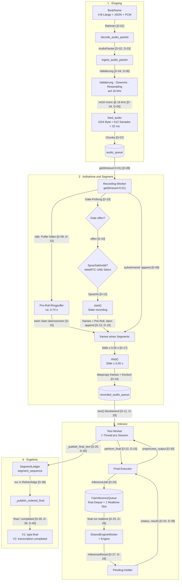
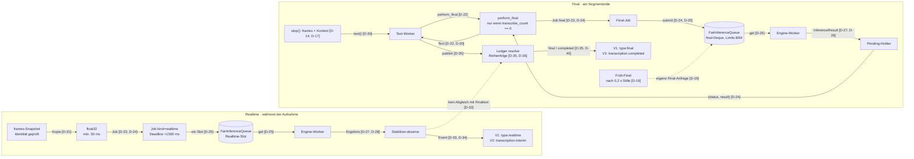

# 01.04 Gesamter Datenfluss

**Quellstand:** `a8993c5c68042d996eab680d84a5b138a214bb5d` · **Gültigkeit:** V1, V2 und OpenAI-Batch
**Faktenbasis:** `workflow/research/01.04.json` (D-01…D-46, E01…E63, N-01…N-07)

Dieses Kapitel folgt einem Audiopaket auf seinem Weg durch den Server: vom ersten Byte auf der Leitung bis zu dem Event, mit dem ein Client den fertigen Text erhält. Es beantwortet drei Fragen: Woher kommt das Audio, wodurch wird daraus ein Segment, und wie wird daraus ein Finaltext? Die Details der einzelnen Stationen stehen in den jeweiligen Spezialkapiteln; hier geht es um die Reihenfolge, die Puffer dazwischen und die Stellen, an denen der Fluss abreißen kann.

## 1. Worum geht es?

Ein Transkript entsteht nicht in einem einzigen Funktionsaufruf. Zwischen Netzwerk, Aufnahme, Inferenz und Ausgabe liegen mehrere Puffer und Threads. Jeder Puffer entkoppelt einen schnellen Produzenten von einem langsameren Konsumenten: Der Netzwerk-Thread darf weiter Audio annehmen, während der Recorder Chunks verarbeitet; der Recorder darf ein Segment abschließen, während die Engine noch am vorherigen Text rechnet. Genau diese Entkopplung erzeugt die Stellen, an denen Verzögerungen, Drops und Reihenfolgefragen sichtbar werden.

Der Server hat drei Zugänge, die in dieselbe Verarbeitung münden, aber unterschiedlich gesteuert werden:

| Zugang | Einstieg | Audio ab | Steuerung | Ergebnis |
|---|---|---|---|---|
| **V1** (Legacy) | `/ws/transcribe` | nach dem Befehl `start` | Kommandos wie `start`, `stop`, `clear`, `ping`, `metrics`, `trigger`, `audio_availability` (D-03) | `type:final`, `type:realtime` und `type:timeline` über den ConnectionManager (D-33, D-35, D-39) |
| **V2** | `/ws/v2` | nach akzeptiertem `hello` | Activation-, Suppression-, Audio-Verfügbarkeits-, Settings- und Snapshot-Kommandos; **kein** Start/Stop (D-41) | projizierte Events mit `eventId`/`eventSeq`, u. a. `transcription.interim` und `transcription.completed` (D-34, D-40) |
| **OpenAI** | HTTP-Upload | mit der Datei | Modellalias wählt die Lane; ein Batch (D-44, D-45) | HTTP-Antwort oder SSE-Stream (D-46) |

Für V1 und V2 gilt danach derselbe Weg: Normierung → Recorder → Segmentbildung → Scheduler → Engine → Ergebnis. OpenAI teilt Normierung, Scheduler und Engine, überspringt aber die VAD-/Segment-Schleife und den Interim-Stabilizer (D-44–D-46). „Gleiche Pipeline" heißt also nicht „gleicher Einstieg", sondern „gemeinsame untere Stufen".

Vier Begriffe werden im Folgenden ständig gebraucht:

- **Segment:** ein zusammenhängender Aufnahmeabschnitt, der als Ganzes final transkribiert wird.
- **Final:** der endgültige Text eines Segments.
- **Interim/Realtime:** ein vorläufiger Text, der während der Aufnahme entsteht und sich noch ändern kann.
- **Ledger:** die Buchhaltung, die pro Segment Reihenfolge und Terminalzustand festhält und entscheidet, wann ein Finaltext publiziert werden darf.

Die Begriffe sind auch im Glossar ([09.01 Glossar](../09-anhaenge/09.01-glossar.md)) eingeordnet.

## 2. Das Wesentliche auf einen Blick

Der Fluss lässt sich in sechs Stationen lesen:

| # | Station | Leitfrage | Kern |
|---|---|---|---|
| 1 | **Eingang** | Was kommt an, und in welcher Form? | Rahmen prüfen, Metadaten validieren, auf 16 kHz normieren, in 32-ms-Chunks legen (D-01–D-08) |
| 2 | **Segmentbildung** | Wann beginnt und endet eine Aufnahme? | Gate, VAD, Pre-Roll und Stille-Erkennung (D-09–D-19) |
| 3 | **Final-Transkription** | Wie wird aus dem Segment Text? | Text-Worker, Executor, Fair-Queue, Engine, Formatierung (D-20–D-30) |
| 4 | **Realtime** | Wie entsteht der vorläufige Text? | Snapshot-Schleife, Realtime-Job, Stabilizer, Interim-Event (D-31–D-34) |
| 5 | **Ergebnis** | Wann und in welcher Reihenfolge kommt der Text an? | Ledger, geordnete Publikation, Cancel, Input-Close, leere Ergebnisse (D-35–D-43) |
| 6 | **OpenAI-Batch** | Wie nutzt ein Datei-Upload dieselbe Inferenz? | ein Batch, keine VAD-Schleife, kein Stabilizer (D-44–D-46) |

Die wichtigste Beobachtung: Zwischen den Stationen liegen **drei verschiedene Warteschlangen** – `audio_queue`, `recorded_audio_queue` und die `FairInferenceQueue`. Sie sehen ähnlich aus, lösen aber unterschiedliche Probleme. Wer sie verwechselt, diagnostiziert an der falschen Stelle.

### 2.1 Gesamtfluss: vom Frame zum Finaltext

**So ist das Diagramm zu lesen.** Der obere Teil zeigt den Eingang: Ein Binärframe wird dekodiert, als `AudioPacket` an die Session gegeben, validiert, auf 16 kHz gebracht und in Chunks zerlegt. Die `audio_queue` ist die Grenze zwischen Netzwerkpfad und Aufnahme-Worker. Der mittlere Teil zeigt die Segmentbildung: Der Worker prüft zuerst das Gate und nur bei offenem Gate die Sprachaktivität. Erst wenn beides zutrifft, beginnt `start()` ein Segment; der Pre-Roll-Puffer wird dabei übernommen. Endet die Sprache, schließt `stop()` das Segment und legt eine tiefe Kopie der Frames mit dem Segmentkontext in die `recorded_audio_queue`. Der untere Teil zeigt die Inferenz: Der Text-Worker holt das Segment blockierend ab, der Executor erzeugt einen `InferenceJob`, die Fair-Queue verteilt ihn an den Engine-Worker. Das Ergebnis läuft über den Pending-Holder zurück in den wartenden Executor und von dort als Text an den Text-Worker. Erst der Ledger entscheidet, ob und wann der Text publiziert wird. Die Rückkante vom Holder zum Executor ist kein Netzwerkpfad, sondern das Aufwecken eines wartenden Threads.

**Textalternative ohne Mermaid:** Client-Frame → Decode → `ingest_audio_packet` → Validierung/Resampling → `feed_audio` → `audio_queue` → Recording-Worker → Gate → VAD → `start()` → Frames inklusive Pre-Roll → bei Stille `stop()` → `recorded_audio_queue` → Text-Worker → Final-Executor → Fair-Queue → Engine-Worker → Pending-Holder → Executor → `preprocess_output` → Text-Worker → Ledger → geordnete Publikation → V1-`type:final` bzw. V2-`transcription.completed`.

### 2.2 Final oder Realtime: zwei Zweige, nicht zwei Stufen

**So ist das Diagramm zu lesen.** Realtime und Final sind keine Alternativen auf derselben Verarbeitungsstufe. Realtime läuft **während** der Aufnahme und wird wiederholt ausgelöst; Final läuft **am Segmentende** und genau einmal pro Segment. Beide benutzen dieselbe `FairInferenceQueue`: Der final-Deque wird zuerst bedient, der Realtime-Slot nur danach (D-25, D-26). Ein neuer Realtime-Job ersetzt den alten im Slot (D-25); ein Final-Job wird bei Erreichen der Limits abgelehnt (D-25). Realtime-Ergebnisse laufen durch den Stabilizer und werden als Interim veröffentlicht; Final-Ergebnisse laufen durch den Ledger und werden in Segmentreihenfolge veröffentlicht. Die gestrichelte Linie „kein Abgleich" ist bewusst gezeichnet: Sie ist keine Datenkante, sondern die ausdrückliche Negativaussage, dass der Finaltext den Interim-Stabilizer im Produktpfad nicht erreicht (D-32, N-01).

**Textalternative ohne Mermaid:** Während der Aufnahme kopiert der Realtime-Worker den Frame-Stand, prüft die Identität, erzeugt float32 mit mindestens 50 ms und schickt einen Realtime-Job mit 1500-ms-Deadline in den einen Realtime-Slot. Der Engine-Worker transkribiert; der Stabilizer beobachtet das Ergebnis und der Server publiziert `type:realtime` bzw. `transcription.interim`. Am Segmentende geht das Segment über den Text-Worker in den Final-Executor. Der Final-Job landet im final-Deque, wird vom Engine-Worker transkribiert, der Holder weckt den Executor, `preprocess_output` formatiert den Text, und der Ledger publiziert ihn in Reihenfolge als `type:final` bzw. `transcription.completed`. Ein Früh-Final kann bereits vor dem Segmentende eine Final-Anfrage in denselben final-Deque legen.

### 2.3 Vollständige Kantenliste

Die Diagramme zeigen eine Auswahl der verständnis-tragenden Kanten. Die folgenden Tabellen listen alle 63 belegten Kanten der Faktenakte, gruppiert nach Stationen – als Nachschlagereferenz; für den Lesefluss reichen Diagramme und Abschnitt 3.

#### Eingang und Normalisierung (E01–E08)

| ID | Von → Nach | Übergabe | Fakten |
|---|---|---|---|
| E01 | WS-Client → `/ws/v2` | Binärframe | D-01, D-02 |
| E02 | WS-Client → `/ws/transcribe` | Binärframe | D-01, D-03 |
| E03 | Binärframe → `decode_audio_packet` | 4-B-Länge + JSON + PCM | D-01 |
| E04 | `decode_audio_packet` → `ingest_audio_packet` | AudioPacket | D-02, D-03 |
| E05 | `ingest_audio_packet` → `packet_to_server_samples` | Validierung | D-04, D-06 |
| E06 | `packet_to_server_samples` → `resample_int16` | int16 mono @ `sampleRate` | D-04, D-05 |
| E07 | `resample_int16` → `feed_audio` | int16 mono @ 16 kHz | D-05, D-06 |
| E08 | `ingest_audio_packet` → Client | warning/error | D-06 |

#### Aufnahme und Segmentbildung (E09–E20)

| ID | Von → Nach | Übergabe | Fakten |
|---|---|---|---|
| E09 | `feed_audio` → `audio_queue` | 1024-Byte-Chunks (512 Samples = 32 ms) | D-07 |
| E10 | `audio_queue` → Recording-Worker | `get(timeout=0.01)` | D-09 |
| E11 | Recording-Worker → `on_recorded_chunk` | Sample-Zählung/Dauerlimit | D-09, D-43 |
| E12 | Recording-Worker → Gate | Gate-Prüfung außen (offen = Aufnahme möglich) | D-10 |
| E13 | Gate (offen) → `is_voice_active` | WebRTC UND Silero (VAD-Prüfung innen) | D-10, D-12 |
| E14 | Gate offen + Sprache → `start()` | State `recording` | D-13, D-43 |
| E15 | `audio_buffer` (Pre-Roll) → `frames` | alle Frames (Trim aus) | D-15, D-16 |
| E16 | Wake-Hit (V2) → `frames` | Schnitt an `release_sample` | D-18 |
| E17 | Aufnahme-Chunks → `frames` | append | D-09 |
| E18 | Stille ≥ `post_speech_silence_duration` → `stop()` | Stoppauslöser | D-17, D-14 |
| E19 | `stop()` → `recorded_audio_queue` | frames + `segment_context` | D-14 |
| E20 | `stop()` → Stabilizer | `finalize()` ohne Finaltext | D-14, D-32 |

#### Final-Transkription (E21–E33)

| ID | Von → Nach | Übergabe | Fakten |
|---|---|---|---|
| E21 | Text-Worker → `recorder.text()` | blockierend, ein Worker pro Session | D-20, D-11 |
| E22 | `text()` → `wait_audio()` | Queue oder warten | D-11, D-20 |
| E23 | `wait_audio` → `set_audio_from_frames` | int16 → float32/32768 | D-21 |
| E24 | `perform_final_transcription` → Executor-Thread | nur wenn `transcribe_count == 0` | D-22 |
| E25 | Executor-Thread → `SchedulerTranscriptionExecutor` | `kind=final` | D-22, D-23 |
| E26 | Executor → `transcribe_for_recorder` | InferenceJob, `request_id` aus Kontext | D-23, D-24 |
| E27 | `transcribe_for_recorder` → `FairInferenceQueue.submit` | final-Deque, Limits 8/64 | D-24, D-25 |
| E28 | Queue → `SharedEngineWorker` | final vor realtime | D-25, D-26 |
| E29 | Worker → Engine | `transcribe(float32)` | D-27 |
| E30 | Worker → `_on_inference_result` | InferenceResult | D-27, D-28 |
| E31 | `_on_inference_result` → Holder | `complete_pending_recorder_transcription` | D-28, D-24 |
| E32 | Holder → Executor-Thread → `perform_final_transcription` | `(status, result)` | D-22, D-24 |
| E33 | `perform_final_transcription` → `preprocess_output` | Großschreibung/Punkt | D-30 |

#### Realtime (E39–E50)

| ID | Von → Nach | Übergabe | Fakten |
|---|---|---|---|
| E39 | Realtime-Worker → frames-Snapshot | Kopie vor Inferenz | D-31 |
| E40 | Snapshot → float32 | /32768, min. 50 ms | D-31 |
| E41 | `realtime_executor` → `transcribe_for_recorder` | `kind=realtime`, Deadline +1500 ms | D-23, D-24 |
| E42 | Realtime-Job → Queue-Slot | ersetzt alten (coalesced) | D-25 |
| E43 | Queue `get()` → Drop | `deadline_at < now` ⇒ stale | D-25 |
| E44 | Worker → Realtime-Engine | eigener Worker, falls nicht `use_main_model_for_realtime` | D-26, D-27 |
| E45 | Ergebnis → `Stabilizer.observe` | stabil/instabil | D-31, D-32 |
| E46 | Stabilizer → Server-Callback | strukturiertes Event | D-32, D-33 |
| E47 | Server → V1-Client | `type:realtime` | D-33 |
| E48 | Server → V2 | `transcription.interim` | D-34 |
| E49 | Terminal erreicht → Interim | verworfen, kein Event | D-34 |
| E50 | Finaltext → Interim-Stabilizer | **kein** Abgleich im Produktpfad | D-32 |

#### Ergebnis, Ledger und Events (E34–E38, E51–E58)

| ID | Von → Nach | Übergabe | Fakten |
|---|---|---|---|
| E34 | `_text_worker` → `_publish_final_text` | Finaltext | D-20, D-35 |
| E35 | `_publish_final_text` → Ledger `resolve_completed` | unter `_ledger_dispatch_lock` | D-35, D-36 |
| E36 | Ledger → `_publish_ordered_final` | nur `segment_sequence`-Reihenfolge | D-36 |
| E37 | `_publish_ordered_final` → V1-Client | `type:final` | D-35, D-39 |
| E38 | `_publish_ordered_final` → V2 | `transcription.completed` | D-34, D-40 |
| E51 | Cancel → Ledger-Barriere | spätere Texte `cancelled` | D-37 |
| E52 | Input-Close → `flush_buffered_audio` | letzter Rest wird final | D-38 |
| E53 | Leerer Finaltext → Ledger | `discarded`/`empty_final` | D-35 |
| E54 | Leere Aufnahme → Ledger | `discarded`/`empty_recording` | D-43 |
| E55 | `recorded_audio_queue` über Limit → älteste | discarded | D-43 |
| E56 | Scheduler-Reject/Drop (final) → Ledger | failed/cancelled | D-29 |
| E57 | Generationswechsel/Session-Ende → Executor | liefert leeren Text | D-24 |
| E58 | `max_audio_queue_seconds` erreicht → Flush | erzwingt Final | D-43 |

#### OpenAI-Batch (E59–E63)

| ID | Von → Nach | Übergabe | Fakten |
|---|---|---|---|
| E59 | HTTP-Upload → `decode_audio_float32` | 16 kHz float32 | D-44 |
| E60 | `resolve_openai_model` → Lane | final/realtime | D-45 |
| E61 | `transcribe_openai` → `_submit_scheduler_job` | gleiche Fair-Queues | D-45, D-25 |
| E62 | Ergebnis → `complete_pending_api_transcription` | Holder, HTTP-Antwort | D-28, D-45 |
| E63 | `stream_callback` → SSE-Delta | pro Engine-Segment | D-46 |

## 3. Stationen des Flusses

### 3.1 Eingang und Normalisierung (D-01–D-08)

**Wozu?** Der Server soll nicht jedes denkbare Audioformat verstehen müssen. Der Eingang ist eine schmale, klar validierte Pforte: Der Client liefert PCM in einem festen Rahmen, der Server prüft Länge, Format und Sample-Rate und bringt alles auf eine einheitliche interne Form.

**Der Rahmen.** Ein Binärframe besteht aus einer 4 Byte langen Längenangabe (Little Endian) für die JSON-Metadaten, dem UTF-8-JSON und den Rohaudiodaten (D-01). Metadaten über 64 KiB werden abgelehnt; kaputte Metadaten, ein Nicht-Objekt oder ein nicht-binärer Frame führen zu einem `AudioPacketError`. Encoder und Decoder sind gegenläufig (D-01).

**V2: Handshake vor Audio.** Ein Binärframe vor akzeptiertem `hello` wird mit Close-Code 4400 beendet (D-02). Nach der Admission wird dekodiert und an `ingest_audio_packet` gegeben; Decode-/Verarbeitungsfehler werden nur geloggt, die Verbindung bleibt offen (D-02). Ein einzelner fehlerhafter Frame beendet keine V2-Sitzung.

**V1: Audio nach dem Start.** Der Server schickt zuerst sein `hello`; danach nimmt er Binärframes über denselben Decode-/Ingest-Pfad an. `AudioPacketError` → `{type:error, where:audio_packet}`, nicht akzeptiertes Paket → `{type:warning}` (D-03). V1 ist gesprächiger: Der Client erfährt auf der Leitung, dass ein Paket nicht verarbeitet wurde.

**Validierung und Normierung.** Prüfung gegen `max_audio_packet_bytes` (Default 512 KiB), positive ganzzahlige `sampleRate`, `channels` 1–8 (Default 1), **nur** `pcm_s16le` (Default). Bytelänge muss Vielfaches von `channels * 2` sein, Frame-Zahl exakt (D-04). Danach int16, Kanal-Mittelwert, `resample_int16` auf 16 kHz (D-04, D-05): bei gleicher Rate Kopie, sonst `scipy.resample_poly` (gcd Up/Down), Fallback `np.interp`, int16-Clip (D-05).

**Chunking.** `feed_audio` mittelt 2D-Eingaben, resampelt nur bei ≠16000, erzeugt int16-Bytes und legt exakt `buf_size`-Stücke in die `audio_queue` (D-07). Defaults 16000/512 → 1024 Byte = 512 Samples = 32 ms (D-07). Kein erneutes Resampling, da der Server bereits 16 kHz liefert.

**Annahme oder Ablehnung.** Leeres Ergebnis → `(True, None)`. Stream inaktiv → Ablehnung + Zähler (V1 vor `start`; V2 ab Admission streamend) (D-06). Sonst `feed_audio`. Exception → Drop, `recorder.failed`-Event (system/error), Fehlermeldung (D-06). Danach Dauerlimit + ggf. Warning (D-06, D-43).

**Kein Mikrofon im Serverpfad.** `_create_recorder` setzt `use_microphone=False`; PyAudio-Leser startet nur bei `use_microphone` (D-08). Audio kommt ausschließlich über WebSocket oder HTTP.

**Beispiel (schematisch):** Ein V2-Client sendet 48-kHz-Stereo-PCM. Der Server validiert, mischt auf mono, resampelt auf 16 kHz und zerlegt in 32-ms-Chunks. Der Client muss `pcm_s16le` und eine positive Rate liefern; alles andere wird abgelehnt.

### 3.2 Gate, VAD, Pre-Roll und Segmentbildung (D-09–D-19)

**Wozu?** Der Server braucht eine Entscheidung, wann eine Aufnahme beginnt und endet: Freigabe (Gate), Sprachaktivität (VAD), Stille-Erkennung. Pre-Roll verhindert abgeschnittene Silbenanfänge.

**Der Recording-Worker.** Genau ein Konsument der `audio_queue`: `get(timeout=0.01)`, Sample-Position, `on_recorded_chunk`, Overflow-Abbau bis `allowed_latency_limit` (Default `audio_queue_size` = 128, älteste Chunks verworfen), Verzweigung aufnehmend/idle, `frames.append`, Pre-Roll-Füllung im Idle (D-09).

**Das Gate** (D-10): **controlled** = allein das Gate-Event (bindet `activationId`+`generation`, `wakeword_detected` nicht befragt; passt zu V2). **legacy** = `wakeword_detected` **oder** (keine Wake-Words/Delay vorbei) **und** `start_recording_on_voice_activity` (V1-Ablauf). Jeweils pro Session.

**Text-Worker und `wait_audio`.** `text()` → `wait_audio`; leere Queue → `start_recording_on_voice_activity=True`, warten auf `start_recording_event` (Poll 0,02 s) (D-11). Server startet die Schleife als `_text_worker` pro Session; controlled folgenlos (Gate entscheidet), Legacy armiert die sprachgesteuerte Aufnahme (D-11).

**VAD.** `is_voice_active` = (WebRTC aktiv **oder** letzte Aktivität ≤1,0 s) **und** Silero aktiv (D-12). WebRTC pro Chunk, Silero im Thread mit Generation. Schwelle `vad_prob > (1 - silero_sensitivity)`, Default 0,05 → 0,95 (D-12). WebRTC reagiert schnell, Silero bestätigt; 1,0-s-Nachhaltung gegen Satzpausen.

**Start.** Abbruch wenn seit Stopp < `min_gap_between_recordings` (Default 0,0 s). Sonst State `recording`, Speicher/Stabilizer-Reset, `realtime_recording_id`++, Startzeiten, `frames=[]` (+ Pre-Roll), Events + Callback (D-13). Aufnahmeidentität sichert Provenienz späterer Realtime-Ergebnisse.

**Pre-Roll.** Ringpuffer `maxlen = (rate // buffer) * pre_recording_buffer_duration` → 23 Frames ≈ 0,74 s (31 Frames/s × 0,75 s, abgerundet) (D-15). Server übergibt **keine** Trim-Konfig → Trim aus, alle Frames übernommen (D-15). Preis: Finaltext kann bis 0,74 s Vorlauf enthalten. Client-Felder `preRecordingBuffer` (`configuredSeconds`, `includedSeconds`, Zeiten, `exact`) in `recording_started`/Final/Realtime (D-16).

**Ende.** Bei `stop_recording_on_voice_deactivity`: Silero-/WebRTC-Prüfung; Stille erst nach `deactivity_silence_confirmation_duration` (Default 0,16 s) bestätigt; `speech_end` nur wenn Dauer > `min_length_of_recording`; Stopp bei Stille ≥ `post_speech_silence_duration` (Default 0,55 s) → `on_vad_stop`, `stop()`, Turn-Callbacks (D-17).

**Stopp.** Verwurf wenn Dauer < `min_length_of_recording` (Default 0,2 s). Sonst `deepcopy` Frames + `segment_context` → `recorded_audio_queue`; `frames=[]`, `is_recording=False`, `stabilizer.finalize()` **ohne** Final-Beobachtung; Events + Callback (D-14). `_last_recording_was_queued` unterscheidet gequet vs. leer – nur Ersteres erzeugt Finaltext, Letzteres `discarded`/`empty_recording` (D-14, D-43).

**Wake-Grenze (V2).** Akzeptierter Treffer → Grenze in Stream-Samples (`operational_zero_point` − `pre_roll_ms`, geklemmt); Frames an `release_sample` beschnitten + Flag (D-18). Legacy: pauschal `sample_rate * wake_word_buffer_duration` entfernt (Default 0,1 s) (D-18).

**Heikel: Früh-Final (D-19).** Bei `early_transcription_on_silence` > 0 (Default 0,2 s), nicht-leeren Frames, Stille darüber und `allowed_to_early_transcribe` schickt der Recorder **während** der Stille den Frame-Stand als echte Final-Anfrage; danach Flag `False` (D-19).

> **Heikel (D-19):** `perform_final_transcription` sendet den Voll-Rest nur bei `transcribe_count == 0` (D-22). Hat der Früh-Final bereits gezählt, wird der spätere Voll-Rest **nicht** erneut geschickt – der veröffentlichte Finaltext stammt aus dem Frame-Stand **vor** dem Aufnahmeende. Code-Ableitung aus `recording.py` + `transcription_api.py`, keine Latenzmessung. Wer erwartet, dass „Final" immer die ganze Aufnahme bis zum Stopp abbildet, muss diesen Punkt kennen.

**Fehlerkette (prüfen vor Inferenz-Verdacht):** Segment zu kurz → verworfen (D-14); Gate zu trotz Sprache (D-10); VAD bestätigt nicht (D-12); Eingangspuffer-Overflow (D-09); Früh-Final bestimmt Text (D-19).

### 3.3 Final-Transkription (D-20–D-30)

**Wozu?** Aus dem Segment wird Text: abholen, in float32 bringen, als Auftrag in die Fair-Queue, von der Engine transkribieren, formatieren. Der Text-Worker serialisiert Finals pro Session.

**Text-Worker.** Genau ein Thread pro Session: `text = recorder.text()` blockierend; Kontext übernehmen/löschen; leer → `discarded_empty_final`; sonst `_publish_final_text`; Exception → Ledger-Fehler/Event (D-20). Finals pro Session serialisiert (D-20).

**Segment → float32.** `text()` wartet; `set_audio_from_frames`: Frames → int16 → float32/32768; `backdate_stop` schneidet, `backdate_resume` als int16 zurück (D-21).

**Final-Auftrag.** `transcribe`: State `transcribing`, `on_transcription_start`; truthy Rückgabe **bricht ab** (D-22). `perform_final_transcription` unter Lock, nur bei `transcribe_count == 0` senden, 0,1-s-Poll auf Antworten. Externer Executor: Thread `VoiceSTTExternalFinalTranscription` → `call_transcription_executor` → `_external_transcription_results`; Zähler nur dort (D-22).

**Executor/Kontext.** `transcribe_with_context`; Final ohne Kontext lädt `current_transcription_context`; zwei Executoren (Final + Realtime) (D-23). Kontext = Brücke Audio↔Buchhaltung (Segmentidentität für Ledger/Events).

**`transcribe_for_recorder`.** Gemeinsamer Inferenz-Eintritt: unbekannte Session → leer; `request_id` aus Kontext (Final) oder UUID; Holder in `_pending_recorder_results`; `InferenceJob` (Segment, Seq 0, Generation, `created_at`); Deadline **nur** Realtime (+1500 ms Default); Submit-Ablehnung → `RuntimeError`; Warten 0,1-s-Schritte; Stop/Session-weg/Generation → leer; Final-Fehler → Ledger `failed`; Erfolg → `record_executor_result` + `TranscriptionResult` (D-24).

**Fair-Queue.** Pro Session Final-Deque + **ein** Realtime-Slot; Final-Limits 8/Session, 64 global; Realtime ersetzt alten (Coalescing); `get`: final zuerst, dann realtime; Realtime mit `deadline_at < now` stale; round-robin; `cancel_session` → alles `cancelled`; Drops via Callback (D-25).

**Scheduler/Worker.** Main-Queue immer; Realtime-Queue = Main bei `use_main_model_for_realtime` (Default `False`), sonst eigene + Worker; Engine-Erzeugung unter Lock (K-29, K-30); `SharedEngineWorker`: `queue.get` → `transcribe_with_options`/`transcribe` → Text-Trim/Fehler → `InferenceResult` (`queue_delay`, `inference_duration`, `total_latency`, `audio_duration`) (D-26, D-27). Latenzdiagnose-Einstieg (Details in [08.14](../08-referenzen/08.14-metrik-katalog.md)).

**Ergebnisrouting.** Performance-Event → `complete_pending_api` (OpenAI, bei Treffer return) → `complete_pending_recorder` → `session.handle_inference_result` (D-28). Recorder-Pfad signalisiert Holder; Textverarbeitung bleibt Recorder/Text-Worker (D-28).

**Drops/Ablehnungen.** Coalesced/stale/cancelled getrennt gezählt; Final mit Kontext im Ledger (`cancelled` bei Cancel, sonst `failed`, Grund `scheduler_<reason>`) + Pending-Fehler; Submit-Ablehnung: Realtime → `realtime_rejected`, Final → `final_rejected` + Ledger `failed` + Fehler (D-29). Fehlendes Final zuerst auf Ablehnung prüfen.

**Formatierung.** `preprocess_output`: Whitespace trimmen, Großbuchstabe; Punkt **nur** bei `preview=False` + alphanumerischem Ende (D-30). Realtime `preview=True` (kein Punkt), Final `preview=False` (Punkt) (D-30).

### 3.4 Realtime-Pfad (D-31–D-34)

**Wozu?** Text schon während des Sprechens – Vorschau, kein Vertrag. Technisch getrennt vom Final, teilt Engine-Infrastruktur.

**Schleife.** Nicht-aufnehmend: 0,02-s-Schritte + Session-Abschluss; aufnehmend: `awaiting_speech_end` pausiert, sonst Silben-Scheduler (`syllable-boundary`/`-followup`/`-fallback`) oder Timer (Default 0,02 s) (D-31). `_run_realtime`: Identität **vor** Snapshot einfrieren, Frames kopieren, danach vergleichen (sonst verwerfen); float32, Min 50 ms sonst Skip; Modellwahl Main/Realtime/Streaming; leer → `empty_count` + leere Beobachtung (D-31).

**Stabilizer.** Ignoriert falsche Aufnahme/Segment, finalisierte, stale Sequenzen, leere Texte, Ausreißer. Akzeptiert: NFKC-Projektion + Evidenz; `stable` wächst nur bei öffentlichem Konsens + Länge; `unstable` = Rest; `display` = Summe; `publish_allowed=False` → Delta zurückgehalten (D-32). Provenienz- und Konsensmaschine, kein Textglätter.

**Kein Final-Abgleich.** `finalize()` beim Stopp ohne Beobachtung → nur `_finalized`. **Kein** Abgleich Final↔Interim im Produktpfad; `FinalObservation` nur Tests/Tools (D-32, N-01). Client ersetzt Interims selbst durch Final – kein „war falsch"-Signal.

**Callback/V1.** `settings.realtime_callback` (`stabilized` vs `update`) + strukturiertes `stabilization_update`; Provenienz-Prüfung, späte verworfen; `type:realtime` mit Text-/Stabilitäts-/Herkunftsfeldern + Timeline `realtime_transcript` (D-33). Feldliste in [08.01](../08-referenzen/08.01-event-katalog.md).

**V2.** `realtime_transcript` → `transcription.interim` (optionale Roh-/Stabilitäts-/Commit-/Sequenz-/Timing-Felder; `text` = Payload-Text) (D-34). Interims **nach** Terminal desselben Segments vor Erzeugung verworfen – keine ID/Seq/Lücke (D-34). Nach Final keine verspäteten Interims.

### 3.5 Ergebnis, Ledger und Events (D-35–D-43)

**Wozu?** Fertiger Text ≠ publikationsfähig: früheres Segment offen, Activation abgebrochen, Input geschlossen, Text leer. Der Ledger macht daraus geordnete, einmalige Publikation.

**Publikation.** `_publish_final_text` → `ledger.resolve_completed` unter Lock; nur bei Freigabe `_publish_ordered_final`: `type:final` an Legacy-Manager, Timeline `final_transcript`, Performance `stream.final_text`, `transcription.completed`, Statuswechsel (außer `recording`/`closed`); leer → `discarded_empty_final` → `discarded`/`empty_final` (D-35).

**Ledger.** `segment_sequence` aufsteigend + `request_id`; Publikation nur in Reihenfolge (`_drain_locked` ab `_next_publish_sequence`, stoppt am Loch); Fertiges hinter Offenem bleibt „prepared"; doppelte/konkurrierende Terminals genau einmal; nach `close_activation` terminal erst wenn alle Segmente terminal **und** gedraint (D-36). Head-of-Line-Ordnung statt Fertigstellungsreihenfolge.

**Cancel.** `requested_terminal==cancelled`: später Fertiges **nicht** vorbereitet/publiziert, sondern `cancelled` terminalisiert; Gedraintes nicht zurückgenommen; `cancel_all`: erst alles `cancelled`, dann einmal drain (D-37). Kein `transcription.revised`, keine Retracts, keine Widerrufe (N-02, D-37).

**Input-Close.** Notify → `recorder.close_controlled_activation` → **nur bei geschlossenem Gate** `flush_buffered_audio` → Ledger-Close (`acceptedSegmentCount`) → Exactly-once-Reservierung → `controller.input_closed` → Publish; Fehlschlag → `closing_input` + Recovery (D-38). Laufende Aufnahme wird nicht mitten im Satz abgeschnitten.

**Timeline/Observer.** Jedes Event als Legacy-Payload (`type:timeline`) via `run_coroutine_threadsafe` an V1, danach an V2-Observer; V2 **nicht** im `ConnectionManager` (keine Legacy-Payloads); Observer-Fehler gefangen (D-39).

**V2-Hülle.** `type`/`protocolVersion`/`sessionId`/`eventId`/`eventSeq` (monoton+1)/`stateVersion` (nur State-Events via `NON_STATE_EVENTS`)/`occurredAtUnixMs`; gleicher `logical_key` → gleiches Envelope; Sink → Queue → Writer `send_text(json)` (D-40). Details in [04.06](../04-schnittstellen/04.06-eventtransport.md), [08.10](../08-referenzen/08.10-websocket-schema-referenz.md).

**V2-Aktivierung.** `hello.accepted`: SettingsPort, ProtocolSessionState, EventProjector, Runtime-Suppression, Observer, **dann** `start_streaming()` + `hello.accepted` mit Snapshot + Log-Token. Kommandos: Activation/Suppression/Audio-Settings/Snapshot – kein Start/Stop (D-41).

**V1 start/stop.** `start`: Epoch+1, `wake_epoch=None`, `streaming=True`, Status `wakeword_wait` (Wake aktiv, Delay≤0) sonst `listening`. `stop`: Epoch+1, `streaming=False`, `idle`, `_reset_activation_locked(stream_stopped)`, Wake-Reset, Flush, Trim, Sprecher frei, ggf. `activation_closed` + Ledger-Close (D-42). Generationswechsel schützt neue Sitzung vor alten Ergebnissen (D-24, E57).

**Recording-Lifecycle** (D-43): `_on_recording_start` (Lifecycle-Prüfung sonst Flush+Freigabe, Sprecherlimit, Controller-`recording_started`/Legacy `legacy-<session>-<n>`, `ledger.accept_segment`, Kontext, Timeline/Publish mit Pre-Roll, Status; Fehler → Reject/Flush/Freigabe); `_on_recording_stop` (Trim, Dauer, `segment_state.final`, Kontext, Controller-`recording_ended`, Publish; leer → `discarded`/`empty_recording`; Legacy Wake-Followup); `_on_transcription_start` (Kontext, accepted/started; rejected bricht ab).

**Diagnose-Kette (rückwärts):** Segment gequet? Job abgelehnt? Text storniert? Leeres Ergebnis? (D-29, D-35–D-37, D-43)

### 3.6 OpenAI-Batch (D-44–D-46)

**Wozu?** Datei in einem Schritt transkribieren – kein Streaming: keine VAD-Schleife, keine Segmente aus Stille, kein Stabilizer; aber dieselbe Fair-Queue und Engines.

**Annahme.** Auth, Datei-Pflicht, Dateiname-Validierung, Formular-Parsing, Modellauswahl inkl. Override → Lane; Limit `openai_max_file_bytes` (Default 25 MiB); Archivierung; Thread-Decode `decode_audio_float32` → 16 kHz float32; Dauer = len/16000 (D-44).

**Modell/Lane.** `whisper-1`/`main`/`default`/konfiguriertes Modell (+ Aliase) → `final`; bei `use_main_model_for_realtime == False` zusätzlich Realtime-Namen → `realtime`; `openai_model_aliases` überschreibt (Default `whisper-1→final`, `fast→realtime`) (D-45). Eigene `sessionId` (`openai-<uuid>`), Seg 0/Seq 0/Gen 0, Request-Options; gleicher `_submit_scheduler_job`-Pfad; Warten mit Timeout (Default 600 s) → Timeout = Cancel + `TimeoutError` (D-45).

**Ergebnis/Streaming.** `stream=true` → `stream_callback` pro Engine-Segment (`segment.text`); SSE `transcript.text.delta`, Ende `transcript.text.done`. Ein Batch, keine VAD-Schleife, kein Stabilizer; Gesamttext = Join der Segmenttexte (D-46). Details in [04.10](../04-schnittstellen/04.10-openai-kompatible-api.md).

### 3.7 Durchgehendes Beispiel (schematisch, V2)

*Reihenfolge belegt; Zeitwerte = Defaults der Faktenakte, keine Latenzmessung.*

1. `hello` → `hello.accepted` mit Snapshot; Binärframes werden angenommen (D-41, D-02).
2. Frame → Decode → Validate → Mono-Mixdown → 16 kHz → 32-ms-Chunks (D-01, D-04, D-05, D-07).
3. Worker prüft Gate (Activation geöffnet), VAD bestätigt Sprache (D-09, D-10, D-12); `start()` + Pre-Roll ≈0,74 s (D-13, D-15).
4. Realtime-Worker: Snapshot, Identitätsprüfung, Job (+1500 ms) in Realtime-Slot; ersetzt Älteren; Engine; Stabilizer → `transcription.interim` (D-31, D-23, D-24, D-25, D-27, D-32, D-34).
5. Stille-Bestätigung 0,16 s; Stopp bei 0,55 s; Dauer > 0,2 s → Segment + Kontext in Queue (D-17, D-14).
6. Text-Worker → float32 → Final-Job; Früh-Final nach 0,2 s Stille möglich → Text aus früherem Stand (D-20, D-21, D-22, D-19).
7. Final-Deque → Engine → Holder → Executor → `preprocess_output` (Groß/Punkt) (D-24, D-25, D-27, D-28, D-30).
8. Ledger → Publikation in `segment_sequence`-Reihenfolge → `transcription.completed`; spätere Interims verworfen (D-35, D-36, D-40, D-34).
9. Input-Close: Flush nur bei geschlossenem Gate → Ledger-Close → `input_closed` (D-38). Cancel → Spätere `cancelled`; Interims bleiben (D-37, N-02).

Bei zwei Segmenten: zweites Final bleibt „prepared", bis erstes publiziert (D-36) – geordnete Folge statt Fertigstellungsreihenfolge.

## 4. Grenzen und typische Missverständnisse

Keine Latenzgarantie in diesem Kapitel; Ende-zu-Ende-Zeiten = Messung + Timings in [02.03](../02-funktionsweise/02.03-activation.md), [08.06](../08-referenzen/08.06-timing-katalog.md).

**N-01: Kein Final-Interim-Abgleich.** Stabilizer-`finalize()` ohne Beobachtung; `FinalObservation` nur Tests/Tools (D-32, D-14). Kein Signal ersetzt Interim durch Final – Client setzt selbst. Bewusste Trennung, keine Transportlücke.

**N-02: Kein Retract.** Kein `transcription.revised`; publizierte Interims nicht zurückgenommen, gedrainte Finals bei Cancel nicht widerrufen (N-02, D-37). Interims als vorläufig behandeln, nicht als versionierte Wahrheit.

**N-03: Ungenutzte Settings.** `realtime_min_audio_seconds`, `realtime_max_audio_seconds`, `vad_energy_threshold` ohne Konsumenten im Datenpfad (N-03). Nicht als Stellschrauben darstellen; Status in [08.03](../08-referenzen/08.03-settings-katalog.md), 03.x.

**N-06: Zwei Queue-Limits, zwei Stufen.** `audio_queue_size` (Default 128) = **Eingangspuffer** (Overflow verwirft älteste Chunks) (D-09). `max_audio_queue_seconds_per_session` = **Segmentdauer** (erzwingt Final) (D-43, E58). Plus Trim `recorded_audio_queue` (älteste Segmente verworfen) (D-43, E55). Drei Puffer, drei Verlustarten.

**N-07: Koaleszenz keine Regelmäßigkeit.** Ersetzen im Slot = Queue-Eigenschaft (D-25); Häufigkeit last-/ratenabhängig, nicht ableitbar. Vorgesehener Rückstau-Umgang, kein Normalzustand.

**N-05: Keine Client-Raten-Aussage.** Server akzeptiert jede positive `sampleRate` (D-04); Rate beim Client/Metadatenfeld prüfen.

**N-04 erledigt.** `.git`-Notiz durch Orchestrator-Verifikation widerlegt (Commit vorhanden, Baum sauber; siehe Faktenakte `commit_note`) – keine offene Grenze.

## 5. Siehe auch / Nachweise

**Verwandte Kapitel:** [01.02 Architekturübersicht](01.02-architekturuebersicht.md) · [01.03 Komponenten und Schichten](01.03-komponenten-und-schichten.md) · [01.05 Betriebs- und Funktionsmodi](01.05-betriebs-und-funktionsmodi.md) · [01.07 Identitäten](01.07-identitaeten.md) · [01.08 Technische Grenzen](01.08-technische-grenzen.md) · [01.09 Architekturdiagramme](01.09-architekturdiagramme.md) · [02.02 Audioverarbeitung](../02-funktionsweise/02.02-audioverarbeitung.md) · [02.03 Activation](../02-funktionsweise/02.03-activation.md) · [02.04 Wake-Word](../02-funktionsweise/02.04-wake-word.md) · [02.05 Transcription](../02-funktionsweise/02.05-transcription.md) · [02.06 Engines](../02-funktionsweise/02.06-engines.md) · [02.08 Scheduler und Nebenläufigkeit](../02-funktionsweise/02.08-scheduler-und-nebenlaeufigkeit.md) · [03.07 Session-Einstellungen](../03-konfiguration/03.07-session-einstellungen.md) · [03.08 Runtime-Änderungen](../03-konfiguration/03.08-runtime-aenderungen.md) · [04.03 WebSocket V2](../04-schnittstellen/04.03-websocket-v2.md) · [04.04 Commands/Acknowledgements](../04-schnittstellen/04.04-commands-acknowledgements.md) · [04.05 Audiotransport](../04-schnittstellen/04.05-audiotransport.md) · [04.06 Eventtransport](../04-schnittstellen/04.06-eventtransport.md) · [04.10 OpenAI-kompatible API](../04-schnittstellen/04.10-openai-kompatible-api.md) · [04.12 Legacy V1](../04-schnittstellen/04.12-legacy-v1.md) · [08.01 Event-Katalog](../08-referenzen/08.01-event-katalog.md) · [08.03 Settings-Katalog](../08-referenzen/08.03-settings-katalog.md) · [08.06 Timing-Katalog](../08-referenzen/08.06-timing-katalog.md) · [08.09 Fehlerkatalog](../08-referenzen/08.09-fehlerkatalog.md) · [08.10 WebSocket-Schema-Referenz](../08-referenzen/08.10-websocket-schema-referenz.md) · [09.01 Glossar](../09-anhaenge/09.01-glossar.md) · [09.03 V1/V2-Unterschiede](../09-anhaenge/09.03-v1-v2-unterschiede.md)

**Belegte Defaults in diesem Kapitel:**

| Wert | Bedeutung | Fakt | Beleg (Auszug) |
|---|---|---|---|
| 64 KiB | maximale JSON-Metadaten eines Frames | D-01 | `protocol.py` `MAX_METADATA_BYTES` Z.7 |
| 512 KiB | `max_audio_packet_bytes` | D-04 | `server.py` Z.7653-7683, Default Z.449 |
| 16 kHz | `SERVER_SAMPLE_RATE` | D-05 | `server.py` Z.147 |
| 32 ms / 1024 Byte / 512 Samples | Chunk-Größe | D-07 | `manual_audio_input.py` Z.9-34 |
| 128 | `audio_queue_size` (Eingangspuffer) | D-09 | `recording.py` Z.124-644 |
| 0,74 s / 23 Frames | Pre-Roll | D-15 | `initialization.py` Z.646-652 |
| 0,2 s | `min_length_of_recording` | D-14 | `lifecycle.py` Z.85-139 |
| 0,16 s | Stille-Bestätigung | D-17 | `recording.py` Z.454-580 |
| 0,55 s | `post_speech_silence_duration` | D-17 | `recording.py` Z.454-580 |
| 0,95 | Silero-Schwelle (Sensitivität 0,05) | D-12 | `voice_activity.py` Z.399-409 |
| 0,2 s | `early_transcription_on_silence` | D-19 | `recording.py` Z.502-520 |
| 8 / 64 | finale Jobs pro Session / global | D-25 | `FairInferenceQueue` Z.1756-1940 |
| 1500 ms | `max_realtime_queue_age_ms` | D-24 | `transcribe_for_recorder` Z.8251-8351 |
| 25 MiB | `openai_max_file_bytes` | D-44 | `openai_routes.py` Z.104-209 |
| 600 s | OpenAI-Wartezeit | D-45 | `transcribe_openai` Z.8362-8413 |

**Verwendete Fakten:** D-01…D-46; N-01, N-02, N-03, N-05, N-06, N-07. N-04 widerlegt (Orchestrator-verifiziert).

**Quellstand:** Commit `a8993c5c68042d996eab680d84a5b138a214bb5d` · `C:\Users\user\AppData\Local\Temp\opencode\voice-stt-v2-src` · Faktenakte `workflow/research/01.04.json`

*Abgrenzung: Fluss und belegte Übergänge; keine gemessenen Latenzen, keine Client-Raten-Aussage, keine Koaleszenz-Regelmäßigkeit. Wire-Formate/Eventfelder/Kommandos nur flussnotwendig; Verträge in 04.x/08.x.*
