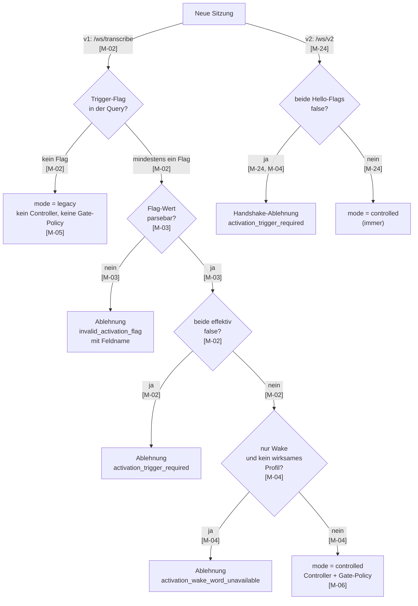
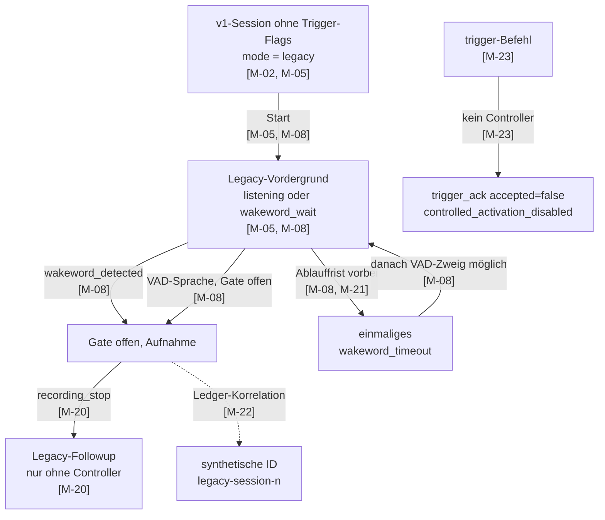
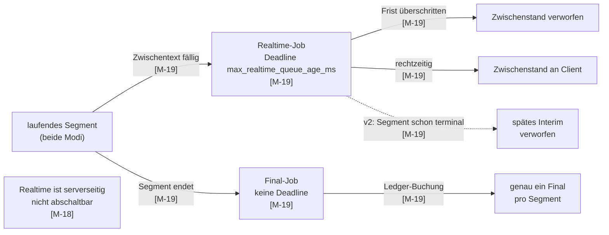

# 01.05 – Betriebs- und Funktionsmodi

*Quellstand: Commit `a8993c5c68042d996eab680d84a5b138a214bb5d`. Faktenbasis: `workflow/research/01.05.json` (M-01…M-28, C-1…C-4, N-1…N-8, U-1…U-3).*

## 1. Worum geht es?

„Modus" ist in diesem Server ein überladener Begriff. Das Kapitel trennt deshalb drei Dinge, die leicht durcheinandergehen:

1. **Der Betriebsmodus** beantwortet die Frage: *Wer entscheidet, wann Audio angenommen wird?* Es gibt genau zwei Antworten: **`legacy`** und **`controlled`**. Der Modus wird bei der Zulassung einer Sitzung festgelegt und bleibt für diese Sitzung bestehen (M-01, M-02).
2. **Die Triggerquelle** beantwortet innerhalb von `controlled`: *Darf ein Mensch manuell auslösen, ein Wake Word, oder beides?* `manual` und `wake_word` sind **keine eigenen Modi**, sondern Quellen desselben Controllers (M-06, M-07).
3. **Realtime und Final** beantworten eine dritte, unabhängige Frage: *Welche Art von Transkript liefert der Server?* Zwischenstände und Endergebnis laufen parallel; diese Achse ist **orthogonal** zur Trigger-Achse und gilt in beiden Betriebsmodi (M-18, M-19).

Ein Client, der „Trigger" gleich „Modus" setzt, wird in einer Legacy-Sitzung enttäuscht: Dort gibt es keinen Controller, und ein `trigger`-Befehl wird abgelehnt (M-05, M-23). Ein Client, der „Wake Word" als eigenen Modus behandelt, baut eine falsche Zustandslogik für kombinierte Sitzungen, in denen beide Quellen freigeschaltet sind, aber nur die erste gewinnt (M-12). Und wer „Realtime ausschalten" als Modusoption sucht, sucht einen Schalter, den der Server nicht anbietet (M-18).

Der Resolver liefert den Modus als String; in v1 ist er als `activationConfig.mode` sichtbar (M-01, M-25). Eine direkt gebaute Session ohne Konfiguration fällt auf `legacy` zurück – das ist ein Default, kein dritter Modus (M-01).

## 2. Das Wesentliche auf einen Blick

- **Zwei Betriebsmodi, nicht drei.** `legacy` und `controlled`; `manual`, `wake_word` und „beide" sind Quellenkonfigurationen in `controlled` (M-01, M-02, M-07).
- **Die Zulassung entscheidet.** v1 ohne Trigger-Flags wird `legacy`; mindestens ein Flag macht die Sitzung `controlled`. v2 ist **immer** `controlled` (M-02, M-24).
- **Fehlende Flags sind nicht `false`.** Wer kein Flag angibt, bleibt Legacy. Wer ein Flag angibt, schaltet damit den kontrollierten Modus ein; das nicht angegebene Flag zählt dann als `false` (M-02).
- **Legacy hat keinen Controller.** Keine Gate-Policy, keine Phasen, keine Controller-Identitäten; Aufnahme entsteht direkt aus VAD/Wake Word, Trigger-Befehle werden abgelehnt (M-05, M-08, M-23).
- **Controlled hat einen Controller und ein Gate.** Der Controller nimmt Trigger an, das Gate entscheidet über Aufnahme; ein zweiter Trigger während einer offenen Activation wird abgelehnt (M-06, M-08, M-12).
- **Unterdrückung ist die einzige Live-Schraube an den Quellen.** Die Freigabe-Flags selbst sind bei der Zulassung fixiert; `suppressed` wirkt nur auf neue Activationen (M-02, M-13, M-15).
- **Realtime ist serverseitig immer an.** Es gibt keinen Settings-Schlüssel zum Abschalten; Final ist keine sechste Phase (M-17, M-18, M-19).

### Drei Achsen, die man auseinanderhalten muss

| Achse | Ausprägungen | Wo festgelegt | Zur Laufzeit änderbar? |
|---|---|---|---|
| **Betriebsmodus** | `legacy`, `controlled` | v1: Trigger-Flags in der Query; v2: Hello | nein, bei Zulassung fixiert (M-01, M-02, M-24) |
| **Triggerquelle** (nur `controlled`) | `manual`, `wake_word`, beide | Zulassung | Freigabe nein; **Unterdrückung** ja, aber nur für neue Activationen (M-02, M-13, M-15) |
| **Ausgabespur** | Realtime-Zwischenstände und Final | serverweit | Realtime nicht abschaltbar (M-18, M-19) |

### Diagramm 1: Zulassung und Modusentscheidung

**Erläuterung in Worten.** Die Entscheidung beginnt beim Transport. Auf der v1-Wire ist das Fehlen *beider* Trigger-Flags die eigentliche Legacy-Bedingung: keine Flags, kein Controller, keine Gate-Policy. Sobald mindestens ein Flag vorhanden ist, wird die Sitzung kontrolliert; dann müssen die Werte parsebar sein, dürfen nicht beide effektiv `false` sein, und eine reine Wake-Konfiguration braucht ein wirksames Wake-Profil. Auf der v2-Wire gibt es keinen Legacy-Zweig: Beide Hello-Flags sind Pflicht-Booleans, und beide `false` werden bereits im Handshake abgelehnt.

**Textalternative (falls Mermaid nicht rendert):** v1 ohne Trigger-Flags → `legacy` ohne Controller. v1 mit mindestens einem Flag → Prüfung: unparsebar → `invalid_activation_flag`; beide effektiv `false` → `activation_trigger_required`; nur Wake ohne wirksames Profil → `activation_wake_word_unavailable`; sonst `controlled`. v2 → immer `controlled`, außer Handshake lehnt beide `false` ab.

## 3. So funktioniert es

### 3.1 Zulassung: wann eine Sitzung legacy oder controlled wird

Auf der v1-Wire ist die Regel bewusst Opt-in (M-02):

- **Kein Trigger-Flag** in der Query → `mode = legacy`. Das gilt auch dann, wenn Zeitwerte mitgeschickt werden; ohne Trigger-Flag entsteht kein Controller, der sie benutzen könnte (M-02, M-16).
- **Mindestens ein Trigger-Flag** vorhanden → `mode = controlled`. Ein nicht angegebenes Flag zählt als `false`.
- **Beide effektiv `false`** → Ablehnung `activation_trigger_required`. Weglassen beider Flags ergibt Legacy, explizites Setzen beider auf `false` ergibt Ablehnung.

Die Flags werden strikt geparst (M-03): `true`/`1`/`yes`/`on` wahr; `false`/`0`/`no`/`off` falsch. Jeder andere Wert → `invalid_activation_flag` mit Feldname. `manualTriggerEnabled=maybe` wird **nicht** stillschweigend `false`.

| Schematische Query (Feldnamen belegt, übrige Parameter weggelassen) | Ergebnis | Begründung |
|---|---|---|
| `/ws/transcribe` ohne Trigger-Flags | `legacy` | kein Flag = kein Opt-in (M-02) |
| `?manualTriggerEnabled=true` | `controlled`, nur `manual` | ein Flag genügt; Wake fehlt → `false` (M-02) |
| `?manualTriggerEnabled=false` | Ablehnung `activation_trigger_required` | beide effektiv `false` (M-02) |
| `?manualTriggerEnabled=maybe` | Ablehnung `invalid_activation_flag` | nicht parsebar (M-03) |
| `?wakeWordTriggerEnabled=true` | `controlled`, nur `wake_word` – **nur** mit wirksamem Profil | sonst `activation_wake_word_unavailable` (M-04) |

Eine reine Wake-Konfiguration braucht ein wirksames Wake-Profil, sonst könnte die Sitzung nie eine Activation auslösen (M-04). `manual=true` + `wake=true` ohne Profil ist erlaubt (`wakeWordProfileEnabled=false`, keine Detektionen) – informative Anzeige, kein Widerspruch (M-04). v2-Handshake-Pendant in [04.03](../04-schnittstellen/04.03-websocket-v2.md) (M-04, M-24).

Die Entscheidung ist **bei der Zulassung fixiert** (M-02). Auch die Trigger-Flags selbst sind keine Settings-Werte: nur Query/Hello/`activationConfig`, kein Settings-Key (M-15).

### 3.2 Legacy: der Modus ohne Controller

Im Legacy-Modus existiert **kein ActivationController** und keine Gate-Policy (M-05). `activation_controller()` liefert `None` – kein „Controller mit anderen Einstellungen", sondern sein Ersatz.

Die Aufnahmeentscheidung fällt direkt im Recorder (M-08):

- **controlled:** ausschließlich das Gate; `wakeword_detected` wird **nicht** konsultiert.
- **legacy:** `wakeword_detected` **oder** („keine Wake-Words bzw. Ablauffrist vorbei" **und** `start_recording_on_voice_activity`).

Der Legacy-Vordergrund startet je nach Wake-Setup in `listening` oder `wakeword_wait` (M-05, M-08). Bei Ablauffrist bleibt das Gate zunächst zu; einmalig `wakeword_timeout`, danach VAD-Zweig (M-08, M-21). Fristendetails in [02.03](../02-funktionsweise/02.03-activation.md), [08.06](../08-referenzen/08.06-timing-katalog.md).

Zwei Legacy-Eigenschaften für den Betrieb:

- **Follow-up nur ohne Controller.** Recorder-Fenster `wake_word_followup_window` nur im Legacy-Pfad, braucht Wake-Setup und Wert > 0. Mit Controller: Controller alleinige Follow-up-Autorität; Fenster wirkungslos (M-20).
- **Synthetische Identitäten.** `legacy-<session>-<n>` für Ledger-/Segment-Korrelation – Buchhaltung, keine Controller-Identität (M-22).

### Diagramm 2: Der Legacy-Gegenentwurf

**Erläuterung in Worten.** Der Legacy-Pfad beginnt ohne Controller. `listening`/`wakeword_wait` sind Recorder-Zustände, **nicht** die fünf Controlled-Phasen. Zwei Wege in die Aufnahme: Wake-Detektion oder VAD-Sprache bei offenem Gate. Nach der Ablauffrist einmalig `wakeword_timeout`, danach VAD-Zweig. Segmentende → Legacy-Follow-up (falls konfiguriert, ohne Controller). Ledger-Korrelation über synthetische ID. `trigger`-Befehl: `accepted: false`, `controlled_activation_disabled`.

**Textalternative (falls Mermaid nicht rendert):** Legacy startet in `listening`/`wakeword_wait`; Wake-Detektion oder VAD-Sprache bei offenem Gate startet die Aufnahme; nach der Ablauffrist einmalig `wakeword_timeout`; `recording_stop` → Legacy-Follow-up; Ledger mit synthetischer ID; `trigger` abgelehnt.

**Beispiel: klassische v1-Sitzung.** Client ohne Trigger-Flags, mit Wake-Words: Sitzung `legacy`; `activationConfig` zeigt Modus/Zeitwerte, aber kein Controller nutzt sie (M-01, M-16). Recorder wartet auf Wake Word; Detektion öffnet das Gate direkt; danach ggf. Recorder-Follow-up. Ein `trigger` in dieser Sitzung → `controlled_activation_disabled`, obwohl die Capability `supported: true` meldet – sie beschreibt die v1-Oberfläche, nicht diese Sitzung (M-23, M-26).

### 3.3 Controlled: Quellen, Annahme, Sperren und Unterdrückung

Kontrollierter Zweig: Recorder-Policy `controlled` + `ActivationController` (M-06). v1-controlled: Query-Zeitwerte in Konstruktor; v2: `id_factory` für kanonische UUIDs (M-06, M-16). Controller verlangt ≥1 Quelle: beide `None` → Defaults `manual=True`/`wake=False`; beide `False` → `ValueError`; Server übergibt echte Booleans (M-07).

**Manuell.** `activate(source:"manual")` → `waiting_first_speech` + `initial_speech`-Frist (Default 15 s) + Gate `replace=True` (M-09). Segment erst bei VAD-Sprache + offenem Gate (`recording_started` → `segment_active` + Watchdog) (M-08, M-09). `activate` öffnet ein Fenster, erzwingt keine Aufnahme.

**Wake Word.** Detektion → `_activate_from_wake_candidate` → `controller.activate(wake_word)` = Commit; Verweigerung: kein Event/Latch/zweite Activation. Wake während offener Activation wirkungslos (M-10). „Kombiniert" ≠ zwei Activationen parallel.

**Kein Merging.** Quellenliste = nur `primarySource` (M-12). Zweiter Trigger bei nicht-`idle` → `activation_locked` (M-12).

**Unterdrückung.** Maske pro Quelle; nur **neue** Activationen; beendet keine laufende, ändert `primarySource` nicht (M-13). v2: `trigger_suppression.set` + Anfangsunterdrückung aus Hello (`runtimeSuppression`); Laufzeitpolitik, kein schreibbarer Settings-Wert. v1: weder Befehl noch Query-Parameter (M-13). Einzige live wirkende Quellen-Einstellung; Freigabe-Flags fixiert (M-02, M-15).

**Wire-Namen.** Controller `trigger_disabled` → v2-Wire `trigger_suppressed` + Diagnose-Event `activation.trigger_suppressed`; v1 sieht `trigger_disabled` (M-14). Derselbe Sachverhalt, unterschiedliches Vokabular.

**Quellen-Vokabular.** v1-Trigger-Umschlag: `manual`/`wake_word`; v2 nur `manual`, `wake_word` → `invalid_payload` („server-internal") (M-11). Bewusste Vertragsdifferenz (Details [04.12](../04-schnittstellen/04.12-legacy-v1.md), [09.03](../09-anhaenge/09.03-v1-v2-unterschiede.md)).

| Quellenkonfiguration | Bedeutung | Konsequenz |
|---|---|---|
| `manual` only | Nur Client-Befehl öffnet Activation | Push-to-Talk; kein Wake Word |
| `wake_word` only | Nur serverseitige Detektion öffnet Activation | Braucht wirksames Profil (M-04) |
| beide | Erste Annahme gewinnt; andere wirkungslos während offener Activation | Kein Merge; zweiter Trigger → `activation_locked` (M-10, M-12) |

> **Schematisch (keine wörtliche Wire-Aufzeichnung):** v2-Sitzung, `manual`+`wake_word`, aktives Profil. 10:00:00 Client `activate(manual)` → angenommen, `waiting_first_speech`, Gate offen. 10:00:02 VAD-Sprache → Segment läuft. 10:00:03 Wake Word gesprochen → keine zweite Activation (Audio der laufenden). 10:00:06 `finish` → Vordergrund `idle`, Final läuft im Hintergrund. 10:00:20 Wake Word → nächste Activation ohne manuellen Befehl (M-09, M-10, M-12, M-17, M-19).

### 3.4 Timing-Verträge: zwei Eingänge, ein Controller

Zwei Gültigkeitsbereiche, keine Doppeldefinition (M-15, M-16):

| Betriebsart | Woher die Werte kommen | Wann sie wirken |
|---|---|---|
| **v1 legacy** | Query gelesen, in `activationConfig` angezeigt | Nie – kein Controller (M-05, M-16) |
| **v1 controlled** | Sechs Query-Parameter (Sekunden, 0,01–3600) als Konstruktorwerte | Einmal beim Sitzungsaufbau; `timing_policy=None` (M-16) |
| **v2** | Settings-Registry: sechs `activation.*`-Keys, Scope `session`, Apply `next_activation`, Millisekunden | Bei jeder Activation neu gelatcht; Patch ab nächster Activation (M-15) |

Sechs `activation.*`-Keys, session-scoped, bei Zulassung als TimingPolicy gelatcht (M-15). Trigger-Flags **ohne** Settings-Key (nur Query/Hello/Anzeige) (M-15) – Patch ändert keine Freigabe, nur Unterdrückung ist live (M-13).

Grenzen (C-3): v1-Query 0,01–3600 s (bewusst weit, Test-Pfad); v2-Registry in Millisekunden mit je eigenen Bereichen pro Schlüssel (Kurzformen der Registry-Keys; vollständige Namen und Bereiche in [02.03](../02-funktionsweise/02.03-activation.md), [08.06](../08-referenzen/08.06-timing-katalog.md), [08.03](../08-referenzen/08.03-settings-katalog.md)): `initialSpeechTimeoutMs` 100–3.600.000 ms, `followupTimeoutMs` 100–60.000 ms, `watchdogInitialMs` 60.000–3.600.000 ms, `watchdogRefreshMs` 30.000–600.000 ms, `watchdogWarningMs` ab 5.000 ms (mit lessThan-Regel), `closingRecoveryMs` 1.000–30.000 ms. Beispiel (Schlüssel `initialSpeech`): `initialSpeechTimeout=0.05` (50 ms) in v1 ok, `activation.initialSpeechTimeoutMs=50` in v2 unter 100-ms-Untergrenze abgelehnt. Defaults/Bereiche in [02.03](../02-funktionsweise/02.03-activation.md), [08.06](../08-referenzen/08.06-timing-katalog.md).

### 3.5 Realtime/Final: die orthogonale Achse

Realtime **keine Modusoption**: `enable_realtime_transcription=True` hart, kein Settings-Feld/Key; Worker-Ende bei `False` im Server unerreichbar; nicht abschaltbar (M-18). Beide Modi, beide Transporte.

Verträge (M-19):

- **Realtime:** Zwischenstände während Segment; Jobs mit Deadline (`max_realtime_queue_age_ms`, nur realtime); zu alt → verworfen; kein Publish bei `reject_current_recording`.
- **Final:** Ergebnis akzeptierten Segments; keine Deadline; pro Segment via Ledger (`segment_state.final`); v2 verwirft Interim nach Terminal vor Erzeugung.

Modus entscheidet *wie* Activation zustande kommt; Realtime/Final *welche Textart* entsteht. Legacy und Controlled haben beide Spuren; Unterschied = Trigger-/Gate-Logik (M-18, M-19).

### Diagramm 3: Realtime und Final als eigene Achse

**Erläuterung.** Laufendes Segment → wiederholte Realtime-Jobs mit Deadline (zu alt → verworfen; v2: Interim nach Terminal nicht projiziert). Segmentende → Final ohne Deadline, genau einmal pro Segment via Ledger. „Nicht abschaltbar" = Eigenschaft der Achse, keine Kante. Final keine Vordergrundphase: Vordergrund kann `idle` sein, während Final läuft (M-17, M-19).

**Textalternative (falls Mermaid nicht rendert):** Segment läuft → Realtime mit Deadline (alt/verworfen vs. rechtzeitig/Client; v2: Terminal-Regel). Segmentende → Final ohne Deadline via Ledger. Realtime nicht abschaltbar.

### 3.6 Close-Semantik: Abschluss ist nicht Abbruch

Zwei Gruppen (M-28) – wichtiger als Phasendetails:

| Gruppe | Beispiele | Wirkung auf akzeptiertes Audio |
|---|---|---|
| **Regulärer Abschluss** | `finished`, `timed_out` (initial/followup), `segment_watchdog_timeout` (Watchdog) | Weiterverarbeitet; Timeout wirft Äußerung nicht weg (M-28) |
| **Verwerfender Abbruch** | `cancelled`, `client_cancel`, `session_closed`, `stream_stopped` | Unpubliziertes unterdrückt (M-28) |

`cancel` markiert Ledger `cancel_pending` (M-28). `finish`/Timeout beendet Fenster, Audio bleibt gültig; nur bewusster Abbruch (oder Geräteverlust/Session-Ende/Stream-Stopp) verwirft. Gründe/Phasen in [02.03](../02-funktionsweise/02.03-activation.md), [08.09](../08-referenzen/08.09-fehlerkatalog.md).

Legacy kennt diese Cancel-Semantik nicht (M-28): kein Controller für „fertig vs. verworfen"; Audio-Meldung setzt nur Flag (M-23).

### 3.7 v2 ist immer controlled – und sagt es nicht über `mode`

v2: beide Hello-Flags Pflicht-Booleans; beide `false` → Handshake-Ablehnung. Nie `legacy`, nie `stream_not_started`, **kein** `start`-Kommando (M-24). Audiopfad mit Annahme geöffnet.

Modus **nicht** auf v2-Wire: `hello.accepted` ohne `mode` (M-25). Client liest `snapshot.trigger` (konfiguriert/unterdrückt/wirksam) + `snapshot.input` (Phase/`activationId`/`primarySource`/Deadline) (M-25). Kein fehlendes Feld – v2 immer kontrolliert.

v1 dagegen: `hello`/`ready` mit `activationConfig` (Modus/Flags/Profil/Timings) (M-25). v1 liest `activationConfig.mode`; v2 sucht kein `mode`.

Warnung (C-4): `mode` überladen – Scheduler-Snapshot `low-memory-one-model`/`balanced-main-plus-realtime` ≠ Activation-Modus. `mode=low-memory-one-model` ⇒ keine Legacy-Aussage. Session-Modus vs. Scheduler-Betriebsart trennen.

### 3.8 Capability: serverweit, nicht sitzungsspezifisch

v1-Fähigkeit `supported: true`, Quellen `manual`/`wake_word`, Aktionen `activate`/`refresh`/`finish`/`cancel`, `commandType: trigger`, `ackType: trigger_ack`, acht Query-Parameter, vier Ereignisse – auch für Legacy-Sitzungen (M-26).

Fehlinterpretation: `supported: true` ⇒ `trigger` funktioniert in meiner Sitzung. Falsch: Capability = v1-Oberfläche; Legacy lehnt mit `controlled_activation_disabled` ab (M-23, M-26). Modus in v1 aus `activationConfig.mode`; in v2 kein Legacy-Fall (M-25).

### 3.9 Vokabular: vier Aktionen, keine Aliase

Genau vier Aktionen: `activate`/`refresh`/`finish`/`cancel` (M-27). Dazu drei Regeln:

- `activate` öffnet neue Activation, **keine** `activationId` (sonst `invalid_payload`).
- `refresh`/`finish`/`cancel` adressieren bestehende, **brauchen** `activationId`.
- `source` bei Controls kein Steuerkriterium; v1 nicht im Replay-Schlüssel (M-27). v2-`source`-Regeln siehe [02.03](../02-funktionsweise/02.03-activation.md).

`extend` existiert nicht (M-27). Docstring-Normalisierung historisch; Parser lehnt ab (C-1): v1 `invalid_action`, v2 `invalid_payload`. `refresh` senden.

## 4. Grenzen

### 4.1 Vier Kontraste

| ID | Beobachtung | Auflösung |
|---|---|---|
| **C-1** | Docstring `extend`→`refresh`; Parser lehnt `extend` ab | Code/Tests gewinnen; `refresh` senden (C-1, M-27) |
| **C-2** | v1 akzeptiert `wake_word`; v2 nicht | Bewusste Vertragsdifferenz; nicht verallgemeinern (C-2, M-11) |
| **C-3** | Zeitgrenzen doppelt (v1 0,01–3600 s; v2 je Schlüssel eigene ms-Bereiche, z. B. initialSpeech 100–3.600.000 ms) | Zwei Geltungsbereiche; keine gemeinsame „Wahrheit" (C-3, M-15, M-16) |
| **C-4** | `mode` überladen (Scheduler vs. Activation) | Getrennt halten (C-4) |

C-2 verführt zu „Client löst serverseitige Wake-Erkennung aus" – falsch: nur v1-Umschlag-Vokabular (M-11). C-3: v1 weit (Test-Pfad kurze Fristen), v2 Vertragsgrenzen – falsche Schicht debuggen vermeiden.

### 4.2 Was es ausdrücklich nicht gibt

| ID | Nicht implementiert | Konsequenz |
|---|---|---|
| **N-1** | Kein dritter Modus | Nur `legacy`/`controlled`; Quellen in `controlled` (M-01, M-02, M-07) |
| **N-2** | Kein Realtime-Aus | Kein Key/Schalter; an (M-18) |
| **N-3** | Keine Live-Änderung der Trigger-Flags | Fixiert; nur `suppressed` live (M-02, M-13, M-15) |
| **N-4** | Kein `extend` | Abgelehnt; `refresh` (M-27, C-1) |
| **N-5** | Kein v2-`start` | Annahme öffnet Pfad (M-24) |
| **N-6** | Keine `finalizing`-Phase | Fünf Phasen (M-17) |
| **N-7** | Kein `wake_word_followup_window` in `controlled`/v2 | Controller alleinig (M-20) |
| **N-8** | Keine gemischten Follow-up-Maschinen | Schließen sich aus (M-20, M-21) |

Fehlerwartungen: Realtime per Settings aus (N-2), Flags live ändern (N-3), `extend` (N-4), v2-`start` (N-5), `finalizing` (N-6).

### 4.3 Offene Punkte

- **U-1:** v1-controlled mit deaktiviertem Wake-Trigger: Timeline-Event bei physischer Detektion? Offen (Test prüft nur Gate).
- **U-2:** Legacy-Wake-Erkennung in v1-controlled konfigurationsabhängig (`use_wake_words`/Evaluator).
- **U-3:** Watchdog-/Follow-up-Details in 02.03/08.06; hier nur Kanten; einzige Zahl: 15-s-Erstsprachfenster (M-09).

## 5. Siehe auch / Nachweise

**Weiterlesen:** [01.01](01.01-produktueberblick.md), [01.02](01.02-architekturuebersicht.md), [02.03](../02-funktionsweise/02.03-activation.md). Details: [02.04](../02-funktionsweise/02.04-wake-word.md), [02.05](../02-funktionsweise/02.05-transcription.md), [04.03](../04-schnittstellen/04.03-websocket-v2.md), [04.12](../04-schnittstellen/04.12-legacy-v1.md), [08.02](../08-referenzen/08.02-command-katalog.md), [08.05](../08-referenzen/08.05-zustands-phasenkatalog.md), [08.06](../08-referenzen/08.06-timing-katalog.md), [08.09](../08-referenzen/08.09-fehlerkatalog.md), [09.03](../09-anhaenge/09.03-v1-v2-unterschiede.md).

**Faktenakte:** `workflow/research/01.05.json`, Commit `a8993c5c68042d996eab680d84a5b138a214bb5d`.

**Grenzen:** Keine Priorität `manual`/`wake_word` (erste Annahme gewinnt; M-10, M-12). Kein dritter Modus, kein Realtime-Aus (M-01, M-18). v2 immer controlled ohne `mode` auf Wire; v1 zeigt `activationConfig.mode` (M-24, M-25). Phasen-/Reason-Matrix maßgeblich in 02.03/08.05. U-1…U-3 offen.
