# 01.06 – Serverweite und sitzungsbezogene Ressourcen

*Alle technischen Aussagen stammen aus der freigegebenen Faktenakte `workflow/research/01.06.json` (Commit `a8993c5c68042d996eab680d84a5b138a214bb5d`); jede Behauptung trägt ihre Fakten-ID (S-01…S-25, N-01…N-07).*

Kapitel [01.02](01.02-architekturuebersicht.md) hat gezeigt, *wer wen* aufruft, [01.03](01.03-komponenten-und-schichten.md) hat gefragt, *wer entscheiden darf*. Dieses Kapitel stellt die dritte, für den Betrieb wichtigste Frage: **Was gehört allen, was gehört jedem, und wo endet beides?** Fast jede Fehlermeldung im Betrieb – „zu langsam", „abgelehnt", „nach dem Modellwechsel weg" – ist in Wahrheit eine Aussage darüber, ob man gerade über eine geteilte oder über eine eigene Ressource spricht.

## 1. Worum geht es?

Man kann sich den Server als **eine Werkstatt mit einer großen Maschine** vorstellen. Die Maschine (die Engine) steht einmal da, und jeder Auftrag muss durch sie hindurch. Die Werkstatt hat mehrere Arbeitsplätze (Sitzungen), jeder mit eigenem Werktisch, eigener Ablage und eigenem Auftragsbuch. Und die Werkstatt nimmt nur eine begrenzte Zahl von Arbeitsplätzen in Betrieb.

Drei Dinge folgen daraus:

1. **Geteilt ist die Maschine, nicht der Auftrag.** Genau eine Queue und ein Arbeiter je Lane; die Engine ist Lane-, keine Sitzungsressource (S-02). Eine Sitzung reicht Aufträge über den Service ein (S-03). „Meine Sitzung ist langsam" ist fast immer eine Aussage über die **gemeinsame Inferenzschicht**.
2. **Isoliert ist der Vordergrund.** Recorder mit eigenen Puffern, Segmentbuchhaltung, Settings-Kopie und Replay-Cache liegen bei der einzelnen Sitzung (S-11, S-12, S-13). Eine Sitzung kann ihre eigene Buchhaltung durcheinanderbringen – aber nicht die einer anderen.
3. **Begrenzt ist beides, nur an verschiedenen Stellen.** Sitzungsplätze bei der **Aufnahme**, Sprecherplätze beim **Sprechen**, Puffer und Pakete am **Rand** (S-18, S-19).

Zwei Präzisierungen:

- **„Serverweit" = pro Prozess/Service-Instanz** (S-01). Keine Aussage über Cluster oder horizontale Skalierung.
- **„Isoliert" ≠ prozessisoliert.** Sitzungen sind Objekte in einem Prozess mit geteiltem Service (S-01) – Besitzgrenze, keine Speichergrenze (vgl. N-03, N-07).

**Nicht Gegenstand:** Activation-Fristen ([02.03](../02-funktionsweise/02.03-activation.md)), Wire-Formate (04.x), Settings-Matrix (03.x), Betriebsverfahren (06.x). Hier zählt nur, *wem* etwas gehört und *wo* es begrenzt wird.

## 2. Das Wesentliche auf einen Blick

> **Kernsatz.** **Einen** Service, **eine** Inferenzmaschine je Lane, **eine** Settings-/Katalog-Wahrheit – aber **pro Verbindung** einen eigenen Recorder, eigene Buchhaltung, eigene Settings-Revision und eigenen Replay-Cache. Grenzen greifen an drei Stellen, nur eine betrifft die Sitzung als Ganzes.

- **Ein Objekt trägt den geteilten Besitz** – Security, Sessions, Scheduler, Modellverwaltung, Events, Audit, Performance, Wake-Katalog, Settings-Kontrolle, Config-Store (S-01).
- **Zwei Lanes, eine Engine je Lane** (Realtime-Queue = Haupt-Queue oder eigene; eigener Worker nur wenn nicht `use_main_model_for_realtime`) (S-02).
- **Keine Engine-Handles in der Sitzung** (Executor → `transcribe_for_recorder` → `InferenceJob` → `submit`); Voraussetzung für Scheduler-Austausch ohne Sitzungszerstörung (S-03, S-24).
- **Ein Store, live gelesene Grenze** (Sitzungen + Reservierungen vs. `max_sessions`) (S-04).
- **Zwei Kanäle, eine Aufnahme** (V1 im ConnectionManager, V2 bewusst nicht) (S-05).
- **Ein Hub für alle** (Sitzung nur als Feld `sessionId`/`clientId`) (S-06).
- **Credentials serverweit, Token pro Sitzung** (24 h, sitzungsgebunden) (S-07).
- **Ein Katalog, eine Revision** (Änderung an alle publiziert; Refresh baut Gebautes nicht neu; `catalogRevision` ≠ `settingsRevision`) (S-08).
- **Eine Settings-Wahrheit in einer Datei** (S-09).
- **Lane-Paar-Politik statt Sitzungsquote** (S-10).
- **Pro Sitzung:** Recorder/Puffer (S-11), Buchhaltung (S-12), Replay-Cache (S-13), Threads/Locks (S-14), V2-Zustand (S-15).
- **Grenzen bei Aufnahme/Sprechen/Puffer/Paket** (S-17–S-19).
- **Fairness pro Queue; Koaleszenz/Verfall nur Realtime** (S-20–S-22).
- **Modellwechsel tauscht Scheduler, nicht Sitzungen** (S-24).

### Geteilt und isoliert im Bild

Alle 24 Fakten-Kanten aus der Akte sind abgedeckt (einzelne darstellungsbedingt aufgespalten); jede beschriftete Kante trägt ihre Fakten-IDs.

```mermaid
flowchart TB
    subgraph SERVER["Serverweit · ein Objekt pro Prozess"]
        SVC["VoiceSTTService"]
        STORE["SessionStore<br/>Sitzungen + Reservierungen"]
        SCHED["InferenceScheduler"]
        Q["Queue je Lane"]
        WK["SharedEngineWorker<br/>1 Thread je Lane"]
        ENG["Engine<br/>1 Instanz je Lane"]
        PEND["Pending-Holder<br/>API und Recorder"]
        HUB["StructuredEventHub<br/>+ Audit/Performance"]
        SEC["SecurityService<br/>+ LogTokenAuthority"]
        WCA["WakeWordCatalogAuthority<br/>+ Registry"]
        CFG["ServerSettingsState<br/>+ RuntimeConfigStore"]
        MM["STTModelManager<br/>+ RegistryView"]
        CM["ConnectionManager<br/>nur v1"]
    end

    subgraph SESSION["Pro Session · eine je Verbindung"]
        S["Session"]
        REC["Recorder<br/>eigene audio-/recorded_queue<br/>eigene Wake-Optionen"]
        LED["SegmentState · Timeline<br/>SegmentLedger"]
        SST["SessionSettingsState<br/>eigene settingsRevision"]
        RPL["CommandReplayCache"]
        ACT["ActivationController<br/>+ Timer- und Text-Thread"]
        P2["ProtocolV2Connection<br/>+ SessionState · nur v2"]
    end

    ADM["Admission<br/>Annehmen oder Ablehnen"]

    SVC -->|"verwaltet [S-01, S-04]"| STORE
    SVC -->|"erzeugt, startet [S-01, S-02]"| SCHED
    SVC -->|"Ereignisse [S-06]"| HUB
    SVC -->|"Gates, Token [S-07]"| SEC
    SVC -->|"Katalog [S-08]"| WCA
    SVC -->|"Settings, Modellstand [S-09]"| CFG
    SVC -->|"Modellauflösung [S-09]"| MM
    SVC -->|"nur v1 [S-05]"| CM
    SVC -->|"Ergebnisrouting [S-03]"| PEND

    SCHED -->|"eine Queue je Lane [S-02]"| Q
    Q -->|"get [S-02]"| WK
    WK -->|"1 Engine je Lane [S-02]"| ENG
    WK -->|"InferenceResult [S-03]"| PEND
    STORE -->|"reserve gegen max_sessions [S-18]"| ADM

    S -->|"eine Instanz je Session [S-11]"| REC
    S -->|"eigene Buchhaltung [S-12]"| LED
    S -->|"eigene Revision [S-12]"| SST
    S -->|"Idempotenz [S-13]"| RPL
    S -->|"Phasen, Fristen [S-14]"| ACT
    S -->|"nur v2 [S-15]"| P2

    S -->|"submit [S-03, S-25]"| SCHED
    PEND -->|"Session-Thread [S-03]"| S
    S -->|"emit mit sessionId [S-06]"| HUB
    S -->|"publish_session (nur v1) [S-05]"| CM
    S -->|"Domain-Events via Observer (v2) [S-05]"| P2
    WCA -->|"catalog_changed an alle [S-08]"| S
    S -->|"close: cancel [S-16]"| SCHED
    S -->|"close: cancel [S-16]"| PEND
    SVC -->|"switch_models: stop/start [S-24]"| SCHED
```



### So liest man das Bild

**Drei Zonen.** Oben serverweit: Service mit Kindern (S-01) – Store (S-04), Scheduler (S-02), Hub (S-06), Security (S-07), Katalog (S-08), Settings/Modellstand (S-09), V1-Kanal (S-05), Ergebnisrouting (S-03). Mitte: Scheduler → Queue → Arbeiter → Engine, eine Queue/ein Arbeiter je Lane, **eine** Engine je Lane (S-02). Unten Sitzung mit sechs Kindern: Recorder (S-11), Buchhaltung (S-12), Settings-Revision (S-12), Replay-Cache (S-13), Controller/Threads (S-14), V2-Zustand (S-15).

**Vier Austritts-Richtungen verlassen die Sitzung:** Submit zum Scheduler (S-03, S-25), Ereignisse zum Hub (S-06), Ausgabe – zum V1-Kanal via `publish_session`, zur V2-Verbindung via Observer (S-05) –, Abbau zu Scheduler/Pending-Maps (S-16). Isolation = Zahl der Grenzübertritte, nicht der Objekte.

**Rückweg kein Scheduler-Pfeil:** Arbeiter → Pending-Holder → Sitzungs-Thread (S-03). Scheduler kennt Sitzung nicht – Voraussetzung der Austauschbarkeit.

**Katalog nach unten:** Änderung an alle Sitzungen (S-08); Refresh baut Gebautes nicht neu. Modellwechsel → Scheduler, nicht Sitzungen (S-24).

**Nicht gezeichnet:** keine Engine pro Sitzung (S-02, S-03), kein Scheduler→Sitzung-Direktpfad, keine Kanten zwischen Sitzungen, kein Prozess-/Container-Rahmen (Gültigkeit pro Prozess, S-01).

**Textalternative (falls Mermaid nicht rendert):** Service mit Store/Scheduler/Hub/Security/Katalog/Settings/Modellverwaltung/V1-Kanal/Pending-Holder. Scheduler → Queue je Lane → Arbeiter → Engine (eine je Lane). Store vergibt Admission via `reserve` gegen `max_sessions`. Sitzung mit Recorder/Puffern, Buchhaltung, Settings-Revision, Replay-Cache, Controller/Threads, V2-Zustand. Vier Austritte: Submit, Ereignisse, Ausgabe (V1-Kanal bzw. V2-Observer), Abbau. Ergebnis via Pending-Holder; Katalog an alle; Modellwechsel tauscht Scheduler.

## 3. Serverweit: was genau einmal existiert

### 3.1 Ein Objekt, ein Lebenszyklus

`create_app` erzeugt **ein** Service-Objekt mit geteiltem Besitz (S-01); Lifespan startet/stoppt genau dieses. Kein zweiter Ort für „Serverzustand". Neustart = Objektwechsel: bleibt, was persistiert wurde (Settings/Ereignisse, S-09/S-06) – nicht Sitzungen.

### 3.2 Zwei Lanes, eine Engine je Lane

Haupt-Lane immer; Realtime-Lane = dieselbe Queue (`use_main_model_for_realtime`) oder eigene + Arbeiter (`low-memory-one-model`/`balanced-main-plus-realtime`) (S-02). **Höchstens eine Engine je Lane** (S-02) – vier Sitzungen (Default 4, S-17) teilen dieselbe Maschine. Sitzung **ohne** Engine-Griff: Executor → `transcribe_for_recorder` → Job → `submit`; kein `worker.engine`-Zugriff (S-03). Grundlage für Scheduler-Austausch (S-24).

### 3.3 Store und live gelesene Grenze

Inventar: Sitzungs-Dict, reservierte IDs, aktive Sprecher; Belegung = Sitzungen + Reservierungen vs. `max_sessions`, live über Service-Settings-Referenz (S-04). Reservierungen zählen (Fenster zwischen Bauwunsch und Eintragung); Änderung wirkt beim **nächsten** Versuch, nicht rückwirkend.

### 3.4 Zwei Kanäle, eine Aufnahme

V1: Query → `admit_session` → `manager.connect` → Server-`hello`. V2: eigene Schicht, bewusst **nicht** im ConnectionManager; `hello_accepted` + Snapshot. Gemeinsame Domäne, getrennte Kanäle (S-05). Werkzeug im ConnectionManager sieht **nur V1**; V2 steht im Store (S-05, S-04).

### 3.5 Ein Hub für alle

Ein `StructuredEventHub` (Instanz-ID, SQLite-Store, drei Queues `event_log_queue_size`) + Audit/Performance-Manager. Sitzungen emittieren mit `sessionId`/`clientId` als **Felder** (S-06). Ereignisse überleben Sitzungsende; Senke geteilt/begrenzt – gesprächige Sitzung belastet gemeinsame Queue (S-06, S-17).

### 3.6 Credentials serverweit, Token pro Sitzung

Gates + Token-Autorität einmal pro Service. Token: `sessionId` + `expiresAt` (24 h), sitzungsgebundene Validierung, Sweep 1024; Scopes `admin`/Session (S-07). Token A öffnet keine Logs von B.

### 3.7 Ein Katalog, viele Sitzungen

Eine Autorität (RLock, `_snapshot`, `catalog_revision`); Ports ohne eigenen Katalog/Revision/Resolver (S-08). Änderung → an **alle** publiziert; Refresh baut Gebautes **nicht** neu. `catalogRevision` ≠ `settingsRevision` (S-08).

### 3.8 Eine Settings-Wahrheit, ein Dokument

`RuntimeConfigStore` → persistenter `ServerSettingsState`; `STTModelManager` + `RegistryView`; `switch_models` auf Settings + Manager; eine Datei `runtime.json`/Overlay (S-09). Sitzung **kopiert** Server-Defaults mit eigener Revision (S-12) – spätere Server-Änderung schreibt Laufendes nicht um.

### 3.9 Speicherpolitik statt Sitzungsquote

Quote nur für **Modellpaare**: medium-Rang ≥ 3; Limit 2 bei `allow_two_medium_models` sonst 1; Rang > 3 → `ValueError`; Status `mediumEquivalentLimit` (S-10). **Keine** Sitzungsquote (S-10, N-03).

## 4. Pro Sitzung: was jede Verbindung selbst besitzt

### 4.1 Recorder: eigene Puffer, eigene Wake-Optionen

Pro Sitzung: Fabrik-Recorder mit eigenen Callbacks, eigenen Queues (`_recorder_queue_depth`), `allowed_latency_limit = audio_queue_size`, Overflow-Behandlung, Wake-Optionen (S-11). Aufwand skaliert mit Sitzungszahl: Default 4 → vier Recorder/Puffersätze; weiterhin eine Maschine (S-02).

### 4.2 Buchhaltung und Settings-Kopie

Segmentzustand/Timeline, `SegmentLedger` (eigener Lock/Sequenzen), `SessionSettingsState` (eigene Revision; Server-Defaults kopiert; **nie persistiert**) (S-12). Sitzungen stören sich nicht; `settingsRevision` ≠ Server; nach Neustart keine Wiederkehr (S-12).

### 4.3 Replay-Cache: Idempotenz für genau eine Sitzung

`commandHistory = session`; geleert erst in `close()`; **kein Limit** (Dict ohne maxsize; Speicher wächst mit `commandId`s) (S-13). Sitzungsschutz vor Doppel-Ausführung, nicht darüber hinaus (N-02).

### 4.4 Threads und Locks

Sitzung: `RLock`, `_ledger_dispatch_lock`, Text-Thread, Timer-Threads je Deadline. Service: Scheduler-RLock/Condition, Settings/Refresh/Pending/Kroko-Locks; Store/CM eigene (S-14). Thread-Zahl wächst mit Sitzungen **und** Aktivierungen – keine Obergrenze jenseits `max_sessions` (S-14, N-07).

### 4.5 V2-Verbindungszustand

Pro Verbindung: Locks, `_ack_memo`, `_closing_versions`, `_state_version`, `_last_event_seq`; `SettingsPort`-Revision = nur diese Sitzung, nie Server (S-15). Geteilt nur Autoritäten.

### 4.6 Teardown

`close()`: geschlossen, Stream aus, Ledger `cancel_all(session_closed)`, Scheduler-/Pending-Abbruch, Sprecher abmelden, Recorder-Shutdown, Text-Thread-Join (3 s), Replay-`clear()`. `stop()`: erst alle Sitzungen, dann Scheduler. Alle Segmente terminal (S-16).

## 5. Grenzen: Defaults, Eingriffspunkte, Puffer

### 5.1 Defaults – Settings-Definitionen, keine Garantien

Überschreibbar via CLI/Env/YAML/Runtime; Gültiges in 06.x/08.03 (S-17).

| Einstellung | Default | Wovon | Fakten |
|---|---|---|---|
| `max_sessions` | 4 | Sitzungsplätze (Admission) | S-17, S-04 |
| `max_active_speakers` | 4 | gleichzeitige Sprecher | S-17, S-18 |
| `max_audio_queue_seconds_per_session` | 30,0 s | Audiopuffer/Sitzung → Zwangs-Final | S-17, S-19 |
| `max_realtime_queue_age_ms` | 1500 ms | Realtime-Deadline | S-17, S-22 |
| `max_final_queue_depth_per_session` | 8 | Final-Tiefe/Sitzung | S-17, S-21 |
| `max_global_inference_queue_depth` | 64 | Tiefe **je Lane** (N-05) | S-17, S-23 |
| `audio_queue_size` | 128 | Recorder-Queue/Latenzgrenze | S-17, S-11 |
| `max_audio_packet_bytes` | 512 KiB | Paketlimit | S-17, S-18 |
| `event_log_queue_size` | 10 000 | je Hub-Queue | S-17, S-06 |
| `model_idle_timeout_seconds` | 3600 s | Idle-Entladung | S-17, S-24 |
| `allow_two_medium_models` | True | Lane-Paar-Politik | S-17, S-10 |
| `openai_max_file_bytes` | 25 MiB | Upload-Grenze | S-17 |
| `realtime_min/max_audio_seconds` | 0,25 / 20,0 s | Realtime-Fenster | S-17 |

Sieben als `limits_dict` an Client/`hello` exponiert, inkl. `realtimeDegradationThresholdMs` – ohne Verbraucher (N-01).

### 5.2 Eingriffspunkte

| Punkt | Wann | Bei Überschreitung | Was bleibt | Fakten |
|---|---|---|---|---|
| **Admission** (`reserve`) | **vor** Recorder-Bau | keine Aufnahme | nichts (billig) | S-18 |
| **Aufnahme** (`try_activate_speaker`) | Sprechstart | Aufnahme verworfen + Warnung | **Sitzung bleibt** | S-18 |
| **Paketgröße** | Paketeingang | `AudioPacketError` | Sitzung bleibt | S-18 |
| **Stream-Status** | Ergebnis | abgelehnt (Zähler `rejected_audio_chunks`) | Sitzung bleibt | S-18 |

**Sitzungslimit = Admission, Sprecherlimit = Aufnahme** (S-18).

```text
reserve(session_id)          # Plaetze: Sitzungen + Reservierungen < max_sessions   [S-04, S-18]
  └─ voll  -> ablehnen        # keine Sitzung, kein Recorder                              [S-18]
build session + recorder      # eigene Puffer/Callbacks                                    [S-11]
add(session_id)               # Reservierung wird Sitzung                                  [S-04]
```

### 5.3 Puffergrenzen

`max_samples = max_audio_queue_seconds * 16000` (Defaults: 480 000, aus Formel S-19 gerechnet); erreicht → Flush + **Zwangs-Final** + Warnung; Recorded-Rückstau auf Final-Tiefe gekürzt; Verwurf → Ledger `discarded` (S-19). Langes Diktat = Stücke, keine Fehlfunktion.

## 6. Konkurrenz: Fairness, Koaleszenz, Verfall, Ablehnung

### 6.1 Fairness

Round-robin-`deque`: pro `get()` **eine** Sitzung, **ein** Auftrag (Final zuerst, sonst Realtime), Rest hinten einreihen; Lanes unabhängig; ein Worker je Lane serialisiert (S-20).

```text
get():
  session = deque.popleft()
  job     = final_queue[session].pop()  wenn vorhanden
            sonst realtime_slot[session]                  [S-20, S-21]
  wenn Rest: deque.append(session)                        [S-20]
```

A/B/A/B bei zwei Vielsprechern – keine Monopolisierung pro Runde (S-20).

### 6.2 Koaleszenz nur Realtime

Neuer ersetzt alten (`coalesced=True`, `_total_queued` unverändert, **vor** Tiefenprüfung → gelingt bei voller Queue); Finals eigene Deque/Prüfung; Zähler `coalescedRealtime` (S-21). Interim = Schall und Rauch (neuester zählt); Finals ausgenommen.

### 6.3 Verfall nur Realtime

Deadline nur Realtime; beim Dequeue `deadline < jetzt` → stale, Drop-Callback, **kein** Engine-Aufruf (S-22). Lieber kein Zwischenstand als veralteter. Finals werden nicht „zu alt", höchstens abgelehnt (S-23).

### 6.4 Ablehnung

Voll → Service `scheduler.overloaded` + `queue.limit_reached`; Sitzung `final_rejected`/`realtime_rejected`; Finals im Ledger `failed`; global zählt nur Akzeptiertes je Queue (S-23). Kapazitätsaussage, kein Engine-/Client-Fehler. Globale Tiefe pro Queue (N-05).

### 6.5 Modellwechsel

`switch_models` unter Locks: alt stoppen, Settings, neu bauen, `wait_ready`, Rollback bei Fehler. Blockade **nur bei `loading`**; `unload` verweigert bei `busy` (aktive Sprecher/Pendings); Idle-Worker periodisch; Sitzungen bleiben Objekte (S-24). Submit: `ensure_models_loaded`, Lock-Revalidierung (stale → Retry); Kroko-Admission unter Lock; kein Enqueue in Ersetztes (S-25). **Keine Garantie** über laufende Aktivierungen (N-06: nur `loading` geprüft).

## 7. Grenzen und offene Punkte

Keine Bugs, sondern Zuschnitt mit Folgen – keine Garantien ableiten:

- **N-01 – `realtime_degradation_threshold_ms` wirkungslos.** Deklariert/geprüft/exponiert/geparst, kein Verbraucher (N-01, S-17).
- **N-02 – Replay ohne Limit/Eviction.** Dict wächst mit `commandId`s; nur `close()`/`clear()` (N-02, S-13).
- **N-03 – kein Sitzungs-CPU/RAM-Budget.** Nur Lane-Politik (S-10); Container/Cgroup außerhalb Code = UNKNOWN (N-03).
- **N-07 – kein Thread-/FD-Budget.** Keine zweite Prüfung; Threads wachsen (S-14); `max_sessions` ≠ Thread-Limit (N-07).
- **N-04 – Scheduler-Stopp drainiert nicht (codegestütztes Risiko, kein Test).** `stop` + `close`, `get()` → `None` ohne Drop-Notify; wartender Thread ohne Timeout. Modellwechsel kann Eingereihtes ohne Drop/Fehler verlieren (N-04, S-24).
- **N-05 – „global" = pro Lane.** `_total_queued` je Instanz; 2× bei getrennten Lanes, 1× Low-Memory. „64 serverweit" falsch (N-05, S-02, S-23).
- **N-06 – Wechsel bei laufenden Aktivierungen unspezifiziert.** Nur `loading` blockiert; Ist-Zustand beschreiben (S-24, S-25), keine Garantie (N-06).

## 8. Siehe auch / Nachweise

**Faktenakte:** `workflow/research/01.06.json`, Commit `a8993c5c68042d996eab680d84a5b138a214bb5d`. Verwendet: alle 25 Fakten S-01…S-25, alle 24 Kanten, N-01…N-07.

**Verwandte Kapitel:** [01.01](01.01-produktueberblick.md) · [01.02](01.02-architekturuebersicht.md) · [01.03](01.03-komponenten-und-schichten.md) · [01.04](01.04-gesamter-datenfluss.md) · [01.05](01.05-betriebs-und-funktionsmodi.md) · [01.07](01.07-identitaeten.md) · [02.01](../02-funktionsweise/02.01-session-management.md) · [02.03](../02-funktionsweise/02.03-activation.md) · [02.07](../02-funktionsweise/02.07-modelle-und-modellverwaltung.md) · [02.08](../02-funktionsweise/02.08-scheduler-und-nebenlaeufigkeit.md) · [03.06](../03-konfiguration/03.06-server-einstellungen.md) · [06.11](../06-betrieb/06.11-performance-ressourcen.md) · [08.03](../08-referenzen/08.03-settings-katalog.md)

*Grenzen: nur belegte Kanten; keine Engine pro Sitzung, kein Scheduler→Sitzung-Direktpfad, keine Sitzungs-Kanten. Zahlen = Settings-Defaults (S-17). 480 000 aus S-19-Formel gerechnet. N-01…N-07 offen/Risiken, keine Eigenschaften.*
