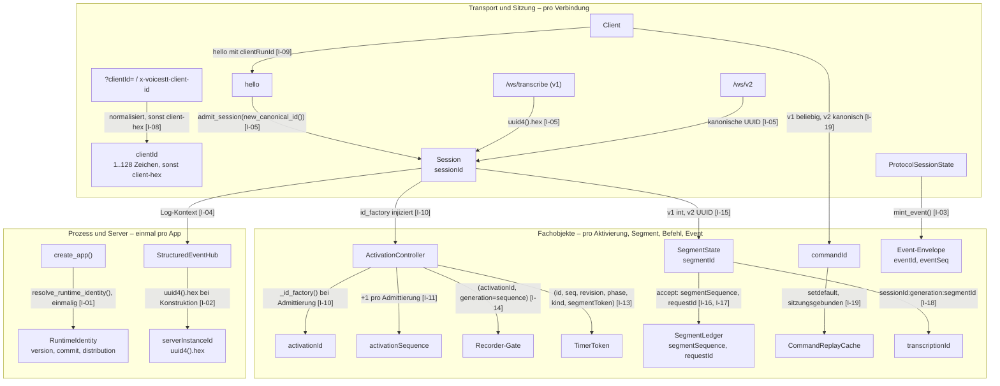

# 01.07 Identitäten

*Faktenbasis: `workflow/research/01.07.json` (Commit `a8993c5c`), Fakten I-01 … I-27, Konflikte C-01 … C-06, Nicht implementiert N-01 … N-06, Offen U-01 … U-04. Keine Aussagen aus vorhandener Dokumentation.*

## 1. Worum geht es?

Ein Voice-STT-Server ist ein Ort, an dem sehr viele Dinge gleichzeitig einen Namen brauchen: der laufende Prozess, die einzelne WebSocket-Verbindung, die Sitzung eines Clients, die eine Aktivierung, das einzelne Audio-Segment, der einzelne Befehl und jedes protokollierte Ereignis. Dieses Kapitel beantwortet für jede Ebene drei Fragen:

1. **Wer vergibt die Kennung?** Server, Client oder Katalog.
2. **Wie sieht sie aus?** 32 Hex-Zeichen, kanonische UUID mit Bindestrichen, ganze Zahl oder freier Katalogname.
3. **Wie lange lebt sie, und wo taucht sie wieder auf?**

Die zentrale Antwort: Es gibt nicht *die* eine Identität, sondern **drei Schichten mit unterschiedlichen Eigentümern**, und zwischen ihnen vermittelt genau eine Kennung – die `sessionId`.

| Schicht | Was sie beschreibt | Kennungen | Lebensdauer |
|---|---|---|---|
| **Server / Prozess** | *Welcher* Server läuft hier? | `RuntimeIdentity` (Version, Commit, Distribution), `serverInstanceId` | einmal pro App-Instanz (I-01, I-02) |
| **Transport / Sitzung** | *Wer* ist verbunden, und *welche* Sitzung entsteht daraus? | `clientId`, `clientRunId`, `sessionId` | pro Verbindung bzw. pro Sitzung (I-05 … I-09) |
| **Fachobjekte** | *Was* passiert inhaltlich? | `activationId`, `activationSequence`, `segmentId`, `segmentSequence`, `commandId`, `eventId`, `wakeWordId` | pro Aktivierung, Segment, Befehl, Event (I-10 … I-23) |

**Nur `sessionId` ist ein Verknüpfungsschlüssel.** Prozesskennungen beschreiben den Server, sie verbinden keine Objekte. Die `clientId` wird als Attribut an die Sitzung weitergereicht (I-08), ist aber kein Schlüssel: Es gibt kein Register, gegen das sie geprüft würde. Und eine Verbindung besitzt überhaupt keine eigene Kennung (I-07, N-01).

> **Praxisbeispiel – eine Logzeile lesen.** Eine Zeile aus dem Event-Hub trägt `serverInstanceId` (welcher Prozess), `clientId` (welcher Client), `sessionId` (welche Sitzung), `requestId` und `segmentId` (welcher Verarbeitungsschritt) sowie `transcriptionId` (welche Transkription). Fehlt `sessionId`, ist die Zeile einer Sitzung nicht zuzuordnen (I-04).

## 2. Wer vergibt was an wen

Das folgende Diagramm zeigt **Erzeugung und Weitergabe**, keine Zeitachse und keine Reihenfolge im Sinne von Garantien. Jede Kante ist eine belegte Faktenkante.

**Textalternative zum Diagramm.** Oben: `create_app()` erzeugt einmalig die `RuntimeIdentity` (I-01), der `StructuredEventHub` einmalig seine `serverInstanceId` (I-02). Mitte: Server normalisiert die `clientId` (I-08), nimmt im `hello` die `clientRunId` entgegen (I-09) und baut über `admit_session` die `Session`; die Kennung entsteht je Endpunkt als kompaktes Hex (v1) oder kanonische UUID (v2) (I-05). Unten: Sitzung reicht ID-Fabrik an den Controller (I-10); Controller vergibt `activationId` (I-10) und `activationSequence` (I-11), gibt beides an Gate (I-14) und `TimerToken` (I-13) weiter. Sitzung erzeugt `SegmentState` (I-15), Ledger nimmt Segment/Sequenz/Request-ID auf (I-16, I-17); Client liefert `commandId` (I-19), Sitzung führt Replay-Cache (I-19). Envelopes erhalten `eventId`/`eventSeq` (I-03), Sitzung meldet Kennungen an den Hub (I-04), Segmentbezug wird zu `transcriptionId` (I-18).

Was **fehlt**: kein Pfeil „Verbindung → Kennung" – keine eigene Identität (I-07, N-01). Kein Pfeil `serverInstanceId` → Sitzung: steht in `/api/v2/info`/Logs, nicht im Snapshot (I-02).

### Die übrigen belegten Kanten

Dreizehn Kanten aus Gründen der Lesbarkeit nicht im Diagramm; gleichwertig belegt.

| Von → Nach | Bedeutung | Fakten |
|---|---|---|
| `RuntimeIdentity` → `/ws/v2` | Version/Commit als Konstruktorargumente in jede `ProtocolV2Connection` | I-01 |
| `RuntimeIdentity` → `/api/v2/info` | öffentliche Serverinformation inklusive `server_instance_id` | I-01, I-02 |
| `Hub` → Log-Payload | `serverInstanceId`, `eventId` (hex), Kontextfelder je Event | I-02, I-04 |
| `hello` → `ParsedHello` | `clientRunId` geprüft, danach ungenutzt | I-09 |
| `Controller` → `segmentToken` | `+1` nur bei `recording_started` | I-12 |
| `command.ack` → `commandId`, `activationId` | Ack trägt IDs, keine `activationSequence` | I-19, I-10 |
| `activation.input_closed` → `causedByCommandId` | nur bei akzeptiertem `finish`/`cancel`, sonst `null` | I-20 |
| `HTTP-Request` → `requestId = sessionId = transcriptionId` | Routen-UUID für Header/Telemetrie | I-22 |
| `HTTP-Request` → `job.session_id` | `openai-<Service-ID>` im Scheduler-Job | I-22 |
| `hello` → `wakeWordIds` | nur exakt kanonische Katalog-IDs | I-23 |
| `Wake-Detektion` → `wakeword.detected` | `wakeWordId` plus `activationId` | I-23 |
| `WakeTracker` → `detectorGeneration` | `reset`/`new_generation`, Verwerfen veralteter Läufe | I-25 |
| `hello.accepted` → `logAccess.accessToken` | sitzungsgebundenes Token, nur dort | I-26 |

Alle 31 Fakten-Kanten der Akte abgedeckt: 18 als 19 Diagrammpfeile (HELLO→SES fasst die Admittierung der beiden Endpunkt-Kanten EP1/EP2→SES zusammen), 13 als Tabellenzeilen.

## 3. Die Schichten im Detail

### 3.1 Server und Prozess: einmal pro App

`RuntimeIdentity` (Version, Commit, Distribution, Kroko-Variante, Quellenangaben) wird **einmalig** in `create_app` über `resolve_runtime_identity` aufgelöst (I-01). Weitergabe an `/api/v2/info`, OpenAPI-Beschreibung, Settings-Endpunkte, jede `ProtocolV2Connection` – pro Verbindung nur **kopiert**. Späterer Umgebungswechsel ändert die Identität eines laufenden Prozesses nicht (I-01).

`serverInstanceId` ist bewusst **keine Konfiguration/Sitzung**: Hub zieht bei Konstruktion `uuid4().hex` (32 Hex) (I-02). In `/api/v2/info` und jedem Log-Payload – Kennung zum Trennen von Prozessen (z. B. nach Neustart). In `hello.accepted` nur via `logAccess` (I-02, I-26); im `session.snapshot` fehlt sie bewusst (I-02).

### 3.2 Transport und Sitzung: eine Kennung, zwei Schreibweisen

| | v1 (`/ws/transcribe`) | v2 (`/ws/v2`) |
|---|---|---|
| Erzeugung | `uuid4().hex` | `new_canonical_id()` (`str(uuid.uuid4())`) |
| Form | 32 Hex, keine Bindestriche | 36 Zeichen, Bindestriche, klein |
| Weitergabe | `admit_session(...)` ohne Kanonisierung | `admit_session(..., canonical_ids=True)` |

**Eine Identität, zwei Schreibweisen**, keine zwei Identitäten (I-05). Transportgebunden: v1 dauerhaft kompakt, v2 kanonisch; Legacy nicht migriert (C-06).

> **Invariante: keine Umformatierung an der Grenze.** Server rechnet kompakt nicht in gehyphaelt um und umgekehrt. `ProtocolSessionState` verweigert Nicht-Kanonisches mit `ValueError` (I-05); Envelope: nicht-kanonisch → `invalid_payload`, abweichend-gültig → `stale_session` (I-06).

Negativtests: zwei Formen (v1 32/nicht-kanonisch vs. v2 kanonisch); kompakte v1-Kennung in v2-Kommando → `invalid_payload` (Ack in eigener v2-Sitzung); gehyphaelte v1-Form → `stale_session` (keine zweite Identität); kanonische v2-Kennung steuert kein v1-Kommando (I-05, I-06).

**`clientId` = Transportangabe, keine Serveridentität** (I-08): `?clientId=`/Header `x-voicestt-client-id`, 1–128 Zeichen `[A-Za-z0-9._:-]`, sonst `client-<hex>`. v1 gibt sie im Server-`hello` zurück; v2 kein `clientId`-Feld (nur Sitzungsobjekt/Telemetrie) (I-08, N-06).

**Keine Verbindungsidentität** (I-07, N-01): kein `connectionId`-Feld/Typ; v1 Manager-Dictionary, v2 Objekt pro Socket mit lokalen Hilfszuständen (`_ack_memo`, `_closing_versions`).

**`clientRunId`: Pflicht, aber folgenlos** (I-09): fehlt/nicht-kanonisch → Close 4400 `invalid_client_run_id`. Danach ungenutzt: nicht bei Admittierung, nicht in `hello.accepted`/Snapshot/Events; kein Mapping. **Format-Gate ohne Gegenstelle** (C-02, N-03).

### 3.3 Activation: der Server vergibt, der Client nie

`activationId` nur serverseitig bei Admittierung via `_id_factory` (I-10): v1 `uuid4().hex`, v2 kanonisch via `canonical_ids=True`. Unverändert durch Controller/Ack/Events/Snapshot/Ledger (I-10).

`activationSequence`: sitzungsweiter Zähler +1 pro Admittierung (I-11). In `activation.started` + `pendingActivations[].activationSequence`, **nicht** im Ack (nur ID + Phase). `reset` beendet, setzt nicht zurück (I-11). Snapshot-Feld `generation` = Alias, kein zweiter Zähler (I-11, C-04).

`segmentToken`: Controller-eigen, Start 0, +1 nur bei `recording_started` (nicht `already_recording`) (I-12). In Snapshot + `TimerToken`, **keine** v2-Wire-Nachricht (I-12, N-05).

`TimerToken`: Callback nur bei exaktem Bündel (`activation_id`, `sequence`, `timer_revision`, `phase`, `kind`, `segment_token`) (I-13). `timerRevision` allein unzureichend (beginnt je Aktivierung neu).

Recorder-Gate: unabhängige Kopie `(activationId, generation=sequence)` (I-14) – altes `open` verworfen, fremdes/älteres `close` wirkungslos, `close` idempotent. Spätes `close(A)` schließt B nicht.

**Vier Zähler:**

| Zähler | Eigentümer | Skopus | Steigt bei | Leitung? |
|---|---|---|---|---|
| `activationSequence` | Controller/Sitzung | Sitzung | jeder Admittierung | ja (`activation.started`, Snapshot) |
| `segmentToken` | Controller | Sitzung/Segmentstart | `recording_started` | nein (Snapshot, TimerToken) |
| `segmentSequence` | Ledger | Sitzung | jedem `accept` | nicht als eigenes Feld belegt |
| `timerRevision` | Controller | Aktivierung | je Aktivierung neu | nein (nur `TimerToken`) |

### 3.4 Segment: die Kennung mit dem meisten Kontext

`segmentId` autoritativ in `SegmentState` (I-15): v1 Integer ab 1, v2 kanonische UUID via Fabrik. Ledger normalisiert (numerisch → int, sonst opaquer String, leer verweigert).

`segmentSequence`: Ledger-Zähler ab 1 pro `accept`, unabhängig von Aktivierung/`segmentToken` (I-16). `SegmentContext` bindet Session/Aktivierung/Sequenz/Segment/Sequenz/Settings/Request/Erzeugungszeit; Ledger nur eigene `session_id` (I-16).

`requestId`: **intern** pro Segment, `uuid4().hex` aus Ledger-Default-Fabrik (auch v2) (I-17). Telemetrie + Rücklookup; kein v2-Wire-Feld (I-17, N-05).

`transcriptionId`: abgeleitet, nicht erzeugt: `f"{sessionId}:{generation}:{segmentId}"` (I-18). `generation` = **Sitzungs-Turn-Zähler** (`close`/`clear`), nicht `activationSequence`. Beispiel: Sitzung `…`, Generation `0`, drittes Segment → `"<sessionId>:0:3"` – mittlere Zahl = Turn, nicht Aktivierung. Final-Job übernimmt Ledger-`requestId` als `job.request_id` (I-18).

### 3.5 Command: die einzige Kennung, die der Client besitzt

`commandId` gehört dem Client (I-19): v1 beliebiger nicht-leerer getrimmter String; v2 kanonische UUID – sonst **keine Antwort, kein Replay-Slot**. Idempotenz **sitzungsgebunden**: ReplayCache pro Sitzung (`setdefault`), nur `close()` leert; v2 merkt ersten Ack pro `commandId` (ursprüngliche Versionen bei Replay) (I-19).

> **Praxisbeispiel.** Gleicher `commandId`-Retry bei bestehender Verbindung → derselbe Ack, keine Doppel-Aktivierung. Nach Abbruch + neuer Sitzung: Cache neu, keine Deduplizierung. Idempotenz = Sitzungseigenschaft (I-19).

Korrelation v2: `commandId` im Ack + `causedByCommandId` in `activation.input_closed` (nur akzeptiertes `finish`/`cancel`, sonst `null`) (I-20). Ack ohne `activationSequence` (I-20, I-11).

Hinweis Aktionsvokabular (C-01): Ein Docstring behauptet, `extend` werde zu `refresh` normalisiert – implementiert ist das nicht (kein `extend`-Zweig; Aktionen nur `activate`/`refresh`/`finish`/`cancel`). Unbekannte Actions werden abgelehnt (intern `invalid_action`, auf der v2-Wire `invalid_payload`). Code = Autorität (vgl. [02.03](../02-funktionsweise/02.03-activation.md)).

### 3.6 Events: zwei Identitäten, zwei Räume

v2-Event: **kanonische UUID `eventId`** + **lückenlose monotone `eventSeq` pro Sitzung** (auch diagnostische Non-State-Events) via `mint_event` (I-03). `logical_key` → gleicher logischer Vorgang = gleiches Envelope (Retry sendet erneut, erzeugt nicht neu) (I-03). `stateVersion` nur bei sichtbaren Änderungen.

Log-`eventId` getrennt: Hub `uuid4().hex` (32) + `serverInstanceId`/Zeit/Kanal/Name/Severity + Kontext (`clientId`, `requestId`, `segmentId`, `sessionId`, `transcriptionId`, `transport`) (I-04). Zwei Räume, zwei Formate – siehe 4.2.

### 3.7 HTTP-synthetisch

Kein Sitzungsobjekt → erfundene Kennungen, sogar **zwei** `request_id` (I-22, C-05):

- **Routen-Kennung** `uuid4().hex`: `X-Request-ID`, Telemetrie-`sessionId`/`requestId`/`transcriptionId`.
- **Service-Kennung** `uuid4().hex`: Holder + `job.request_id`; Job-Sitzung `openai-<Service-ID>`.

Pro Request, nichts im Store, keine WS-Beziehung (I-22). Optionale `clientId` aus Header; fehlt → `None` (**kein** `client-<hex>`-Fallback) (I-22).

> **Praxisbeispiel.** `curl` → `X-Request-ID: 4b1e…`; in Logs dreifach benannt; `openai-…` separate Scheduler-Kennung. Nicht gleichsetzen.

### 3.8 Katalog: Namen statt UUIDs

`wakeWordId` aus Manifest (`id`), **keine UUID** (I-23). Normalisierung über `id`/`displayName`/Alias. v2 nur **exakt kanonische** Katalog-IDs: Alias → `not_canonical`, ein Fehler verwirft **ganze** Auswahl. Sichtbar in `wakeword.detected` (+ `activationId`) und `hello`-`wakeWordIds` (I-23).

`catalogRevision` = **Revision, keine ID**: zählt Katalogwechsel, in Capabilities + `wakeword.availability_changed`, ohne `activationId` (I-24). Trennen von `settingsRevision`/`stateVersion`/`eventSeq` (I-24).

### 3.9 Token: Flüchtiges für den Logzugriff

`logAccess.accessToken`: sitzungsgebunden, flüchtig (hex+hex, 64 Zeichen) + Ablauf; Validierung bindet `session_id` (I-26). Nur in `hello.accepted`, nicht in späteren Snapshots; **keine Sitzungsidentität** (I-26). Berechtigung ≠ Identität.

## 4. Verwechslungskästen

### 4.1 `generation` – dreifach belegt (C-04, I-25)

| Bedeutung | Wo | Was sie zählt |
|---|---|---|
| Alias `activationSequence` | Controller-Datensatz | Admittierungen |
| Sitzungs-Turn-Zähler | Sitzung (`close`/`clear`) | Lebenszyklen (Basis `transcriptionId`) |
| Detektor-Generation | Wake-Tracker (`reset`/`new_generation`) | Detektorläufe; alte verworfen |

Nicht austauschbar. Zusammenführung nur Code-Kommentar (Evidenz C) – **offen** (U-04), keine Funktion.

### 4.2 `eventId` – zweifach, zwei Räume (C-03, I-03, I-04)

| | Wire-`eventId` | Log-`eventId` |
|---|---|---|
| Erzeuger | `mint_event` | `Hub.emit` |
| Format | kanonische UUID (36) | hex (32) |
| Gültigkeit | pro v2-Sitzung (+ `eventSeq`) | pro Log-Event |
| Replay-stabil | ja (`logical_key`) | nein |

Nicht gleichsetzen. Verbindung ggf. über Kontext (`sessionId`, `segmentId`, `transcriptionId`).

### 4.3 Keine IDs, obwohl es so aussieht (I-27)

`manual`/`wake_word` (Enums), `legacy`/`controlled` (Modus – nur *ob* Controller existiert), Result-Codes/Reasons (Vokabular), `stateVersion`/`lastEventSeq`/`settingsRevision`/`timerRevision`/`catalogRevision`/Interim-Sequenz (Zähler/Revisionen). Als IDs verwendet = Scheinschlüssel.

### 4.4 `clientRunId` ist keine Reconnect-Kennung (I-09, N-03, C-02, U-01)

Pflicht + kanonisch (sonst Close 4400), danach **unbenutzt**: kein Mapping/Lookup, nichts in accepted/Snapshot/Events. Neue Verbindung = neue `sessionId` (N-03). Gleiche `clientRunId` nach Abbruch → **neue** Sitzung, nicht alte zurück. Konstanz über Reconnects unbelegt (U-01). Reconnect: 04.08.

## 5. Synthetische Kennungen

Kennung ohne eigenes Objekt – aus Teilen gebildet/vergeben für Telemetrie/Jobs, ohne abfragbare Entität.

| Kennung | Bildung | Gültigkeit | Was sie nicht ist |
|---|---|---|---|
| `legacy-<sessionId>-<n>` | Zähler | nur v1-Legacy | keine UUID/Ledger-ID, nie v2 (I-21) |
| `client-<hex>` | Normalisierungs-Fallback | pro Verbindung | keine Registrierung, kein Fehler (I-08, N-06) |
| `openai-<Service-ID>` | Job-Sitzung HTTP | pro Request | keine WS-Sitzung, nichts im Store (I-22) |
| `transcriptionId` | `sessionId:generation:segmentId` | pro Segment, Telemetrie | kein Objekt/Wire-Feld (I-18) |
| Routen-`requestId` | `uuid4().hex` | pro Request | nicht Service-ID (I-22, C-05) |
| Service-`requestId` | `uuid4().hex` | pro Request | nicht Routen-ID; Holder-intern (I-22) |

Nützlich für Logs/Jobs, keine Zustandsgarantie. `legacy-…` nie auf v2 (I-21); `transcriptionId`-Mitte nur mit Turn-Bedeutung lesbar (I-18).

## 6. Grenzen

**Nicht implementiert (N-01…N-06):** keine Verbindungsidentität (I-07); keine Client-ID-Erzeugung im Repo (I-08); keine Wiederaufnahme per `clientRunId` (I-09); keine Formatvalidierung v1-IDs; `requestId`/`segmentToken` keine Wire-Felder (I-12, I-17); keine Client-ID-Pflicht (I-08).

**Offen (U-01…U-04):** `clientRunId`-Konstanz (I-09); `segmentToken`/`segmentSequence`-Drift (I-12, I-16); Interim-Sequenz-Skopus (nur Passthrough); `generation`-Zusammenführung nur Kommentar (Evidenz C) (I-25).

Keine Laufzeit-/Verfügbarkeitsgarantien; Stand Commit `a8993c5c`.

## 7. Siehe auch / Nachweise

**Verwandte Kapitel:** [01.01](01.01-produktueberblick.md), [01.02](01.02-architekturuebersicht.md), [01.04](01.04-gesamter-datenfluss.md), [02.03](../02-funktionsweise/02.03-activation.md). Ergänzend: 01.03, 01.06, 01.08, 02.01, 03.09, 04.03, 04.04, 04.08, 04.10, 04.12, 08.01, 08.10, 09.03.

**Faktenverwendung:** I-01 (3.1, 2); I-02 (3.1, 2); I-03 (3.6, 4.2); I-04 (3.6, 4.2); I-05 (3.2, 2); I-06 (3.2, 3.5); I-07 (3.2, 6); I-08 (3.2, 5, 6); I-09 (3.2, 4.4, 6); I-10 (3.3, 2); I-11 (3.3, 4.1); I-12 (3.3, 6); I-13 (3.3, 2); I-14 (3.3, 2); I-15 (3.4); I-16 (3.4); I-17 (3.4, 6); I-18 (3.4, 5); I-19 (3.5, 2); I-20 (3.5); I-21 (5); I-22 (3.7, 5); I-23 (3.8); I-24 (3.8); I-25 (4.1); I-26 (3.9); I-27 (4.3). Konflikte C-01 (3.5), C-02 (4.4), C-03 (4.2), C-04 (4.1), C-05 (3.7), C-06 (3.2).

**Testbelege (Negativtests Formattrennung, Dateien in `tests/unit/` des Quellstands):** `test_protocol_v1_v2_boundary.py` (Formen, `invalid_payload`, `stale_session`); `test_protocol_v2_contract.py` (Kanonik, `eventSeq`); `test_protocol_v2_e2e.py` (`clientRunId`, `activationId`, `segmentId`, `causedByCommandId`).
