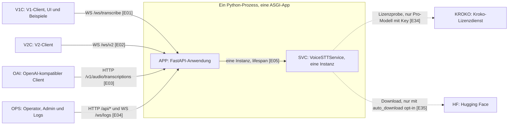
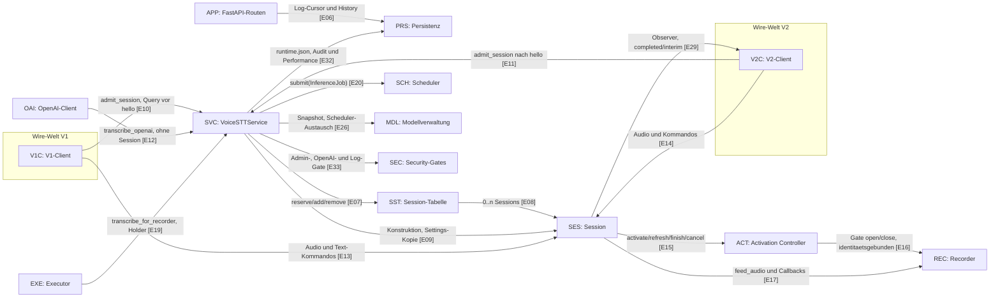
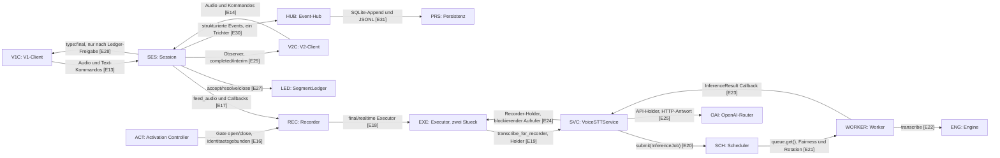

# 01.09 – Architekturdiagramme

*Quellstand: Commit `a8993c5c`. Faktenbasis: `workflow/research/01.09.json` (G9-01…G9-18, Kanten E01–E35).*

## 1. Worum geht es?

Ein Architekturbild ist keine Dekoration, sondern eine Antwort auf eine konkrete Frage. Dieses Kapitel beantwortet drei Fragen mit drei Diagrammen – und nur mit diesen dreien:

| Diagramm | Leitfrage | Pfeile | Knoten |
|---|---|---|---|
| **D1 – Systemübersicht** | Wer redet von außen mit dem Server, und was ist überhaupt „der Server"? | 7 (E01–E05, E34, E35) | 8, dazu ein Prozessrechteck |
| **D2 – Komponenten** | Wie ist der Prozess innen aufgebaut, und wo trennen sich V1, V2 und OpenAI? | 18 (E06–E17, E19, E20, E26, E29, E32, E33) | 14 |
| **D3 – Datenfluss** | Wie kommt ein Auftrag vom Audio bis zum Transkript – und wie kommt das Ergebnis zurück? | 17 (E13, E14, E16–E25, E27–E31) | 14 |

Die drei Bilder sind bewusst **keine** Nacherzählung des Codes. Aus 154 Einzelkanten der Detailrecherche (45 + 46 + 63) sind 35 distinkte Übersichtspfeile verdichtet worden: 33 durchgezogene und 2 gestrichelt-optionale (G9-14). Weil sieben Pfeile in zwei Diagrammen vorkommen (E13, E14, E16, E17, E19, E20, E29), enthalten die drei Bilder zusammen 42 gezeichnete Pfeile – aber weiterhin nur 35 verschiedene Aussagen. Alles darüber hinaus – Chunk-Größen, Pre-Roll, Formate, einzelne Event-Namen, Close-Codes – steht in den Detailkapiteln, nicht auf diesen Pfeilen.

Zwei Dinge fehlen absichtlich (Abschnitt 5): **Zeitangaben** (Phasen, Fristen, Latenzen, Queue-Tiefen) und **nicht existierende Nebenwege** (Broker, Prozessgrenzen, Engine pro Session, Ledger auf der Leitung). Die Diagramme zeigen Operationen, keine Dauer. Zeitarten und Defaults gehören in [02.03 Activation](../02-funktionsweise/02.03-activation.md) und in den Timing-Katalog, nicht auf eine Architekturkante (G9-15).

**Lesereihenfolge:** D1 von außen nach innen, D2 zur Orientierung in den Komponenten, D3 entlang eines einzigen Auftrags. Wer nur ein Bild ansieht, nimmt D1; wer den Server ändern will, nimmt D2; wer einen Fehler sucht, nimmt D3.

## 2. D1 – Systemübersicht

### 2.1 Das Diagramm

### 2.2 Wie man es liest

Das Rechteck ist die wichtigste Aussage: **alles außer den sechs äußeren Knoten läuft in genau einem Python-Prozess mit einer ASGI-App** (G9-01). Kein Worker-Prozess, kein Broker, kein zweiter Dienst; Start über `uvicorn.run(create_app)`, Port 8010. Innerhalb entsteht genau **eine** `VoiceSTTService`-Instanz mit `lifespan`-Start/Stopp (G9-03).

Vier Außenwelten mit vier Verträgen:

- **V1C** – Legacy-Client. Die mitgelieferte Web-UI ist ein V1-Client (`/ws/transcribe`, `/ws/logs`, HTTP-`fetch`; kein `/ws/v2`, kein `/v1/audio`) (G9-12).
- **V2C** – neuer Vertrag. Belegt nur in Tests und einem Engineering-Werkzeug; Drittclients unbelegbar (G9-13, U-02).
- **OAI** – OpenAI-kompatible Aufrufer über den zweiten Router (G9-02).
- **OPS** – Admin-Oberfläche, HTTP-Verwaltung, Log-Stream (G9-02, G9-10).

Die gestrichelten Kanten sind die einzigen ausgehenden Verbindungen: Kroko-Lizenzprobe nur bei Pro-Modell mit Key (nicht `forceCommunity`/bestätigt), synchron im Initialisierungsthread; Hugging-Face-Download nur bei `auto_download` opt-in (Default aus). Beide außerhalb des Audio-/Inferenzpfads (G9-11). Bedingung im Label, nicht in Fußnote.

### 2.3 Textalternative

Falls Mermaid nicht rendert: Ein Python-Prozess enthält FastAPI-Anwendung und genau eine Service-Instanz (Start erzeugt, Herunterfahren stoppt). Vier Wege hinein: V1 über `/ws/transcribe`, V2 über `/ws/v2`, OpenAI über `/v1/audio/transcriptions`, Operator über `/api/*` und `/ws/logs`. Zwei bedingte gestrichelte Wege hinaus: Kroko-Lizenzprüfung (nur Pro-Modell mit Key), Hugging-Face-Download (nur Opt-in).

## 3. D2 – Komponenten

### 3.1 Das Diagramm

### 3.2 Die drei Welten und der gemeinsame Kern

**Ein Prozess, zwei Wire-Welten.** V1/V2 teilen Prozess, Service, Store – protokollarisch getrennt (G9-04). V1: Zulassung über Query **vor** Server-`hello` (E10); V2: **nach** validiertem Client-`hello` (E11). V2 nicht im `ConnectionManager` – keine solche Kante (Abschnitt 5, Nr. 1).

**OpenAI ist sitzungslos.** Kein `admit_session`: synthetische ID, nur Holder + `submit` (G9-05). OAI außerhalb beider Wire-Welten; E12 trägt „ohne Session". Drei Eingänge ≠ drei Sitzungen.

**Sessions entstehen kontrolliert.** Service reserviert/ergänzt/entfernt in der Session-Tabelle (E07); Tabelle hält 0..n Sessions (E08); Session mit Settings-Kopie konstruiert (E09). Controller kein zweiter Verwalter: Session sendet `activate/refresh/finish/cancel` (E15), Gate-Öffnung identitätsgebunden (E16).

**Recorder: Audio von Session, nicht vom Gate.** E17 (Audio/Callbacks) und E16 (Gate) sind zwei Wirkungen auf dieselbe Komponente. Offenes Gate allein erzeugt kein Transkript.

**Querschnitt:** Modellverwaltung mit Snapshot für Scheduler-Austausch (E26); Persistenz mit Log-Historie (E06) plus `runtime.json`/Audit/Performance (E32); Security-Gates für Admin/OpenAI/Log (E33). V2-Handshake ohne Admin-Check, `/health` unauthentifiziert (G9-10) – deshalb keine Auth-Kante an `/ws/v2` (Abschnitt 5, Nr. 15).

**Handler-Hinweis.** V1-Route, V2-Connection, OpenAI-Router liegen in der Anwendung; im Diagramm steht der Clientknoten (keine eigenen Handler-IDs), das Label nennt die Operation. Handler als Kästen: [01.03](./01.03-komponenten-und-schichten.md).

### 3.3 Textalternative

Falls Mermaid nicht rendert: Ein Prozess enthält FastAPI-Routen, Service-Instanz, Session-Tabelle, Sessions, Activation Controller, Recorder, Executor, Scheduler, Modellverwaltung, Security-Gates, Persistenz. V1-Zulassung vor Server-`hello`, V2 danach; V2 nicht im ConnectionManager. OpenAI ohne Session. Service erzeugt Sessions (Settings-Kopie), verwaltet Tabelle. Session steuert Activation/Recorder getrennt; Controller öffnet Gate; Session liefert Audio. Executor ruft Service, Service reicht beim Scheduler ein; Modellverwaltung erhält Snapshot. Persistenz via Anwendung (Log-Historie) und Service (Runtime/Audit/Performance).

## 4. D3 – Datenfluss

### 4.1 Das Diagramm

### 4.2 Der Hinweg

Client-Audio/Kommandos → Session (E13/E14) → `feed_audio` (E17); Gate separat (E16). Recorder → je ein Final-/Realtime-Executor (E18) – **nicht** der Engine-Ort: Executor ruft Service via `transcribe_for_recorder` (E19), Service reicht `InferenceJob` ein (E20). Scheduler `queue.get()` (E21), Worker transkribiert (E22), `InferenceResult` zurück (E23). Engine am Worker, nicht an Session – eine Bindung, nicht eine pro Session.

Ausgeschlossen: kein Recorder-Kindprozess, keine Session-Engine, kein Worker→Session-Direktkontakt.

### 4.3 Der Rückweg – die Architekturaussage

Streng geordnet **über Halter, nicht Session** (G9-07): Performance-Event → `complete_pending_api` (E25) → `complete_pending_recorder` (E24) → Session-Fallback. Bildkette **WORKER → SVC → EXE** (E23, E24) plus Zweig **SVC → OAI** (E25). Welcher Halter trägt, hängt vom Auftragsteller ab (V1/V2 → Recorder-Holder; OpenAI → API-Holder); leere Holder geben nichts ab. E24/E25 getrennt, keine „Antwort"-Kante.

### 4.4 Freigabe statt Direktverbindung

Ledger: accept/resolve/close (E27), schreibt **nicht** auf Leitung. Gibt frei (`drain`), Session publiziert – genau **eine** Kante Session → V1C (E28, `type:final` erst nach Freigabe) (G9-17). Kante „LED → V1C" wäre falsch (Abschnitt 5, Nr. 5).

V2: kein Legacy-Payload, Observer mit `completed`/`interim` (E29). Alle strukturierten Ereignisse durch **einen** Trichter (E30) in den Hub, dann SQLite-Append + JSONL (E31).

### 4.5 Lesebeispiel

Push-to-Talk (V1): D1 Weg in Prozess; D2 Zulassung vor `hello` (E10), Session mit Settings-Kopie (E09); D3 Audio/Kommandos (E13), Gate (E16), `feed_audio` (E17), Executor (E18), Holder (E19), Scheduler (E20), Worker (E21), Engine (E22), Ergebnis (E23), Recorder-Holder (E24), Ledger-Freigabe (E27), `type:final` (E28). OpenAI: E12 statt E10/E11, E25 statt E24, kein E27/E28.

Controller nur Gate-Quelle (Ansteuerung E15 in D2, damit D3 den Rückweg zeigt). Ledger-Kante ohne Nachfolger = Aussage, keine Auslassung.

### 4.6 Textalternative

Falls Mermaid nicht rendert: Audio/Kommandos → Session → Recorder (`feed_audio`); Controller öffnet/schließt Gate. Recorder → Final-/Realtime-Executoren → Service → Scheduler → Worker → Engine → Ergebnis an Service. Service → Recorder-Holder (Executor) / API-Holder (OpenAI-Router). Session → Ledger (Freigabe) → `type:final` an V1; Observer `completed`/`interim` an V2; Ereignisse via Hub in Persistenz.

## 5. Was bewusst nicht gezeichnet ist

Vertragsbestandteil – jede plausible, aber nicht existente Kante mit Grund und Beleg:

| Nr. | Nicht zeichnen | Was stattdessen gilt | Beleg |
|---|---|---|---|
| 1 | V2 → ConnectionManager | V2 selbst verwaltet; kein Legacy-Payload erreicht V2 | C-08/09, K-12, D-39, `server.py` 10133–10136 |
| 2 | Scheduler/Queue/Worker → Session (direkt) | Rückweg via Service-Halter; Session nur Fallback | C-19, K-33, D-28, G9-07 |
| 3 | Engine pro Session | Eine Engine-Bindung je Worker | K-31, N-2 |
| 4 | Recorder-Kindprozess / `run_transcription_worker` | Alles im selben Prozess | C-17, K-27 |
| 5 | SegmentLedger → Wire | Ledger gibt frei, Session publiziert (E28) | G9-17, C-20/21, D-36 |
| 6 | Final-/Interim-Abgleich, Retract | Kein Abgleich/Rückzug | D-32, N-01/02 |
| 7 | Interim nach Terminalzustand | Keins gezeichnet | D-34 |
| 8 | OpenAI → Session/Recorder | Sitzunglos (E12, E25) | K-34, D-45 |
| 9 | Log-Client → Session | Liest Store, nicht Session | K-37, `server.py` 9571 |
| 10 | GPU-/CUDA-Kante | CPU erzwungen, zwei CPU-Engines | G9-18, C-30, K-32 |
| 11 | Broker/Redis/Celery/DB-Server, V1-/V2-Split-Prozesse | Ein Prozess, kein Vermittler | G9-01, N-01 |
| 12 | Weitere Außenkanten außer E34/E35 | Nur zwei gestrichelte bedingte Kanten | G9-11, C-03 |
| 13 | `VoiceSTT_server/index.html` (8011/8012) → App | Nicht ausgeliefert; UI = V1-Client (E01) | G9-12 |
| 14 | Phasen/Deadlines/Timeouts/Latenzen/Queue-Tiefen als Label | Operationen, keine Zeiten | G9-15, C-12, K-22 |
| 15 | Admin-Auth-Pfeil an `/ws/v2` | Kein Admin-Check; `/health` unauthentifiziert | N-4, G9-10 |
| 16 | `v2-start`-Kommando | Existiert nicht | N-3, D-41 |
| 17 | Client → SessionStore | Nur via `admit_session` | G9-05 |
| 18 | Zeit-/Sequenzdiagramm mit gemessenen Dauern | Keine Garantielatenzen; D3 = Operationsfluss | G9-15 |

## 6. Mermaid-Regeln

Aus Literalen + Mermaid-Syntax abgeleitet (G9-16):

1. **IDs ASCII, kurz:** `V1C`, `APP`, `SES` – keine Leerzeichen/Umlaute. Kanon 19 IDs plus `WORKER`/`SEC` aus Kanten ableitbar (21 Knoten; offengelegt, nicht still eingeführt).
2. **Labels immer gequotet:** `ID["Text"]`, `-->|"Text"|`. Unquoted bricht an `/`, `:`, Klammern.
3. **Sicher:** `/`, `:`, `.`, `(`, `)`, `,`, Leerzeichen. **Vermeiden:** `<`/`>` (HTML), `#`, `;`, `%%`, unescaped `"`. Keine ` `-Umbrüche nötig; Knotentexte kurz.
4. **Reale ID-Form `openai-{request_id}`** – niemals `openai-<uuid>` (HTML-Tag → Syntaxfehler). Häufigster Render-Bruchgrund.
5. **Jede Kante genau eine E-Nummer.** Kein Pfeil ohne Beleg. E01–E35 stabil, in Abschnitt 8 aufgelöst.
6. **Gestrichelt nur E34/E35** (`-.->`), Bedingung im Label. Rest durchgezogen (G9-14).

## 7. Grenzen und offene Punkte

**Nicht implementiert:** kein Final-/Interim-Abgleich/Retract (N-01/N-02); keine Engine pro Session (N-2); kein `v2-start` (N-3); keine Admin-Prüfung im V2-Handshake (N-4). Produktgrenzen – Details [01.08](./01.08-technische-grenzen.md), [04.03](../04-schnittstellen/04.03-websocket-v2.md).

**Unbekannt:** U-02 (V2-Drittclients unbelegbar; `V2C` = Vertrag, nicht Produkt). U-04: Mermaid-Blöcke syntaxbasiert gebaut, **nicht gerendert** – Renderprüfung im Integrationsschritt; Syntaxfehler = Befund.

**Anker:** Belege in [01.02](./01.02-architekturuebersicht.md), [01.03](./01.03-komponenten-und-schichten.md), [01.04](./01.04-gesamter-datenfluss.md) – hier kuratiert zu Bildern (G9-14), nicht dupliziert. Verdichtung 154→35 = Auswahl, keine neue Tatsache.

**Nicht geleistet:** keine Zeitabläufe ([02.03](../02-funktionsweise/02.03-activation.md)), keine Scheduler-Politik ([02.08](../02-funktionsweise/02.08-scheduler-und-nebenlaeufigkeit.md)), keine Transkriptionskorrelation ([02.05](../02-funktionsweise/02.05-transcription.md)). Landkarten, keine Fahrpläne.

## 8. Siehe auch und Nachweise

**Verwandte:** [01.01](./01.01-produktueberblick.md) · [01.02](./01.02-architekturuebersicht.md) · [01.03](./01.03-komponenten-und-schichten.md) · [01.04](./01.04-gesamter-datenfluss.md) · [01.05](./01.05-betriebs-und-funktionsmodi.md) · [01.06](./01.06-serverweite-und-sitzungsbezogene-ressourcen.md) · [01.07](./01.07-identitaeten.md) · [01.08](./01.08-technische-grenzen.md) · [02.03](../02-funktionsweise/02.03-activation.md) · [02.05](../02-funktionsweise/02.05-transcription.md) · [02.08](../02-funktionsweise/02.08-scheduler-und-nebenlaeufigkeit.md) · [04.03](../04-schnittstellen/04.03-websocket-v2.md) · [04.10](../04-schnittstellen/04.10-openai-kompatible-api.md) · [05.01](../05-administration/05.01-sicherheitsarchitektur.md)

**Faktenbasis (G9):** Prozess/App (G9-01–G9-03); V1/V2-Trennung (G9-04); Admission (G9-05); Inferenzpfad (G9-06); Rückweg (G9-07); Trichter (G9-08); Hub/Persistenz (G9-09); Security (G9-10); Außenkanten (G9-11); UI=V1 (G9-12); V2-Clients unbelegt (G9-13); Kuratierung 154→35 (G9-14); Zeit-Abgrenzung (G9-15); Mermaid-Regeln (G9-16); Ledger-Freigabe (G9-17); kein Broker/GPU (G9-18).

**Kantenverzeichnis (E01–E35):** V1C→APP (E01, C-06/K-11/D-03) · V2C→APP (E02, C-09/K-12/D-02) · OAI→APP (E03, C-25/K-04/D-44) · OPS→APP (E04, C-24/K-37/K-39) · APP→SVC (E05, G9-03/C-02/K-01-02) · APP→PRS (E06, K-37/K-35) · SVC→SST (E07, C-04/05/K-16/17) · SST→SES (E08, C-05/K-16) · SVC→SES (E09, C-04/K-17/K-21) · V1C→SVC (E10, C-06/K-11/G9-04) · V2C→SVC (E11, C-10/K-13/D-41) · OAI→SVC (E12, C-25/K-34/D-45) · V1C→SES (E13, C-06/07/D-03) · V2C→SES (E14, C-10/D-02/D-41) · SES→ACT (E15, C-12/13) · ACT→REC (E16, C-13/15/K-23/D-10) · SES→REC (E17, C-07/16/D-07/D-43) · REC→EXE (E18, C-16/K-27/D-22) · EXE→SVC (E19, K-28/D-24) · SVC→SCH (E20, C-18/K-29/D-25) · SCH→WORKER (E21, K-30/31/D-25) · WORKER→ENG (E22, C-30/K-31-32/D-27) · WORKER→SVC (E23, C-19/K-33/D-28) · SVC→EXE (E24, G9-07/D-28) · SVC→OAI (E25, C-19/K-34/D-28) · SVC→MDL (E26, C-27/K-19) · SES→LED (E27, C-20/K-24/D-36) · SES→V1C (E28, G9-17/D-35/36) · SES→V2C (E29, D-34/D-39/40) · SES→HUB (E30, C-21/22/K-25/D-39) · HUB→PRS (E31, C-22/K-35) · SVC→PRS (E32, C-23/K-09/K-38) · SVC→SEC (E33, C-24/K-39) · SVC⇢KROKO (E34, G9-11) · SVC⇢HF (E35, G9-11)

**Gliederung:** Systemübersicht D1 (E01–E05, E34, E35) · Komponenten D2 (18 Kanten) · Datenfluss D3 (17 Kanten) · Diagrammvertrag (E-Nummern + Textalternativen) · Abgrenzung (Abschnitt 5, 7).
