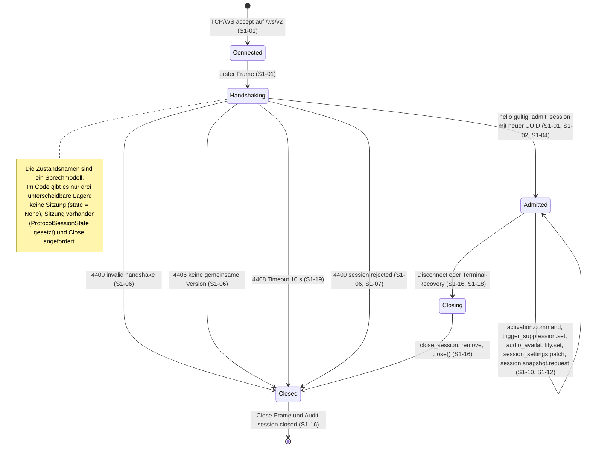
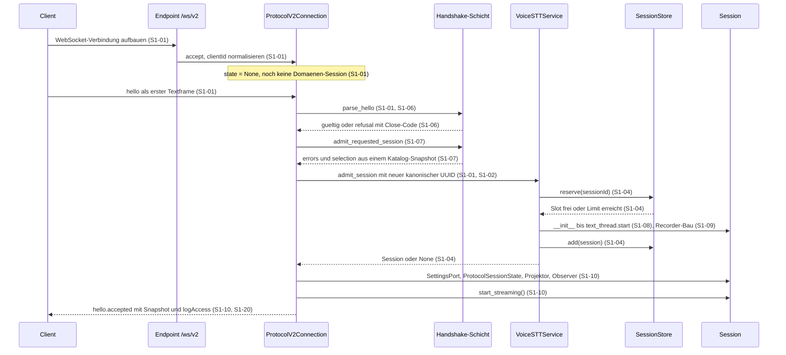
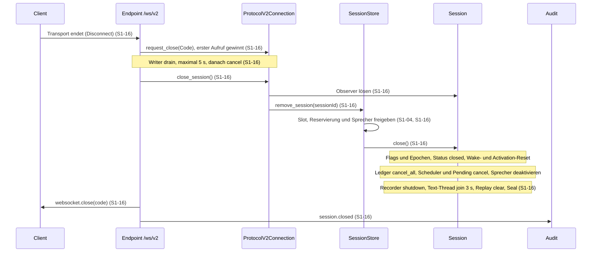

# 02.01 – Session-Management

*Grundlage: freigegebene Faktenakte `workflow/research/02.01.json` zum Commit `a8993c5c` (S1-01 … S1-22). Phasen, Fristen und Recovery-Semantik der Aktivierung sind ausschließlich in [02.03 Activation](./02.03-activation.md) beschrieben und werden hier nicht neu definiert.*

## 1. Worum geht es?

Eine WebSocket-Verbindung ist zunächst nur Transport: Bytes rein, Bytes raus. Sobald ein Client Sprache transkribieren lassen will, braucht er mehr – eine **Sitzung**: eigene Identität (`sessionId`), eigener Recorder und Text-Thread, eigene Einstellungs-Kopie und eigenes Segment-Ledger, mit Anfang (Admission), Betrieb (Streaming, Aufnahme, Transkription) und Ende (Disconnect, Recovery, Close).

Die Sitzung ist das „Vordergrund-Objekt" des Servers: länger als ein Frame, kürzer als der Prozess. Alles, was ein Client an Zuständen, Events und Snapshots sieht, hängt an genau dieser Sitzung.

Drei Stellen zählen praktisch:

1. **Ressourcenplanung.** Sitzungen und gleichzeitig sprechende Teilnehmer sind begrenzt – auf zwei Ebenen, zu zwei Zeitpunkten (4.3).
2. **Fehlerdiagnose.** `session.rejected`, Close-Code 4409 oder fehlender Snapshot deuten sich nur über den Lebenszyklus-Ort (3 und 5).
3. **Client-Design.** Reconnect = neue Sitzung, keine Fortsetzung (5.2).

Identitäten im Detail: [01.07](../01-grundlagen/01.07-identitaeten.md); geteilt vs. sitzungsbezogen: [01.06](../01-grundlagen/01.06-serverweite-und-sitzungsbezogene-ressourcen.md).

## 2. Das Wesentliche auf einen Blick

v2-Lebenszyklus in fünf sprechenden Zuständen: **Connected** (Transport offen, keine Sitzung), **Handshaking** (hello wird geprüft), **Admitted** (Sitzung existiert und streamt), **Closing** (Schließung eingeleitet), **Closed** (Transport zu, Sitzung entfernt).



**Lesart.** Nach Accept existiert bewusst noch keine Domänen-Session (Protokollzustand `None`) (S1-01). Der erste Textframe startet die Handshake-Prüfung. Bei gültigem hello: Sitzung mit **neuer, servergenerierter UUID** (S1-01, S1-02, S1-04). *Admitted*-Selbstpfeil = wichtigster Teil: Befehle ändern den **Inhalt**, nicht den Lebenszyklus (S1-10, S1-12). Jeder Handshake-Fehler → *Closed*: 4400 (unbrauchbar), 4406 (keine Version), 4408 (10-s-Frist), 4409 (Sitzung abgelehnt) (S1-06, S1-19). Jeder Handshake-Fehler führt direkt nach *Closed*; einen Rückfall nach *Connected* gibt es nicht (S1-06).

**Textfassung (falls Mermaid nicht rendert).** Verbinden → Accept ohne Sitzung. Erster Frame als hello geprüft. Gültig → Sitzung mit neuer UUID + `hello.accepted` mit Snapshot. Ungültig/keine Version/kein hello in 10 s/Ablehnung → Close 4400/4406/4408/4409. Angenommen bis Disconnect/Terminal-Recovery; dann feste Aufräumreihenfolge, Close-Frame, Audit `session.closed`.

**Abgrenzung:** Die fünf `inputPhase`-Werte stammen aus dem Activation Controller ([02.03](./02.03-activation.md)), nicht aus diesem Diagramm (S1-12).

## 3. So funktioniert es: von der Verbindung zur Sitzung

### 3.1 Der v2-Pfad – erst prüfen, dann bauen

Einziger v2-Erzeuger: `/ws/v2`-Endpoint, strikt (S1-01).

**Pseudocode (gekürzt, kein Produktivcode):**

```text
accept()
clientId = normalisiere(query.clientId oder header.x-voicestt-client-id)
connection = ProtocolV2Connection(service, clientId)   # state = None

# Schleife vor Annahme, 10-s-Frist pro Wartezeit
raw = receive(timeout=10s)
result = parse_hello(raw)                       # S1-06
if not result.accepted:
    sende ggf. refusal; request_close(result.close_code)
    ende

errors, selection = admit_requested_session(result.hello)   # S1-07
if errors:
    sende session.rejected(reason="invalid_requested_session"); request_close(4409)
    ende

session = service.admit_session(new_canonical_uuid(), ...)   # S1-02, S1-04
if session is None:
    sende session.rejected(reason="session_limit_reached"); request_close(4409)
    ende

# angenommen:
state = ProtocolSessionState(...); projector = EventProjector(...)
observer binden; start_streaming()
sende hello.accepted(snapshot, logAccess)                    # S1-10, S1-20
```

Vier Punkte:

**a) Vor hello keine Sitzung, kein Slot.** Kein „Anmelden für später"; Binärdaten vor gültigem hello → 4400-Pfad (S1-06). Slot-Reservierung erst in `admit_session`; hängender Handshake belegt nichts, nach 10 s Close 4408 (S1-19).

**b) ID macht der Server.** Kanonische UUIDv4 (36 Zeichen); ein mitgesendeter Wert bestimmt nie die ID (Behandlung unbekannter Felder unbelegt, U-3) (S1-02). Kompakt/Großschrift abgelehnt (zwei Schreibweisen = zwei Replay-Schlüssel) (S1-02). v1 bleibt 32-Hex, kein Umbau an Grenze (S1-05). Details: [01.07](../01-grundlagen/01.07-identitaeten.md).

**c) Katalog einmal befragt.** Fehlerliste + Auswahl aus **einem** Snapshot – kein halb validierter Zustand bei parallelem Refresh (S1-07). Ablehnung bei: keine Triggerquelle, Wake-ohne-IDs, IDs-ohne-Wake, unbekannte/gesperrte/nicht ladbare ID. Auswahl danach nur durchgereicht (S1-07).

**d) Fehler klassifiziert** – Close-Code als letzte verlässliche Auskunft:

| Situation | Wire-Reaktion | Close | Beleg |
|---|---|---|---|
| hello unparsebar / kein hello / Pflichtfelder fehlen | sonst nichts (kein Wire-Body) | 4400 | S1-06 |
| keine gemeinsame Version | `protocol.incompatible` | 4406 | S1-06 |
| kein hello in Frist | – | 4408 | S1-19 |
| Sitzung ungültig/nicht konfigurierbar | `session.rejected` (`invalid_requested_session`) | 4409 | S1-06, S1-07 |
| Limit erreicht | `session.rejected` (`session_limit_reached`) | 4409 | S1-04, S1-06 |
| interner Fehler | – | 1011 | S1-06 |

v1: 1008 (Konfiguration), 1013 (Limit) – nicht austauschbar (S1-05, S1-06). Vollständig: [08.09](../08-referenzen/08.09-fehlerkatalog.md).

### 3.2 Die Fabrik: reservieren, bauen, eintragen

`admit_session` = einziger Store-Weg (S1-04):

1. **`reserve(sessionId)`** unter Lock: Duplikat/Limit (`sessions + reserved >= max_sessions`) abgelehnt, `rejected_sessions`++. Reservierung belegt **schon** Slot.
2. **Bau** (`RecorderBackedRealtimeSession`): Recorder, Controller, Ledger, Text-Thread (3.3).
3. **`add(session)`**: Reservierung → Eintrag; Fehlschlag → Halbfertige schließen, `None`.

Bau-Exception → Reserve frei + Zugewiesene schließen – kein Slot-Leck (S1-04, S1-08). `remove` gibt Slot + Reserve + Sprecher frei (S1-04). Laufende Reservierungen stehen nur im internen `SessionStore.snapshots()` als `pendingSessionAdmissions`; `/health` zeigt nur `activeSessions`/`activeSpeakers`/`rejectedSessions` (4.4).

### 3.3 Initialisierung in bewusster Reihenfolge

Konstruktor-Kette mit Abhängigkeiten (S1-08):

1. Settings-Kopie + Wake-/Activation-Config.
2. `session_id`, normalisierte `clientId`, `canonical_ids` → `_id_factory`; Observer `None`, `SegmentState`, Timeline, Lock.
3. `streaming=False`, `idle`, Generation 0, Zähler.
4. Ledger, sitzungsbezogener Settings-State (Revision 0), Dispatch-Lock.
5. Lifecycle-/Wake-Epochen, Replay-Cache, `_audio_available=True`, Statistiken.
6. **Recorder-Bau** (3.4).
7. **Controller nur `controlled`** (+ Activation-Policy am Recorder).
8. Wake-Word-Laufzeit.
9. **Letzter Schritt: `text_thread.start()`.**

Didaktisch wichtigster Punkt: **Nebenläufigkeit erst, wenn alles steht.** Konstruktor-Exception vorher → kein Thread; `admit_session` schließt nur Zugewiesene + gibt Reserve frei (S1-08). Fehlgeschlagene Admission = sauberer Rückbau, kein Leck.

### 3.4 Recorder gehört zur Sitzung, Engine nicht

Pro Sitzung **eigener Recorder**: `use_microphone=False` (Audio über Verbindung), kein Spinner, synchrone Callbacks, Modell-/VAD-/Wake-Config, nur zugelassene Klassifizierer; Final-/Realtime-Aufträge an **geteilten** Executor des Service (S1-09). Externer Executor → nur Ready-Event, kein Worker-Prozess (S1-09). „Pro Sitzung isoliert, pro Server geteilt": Modelle/Worker einmal, Sitzung nur Aufnahme-/Zustandslogik. Inferenz: [02.08](./02.08-scheduler-und-nebenlaeufigkeit.md).

### 3.5 Streaming beginnt mit der Annahme, nicht mit Befehl

v2: **kein** `start`/`stop`/`clear`. Mit Annahme: Settings-Port, Protokollzustand, Projektor, Runtime-Suppression, Observer, `start_streaming()`, Snapshot, Log-Zugang, `hello.accepted` (S1-10). Danach sofort „im Betrieb" (`listening`/`wakeword_wait` statt `idle`) (S1-10, S1-11). Nur fünf Inbound-Typen: `activation.command`, `trigger_suppression.set`, `audio_availability.set`, `session_settings.patch`, `session.snapshot.request` (S1-10). v1 startet explizit per `start` – Portierungsfalle (S1-10; [09.03](../09-anhaenge/09.03-v1-v2-unterschiede.md)).

### 3.6 Admission-Sequenz



**Erklärung.** Client sieht zwei Nachrichten (hello, `hello.accepted`); dazwischen sechs Serverstationen in fester Reihenfolge: prüfen → Katalog → reservieren → bauen → eintragen → Observer/Streaming. Snapshot erst nach `start_streaming()`: erster Eindruck = bereits laufender Zustand (S1-10).

**Textfassung.** Verbinden → Accept + Client-ID-Normierung → hello → Prüfung gültig/ungültig → Katalog-Prüfung → Slot-Reserve → Sitzungsbau (Recorder/Text-Thread) → Store-Eintrag → Protokollbindung + Streaming-Start → `hello.accepted` (Snapshot, Log-Zugang).

### 3.7 v1-Pfad: anderer Weg, kein Sonderfall

v1: Admission aus Query **vor** erster Nachricht, 32-Hex-ID, **Server**-`hello`; Audit `session.accepted` + `logAccess` (S1-05). Code-Kommentar: beide Protokolle in einer Route = Zweig in bereits angenommener Sitzung (S1-01). **v2 prüft zuerst und baut dann; v1 baut zuerst und begrüßt dann.** Gegenüberstellung: [09.03](../09-anhaenge/09.03-v1-v2-unterschiede.md).

## 4. Im Betrieb

### 4.1 Zwei Zustandswelten – nicht vermischen (C-3)

- **Domain-Status** (sitzungsintern): `idle`, `listening`, `wakeword_wait`, `wakeword_detected`, `wakeword_timeout`, `voice`, `silence`, `recording`, `transcribing`, `closed` (S1-11). Unter Lock gesetzt; `closed` **terminal** – späte Callbacks werden No-Op, keine Wiederbelebung (S1-11).
- **`inputPhase`** (Wire, Aktivierung): nur aus Controller, fünf kanonische Werte, **nie** aus Status (S1-12). Status **nie** auf v2-Leitung (S1-12).

| | Domain-Status | v2-`inputPhase` |
|---|---|---|
| Quelle | Sitzung (`publish_status`, Lock) | Activation Controller |
| Werte | zehn inkl. `closed` (S1-11) | fünf kanonische (S1-12, Semantik 02.03) |
| Terminal | `closed` endgültig (S1-11) | Controller-Lifecycle (02.03) |
| Draht? | nein, nur Legacy-Kanal (S1-12, S1-22) | ja, Ack/Event/Snapshot (S1-12) |

Drittes Objekt: `ProtocolSessionState` (`stateVersion` 0, `eventSeq` 0, Settings-Revision; nicht-kanonisch → `ValueError`; keine Phasen-/Deadline-/Ledger-Autorität) (S1-03). Nummerierer/Spiegel, nicht Ablauf-Wahrheit.

**Praxisregel:** Phasen aus `inputPhase`, nie aus `status` schließen. Status = Betriebsdiagnose/Legacy, keine v2-Wire-Wahrheit.

### 4.2 Serverweit geteilt vs. sitzungsbezogen

| Serverweit (ein Objekt) | Sitzungsbezogen (pro Sitzung) |
|---|---|
| Session-Store, Server-Settings-State (Overlay/Revision persistiert) | Session-Settings-State (Revision 0, nie persistiert) |
| Scheduler + Queues | Segment-Ledger, Timeline, Replay-Cache |
| Executor (nur `session_id`) | Activation Controller |
| Wake-Katalog + Revision | Recorder, Text-Thread |
| Event-Hub, Audit/Performance | `status`, `streaming`, Epochen |
| STT-Manager, Connection-Manager | `_audio_available` |

Store **referenziert** Server-Settings (nicht kopiert) (S1-13) – deshalb Limits live (4.3); Sitzungsverhalten bei Annahme eingefroren: Kopie effektiver Einstellungen + zugelassene Wake-Auswahl, Revision 0; Server-Patch schreibt Bestehende **nicht** um (S1-14). Laufende Sitzung anders betreiben = neu aufbauen (= Reconnect, 5.2).

### 4.3 Limits und Konkurrenz: zwei Türen, zwei Zeitpunkte

- **Sitzungs-Slot** bei **Admission**: Sessions + Reservierungen vs. `max_sessions` (S1-04).
- **Sprecher-Slot** bei **Aufnahmebeginn** (`on_recording_start`) vs. `max_active_speakers` (S1-15).

Folgen: Limit → Sitzung kommt nicht zustande (`session.rejected`/`session_limit_reached`, 4409, `rejectedSessions`++) (S1-04, S1-06). Sprecher voll → **Sitzung bleibt**: Aufnahme verworfen, Chunk-Zähler++, Legacy-Warnung via Manager (S1-15). v2-Client: **kein** Wire-Signal (kein Warnungstyp; v2 nicht im Manager) (N-2, S1-22).

**Beispiel** (Werte veranschaulichend; maßgeblich `/api/config`): `max_sessions=2`, `max_active_speakers=1`. A (manuell) + B (Wake) admitted; C → `session.rejected` + 4409 vor Audio. Sprechen A+B gleichzeitig: A beginnt, Bs Beginn verworfen, B bleibt ansprechbar – B merkt nur fehlende Transkription (keine v2-Warnung) (S1-15, N-2).

**Limits live, keine Verdrängung.** Änderung am geteilten Objekt, gelesen bei jeder Entscheidung → ab **nächster** Entscheidung; Bestehende nicht beendet (S1-21). Gesenktes Limit wirkt beim nächsten Versuch, nicht als Räumung.

> **Konfiguration (C-2).** Mehrere Default-Angaben (4 Sessions / 4 Sprecher; weitere Zahlen wie 8 gehören zu anderen Limits) – kein fester Wert hier. Verbindlich: `/api/config` (`limits`) (S1-20, S1-21).

### 4.4 Sichtbarkeit

Drei Blicke (S1-20): **`/health`** (`activeSessions`, `activeSpeakers`, `rejectedSessions` = Zähler, keine Zahl); **Store-Snapshot** (+ Reservierungen, pro Sitzung `snapshot()` – „hängt im Handshake" vs. „läuft, tut nichts"); **`logAccess`** pro Sitzung in `hello.accepted` (Token + Instanz-ID + Cursor). v2-Snapshot **ohne** Limits – die stehen in `/api/config`/`/health`; v1 packt sie ins `hello` (C-4, S1-13, S1-20). v2 nicht im Manager: `publish_session` läuft für v2 ins Leere (S1-22) – deshalb kein Status, keine Legacy-Warnung im v2-Kanal (N-2). Kanäle parallel ohne Vermischung.

## 5. Wie eine Sitzung endet

### 5.1 Feste Schließreihenfolge

Client-Disconnect/Transportfehler/Terminal-Recovery → Sequenz (S1-16):



**Erklärung.** `request_close` idempotent (erster gewinnt; mehrere Quellen). Writer bis 5 s ausliefern, dann Abbruch. Abbau: **Observer lösen** (danach `activation_closed` nur Log/Manager, kein v2-Event) → **Store entfernen** (Slot/Reserve/Sprecher frei; ab hier nicht in `/health`) → **`close()`** (Lock: Generation/Epochen hoch, Wake-Epoche weg, `streaming=False`, `closed`, Timeline/Statistik-Reset, Wake-/Activation-Reset; danach: `ledger.cancel_all`, ggf. `final_cancelled`, Scheduler-/Pending-Cancel, Sprecher abmelden, Recorder-Shutdown, Text-Join 3 s, Replay-`clear()`; Seal gegen Wiederbenutzbarmachen) (S1-11, S1-16) → **Transport-Close** (gewonnener Code) → **Audit** `session.closed` (S1-16).

„Kurz unter Lock markieren, draußen aufräumen, am Ende versiegeln" – Callback während Shutdown öffnet Geschlossenes nicht (S1-11, S1-16).

**Textfassung.** Disconnect → `request_close` (erster gewinnt) → Writer 5 s → `close_session` (Observer lösen) → Store-`remove` (Slot/Reserve/Sprecher frei) → `close()` (terminal markieren, Ledger/Scheduler/Recorder/Text/Replay aufräumen, versiegeln) → `websocket.close(code)` → Audit.

v1: Store-Remove erst im `finally` nach Transportende, vor Manager-Disconnect (S1-16) – v1/v2-Beobachtungen nicht ineinander übersetzen.

### 5.2 Reconnect = neue Sitzung

Jedes hello → neue UUID (S1-02). Nach Abbruch: alte Sitzung mit Transport weg (Store-pop); neue `sessionId`, neuer Snapshot, neue Settings-Kopie (S1-17). Replay-Cache sitzungsgebunden, bei `close()` geleert – Idempotenz nur **innerhalb** (S1-17). **Keine** Resumption: kein Token/Persistenz/Befehl (N-3); kein client-initiierter Abschluss (`session.close`/`end` gibt es nicht; Ende = Verbindungsende) (N-4).

**Clients:** Nach Reconnect Zustand aus Snapshot neu aufbauen; `stateVersion`/`eventSeq` nicht weitertragen; Offline-Puffer mit neuer Sitzung/neuen Grenzen rechnen.

### 5.3 Terminal-Recovery

Eingabepfad nicht sicher schließbar → kein Rettungsversuch, sondern technisches Beenden: `_audio_available=False`, Warnung, `close()`, interner Marker → `request_close(1011)` (S1-18). Idempotent (`closed` → nichts). Client sieht Close 1011, nicht „weiterhin idle". Ursachen/Fristen: [02.03](./02.03-activation.md); hier nur: **terminal heißt terminal**.

### 5.4 Handshake-Timeout ja, Idle-Timeout nein

10-s-Frist **nur vor** Annahme (S1-19). Danach: kein Idle-Timeout, kein Reaper, kein Ping/Pong (S1-19, N-5). Angenommene stille Sitzung bleibt bis Transportende/Recovery. Kapazitätsfolge: **Ruhende Sitzungen belegen Slots.** „Auf Vorrat" offen = Limitverbrauch bis Close. Einziger Idle-Mechanismus: Modelle, nicht Sitzungen (N-5).

## 6. Grenzen, offene Punkte und Konflikte

### 6.1 Bewusst nicht vorhanden

| ID | Nicht vorhanden | Bedeutung |
|---|---|---|
| N-1 | Kein v2-Test für `session_limit_reached` | Pfad im Code, nicht e2e-abgesichert; bei Verdacht Code-/v1-Pfad vergleichen |
| N-2 | Kein v2-Wire-Signal Sprecherlimit-Ablehnung | Nur Legacy-Warnung via Manager (S1-15, S1-22) |
| N-3 | Keine Resumption | Kein Token/Persistenz/Wiederaufnahme (S1-17) |
| N-4 | Kein client-initiierter Abschluss | Kein `session.close`/`end`; nur Verbindungsende (S1-17) |
| N-5 | Kein Session-Idle-Timeout/Reaper | Stille belegt Slots; nur Modell-Idle (S1-19) |
| N-6 | Kein v2-Audit `session.accepted`/`session.rejected` | Nur `session.closed`; v1 mehr (S1-16, S1-05) |

### 6.2 Offen

| ID | Offen |
|---|---|
| U-1 | `websocket.close`-Fehler still verschluckt – Client-Beobachtbarkeit des Codes ungeklärt |
| U-2 | `service.stop()` beendet v2-Verbindungen evtl. nicht aktiv (kein `request_close`-Pfad belegt) |
| U-3 | hello mit unbekanntem Feld (z. B. `sessionId`): ignoriert vs. anders – unbelegt; sicher: bestimmt nicht die ID (S1-02) |

### 6.3 Konflikte

- **C-1 – Branch-Angabe:** lokal nicht verifizierbar (detached, leere refs). Commit verifiziert; Branch = Auftragskontext, keine Kapitelaussage.
- **C-2 – Defaults:** 4 (Sessions) / 4 (Sprecher); weitere Zahlen (z. B. 8 Queue-Depth) gehören zu anderen Limits; kein fester Wert hier. `/api/config` maßgeblich (4.3).
- **C-3 – Zustandswelten:** `status`/`inputPhase` nicht vermischt; `status` unsichtbar für v2 (4.1).
- **C-4 – Limits-Platz:** v1-hello mit Limits, v2-Snapshot ohne; serverweit `/api/config` + `/health` (4.4).

## 7. Siehe auch / Nachweise

**Weiterführend:** [01.05](../01-grundlagen/01.05-betriebs-und-funktionsmodi.md) · [01.06](../01-grundlagen/01.06-serverweite-und-sitzungsbezogene-ressourcen.md) · [01.07](../01-grundlagen/01.07-identitaeten.md) · [02.02](./02.02-audioverarbeitung.md) · [02.03](./02.03-activation.md) · [02.08](./02.08-scheduler-und-nebenlaeufigkeit.md) · [08.04](../08-referenzen/08.04-api-endpunkt-katalog.md) · [08.05](../08-referenzen/08.05-zustands-phasenkatalog.md) · [08.09](../08-referenzen/08.09-fehlerkatalog.md) · [08.10](../08-referenzen/08.10-websocket-schema-referenz.md) · [09.03](../09-anhaenge/09.03-v1-v2-unterschiede.md) · [09.07](../09-anhaenge/09.07-quellen-verifikation.md)

**Faktennachweise (S1-01…S1-22):** S1-01 Endpoint/Handshake (server.py 10121–10147; connection.py 218–255, 105–107) · S1-02 UUID (connection.py 257–282, 312–316; schema.py 214–233; handshake.py 83–155) · S1-03 SessionState (session.py 32–144) · S1-04 Slots (server.py 6133–6237, 7325–7370) · S1-05 v1-Pfad (server.py 9938, 10138–10146, 2337–2343, 1308–1352) · S1-06 Fehler/Close (connection.py 230–305; schema.py 202–206; server.py 7366–7370) · S1-07 Katalog (handshake.py 190–247; connection.py 260–271) · S1-08 Init (server.py 2308–2448) · S1-09 Recorder (server.py 2737–2848, 2273–2305; initialization.py 446–448) · S1-10 Streaming (connection.py 307–343; schema.py 44–48; server.py 2850–2863) · S1-11 Status (server.py 3102–3137, 2857, 2870, 2900) · S1-12 Wire-Phase (connection.py 799–804, 620–652, 781–797; server.py 3440–3458; schema.py 85–89) · S1-13 geteilt/sitzungsbezogen (server.py/diverse; event_logging.py 697–701) · S1-14 Settings-Seed (server.py 3173–3196; settings_control.py 875–942) · S1-15 Slots (server.py 6201–6212, 5314, u. a.) · S1-16 Close (server.py 10259–10288; connection.py 200–214, 140–152; server.py 7372–2948, 5880–5950) · S1-17 Reconnect (connection.py 257–282; server.py 2907, 4484, 819–827) · S1-18 Recovery (server.py 4246–4324; connection.py 688–702) · S1-19 Timeout (schema.py 209; connection.py 74–78; server.py 10229–10239) · S1-20 Sichtbarkeit (server.py 7685–8913, 6222–6234, 7772–7806) · S1-21 Live-Limits (server.py 178–221, 7826–7892) · S1-22 Kanaltrennung (server.py 10133–10135, 1745–1748)

**Gliederung (02.01):** Erstellung 3.1–3.6 · Initialisierung 3.3–3.5 · Lebenszyklus 2, 5 · Identitäten 3.1(b), 5.2 · Verbindungen 3.1, 4.4 · Konkurrenz 4.3 · Zustände 4.1 · Abbruch 5.1 · Reconnect 5.2 · Cleanup 5.1, 5.3 · Grenzen 6.
