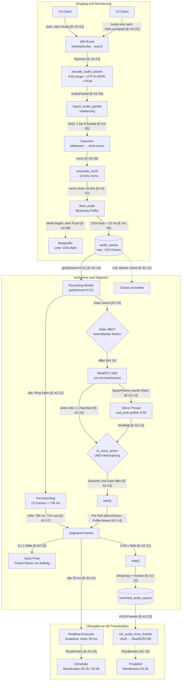
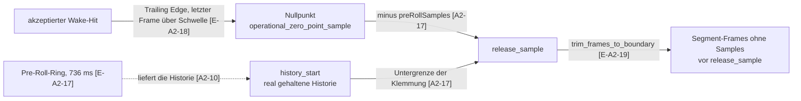
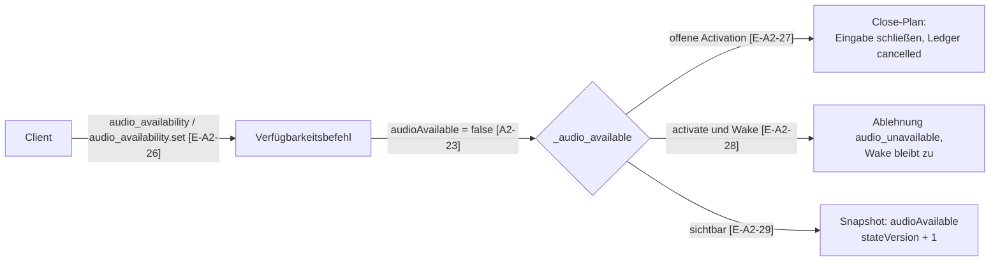

# 02.02 – Audioverarbeitung

**Quellstand:** `a8993c5c68042d996eab680d84a5b138a214bb5d`
**Gültigkeit:** V1, V2 und OpenAI-Batch; der Mikrofonpfad gilt nur für Library/Standalone
**Faktenbasis:** `workflow/research/02.02.json` (A2-01…A2-26, E-A2-01…E-A2-30, N-A2-01…06, U-A2-01…05)

## 1. Worum geht es?

Jede Transkription beginnt mit Bytes, die irgendwo ankommen: auf einem WebSocket, in einer hochgeladenen Datei oder – außerhalb des Serverbetriebs – an einem Mikrofon. Bis daraus ein Segment wird, das die Engine transkribieren kann, durchläuft das Audio mehrere Stationen: Es wird gegen Grenzen geprüft, auf eine einheitliche Rate gebracht, in feste Häppchen geschnitten, in Warteschlangen gepuffert und schließlich auf Sprachaktivität bewertet. Dieses Kapitel beschreibt genau diesen Weg. Es endet dort, wo ein fertiges Segment an die Transkription übergeben wird; was danach mit Text, Queues und Ledger passiert, steht in [02.05 Transcription](./02.05-transcription.md) und [02.08 Scheduler und Nebenläufigkeit](./02.08-scheduler-und-nebenlaeufigkeit.md).

Die wichtigste Aussage vorweg: **Der Recorder entscheidet nicht allein, ob aufgenommen wird.** Er prüft zuerst, ob das Gate der Activation offen ist, und erst danach die Sprachaktivität. Im kontrollierten Modus ist das Gate die eigentliche Aufnahme-Autorität; die VAD liefert nur die Bestätigung (A2-14).

Drei Zugänge münden in dieselbe untere Verarbeitung, aber mit unterschiedlicher Steuerung:

| Zugang | Einstieg | Audio fließt ab | Besonderheit |
|---|---|---|---|
| **V1** (Legacy) | `/ws/transcribe` | nach dem Textbefehl `start` | Fehler im Audiopaket werden beantwortet, die Verbindung bleibt offen (A2-03) |
| **V2** | `/ws/v2` | unmittelbar nach akzeptiertem `hello` | kein `start`/`stop`; Binärdaten vor dem Handshake → Close 4400 (A2-02, N-A2-01) |
| **OpenAI-Batch** | HTTP-Upload | mit der Datei | ein Batch, ohne Recorder-VAD (A2-26) |

## 2. Das Wesentliche auf einen Blick

- **Zwei verschiedene Größenlimits pro Paket.** Metadaten höchstens 64 KiB, PCM-Nutzlast höchstens 512 KiB (A2-01, A2-04).
- **Normierung ist deterministisch.** Mehrkanal per Mittelwert zu Mono, dann auf 16 kHz (A2-05).
- **Ein Chunk ist 1024 Byte = 512 Samples = 32 ms.** Nur volle Chunks wandern in die `audio_queue`; ein Rest bleibt liegen und wird beim Beenden **nicht** nachgeschoben (A2-07, N-A2-05).
- **Die `audio_queue` fasst 128 Chunks ≈ 4,096 s.** Eingangs-Chunk-Puffer, kein Segmentdauer-Limit (A2-08).
- **Der Pre-Roll hält 23 Frames = 736 ms**, nicht 750 ms: konfiguriert 0,75 s, gespeichert die ganzzahlige Frame-Zahl (A2-10). Der Pre-Roll-Trim ist im Server inaktiv (A2-11, N-A2-04).
- **Die VAD ist zweistufig.** WebRTC prüft alle 10 ms, Silero bestätigt in einem eigenen Thread mit `vad_prob > 0,95`; aktiv ist nur, was beide Stufen passiert (A2-12, A2-13, A2-14).
- **Segmentende in drei Zahlen:** 0,16 s Bestätigung, Mindestdauer 0,2 s, Stopp bei 0,55 s Stille (A2-15). Ein Früh-Final entsteht bereits nach 0,2 s Stille und ist danach nicht rückholbar (A2-16).
- **Audio-Verfügbarkeit ist eine Semantik, kein Transportzustand.** Sie sperrt neue Activations und bricht offene ab, beendet aber weder Stream noch Sitzung (A2-23).
- **Die Engine bekommt float32 ohne Pegelregelung.** Ein separater Engine-VAD (`vad_filter`) ist eine dritte, unabhängige Stufe (A2-25, N-A2-06).

### 2.1 Der Weg vom Rahmen zum Segment

**So ist das Diagramm zu lesen.** Oben: Rahmen → Decode → `ingest_audio_packet` (Validierung) → Downmix → Resampling → `feed_audio` → 1024-Byte-Chunks in die `audio_queue` (Rest bleibt liegen; Überlauf verwirft Älteste). Mitte: Worker holt Chunks (10-ms-Timeout), prüft Gate, dann WebRTC (10-ms-Unterframes) → Silero-Thread → UND → `is_voice_active` → `start()` mit Pre-Roll-Übernahme. Segment-Frames → Früh-Final (0,2 s) bzw. `stop()` (0,55 s) → `recorded_audio_queue`. Unten: nur Übergabe (Konvertierung bzw. Realtime-Snapshot an Executor); Queues/Ledger in 02.05/02.08.

**Textalternative ohne Mermaid:** V1-/V2-Rahmen → `decode_audio_packet` → `ingest_audio_packet` mit Validierung → Downmix auf Mono → Resampling 16 kHz → `feed_audio` → 1024-Byte-Chunks in `audio_queue` (Rest liegen, Überlauf verwirft Älteste) → Recording-Worker → Gate → WebRTC-VAD → Silero-Bestätigung → `is_voice_active` → `start()` mit Pre-Roll → Segment-Frames → Früh-Final nach 0,2 s Stille bzw. `stop()` nach 0,55 s → `recorded_audio_queue` → float32-Konvertierung bzw. Realtime-Snapshot an Executor.

### 2.2 Alle belegten Kanten

| ID | Von → Nach | Übergabe oder Bedingung | Fakten |
|---|---|---|---|
| E-A2-01 | V1-Client → `/ws/transcribe` | Textbefehl `start` vor dem Binäraudio | A2-03 |
| E-A2-02 | V2-Client → `/ws/v2` | Binäraudio erst nach `hello.accepted` | A2-02 |
| E-A2-03 | WS-Route → `decode_audio_packet` | 4-B-Länge + JSON + PCM | A2-01, A2-02, A2-03 |
| E-A2-04 | Decode → `ingest_audio_packet`/Validierung | `AudioPacket` | A2-03, A2-04 |
| E-A2-05 | Validierung → Downmix | int16, Kanäle 1…8 | A2-04, A2-05 |
| E-A2-06 | Downmix → Resampling 16 kHz | `resample_poly`, Fallback `np.interp` | A2-05 |
| E-A2-07 | Resampling → `feed_audio`-Chunker | int16 mono 16 kHz | A2-05, A2-07 |
| E-A2-08 | Chunker → Restpuffer | weniger als 1024 Byte bleiben liegen | A2-07 |
| E-A2-09 | Chunker → `audio_queue` | 1024 Byte = 32 ms | A2-07 |
| E-A2-10 | `audio_queue` → Recording-Worker | `get(timeout=0.01)` | A2-08 |
| E-A2-11 | Überlauf → älteste Chunks verworfen | Limit 128 | A2-08 |
| E-A2-12 | Worker (idle) → Pre-Roll-Ring | 23 Frames / 736 ms | A2-10 |
| E-A2-13 | Worker → WebRTC-VAD | 10-ms-Unterframes | A2-12 |
| E-A2-14 | WebRTC → Silero-Thread | bestätigende zweite Stufe | A2-13 |
| E-A2-15 | WebRTC + Silero → `is_voice_active` | UND, 1-s-Nachlauf | A2-14 |
| E-A2-16 | `is_voice_active` + Gate → `start()` | Aufnahme beginnt | A2-14 |
| E-A2-17 | Pre-Roll-Ring → Frames | volle 736 ms (Trim aus) | A2-11 |
| E-A2-18 | Wake-Hit → `WakeAudioBoundary` | Nullpunkt minus `preRollMs`, geklemmt | A2-17 |
| E-A2-19 | Boundary → Frame-Trim | Samples vor `release_sample` entfallen | A2-17 |
| E-A2-20 | Aufnahme → Early-Final | 0,2 s Stille, aktueller Frame-Stand | A2-16 |
| E-A2-21 | Aufnahme → `stop()` | 0,55 s Stille / 0,16 s Bestätigung | A2-15 |
| E-A2-22 | `stop()` → `recorded_audio_queue` | Frames + `segment_context` | A2-18 |
| E-A2-23 | Queue → `set_audio_from_frames` | int16 → float32/32768 | A2-18 |
| E-A2-24 | Frames → Realtime-Executor | Snapshot, mind. 50 ms, alle 20 ms | A2-19 |
| E-A2-25 | Executor → Scheduler | Randknoten 02.05 / 02.08 | A2-20 |
| E-A2-26 | Client → Audio-Verfügbarkeit | V1-Befehl bzw. V2-Set | A2-21, A2-22 |
| E-A2-27 | `false` → Activation-Abbruch | `audio_unavailable` | A2-23 |
| E-A2-28 | `false` → blockiert `activate` und Wake | `audio_unavailable` | A2-23 |
| E-A2-29 | Verfügbarkeit → Snapshot | `audioAvailable`, eine `stateVersion` | A2-22 |
| E-A2-30 | HTTP-Upload → Decode 16 kHz float32 | 25 MiB, ein Batch | A2-26 |

## 3. Eingang und Validierung

### 3.1 Der Rahmen

Ein Audioframe = 4-Byte-Länge (little-endian, JSON-Kopf) + UTF-8-JSON + Rohaudio (A2-01). Metadaten > 64 KiB abgelehnt (encode + decode); kaputtes/nicht-binäres/fehlendes/ungültiges/Nicht-Objekt → `AudioPacketError` – keine Sitzung mit halb gelesenen Daten.

### 3.2 V2 prüft Handshake, V1 meldet Fehler (ohne Close)

V2: `handle_binary` zuerst `accepted`; vor `hello` → Close 4400, keine Session/kein Recorder. Danach: dekodieren → `ingest`; Fehler nur geloggt, Verbindung offen (A2-02). V1: `decode` → `ingest`; Dekodierfehler → `{type:error,where:audio_packet}`, Annahmefehler → `{type:error,where:audio}`, Ablehnung → `{type:warning}`; Verbindung bleibt in allen Fällen (A2-03). `stop` = Streaming-Prüfung, kein Transportende.

V2-4400 = Programmierfehler im Verbindungsaufbau; V1-`error` = Hinweis ohne Abbruch. Details: [04.05](../04-schnittstellen/04.05-audiotransport.md), [04.12](../04-schnittstellen/04.12-legacy-v1.md).

### 3.3 Die sechs Prüfungen

Reihenfolge (A2-04): (1) Nutzlast ≤ `max_audio_packet_bytes` (512 × 1024 = 512 KiB); (2) `sampleRate` positiv int (kein bool); (3) `channels` Default 1, positiv, ≤ 8; (4) `format` Default `pcm_s16le`, **nur** dieses (keine Konvertierung, Ablehnung); (5) Nutzlast-Vielfaches von `channels × 2`; (6) `frames` positiv + exakt. Keine `sampleRate`-Obergrenze – jede positive Rate akzeptiert und heruntergerechnet (reale Client-Raten unbelegt, U-A2-01). Nur PCM-Nutzlast gegen 512 KiB; Metadaten separat 64 KiB.

Beispiel: 20 ms Stereo @48 kHz = 960 Frames, 3840 Byte; durch 4 teilbar, `frames=960` exakt; Downmix → 960 Mono, Resampling 3:1 → 320 Samples = 20 ms (A2-04, A2-05).

### 3.4 Downmix und Resampling

int16-Array; bei >1 Kanal Mittelwert + int16-Cast (unvollständiger Rest verworfen). Dann `resample_int16(rate, 16000)`: gleich/leer → Kopie; sonst `resample_poly` (ganzzahliges Up/Down via gcd), Fallback `np.interp`, Clip `[-32768, 32767]` (A2-05).

Null-Sample-No-op: Konvertierung 0 Samples (Nutzlast < Kanalrahmen) → `(True, None)`: kein Recorder/Fehler/Zähler (A2-06). Leere Pakete stören nicht.

## 4. Chunking und Warteschlangen

### 4.1 32 Millisekunden als kleinste Einheit

`feed_audio`: bytearray-Puffer, 2D-Mittelwert, Resampling nur bei ≠16000, int16-Bytes anhängen. `buf_size = 2 × 512 = 1024 Byte = 512 Samples = 32 ms` (A2-07). Nur volle Chunks in `audio_queue`; Rest wartet. Beispiel: 3200 Byte (1600 Samples) → 3 Chunks + 128 Byte Rest.

Grenzfall: **Rest beim Beenden/Flush nicht nachgeschoben** (A2-07, N-A2-05) – bis 31 ms Audioverlust am Segmentende möglich; nur Mikrofon-Worker flusht (A2-09).

### 4.2 Ein Konsument, ein Timeout, ein Überlauflimit

Worker holt mit `get(timeout=0.01)`, zählt Samples (`len // 2`), ruft `on_recorded_chunk`, baut bei Überlauf bis `allowed_latency_limit` die **ältesten** Chunks ab (A2-08). Server: Limit = `audio_queue_size` = 128 → 128 × 32 ms ≈ **4,096 s**. Zu langsamer Konsument verliert den Anfang, nicht das Neueste.

**`audio_queue_size` = Eingangs-Chunk-Puffer, kein Segmentdauer-Limit** (A2-08). „Aufnahme bricht nach ~4 s ab" → falscher Ort; Dauergrenzen in Abschnitt 14.

## 5. Der Mikrofonpfad gehört zur Library

Server: `use_microphone=False`; PyAudio-Leser nur bei `True` (A2-09). Audio nur via WebSocket/HTTP. Mikrofonpfad (Library/Standalone): mono `paInt16`, 1024-Frames-Lesen, 16-kHz-Versuch sonst höchste Rate (ohne Gerät 48000), Gerätetest, Resampling, 1024-Byte-Chunks, eigener Prozess mit `mp.Queue`; **Teilpuffer-Flush beim Ende** (A2-09). „Kein Audio": erst fragen Server-vs-Library (vgl. [01.06](../01-grundlagen/01.06-serverweite-und-sitzungsbezogene-ressourcen.md)).

## 6. Pre-Roll: 23 Frames, 736 Millisekunden

### 6.1 Warum 736 ms statt 750 ms

Ringpuffer `maxlen = int((rate // buffer) * duration) = int((16000//512) * 0.75) = int(31 × 0.75) = 23 Frames` à 32 ms = **736 ms** (A2-10). Paralleler Metadaten-Deque (Sample-Zähler, RMS, WebRTC/Silero-Flags). Gefüllt wenn idle oder seit Stillebeginn.

Kein Rundungsfehler: ganze Frames, 0,75 s nicht ganzzahlig darstellbar. Konfiguriert = Obergrenze, gehalten = 736 ms. 750-ms-Erwartung misst 14 ms zu viel.

### 6.2 Der Trim ist vorhanden, aber im Server aus

Library-Selektor: `min_silence` 200 ms, `guard` 160 ms, `max_gap` 80 ms, `min_included` 600 ms, RMS-Schwelle `min(silence_rms, floor × 2,5 + 25)` (A2-11). Server setzt Schlüssel nicht → `enabled` False → **alle** Ring-Frames, keine Auswahl, kein zweiter VAD-Lauf (A2-11, N-A2-04). Folgen: bis 736 ms Vorlauf inkl. Raumgeräusch (normal); Selektor kein Server-Diagrammschritt – nur Ring aktiv.

## 7. Die zweistufige Sprachaktivitätserkennung

### 7.1 Stufe 1: WebRTC auf 10-ms-Fenstern

32-ms-Chunk → drei 10-ms-Unterframes (160 Samples = 320 Byte bei 16 kHz). Normal: **ein** Sprachframe genügt → `True` + `last_webrtc_speech_time`; sonst Reset (A2-12). `all_frames_must_be_true=True` ungesetzt (alle müssten sprechen). Rate ≠16 kHz vorher `resample_poly`. Billig, empfindlich – Fehlauslöser-Abfang folgt.

### 7.2 Stufe 2: Silero in eigenem Thread

Nur bei WebRTC-Sprache und inaktivem Silero: Thread `check_voice_activity` (A2-13). WebRTC inaktiv→aktiv resettet Silero-Zustand. Entscheidung `vad_prob > (1 - silero_sensitivity)`; Server `0.05` → **`> 0,95`** – bewusst hoch (A2-13). Generationen-Zähler + Lock gegen veraltete Threads; `reset_silero_vad_state` räumt auf.

Wert gesetzt, nicht begründet (U-A2-04); Kalibrierung Sensitivität/`preRollMs` offen (U-A2-03).

### 7.3 UND-Verknüpfung – und wer wirklich entscheidet

`is_voice_active = (webrtc_aktiv ODER now - last <= 1,0 s) UND silero_aktiv` (A2-14). 1-s-Nachlauf ≠ Stille-Bestätigung (Abschnitt 8): ersteres hält „aktiv" offen, letzteres misst Stille. Worker: **erst Gate, dann VAD**; nur bei beidem `start()` + Pre-Roll-Übernahme + Puffer-Leerung (A2-14). Controlled: Gate allein maßgeblich, VAD nur Plausibilität. Phasen/Timer/Gate-Bindung: [02.03](./02.03-activation.md). Ohne offenes Gate kein Segment – auch bei schreiender VAD.

## 8. Start, Stopp und der heikle Früh-Final

### 8.1 Wann ein Segment endet

| Wert | Server-Default | Bedeutung |
|---|---|---|
| Stille-Bestätigung | **0,16 s** | ab hier gilt „still" |
| Mindestdauer | **0,2 s** | kürzere Äußerungen: kein `speech_end`, kein Turn |
| Stopp-Schwelle | **0,55 s** | Segmentende |

Stopp-Erkennung per **WebRTC** (Server setzt `silero_deactivity_detection` nicht; Library-Default False) (A2-15). Danach `on_vad_stop`, `stop()`, Turn-Callbacks. „äh" (0,15 s) → kein Turn. Letztes Signal → Ende: mind. 0,55 s + Bestätigungsfenster (normal, kein Hänger).

### 8.2 Der Früh-Final ist ein echter Finalauftrag

`early_transcription_on_silence > 0` (Server **0,2 s**) + Frames + Stille + `allowed_to_early_transcribe` → **aktueller** Frame-Stand als float32-**Finalauftrag** (`use_prompt=True`) (A2-16). Danach Flag False bis neue Sprache/`perform_final`.

1. **Final, kein Interim** – geht in Finalpfad, nicht Realtime-Schleife.
2. **Rest nicht nachgeschoben** – `perform_final` sendet nur bei `transcribe_count == 0`, wartet sonst. Finaltext aus Frame-Stand **vor** Aufnahmeende.

Tests: Übermittlung während `is_recording` True (A2-16). Wer nach kurzer Pause (unter 0,55 s) weiterspricht, fehlt im bereits abgesetzten Finaltext. Latenz-Optimierung mit Vollständigkeitsrisiko.

### 8.3 Durchgerechnetes Beispiel

V2-Client, 32-ms-Pakete @16 kHz mono (1024 Byte = 1 Chunk/Paket). Activation offen → Gate offen.

| Zeit | Ereignis | Beleg |
|---|---|---|
| −0,736 s | Pre-Roll-Ring mit 23 Frames gefüllt | A2-10 |
| 0,000 s | Sprache beginnt | – |
| ≈ 0,020 s | WebRTC: Sprachframe im Chunk | A2-12 |
| ≈ 0,030 s | Silero bestätigt (`> 0,95`), `is_voice_active`, `start()` + Pre-Roll | A2-13, A2-14 |
| 1,900 s | letzte Sprache | – |
| 2,060 s | Stille 0,16 s bestätigt | A2-15 |
| 2,100 s | 0,2 s Stille: Früh-Final aus Frame-Stand | A2-16 |
| 2,450 s | 0,55 s Stille: `stop()` → `recorded_audio_queue` | A2-15, A2-18 |

Segment ≈ 3,19 s (0,736 s Vorlauf). Früh-Final bis ≈ 2,1 s; Rest Stille. Neustart bei 2,2 s → fehlend im Final (Auftrag abgesetzt).

## 9. Die Wake-Grenze

Akzeptierter Wake-Hit → Grenze = **Trailing Edge** (letzter Frame ≥ Schwelle) als `operationalZeroPointSample` (A2-17). Start: `release_sample = max(history_start, zero_point − preRollSamples)`; `history_start` = real gehaltene Historie (Pre-Roll-Ring + Frames) (A2-17). Klemmung: weiter zurück als vorhanden → frühestes Sample, nie „ins Nichts". `preRollMs` Session-Setting Default 0, `next_activation`, keine receptive-Obergrenze; Klemmung sichert (A2-17). Test: 10 ms → 160 Samples; 5000 ms → geklemmt.

**Lesart.** Hit → Trailing-Edge-Nullpunkt → minus `preRoll` → gegen Historie geklemmt → Maximum = Schnitt; alles davor verworfen. Gestrichelt: Historie aus Pre-Roll-Ring.

**Textalternative:** Wake-Hit → Trailing Edge als Nullpunkt → `release_sample = max(history_start, Nullpunkt − preRollSamples)` → `trim_frames_to_boundary` schneidet davor ab.

Nur bei `WakeAudioBoundary`-Instanz; sonst Legacy-Fixschnitt `sample_rate × wake_word_buffer_duration` (Default 0,1 s) (A2-17). `preRollMs`-Kalibrierung offen (U-A2-03); Default 0 = nur Trailing Edge, kein Zusatzvorlauf.

## 10. Assemblierung und Übergabe an Realtime

### 10.1 Was `stop()` hinterlässt

`stop_recording`: Frames deepcopy + `backdate_*` + `segment_context` → `recorded_audio_queue`; Frames leer; Stabilizer `finalize()` ohne Finaltext; Events + Callback (A2-18). Kontext unveränderlich – spätere Settings wirken nicht rückwirkend.

`set_audio_from_frames`: join → int16 → `/32768.0` float32; `backdate_stop` schneidet Ende, `backdate_resume` als int16 in **2048-Byte-Blöcken** (1024 Samples = **64 ms**) zurück (A2-18). Keine neue Audioformat-Stufe – Einfüge-Körnung, kein Puffer.

### 10.2 Der Realtime-Snapshot

Worker friert Identität/Kontext ein, kopiert Frames (optional Lock), verwirft bei Identitätsänderung (A2-19). join → ungerades Byte weg → int16; **< 50 ms Skip**; `/32768` → float32; **kein Resampling** (Recorder 16 kHz). Server `realtime_processing_pause = 0.02` (Library 0,2 s); `awaiting_speech_end` pausiert (A2-19). Alle ~20 ms Snapshot ≥ 50 ms – überlappende Fenster, keine exakten Stücke.

## 11. Der Executor als Randknoten

Zwei Executoren (Final/Realtime): `transcribe` → `transcribe_with_context`; Final ohne Kontext lädt `current_transcription_context`; `service.transcribe_for_recorder` (A2-20). Ab hier Inferenz: Priorisierung/Limits/Verwerfung/Ledger in [02.05](./02.05-transcription.md), [02.08](./02.08-scheduler-und-nebenlaeufigkeit.md). Lieferung endet mit float32 + Kontext.

## 12. Audio-Verfügbarkeit

### 12.1 Der Befehl in V1

`{type: "audio_availability", commandId, audioAvailable}`; `commandId` nicht-leer Pflicht: fehlt → `missing_command_id`, falscher Typ → `invalid_command_id`; Nicht-Bool → `invalid_payload` (A2-21). Gleiche ID + gleicher Payload → **Replay**; gleiche ID anderer Payload → `command_id_conflict`. Ack `audio_availability_ack`: `commandId`, `accepted`, `reason` (`applied`/`no_change`), `audioAvailable`, `activationId`, `phase`, `sessionId` – Quittung + Phasen-/Activations-Stand.

### 12.2 V2 – sichtbar ohne Event

`audio_availability.set` validiert Bool, ruft Domänenmethode (A2-22). **Kein** Availability-Event (N-A2-03); aber `audioAvailable` Snapshot-Pflicht → Connection erhöht `stateVersion` **genau einmal** (`visible_without_event`); Replay/`no_change` nichts. Bei gleichzeitigem Input-Close: Ack mit Version des `closing_input`-Eintritts.

Regel für Clients: Zustand nicht nur über Events führen – `stateVersion`/Snapshot vergleichen. Zustandsmodell: [04.09](../04-schnittstellen/04.09-client-zustandsmodell.md).

### 12.3 Was `false` und `true` bewirken

Start `true`. `false` (A2-23): (1) offene Activation via `activation.audio_unavailable()` + Close-Plan (Input-Close, Ledger `cancelled`); (2) `cancel_requested`, Wake-Reset; (3) **Streaming/Sitzung weiter, Audioannahme NICHT blockiert**; (4) neues `activate` → `audio_unavailable`-Ablehnung, Wake zu; (5) `true` nur Flag – Sitzung wieder nutzbar, Wake wieder möglich.

**Verfügbarkeit = Bedeutung, kein Transportzustand.** Ingest prüft Flag nicht (A2-23). Weitergesendetes Audio wird bedient – sinnvoll oder nicht, Cliententscheidung (U-A2-02). Keine serverseitige Geräteerkennung: Wert nur vom Client (N-A2-02). Fail-closed: Flag False + technisches Ende statt Zwischenzustand.

**Lesart.** Ein Flag, drei unabhängige Wirkungen: Abbruch offener Activation, Ablehnung neuer Versuche, versionierte Sichtbarkeit. Transport in keinem Pfeil – fehlende Quelle beendet keine Verbindung.

**Textalternative:** Befehl → Flag `false` → offene Activation `audio_unavailable`-Abbruch → neue `activate`/Wake abgelehnt → Snapshot `audioAvailable: false` + `stateVersion`+1; Sitzung bleibt.

## 13. Datei-Upload und Batch

`POST /v1/audio/transcriptions`: Datei Pflicht, Dateiname-Check, Limit `openai_max_file_bytes + 1` (Default **25 MiB**), darüber **413** (A2-26). Decode via Faster-Whisper `sampling_rate=16000` Mono-float32; Dauer = `len/16000`. **Ein Batch** durch Scheduler/Engine-Pfad, **ohne Recorder-VAD**.

1. 25 MiB = Dateigröße, keine Dauer (unkomprimiert 16-kHz-Mono ≈ 13,7 min; MP3 gleicher Größe viel länger).
2. Ohne VAD: keine Segmentierung/Pre-Roll/Stille-Heuristik – Datei als Ganzes.
3. Engine-VAD unberührt (Abschnitt 15): „ohne VAD" gilt nur Recorder-Stufen.

Details: [04.10](../04-schnittstellen/04.10-openai-kompatible-api.md).

## 14. Drei Grenzen, die man nicht verwechseln darf

| Grenze | Default | Wo | Bei Erreichen |
|---|---|---|---|
| `audio_queue_size` | **128** Chunks ≈ 4,096 s | Eingang `feed_audio`→Worker | Älteste verworfen (A2-08) |
| `max_audio_queue_seconds_per_session` | **30,0 s** | kumulierte Samples/Sitzung | Flush, Zwangs-Final, Warnung (A2-24) |
| `max_final_queue_depth_per_session` | **8** | wartende Finals | Ältester verworfen; Ledger `discarded`, `recorded_audio_queue_trimmed` (A2-24) |

Harte Nicht-Queue-Limits: Metadaten 64 KiB / PCM 512 KiB / Kanäle ≤ 8 / nur `pcm_s16le` (Ablehnung); Upload 25 MiB → 413.

30 s zählt **kumuliert pro Sitzung**, nicht Segment: Diktat mit 30 s Gesamtsprache → Schnitt mit Flush + Zwangs-Final, nicht still. 4,096 s nur Rückstand.

## 15. Engine-Normierung und die dritte VAD

Übergabe: int16/32768 → float32; **keine** Verstärkung/Rauschunterdrückung/Gain (N-A2-06). Optional `normalize_audio` (Default aus): Peak-Skalierung **0,95** – laut nicht klippend, leise hörbar bleibend.

Dritte Stufe: Faster-Whisper `vad_filter` **an** (Default) (A2-25). Unabhängig von WebRTC/Silero, arbeitet auf Segmentiertem, schneidet Stille. Drei Stufen (2 Recorder + 1 Engine) nicht verschmelzen: Entscheidend ist, **wo** „keine Sprache" verworfen wurde. Engine-Optionen: [08.08](../08-referenzen/08.08-engine-referenz.md).

## 16. Grenzen und offene Punkte

### 16.1 Nicht implementiert

| ID | Befund | Bedeutung |
|---|---|---|
| N-A2-01 | Kein `start`/`stop` in V2 | Atomar mit `hello.accepted`; nicht auf Start warten |
| N-A2-02 | Keine serverseitige Geräteerkennung | Client-Bool; kein Mikrofon-Wissen |
| N-A2-03 | Kein Availability-Event V2 | Nur `stateVersion` + Snapshot |
| N-A2-04 | Pre-Roll-Trim Server inaktiv | Library-Feature, keine Serverstufe |
| N-A2-05 | Kein Sub-32-ms-Rest-Flush | Bis 31 ms Verlust am Segmentende |
| N-A2-06 | Keine AGC/Rauschunterdrückung/Gain | Nur int16-Konvertierung + optionale Peak-Norm 0,95 |

### 16.2 Offen

| ID | Offen | Warum es zählt |
|---|---|---|
| U-A2-01 | Reale Client-Raten/Chunkgrößen | Jede positive Rate akzeptiert; „typisch" unbelegt |
| U-A2-02 | Clientverhalten nach `false` | Server nähme weiter an; Stoppen undokumentiert |
| U-A2-03 | Silero-/`preRollMs`-Kalibrierung | Trefferquote/Wortanfang direkt betroffen |
| U-A2-04 | Begründung `silero_sensitivity = 0.05` | Gesetzt, nicht hergeleitet |
| U-A2-05 | Branch-Identität | Detached HEAD; Commit trägt, Branch nicht |

### 16.3 Vier Spannungen

1. **Konfiguriert 0,75 s, real 736 ms** – ganze Frames; 14 ms systematisch (A2-10).
2. **Drei „Queues", drei Bedeutungen** – Eingang, Sitzungsbudget, Finaltiefe (A2-08, A2-24).
3. **Schwelle 0,95 statt 0,5** – konservativ; erklärt fehlende Segmente trotz WebRTC (A2-13).
4. **Semantik vs. Transport** – `false` bricht Activation, beendet nichts (A2-23).

## 17. Siehe auch / Nachweise

**Faktenakte:** `workflow/research/02.02.json`, Commit `a8993c5c68042d996eab680d84a5b138a214bb5d`.

| Thema | Fakten | Codebeleg |
|---|---|---|
| Rahmen, 64-KiB-Grenze | A2-01 | `protocol.py` |
| V2-Handshake-Gate, 4400 | A2-02 | `protocol_v2/connection.py`, `schema.py` |
| V1-Fehler ohne Close | A2-03 | `server.py` `websocket_loop` |
| Validierung, 512 KiB, 8 Kanäle, nur pcm_s16le | A2-04 | `server.py` `packet_to_server_samples`; `protocol.py` |
| Downmix/Resampling/Clip | A2-05 | `server.py` `resample_int16` |
| Null-No-op | A2-06 | `server.py` `ingest_audio_packet` |
| 1024 B/32 ms, kein Flush | A2-07 | `manual_audio_input.py`, `audio_recorder.py` |
| Worker/Timeout/Überlauf 128 (≈4,096 s) | A2-08 | `recording.py`, `server.py`, `initialization.py` |
| Mikrofon nur Library (+Flush) | A2-09 | `server.py`, `audio_input_worker.py`, `initialization.py` |
| Pre-Roll 23 F/736 ms + Metadaten | A2-10 | `initialization.py`, `voice_activity.py`, Server-Default |
| Trim inaktiv | A2-11 | `voice_activity.py`, `preroll.py`, Server-Config ohne Schlüssel |
| WebRTC 10-ms-Frames | A2-12 | `voice_activity.py` |
| Silero-Thread, Schwelle 0,95 | A2-13 | `voice_activity.py`, Server-Default |
| UND + Nachlauf, Gate zuerst | A2-14 | `voice_activity.py`, `recording.py`, `activation_control.py` |
| 0,16/0,2/0,55 s, WebRTC-Stopp | A2-15 | `recording.py`, Defaults, Serverwerte |
| Früh-Final, kein Zweitauftrag | A2-16 | `recording.py`, `transcription_api.py` |
| Wake-Grenze/Trailing Edge/Klemmung/Legacy-Schnitt | A2-17 | `wake_audio_boundary.py`, `recording.py`, `settings_control.py` |
| stop/Frames/Kontext/64-ms-Blöcke | A2-18 | `lifecycle.py`, `recording_buffers.py` |
| Realtime-Snapshot/50 ms/20 ms/kein Resampling | A2-19 | `realtime.py`, Server-Pause |
| Executoren/Kontext/Scheduler | A2-20 | `server.py` |
| V1-Audio-Befehl/Ack/Replay | A2-21 | `server.py` Handler |
| V2-Verfügbarkeit/stateVersion/kein Event | A2-22 | `commands.py`, `connection.py`, `snapshot.py`, `schema.py` |
| Abbruch/Sperre/Fail-Closed | A2-23 | `server.py` Init/Gates/Handler/Fail-Closed |
| 30 s/Finaltiefe 8 | A2-24 | `server.py` Limits |
| float32/Pick-Norm/vad_filter | A2-25 | `base.py`, `faster_whisper_engine.py`, Server-Defaults |
| Upload 25 MiB/413/16 kHz/Batch | A2-26 | `openai_routes.py`, `server.py` |

**Verwandte Kapitel:** [01.04](../01-grundlagen/01.04-gesamter-datenfluss.md) · [01.06](../01-grundlagen/01.06-serverweite-und-sitzungsbezogene-ressourcen.md) · [01.07](../01-grundlagen/01.07-identitaeten.md) · [02.01](./02.01-session-management.md) · [02.03](./02.03-activation.md) · [02.05](./02.05-transcription.md) · [02.08](./02.08-scheduler-und-nebenlaeufigkeit.md) · [04.05](../04-schnittstellen/04.05-audiotransport.md) · [04.09](../04-schnittstellen/04.09-client-zustandsmodell.md) · [04.10](../04-schnittstellen/04.10-openai-kompatible-api.md) · [04.12](../04-schnittstellen/04.12-legacy-v1.md) · [08.02](../08-referenzen/08.02-command-katalog.md) · [08.03](../08-referenzen/08.03-settings-katalog.md) · [08.06](../08-referenzen/08.06-timing-katalog.md) · [08.08](../08-referenzen/08.08-engine-referenz.md) · [09.01](../09-anhaenge/09.01-glossar.md)

**Gliederung:** Mikrofon (5) · Zuführung/WebSocket (3, 13) · PCM/Format/Rate (3) · Frames/Chunks/Puffer (4) · Resampling (3.4) · Normalisierung (15) · VAD (7, 15) · Pre-Roll/Grenzen (6, 9) · Verfügbarkeit (12) · Übergabe (10, 11).
