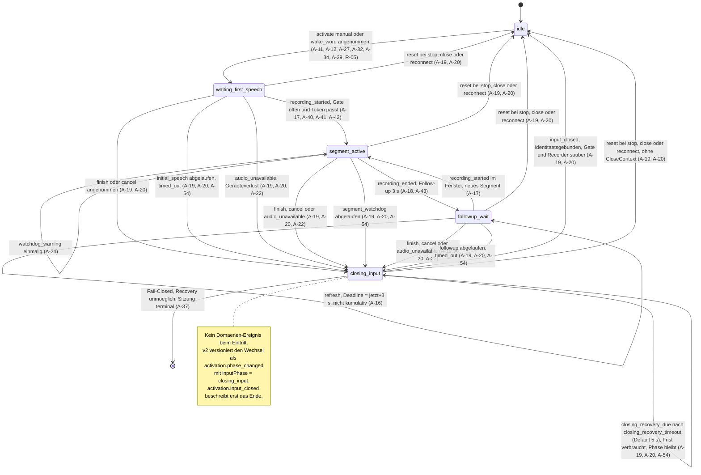
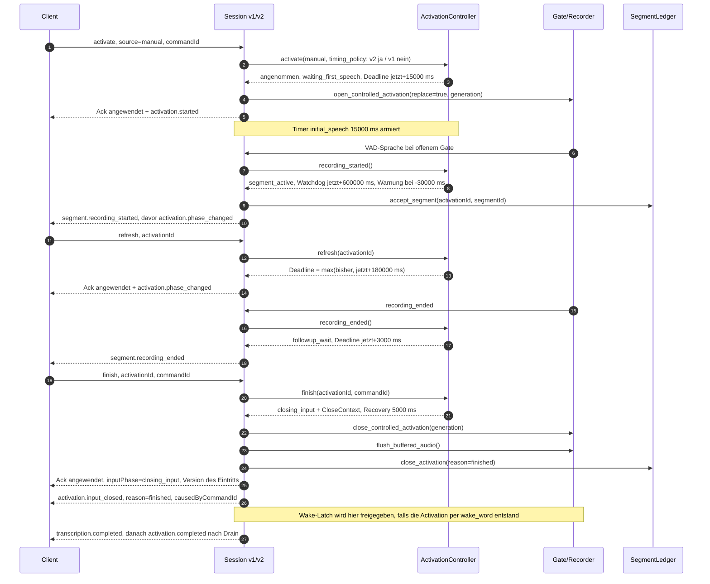

# 02.03 – Activation

## 1. Worum geht es?

**Geltungsbereich.** Dieses Kapitel beschreibt den **kontrollierten Activation-Modus**: das ist jede v2-Sitzung und jede v1-Sitzung, die beim Aufbau mindestens ein Trigger-Flag mitschickt (Opt-in). Eine klassische v1-Sitzung ohne Trigger-Flags läuft im **Legacy-Modus**: Sie besitzt keinen ActivationController, nimmt Sprache direkt über VAD bzw. Wake Word auf und kennt die hier beschriebenen Phasen, Identitäten und Timer nicht (R-05, R-06). Wo Legacy abweicht, sagt dieses Kapitel es ausdrücklich.

„Activation" ist der Zeitraum, in dem der Server Sprache für genau eine Äußerungseinheit annimmt: vom Druck auf die Sprechtaste (oder vom erkannten Wake Word) bis zu dem Moment, in dem die Audioeingabe wieder sicher geschlossen ist. Ohne eine solche Instanz gibt es kein verlässliches „offen/zu": Die Sprachaktivitätserkennung (VAD, Voice Activity Detection) würde bei jedem Husten eine Aufnahme starten, Push-to-Talk und Wake Word würden sich gegenseitig die Aufnahme wegnehmen, und ein Client wüsste nie, ob sein „Stopp" noch etwas bewirkt hat.

Das Problem ist im Kern ein Konkurrenzproblem. Drei Dinge wollen dieselbe Ressource steuern: ein Mensch am Client (manuell), die Wake-Word-Erkennung im Server und die Audio-Hardware (Mikrofon vorhanden oder nicht). Dazu kommen Zeitgeber, die ein offenes Fenster irgendwann schließen müssen, damit eine Sitzung nicht ewig „aufnahmebereit" bleibt.

Die Lösung ist eine **serverautorisierte Zustandsmaschine**: Im kontrollierten Modus gibt es pro Sitzung genau einen *Controller*, der alle Trigger, alle Recorder-Callbacks und alle Timeout-Callbacks serialisiert und fünf kanonische Phasen kennt (A-11, R-05). Für die Cliententwicklung ist das der entscheidende Punkt: Der Client *rät* den Zustand nicht aus Audiostreams, sondern bekommt zu jedem Befehl eine deterministische Antwort (Ack) und dazu Ereignisse, die den Zustand versionieren. Ein abgelehnter Befehl ist damit genauso gut diagnostizierbar wie ein angenommener.

Wichtig für die Abgrenzung: Die finale Transkription ist **keine** Phase dieser Maschine. Sobald die Eingabe sicher geschlossen ist, steht die Vordergrundphase auf `idle` und darf die nächste Activation annehmen, während ältere Arbeit im Hintergrund noch ausläuft (A-20). Wer das verwechselt, baut Clients, die auf ein „fertig" warten, das die Activation gar nicht liefert.

## 2. Das Wesentliche auf einen Blick

- **Ein Controller je Sitzung – im kontrollierten Modus.** Er besitzt den Vordergrundzustand, die Zeitgeber und die Identitäten (`activationId`, `activationSequence`, `segmentToken`, `timerRevision`, `version`) (A-11, R-05).
- **V1-Legacy ist nicht ein Sonderfall dieses Controllers, sondern sein Ersatz.** Ohne Trigger-Flags bleibt `_activation = None`, der Recorder arbeitet mit der Policy `legacy`, die Aufnahme entsteht direkt aus VAD/Wake Word, ein `trigger` wird mit `controlled_activation_disabled` abgelehnt, der Anschluss nach einem Segment läuft über das Recorder-Fenster `wake_word_followup_window` (Default 0.0 = aus), Ledger-Identitäten sind synthetisch (`legacy-<sessionId>-<n>`), und die sechs Zeitwerte sind wirkungslos (R-05, R-06).
- **Zwei Triggerquellen, keine Rangfolge.** `manual` und `wake_word` werden nach denselben Regeln aufgenommen; keine Quelle ist „wichtiger", und es werden niemals zwei Quellen zu einer Activation verschmolzen (A-12, A-34).
- **Das Gate ist die einzige Aufnahme-Autorität.** Die VAD darf nur aufnehmen, wenn das Gate für genau diese Activation offen ist; das Gate ist an `(activationId, generation)` gebunden, sodass ein verspätetes Öffnen oder Schließen keine neuere Activation trifft (A-27, A-32, A-40).
- **Vier Deadline-Arten** statt beliebig vieler Timer: `initial_speech`, `followup`, `segment_watchdog` und `closing_recovery` (A-54).
- **Jeder Zeitgeber-Callback muss ein Token vorweisen.** Passt es nicht mehr, ist er wirkungslos – er kann weder eine neuere Activation beenden noch eine ältere wiederbeleben (A-16, A-24).
- **Schließen ist zweiphasig.** Erst Barriere und Kontext, dann physisches Schließen; im regulären Abschluss entsteht `idle` ausschließlich über ein identitätsgebundenes `input_closed()` (A-19, A-20). Nur der Reset (Stop, Close, Reconnect) verwirft den Vordergrund ohne Abschlussprotokoll und geht direkt nach `idle`.
- **Befehle sind idempotent – innerhalb einer Sitzung.** Eine `commandId` wird je Sitzung genau einmal beantwortet; ein Replay liefert die gespeicherte Antwort, ohne die Maschine erneut zu betreten. Nach einem echten Disconnect gilt das nicht mehr (R-03; §3.8).
- **Scheitert das Schließen hart, wird die Sitzung terminal beendet** statt in einem dauerhaft hängenden `closing_input` zu verharren (Recovery/Fail-Closed, A-19, A-20).

## 3. So funktioniert es

### 3.1 Der Controller und seine Identitäten

Der Controller ist ein Objekt mit einem einzigen Sperrzugriff (Lock) und einem einfachen Auftrag: Er nimmt Befehle, Recorder-Callbacks und Timer-Callbacks entgegen und entscheidet jeweils, ob sie in der aktuellen Phase etwas bewirken dürfen. Jede Entscheidung liefert neben „akzeptiert/abgelehnt" einen **Begründungscode** und einen **Snapshot** des Zustands (A-11).

Vier Zähler machen den Zustand nach außen überprüfbar:

| Feld | Wann es sich ändert | Wozu der Client es braucht |
|---|---|---|
| `activationId` | bei jeder neu aufgenommenen Activation | Identität für alle Folge-Befehle |
| `activationSequence` (Kompatibilitätsfeld `generation`) | nur bei Aufnahme einer neuen Activation | erkennt „das ist eine andere Activation als meine" |
| `version` | bei jeder sichtbaren Zustandsänderung | ordnet Ereignisse und Acks |
| `timerRevision` | nur bei einer *wirksamen* Zeitgeberänderung | entwertet alte Timer-Callbacks |

Dass `timerRevision` nur bei echten Änderungen steigt, ist praktisch bedeutsam: Eine Watchdog-*Warnung* verschiebt keine Frist und erhöht die Revision deshalb bewusst nicht – derselbe Timer bleibt für den späteren Ablauf gültig (A-24).

Alle Fristen laufen auf einer **monotonen Uhr**. Ein Sprung der Systemuhr (Zeitumstellung, NTP-Korrektur) kann eine Phase daher weder vorzeitig beenden noch künstlich verlängern; Wanduhrzeit dient nur Protokoll und Anzeige (A-11).

### 3.2 Zwei Quellen, keine Priorität

`manual` und `wake_word` sind gleichrangige Trigger. Beide laufen durch dieselbe Aufnahmeprüfung; die Quelle entscheidet nur darüber, *ob* diese Quelle in der Sitzung freigeschaltet und nicht unterdrückt ist (A-12, A-34).

Daraus folgen drei Eigenschaften, die man als Client kennen sollte:

1. **Kein Merging.** Eine Activation hat genau eine Primärquelle; die Quellenliste enthält nur diese. Ein Wake Word, das während einer manuellen Activation gesprochen wird, hat *keine* Trigger-, Verlängerungs- oder Beenden-Wirkung – seine Audiodaten sind gewöhnliches Activation-Audio (A-34).
2. **Unterdrückung wirkt nur nach vorn.** Eine Laufzeit-Unterdrückung (`suppressed`) verhindert die Aufnahme *neuer* Activations dieser Quelle. Eine bereits laufende Activation behält ihre Quelle und wird durch eine Unterdrückungsänderung nie beendet (A-12).
3. **Steuerbefehle sind quellenneutral.** `refresh`, `finish` und `cancel` adressieren eine Activation, nicht eine Quelle (A-21). Ein mitgeschicktes `source` hat auf der Steuerebene keine inhaltliche Bedeutung: v1 toleriert und ignoriert es, v2 verwirft den ganzen Befehl mit `invalid_payload` (A-28; siehe §3.12 und §6.5).

Die wirksame Freigabe ist also `configured AND NOT suppressed` – die Oberfläche zeigt genau diese drei Sichten (`configured`, `suppressed`, `effective`), damit ein Client zwischen „in dieser Sitzung nicht vorgesehen" und „gerade stummgeschaltet" unterscheiden kann.

### 3.3 Aufnahme (Admission): wann ein Trigger angenommen wird

Ein `activate` wird nur akzeptiert, wenn **alle** folgenden Bedingungen zutreffen (A-11, A-27):

- die Quelle ist überhaupt eine bekannte Quelle (`manual` oder `wake_word`);
- die Vordergrundphase ist `idle` – sonst `activation_locked`;
- die Quelle ist wirksam (konfiguriert und nicht unterdrückt) – sonst `trigger_disabled`;
- es wurde **keine** `activationId` mitgeschickt – `activate` eröffnet immer eine neue Activation und darf nie eine bestehende adressieren;
- auf Sitzungsebene: es existiert ein Controller, die Sitzung ist nicht geschlossen und der Stream läuft;
- bei `activate` zusätzlich: es ist ein Eingabegerät verfügbar – sonst `audio_unavailable`.

Die Sitzungsprüfungen sind **nicht** derselbe Fehler, auch wenn sie alle vor der Zustandsänderung liegen. `controlled_activation_disabled` heißt „diese Sitzung hat keinen Controller" (V1-Legacy), `session_closed` heißt „die Sitzung ist beendet", `stream_not_started` heißt „es fließt noch kein Audio". Nur der fehlende Gerätefall heißt `audio_unavailable` – und er wird ausschließlich bei `activate` geprüft. Auf `refresh`, `finish` und `cancel` wirkt ein Geräteverlust nicht als Ablehnung, sondern über den separaten `audio_availability`-Pfad, der die offene Activation mit Grund `cancelled` und Ursache `audio_unavailable` schließt (A-22, R-07). Auf v2 werden die drei Lebenszyklus-Gründe zu `internal_error` projiziert – dort sind sie kein regulärer Betriebszustand –, `audio_unavailable` bleibt `audio_unavailable` (R-07).

Erst danach entstehen die neuen Identitäten, die Phase wechselt nach `waiting_first_speech`, die Frist `initial_speech` wird auf `jetzt + initial_speech_timeout` gesetzt (Default 15 s; maßgeblich ist die beim Aufnahmezeitpunkt gelatchte Policy), und das Gate wird mit `replace=true` geöffnet (A-11, A-32).

Wichtig ist die Reihenfolge: Alle Prüfungen *vor* der Zustandsänderung sind reine Ablehnungen. Ab dem Moment, in dem die Activation existiert, ist sie ein Fakt – ein späterer Fehler bei der Ereignisprojektion wird als Nachlauf-Fehler protokolliert, aber nicht in eine Ablehnung zurückgedreht. Diese Trennung ist der Grund, warum ein Client sich auf ein `accepted` verlassen kann (A-11).

### 3.4 Das Gate: die einzige Aufnahme-Autorität

Der Recorder kennt im kontrollierten Modus keinen Wake-Word-Zustand und keine Triggerquelle. Er kennt nur „Gate offen" oder „Gate zu" – und das Gate gehört einer bestimmten Activation (A-27).

Jede Gate-Operation ist an `(activationId, generation)` gebunden:

- Ein **Öffnen** mit einer älteren Generation als der aktuell haltenden wird abgelehnt – ein verspätetes Öffnen kann eine neuere Activation nicht ersetzen.
- Ein **Schließen** mit fremder `activationId` oder älterer Generation wird ignoriert – ein verspätetes Schließen von Activation A darf B nicht zumachen.
- Ein **Abbruch** schließt bedingungslos und stellt einen deterministischen Zustand her; er wird für Reset und Teardown verwendet.

Beim tatsächlichen Aufnahmestart prüft die Sitzung zusätzlich, ob das vom Gate gelatchte Aufnahme-Token noch zur aktuellen Activation passt. Weicht es ab, wird die Aufnahme verworfen, das Mikrofon gespült und der Sprecher deaktiviert – ein Segment wird nicht „wiederbelebt", nachdem der Controller bereits `idle` veröffentlicht hat (A-40, A-41, A-42).

Merksatz: *Der VAD schlägt vor, das Gate entscheidet, der Controller protokolliert.*

### 3.5 Die fünf Phasen

| Phase | Bedeutung | Wartet auf | Aktive Frist |
|---|---|---|---|
| `idle` | kein Vordergrundfenster; neue Activation möglich | Trigger | keine |
| `waiting_first_speech` | Fenster offen, aber noch keine Sprache | erste Sprache | `initial_speech` (15 s) |
| `segment_active` | es wird aufgenommen | Segmentende | `segment_watchdog` (600 s, verlängerbar) |
| `followup_wait` | Segment beendet, Anschluss erlaubt | neues Segment oder Ende | `followup` (3 s) |
| `closing_input` | Eingabe wird sicher geschlossen | Abschluss des Schließens | `closing_recovery` (5 s) |

In `waiting_first_speech`, `segment_active` und `followup_wait` muss das Gate offen sein; nur in diesen drei Phasen darf überhaupt aufgenommen werden (A-27). `closing_input` ist eine Schleuse, kein Aufnahmezustand.

### 3.6 Timer, Watchdogs und das Warnfenster

Der Zeitvertrag ist bewusst klein und hat vier Deadline-Arten mit klaren Regeln (A-54):

- **`initial_speech`**: `jetzt + 15 s` bei der Aufnahme. `refresh` ist hier **unzulässig** – das Erstsprachfenster ist nicht verlängerbar.
- **`followup`**: `jetzt + 3 s` nach einem regulären Segmentende und erneut bei jedem `refresh`. Nie kumulativ: Ein Refresh setzt die Frist neu, er addiert nicht.
- **`segment_watchdog`**: `jetzt + 600 s` beim Segmentstart. Ein `refresh` setzt `max(bisherige Deadline, jetzt + 180 s)`. Die Sprachaktivität (VAD) setzt ihn **nicht** zurück (A-17, A-24).
- **`closing_recovery`**: `jetzt + 5 s` beim Eintritt in `closing_input`, damit ein hängendes Schließen den Vordergrund nicht dauerhaft blockiert (A-19, A-20).

Ein Watchdog hat zusätzlich ein **Warnfenster**: 30 s vor Ablauf wird einmalig `watchdog_warning` gemeldet. Ist das Warnfenster breiter als die Restzeit (z. B. direkt nach einem Refresh), wird die Warnung sofort fällig, statt stillschweigend auszufallen (A-24).

Zwei Details verhindern typische Fehlerbilder:

- **Warnung ist keine Zustandsänderung der Frist.** Sie erhöht `version`, nicht `timerRevision`; derselbe Timer feuert danach regulär (A-24).
- **Ein zu früher Weckruf wird nachgeholt.** Der Timer-Thread darf minimal zu früh aufwachen (unter Windows liegt die Auflösung bei rund 15 ms). Meldet der Controller dann `not_due`, wartet derselbe Thread den Rest ab, statt die Deadline zu verlieren (A-16).

Läuft eine Frist ab, führt der Weg **immer** in die Schließen-Schleuse – nie direkt nach `idle` (A-19, A-20):

| Abgelaufene Frist | Schließgrund (`reason`) | Ursache (`cause`) | Follow-up danach? |
|---|---|---|---|
| `initial_speech` | `timed_out` | `initial_speech_timeout` | nein |
| `followup` | `timed_out` | `followup_timeout` | nein |
| `segment_watchdog` | `segment_watchdog_timeout` | `segment_watchdog_timeout` | nein (bewusst kein Anschlussfenster) |
| `closing_recovery` | unverändert | Recovery | – |

### 3.7 Aktivieren, Verlängern, Beenden, Abbrechen

**Verlängern (`refresh`)** ist die einzige Operation, die eine laufende Frist verschiebt, und sie ist phasenabhängig (A-16):

| Phase | Antwort auf `refresh` |
|---|---|
| `idle` | `not_active` |
| `waiting_first_speech` | `invalid_phase` (nicht verlängerbar) |
| `segment_active` | Deadline auf `max(bisher, jetzt + 180 s)`; ist das Ziel nicht größer, bleibt alles unverändert (`changed = false`) |
| `followup_wait` | Deadline auf `jetzt + 3 s` (nicht kumulativ) |
| `closing_input` | `closing_input` – wirkungslos |

Der No-Op-Fall ist praktisch wichtig: Wer während eines 10-Minuten-Watchdogs nach 12 Sekunden refresht, verlängert **nichts**, weil 180 s kleiner sind als die verbleibenden ~588 s. Die Antwort ist trotzdem „akzeptiert", aber ohne Zustandsänderung und ohne neues Ereignis. Ein Refresh kurz vor Ablauf (z. B. nach 500 s ⇒ Ziel 680 s) verschiebt die Frist wirklich.

**Beenden (`finish`)** ist der reguläre Abschluss: Die bereits aufgenommene Sprache wird weiterverarbeitet, offene Segmente werden zu Ende geführt, es entsteht ein sauberer Abschluss mit Grund `finished`.

**Abbrechen (`cancel`)** beendet ebenso, markiert die Activation aber als verworfen: Noch nicht veröffentlichte Ergebnisse offener Segmente werden unterdrückt statt ausgegeben (A-19, A-22). Nur bewusster Abbruch, Geräteverlust, gestoppter Stream und geschlossene Sitzung haben diese Wirkung; `finish`, Timeouts und Watchdog verarbeiten das bereits angenommene Audio regulär.

Beide Befehle sind **wiederholbar**: Ein zweites `finish` oder `cancel`, während die Activation schon in `closing_input` steht, antwortet mit „akzeptiert, keine Änderung" (`no_change`) – ohne zweite Transition, ohne zweites Ereignis, ohne zweite Ledger-Operation. Das ist Idempotenz by design und nicht ein Sonderfall (A-19, A-20).

Ein Sonderfall ist der **Geräteverlust**: Meldet der Client `audioAvailable: false`, wird eine offene Activation abgebrochen (Grund `cancelled`, Ursache `audio_unavailable`), die Sitzung und ihr Hintergrund-Ledger bleiben aber bestehen. Diese Schließung ist bewusst **nicht** einem Befehl zugeordnet, damit `causedByCommandId` nicht fälschlich auf die Verfügbarkeitsmeldung zeigt (A-22).

### 3.8 Befehle, Acks und Replay

Jeder Befehl durchläuft zwei Stufen, und die Reihenfolge ist Vertrag (A-28, A-29, A-30, A-31):

1. **Umschlag zuerst.** Sobald eine brauchbare `commandId` existiert, wird ein deterministischer Replay-Schlüssel gebildet – auch dann, wenn der Befehl inhaltlich Unsinn enthält. Eine abgelehnte `commandId` bleibt also „belegt" und kann nicht später mit anderem Inhalt als neuer Befehl durchgehen.
2. **Semantik danach.** Erst jetzt werden Aktion, Quelle, `activationId` und Feldkombinationen geprüft. Keine dieser Prüfungen berührt den Vordergrundzustand.

Eine Ausnahme betrifft den Umschlag selbst: Ein v2-Payload ohne brauchbare `commandId` erhält **gar keinen** Ack und belegt keinen Replay-Slot – ohne Identität gibt es weder Antwort noch Wiedererkennung. Auf v1 wird ein Befehl ohne `commandId` zwar beantwortet, aber ohne Replay-Identität; er lässt sich weder wiederholen noch gegen einen Konflikt prüfen (A-47, A-48).

Der Replay-Schlüssel folgt dabei der jeweiligen Schnittstelle. Auf **v1** enthält er bei `activate` die Quelle, bei Steuerbefehlen nur Aktion und `activationId` – ein mitgeschicktes `source` erzeugt dort also nie einen Konflikt. Auf **v2** ist der Schlüssel der eingefrorene Umschlag: Jedes Feld außer `commandId` – auch ein mitgeschicktes `source` – ist Schlüsselbestandteil, zwei Payloads, die sich irgendwo unterscheiden, teilen sich also nie eine Antwort (A-28, A-47). Ein Replay liefert in beiden Fällen exakt die zuerst erzeugte Antwort, inklusive der damaligen Versionswerte; ein gleicher `commandId` mit anderem Inhalt wird als `command_id_conflict` abgelehnt und überschreibt den ursprünglichen Eintrag nicht.

Praktisch heißt das: Die Idempotenz ist **sitzungsgebunden**, nicht verbindungsgebunden. Die Fähigkeitsanzeige nennt `commandHistory: "session"`; geleert wird der Cache erst beim Abbau der Sitzung in `close()` – nicht bei `stop`, nicht bei `clear` (R-03). Innerhalb derselben Sitzung gilt: gleiche `commandId` + gleicher Payload → gespeicherte Antwort ohne Zustandsänderung; gleiche `commandId` + anderer Payload → `command_id_conflict`; auch ein fachlich abgelehnter Befehl belegt seine `commandId` und behält seine erste Antwort.

Nach einem echten Verbindungsabbruch entsteht dagegen eine **neue** Sitzung – auf v2 mit frischer UUID – und damit ein leerer Cache. Dieselbe `commandId` ist dort kein Replay, sondern ein neuer Befehl und kann eine neue Activation eröffnen. Die Wiederaufnahme nach einem Disconnect ist deshalb kein Replay, sondern ein **Resync**: Snapshot lesen, offene Identitäten übernehmen und für jeden neuen Befehl eine neue `commandId` verwenden. `clientRunId` identifiziert dabei den Client-Lauf für den Handshake; es stellt keine Sitzung wieder her (R-03b).

*Schematische Darstellung einer v2-Antwort (nicht wörtlich aus einer Antwortkopie):*

```json
{
  "type": "command.ack",
  "commandId": "…",
  "accepted": true,
  "result": "applied",
  "activationId": "…",
  "inputPhase": "segment_active",
  "stateVersion": 7,
  "settingsRevision": 3
}
```

### 3.9 Audiofreigabe

Die Activation öffnet kein Gerät; sie öffnet ein *Gate*. Das ist der Grund, warum ein Client ohne Mikrofon keine „halbe" Activation erzeugen kann: Fehlt die Verfügbarkeit, wird schon die Aufnahme mit `audio_unavailable` abgelehnt, statt ein Fenster zu öffnen, das nie Sprache empfangen kann (A-27, A-12).

Verliert die Sitzung das Gerät *während* der Activation, wird nur das Vordergrundfenster beendet. Transkription im Hintergrund, Ledger und Sitzung überleben – der Client kann nach Wiederherstellung des Geräts sofort neu aktivieren.

### 3.10 Der zweiphasige Abschluss und die Recovery

Der Abschluss ist bewusst getrennt, weil er zwei unterschiedliche Risiken hat: eine Zustandsentscheidung (schnell, unter Lock) und physische Aufräumarbeit (langsam, kann hängen).

**Phase A (unter Sitzungslock):** Der Controller wechselt nach `closing_input` und legt genau einen unveränderlichen *CloseContext* an: Grund, Ursache und – falls ein `finish`/`cancel` ihn ausgelöst hat – die auslösende `commandId`. Die Sitzung baut daraus einen unveränderlichen Schließplan. Kein Gate wird geschlossen, kein Recorder gespült, kein `idle` gesetzt (A-19, A-20).

**Phase B (außerhalb der Locks):** In fester Reihenfolge wird das Gate generationsgebunden geschlossen, der Recorder gespült, das Ledger informiert, das logische Abschlussereignis reserviert, dann `input_closed(activationId, activationSequence)` aufgerufen – und erst dieser identitätsgebundene Aufruf setzt `idle` (A-19, A-20). Anschließend wird das bereits reservierte Ereignis veröffentlicht.

Scheitert Phase B (Gate lässt sich nicht schließen, Spülen wirft), bleibt die Phase ehrlicherweise `closing_input`; nach Ablauf der Recoveryfrist greift die Recovery: Das Gate wird bedingungslos abgebrochen, es wird erneut gespült, und wenn das Gate danach wirklich zu ist, läuft derselbe geordnete Abschluss mit dem Vermerk „recovered". Ist selbst das nicht möglich, wird die Sitzung **terminal** geschlossen (Fail-Closed) statt einen wiederbenutzbaren `idle` zu behaupten (A-19, A-20). Ein hängender Vordergrund ist damit kein Dauerzustand.

Ein Detail für Ereignis-Konsumenten: Der Eintritt in `closing_input` erzeugt **kein** eigenes Domänen-Ereignis. Auf v2 wird er über einen synthetischen Marker als `activation.phase_changed` mit `inputPhase = closing_input` versioniert; `activation.input_closed` beschreibt erst den *abgeschlossenen* Vorgang.

### 3.11 Wake-Integration

Der Wake-Word-Pfad endet nicht im Recorder, sondern in derselben Aufnahme wie ein manueller Befehl. Der Ablauf ist: Erkennung → Bewertung (Latch, Cooldown) → Admission-Koordinator → `activate(source="wake_word")` (A-34, A-44).

Der Koordinator hält einen **Latch** (eine Sperrklinke), damit eine einzelne Detektion nicht mehrfach zündet. Er wird erst am *sicheren Eingabeschluss* der zugehörigen Activation freigegeben – nicht am VAD-Ende, nicht am Segmentende und nicht beim Ablauf eines Cooldowns. Technisch hängt die Freigabe am Abschlussereignis der Activation (A-46).

Zwei Eigenschaften sind für Clients wichtig:

- **Ablehnung hinterlässt nichts.** Ist bereits eine Activation offen (`activation_locked`), die Quelle unterdrückt oder das Gerät weg, gibt es kein Ereignis, keinen Latch und keine zweite Activation (A-34).
- **Genau ein logisches Ereignis pro angenommener Detektion.** Das logische `wakeword.detected` wird vor dem fehlbaren Transport verbucht; ein Transportfehler kann es weder verschwinden lassen noch verdoppeln (A-44, A-45).

### 3.12 v1 und v2 im Vergleich

| Aspekt | v1 (`/ws/transcribe`) | v2 (`/ws/v2`) |
|---|---|---|
| Befehlstyp | `"type": "trigger"` mit `action` | `activation.command` mit `action` |
| Steuerbefehle mit `source` | wird toleriert und ignoriert | verboten (`invalid_payload`) |
| `source: "wake_word"` vom Client | syntaktisch zulässig; wirkt nur, wenn die Wake-Quelle freigeschaltet ist | im Umschlag ungültig – `wake_word` ist serverseitig (Pflichtfeld, nur `manual`) |
| Antwort | `trigger_ack` mit `reason` | `command.ack` mit `result` (festes Vokabular) |
| `extend`-Alias | nicht mehr akzeptiert (`invalid_action`) | nicht vorhanden (`invalid_payload`) |
| Unterdrückung | kein eigener Befehl | `trigger_suppression.set` |
| Timingwerte | ohne Trigger-Flags wirkungslos (Legacy); mit Trigger-Flags sechs Querywerte pro Sitzung, sitzungsstabil | keine Querywerte; aus der Settings-Registry, bei jeder Activation neu gelatcht |
| Phasenwechsel `closing_input` | kein Ereignis | versioniert über `activation.phase_changed` |

**Die Timingwerte in den drei Betriebsarten** – die Tabellenzeile oben ist bewusst knapp, hier die vollständige Abgrenzung:

| Betriebsart | Woher die sechs Werte kommen | Wann sie wirken |
|---|---|---|
| V1-Legacy (keine Trigger-Flags) | Die Query wird gelesen, aber es gibt keinen Controller, der sie benutzt; `hello.activationConfig` zeigt die sechs Werte trotzdem an | nie – Präsenz in `hello.activationConfig` ist keine Wirksamkeit (R-01) |
| V1-Controlled (mindestens ein Trigger-Flag) | sechs Queryparameter in **Sekunden** (`initialSpeechTimeout`, `followupTimeout`, `segmentWatchdogInitialSeconds`, `segmentWatchdogRefreshSeconds`, `segmentWatchdogWarningSeconds`, `closingRecoveryTimeoutSeconds`), je 0.01–3600; Defaults 15/3/600/180/30/5 s | einmal beim Sitzungsaufbau als Controller-Konstruktorwerte; sie gelten unverändert für die gesamte Sitzungsdauer, weil keine Policy pro Activation durchgereicht wird (`_new_activation_inputs` liefert `None`) (R-01) |
| V2 (`/ws/v2`) | ausschließlich aus der Settings-Registry (Millisekunden, Bereiche wie §5.1); Timings aus der Query werden auf `/ws/v2` gar nicht gelesen | bei jeder Activation neu gelatcht; ein Settings-Patch wirkt ab der nächsten Activation (R-02) |

Der `extend`-Alias ist eine bekannte Stolperfalle: Er existiert auf **keiner** der beiden Schnittstellen mehr. Ein Docstring im Code spricht noch von einer Normalisierung zu `refresh`; das ist veraltet. Senden Sie `refresh`.

## 4. Konkreter Ablauf: Push-to-Talk mit Verlängerung, Follow-up und Abschluss

Das folgende Szenario nutzt ausschließlich die Standardwerte der Akte (15 000 ms Erstsprache, 600 000 ms Watchdog, 180 000 ms Refresh-Ziel, 30 000 ms Warnfenster, 3 000 ms Follow-up, 5 000 ms Recovery).

**10:00:00.000 – Aktivieren.** Der Client sendet `activate` mit `source: "manual"` und einer neuen `commandId`. Der Controller nimmt an: neue `activationId`, `activationSequence` +1, Phase `waiting_first_speech`, Frist `initial_speech` auf 10:00:15.000. Das Gate öffnet mit `replace=true` für genau diese Activation. Der Client erhält „angewendet" plus `activation.started` mit `primarySource: "manual"` und den beim Aufnahmezeitpunkt gültigen Einstellungen.

**10:00:02.400 – Sprache beginnt.** Die VAD erkennt Sprache, das Gate steht offen, das Aufnahme-Token passt: `recording_started` wird angenommen. Phase `segment_active`, Segmentzähler 1, `segmentToken` 1. Der Watchdog wird auf 10:10:02.400 gesetzt, die Warnung ist für 10:09:32.400 vorgemerkt. Der Client sieht `segment.recording_started` (mit vorangestelltem `activation.phase_changed` nach `segment_active`).

**10:08:22.400 – Verlängerung in langer Diktatphase.** Der Nutzer spricht seit dem Segmentstart durch. Nach 500 s sendet der Client vorsorglich `refresh`. Ziel = `max(10:10:02.400, 10:08:22.400 + 180 s)` = `max(10:10:02.400, 10:11:22.400)` = **10:11:22.400** – die Frist wandert wirklich, und die Warnung rutscht mit auf 10:10:52.400. Antwort: „angewendet", dazu ein `activation.phase_changed` mit `previousPhase = inputPhase = segment_active` und neuer Deadline. Ein Refresh nach nur 12 s hätte dagegen nichts bewegt (180 s < 588 s Restzeit) und kein Ereignis erzeugt.

**10:08:29.600 – Segmentende.** Der Nutzer hält inne, `recording_ended` wird angenommen: Phase `followup_wait`, Frist `followup` auf 10:08:32.600. Das Segment wird im Ledger geführt; der Client erhält `segment.recording_ended`.

**10:08:30.800 – Anschluss.** Der Nutzer spricht einen Nachsatz. `recording_started` im Follow-up-Fenster öffnet ein **neues** Segment: `segmentToken` 2, Watchdog neu auf 10:18:30.800, Warnfenster neu. Kein neues `activate`, keine neue `activationId`.

**10:08:45 – Ende.** Der Nutzer beendet mit `finish` (inklusive `activationId`). Der Controller geht nach `closing_input` mit Grund `finished` und merkt sich die auslösende `commandId`. Der Client erhält „angewendet" mit `inputPhase: "closing_input"`; der Versionswert dieser Antwort ist der Stand des *Eintritts*, nicht des nachfolgenden Abschlusses.

**10:08:45 – Schließen.** Gate zu (generationsgebunden), Recorder spülen, Ledger schließen, Abschlussereignis reservieren, `input_closed(...)` ⇒ `idle`. Der Client erhält `activation.input_closed` mit `reason: "finished"`, `causedByCommandId` = die `finish`-ID und der Anzahl angenommener Segmente (hier 2).

**Danach.** Die finale Transkription läuft im Hintergrund; `transcription.completed` und – wenn alle Segmente terminal sind – `activation.completed` folgen. Der Vordergrund ist zu diesem Zeitpunkt längst wieder `idle` und darf die nächste Activation annehmen. Entstand die Activation per Wake Word, wird an genau dieser Stelle der Latch freigegeben.

### Zustandsdiagramm



**Erläuterung in Worten.** Der einzige Einstieg in eine neue Activation führt von `idle` nach `waiting_first_speech` – entweder durch einen manuellen Befehl oder durch eine angenommene Wake-Detektion; beide Quellen laufen durch dieselbe Prüfung. Aus dem Wartefenster geht es nur nach `segment_active`, wenn tatsächlich Sprache beginnt und das Aufnahme-Token zur aktuellen Activation passt; sonst bleibt es beim Ablauf bei `timed_out`. In `segment_active` gibt es drei Selbstschleifen: erneutes Sprachsignal (ohne den Watchdog zurückzusetzen), ein wirksamer `refresh` und die einmalige Warnung. Jedes Segmentende führt kurz nach `followup_wait`, von wo aus ein neues Segment zurückführt oder die Frist abläuft. Ein Geräteverlust bricht aus jeder offenen Phase ab – deshalb hat auch das Erstsprachfenster einen eigenen `audio_unavailable`-Pfeil. *Alle* Beendigungen – Befehl, Timeout, Watchdog und Geräteverlust – münden in `closing_input`, nie direkt in `idle`. Dort gibt es nur eine Selbstschleife (Recovery nach Ablauf der Recoveryfrist, ohne die Phase zu verlassen) und genau einen regulären Ausgang: das identitätsgebundene `input_closed`. Der Reset-Pfad ist der einzige Weg, der eine Phase ohne Abschlussprotokoll nach `idle` zurückführt – er wird bei Stop, Close und Reconnect verwendet, gilt für jede Nicht-`idle`-Phase einschließlich `closing_input` und macht damit eine alte Activation unweigerlich ungültig. Scheitert selbst die Recovery (Gate lässt sich nicht sicher schließen), endet die Sitzung terminal – als Kante nach `[*]` gezeichnet (A-37). Das Diagramm gilt für den kontrollierten Modus; im V1-Legacy-Modus existiert diese Maschine überhaupt nicht (R-05).

### Sequenzdiagramm



**Erläuterung in Worten.** Der Client erzeugt die Activation mit einem einzigen Befehl; der Controller *committet* sie zuerst – neue Identität, Phase, Frist –, und genau dieser Commit ist der Punkt, an dem die Activation Fakt wird. Erst danach öffnet die Sitzung das Gate auf Basis des entschiedenen Snapshots; ein Gate steht also nie für eine Activation offen, die es nicht gibt, und ein Fehler beim Öffnen kann den bereits erfolgten Commit nicht zurücknehmen. Nach dem Gate-Öffnen wird die Antwort gebaut und werden die gesammelten Ereignisse veröffentlicht. Der Aufnahmestart kommt nicht vom Client, sondern vom Recorder und wird gegen das Gate-Token geprüft; erst danach entsteht ein Ledger-Segment. Ein `refresh` ändert nur die Frist und erzeugt ein Phasenereignis mit unveränderter Phase. Der Abschluss ist im Diagramm absichtlich zweistufig gezeichnet: `finish` führt sofort in die Schleuse, aber `idle` entsteht erst nach Gate-Schließen, Spülen, Ledger-Abschluss und dem identitätsgebundenen `input_closed`. Die beiden letzten Nachrichten an den Client sind deshalb getrennt: Die Antwort auf `finish` trägt den Versionsstand des Schleusen-Eintritts, das Abschlussereignis beschreibt den fertigen Vorgang. Der Wake-Latch fällt am Abschluss – nicht früher, weil vorher noch Audio derselben Activation verarbeitet wird. (Die Timing-Policy in Schritt 2 ist der Unterschied zwischen den Schnittstellen: v2 übergibt sie, V1-Controlled nicht – dort gelten die Konstruktorwerte der Sitzung, R-01.)

## 5. Konfiguration und Schnittstellen

### 5.1 Zeitwerte

Die sechs Zeitwerte haben drei verschiedene Herkünfte. Wer sie verwechselt, debuggt die falsche Schicht (R-01, R-02):

- **V1-Legacy** (keine Trigger-Flags): Die sechs Queryparameter werden zwar geparst und in `hello.activationConfig` angezeigt, aber es existiert kein Controller, der sie verwendet – sie sind wirkungslos.
- **V1-Controlled** (mindestens ein Trigger-Flag): Die sechs Queryparameter (Sekunden, je 0.01–3600) setzen die Konstruktorwerte des Controllers; Defaults 15/3/600/180/30/5 s. Sie sind für die gesamte Sitzungsdauer unveränderlich, weil v1 keine Timing-Policy pro Activation übergibt.
- **V2**: Query-Timings gibt es nicht – sie werden auf `/ws/v2` gar nicht gelesen. Die Werte kommen aus der Settings-Registry und werden bei jeder Activation neu gelatcht; eine laufende Activation behält die Werte, mit denen sie gestartet ist (A-54).

Die folgende Tabelle gilt für **v2** (Registry-Schlüssel in Millisekunden). Im V1-Controlled-Betrieb heißen dieselben Zahlen Queryparameter in Sekunden, und die engen Vertragsbereiche werden dort nicht erzwungen: Die Query akzeptiert bewusst 0.01–3600 s, damit Tests kurze Fristen über den Produktionspfad fahren können (R-01).

| Schlüssel | Bedeutung | Default | Erlaubter Bereich |
|---|---|---|---|
| `activation.initialSpeechTimeoutMs` | Wartezeit auf die erste Sprache | 15 000 ms | 100 – 3 600 000 |
| `activation.followupTimeoutMs` | Anschlussfenster nach einem Segment | 3 000 ms | 100 – 60 000 |
| `activation.segmentWatchdogInitialMs` | Watchdog-Frist beim Segmentstart | 600 000 ms | 60 000 – 3 600 000 |
| `activation.segmentWatchdogRefreshMs` | Mindest-Restzeit, die ein Refresh sichert | 180 000 ms | 30 000 – 600 000 |
| `activation.segmentWatchdogWarningMs` | Vorwarnzeit vor Watchdog-Ablauf | 30 000 ms | ≥ 5 000, muss kleiner als die jeweils wirksame Watchdog-Frist sein (Kreuzregel gegen beide Fristen, s. Text darunter) |
| `activation.closingRecoveryTimeoutMs` | Recoveryfrist in `closing_input` | 5 000 ms | 1 000 – 30 000 |

In der Registry betrifft die Quervalidierung „Warnung < Frist" beide Watchdog-Fristen; ein Wert, der nur zu einer von beiden passt, wird abgelehnt.

### 5.2 Triggerfreigabe

- Konfiguriert wird pro Quelle (`manual`, `wake_word`) bei der Sitzungseröffnung; mindestens eine Quelle muss aktiv sein.
- Zur Laufzeit kann zusätzlich **unterdrückt** werden (v2: `trigger_suppression.set` mit `manual` und `wakeWord`; die Sitzungseröffnung kann eine Anfangssuppression mitgeben). Unterdrückung wirkt ausschließlich auf neue Aufnahmen (A-12).
- Ein abgelehnter Trigger wegen Unterdrückung wird auf v2 als `trigger_suppressed` quittiert und zusätzlich als diagnostisches Ereignis `activation.trigger_suppressed` gemeldet – ohne Zustandsänderung der Phase.

### 5.3 Befehlsübersicht

| Zweck | v1 | v2 |
|---|---|---|
| Öffnen | `trigger` + `action: "activate"` + `source` | `activation.command` + `action: "activate"` + `source: "manual"` |
| Verlängern | `action: "refresh"` + `activationId` | gleich, aber ohne `source` |
| Abschließen | `action: "finish"` + `activationId` | gleich |
| Abbrechen | `action: "cancel"` + `activationId` | gleich |
| Unterdrücken | – | `trigger_suppression.set` |
| Geräteverfügbarkeit | `audio_availability` | `audio_availability.set` |

Antworten: v1 `trigger_ack` (mit `reason`), v2 `command.ack` (mit `result` aus einem geschlossenen Vokabular: `applied`, `no_change`, `activation_locked`, `not_active`, `invalid_phase`, `closing_input`, `stale_activation`, `command_id_conflict`, `invalid_payload`, `trigger_suppressed`, `audio_unavailable`, …). `accepted` ist nur bei `applied` und `no_change` wahr.

## 6. Grenzfälle und Fehler

### 6.1 Ablehnungsgründe richtig lesen

| Situation | Antwort | Bedeutung für den Client |
|---|---|---|
| `activate`, während etwas läuft | `activation_locked` | nicht wiederholen, sondern auf Abschluss warten |
| `activate`, Quelle unterdrückt/nicht konfiguriert | `trigger_disabled` (v1) / `trigger_suppressed` (v2) | Freigabe prüfen, nicht erneut senden |
| `activate` mit `activationId` | `invalid_payload` | Aufruf ist begrifflich falsch |
| `refresh`/`finish`/`cancel` in `idle` | `not_active` | Activation ist vorbei; neu aktivieren |
| Steuerbefehl mit fremder `activationId` | `stale_activation` | eigene Identität veraltet; Snapshot neu lesen |
| `refresh` in `waiting_first_speech` | `invalid_phase` | Erstsprachfenster ist nicht verlängerbar |
| `refresh` in `closing_input` | `closing_input` | Abschluss läuft bereits |
| zweites `finish`/`cancel` in `closing_input` | `no_change` | Erfolg im Sinne von „schon dabei" |
| gleiche `commandId`, anderer Inhalt | `command_id_conflict` | neue `commandId` verwenden |
| Befehl in einer V1-Legacy-Sitzung (kein Controller) | `controlled_activation_disabled` (v2: `internal_error`) | diese Sitzung hat keine Activation-Maschine; Trigger-Flags beim Aufbau setzen oder Legacy-Verhalten akzeptieren |
| Befehl nach `close()` | `session_closed` (v2: `internal_error`) | neue Sitzung aufbauen |
| Befehl vor dem Stream-Start | `stream_not_started` (v2: `internal_error`) | erst Audio starten, dann aktivieren |
| `activate` ohne Gerät | `audio_unavailable` (v2: `audio_unavailable`) | erst Verfügbarkeit herstellen; gilt nur für `activate` |

Die drei Lebenszyklus-Gründe `controlled_activation_disabled`, `session_closed` und `stream_not_started` sind **keine** Unterarten von `audio_unavailable`. Sie beschreiben den Zustand der Sitzung, nicht den des Geräts; `audio_unavailable` beschreibt allein die fehlende Aufnahmequelle beim Öffnen. Auf v2 werden die drei zu `internal_error` projiziert, weil sie dort kein regulärer Betriebszustand sind (R-07).

### 6.2 Veraltete Timer und Tokens

Der häufigste Denkfehler ist, einen Timer als „gehört zur Phase" zu behandeln. Ein Timer gehört zu einem **Zeitpunkt und einer Identität**. Deshalb trägt jeder geplante Callback ein Token aus `activationId`, `activationSequence`, `timerRevision`, der Fristart `kind` (deadlineKind), Phase und `segmentToken`. Trifft auch nur ein Teil nicht mehr zu, wird der Callback mit `stale_timer` verworfen. Das verhindert zwei teure Fehler: Ein alter Timer beendet keine frisch verlängerte Activation, und ein alter Timer „öffnet" keine längst beendete wieder.

### 6.3 Rennen zwischen Gate und Controller

Zwischen „Gate war offen" und „Controller nimmt den Aufnahmestart an" liegt ein Fenster. Genau dort prüft die Sitzung das gelatchte Aufnahme-Token gegen die aktuelle Activation. Weicht es ab – etwa weil ein `cancel` dazwischenkam –, wird die Aufnahme verworfen, gespült und der Sprecher freigegeben, statt ein Segment in einer beendeten Activation zu erzeugen. Für Clients ist das unsichtbar, außer dass kein `segment.recording_started` kommt.

### 6.4 Hängender Abschluss

Bleibt `closing_input` stehen, ist die Sitzung nicht „kaputt", sondern in der Recovery. Nach Ablauf der Recoveryfrist wird hart abgebrochen; gelingt auch das nicht, wird die Sitzung terminal beendet (Fail-Closed). Ein Client sollte in diesem Fall die Verbindung als beendet betrachten und neu aufbauen, nicht weiter `refresh` senden – `refresh` ist in dieser Phase ohnehin wirkungslos.

### 6.5 v1/v2-Fallen

- **`source` bei `activate`.** Auf v2 ist `source` ein **Pflichtfeld**, und der einzige zulässige Wert ist `"manual"` (`CLIENT_SOURCES = {"manual"}`). Fehlt `source` oder steht dort `"wake_word"`, wird der Befehl ohne jede Wirkung mit `invalid_payload` abgelehnt. `wake_word` entsteht ausschließlich serverseitig im Wake-Koordinator; ein Client kann eine Wake-Activation nicht imitieren. Auf v1 ist `source` bei `activate` ebenfalls Pflicht, erlaubt aber `manual` **oder** `wake_word`; fehlt es, antwortet v1 mit `invalid_source`, und ein `wake_word` wirkt nur, wenn die Wake-Quelle freigeschaltet ist (sonst `trigger_disabled`). **Migrationsregel:** bei `activate` immer `source: "manual"` setzen, bei `refresh`/`finish`/`cancel` `source` entfernen (dort ist es auf v2 verboten – auch `"manual"` ergibt `invalid_payload`) (R-04, R-04b, R-04c).
- **`extend`.** Existiert auf keiner Schnittstelle mehr; v1 antwortet `invalid_action`, v2 `invalid_payload`. Immer `refresh` senden.
- **`source` bei Steuerbefehlen.** v1 toleriert es stillschweigend; v2 lehnt den ganzen Umschlag ab. Das ist eine der häufigsten Migrationsursachen.
- **Timings.** Drei Fälle, die man nicht verwechseln darf: V1-Legacy ignoriert die sechs Werte vollständig (kein Controller); V1-Controlled setzt sie einmal pro Sitzung über Queryparameter (Defaults 15/3/600/180/30/5 s, danach unveränderlich); v2 liest keine Query-Timings, sondern latcht die Registry-Werte bei jeder Activation neu. Wer v2-Timings ändert, ändert damit nichts an einer laufenden v1-Sitzung – und umgekehrt (R-01, R-02).
- **Ereignis für `closing_input`.** Auf v1 gibt es keines; auf v2 existiert ein versionierter Phasenwechsel. Ein Client, der auf v1 „warten bis Ereignis" implementiert, wartet ewig.
- **Replay nach Reconnect.** `commandId`-Idempotenz endet mit der Sitzung. Nach einem echten Disconnect ist dieselbe ID ein neuer Befehl; Wiederaufnahme heißt Snapshot-Resync, nicht Replay (R-03, R-03b).

## 7. Siehe auch / Nachweise

**Faktenakte:** `workflow/research/02.03.json`, Commit `a8993c5c68042d996eab680d84a5b138a214bb5d`.

| Thema | Fakten-IDs | Codebeleg |
|---|---|---|
| Fünf Phasen, Controller, Identitäten, monotone Deadlines | A-01, A-11, A-12, A-13, A-14, A-15 | `api_fastapi_server/activation.py` |
| Zwei Quellen, keine Priorität, Quellenneutralität, Unterdrückung | A-03, A-11, A-21, A-27, A-56 | `activation.py` (`activate`, `refresh`, `finish`, `cancel`, `set_runtime_suppression`, `trigger_state`) |
| Aufnahme-Prüfungen, Gate öffnen mit `replace` | A-11, A-12, A-32, A-34, A-39 | `activation.py:464-509`; `VoiceSTT/core/activation_control.py` |
| `refresh`-Matrix, No-Op, nicht kumulativ | A-16 | `activation.py:511-570` |
| `recording_started`, Idempotenz, kein VAD-Reset | A-17, A-40, A-41, A-42 | `activation.py:572-596` |
| `recording_ended` → Follow-up | A-18, A-43 | `activation.py:598-616` |
| `finish`/`cancel`, CloseContext, Wiederholbarkeit | A-19, A-20 | `activation.py:618-700` |
| Reset (stop, close, reconnect) direkt nach `idle` | A-19, A-20 | `activation.py:819-827`; `server.py:4481-4505` |
| Geräteverlust | A-22, A-36, A-59 | `activation.py:702-720`; `server.py:3730-3821` |
| Watchdog-Warnung, ein einziges Mal | A-24 | `activation.py:746-798` |
| Gate-Bindung an `(activationId, generation)` | A-39, A-40, A-41, A-42, A-65 | `activation_control.py`; `server.py:5300-5439` |
| Wake-Admission, Latch, Latch-Freigabe, genau ein logisches Ereignis | A-44, A-45, A-46 | `api_fastapi_server/wake_admission.py`; `server.py:2588-2713`, `5891-5898` |
| Abschluss in zwei Phasen, Ledger, Ereignisreservierung, Recovery | A-23, A-25, A-36, A-37, A-57, A-58, A-60 | `server.py:3873-4258` |
| Zeitgeber-Token, Timer-Thread, Nachholen bei frühem Aufwachen | A-14, A-24, A-38 | `activation.py:127-144`; `server.py:4393-4479` |
| Sechs Zeitwerte mit Defaults und Bereichen | A-05, A-54, A-55 | `api_fastapi_server/settings_control.py:278-366` |
| Befehlsumschlag, Replay-Cache, Konflikt | A-28, A-29, A-30, A-31 | `api_fastapi_server/activation_commands.py` |
| v2-Umschlag, Schlüsselbildung, Keyless-Fall, Ergebnisvokabular, Ereignisprojektion, Snapshot | A-47, A-48, A-49, A-50, A-51, A-52, A-53 | `protocol_v2/commands.py`, `protocol_v2/schema.py`, `protocol_v2/events.py`, `protocol_v2/connection.py`, `protocol_v2/snapshot.py` |
| v1-Transport (`trigger`, `trigger_ack`), Session-Admission, Event-Mapping | A-06, A-07, A-08, A-09, A-10, A-33, A-35, A-61, A-62, A-63, A-64 | `server.py:3414-3425`, `3500-3572`, `10093-10098` |
| V1-Controlled-Timings aus der Query, sitzungsstabil; V1-Legacy-Werte wirkungslos | R-01 | `server.py:1048-1079`, `1110-1150`, `1153-1208`, `2421-2441`, `9913-9945`, `3407`; `activation.py:93-98`, `272-288` |
| V2-Timings aus der Settings-Registry, je Activation gelatcht, keine Query-Timings | R-02 | `server.py:3350-3407`, `10121-10146`; `settings_control.py:1111` |
| Replay-Cache pro Sitzung, Clear nur in `close()` | R-03 | `server.py:2406-2409`, `2935-2937`, `7754-7758`; `activation_commands.py:284-329` |
| Neue Sitzung nach Disconnect (frische UUID), Resync statt Replay | R-03b | `protocol_v2/connection.py:200-214`, `257-282`; `protocol_v2/handshake.py:111-116` |
| V2-`activate` mit `source`-Pflicht (`manual`) | R-04 | `protocol_v2/commands.py:143-167`; `protocol_v2/schema.py:62-80` |
| V2-Steuerbefehle verbieten `source` | R-04b | `protocol_v2/commands.py:163-167` |
| `wake_word` nur serverintern | R-04c | `protocol_v2/schema.py:72-80`; `server.py:2624`, `5798`; `activation_commands.py:212-226` |
| Controller nur bei `mode=controlled` | R-05 | `server.py:2390`, `2421-2441`; `activation_control.py:29-37` |
| Legacy-Aufnahme, Recorder-Follow-up, synthetische IDs, wirkungslose Timings | R-06 | `server.py:5526-5531`, `5600-5659`; `activation_control.py:191-226`; `recording.py:230-384` |
| Ablehnungsgründe: Lebenszyklus vs. Audio, v2-Projektion | R-07 | `server.py:3665-3728`, `3596-3615`, `3730-3821`; `protocol_v2/commands.py:211-247` |

**Verwandte Kapitel:** 02.01 Session-Management (Sitzungslebenszyklus), 02.02 Audioverarbeitung (VAD, Vorpuffer), 02.04 Wake Word (Erkennung und Bewertung), 04.04 Commands und Acknowledgements (Wire-Formate), 04.09 Client-Zustandsmodell (Snapshot-Synchronisierung).

**Grenzen dieser Darstellung:** Die Akte markiert bewusst keine Priorität zwischen den Triggerquellen – es gibt keine, deshalb findet sich dazu auch keine Rangfolge-Aussage. Timingwerte sind Defaults, keine Garantien für Wanduhrgenauigkeit (unter Windows rund 15 ms Auflösung). Wo die Akte keine Aussage trifft (etwa zur genauen Wirkung sehr kurzer Folgesegmente auf die spätere Transkription), trifft dieses Kapitel keine. Für „v2-`activate` ohne `source`" existiert kein eigener Test; die Aussage stützt sich auf denselben Validierungspfad wie der `wake_word`-Fall, der über den Code belegt ist.
