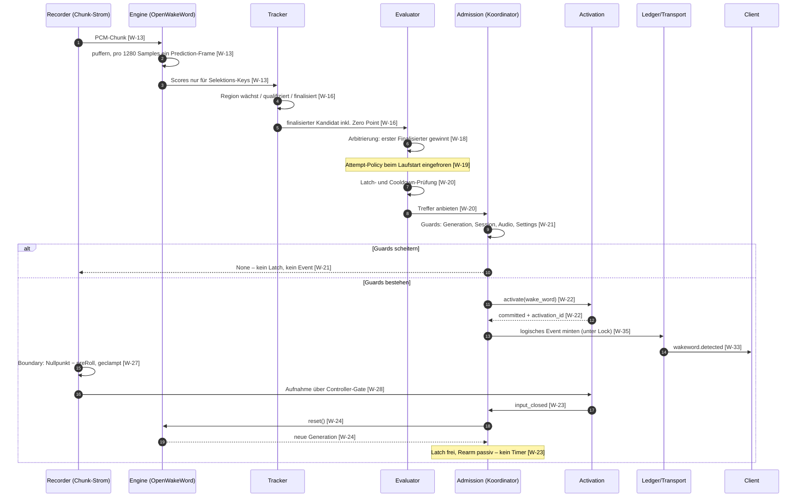
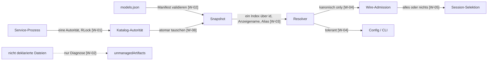
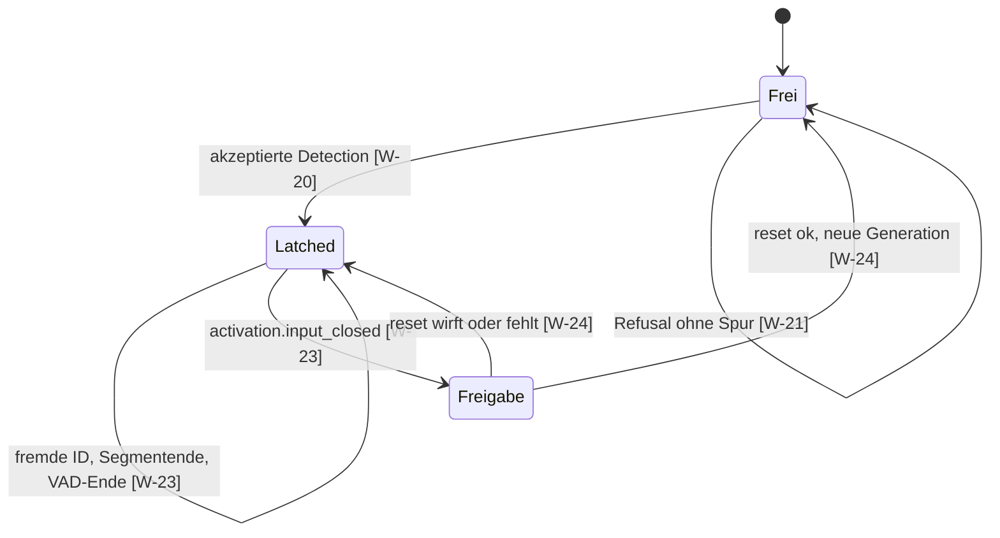

# 02.04 – Wake-Word

> **Entwurf** · Voice-STT-Server V2 · Quellcommit `a8993c5c68042d996eab680d84a5b138a214bb5d`
> Faktenbasis: `workflow/research/02.04.json` (W-01…W-35, N-01…N-05, U-01, C-01…C-04). Alle technischen Aussagen sind mit Fakten-IDs belegt; nicht belegte Zahlen sind bewusst **nicht** enthalten.

## 1. Worum geht es?

Ein Wake-Word ist der einzige Auslöser im Server, der **ohne Client-Kommando** eine Activation beginnt. Alles andere – Push-to-Talk, manuelles Starten, Timeouts – wird von außen angestoßen. Das Wake-Word dagegen entsteht aus dem Audiostrom selbst: Der Server hört auf einem Eingabekanal mit, bewertet fortlaufend kurze Audioabschnitte und entscheidet, ob ein konfiguriertes Schlüsselwort gesprochen wurde.

Technisch sind das zwei Aufgaben:

1. **Detektion** – aus PCM-Blöcken werden Bewertungen („Scores") pro Wake-Word, daraus Regionen, daraus ein Kandidat mit Zeitbezug.
2. **Übernahme** – aus einem Kandidaten wird *höchstens einmal* eine Activation, mit Event an den Client, sauberem Schnitt im Audio und klarer Regel, wann das Wake-Word wieder „scharf" ist.

Die zweite ist schwieriger: Ein Erkennungsmodell liefert rund um dieselbe Äußerung mehrere Treffer, und während der Aufnahme darf das gesprochene Wort nicht erneut auslösen. V2 löst das nicht mit Timern und Heuristiken, sondern mit expliziten Zuständen: **Latch**, **Cooldown**, **Generation** und **Epoche**.

Die Kette dieses Kapitels:

```
Frames → Tracker → Evaluator → Admission → activate() → Ledger/Transport
                                                              ↓
                        Release (nur am Aktivierungsende) → Engine-Reset → wieder bereit
```

Der einzige Punkt, an dem eine Erkennung „wirklich" wird, ist `activate()`; alles davor ist Vorschlag, alles danach unumkehrbar.

## 2. Das Wesentliche auf einen Blick

Vier Eigenschaften prägen den Pfad:

| Eigenschaft | Bedeutung | Beleg |
|---|---|---|
| **Serverweiter Katalog** | Eine Autorität pro Prozess verwaltet Snapshot, Namensauflösung; Sessions lesen nur. | W-01 |
| **Genau ein Backend pro Engine** | Eine laufende Engine nutzt ein Inferenz-Backend für *alle* gewählten Wörter. | W-06 |
| **Genau ein Commit** | `activate()` ist der einzige Übergang von Kandidat zu Activation; Ablehnungen hinterlassen keine Spur. | W-22, W-21 |
| **Genau ein Event** | Logisches Event vor fehlbarem Transport gemintet, pro `activationId` idempotent. | W-35 |

### 2.1 Zeitfolge einer Äußerung (Sequenzdiagramm)



**Erläuterung.** Der Recorder schiebt Blöcke in die Engine; pro 1280 Samples (80 ms @16 kHz) entsteht ein Prediction-Frame mit Scores der selektierten Wörter (W-13). Der Tracker lässt pro Wake-Word eine Region wachsen/qualifizieren/finalisieren (W-16). Der Evaluator arbitriert (W-18), prüft die eingefrorene Policy (W-19), Latch und Cooldown (W-20). Die Admission prüft Guards (Generation, Session, Audio, Settings) (W-21). Scheitern → `None` (kein Latch/Event/zweite Activation). Bestehen → `activate()` = Commit (W-22), Event-Mint vor Transport (W-35), `wakeword.detected` (W-33). Parallel: Boundary-Schnitt (W-27), Aufnahme via Gate (Detektor währenddessen aus, W-28). Am `input_closed` Latch-Lösung (W-23), Engine-Reset → neue Generation (W-24). Danach bereit – ohne Timer.

**Textalternative:** Chunk → Engine puffert → Frame pro 1280 Samples → Tracker-Region (Score ≥ Sensitivität) → Qualifikation → Finalisierung (Trailing Edge = Zero Point) → Arbitrierung (erster Finalisierter) → Policy-Check → Latch/Cooldown → Admission-Guards → Commit via `activate()` → Event-Mint → Transport → Boundary-Schnitt → Aufnahme → `input_closed` → Latch-Lösung → Engine-Reset → neue Generation.

### 2.2 Der Katalogpfad (zweites Diagramm)



**Erläuterung.** Eine Katalog-Autorität mit Snapshot und Resolver (W-01); Kandidaten atomar getauscht (W-08). Ein Resolver-Index, Token mit zwei Besitzern bricht den Katalog (W-03). Draht nur kanonisch, Konfiguration tolerant (W-04). Session übernimmt vollständig oder gar nicht (W-05). Nicht-deklarierte Dateien nur Diagnose (W-02).

## 3. Katalog, Manifest und Aliase

### 3.1 Eine Autorität pro Serverprozess

Der Katalog: genau **eine** serverweite, threadsichere Autorität (RLock) mit last-known-good Snapshot, `catalogRevision`, Resolver; `refresh()` + `set_global_disabled()` unter Lock (W-01). Zwei Sessions sehen denselben Stand; Admin-Refresh läuft nicht in Namensauflösung hinein. **`catalogRevision` ≠ `settingsRevision`** (W-01).

### 3.2 models.json als einzige Quelle

Kein Dateisystem-Scan: Manifest `manifestVersion 2`, `catalogRevision 2`, 2 Pipeline-Sektionen (onnx/tflite mit Mel-Spektrogramm + Embedding), **25 `wakeWords`-Einträge**, jeder beide Backends + `artifactVersion "1"` (W-02). 25 Einträge = 25 mögliche Auslöser, nicht geladene Modelle – geladen wird nur Selektiertes (W-12). Nicht-deklarierte Dateien → nur `diagnostics.unmanagedArtifacts` (W-02). Modell „dazukopiert" wird nicht angeboten – Absicht, kein Versehen.

### 3.3 Normalisierung, Index, Kollisionen

Normalisierung: NFKC → Trimmen → Separatorläufe zu `_` → casefold; `id` muss Normalform sein, sonst `ManifestError` (W-03). `id`/`displayName`/Aliase → ein Resolver-Index. Token mit zwei Besitzern → **gesamter Katalog bricht ab** (keine Heuristik); zwei Einträge teilen keinen Stem je Backend (W-03). Manifest: 17 mit, 8 ohne Aliase (W-03). Lauter, früher, für alle gleicher Abbruch statt schleichendem Fehler.

### 3.4 Kanonisch auf dem Draht, tolerant in der Konfiguration

| Kontext | Verhalten | Beleg |
|---|---|---|
| **v2-Wire** (`requestedSession.wakeWordIds`) | nur kanonische IDs; Alias/Anzeige → `not_canonical`, unbekannt → `unknown`; Code immer `wake_word_unavailable` | W-04 |
| **Konfiguration** (Selection-Patch, CLI-Legacy) | tolerant via `resolve()` (z. B. `Hey Jarvis`/`jarvis`) | W-04 |

Fehler nennt `wakeWordId` als Wert, nicht der Code (W-04). Alias in Config ok, in Hello abgelehnt – kein langes Debuggen nötig.

### 3.5 Auswahl ist atomar

Kein Teilladen/Default/stilles Entfernen: jeder Problemwert eigener `SelectionError`; jeder Fehler verhindert Selektion. Duplikate kanonisch dedup (kein Fehler). Leer bei aktivem Trigger → `wake_word_selection_required`; IDs ohne Trigger → `not_allowed` (W-05). Session startet nicht „irgendwie reduziert", sondern gar nicht – richtig für ein Feature, dessen Fehlfunktion heimliches Zuhören wäre.

## 4. Backends, Build und CI

### 4.1 Genau ein gemeinsames Backend pro Engine

Eine Engine = ein Inferenz-Backend für *alle* gewählten Einträge; „healthy" = Schnittmenge je Eintrag. `auto`: ONNX Windows-first, TFLite sonst; darf **gesamt** wechseln (`fallbackUsed=true`). Explizit: kein Fallback (fehlt → `backend_unavailable`); `auto` ohne Schnittmenge → `no_common_backend` (W-06). Kein Mischen – vorhersagbare Latenz, ein Satz Ressourcen.

### 4.2 Health ist ein Ladeversuch

Reihenfolge: Deklaration → Datei → `sha256` → Bytes → Pipeline → Runtime → Classifier-Probe (ORT-Session/TFLite-`allocate_tensors`) → Pipeline-Probe (W-07). Gründe: `artifact_missing`, `artifact_integrity_mismatch`, `pipeline_unavailable`, `runtime_unavailable`, `artifact_unloadable`, `globally_disabled`. Fehlende Runtime **nie** bestanden (W-07) – Host ohne Laufzeit meldet „nicht verfügbar" statt abzustürzen.

### 4.3 Refresh tauscht atomar – oder gar nicht

Kandidat vollständig bauen, nur bei Erfolg tauschen (W-08). Sichtbarkeit via revisionsfreie JSON-sortierte Projektion; ohne sichtbare Änderung bleibt Revision (Snapshot adoptiert) (W-08). Fehlschlag: bisheriger Stand, `ok=false` + Fehler (W-08). Global-Disable im selben Lock, tolerant (W-08).

### 4.4 Katalog-API und Reichweite

`GET /api/v2/wake-words` (ohne Auth): `{protocolVersion, catalogRevision, wakeWords[]}` aus **einem** Snapshot (W-09). `POST refresh` Admin: 200 / 422 + voller Snapshot (W-09). Jede sichtbare Änderung → `wakeword.availability_changed` (`catalogRevision` + `availableWakeWordIds`) an **jede** laufende v2-Session, katalogweit, ohne `activationId` (W-09). Kein Abbruch-Missverständnis: kein Zusammenhang mit laufender Activation.

### 4.5 Session-Backend zwingend OpenWakeWord

Bei Selektion Backend **zwingend** `openwakeword`; anderer sessionlokaler Wert → `session_config_value_fallback` + Warnung (W-10). Porcupine nur Legacy/Standalone. Katalog/Engine: `onnx`/`tflite` = Inferenz-Backends, keine Produkte. Kein v2-Wake über Porcupine (N-03).

### 4.6 Paketierung und CI

Nur Manifest-Dateien + `models.json` + `silero_vad.onnx` (kein Glob) (W-11). CI installiert `.[recommended,server]` **ohne** `openwakeword`; `pytest tests/unit tests/compatibility`; `testpaths=tests/unit` (W-11). Reale OWW-Inferenz **nicht** CI-abgedeckt (Fakes); nur nicht-leerer Asset-Ordner geprüft (W-11, N-04). Grün ≠ ladefähig.

## 5. Session-Aufbau

### 5.1 Der Handshake fragt den Katalog einmal

Katalog **einmal** befragt, Ergebnis (Fehler + Auswahl) aus demselben Snapshot (W-12). Auswahl → `session_config.wake_word_selection` → `setup_wakeword_detection`: `OpenWakeWordEngine` (nur gewählte Pfade, ein Framework, geteilte Pipeline) + `model_key`→kanonische-ID-Bindung (W-12). Ohne Selektion/Controller **kein** v2-Pfad (früh zurück, `_wake_admission` None) (W-12). Wake-Word = Eigenschaft kontrollierter Session mit Auswahl.

### 5.2 1280 Samples, 80 ms, ein Frame

Upstream puffert; pro 1280 Samples (80 ms @16 kHz) neue Prediction (W-13). Engine zählt `_pending_samples`; pro **wirklich neuem** Frame genau ein `PredictionFrame(index, end_sample, scores)`; kurze verworfen (W-13). Kürzere Chunks → voriger Score erneut (W-13); Tail-Lücke → ältester Wert vorn (W-13). Nur Selektions-Keys liefern Scores (W-13).

### 5.3 Gain auf Kopie, Schwellen pro Frame

`detectorGain`: float32-Multiplikation auf **Kopie**, int16-Clamp, kein Wrap; Original byte-identisch (W-14). Gain **einmal pro Recorder-Chunk** aus `tracker.current_policy()`; Schwelle/Frame-Zähler pro Prediction-Frame aus eingefrorenem Snapshot (W-14). Normalfall unauffällig; keine Garantie für atomaren Gain+Schwelle-Wechsel im selben Chunk (C-01).

### 5.4 Was erst mit neuer Session wirkt

`noiseSuppression` + `vadThreshold` in Loader-Kwargs des **einen** Upstream-Modells → erst neue Session (`next_session`) (W-15). `vadThreshold = 0.0` deaktiviert OWW-internes VAD-Gate; kein zweiter Betriebsstrang in Activation (W-15). Zur Laufzeit geändert + nichts beobachtet = Wirksamkeitszeitpunkt, kein Fehler.

## 6. Erkennung: Regionen, Qualifikation, Finalisierung

### 6.1 Begriffe

| Begriff | Bedeutung | Beleg |
|---|---|---|
| **Score** | Bewertung pro Wake-Word/Frame | W-13 |
| **Region / Lauf** | zusammenhängender Bereich ≥ Sensitivität | W-16 |
| **Qualifikation** | `frames >= min_frames` – noch kein Treffer | W-16 |
| **Finalisierung** | erster Frame unter Schwelle | W-16 |
| **Zero Point** | letzter Sample letzter Frames über Schwelle (Trailing Edge) | W-16 |
| **Peak** | höchster Score der Region (Domain-Score) | W-17 |

### 6.2 Der Ablauf pro Wake-Word

Genau **ein** Lauf: wächst bei Score ≥ Sensitivität; fällt er vorher darunter → verworfen, Neustart (W-16). Qualifikation ≠ Treffer/Event (W-16). Finalisierung = erster Frame darunter (W-16). Zero Point = Ende des letzten Frames über Schwelle – **Trailing Edge**, nicht Beginn/Peak (W-16). Modell ohne Score = darunter (Lauf überlebt stummes Modell nicht) (W-16).

Beispiel: Frames 1–3 unter, 4–9 über Schwelle, ab 10 darunter. Region qualifiziert in einem der Frames 4–9; Frame 10 finalisiert; Zero Point = Ende Frame 9. Späterer Nachhall in Frame 14 ändert nichts.

### 6.3 Arbitrierung: erster Finalisierter gewinnt

Mehrere Kandidaten → **zuerst finalisierter** qualifizierter gewinnt; alle anderen derselben Entscheidung verworfen (`_regions.clear()`, Policy zurück) (W-18). Kein Warten/Längen-/Peak-Vergleich. Nur Gleichstand im **selben** Frame: Minimum `(quali_frame, start_frame, canonical_id)` (W-18). Deterministisch, reproduzierbar.

### 6.4 Domain-Score = Peak

`wakeword.detected.score` = `peak_score` der Region (nicht Final-/Quali-Frame) (W-17). Diagnose: `wakeWordId`, Peak, Start/Quali/Final/Zero-Point, Frame-Anzahl, Detector-Generation, Policy (W-17). Hoher Peak + späte Finalisierung = kein Widerspruch.

### 6.5 Policy friert beim Laufstart ein

`WakeAttemptPolicy{sensitivity, min_frames, gain, cooldown, pre_roll, settings_revision}` einfriert, wenn neuer Lauf startet **während kein anderer offen** (W-19). Gilt für Vergleich/Zähler/Quali/Finale/PreRoll/Cooldown/effektive Settings; Patch erst **nächster** Versuch; kein gemischter Versuch; Hit trägt Snapshot (W-19). Patch während Äußerung → wirkt danach. Pseudocode siehe Faktenakte-Kurzform (W-13…W-19).

## 7. Latch, Suppression, Rearm

### 7.1 Nur zwei Blocker

Evaluator kennt genau zwei Gründe, nicht anzubieten (W-20): (1) **Latch** (ab akzeptierter Detection bis sicherem Eingabeschluss derselben Activation); (2) **`wakeWord.cooldownMs`** (Default 0, passiv via `monotonic`, kein Timer/Thread). Latch aktiv → `process()` sofort `()` (Engine ungefüttert), `observe` setzt Tracker ohne Generationssprung zurück (W-20). Gruppierung = Tracker, nicht Cooldown (W-20).

### 7.2 Latch-Lebenszyklus



**Erläuterung.** Latch nur durch akzeptierte Detection (W-20). Weder Segment-/VAD-Ende noch Cooldown-Ablauf noch fremde ID lösen (W-23). Lösung nur an `input_closed` derselben Activation (W-23). Freigabe zweistufig: erst Freigabe, dann erfolgreicher Engine-Reset (W-24); Fehlschlag → Latch bleibt.

### 7.3 Admission prüft vor dem Commit (W-21)

Guards: `hit.detector_generation == evaluator.generation` + nicht gelatcht; Session streamt/nicht-closed/Epochen/Controller/`_audio_available`/Activation-Settings. Ablehnung → `refused()` (nur Cooldown) → `None`: **kein** Latch/Event/zweite Activation/Merge; Recorder nichts, kein `accepted_wake_detection` (W-21). Treffer „spurlos" = nie Kandidat; nur interne Diagnose.

### 7.4 `activate()` ist der einzige Commit (W-22)

Ablehnung: `phase != idle` → `activation_locked`; Quelle nicht konfiguriert/unterdrückt → `trigger_disabled`; `activation_id` mitgegeben → `invalid_payload`. Nach Commit keine Umdeutung: committed + ID; Exception → `committed_probe` (`_open_wake_activation_id` auf `primarySource wake_word`), dann Refusal vs. Post-Commit-Fehler. Post-Commit-Fehler lässt Activation bestehen. Garantie: gesehene `activationId` existiert.

### 7.5 Release nur am Aktivierungsende (W-23)

Latch-Lösung ausschließlich beim Publizieren von `activation_closed` (Wire `input_closed`); nicht VAD/Segment/Inferenz/Cooldown (W-23). `release(id)` löscht `acceptedDetection`, **nicht** gemintete Events; Cooldown bleibt; fremde ID wirkungslos (W-23).

### 7.6 Reset vor Freigabe (W-24)

`release` zuerst `engine.reset()`; wirft/fehlt → Latch bleibt, `False`, ERROR („Wake gesperrt, manuell weiter") (W-24). `_reset_failed` vor/nach; solange True → `process()` = (). Erfolg → Tracker-Reset (neue Generation) + Policy neu (W-24). Konservativ: lieber kein Wake als inkonsistentes Modell; manuell offen.

### 7.7 Zwei Stale-Achsen (W-25)

(1) **Detector-Generation**: `reset()` erhöht; Hit muss Evaluator-Generation treffen, Recorder verwirft unpassende (W-25). (2) **Lifecycle-Epoche**: `_wake_detection_epoch` nur beim Recorder-Eintritt in `wakeword` gesetzt; `start`/`stop`/`close` erhöhen + `None`; `clear` → `None` (W-25). Treffer aus früherem Stream wirkungslos. `clear`/Stop/Close → `_reset_wake_detector` (koordinator-weit, außerhalb Locks); `clear` nutzt `suspend_admission()` (W-25).

### 7.8 Drei Aus-Mechanismen (W-26)

| Mechanismus | Wirkung | Reichweite |
|---|---|---|
| **Runtime-Suppression** (`runtimeSuppression`) | Live-Maske nur **nächste** Admission (`trigger_disabled`); beendet nichts, kein Merge; Schreiben nur `trigger_suppression.set` | nächste Admission |
| **Latch** | Wake-Zustand ganze Activation inkl. Follow-up | Activation |
| **Konfiguration** (`TriggerEnabled`/`ProfileEnabled`) | ob Quelle läuft/Snapshot | Session/Server |

Zusätzlich Legacy-Followup **nur ohne** Controller (`wake_word_followup_window`, Default 0.0); controlled: Controller einzige Follow-up-Autorität (W-26). Suppression ≠ laufender Ausschalter.

## 8. Audioübernahme

### 8.1 Schnitt am Nullpunkt (W-27)

`releaseBoundary = operationalZeroPoint − preRoll`, beidseitig auf `history_start_sample` geclampt (real gehaltene Historie, nicht Receptive Field) (W-27). `preRollMs = 0` → Audio exakt Nullpunkt (Wort aus) (W-27). Clamp via `pre_roll_clamped`/`releasedPreRollSamples` ausgewiesen (W-27). Nur bei `WakeAudioBoundary`-Instanz; sonst Legacy-Fixdauer (Sonderfall, keine Regel) (W-27). Pre-Roll aus `hit.policy`, kein Nachlesen (W-27).

Beispiel: `preRollMs` größer als Historie → Schnitt am Beginning, `pre_roll_clamped` gesetzt; kein Fenster vor vorhandenem Audio.

### 8.2 Detektor nur außerhalb der Aufnahme (W-28)

Kein Detector/Score **während** Aufnahme; erst nach `wake_word_activation_delay` (W-28). Kontrollierte Aufnahme nur via Controller-Gate (`wakeword_detected` nicht konsultiert); Nicht-Aufnahme-Zweig spiegelt `wakeword_detected = evaluator.latched` (W-28). Eigene Wiedergabe löst während Aufnahme nichts aus; zweites Wake-Word während Aufnahme = nicht bewertet (nicht „unterdrückt").

## 9. Follow-up-Integration

Nach akzeptiertem Treffer: `wakeword_detected`, sonst `wakeword_wait` (Wake-Sessions) bzw. `listening` (W-29). Segmentende → `followup_wait` + `now+followupTimeoutMs`; neues Segment im Kontext ohne Re-Trigger (Latch aktiv) (W-29). Legacy-Recorder-Followup in controlled **aus** (W-29). Frist = Activation-Wert, kein Wake-Wert:

| Wert | Default | Bereich | Wirksam | Beleg |
|---|---|---|---|---|
| `followupTimeoutMs` | `3000` | `100`–`60000` | nächste Activation | W-29 |

Dialogfenster ohne Schlüsselwort; Frist nicht in Wake-Tabelle suchen. Fristablauf → Input-Close → Latch-Lösung (W-29 → W-23).

## 10. Konfiguration und Schnittstellen

### 10.1 Elf Wake-Settings (W-30)

Registry-Defaults/Ranges, **keine Betriebspunkte**; pending = unkalibriert (N-01).

| Key | Typ | Bereich | Default | Wirksam | Status |
|---|---|---|---|---|---|
| `sensitivity` | float | 0.0–1.0 | 0.5 | nächster Versuch | neutral, unkalibriert (N-01) |
| `minFrames` | int | ≥ 1 | 1 | nächster Versuch | **PENDING WW-18**, EVIDENCE_BLOCKED |
| `cooldownMs` | int | ≥ 0 | 0 | nächster Versuch | **PENDING WW-18**, EVIDENCE_BLOCKED |
| `preRollMs` | int | ≥ 0, **kein Maximum** | 0 | nächster Versuch | **PENDING WW-19**, EVIDENCE_BLOCKED |
| `detectorGain` | float | 0.0–3.0 | 1.0 | nächster Versuch | **PENDING WW-18**, EVIDENCE_BLOCKED |
| `vadThreshold` | float | 0.0–1.0 | 0.0 | neue Session | **PENDING WW-18**, EVIDENCE_BLOCKED |
| `noiseSuppression` | bool | true/false | false | neue Session | – |
| `inferenceBackend` | string (`allowedValues`: `auto`/`onnx`/`tflite`) | `auto` | neue Session (Server/Admin) | – |
| `selection` | string_list | – | `[]` | neue Session | – |
| `globalDisabledIds` | string_list | – | `[]` | neue Session (Server/Admin) | – |
| `runtimeSuppression.wakeWord` | bool | – | false | sofort (live) | `writable = False` |

`preRollMs` bewusst ohne Maximum (kein vergessener Validator); Clamp am Audio (W-27). `runtimeSuppression.wakeWord` nur via Setter, kein Patch (W-30).

### 10.2 Ein Bundle, kein zweiter Speicher (W-31)

Alle sechs Attempt-Werte aus **einem** Bundle `activation_admission_settings()` inkl. `settings_revision` (W-31). Nicht-numerisch/Bools → Default; `sensitivity`-Fallback `wake_words_sensitivity or 0.5` (W-31). Kein zweiter Speicher – konsistentes Einfrieren (W-19).

## 11. Diagnose und Wire

### 11.1 Diagnose intern (W-32, N-02)

Evaluator (threshold/minFrames/cooldown/preRoll/gain/policy/generation/latch/cooldownUntil/tracker/lastHit/engine), Tracker (frameIndex/generation/attemptPolicy/lastScores/runningRegions), Engine (backend/ids/frames/samples/gain/ns/vad/closed/resetFailed), Koordinator (evaluator/acceptedDetection/logicalEvents) (W-32). `server.wake_detection_diagnostics()` **ohne Aufrufer** – kein HTTP/WS (W-32, N-02). Prozess-Debugging, keine Client-API. Rohscores kein Vertrag.

### 11.2 Wire-Projektionen (W-33)

| Projektion | Inhalt |
|---|---|
| `GET /api/v2/wake-words` | `id`, `displayName`, `aliases`, `artifactVersion`, `available`, `backends{onnx,tflite{available,reason}}`, ggf. `unavailableReason`, `catalogRevision` |
| `snapshot.wakeWordCapabilities` | `{catalogRevision, availableWakeWordIds}` |
| `wakeword.detected` | `activationId`, `wakeWordId`, `score`, `primarySource = wake_word`; Timeline-Variante + `logicalEventId` |

Keine Pfade/Maps; Nicht-Ladbares mit `available=false` + Grund (W-33). Nur akzeptierte Detektionen (W-33). Events: `wait_started`/`wait_ended`/`followup_started`/`followup_timeout`/`timeout`/`availability_changed` (W-33). Client sieht Entscheidungen + Verfügbarkeit, nicht Bewertungsgrundlage.

### 11.3 Kalibrier-Harness (W-34)

Echte Produktionsregeln (Engine/Tracker/Boundary), Receptive-Field/Ressourcen/Score-Traces messbar (W-34). Kein CI-Bestandteil. **Keine** Positiv-Aufnahmen im Repo (nur Falsch-Positiv vs. Negativ) (W-34). Threshold/Min-Frames/Cooldown/Pre-Roll/Gain **EVIDENCE_BLOCKED** (W-34).

### 11.4 Exactly-once (W-35)

Mint **vor** fehlbarem Transport unter Koordinator-Lock; pro `activationId` idempotent (zweiter Mint = Bestand) (W-35). Transportfehler: nichts zurück, `delivered=false` + Versuche sichtbar; `redeliver()` mintet nie; `release()`/`reset()` löschen nichts – Event „ungeschieht" nicht, Treffer kein zweites (W-35). Abbruch zwischen Erkennung und Zustellung: Treffer bleibt, Zustellung nachholbar, kein Duplikat bei Reconnect.

## 12. Grenzen und offene Punkte

### 12.1 Nicht implementiert

| ID | Grenze | Praxisfolge |
|---|---|---|
| N-01 | Keine kalibrierten Betriebswerte (pending WW-18/19, EVIDENCE_BLOCKED) | Schwellen = Defaults; keine „empfohlenen" Zahlen – nicht erfinden |
| N-02 | Kein HTTP-/WS-Zugang Detektor-Diagnose | Score-Traces nicht clientseitig |
| N-03 | Kein v2-Wake über Porcupine | Nur Legacy; Katalog/Engine nur `onnx`/`tflite` |
| N-04 | Keine echte Backend-Inferenz in CI | Grün ≠ ladefähig |
| N-05 | Kein Rearm-Timer/Nachlauf | Passiv via Release; Cooldown-Timestamp ohne Abräumen |

### 12.2 Quelle unsicher

U-01: Branch `feat/v2-release-cleanup` lokal nicht verifizierbar (detached HEAD, leere refs, shallow). Belegt: Commit `a8993c5c68042d996eab680d84a5b138a214bb5d`; Aussagen gelten für diesen Commit.

### 12.3 Korrektur-/Abgrenzungspunkte

**C-01 – Gain-Kopplung (Nuance, keine Garantie).** Gain pro Chunk aus `current_policy()`, Schwelle/Frame aus Snapshot (W-14). Normalfall unauffällig; keine Zusicherung atomaren Wechsels. Garantie erst herstellen – Code gibt sie nicht.

**C-02 – Kanonisch vs. tolerant.** Draht nur kanonisch (`not_canonical`/`unknown`, Code immer `wake_word_unavailable`); Konfiguration tolerant (W-04). Beabsichtigt, nicht vereinheitlichen.

**C-03 – Legacy kein v2-Pfad.** Porcupine/Legacy-Followup/Fixdauer existieren, aber nicht im kontrollierten Pfad (W-10/W-26/W-27/W-29). Fixdauer nur Sonderfall ohne Boundary (W-27).

**C-04 – Zwei Revisionen.** `catalogRevision` vs. `settingsRevision` (W-01). Revision unverändert ≠ nichts passiert (Snapshot adoptiert, W-08).

## 13. Siehe auch / Nachweise

**Verwandt:** [02.01](./02.01-session-management.md) · [02.02](./02.02-audioverarbeitung.md) · [02.03](./02.03-activation.md) · [01.05](../01-grundlagen/01.05-betriebs-und-funktionsmodi.md) · [03.07](../03-konfiguration/03.07-session-einstellungen.md) · [03.09](../03-konfiguration/03.09-wirksamkeitszeitpunkt.md) · [08.03](../08-referenzen/08.03-settings-katalog.md) · [08.01](../08-referenzen/08.01-event-katalog.md) · [08.04](../08-referenzen/08.04-api-endpunkt-katalog.md)

**Fakten (Kurz):** W-01 Autorität · W-02 Manifest/25 Einträge · W-03 Normalisierung/Kollision · W-04 kanonisch/tolerant · W-05 atomar · W-06 ein Backend · W-07 echter Ladeversuch · W-08 atomarer Tausch · W-09 API/Event · W-10 forced openwakeword · W-11 Paket/CI · W-12 selected-only · W-13 1280/80ms · W-14 Gain-Kopie · W-15 next_session-Keys · W-16 Region/Quali/Finale · W-17 Peak · W-18 first-finalized · W-19 Freeze · W-20 2 Blocker · W-21 Refusal-spurlos · W-22 Commit · W-23 Release-bei-Close · W-24 Reset-vor-Freigabe · W-25 Stale-Achsen · W-26 3 Aus-Mechanismen · W-27 Nullpunkt/Clamp · W-28 nur-ausserhalb-Aufnahme · W-29 Follow-up · W-30 11 Keys · W-31 Bundle · W-32 interne Diagnose · W-33 Projektionen · W-34 Harness · W-35 Exactly-once. N-01…N-05, U-01.
