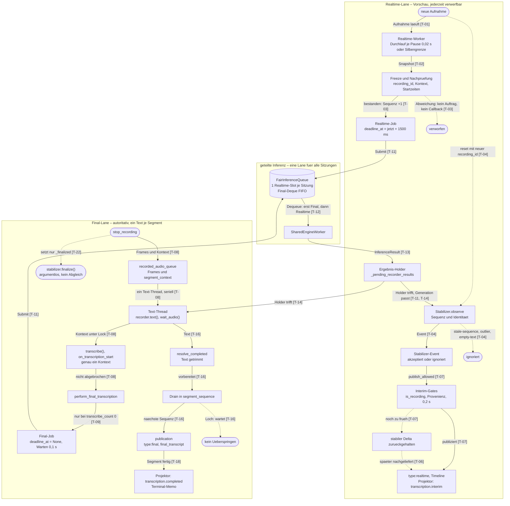
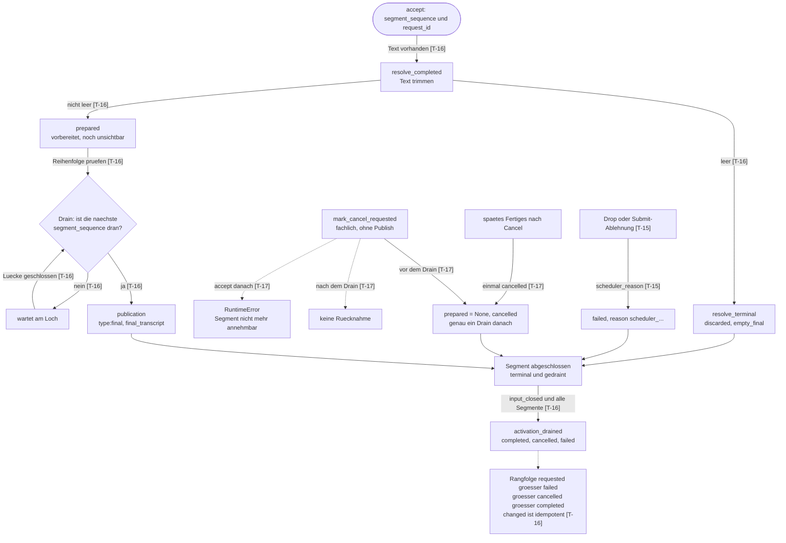
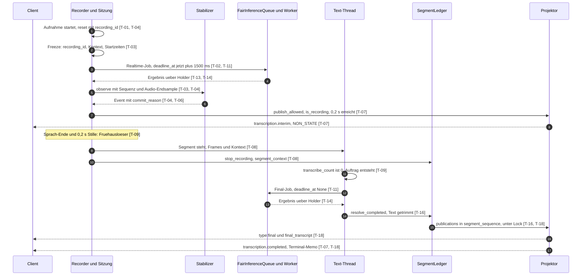

# 02.05 – Transcription

**Quellstand:** `a8993c5c68042d996eab680d84a5b138a214bb5d`
**Gültigkeit:** V1 und V2 (gemeinsamer Kern); V2-Ausgabe über die Ereignisprojektion; OpenAI-Batch teilt den Scheduler, nicht diesen Ergebnisweg
**Faktenbasis:** `workflow/research/02.05.json` (T-01…T-22, N-1…N-7)

## 1. Worum geht es?

Wer den Server benutzt, hört am Ende einen Satz. Auf dem Weg dorthin entstehen über denselben Schall aber **zwei verschiedene Texte**: eine Vorschau, die während des Sprechens wächst und jederzeit falsch sein darf, und ein Finaltext, der einmal entsteht und dann gilt. Dieses Kapitel beschreibt beide Wege, die Warteschlange dazwischen und die Stelle, an der aus dem zweiten Text ein Ereignis für den Client wird.

Die wichtigste Aussage vorweg: **Der Finaltext wird nicht aus der Vorschau zusammengesetzt.** Die Vorschau ist eine eigene Maschine mit eigenen Aufträgen, eigenem Textvergleich und eigenen Verwerfungsregeln; der Finaltext entsteht aus einem eigenen Inferenzauftrag über das Segmentaudio. Zwischen beiden Pfaden gibt es im Produkt **keine** Abgleichs-, Korrektur- oder Ersetzungslogik (T-22, N-2).

Warum zwei Wege? Die Vorschau beantwortet: *Was könnte gerade gesagt worden sein?* Sie muss schnell sein, darf raten und darf verschwinden. Der Finaltext beantwortet: *Was ist gesagt worden?* Er muss vollständig sein, darf nicht raten und darf nicht zweimal kommen.

**Zwei Pfade, ein Ergebnis.** Beide Lanes teilen sich Puffer und Scheduler, aber **nicht** den Ergebnisweg (T-01). Die Vorschau endet in einem Interim-Ereignis ohne Sitzungszustandsänderung; der Finaltext endet im Segment-Ledger und wird in Reihenfolge freigegeben. Pro Segment gibt es genau **einen** gültigen Text: den Finaltext.

**Korrelation und Ersetzung.** Jeder Text trägt eigene Identität: Vorschau an `recording_id`, Segment und Beobachtungssequenz; Final an `segment_sequence` und `request_id`. Ersetzt wird in der Vorschau nur der instabile Rest; ein publizierter Finaltext nie zurückgenommen; eine stornierte Vorbereitung durch **nichts** ersetzt (T-06, T-16, T-17, T-21).

Der Weg *zum* Segment – Gate, VAD, Vorpuffer, Frühauslöser audioseitig – steht in [02.02 Audioverarbeitung](./02.02-audioverarbeitung.md); die Gesamtübersicht in [01.04 Gesamter Datenfluss](../01-grundlagen/01.04-gesamter-datenfluss.md). Vordergrundphasen und Eingabeschluss: [02.03 Activation](./02.03-activation.md); hier zählt nur, wann `input_closed` gemeldet ist.

## 2. Das Wesentliche auf einen Blick

- **Pro Sitzung zwei Sorten Arbeit, ein Taktgeber.** Realtime-Worker als Schleife im Recorder; **ein** Text-Thread erledigt Finals strikt nacheinander (T-01).
- **Die Vorschau ist ein Angebot, keine Zusage.** Netze: eingefrorene Identität mit Nachprüfung, Stale-Grenze, Koaleszierung, Publikations-Gate (T-03, T-07, T-11, T-12).
- **Der Stabilizer entscheidet zeichenweise.** Stabilität = Anzahl **und** Zeitspanne; stabiler Anteil wächst nur, wird nicht zurückgenommen (T-04, T-05, T-06).
- **Ein Interim berührt den Sitzungszustand nicht.** `eventId` + `eventSeq`, aber **kein** `stateVersion` (T-07).
- **Ein Segmentkontext hat höchstens einen Finalauftrag.** `transcribe_count` erzwingt das (T-09).
- **Der Früh-Final ist gebaut, wie er ist.** Nach Sprach-Ende + 0,2 s Stille aus aktuellem Frame-Stand; kein Nachreichen (T-09).
- **Der Scheduler kennt keine Zahlenpriorität.** Priorität = Reihenfolge: Final vor Realtime, FIFO je Sitzung, Round-Robin über Sitzungen (T-12).
- **Die Reihenfolge ist die Garantie.** Nur in `segment_sequence`-Ordnung; Loch blockiert statt übersprungen (T-16).
- **Cancel = Barriere, keine Rücknahme.** Vorbereitetes gelöscht, Spätes `cancelled`, Gedrahtes bleibt (T-17).
- **Kein Inferenz-Timeout, kein Final↔Stabil-Abgleich.** Abbruch über Sitzungs-Lebenszeichen (T-11, N-1, T-22, N-2).

### 2.1 Gesamtfluss: zwei Lanes, ein Scheduler

**Erläuterung in Worten.** Zwei Förderbänder, ein Nadelöhr. Oben die Vorschau: Aufnahme → Worker (Pause 0,02 s) → Identität einfrieren/nachprüfen → Realtime-Auftrag mit 1500-ms-Frist → Fair-Queue (ein Slot je Sitzung, Ersetzen statt Anhängen) → Worker → Holder → Stabilizer → Event → Interim-Gates → `transcription.interim`. Unten der Final: `stop_recording` → Frames + Kontext → Text-Thread (ein Kontext, ein Auftrag, ohne Deadline) → Fair-Queue → Worker → Holder → Text-Thread → `resolve_completed` → Drain in Segmentreihenfolge → `type:final`/`final_transcript` → `transcription.completed`. Berührung nur in Scheduler und Holder. Gestrichelt `stop → finalize()`: nur Flag, kein Text (T-22).

**Textliche Alternative:** Aufnahme startet → Realtime-Worker (0,02 s) → Identität einfrieren/nachprüfen → Realtime-Job (1500 ms) → Fair-Queue (Slot/Ersetzen) → Worker → Holder → Stabilizer → Event → Interim-Gates → `transcription.interim`. Parallel: Segmentende → Frames/Kontext → Text-Thread → Kontextbindung → `transcribe_count`-Prüfung → Final-Job (keine Deadline) → Queue → Worker → Holder → Text-Thread → `resolve_completed` → Drain → `type:final` → `transcription.completed`.

## 3. Der Realtime-Pfad: die Vorschau

### 3.1 Der Takt: Timer oder Silbengrenze

Realtime-Worker = Schleife über die Aufnahme, viele Durchläufe (T-01). Trigger (T-02):

| Pfad | Bedingung | Auslösegrund |
|---|---|---|
| **Timer** (Default) | immer | `timer`; Pause `realtime_processing_pause` (Server 0,02 s) |
| **Silbengrenze** | nur wenn `realtime_transcription_use_syllable_boundaries` (Default **aus**) | `syllable-boundary`, `-followup` (gebündelt), `-fallback` |

Pause bei `awaiting_speech_end` (T-02). 0,02 s = Pausenlänge, kein Anzeigetakt; Abstand = Pause + Arbeit + Queue-Wartezeit (unter Last größer). Stale-Grenze fängt zu alte Aufträge (§5).

### 3.2 Einfrieren, nachprüfen, verwerfen

Vor Snapshot + Inferenz: `recording_id`, Kontext, Startzeiten einfrieren; danach erneut prüfen (T-03). Abweichung (Aufnahme beendet/neu, Kontext fremd) → **verwerfen**: keine Sequenz, kein Stabilizer, kein Callback (T-03). Nur bestanden erhöht `realtime_observation_sequence` (Stabilizer-Sequenz). Vorschau kann nicht „nachträglich" in falschem Segment auftauchen – Preis: Ausfälle bei schnellen Wechseln (kein Interim).

> **Nicht verwechseln:** `InferenceJob.sequence` konstant 0 (N-6). Sichtbare Sequenz = Recorder-Zähler `realtime_observation_sequence` (T-03).

### 3.3 Die Prüfreihenfolge von `observe`

Feste Reihenfolge = Vertragsbestandteil (T-04): `wrong-recording` → `wrong-segment` (erste Zuordnung nur nachgeführt) → `finalized` → `stale-sequence` (`sequence <= _last`) → `empty-text` (Projektion leer) → `outlier` (+ Adopt-Zweig: Outlier-Serie als Evidenz, Z. 347–357). Akzeptiert = Evidenz, nicht Veröffentlichung (→ Projektion §3.5, Gates §3.6).

### 3.4 Schwellen: Anzahl **und** Zeitspanne

Stabilität braucht Mindestanzahl **und** Mindestzeitspanne; Evidenz nur bei neuer Sequenz + strikt größerem Audio-Endsample (T-05).

| Schwelle | Default | Bedeutung |
|---|---|---|
| `min_char_confirmations` | 2 | Bestätigungen/Zeichen |
| `min_span` | 0,60 s | Zeitspanne |
| `max_window` | 8,00 s | Fenster |
| Leerzeichen | 4 / 0,75 s **+** stabiler Rechtskontext (min. 2 Zeichen) | rechtes Umfeld nötig |
| Satzzeichen | 4 | höhere Hürde |
| `initial_prefix` | 2 / 0,80 s | Wortanfang |
| `outlier_similarity_threshold` | 0,35 | Ausreißerbewertung |
| `max_single_outlier_gap` | 1 | weitere Evidenzgrenze |
| `max_recent_observations` | 128 | Fenstergröße |
| Tokenisierung | space-tokenized | Wortebene |
| `require_audio_progress` | aktiv | ohne Fortschritt keine Evidenz |

Folgen: stabiler Text läuft Sprecher hinterher (gewollt); Leerzeichen teurer als Buchstaben (instabile Ränder). Schwellen = Defaults, Verbindliches im [Settings-Katalog](../08-referenzen/08.03-settings-katalog.md).

### 3.5 Projektion und zurückgehaltene Deltas

Vergleichsbasis NFKC: Whitespace kollabiert, Satzzeichen (Kategorie P) entfernt, `casefold`, Endspace weg (T-06). `stable_text` wächst nur bei `public_consensus_aligned` + längerem Frontier (`commit_reason` `space-confirmed`/`evidence-threshold`); **nie zurückgenommen** (T-06). `display = stable + unstable` (Rest jederzeit änderbar). Bei `publish_allowed == False`: Delta in `_unpublished_stable_delta` zurückgehalten, später nachgeliefert (T-06). `consensus_*`/`internal_revision` diagnostisch.

Erste Vorschau erscheint mit Stabilisiertem, Rest folgt nach. Ausbleiben kann „zu früh" heißen, ohne Textverlust.

### 3.6 Interim-Gates, Provenienz, Segmentende

Akzeptiertes Event ≠ publiziert. Zusätzlich nötig (T-07): `is_recording`; Provenienz unverändert (recording_id/Kontext/Segment); Fertigstellung > `init_realtime_after_seconds` nach Aufnahmestart (Default 0,2 s, `INIT_REALTIME_INITIAL_PAUSE`). Frühere tragen Evidenz, werden nicht publiziert. Server: `reject_current_recording` verwirft; Provenienz-Abweichung → Verwerfen **ohne Ersatz** (T-07).

Weg: Legacy `type:realtime` → Timeline `realtime_transcript` → V2 `transcription.interim` (Text Pflicht + Stabilizer-Felder) (T-07). **Interims NON_STATE** (`eventId`/`eventSeq` ja, `stateVersion` nein) – kein Zustandsfortschritt via `stateVersion` (T-07). **Nach Terminal Schluss:** Interim zu abgeschlossenem Segment vor Mint verworfen (+ Terminal-Memo), keine Sequenzlücke (T-07).

**Beispiel** (illustrativ; zugesagt Gate-Logik): t=0,00 Sprechen; t=0,15 brauchbar, aber <0,2 s → Evidenz ja, Publikation nein; t=0,9 „Bitte fassen" stabil + instabiler Rest; Segmentende → Zugehörigkeit vorbei → Verwerfen.

## 4. Der Final-Pfad: ein Text je Segment

### 4.1 Der Text-Thread

Genau **ein** Thread pro Session; Finals strikt nacheinander (blockierendes Warten) (T-01). Fest (T-08): `text()` löscht Interrupt-Flags → `wait_audio()` (Poll 0,02 s) lädt Frames (`segment_context` sonst `_active_recording_context`) → `transcribe()` setzt `transcribing` + `on_transcription_start(audio_copy)`; wahrer Rückgabewert bricht ab → sonst `perform_final_transcription`. `_on_transcription_start` bindet Kontext (`recorder._current_transcription_context`, `_active_text_context`); Text-Thread übernimmt unter Lock und setzt **sofort** `None` – genau **ein** Final je Kontext (T-08). Zweites Segment wartet auf erstes (Thread, nicht erst Ledger).

### 4.2 Der `transcribe_count`-Vertrag

Doppelte Absicherung (T-09): Kontextbindung (§4.1) + Zähler. `perform_final_transcription` sendet **nur** bei `transcribe_count == 0`, sonst Ergebnis-Übernahme. Erhöhung bei Submit, Erniedrigung nach Empfang. Kein zweiter, „besserer" Lauf ersetzbar.

### 4.3 Der Früh-Final – implementierter Vertrag

Default `early_transcription_on_silence = 0,2 s`: nach Sprach-Ende + Stille **aktueller Frame-Stand** als Finalauftrag (`allowed_to_early_transcribe=False` danach) (T-09). Folge (Vertrag, kein Bug – Code + Test `slow_final_gap`): **kein** späterer Voll-Rest; Finaltext aus Stand **vor** regulärem Segmentende. In Stille-Schwelle fallende Sprache fehlt im Final. Audioseitig: [02.02](./02.02-audioverarbeitung.md) (A2-16); hier: **einmal, aus Stand von jetzt**.

### 4.4 Der externe Executor

Server: Audio **tiefkopiert** (Recorder arbeitet weiter), `segment_context` kopiert, Daemon-Thread `VoiceSTTExternalFinalTranscription`, Ergebnis (`success`/`error`) in `_external_transcription_results` (T-10). Pipe-Betrieb: `(audio, language, use_prompt)` an Parent-Pipe. Deep Copy = Reproduzierbarkeit (kein Überschreiben während Inferenz).

### 4.5 Job-Bau, Warten, kein Timeout

| Feld | Regel | Wirkung |
|---|---|---|
| `request_id` | Kontext (Final, uuid4-hex/32), frisch (Realtime) | Korrelierbarkeit |
| Segment | Kontext, sonst `current` | Zugehörigkeit |
| `sequence` | **konstant 0** | sichtbare Sequenz = Recorder-Zähler (N-6) |
| `generation` | Sitzung | veraltete Aufträge erkennbar |
| `created_at` | monoton | Queue-Delay-Messung |
| `deadline_at` | **nur Realtime**: jetzt + 1500 ms (Default); Final: `None` | Finals verfallen nicht |
| Warten | 0,1-s-Scheiben | Lebenszeichen-Prüfung |

Abbruch nur: `stop_event`, Sitzung weg, Generation gewechselt → leeres `TranscriptionResult` (T-11). **Kein Ausführungs-Timeout** (N-1): Hänger blockiert Auftrag + geteilte Lane (keine Frist). Final-Fehler → Ledger `failed` (T-11, T-13).

## 5. Der Scheduler-Vertrag – nur die Außenseite

Interna: [02.08](./02.08-scheduler-und-nebenlaeufigkeit.md). Beobachtbar (T-12): Pro Sitzung Final-Deque FIFO + genau **einen** Realtime-Slot.

| Regel | Wert / Verhalten |
|---|---|
| Final-Ablehnung/Sitzung | Deque ≥ **8** |
| Final-Ablehnung/global | ≥ **64** wartend |
| Realtime | ersetzt Slot (`coalesced=True`), Gesamtzahl unverändert |
| Entnahme | erst Final, dann Realtime |
| Realtime-Stale | `deadline < jetzt` (**strikt**) → nie inferiert |
| Fairness | Round-Robin `_ordered_sessions` |
| Abbruch | `cancel_session` → alle `cancelled` |
| Priorität | **keine numerische, keine Vererbung** – Reihenfolge/Verdrängung *ist* die Priorität |

Koaleszierung = kein Stau veralteter Vorschauen (Preis: Überspringen, kostenlos da verwerfbar).

Worker (T-13): `transcribe_with_options` nur bei `request_options` + Methode, sonst `transcribe`; Text `strip()`; `queue_delay`/`inference_duration`/`total_latency` (monoton) in `RunningStats`; `InferenceResult` + `audio_duration` (`len/16000`) an Callback; Fehler → `failed_jobs` + `error`, Worker läuft weiter.

## 6. Der Rückweg: Ergebnis, Ledger, Publikation

### 6.1 Ergebnisrouting

Fest (T-14): (1) Performance-Event `inference.completed`; (2) `complete_pending_api_transcription` → Treffer return; (3) `complete_pending_recorder_transcription` (Holder `event.set()`) → Treffer return; (4) sonst `session.handle_inference_result`. Recorder-Text **nicht** im Callback: blockierter Aufrufer liest selbst (Text-Thread); Callback verteilt nur. Final seriell, Realtime unabhängig.

### 6.2 Drops und Ablehnungen

| Situation | Zähler / Grund | Folge |
|---|---|---|
| Realtime ersetzt | `coalesced` | alter entfällt |
| Realtime zu alt | `stale` | keine Inferenz |
| storniert | `cancelled` | keine Inferenz |
| Final+Drops | `scheduler_<reason>` | Ledger `cancelled`/`failed` |
| Submit ab (Realtime) | `realtime_rejected` | kein Auftrag |
| Submit ab (Final) | `final_rejected` | Ledger `failed` + Holder-Fehler |
| Scheduler voll | `scheduler.overloaded` + `queue.limit_reached` | abgelehnt |

Abgelehnter Final = **benanntes** Terminal (Ereignis), kein stilles Ausbleiben (T-15).

### 6.3 Ledger: Reihenfolge, Drain, Terminals

Buchhaltung „Texte in Ordnung" (T-16): `segment_sequence` aufsteigend + `request_id`. `resolve_completed` trimmt; leer → terminal `discarded`/`empty_final` (kein `prepared`). Publikation **nur** in `_next_publish_sequence`-Reihenfolge; Loch → **Stop, kein Überspringen** (T-16). Resolution/Publication/Activation-Terminal als `LedgerUpdate`; `changed` idempotent. Abschließend erst bei `input_closed` + alle terminal **und** gedraint; Rang `requested` > `failed` > `cancelled` > `completed` (T-16). Segment-Freigabe unabhängig vom Activations-Ende; Final während nächstem Segment publizierbar. Phasen: [02.03](./02.03-activation.md).

**Erläuterung.** Ein Segment: Text → trimmen → leer? terminal ohne Publikation; sonst `prepared` → Reihenfolgeprüfung → passt: publiziert; passt nicht: wartet (kein Vorziehen). Stornierung löscht Nicht-Gedrahtes (`cancelled`), späte Ergebnisse dito einmalig, kein `type:final`. Gedrahtes nie zurück. Drops → `failed`. Alle terminal+gedraint + `input_closed` → `activation_drained`.

**Textalternative.** Text → trim → leer terminal / sonst prepared → Drain (nächste Sequenz?) → ja publizieren / nein warten → Cancel löscht/terminalisiert → Spätes `cancelled` → Drops `failed` → alles terminal+gedraint + `input_closed` → `activation_drained`.

### 6.4 Die Cancel-Barriere

`mark_cancel_requested` **fachlich**: kein Publish/Callback (T-17). (1) Nicht-gedrahtes `prepared` → `None` + `cancelled`, genau **ein** Drain danach. (2) `accept` danach → `RuntimeError`. (3) Spätes Fertig → **einmal** `cancelled`, keine Publikation. **Gedrahtes nie zurück** (T-17). `cancel_all`: erst **alle** `cancelled` + Input-Close, **dann** ein Drain (T-17) – kein Segment wird während Aufräumen noch publiziert, obwohl storniert.

### 6.5 Publikation und Nicht-Publikation

Anwendung unter `_ledger_dispatch_lock`: Auflösungen (Terminals) → Publikationen (Finals) → Activation-Terminals (gedraint) – sichtbar reihenfolgeunabhängig vom Thread-Rennen (T-18).

**Publikation enthält:** `type:final` + Identitäten/Segment/Textfelder (`duration`, `endReason`, `preRecordingBuffer`, Zeiten, `wakeWord`); Timeline `final_transcript`; Performance `stream.final_text` (utteranceToFinalMs, speechEndToFinalMs, Zeichen/Wörter); `transcription.completed`; Statuswechsel (außer `recording`/`closed`) (T-18).

**Nicht-Publikation erzeugt:** `final_transcript_discarded`/`_cancelled`/`_failed` (Grund, `requestId`, Activation/Segment), Realtime-Zusammenfassung, `transcription.<state>` (warning, `failed` = Fehler) (T-18). **Leer → `discarded`/`empty_final`, kein `type:final`.**

„Kein Final" ∈ {publiziert, verworfen, storniert, gescheitert} – nie „nichts".

### 6.6 Vorschau- und Final-Normierung

Gemeinsam: Whitespace→space, trimmen, Großbuchstabe nur bei `ensure_sentence_starting_uppercase` (T-19). Punkt **nur** bei `preview=False` + `ensure_ends_with_period` + alphanumerischem Ende (T-19). Vorschau (`preview=True`): kein Punkt; Final (ohne `preview`): ggf. Punkt. Ledger sieht **Rohtext ohne Punkt**; Punkt = Ausgabeformatierung, keine Engine-Leistung (T-19).

### 6.7 Metriken

| Ereignis | Inhalt | Besonderheit |
|---|---|---|
| `stream.first_text` | `timeToFirstTextMs`, `audioElapsedSeconds` | einmal je Generation/Segment |
| `transcription.realtime_emitted` | `sincePreviousMs`, Zähler, `isOutlier` | nur `realtime_log_detail = events` (Default) |
| `transcription.performance_summary` | Counts, avg/min/max/p50/p95, firstRealtimeMs/TimeToFinalMs | Zusammenfassung |
| `stream.final_text` | utteranceToFinalMs, speechEndToFinalMs, Zeichen/Wörter | je Publikation |
| `inference.completed` | queueDelayMs, inferenceMs, totalLatencyMs, realTimeFactor, Sessions/Sprecher | je Auftrag |

Snapshot: Delays/Dauern je Lane + Ledger/Queue-Zahlen (T-20). **Einzige Deadline:** Realtime-Queue-Alter 1500 ms beim Dequeue. Latenzen = Messungen, keine Fristen.

### 6.8 Identitäten

| Identität | V1 | V2 |
|---|---|---|
| Segment-ID | Integer ab 1 | kanonische UUID |
| `request_id` | Kontext (hex32) / frisch | gleich |
| `transcriptionId` | `{session}:{generation}:{segment}` (Telemetrie) | gleich |
| `activationId` | `legacy-<session>-<n>` ohne Controller | kanonisch (controlled) |
| `eventId` | – | UUID je Event |
| `eventSeq` | – | monoton je Event, **inkl. Interims** |
| `stateVersion` | – | nur sichtbare, **ohne Interims** |
| `logical_key` | – | nur `input_closed` + `transcription.terminal` je Segment |

Ledger normalisiert numerisch→int, Rest String (T-21). `eventSeq` läuft auch bei Interims (Lücken erkennbar), `stateVersion` nicht. `logical_key` nur zwei Arten: Retry = gleiches Envelope, kein zweiter Wechsel.

### 6.9 Kein Final-Stabil-Abgleich

`finalize()` nur argumentlos in `stop_recording` (T-22): `_finalized=True`, **kein Text**, kein Vergleich, weitere = „ignored finalized". `RealtimeTextFinalObservation` nur Tests/Werkzeuge, **nie Produkt**. Abgleich = `NOT_IMPLEMENTED` (Vertrag da, nicht verdrahtet) (T-22, N-2). Kein „besserer" Realtime-Text ersetzt Final; kein abweichendes Final korrigiert Stabilizer. Stärkste Einzelaussage: Pfade bis Ende getrennt.

### 6.10 Ein Segment im Durchlauf (illustrativ; Regeln zugesagt, Sekunden nicht)

Push-to-Talk, ein Segment, Defaults.

**Erläuterung.** Vorschau: Aufnahme → Freeze → Realtime-Job (Frist) → Queue → Worker → Holder → Stabilizer → Event → Gates → Interim (NON_STATE). Stille + 0,2 s → Früh-Final-Auftrag aus Stand (T-09). Text-Thread: `transcribe_count` 0 → Final ohne Deadline → Queue → Worker → Holder → Text-Thread → `resolve_completed` → Drain → `type:final`/`transcription.completed`.

**Zwei Segmente:** zweiter Text schneller fertig → unsichtbar bis erstes publiziert (T-16). Reihenfolge statt Fertigstellung.

**Stornierung:** vorbereitet gelöscht, Segment `cancelled`, Spätes dito – ohne `type:final`, mit `final_transcript_cancelled` + `transcription.<state>` (T-17, T-18).

## 7. Grenzen und ehrliche Lücken

| ID | Grenze | Bedeutung |
|---|---|---|
| N-1 | Kein Inferenz-Timeout (Final/Realtime); nur Lebenszeichen/Generation + Realtime-Queue-Alter | Hänger blockiert Auftrag + Lane; keine Frist löst auf |
| N-2 | Kein Final↔Stabil-Abgleich (Vertrag da, nicht verdrahtet) | Final nie gegen Vorschau geprüft/korrigiert |
| N-3 | `realtime_min/max_audio_seconds`, `realtime_degradation_threshold_ms` existieren, werden **nicht** ausgewertet | Setzen ändert nichts |
| N-4 | `realtime_stabilized_text`/`safetext` geschrieben, nie gelesen | toter Zustand |
| N-5 | Streaming-Realtime-Zweig implementiert; Nutzung durch Default-Engine hier nicht entscheidbar | keine Streaming-Aussage (→ 02.06) |
| N-6 | `InferenceJob.sequence` konstant 0; sichtbar = Recorder-Zähler | Verwechslungsgefahr |
| N-7 | Transkript-Persistenz/Ablage nicht untersucht (02.06/02.07); Early-Rest 02.02; Scheduler-Interna 02.08 | „Wo bleibt Transkript?" hier unbeantwortet |

0,02-s-Pause keine Anzeigefrequenz; 1500 ms Stale-Grenze, keine Latenzzusage; Schwellen Defaults, keine Qualitätsgarantie. Früh-Final Kompromiss (§4.3), kein offener Fehler.

## 8. Siehe auch / Nachweise

**Faktenakte:** `workflow/research/02.05.json`, Commit `a8993c5c68042d996eab680d84a5b138a214bb5d`.

| ID | Thema | Codebeleg |
|---|---|---|
| T-01 | Zwei Threads, geteilter Puffer/Scheduler, getrennter Weg | `server.py:2737-2848`, `2443-2448`; `realtime.py:31-1048` |
| T-02 | Timer 0,02 s, Silben-Pfad, Pause | `realtime.py:988-1046`, `687-834`, `945-986`; `server.py:431` |
| T-03 | Freeze/Nachprüfung/Verwerfen/Sequenz | `realtime.py:701-721`, `764-776`; e2e `:1660-1721` |
| T-04 | `observe`-Reihenfolge inkl. Adopt | `stabilizer.py:291-359`; Test `:341-357` |
| T-05 | Exakte Schwellen/Evidenzregel | `stabilizer.py:15-36`, `622-677`, `715-740`, `1036-1054` |
| T-06 | Normalform/stabile Frontier/Delta | `stabilizer.py:425-540`, `944-994`; Test `:394-404` |
| T-07 | Gates/Provenienz/NON_STATE/Terminal-Memo | `realtime.py:510-683`; `server.py:4981-5119`, `4900-5950`; `events.py`/`schema.py` |
| T-08 | Thread/`wait_audio`/Kontextbindung/ein Final | `transcription_api.py:22-59`, `72-142`; `audio_recorder.py`; `lifecycle.py`; `server.py` |
| T-09 | `transcribe_count`, Früh-Final/kein Nachschub | `transcription_api.py:87-107`; `transcription.py:202-241`; `recording.py:500-520`; `server.py:435` |
| T-10 | Externer Executor/Deep Copy/Pipe | `transcription.py:206-256`, `176-199` |
| T-11 | Job/Deadline/Warten/kein Timeout | `server.py:2273-2305`, `8251-8351`, `492` |
| T-12 | FairQueue/Limits/Coalesce/Stale/Round-Robin | `server.py:1756-1940`, `2111-2204`, `492-493` |
| T-13 | Worker/Metriken/Fehler-kein-Abbruch | `server.py:2012-2099`, `1619-1656` |
| T-14 | Routing API→Holder→Session | `server.py:8547-8611`, `8353-8360`, `3044-3048` |
| T-15 | Drops/Ablehnungen/`scheduler_<reason>` | `server.py:7458-7526`, `3050-3091`, `8613-8627` |
| T-16 | Ledger/Drain/Terminals/Idempotenz | `segment_ledger.py:232-260`, `316-373`, `490-553`, `46-65`; Test `31-143` |
| T-17 | Cancel-Barriere/`cancel_all`/späte Ergebnisse | `segment_ledger.py:171-230`, `262-419`, `324-344`; `server.py:2891-2948`, `4517-4567` |
| T-18 | Dispatch-Lock/Publikation/Nicht-Publikation | `server.py:4536-4567`, `4816-4898`, `4577-4611`, `4771-4794` |
| T-19 | Normierung Vorschau/Final | `text_formatting.py:18-44`; `realtime.py:656-681`; `transcription_api.py:119-127` |
| T-20 | Metriken/Snapshot/einzige Deadline | `server.py:5121-5292`, `4624-4666`, `8576-8605` |
| T-21 | IDs/`logical_key` | `server.py`; `segment_ledger.py`; `schema.py`; `session.py`; `connection.py`; `activation.py` |
| T-22 | `finalize()` argumentlos/kein Abgleich | `lifecycle.py:120-126`; `stabilizer.py:361-402,76-88`; Tests `449-489` |

**Gliederung:** Gesamtpipeline §1/§2.1 · Realtime §3 · Final §4 · Segmente/Transkripte §4.1/§6.3 · Korrelation/Ersetzung/Stabilisierung §1/§3.3–3.5/§6.8 · IDs §6.8 · Aufträge/Queues/Prioritäten §4.5/§5 · Cancellation/Spätes §6.2/§6.4/§6.10 · Fehler/Timing §3.1/§4.3/§4.5/§6.2/§7

**Verwandte Kapitel:** [01.04](../01-grundlagen/01.04-gesamter-datenfluss.md) · [02.02](./02.02-audioverarbeitung.md) · [02.03](./02.03-activation.md) · [02.06](./02.06-engines.md) · [02.07](./02.07-modelle-und-modellverwaltung.md) · [02.08](./02.08-scheduler-und-nebenlaeufigkeit.md) · [04.06](../04-schnittstellen/04.06-eventtransport.md) · [04.10](../04-schnittstellen/04.10-openai-kompatible-api.md) · [08.01](../08-referenzen/08.01-event-katalog.md) · [08.03](../08-referenzen/08.03-settings-katalog.md) · [08.06](../08-referenzen/08.06-timing-katalog.md) · [08.14](../08-referenzen/08.14-metrik-katalog.md)

**Grenzen der Darstellung.** Schwellen = Defaults; Wire-Namen/Scopes/Wertebereiche im Settings-Katalog. Früh-Final implementierter Vertrag (Code + Test `slow_final_gap`); keine „Richtigkeits"-Aussage. N-5: keine Streaming-Nutzungs-Aussage (→ 02.06).
