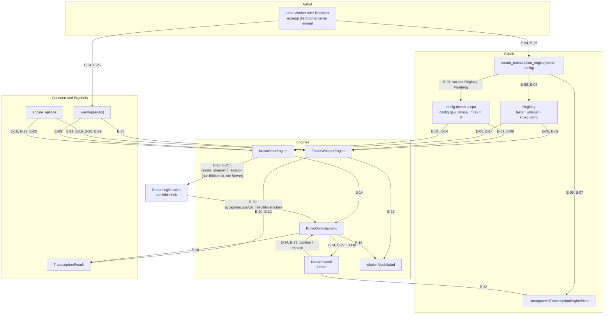
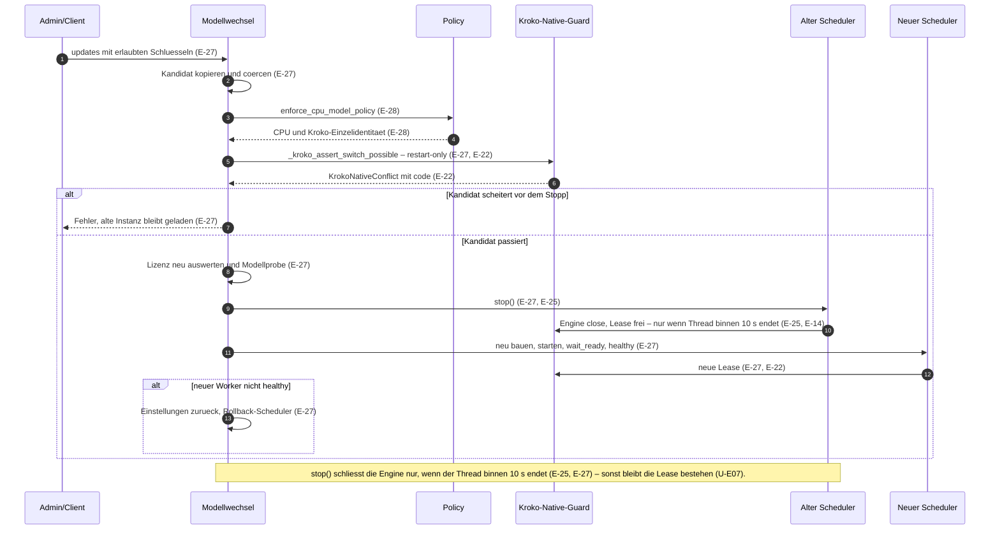

# 02.06 – Engines

*Faktenbasis: `workflow/research/02.06.json` (E-01…E-30, DE-01…DE-37, C-E01…C-E08, N-E01…N-E11, U-E01…U-E07). Commit `a8993c5c`.*

**Abgrenzung:** Dieses Kapitel beschreibt die Engine-Schicht – den letzten Abschnitt der Kette „Audioarray → Text". Modellkatalog, Provisionierung und Lebenszyklus: [02.07 Modelle und Modellverwaltung](./02.07-modelle-und-modellverwaltung.md). Queues, Lanes, Fairness: [02.08 Scheduler und Nebenläufigkeit](./02.08-scheduler-und-nebenlaeufigkeit.md). Einordnung: [01.03](../01-grundlagen/01.03-komponenten-und-schichten.md).

## 1. Worum geht es?

Eine Engine ist der austauschbare Adapter zwischen dem Server und einer ASR-Bibliothek. Sie bekommt ein Audioarray, eine Sprache und wenige gemeinsame Einstellungen und liefert Text plus Metadaten zurück. Der Rest – Recorder, Worker, Scheduler, Routen – muss nicht wissen, ob im Hintergrund Faster-Whisper oder Kroko-ONNX rechnet.

Dafür gibt es drei Dinge: einen gemeinsamen Vertrag (`TranscriptionEngineConfig`, `TranscriptionResult`, `BaseTranscriptionEngine`), eine Fabrik (Name → Instanz) und zwei produktive Engines (`faster_whisper` Default, `kroko_onnx`) (E-06, E-08).

Drei Sätze vorab – sie werden im Kapitel belegt:

1. **Fähigkeit ist nicht Nutzung.** Kroko meldet `supports_streaming = True`; der Server erzeugt trotzdem nie eine Streaming-Session (E-21, C-E06).
2. **Ein Engine-Name ist nicht das Modell.** Die Engine löst einen lokalen Pfad auf; sie lädt nichts nach (E-13, E-15, N-E06).
3. **Optionen sind nicht überall gleich.** Faster-Whisper versteht Request-Optionen, Kroko verwirft sie still (E-11, N-E04).

## 2. Das Wesentliche auf einen Blick

| Frage | Kurzantwort | Belege |
|---|---|---|
| Welche Engines? | Exakt `faster_whisper` (Default) + `kroko_onnx`; kein Alias, keine dritte | E-06, E-08, N-E01 |
| Wer erzeugt? | Fabrik; Module erst bei Bedarf importiert | E-07, E-09, E-14 |
| GPU? | Nein. Fabrik setzt `device=cpu`, `gpu_device_index=0`; Kroko akzeptiert nur `provider=cpu` | E-07, E-17, N-E05 |
| Woher das Modell? | Ausschließlich lokal; kein Download durch die Engine | E-13, E-15, N-E06 |
| Streaming? | Fähigkeit bei Kroko; Nutzung nur Bibliothek, nicht Server | E-21, C-E06, N-E10 |
| Request-Optionen? | Nur Faster-Whisper; Kroko ignoriert still | E-11, E-26, N-E04 |
| Fehler? | `TranscriptionEngineError`-Familie; nativ `KrokoNativeConflict` separat | E-05, E-22, E-30 |
| Wechsel? | Kandidat prüfen, alte Lane stoppen, neu bauen, bei Fehler Rollback | E-27 |

### 2.1 Auswahl und Aufbau im Überblick



**Was das Diagramm sagt:** Aufrufer (Lane-Worker/Recorder) → Fabrik → Registry-Prüfung → Engine-Konstruktor → Modellauflösung → ggf. Native-Lease → Ergebnis (E-24, E-25, E-06–E-09, E-13–E-15, E-22). Unbekannt → Fehler vor Import (E-05, E-07). Warmup = normaler `transcribe`-Aufruf der Basis (E-03). Optionen wirken unterschiedlich je Engine (E-11, E-16, E-26, E-29). Die Session-Kante existiert ausschließlich für die Bibliothek; der Server erzeugt nie eine Streaming-Session (E-20, E-21, C-E06).

**Textalternative:** Fabrik normalisiert Namen, setzt CPU, prüft Registry, importiert lazy, baut Engine. Faster-Whisper löst lokalen Pfad auf; Kroko baut Backend, löst Pfad auf, beantragt ggf. Lease. Warmup transkribiert englisches Asset. Ergebnis via `transcribe`.

### 2.2 Drei Ebenen nicht verwechseln

| Ebene | Was sie festlegt | Fehlannahme (falsch) |
|---|---|---|
| **Name** | `faster_whisper` / `kroko_onnx` | „Alias wird gemappt" – wird er nicht (E-06) |
| **Config** | Modell, Compute, Beam, Batch, VAD, Normierung (E-01) | „Enthält Sprache/Threads/Prompt-Schalter" – tut sie nicht (E-01, E-29) |
| **Instanz** | Recognizer/Modell im Speicher | „Zwei Engines teilen sich ein Modell" – nur wenn Lanes dieselbe Instanz nutzen; Kroko erlaubt ohnehin eine Native-Instanz (E-22) |

## 3. Der gemeinsame Vertrag und die Fabrik

### 3.1 Was eine Engine an Konfiguration erhält

Nur Gemeinsames (E-01): `model` (Pflicht), `download_root=None`, `compute_type="default"`, `gpu_device_index=0` (int|Liste), `device="cpu"`, `beam_size=5`, `initial_prompt=None`, `suppress_tokens=None`, `batch_size=0`, `vad_filter=True`, `normalize_audio=False`, `engine_options=None`. **Kein** Feld für Sprache/Samplerate/Threads/Prompt-Schalter – nur `engine_options`/Aufrufparameter (E-01, E-29).

### 3.2 Ergebnisse

`TranscriptionResult`: `text` (Pflicht), `info` (`language` Default None, `language_probability` Default 0.0), `details` (Default `{}`) (E-02). Engines füllen `details` unterschiedlich: Faster-Whisper Segmente/Wörter/Zeiten (E-12), Kroko leer (E-19). Keine einheitlichen Schlüssel erwarten.

### 3.3 Was die Basis festlegt

`engine_name="base"`, `supports_streaming=False`; Konstruktor speichert `config`; `warmup(audio)` → `transcribe(audio, language="en", use_prompt=False)`; `transcribe` abstrakt; `create_streaming_session` wirft `TranscriptionEngineError` (E-03); `_normalize_audio` wirft bei `None`/Größe 0, bei `True` Peak-Normierung 0.95; `_get_prompt` nur bei `use_prompt` + gesetztem `initial_prompt` (E-03). Warmup = englischer Start ohne Verhaltensänderung der ersten Anfrage.

### 3.4 Streaming-Vertrag

Abstrakt `reset()`/`accept_audio`/`get_result()`; `decode` No-op; `finish` = `decode`+`get_result`; `close` No-op (E-04). Nur Kroko implementiert `finish`/`close` (Tail-Padding, Stream) (E-20). Für andere Engines theoretisch.

### 3.5 Fehlerhierarchie

`TranscriptionEngineError(RuntimeError)` Setup/Laufzeit; `UnsupportedTranscriptionEngineError` davon abgeleitet **nur** unbekannter Name (E-05). Nativ separat: `KrokoNativeConflict` mit `code`/`restart_required` – kein `TranscriptionEngineError`; pauschales Fangen sieht ihn nicht (E-22, E-30).

### 3.6 Registry, Normalisierung, keine Aliase

Exakt zwei Einträge, Default `faster_whisper`; Normalisierung `(name or Default).strip().lower().replace("-", "_")`, **kein Mapping** (E-06):

| Eingabe | Ergebnis |
|---|---|
| `None` oder `""` | `faster_whisper` (Default) |
| `" "` | **nicht unterstützt** (nach strip leer) |
| `"Faster-Whisper"` | `faster_whisper` |
| `"kroko-onnx"` | `kroko_onnx` |
| `"whisper"` | **nicht unterstützt** |

Fehler nennt sortiert `faster_whisper, kroko_onnx` (E-06). Tippfehler → Ablehnung.

### 3.7 Reihenfolge in der Fabrik

```text
# Schematisch – keine ausfuehrbare API
name = (name or "faster_whisper").strip().lower().replace("-", "_")
config.device = "cpu"
config.gpu_device_index = 0          # Mutation auch bei spaeterer Ablehnung
if name not in {"faster_whisper", "kroko_onnx"}:
    raise UnsupportedTranscriptionEngineError(
        "Unsupported transcription engine '<roher Name>'. "
        "Supported engines: faster_whisper, kroko_onnx")
engine_cls = import_module(...)      # lazy
return engine_cls(config)
```

Folgen (E-07): CPU-Mutation auch bei Ablehnung (Config-Weiterverwendung beachten); Fehlertext mit **rohem** Namen (Diagnose-nützlich, bei Whitespace verwirrend); Import erst nach Prüfung (unbekannt lädt nichts).

### 3.8 Die Paketgrenze

Nur `faster_whisper_engine.py` + `kroko_onnx_engine.py` im Paket; fünf Altadapter `engineering/drafts` (ohne `__init__`, nicht importierbar), sieben entfernt; Serverstart nur `base`/`factory`/`model_resolver`/`_model_utils`/beide Engines (E-08). **„Im Repo" ≠ „im Produkt"** – Registry, nicht Dateibaum.

## 4. Faster-Whisper

### 4.1 Aufbau und Laden

Lazy-Import im Konstruktor; fehlt Paket → `TranscriptionEngineError` + `pip install "VoiceSTT[faster-whisper]"` (E-09). Immer `faster_whisper.BatchedInferencePipeline` gelesen (auch batch=0) – fehlt Attribut → `AttributeError` statt sauberem Fehler; nur mit Pin 1.2.1 garantiert (C-E03, U-E06). Dann: `engine_options` kopieren, Modell strikt lokal (E-13), **nur** `cpu_threads`/`num_workers` per `int()` übernehmen (E-09, E-29), `WhisperModel(pfad, device, compute_type, device_index, download_root, **kwargs)`; `batch_size>0` → `BatchedInferencePipeline`-Hülle. **Kein `close()`** (N-E09) – Lebensdauer Prozess/GC; Wechsel ersetzt Instanz ohne close.

### 4.2 Normale Transkription

Nur (E-10): `language` (oder None), `beam_size`, `initial_prompt` (nur `use_prompt`+gesetzt), `suppress_tokens`, `vad_filter`, `batch_size` (>0). Kein `temperature`/Word-Timestamps/`task`. `supports_streaming False`; kein `transcribe_with_context` (E-10, N-E11).

### 4.3 Request-Optionen (OpenAI-Pfad)

Nur hier `transcribe_with_options` (E-11): `prompt` (oder `_get_prompt`), `temperature` float (Default 0.0), `word_timestamps` bei `"word"` in Granularitäten, `threshold` → `vad_parameters` nur wenn nicht-None **und** `config.vad_filter`, `stream_callback` durchgereicht, `batch_size`>0. Nicht-numerisch → `ValueError` ungewrapped (E-11); Route validiert 0.0–1.0 (E-26).

### 4.4 Ergebnis-Normalisierung

Segment-Iterable → `text` (nicht-leere verkettet, getrimmt); `details`: `duration`, `after_vad`, Segmente (id/seek/start/end/text/tokens/temperature/avg_logprob/compression_ratio/no_speech_prob/words), flache `words` (E-12). Callback pro nicht-leerem Segment. Basis `verbose_json`/Zwischenanzeigen. Language aus Modell (E-02, E-12).

### 4.5 Strikt lokale Modellauflösung

Konservativ (E-13): direkter Pfad wenn CTranslate2 (`config.json`+`model.bin`) oder `snapshots/<ref>`; sonst Reihenfolge `options[model_root]` → `VOICESTT_FASTER_WHISPER_MODEL_ROOT` → `download_root` mit Aliasen `models--Systran--faster-whisper-<n>`/`faster-whisper-<n>`/`<n>` + Glob-Suffix-Match; sonst `TranscriptionEngineError` (kein Download). `local_files_only`/`offline`/`offline_models`-Option bzw. ENV `VOICESTT_OFFLINE_MODELS` ändern nur den Fehlermeldungs-Präfix. `download_root` = Suchort, kein Ziel. `download_root` + lokaler Pfad an `WhisperModel` unbelegt (U-E05).

### 4.6 Praxisbeispiel

Final-Lane Defaults: `faster_whisper`, `small`, `int8`, `beam 5`, `batch 16`, `vad True`, `normalize False` (E-26): lokal auflösen (Fehlen = Worker-Load-Fehler), Batch-Hülle, `transcribe` mit batch/beam/vad/kein Prompt (`use_prompt=False`) (E-09, E-10). OpenAI mit prompt/`temperature=0.0`/`["word"]` → `transcribe_with_options` + Segment-/Wortdetails (E-11, E-12, E-26). Illustrativ: `{"cpu_threads": 4, "num_workers": 1}` per `int()` (E-09); `num_threads` hier wirkungslos (E-29).

## 5. Kroko-ONNX

### 5.1 Backend und Native-Lease

Zweistufig: Engine → Backend → nativer Recognizer (E-14): NumPy → Pfad auflösen → sample_rate (Default 16000) → Tail-Padding → Suppression (+Quiet-Env) → **nur bei nicht-injizierter Klasse** Lease via `process_guard().acquire(identity_for_path, effective_key)` → `from_transducer(**kwargs)` → bei Erfolg `confirm_loaded`. Fehler → Lease frei. `close()`: Recognizer None + Lease frei; `weakref.finalize`-Netz (E-14). Guard **vor** nativem Laden; Injizierte (Test-Doubles) ohne Guard (E-14).

### 5.2 Modellauflösung und unerreichbarer Zweig

Quelle (E-15): `options[model_path|model_file]` → `config.model` → Default `Kroko-DE-Community-64-L-Streaming-001.data`; existiert → kanonisiert; sonst Wurzel `model_root`/`model_dir`/`VOICESTT_KROKO_MODEL_ROOT`/`download_root` (+ `model_dir`: genau eine `*.data` ohne `.part`); sonst Fehler (Manager-Verweis). **Kein Download** (auch nicht auto/ALLOW) (E-15, N-E06). Fallback `model_filename`/`.data`-Glob **unerreichbar** (Resolver liefert oder wirft) (C-E02, U-E04): `model_filename` wirkungslos; `model_dir` nur „genau-eine-Regel".

### 5.3 Recognizer-Defaults und Nested-Override

Native-Kwargs + Defaults (E-16): Tabelle Abschnitt 8.3 (`num_threads 1`, `provider cpu`, `sample 16000`, `feature_dim 80`, `greedy_search`, `max_active_paths 4`, `hotwords_score 1.5`, `blank_penalty 0.0`, Endpoint an mit 2.4/1.2/20.0). `options["recognizer"]` Nicht-Objekt → Fehler; Objekt → **`kwargs.update(nested)` zuletzt über alles** (E-16). **Konflikt C-E01:** Nested kann `model_path`/`provider`/`num_threads` überschreiben; die Guard-relevante `key`-Auswahl dagegen läuft über `effective_recognizer_key` und erreicht die Lease-Identität. CPU-Prüfung sieht nur Top-Level. Garantie = geprüfte Top-Level-Felder; Natives unbelegt (U-E01). `from_transducer`-`AttributeError` → klare Meldung (E-16).

### 5.4 CPU-Provider

Nur expliziter Wert, `lower()=="cpu"` ok sonst Fehler („CPU-only Build"); Rückgabe immer `"cpu"`; `config.device` **nicht** ausgewertet (E-17). `"CPU"` ok, `"cuda"` abgelehnt, fehlend = cpu.

### 5.5 Synchrone Transkription (E-18)

Pro Aufruf neuer Stream: float32 flach, `accept_waveform`, ggf. Tail-Nullsamples, `input_finished` wenn angeboten, dekodieren solange `is_ready` (bevorzugt Listen-Form), ohne `is_ready` ein Versuch sonst Fehler; Text via `text_from_output`; Sprache Parameter oder `Kroko-<LL>-`-Dateiname (E-18). Ergebnis-Sprache: `output.language` oder Options-/Aufruf-Sprache; `language_probability` ist 1.0, sobald so eine Sprache bestimmt ist, sonst 0.0 – keine Erkennungs-Konfidenz (E-19).

### 5.6 Streaming-Session

Zustände (E-20): Aktiv (`closed=False, finished=False`), Beendet (`finished=True`), Geschlossen (`closed=True`). Konstruktor sofort `reset()` → Stream (E-20). `accept_audio` wirft bei zu/f_ertig; leer No-op; optional normalisiert; Rate Parameter/Backend-Default (E-20). `decode` No-op wenn zu/kein Stream; `get_result` bei zu → `text ""`; `finish` einmalig Tail+`input_finished`+dekodieren+Ergebnis, erneut nur decode+Ergebnis; `close` → `closed=True`, Stream None (E-20).

**Trennung Fähigkeit/Nutzung** (E-21, C-E06):

| Ort | `supports_streaming` | Session erzeugt? | Nutzung |
|---|---|---|---|
| Bibliothek Realtime | Kroko `True` | Ja (Methode + Fähigkeit) | `accept` → `decode` → `get_result`, Ende `finish`/`close` |
| Server Realtime-Lane | Kroko `True` | **Nein** | `transcribe`/`transcribe_with_options` pro Job |
| Server Final-Lane | Faster `False` | Nein | wie oben |

Server = Segmente, nicht Chunks; Realtime-Anzeige aus segmentweisen Ergebnissen (E-21). Streaming-Session = Bibliothek (ohne `use_main_model_for_realtime`/externen Executor, E-24).

### 5.7 Guard-Regeln

Prozessweit, fail-closed, **vor** nativem Laden (E-22). Codes: `concurrent_native_identity` (Lease belegt, keine Freigabe nötig), `pro_identity_change_requires_restart`, `key_context_change_requires_restart`, `pro_requires_key` (Key setzen). Max **eine** Lease; Pro nur gleiche Identität erneut; Key-Kontext bindend; Community nach Pro ok (Kontext bleibt); acquire sticky; `confirm_loaded` = Nachweis; `release` frei; finalize-Netz (E-22). Guard entscheidet, Native-Verhalten nicht neu gemessen.

### 5.8 Tier, Key, Ausgabedämpfung

**Tier:** Header `free` true→`community`, false→`pro`, fehlend→`None` (Einordnung, kein Beweis) (E-23). **Identität:** Header-UUID sonst normalisierter Pfad (E-23) – C-E08 (gleiche Namen, verschiedene Pfade: Stufe 1 gleich, Stufe 2 Konflikt).

**Key-Priorität** (E-23): `recognizer.key` (auch leer, unterdrückt Env) → `options.key` → ENV (`KROKO_API_KEY`, `KROKO_ONNX_KEY`, `VOICESTT_KROKO_ONNX_KEY`, `KROKO_KEY`) → `""`.

**Öffentliche Namen:** vier Community-Namen = Metadatum, **keine** Whitelist (E-23).

**Dämpfung:** `suppress_native_output` > `suppress_output` > `quiet` > `silent` (Default False) → Quiet-Env + stdout/stderr prozessweit auf devnull unter RLock (E-23). Kein per-Engine-Logfilter – globaler FD-Eingriff.

### 5.9 Praxisbeispiel

Realtime-Default: `kroko_onnx` + `Kroko-DE-Community-64-L-Streaming-001.data`, Community ohne Key (E-26). Illustrativ: `{"num_threads": 2, "provider": "cpu", "recognizer": {"hotwords_score": 1.8}}` – Top-Level belegt, Nested zuletzt (C-E01). Pro ohne Key → `pro_requires_key`; zweites Modell → `concurrent_native_identity` (E-22, N-E08).

## 6. Zwei Initialisierungspfade

### 6.1 Bibliothek

Final-Worker erzeugt Engine **einmalig** in `run()` (E-24): bauen → `warmup_audio.wav` float32 → `warmup()` → `ready`; Fehler davor weitergereicht (kein „bereit, aber kaputt"). Realtime-Modell im Recorder-Prozess (nicht Worker), nur wenn aktiviert + nicht-use_main + kein Executor; ebenfalls Warmup; Rückfall Haupt-Engine/Optionen (E-24, C-E05). `device != cpu` → Warnung + still `cpu`/`0` (E-24). Worker-Start: Linux Thread, sonst mp-Prozess (spawn) (E-24, C-E04).

### 6.2 Server

Pro Lane `SharedEngineWorker`; Fabrik **einmal** im Worker-Thread (E-25); beide teilen `engine_initialization_lock` (Konstruktor darunter; Begründung: paralleler nativer Aufbau korrumpiert Allokator) (E-25). Danach unabhängig. Fehler → `load_error` + Callback; `ready` im `finally` (E-25) – „ready" ohne Engine möglich; Jobs dann „nicht verfügbar". Warmup nur bei `model_warmup`, Fehler Debug-only (E-25) – erste Anfrage zahlt. `stop()` wartet 10 s auf Thread, sonst keine Engine-Schließung (E-25) – passt zu Wechsel-Grenze E-27/U-E07.

### 6.3 Vergleich

| Pfad | Wer erzeugt | Ort | Warmup | Fehler |
|---|---|---|---|---|
| Bibliothek Final | `run()` Transcription-Worker | Linux-Thread, sonst Prozess (E-24) | Asset + `warmup()` | vor `ready` weitergereicht |
| Bibliothek Realtime | Recorder-Prozess | Recorder-Prozess (E-24) | dito | geloggt/weitergereicht |
| Server Lane | `SharedEngineWorker` | Thread je Lane (E-25) | optional | `load_error`, `ready` im `finally` |

„Eine Instanz pro Prozess" nur je Schicht (C-E04); Kroko-Native: eine Lease (E-22).

## 7. Optionen und Wechsel

### 7.1 Welche Optionen eine Lane sieht

Auflösung pro Lane (E-26): eigene Lane bei passender Engine → andere Lane gleiche Engine → `stt_engine_settings[engine]` → `{}`. Lane sieht nicht zwingend nur eigene (Realtime-Faster kann Final-Optionen erben). Optionen aus `public_dict` **entfernt** (E-26, C-E07): setzbar, aber nicht via `/api/config` lesbar – Bedien-/Diagnoselücke; Startkonfig/CLI/Switch-Diff heranziehen.

Pfad: `request_options` + Methode → `transcribe_with_options`, sonst `transcribe`; Kroko keine Methode → still verworfen (N-E04). OpenAI baut prompt/temperature/threshold/granularities, validiert 0.0–1.0 (E-26); bei Kroko wirkungslos.

### 7.2 Engine-/Modellwechsel

Erlaubt: `model`, `realtime_model`, `transcription_engine`, `realtime_transcription_engine`, `use_main_model_for_realtime`, `language`, beide Options-Dicts; Rest → `ValueError` (E-27). Kandidat kopieren/coercen; Modell-/Engine-Änderung ohne `use_main` → `False` (explizit für gemeinsam) (E-27). Prüfungen: `enforce_cpu_model_policy` (E-28) → `_kroko_assert_switch_possible` restart-only **vor** Eingriff (E-27) → Lizenz/Modellprobe → ohne Scheduler nur Übernahme → mit: alt stoppen, neu starten, `wait_ready`/`healthy`, Fehler → Rollback (E-27). Kroko-Wechsel nur ohne laufende Sessions/Transkriptionen, sonst `RuntimeError` (Entladen nötig) (E-27).



**Lesart:** Kandidat → Policy → Native-Sperren → Lizenz/Probe → alt stoppen → neu starten → `wait_ready`/`healthy` → ggf. Rollback. 10-s-Grenze kritisch.

**Textalternative:** Prüfen, Police, Sperren, Probe, Stopp, Neubau, Bereitschaft, ggf. Rollback; Lease-Freigabe nur bei rechtzeitigem Thread-Ende.

Beispiel-Wechsel (nur provisionierte Modelle): `{"transcription_engine": "faster_whisper", "model": "base", "realtime_transcription_engine": "kroko_onnx", "realtime_model": "Kroko-DE-Community-64-L-Streaming-001.data"}` – fehlt `base`, Scheitern vor Stopp (E-27).

### 7.3 Startvalidierung

Früh (E-28): `enforce_supported_engines` beide Felder (wenn nicht None) → `ValueError` **vor** Import; `enforce_cpu_model_policy` (device, Engine, Tuning, Kroko-Einzel); `effective_device` wirft außer cpu; CLI `--device` choices (cpu), `--engine`/Realtime-**ohne** choices (Tippfehler erst Policy); YAML `device != cpu` → `SystemExit`. Bibliothek: Warnung + still cpu/0 (E-24).

### 7.4 Thread-Knöpfe

Indirekt (E-29): Faster nur `cpu_threads`/`num_workers` per `int()`; `num_threads` NICHT gemappt; Kroko `num_threads` Default 1; keine Grenzen (0/negativ/riesig ungeprüft); Fehler: Faster `ValueError`/`TypeError`, Kroko `TranscriptionEngineError`; kein Server-Feld; `OMP_NUM_THREADS` Deployment.

## 8. Fehler- und Optionstabellen

### 8.1 Belegte Fehlerfälle

| Auslöser | Ergebnis | Belege |
|---|---|---|
| Unbekannter Name | `UnsupportedTranscriptionEngineError` | E-05, E-07 |
| Paket fehlt (FW/Kroko/Recognizer) | `TranscriptionEngineError` | E-09, E-30 |
| Modell nicht lokal | `TranscriptionEngineError` + Manager-Verweis | E-13, E-15, E-30 |
| Kroko-Provider ≠ cpu | `TranscriptionEngineError` | E-17, E-30 |
| Ungültige Kroko-Optionstypen | `TranscriptionEngineError` | E-16, E-30 |
| Geschlossene/beendete Streaming-Session | `TranscriptionEngineError` | E-20, E-30 |
| Basis ohne Session | `TranscriptionEngineError` | E-03, E-30 |
| Audio None/leer | `TranscriptionEngineError` | E-03 |
| Temperatur nicht-numerisch (FW) | `ValueError` ungewrapped | E-11 |
| Native Kroko-Konflikte | `KrokoNativeConflict(code, restart_required)` | E-22, E-30 |
| Wechsel bei laufenden Sessions (Kroko) | `RuntimeError` | E-27 |

### 8.2 Optionen je Engine

| Bereich | Faster-Whisper | Kroko-ONNX |
|---|---|---|
| **Config** | `model`, `download_root`, `compute_type`, `device`, `gpu_device_index`, `beam_size`, `initial_prompt`, `suppress_tokens`, `batch_size`, `vad_filter`, `normalize_audio` (E-01) | dieselben (E-01) |
| **`engine_options`** | `model_root`, `cpu_threads`, `num_workers`, `local_files_only`/`offline` (nur Präfix) (E-09, E-13) | `model_path`/`model_file`, `model_root`, `model_dir`, `model_filename` (wirkungslos, C-E02), `language`, `key`, `referralcode`, `num_threads`, `provider`, `sample_rate`, `feature_dim`, `decoding_method`, `max_active_paths`, `hotwords_file`, `hotwords_score`, `blank_penalty`, `enable_endpoint_detection`, `rule1/2/3_*`, `recognizer` (E-16) |
| **Dämpfung** | – | `suppress_native_output`, `suppress_output`, `quiet`, `silent` (E-23) |
| **Request** | `prompt`, `temperature`, `timestamp_granularities`, `threshold`, `stream_callback` (E-11) | keine; still verworfen (N-E04) |
| **Ignoriert** | – | `beam_size`, `vad_filter`, `initial_prompt`, `use_prompt` (E-19, N-E03) |
| **Streaming** | `False` (E-10) | `True`, Server nutzt nicht (E-21, C-E06) |
| **Wurzeln** | `model_root`, `VOICESTT_FASTER_WHISPER_MODEL_ROOT`, `download_root` (E-13) | `model_root`, `model_dir`, `VOICESTT_KROKO_MODEL_ROOT`, `download_root` (E-15) |
| **Threads** | `cpu_threads`, `num_workers` (E-29) | `num_threads` (E-29) |

### 8.3 Kroko-Recognizer-Defaults

| Schlüssel | Default |
|---|---|
| `key` | Key-Kette (E-23) |
| `referralcode` | `""` |
| `num_threads` | `1` |
| `provider` | `cpu` |
| `sample_rate` | `16000` |
| `feature_dim` | `80` |
| `decoding_method` | `greedy_search` |
| `max_active_paths` | `4` |
| `hotwords_file` | `""` |
| `hotwords_score` | `1.5` |
| `blank_penalty` | `0.0` |
| `enable_endpoint_detection` | `True` |
| `rule1_min_trailing_silence` | `2.4` |
| `rule2_min_trailing_silence` | `1.2` |
| `rule3_min_utterance_length` | `20.0` |

### 8.4 Server-Lane-Defaults

| Einstellung | Final | Realtime |
|---|---|---|
| Engine | `faster_whisper` | `kroko_onnx` |
| Modell | `small` | `Kroko-DE-Community-64-L-Streaming-001.data` |
| `compute_type` | `int8` | `int8` |
| `beam_size` | `5` | `3` |
| `batch_size` | `16` | `16` |
| `vad_filter` | `True` | `True` |
| `normalize_audio` | `False` | `False` |

## 9. Grenzen und offene Fragen

### 9.1 Code-Reihenfolgen

| ID | Befund | Konsequenz |
|---|---|---|
| **C-E01** | Nested `recognizer` zuletzt über alle Native-Kwargs; Prüfung nur Top-Level | Nested kann `model_path`/`provider`/`num_threads` überschreiben (`key` dagegen erreicht die Guard-Identität via `effective_recognizer_key`); Natives unbelegt (U-E01) |
| **C-E02** | `model_filename`-Zweig unerreichbar (Resolver liefert/wirft) | Nicht planen; Absicht unbelegt (U-E04) |
| **C-E03** | `BatchedInferencePipeline` immer gelesen, auch batch=0 | Ohne Attribut `AttributeError`; nur Pin 1.2.1 garantiert (U-E06) |
| **C-E04** | Worker-Start plattformabhängig (Linux Thread/sonst Prozess); Server echte Threads | Je-Schicht-Formulierung, keine globale Aussage |
| **C-E05** | Defaults je Schicht (Bib faster/main; Server faster+kroko) | Nicht vereinheitlichen |
| **C-E06** | Kroko `supports_streaming`, Server nutzt nie | Fähigkeit ≠ Nutzung; Server segmentweise |
| **C-E07** | Optionen im Diff, nicht in `public_dict` | Nicht via `/api/config` lesbar |
| **C-E08** | Identität zweistufig (Settings vs Scheduler) | Gleiche Namen, verschiedene Pfade: Stufe 1 ok, Stufe 2 Konflikt |

### 9.2 Nicht implementiert

N-E01 keine dritte Engine · N-E02 kein FW-Chunk-Streaming · N-E03 Kroko ignoriert Prompt/Use-Prompt · N-E04 keine Kroko-Request-Optionen (still verworfen) · N-E05 kein GPU · N-E06 kein Engine-Download · N-E07 keine Options-Whitelist · N-E08 keine zweite native Instanz/Modell · N-E09 kein FW-`close()` · N-E10 kein Server-Streaming · N-E11 kein Engine-`transcribe_with_context`.

### 9.3 Unbekannt

U-E01 Nested-Wirkung nativ/Guard (nur `provider`/`model_path`/`num_threads` unbeaufsichtigt; `key` guard-relevant) · U-E02 CPU/Durchsatz/0-negativ · U-E03 Thread-Sicherheit ein Recognizer · U-E04 `model_filename`-Absicht · U-E05 `download_root`+lokaler Pfad · U-E06 Pipeline-Verfügbarkeit außer Pin · U-E07 Lease-Freigabe bei 10-s-Timeout.

### 9.4 Für den Betrieb

1. **Modelle zuerst provisionieren** – kein Nachladen (E-13, E-15, N-E06).
2. **Pro-Wechsel = Neustart planen** – Prozessbindung (E-22, E-27).
3. **Streaming nicht vom Server erwarten** – Bibliothek, nicht Lane (E-21, C-E06, N-E10).
4. **Optionen nicht voraussetzen** – Kroko verwirft still; Ansicht zeigt sie nicht (N-E04, C-E07).
5. **Nach Wechsel auf Lease achten** – Hänger → Blockade → Neustart sicher (E-22, E-27, U-E07).

## 10. Siehe auch und Nachweise

**Verwandt:** [01.03](../01-grundlagen/01.03-komponenten-und-schichten.md) (K-29…K-32) · [01.08](../01-grundlagen/01.08-technische-grenzen.md) (G-01/G-03/G-13/G-20/G-21) · [02.05](./02.05-transcription.md) (Pipeline/Aufträge) · [02.07](./02.07-modelle-und-modellverwaltung.md) (Katalog/Provisionierung/Lifecycle) · [02.08](./02.08-scheduler-und-nebenlaeufigkeit.md) (Lanes/Worker/Queues) · [05.07](../05-administration/05.07-kroko-lizenzierung.md) · [05.08](../05-administration/05.08-native-guard.md) · [08.08](../08-referenzen/08.08-engine-referenz.md) · [08.09](../08-referenzen/08.09-fehlerkatalog.md) · [09.01](../09-anhaenge/09.01-glossar.md)

**Gliederung:** Abstraktion/Factory (2, 3) · Engines/Fähigkeiten (2, 3.6, 5.6) · Faster-Whisper (4) · Kroko Community/Pro (5) · Init/CPU (3.7, 5.4, 6, 7.3) · Wechsel (7.2) · Optionen (7.1, 8.2, 8.3) · Grenzen/Fehler (8.1, 9)

**Faktenregister:** E-01 Config · E-02 Ergebnis · E-03 Basis/Warmup/Fehler · E-04 Streaming-ABC · E-05 Hierarchie · E-06 Registry/Alias-Verbot · E-07 Reihenfolge/CPU-Mutation · E-08 Paketgrenze · E-09 FW-Load · E-10 FW-transcribe · E-11 FW-Optionen · E-12 FW-Normierung · E-13 FW-lokal · E-14 Kroko-Backend/Lease · E-15 Kroko-lokal/unerreichbar · E-16 Recognizer/Nested · E-17 CPU-Provider · E-18 sync. Transkription · E-19 KOE-Wrapper · E-20 Session-Zustände · E-21 Fähigkeit/Nutzung · E-22 Guard · E-23 Tier/Key/Suppression · E-24 Bib-Init · E-25 Server-Worker · E-26 Optionen/Request-Pfad · E-27 Wechsel · E-28 Validierung · E-29 Threads · E-30 Fehler · C-E01…C-E08, N-E01…N-E11, U-E01…U-E07 wie oben.
