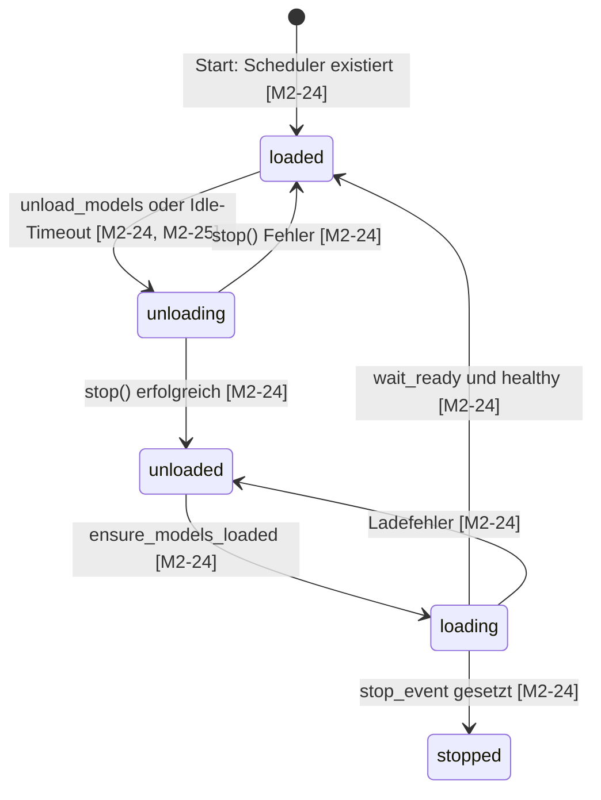
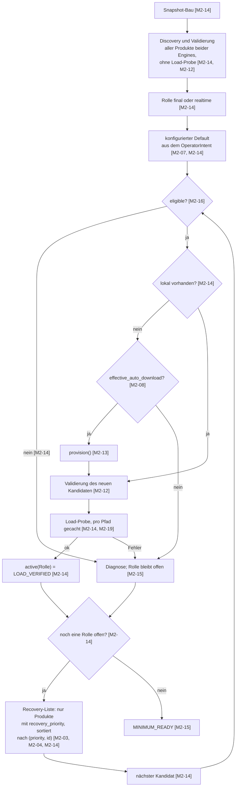
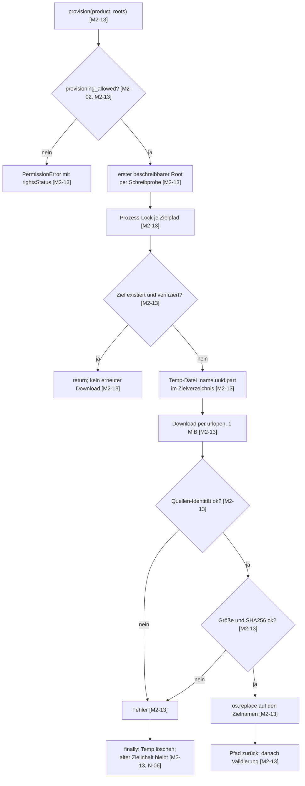
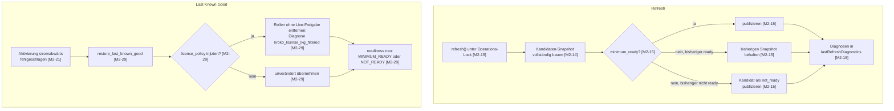

# 02.07 – Modelle und Modellverwaltung

*Faktenbasis: `workflow/research/02.07.json` (M2-01…M2-31, N-01…N-10, U-01). Commit `a8993c5c`.*

**Abgrenzung:** Dieses Kapitel beschreibt die Verwaltungsschicht **über** den Engines: Katalog, Betreiberabsicht, Discovery, Provisionierung, Auswahl, Aktivierung und Lebenszyklus. Wie eine Engine aus einem Pfad eine Instanz baut, steht in [02.06 Engines](./02.06-engines.md). Lanes, Queues und Worker: [02.08 Scheduler und Nebenläufigkeit](./02.08-scheduler-und-nebenlaeufigkeit.md). Serverweite statt sitzungsbezogene Ressourcen: [01.06](../01-grundlagen/01.06-serverweite-und-sitzungsbezogene-ressourcen.md). Kroko-Lizenz und Native-Guard werden hier nur an der Verwaltungsgrenze berührt; kanonisch sind [05.07](../05-administration/05.07-kroko-lizenzierung.md) und [05.08](../05-administration/05.08-native-guard.md).

## 1. Worum geht es?

Ein Modellname in der Konfiguration ist noch kein Modell. Auf dem Server müssen vier verschiedene Fragen beantwortet werden, und sie haben vier verschiedene Antworten:

1. **Was ist als Produkt bekannt?** (Welche Modelle gibt es überhaupt, mit welchen Rechten und welcher Prüfsumme?)
2. **Was möchte der Betreiber?** (Welche Engine, welches Modell, darf nachgeladen werden?)
3. **Was liegt tatsächlich auf der Platte?** (Welche Dateien wurden gefunden und bestehen die strukturelle Prüfung?)
4. **Was läuft gerade?** (Welcher Kandidat ist für `final` und `realtime` aktiv, und ist der Server „bereit“?)

Der `STTModelManager` beantwortet alle vier Fragen an **einer** Stelle. Er ist der einzige transaktionale Registry-Owner: Er hält die Produktfakten (`authority`), die Betreiberabsicht (`intent`), die Ladeprüfung (`load_probe`), den Provisionierer, optional eine Lizenzpolicy und genau zwei Engine-Adapter. Die Policy liegt hier, die Dateilayouts liegen in den Adaptern (M2-01).

Zwei harte Grenzen prägen das ganze Kapitel:

- **Die Engine lädt nie.** Sie löst ausschließlich einen lokalen Pfad auf und wirft einen Fehler, wenn sie ihn nicht findet; `urlopen` und `hf_hub_download` kommen in den Engines nicht vor (M2-31).
- **Der Provisionierer lädt atomar.** Er prüft vor dem Download die Berechtigung, lädt in eine Temp-Datei, verifiziert Größe und SHA-256 und benennt erst dann um (M2-13).

Praktisch heißt das: „Modell auswählen“ und „Modell beschaffen“ sind zwei getrennte Vorgänge. Ein Betreiber, der ein Modell in die Einstellungen schreibt, hat damit noch keine Datei bereitgestellt.

## 2. Das Wesentliche auf einen Blick

| Frage | Kurzantwort | Belege |
|---|---|---|
| Wer besitzt den Katalog? | Genau ein `STTModelManager`; zwei Adapter, ein Provisionierer, eine optionale Lizenzpolicy | M2-01 |
| Wie viele Produkte? | 11 Faster-Whisper + 12 Kroko = 23 | M2-03, M2-04 |
| Wer darf provisionieren? | Nur Produkte mit `provisioning_allowed=True`; keines der ausgelieferten Produkte erfüllt das | M2-02, M2-13, N-02, N-03 |
| Wie wird gefunden? | Wurzeln in fester Reihenfolge; Layout je Engine-Adapter | M2-09, M2-10, M2-11 |
| Was gilt als „gültig“? | Struktur bzw. Dateityp und ggf. Größe; **kein** SHA-256 | M2-12 |
| Wann wird aktiviert? | Nur ein Snapshot mit `MINIMUM_READY`; sonst bleibt der letzte gute Stand | M2-14, M2-15 |
| Was heißt „geladen“? | Ein Scheduler existiert; das ist **kein** Gesundheitsnachweis | M2-24 |
| Wie wird gewechselt? | Lizenz → Intent → Refresh/Probe → Gate → alter Stopp, neuer Start → ggf. Rollback | M2-21, M2-23 |
| Was begrenzt den Speicher? | Rangklassen und Anzahl, keine Byte-Grenze | M2-27 |
| Was gilt für Kroko Pro? | UUID, Key, Native-Guard, Force Community | M2-28 |

### 2.1 Vier Begriffe, die nicht verwechselt werden dürfen

| Begriff | Was er ist | Was er nicht ist |
|---|---|---|
| `ProductModel` | Unveränderliche Produktfakten: ID, Engine, Rollen, Rechte, Dateiname, Hash, Größe, Quelle (M2-02) | Keine Datei, kein Zustand „gefunden“ |
| `OperatorIntent` | Absicht aus den Einstellungen: Defaults je Rolle, Auto-Download, Pfade, installierte Kroko-Variante (M2-07) | Keine Prüfung, ob das Modell existiert |
| `ModelCandidate` | Konkreter Fund auf der Platte: Pfad, Quelle, `product_id`, Zustand, Probleme (M2-12) | Kein Produktrecht, keine Garantie auf Ladbarkeit |
| `ModelSnapshot` | Gesamtergebnis eines Refresh: Kandidaten, aktive Rolle(n), Readiness, Diagnosen (M2-15) | Keine Teilmenge, keine offene Baustelle |

### 2.2 Der Lebenszyklus des geladenen Modells (A)



**Was das Diagramm sagt:** Der Server startet mit einem Scheduler und setzt den Zustand auf `loaded` (M2-24). `loaded` bedeutet hier nur „es gibt einen Scheduler“, nicht „das Modell ist gesund“. Ein expliziter Ladevorgang ist nur der Lazy-Pfad `unloaded → loading → loaded` (M2-24). Das Entladen geht über `unloading`; scheitert `stop()`, kehrt der Zustand nach `loaded` zurück. Während eines Ladevorgangs kann ein Shutdown den Zustand `stopped` setzen; ein Rückweg ist nicht belegt (M2-24). Der Idle-Daemon stößt denselben Unload-Pfad an (M2-25).

**Textalternative:** Start = `loaded` (Scheduler vorhanden). Unload = `unloading`, bei Erfolg `unloaded`, bei Fehler zurück nach `loaded`. Lazy Load = `unloaded → loading → loaded` oder bei Fehler `unloaded`. Shutdown während des Ladens = `stopped`.

### 2.3 Die Auswahl je Rolle (D)



**Was das Diagramm sagt:** Zuerst wird der gesamte Bestand entdeckt und strukturell geprüft, aber noch nicht geladen (M2-14, M2-12). Dann wird pro Rolle der konfigurierte Default versucht: Eignung, lokale Existenz, ggf. Provisionierung, dann die teure Load-Probe (M2-14, M2-19). Erst danach greift die generische Recovery – und sie greift **nur** für Produkte mit ausdrücklicher `recovery_priority` (M2-03, M2-04, M2-14). Der Rücksprung im Diagramm ist schematisch: Die Recovery prüft jeden priorisierten Kandidaten erneut auf Eignung, lokale Existenz und Probe.

**Textalternative:** Bestand entdecken und validieren → Default je Rolle prüfen → ggf. provisionieren → Probe → aktive Rolle. Fehlt eine Rolle, werden nur priorisierte Produkte der Reihe nach versucht; ohne Priorität gibt es keinen generischen Fallback.

### 2.4 Warum diese Bauform?

| Alternative | Warum sie hier nicht gewählt ist |
|---|---|
| Download in der Engine | Die Engine darf nur lokal auflösen; fehlt das Modell, gibt es einen Fehler mit Verweis auf die Verwaltung (M2-31) |
| Veränderliche Produktdaten | `ProductModel` ist `frozen`; Änderungen an Identität oder Rechten würden sonst stillschweigend die Bedeutung eines Snapshots verschieben (M2-02) |
| Teilveröffentlichung eines Refresh | Ein Kandidat wird nur als **vollständiger** Snapshot sichtbar; ein halb fertiger Zustand ist nie „aktiv“ (M2-15) |
| Hash bei jeder Discovery | Discovery prüft nur Struktur/Größe; der Hash bleibt dem Provisionierer vorbehalten (M2-12) |
| Dateisystem-Rollback | Die Temp-Datei wird gelöscht, das alte Ziel bleibt bis zum erfolgreichen `os.replace` unberührt (M2-13, N-06) |

Diese Entscheidungen sind keine Garantien, sondern bewusst gewählte Grenzen. Wo sie wehtun, stehen sie in §5 und §14.

## 3. Katalog, Identitäten und Manifest

### 3.1 Zwei Quellen, eine Autorität

Der Katalog entsteht aus zwei Quellen:

- **Faster-Whisper:** elf Produkte sind direkt im Python-Code als `ProductModel` hinterlegt (M2-03).
- **Kroko:** zwölf Produkte werden aus dem ausgelieferten Manifest `models.json` erzeugt (M2-04, M2-05).

Beide werden zur `default_product_authority()` zusammengeführt (M2-04). Die Engine-Adapter kennen nur ihre jeweilige Engine; der Manager führt sie zusammen (M2-01).

### 3.2 Die elf Faster-Whisper-Produkte

Die Produkt-IDs folgen dem Muster `faster-whisper-<name>`:

- **mehrsprachig:** `faster-whisper-tiny`, `faster-whisper-base`, `faster-whisper-small`, `faster-whisper-medium`, `faster-whisper-large-v2`, `faster-whisper-large-v3`, `faster-whisper-large-v3-turbo`
- **englisch:** `faster-whisper-tiny.en`, `faster-whisper-base.en`, `faster-whisper-small.en`, `faster-whisper-medium.en`

Alle elf sind `artifact_kind=directory`, `provisioning_allowed=False`, `rights_status=LOCAL_ONLY_UNPINNED` und bedienen standardmäßig beide Rollen `final` und `realtime` (M2-03). Eine Recovery-Priorität haben nur `tiny` (300) und `small` (200); alle anderen haben keine (M2-03).

Das ist die zentrale Konsequenz für die Praxis: **Faster-Whisper wird nie provisioniert** (N-03). Wer `medium` will, muss den Ordner mit `config.json` und `model.bin` selbst bereitstellen. Fehlt er, gibt es keinen automatischen Download – und ohne Recovery-Priorität auch keinen generischen Ersatz durch ein anderes lokales Faster-Whisper-Modell (M2-03, M2-14).

### 3.3 Die zwölf Kroko-Produkte

Das Manifest enthält vier Community- und acht Pro-Einträge (M2-04, M2-05):

| Klasse | Produkt-IDs |
|---|---|
| Community (4) | `kroko-de-community-64-l`, `kroko-de-community-128-l`, `kroko-en-community-64-l`, `kroko-en-community-128-l` |
| Pro (8) | `kroko-de-pro-16-m`, `kroko-de-pro-16-l`, `kroko-de-pro-32-m`, `kroko-de-pro-32-l`, `kroko-de-pro-64-m`, `kroko-de-pro-64-l`, `kroko-de-pro-128-m`, `kroko-de-pro-128-l` |

Community-Einträge tragen `licenseClass=community-unresolved`, `redistributionStatus=POLICY_REQUIRED`, `requiresRuntimeVariant=free`. Pro-Einträge tragen `licenseClass=commercial`, `redistributionStatus=PROHIBITED`, `requiresRuntimeVariant=pro` und die Herkunft `operator-provisioned` (M2-05).

Eine Recovery-Priorität hat ausschließlich `kroko-de-community-64-l` (100); alle anderen Kroko-Produkte haben keine (M2-04). Damit ist dieses eine Modell der generische Kroko-Fallback, wenn die konfigurierte Rolle fehlt.

**Wichtig für die Provisionierung:** Obwohl die Community-Einträge Dateiname, SHA-256, Größe und eine Quell-URL besitzen, ist `provisioning_allowed` bei allen zwölf `False`. Der Grund steht im Manifest: `redistributable` ist nur bei `ALLOWED` wahr; `POLICY_REQUIRED` zählt ausdrücklich nicht, und die Pro-Einträge sind `PROHIBITED` und haben keine Quelle (M2-05, M2-06). Deshalb ist **kein ausgeliefertes Kroko-Produkt provisionierbar** (N-02). Der Provisionierungspfad ist implementiert, aber im ausgelieferten Katalog faktisch blockiert.

### 3.4 Das Manifest-Schema

| Ebene | Inhalt | Beleg |
|---|---|---|
| Kopf | `schemaVersion` (aktuell 1), `manifestRevision` (aktuell 1), `upstream`, `licensePolicy`, `models[]` | M2-05 |
| Upstream | `Banafo/Kroko-ASR`, Revision `d45212ae…`, Art `huggingface-commit-sha` | M2-05 |
| Lizenzpolicy | Community `POLICY_REQUIRED`, Pro `PROHIBITED` | M2-05 |
| Pflichtfeld je Eintrag | `id`, `filename`, `requiresRuntimeVariant`, `redistributionStatus` | M2-06 |
| Weitere Felder | `language`, `tier`, `licenseClass`, `sha256`, `bytes`, `provenance` | M2-06 |
| Ableitung | `redistributable` nur bei `redistributionStatus == ALLOWED` | M2-06 |

Fehlt einem Eintrag ein Pflichtfeld, wirft das Laden einen `KrokoModelError`; `requiresRuntimeVariant` wird kleingeschrieben, `redistributionStatus` großgeschrieben, `bytes` als Ganzzahl gelesen (M2-06). Das Manifest wird über `importlib.resources` aus dem Paket geladen, mit einem Pfad-Fallback; fehlt oder bricht die Datei, gibt es einen Fehler – keinen stillen leeren Katalog (M2-06).

Der Lookup erfolgt in drei Stufen: exakte ID, exakter Dateiname, Dateiname case-insensitiv (M2-06). Ein Pfad zählt dabei über seinen Dateinamen. So kann ein Betreiber entweder `kroko-de-community-64-l` oder `Kroko-DE-Community-64-L-Streaming-001.data` angeben.

### 3.5 Die Regeln des `ProductModel`

`ProductModel` ist `frozen`; seine Felder sind die unveränderlichen Produktfakten (M2-02):

| Feld | Bedeutung |
|---|---|
| `id`, `engine` | stabile Produktidentität; der Engine-Name wird normalisiert |
| `language`, `license_class` | Sprache und Lizenzklasse |
| `runtime_variant` | erwartete Runtime-Variante (`free`/`pro`) |
| `roles` | Rollen, die das Produkt bedienen kann (Standard: `final` + `realtime`) |
| `revision` | Herkunftsrevision, wenn belegt |
| `filename`, `artifact_kind` | Dateiname und Artefakttyp (`file`/`directory`) |
| `sha256`, `bytes`, `source`, `source_identity` | Inhaltsidentität und Quelle |
| `provisioning_allowed`, `rights_status` | Berechtigung und Rechtezustand |
| `recovery_priority` | optionaler Rang für die generische Recovery |

Die Konstruktion prüft (M2-02):

- `id` und `engine` müssen nicht leer sein.
- Ein Dateiname darf keine Pfadanteile enthalten (kein `/`, kein `\`, kein `.`/`..`).
- Nur wenn `provisioning_allowed=True` ist, sind `filename`, `sha256`, `bytes` und `source` Pflicht; `artifact_kind` muss `file` sein, `bytes` muss eine positive Ganzzahl (kein `bool`) und `sha256` exakt 64 Hexzeichen lang sein. Sonst `ValueError`.

`public_dict()` gibt die Fakten ohne lokale Pfade aus; die Quelle erscheint als URL (M2-02). Das ist die Grundlage für die pfadarme Katalogansicht.

### 3.6 Katalog ist nicht Dateibaum

Ein Produkt im Katalog heißt nicht, dass eine Datei existiert. Umgekehrt kann eine Datei existieren, ohne im Katalog zu stehen: Der Kroko-Adapter ordnet nur über den Dateinamen zu; ohne Treffer bleibt `product_id=None`, und die ID wird der Dateiname (M2-11). Solche „unmanaged“ Kandidaten sind sichtbar, aber für Kroko nicht verfügbar, weil die Manifest-Autorität fehlt (M2-11, M2-16). Bei Faster-Whisper ist ein nicht zugeordneter Ordner dagegen ein explizit lokaler Kandidat und kann verfügbar werden (M2-11, M2-16).

## 4. Betreiberabsicht und Discovery

### 4.1 Was der Intent aus den Einstellungen liest

`OperatorIntent.from_settings()` bildet die Absicht aus den Server-Einstellungen (M2-07):

- normalisierte `stt_engine_settings` und `stt_model_settings`,
- die Engines für `final` und `realtime`,
- die Modelle für beide Rollen,
- die globale Auto-Download-Absicht,
- die installierte Kroko-Variante.

Zusätzlich werden **Legacy-Pfade** eingesammelt: `model_path`, `model_file`, `model_root` und `model_dir` aus den Engine-Optionen sowie `download_root` werden an `custom_paths` angehängt, ohne Duplikate (M2-07). Das ist die Brücke für Installationen, die ihre Modelle bisher nur über Engine-Optionen oder eine Umgebungsvariable eingebunden hatten.

Die Kroko-Variante stammt **ausschließlich** aus der installierten Build-Identität (`installed_kroko_variant()`), nie aus einem Key oder einer Konfigurationsangabe (M2-07). Zugangsdaten werden für die spätere Redaktion gesammelt, damit Fehlermeldungen keine Secrets ausschreiben (M2-07).

### 4.2 Auto-Download: drei Schalter, ein ODER

| Ebene | Schalter | Default |
|---|---|---|
| global | `stt_auto_download_enabled` | `False` |
| Engine | `stt_engine_settings[engine].auto_download_enabled` | `False` |
| Modell | `stt_model_settings[id oder engine:id].auto_download_enabled` | `False` |

Die effektive Absicht ist das logische ODER der drei Ebenen (M2-08). Die Reihenfolge der Auswertung ist fest `global`, `engine`, `model`; für die Entscheidung zählt nur, ob mindestens eine Ebene `True` ist (M2-08). Alle Defaults sind `False` (M2-08).

Das bedeutet praktisch: Auto-Download ist **aus**, solange niemand ihn ausdrücklich einschaltet. Und selbst dann entscheidet nicht der Schalter allein, sondern zusätzlich `provisioning_allowed` am Produkt (M2-02, M2-13).

### 4.3 Wurzeln in fester Reihenfolge

`discovery_roots(engine)` liefert die Suchwurzeln in dieser Reihenfolge (M2-09):

1. `custom_paths` bzw. `paths` aus den Engine-Einstellungen, in ihrer Reihenfolge,
2. die Legacy-Umgebungsvariable `VOICESTT_FASTER_WHISPER_MODEL_ROOT` bzw. `VOICESTT_KROKO_MODEL_ROOT`,
3. die verwaltete Default-Wurzel.

Duplikate bleiben an ihrer ersten Position (M2-09). Die Default-Wurzel ist `<runtime_root>/models/stt/fasterwhisper` bzw. `<runtime_root>/models/stt/kroko_asr`; `runtime_root` ist `data_root_path` oder ersatzweise `data` (M2-09). Ohne gesetzten Datenpfad landet man also relativ in `data/models/stt/...`.

Die Reihenfolge ist eine Priorität, keine Suche „irgendwo“. Wer eine eigene Wurzel vorne einträgt, gewinnt gegen die Default-Wurzel; wer sie hinten anhängt, verliert gegen einen früheren Treffer.

### 4.4 Das Faster-Whisper-Layout

Der Faster-Whisper-Adapter sucht in jeder Wurzel **die Wurzel selbst und genau eine Ebene Unterordner** (M2-10). Ein Ordner ist gültig, wenn er

- `config.json` **und** `model.bin` enthält, oder
- einen `snapshots/`-Unterordner enthält, in dem ein gültiger Snapshot liegt.

Bei mehreren gültigen Snapshots wird der **lexikographisch letzte** genommen, nicht der zeitlich neueste (M2-10). Staging-Namen (führender Punkt, `.part`, `.staging`) werden übersprungen (M2-10). Doppelte Treffer werden über den aufgelösten Pfad case-insensitiv entfernt (M2-10).

Die ID ist die Produkt-ID, wenn der Ordnername zu einem Produkt passt; sonst eine „freundliche“ ID, bei der ein `models--Org--Name`-Präfix zu `Name` verkürzt wird (M2-10). Ein Ordner `models--Systran--faster-whisper-small` wird also zu `faster-whisper-small`, wenn das Produkt bekannt ist, sonst zu `faster-whisper-small` als freundlicher ID.

```text
# Schematisch – Faster-Whisper-Layout
<data>/models/stt/fasterwhisper/
    small/                                  # gültig: config.json + model.bin
    models--Systran--faster-whisper-base/
        snapshots/<ref>/                    # letzter sortierter gültiger Treffer
    .cache-partial/                         # Staging: übersprungen
```

### 4.5 Das Kroko-Layout

Der Kroko-Adapter akzeptiert zwei Formen (M2-11):

- die Wurzel ist direkt eine `.data`-Datei (dann ist `source_root` ihr Elternordner), oder
- die Wurzel ist ein Ordner; dann werden alle `*.data` darin eingesammelt.

Staging-Dateien werden übersprungen, Treffer über den aufgelösten Pfad dedupliziert (M2-11). Die Produktzuordnung erfolgt **nur über den Dateinamen** (case-insensitiv). Gibt es keinen Treffer, bleibt `product_id=None`, und die ID ist der Dateiname (M2-11).

```text
# Schematisch – Kroko-Layout
<data>/models/stt/kroko_asr/
    Kroko-DE-Community-64-L-Streaming-001.data   # -> kroko-de-community-64-l
    Kroko-DE-Pro-64-L-Streaming-001.data         # -> kroko-de-pro-64-l
    fremdmodell.data                             # -> unmanaged, nicht verfügbar
```

### 4.6 Ein Intent, der nicht greift

Betriebs-Defaults (Ausgangspunkt für `OperatorIntent.from_settings`, M2-07): `model="small"`, `realtime_model="Kroko-DE-Community-64-L-Streaming-001.data"`, `transcription_engine="faster_whisper"`, `realtime_transcription_engine="kroko_onnx"` (server.py:409-413).

Ein typisches Beispiel: Der Betreiber setzt `model=medium` für `final`, aber auf der Platte liegt nur `small`. Auto-Download ist aus.

- Der Default `medium` wird geprüft, ist aber nicht lokal vorhanden; es gibt eine Diagnose `configured_default_missing` (M2-14).
- Die generische Recovery greift nur für Produkte mit `recovery_priority`. `medium` hat keine; `small` hat 200, `tiny` hat 300 (M2-03).
- `small` ist lokal vorhanden, wird probe-verifiziert und deckt beide Rollen ab – sofern es nicht durch den Intent deaktiviert ist (M2-14).

Ergebnis: Der Server läuft mit `small`, obwohl `medium` konfiguriert war. Das ist keine stille Missachtung, sondern die belegte Recovery-Reihenfolge. Wer das nicht will, muss `medium` lokal bereitstellen oder die Recovery-Prioritäten bewusst setzen.

## 5. Validierung: Struktur und Größe, kein Hash

Die Validierung ist bewusst schwach – und das muss man wissen (M2-12):

| Engine | `VALIDATED`, wenn … | Zusätzlich | Nicht geprüft |
|---|---|---|---|
| Faster-Whisper | `config.json` und `model.bin` vorhanden sind | – | Inhalt, Hash, Größe |
| Kroko | die Datei eine `.data`-Datei ist | bei bekanntem Produkt: Dateigröße gleich `bytes` | Inhalt, Hash |

Fehlt eine Bedingung, bleibt der Kandidat `DISCOVERED` und trägt ein Problem (M2-12). Ein SHA-256 wird bei Discovery und Validierung **nicht** berechnet; das passiert ausschließlich im Provisionierer (M2-12).

Die praktische Folge ist unangenehm, aber ehrlich: Eine Datei, die vorhanden ist, die richtige Größe hat und inhaltlich falsch ist, wird `VALIDATED`. Erst die Load-Probe entscheidet, ob sie wirklich ladbar ist (M2-12, M2-19). Ein Bitfehler, eine abgeschnittene Datei mit zufällig gleicher Größe oder ein falsches Format können also bis zur Probe durchrutschen (N-04, N-09). Es gibt keinen Hash-Nachweis im Discovery-Pfad.

Warum ist das so? Die Discovery läuft bei jedem Refresh über den gesamten Bestand; ein vollständiger Hash über große Modelldateien wäre dort teuer. Der Preis ist die schwächere Aussage: „`VALIDATED`“ heißt „strukturell plausibel“, nicht „inhaltlich korrekt“.

## 6. Provisionierung: berechtigt, atomar, ohne Rollback

### 6.1 Der Ablauf



**Was das Diagramm sagt:** Die Berechtigung kommt vor allem anderen (M2-13). Danach wird der erste beschreibbare Ziel-Root gewählt, pro Zielpfad ein Prozess-Lock genommen und geprüft, ob dort bereits eine verifizierte Datei liegt (M2-13). Nur wenn nicht, wird in eine Temp-Datei im Zielverzeichnis geladen, die Quellen-Identität geprüft, Größe und SHA-256 verifiziert und erst dann per `os.replace` umbenannt (M2-13). Im Fehlerfall wird die Temp-Datei gelöscht; der alte Zielinhalt bleibt unangetastet (M2-13, N-06).

**Textalternative:** Berechtigung → Ziel → Lock → vorhandene Datei verifizieren → sonst Temp, Download, Quellen-Identität, Größe/Hash, atomare Umbenennung; bei Fehler Temp weg, alt bleibt.

### 6.2 Die Schritte im Einzelnen

1. **Berechtigung.** `provisioning_allowed=False` führt zu `PermissionError` mit dem `rightsStatus` (M2-13). Der Aufrufer im Manager fängt das und schreibt `blocked_ineligible` mit `rightsStatus` in die Diagnose (M2-13, N-02).
2. **Ziel.** Der erste Root, für den eine Schreibprobe mit einer UUID-Datei gelingt, gewinnt (M2-13). Das Ziel ist `<root>/<filename>`.
3. **Serialisierung.** Ein Prozess-Lock pro normalisiertem Zielpfad verhindert, dass zwei Threads dieselbe Datei gleichzeitig laden (M2-13). Der zweite Thread wartet und sieht danach die verifizierte Datei; es gibt nur einen Fetch.
4. **Idempotenz.** Existiert das Ziel und ist es verifiziert (Größe **und** SHA-256), wird es ohne erneuten Download zurückgegeben (M2-13).
5. **Temp und Download.** Die Temp-Datei heißt `.<name>.<uuid>.part` und liegt im Zielverzeichnis; geladen wird per `urlopen` ohne Cache in 1-MiB-Blöcken (M2-13).
6. **Quellen-Identität.** Die tatsächlich beobachtete URL (nach Redirects) muss der erwarteten `source_identity` bzw. `source` entsprechen; sonst Abbruch (M2-13). Das verhindert, dass ein Redirect auf eine andere Datei als die autorisierte führt.
7. **Verify.** Größe und SHA-256 müssen stimmen; beides wird aus dem `ProductModel` geprüft (M2-02, M2-13).
8. **Replace.** `os.replace` benennt die Temp-Datei auf den Zielnamen um (M2-13). Das ist der einzige Schritt, der den sichtbaren Zielzustand ändert.
9. **Finally.** Die Temp-Datei wird immer gelöscht, auch im Fehlerfall (M2-13).

### 6.3 Kein Rollback – aber auch kein Teilzustand

Es gibt **keinen Dateisystem-Rollback** (N-06). Das ist kein Mangel des Ablaufs, sondern seine Bauform: Vor dem `os.replace` wird das Ziel nicht angefasst; scheitert der Download oder die Prüfung, bleibt die alte Datei unverändert. Nach dem `os.replace` gibt es nichts zurückzurollen, weil der neue Inhalt bereits vollständig verifiziert ist. Was fehlt, ist eine Wiederherstellung einer zuvor überschriebenen Datei, falls der neue Inhalt später doch nicht lädt – dafür gibt es die Load-Probe und den LKG-Mechanismus, nicht den Provisionierer (M2-13, M2-29).

### 6.4 Der ausgelieferte Katalog blockiert

Die Provisionierung ist implementiert, aber im ausgelieferten Katalog nicht erreichbar:

- **Faster-Whisper:** `artifact_kind=directory`, `provisioning_allowed=False`; der Provisionierer unterstützt nur `file` (M2-02, M2-03, N-03).
- **Kroko Community:** `redistributionStatus=POLICY_REQUIRED`; `redistributable` ist nur bei `ALLOWED` wahr, also `provisioning_allowed=False` (M2-05, M2-06, N-02).
- **Kroko Pro:** `PROHIBITED`, keine Quelle (M2-05, N-02).

Selbst mit eingeschaltetem Auto-Download endet der Versuch daher in `blocked_ineligible` (M2-13, N-02). Betreiber müssen Kroko-Dateien lokal bereitstellen; der Server beschafft sie nicht.

## 7. Snapshot, Readiness und letzter guter Stand

### 7.1 Wie ein Snapshot entsteht

Der Snapshot-Bau hat drei Stufen (M2-14):

1. **Discovery und Validierung aller Produkte beider Engines** – ohne Load-Probe. Das ist billig und verschafft den vollständigen Überblick.
2. **Default je Rolle** – für `final` und `realtime` wird der konfigurierte Default geprüft: Eignung, lokale Existenz, ggf. Provisionierung, dann Probe. Ein Erfolg setzt `active[role]`.
3. **Generische Recovery** – nur Produkte mit `recovery_priority`, sortiert nach `(priority, id)` aufsteigend, und nur für noch fehlende Rollen. Die Schleife stoppt, sobald alle Pflichtrollen gedeckt sind. Die Probe wird pro Pfad gecacht, damit eine Datei, die beide Rollen bedient, nicht zweimal geladen wird.

Ein Produkt ohne `recovery_priority` ist **kein** generischer Fallback (M2-03, M2-04, M2-14). Das ist die wichtigste Auswahlregel für Betreiber: Lokal vorhanden zu sein reicht nicht, um eine fehlende Rolle zu übernehmen.

### 7.2 Veröffentlichung und LKG (B)



**Was das Diagramm sagt:** Ein Refresh baut zuerst einen vollständigen Kandidaten (M2-14). Veröffentlicht wird er nur, wenn er `MINIMUM_READY` erreicht – oder wenn bisher gar kein brauchbarer Snapshot existierte (M2-15). Ein gescheiterter Kandidat wird nie teilweise sichtbar; seine Diagnosen landen in `lastRefreshDiagnostics` (M2-15). Scheitert die Aktivierung stromabwärts, wird der zuletzt dienstlich bewiesene Stand wiederhergestellt; eine injizierte Lizenzpolicy filtert dabei Rollen, deren Freigabe nicht mehr gilt (M2-29).

**Textalternative:** Kandidat bauen → nur bei `MINIMUM_READY` (oder ohne bisherigen brauchbaren Stand) veröffentlichen → sonst alten Stand behalten und Diagnosen festhalten. Bei Aktivierungsfehler LKG zurück, ggf. lizenzgefiltert.

### 7.3 Die öffentlichen Zustände

Der Snapshot hat intern `readiness` (`MINIMUM_READY`/`NOT_READY`) und `optional_state` (`complete`/`provisioning`/`errors`). Daraus werden vier öffentliche Zustände (M2-15):

| Öffentlicher Zustand | Bedeutung |
|---|---|
| `ready_complete` | Pflichtrollen gedeckt, keine optionale Arbeit offen |
| `ready_optional_provisioning` | Pflichtrollen gedeckt, optionale Provisionierung läuft |
| `ready_optional_errors` | Pflichtrollen gedeckt, optionale Provisionierung mit Fehlern |
| `not_ready` | Mindestens eine Pflichtrolle ist nicht gedeckt |

`revision` wird beim Bau vergeben (M2-15). Wird ein Kandidat nicht veröffentlicht, ist seine Revision verloren; der alte Snapshot behält seine Revision. Genau daran erkennt der aufrufende Service den Fall „neuer Intent, aber kein neues `MINIMUM_READY`“ (§10).

### 7.4 Optionale Provisionierung

Ist das Minimum gedeckt, werden zusätzlich Produkte betrachtet, die aktiviert sind, deren Auto-Download wirksam ist und die lokal fehlen (M2-15). Während dieser Arbeit wird ein transienter `MINIMUM_READY`-Snapshot mit `optional_state=provisioning` veröffentlicht; der bereits aktive Satz bleibt unverändert. Danach folgt der endgültige Snapshot mit `complete` oder `errors` (M2-15). Die optionalen Produkte werden ergänzt, nicht stillschweigend als Lane-Modell gesetzt.

### 7.5 LKG und Lizenzfilter

`restore_last_known_good(snapshot, message)` akzeptiert nur einen `ModelSnapshot` (M2-29). Es wird kein neuer Kandidat gebaut und keine Probe wiederholt; der übergebene Stand ist der zuletzt dienstlich bewiesene. Ist eine Lizenzpolicy injiziert, werden aktive Rollen entfernt, deren kommerzielle Freigabe nicht mehr gilt; die Readiness wird neu berechnet (`MINIMUM_READY`, wenn die Pflichtrollen noch gedeckt sind, sonst `NOT_READY`) und die Diagnose `kroko_license_lkg_filtered` mit den entfernten IDs ergänzt (M2-29). Ohne Policy bleibt der Snapshot unverändert (M2-29).

Das verhindert, dass ein Rollback eine Pro-Freigabe „auferstehen“ lässt, die inzwischen per Key-Rotation, Force Community oder Ablauf ungültig geworden ist (M2-28, M2-29).

### 7.6 Betriebsflächen

| Fläche | Zweck | Besonderheit |
|---|---|---|
| `GET /api/models` | Katalog ohne Pfad, dazu `active`, `lifecycle`, `management` | Admin; Pfade werden entfernt (M2-30) |
| `GET /api/models/management` | vollständiger Verwaltungsstatus inkl. Kandidaten und Diagnosen | Admin (M2-16, M2-30) |
| `POST /api/models/refresh` | Snapshot bauen und aktivieren | Fehler als 409 bei `RuntimeError`/`ValueError` (M2-30) |
| `POST /api/kroko/license/refresh` | Lizenz neu prüfen | Timeout `(0, 60]`, Default 5.0; bei Pro zusätzlich Modellrefresh (M2-30) |
| `GET/PUT /api/models/lifecycle` | Idle- und Speicherpolitik | nur vier Schalter plus Snake-Aliase; `idleTimeoutSeconds >= 1` (M2-30) |
| `POST /api/models/load` / `unload` | explizites Laden/Entladen | Unload bei Beschäftigung 409 (M2-30) |
| `GET/PUT /api/models/active` | aktive Lanes anzeigen/wechseln | Wechselregeln §10 (M2-23, M2-30) |
| `PATCH /api/config` | Modell-Einstellungen ändern | `appliesTo=model_refresh`; **kein** automatischer Refresh (M2-30) |
| `GET /health` | Liveness ohne Admin-Guard | `sttReady` und `sttModels` aus der pfadfreien Zusammenfassung (M2-16, M2-30) |

Der letzte Punkt ist im Betrieb entscheidend: `PATCH /api/config` für `auto_download`, Engine- oder Modell-Einstellungen markiert die Änderung nur als „Modellrefresh erforderlich“. Erst `POST /api/models/refresh` (oder ein Wechsel) stößt die Provisionierung/Aktivierung an (M2-30).

## 8. Registry-Sicht und Aliase

### 8.1 Zwei Sichten auf denselben Zustand

- **`status()`** ist die Admin-Sicht. Pro Kandidat werden `eligible` (seiteneffektfrei) und `available` (eligible **und** Zustand `VALIDATED`/`LOAD_VERIFIED`) berechnet; pro Autoritätsprodukt kommen `operatorEnabled` und `autoDownloadRequestedScopes` hinzu; dazu `refreshInProgress` und `lastRefreshDiagnostics` (M2-16).
- **`readiness_summary()`** ist die pfadfreie Sicht für nicht authentifizierte Liveness. Sie enthält Revision, Zustand, Readiness, `minimumReady`, `optionalProvisioning`, `refreshInProgress`, die Kandidatenzahl und die Menge der Diagnose-Ergebnisse – keine Pfade, keine Produktdetails (M2-16).

Diese Trennung ist der Grund, warum `/health` ohne Admin-Guard auskommt, während `/api/models/management` die vollen Pfade zeigt (M2-16, M2-30).

### 8.2 `eligible` ist nicht `available`

| Begriff | Frage | Beispiel |
|---|---|---|
| `eligible` | Darf dieses Produkt nach Intent, Variante und Lizenz überhaupt verwendet werden? | Ein Modell ist per Intent deaktiviert → nicht eligible |
| `available` | Ist es zusätzlich strukturell gültig bzw. probe-verifiziert? | Ordner ohne `model.bin` → `DISCOVERED`, nicht available |

`available = eligible AND state in {VALIDATED, LOAD_VERIFIED}` (M2-16, M2-17). Ein Kandidat kann also „erlaubt, aber kaputt“ oder „gesund, aber gesperrt“ sein. Beide Fälle sind diagnostisch unterscheidbar.

### 8.3 Namensauflösung

`list_models()` liefert je Kandidat `id`, `object`, `engine`, `alias`, `name`, `folder`, `path`, `available`, `eligible`, `validationState` und `problems` (M2-17). `available` wird wie oben aus Zustand und Eignung gebildet.

Die Auflösung normalisiert Suchbegriffe und Einträge in Tokens (M2-17):

- Kleinschreibung,
- `_` → `-`,
- Basename,
- Entfernen eines `models--…--`-Präfixes,
- Entfernen eines `faster-whisper-`-Präfixes.

`aliases_for()` und `resolve()` schneiden die Tokens von ID, Name, Folder und Pfad. `resolve()` liefert nur **verfügbare** Einträge (M2-17). `whisper-1` ist kein `ProductModel`/Katalogprodukt, sondern ein OpenAI-Routing-Alias (`openai_model_aliases`, server.py:510,8436,10524; Ergänzung in `/v1/models`, openai_routes.py:59-61) und wird dort behandelt – hier nur zur Abgrenzung.

| Anfrage | Trifft `faster-whisper-small`? | Warum |
|---|---|---|
| `small` | ja | Token `small` auf beiden Seiten |
| `faster-whisper-small` | ja | exakte ID |
| `models--Systran--faster-whisper-small` | ja | Präfix wird entfernt, `faster-whisper-small` bleibt |
| `medium` | nein | anderes Produkt |
| ein `DISCOVERED`-Kandidat | nein | `resolve()` verlangt `available` |

Das ist die Grundlage dafür, dass Betreiber in der API kurz (`small`) oder lang (`models--Systran--faster-whisper-small`) sprechen können, ohne die Ablage kennen zu müssen. Ein nicht verfügbarer Kandidat wird dabei bewusst nicht stillschweigend aufgelöst.

## 9. Verdrahtung, Probe und Lanes

### 9.1 Wie der Service den Manager einbindet

Der Service baut den Manager mit `runtime_root` (`data_root_path` oder `data`), dem Intent aus den Einstellungen, der Probe und der Lizenzpolicy (M2-18). **Vor** dem ersten `refresh()` wird die Kroko-Lizenzpolicy synchron geprüft (`background=False`); ohne frischen modellgebundenen Nachweis darf kein Pro-Modell in den Snapshot (M2-18). Danach wird der Snapshot angewendet, der Scheduler erzeugt und der Zustand auf `loaded` gesetzt (M2-18, M2-24).

`_apply_stt_model_snapshot()` schreibt `_resolved_stt_models` nur, wenn `minimum_ready` gilt; sonst gibt es `False` zurück und die vorherige Zuordnung bleibt stehen (M2-18). Diese Zuordnung ist bewusst nicht Teil von `public_dict()` und erscheint daher nicht in `/api/config` (M2-18).

### 9.2 Die Probe

Die Probe ist der teuerste Schritt und wird nur für ernsthafte Kandidaten ausgeführt (M2-19):

1. Bei Kroko: Läuft bereits eine gesunde Instanz mit **identischem** Modell, ist die Probe `True` – ohne zweiten nativen Load. Sonst folgt ein nativer Preflight (M2-19).
2. Die Settings werden geklont: `model` und `realtime_model` zeigen auf den Kandidatenpfad, `use_main_model_for_realtime=True`, `_resolved_stt_models` für beide Rollen gesetzt (M2-19).
3. Ein Probe-Scheduler wird gestartet, `wait_ready(180.0)` und `healthy()` geprüft und der Scheduler **immer** gestoppt (M2-19).

Die 180 Sekunden sind ein Code-Wert, kein Erfahrungswert (M2-19). Weil die Probe eine echte Engine-Initialisierung ist, kann sie lange dauern; deshalb wird sie pro Pfad gecacht und nicht für jeden Kandidaten wiederholt (M2-14).

### 9.3 Was die Lanes sehen

Die Engine-Fabriken lesen `_resolved_stt_models[final|realtime]` (M2-20):

- `model` = aufgelöster Pfad, sonst Fallback auf die Einstellung,
- `engine` = aufgelöste Engine,
- Optionen aus `resolved_engine_options`: zuerst die Optionen der passenden Lane und Engine, dann die andere Lane derselben Engine, dann `stt_engine_settings[engine]` bzw. die Options-Dicts (M2-20).

Damit ist die Verantwortung sauber getrennt: Der Manager entscheidet **welcher Pfad**, die Engine-Fabrik entscheidet **wie geladen wird**. Die Engine löst im Normalfall keinen Namen mehr auf, sondern bekommt einen Pfad (M2-20, M2-31).

## 10. Refresh, Wechsel und Lebenszyklus

### 10.1 Der gesperrte Refresh

`refresh_stt_models()` läuft unter einem Refresh-Lock und führt folgende Schritte aus (M2-21):

1. **Lizenz vor Admission.** Die Kroko-Lizenzpolicy wird neu ausgewertet, bevor der neue Snapshot entsteht.
2. **Alten Stand merken.** Snapshot, Intent und `_resolved_stt_models` werden gesichert.
3. **Kandidaten-Intent.** `OperatorIntent.from_settings()` liest die aktuellen Einstellungen.
4. **Quiesced Refresh.** Der Manager baut den Snapshot; bei einem Kroko-Probe-Konflikt greift der Quiesce-Pfad (§10.2).
5. **Fehlerfall.** Exception → Intent zurück, `restore_last_known_good`, `refreshRequired=True`, `RuntimeError`.
6. **Kein neues Minimum.** War der alte Snapshot `ready` und ist die Revision unverändert, wurde der Kandidat nicht veröffentlicht; das gilt als Fehlschlag und führt zum Rollback.
7. **Anwenden.** Der neue Snapshot wird angewendet.
8. **Beschäftigt?** Hat sich die Modellzuordnung geändert und ist der Server beschäftigt, wird **vollständig** zurückgerollt und ein Fehler gemeldet; es wird nichts aktiviert.
9. **Scheduler tauschen.** Alter Scheduler stoppen, neuen starten, `wait_ready` und `healthy` prüfen.
10. **Rollback.** Scheitert der neue Scheduler, wird der alte Stand wiederhergestellt und ein Rollback-Scheduler gestartet. Ist auch der nicht gesund, bleibt `unloaded` mit Fehler.

Der Unterschied zwischen Schritt 5 und 6 ist subtil, aber wichtig: Ein geworfener Fehler und ein „nicht veröffentlichter“ Kandidat führen beide zum LKG, aber nur der zweite Fall erkennt man an der unveränderten Revision.

### 10.2 Quiesced Refresh

Der Quiesce-Pfad ist Kroko-spezifisch (M2-22). Die Probe merkt sich Konflikte. Ist ein Konflikt `concurrent_native_identity` aufgetreten und der Server **nicht** beschäftigt, wird die laufende native Instanz über den regulären Unload-Pfad entladen (`reason=kroko_model_transition`) und der Refresh einmal wiederholt. Ist der Server beschäftigt (aktive Sessions oder Transkriptionen), gibt es einen `RuntimeError`: Der Wechsel wird vertagt, nicht erzwungen.

Der Grund ist die eine native Identität pro Prozess: Ein zweites Kroko-Modell darf nicht neben dem laufenden geladen werden (M2-22; Details [02.06](./02.06-engines.md), [05.08](../05-administration/05.08-native-guard.md)).

### 10.3 Der aktive Wechsel

`switch_models()` akzeptiert nur diese Schlüssel (M2-23):

`model`, `realtime_model`, `transcription_engine`, `realtime_transcription_engine`, `use_main_model_for_realtime`, `language`, `transcription_engine_options`, `realtime_transcription_engine_options`.

Alles andere führt zu `ValueError` (M2-23). Wird ein Modell oder eine Engine geändert, ohne `use_main_model_for_realtime` ausdrücklich mitzugeben, wird `False` erzwungen – die Lanes werden also getrennt, nicht stillschweigend gemeinsam (M2-23).

Der Ablauf (M2-23):

1. `enforce_cpu_model_policy` (CPU, Engine, Speicherregeln),
2. `_kroko_assert_switch_possible` (restart-only-Konflikte vor jedem Eingriff),
3. Lizenz-Reevaluierung mit den Kandidaten-Settings,
4. quiesced Refresh,
5. Gate: `minimum_ready`, sonst `ValueError`,
6. `registry.resolve` für geänderte Lanes; ist das Modell nicht lokal verfügbar, `ValueError`,
7. ohne Scheduler: Einstellungen übernehmen und persistieren (`reloaded=False`),
8. mit Scheduler: alten Scheduler stoppen, neuen starten, `wait_ready`/`healthy`; bei Fehler vollständiger Rollback und Rollback-Scheduler,
9. Erfolg: Audit `models.switched`, Performance-Event, Persistierung.

Ein Wechsel ist damit **kein Download-Befehl**: Was nach dem Refresh nicht lokal auflösbar ist, wird abgelehnt (M2-23). Und ein Wechsel ohne geladenen Scheduler lädt nichts nach; er übernimmt nur die Einstellungen.

### 10.4 Refresh und Wechsel im Vergleich

| Aspekt | Refresh | Wechsel |
|---|---|---|
| Auslöser | `POST /api/models/refresh`, Settings-Refresh, Provider-Recheck, Force-Reconcile | `PUT /api/models/active` |
| Lizenz | vor Admission (M2-21) | vor Admission, mit Kandidaten-Settings (M2-23) |
| Intent | aus aktuellen Settings (M2-21) | aus dem Update, Rest kopiert (M2-23) |
| Beschäftigt-Prüfung | ja, vor dem Scheduler-Tausch (M2-21) | **nein**; nur `loading` wird geprüft (M2-23, N-07) |
| Kein Scheduler | – | nur übernehmen/persistieren, `reloaded=False` (M2-23) |
| Fehler | LKG + `RuntimeError` (M2-21) | vollständiger Rollback + Rollback-Scheduler (M2-23) |
| Pflicht-Gate | `MINIMUM_READY` (M2-21) | `MINIMUM_READY` + lokale Auflösbarkeit (M2-23) |

**N-07** ist die wichtigste Zeile dieser Tabelle: Der Wechsel prüft `_models_busy` nicht. Nur der Refresh-Pfad verweigert bei aktiver Arbeit. Ein Kroko-Wechsel kann allerdings über den Quiesce-Pfad scheitern, wenn ein Probe-Konflikt vorliegt und der Server beschäftigt ist (M2-22). Das ist eine andere Prüfung als eine allgemeine Beschäftigungssperre.

### 10.5 Der Lebenszyklus im Detail

- **Start:** Der Server erzeugt einen Scheduler und setzt `loaded` (M2-24). `loaded` ist keine Gesundheitsaussage.
- **Lazy Load:** `ensure_models_loaded()` lässt genau einen Lader arbeiten; weitere Aufrufer warten über eine Condition. Erfolg → `loaded`, Fehler → `unloaded` mit Fehlertext. Ein Shutdown während des Ladens → `stopped` (M2-24).
- **Unload:** `unload_models()` verweigert bei `loading` und bei Beschäftigung (Sprecher oder offene Aufträge). Sonst `unloading`, `scheduler.stop()`, bei Fehler zurück nach `loaded`, bei Erfolg `unloaded` und `gc.collect()`. Ohne Scheduler: `changed=False` (M2-24).
- **Status:** `state`, `loaded`, `error`, `lastActivityAt`, `idleSeconds`, `automaticUnloadEnabled`, `idleTimeoutSeconds`, `idleSecondsRemaining`, `memoryPolicyEnabled`, `allowTwoMediumModels`, `mediumEquivalentLimit`, `active` (M2-24).

Die Statusfelder sind die erste Adresse für Diagnose: `state` sagt, was der Lebenszyklus glaubt; `loaded` sagt, ob ein Scheduler existiert; `active` sagt, welche Lanes belegt sind.

## 11. Idle-Entladung und Warmup

### 11.1 Idle-Entladung

Der Idle-Daemon startet mit `start()` und läuft prozessweit für alle Lanes (M2-25). Sein Intervall ist `min(30, max(0.1, timeout/4))`, sein Timeout `max(0.1, model_idle_timeout_seconds)` (M2-25). Ist die automatische Entladung deaktiviert oder war der letzte Aktivitätszeitpunkt jünger als der Timeout, passiert nichts. Sonst wird `unload_models(reason="idle_timeout")` aufgerufen (M2-25).

Ist der Server beschäftigt, wirft `unload_models()` einen `RuntimeError`; der Daemon schluckt ihn und verschiebt die Entladung auf den nächsten Lauf. Andere Fehler werden geloggt (M2-25). Defaults: automatische Entladung `True`, Timeout `3600.0` Sekunden; die Umgebungsvariablen heißen `VOICESTT_MODEL_IDLE_UNLOAD` und `VOICESTT_MODEL_IDLE_TIMEOUT_SECONDS` (M2-25).

Praktisch: Ein Server, der eine Stunde nichts tut, gibt den Modellspeicher frei. Kommt danach eine Anfrage, greift der Lazy Load und die erste Anfrage zahlt die Ladezeit.

### 11.2 Warmup

`model_warmup` ist standardmäßig `True` (M2-26). Nach der Engine-Erzeugung liest der Worker `warmup_audio.wav` als float32 und ruft `engine.warmup(audio)` auf; Fehler werden nur auf Debug geloggt und übersprungen (M2-26). Der Warmup läuft im Worker **vor** `ready` und gilt auch für die Probe (M2-26).

Damit ist die erste echte Anfrage nicht automatisch die erste Initialisierung – aber nur, wenn der Warmup gelingt. Scheitert er, ist der Worker trotzdem bereit; die erste Anfrage zahlt (M2-26).

## 12. Speicherpolitik: Rangklassen statt Bytes

Die Politik arbeitet mit **Rangklassen**, nicht mit gemessenem Speicher (M2-27):

| Engine / Modell | Rang |
|---|---|
| Kroko (jedes Modell) | 2 |
| Faster-Whisper `large-v3-turbo` (exakter Standardname) | 3 |
| Faster-Whisper `large` (andere Large-Modelle) | 4 |
| Faster-Whisper `medium` | 3 |
| Faster-Whisper `small` | 2 |
| Faster-Whisper `base` oder `tiny` | 1 |
| andere Engine / unbekannter Name | `None` |

Die Regeln (M2-27):

- `device` muss `cpu` sein; die Engine muss unterstützt sein.
- Sind Engine und Modell beider Lanes gleich, wird `use_main_model_for_realtime=True` gesetzt; dann gibt es keine weitere Prüfung.
- Ist die Politik deaktiviert, gibt es keine Prüfung.
- Sonst wird abgelehnt, wenn `max(ranks) > 3` **oder** die Anzahl der Ränge `>= 3` das Limit übersteigt (Limit 2 bei `allow_two_medium_models`, sonst 1).
- Ein `None`-Rang überspringt die Prüfung.

Beispiele:

- `large-v3` (4) + `small` (2): abgelehnt, weil `max > 3` (M2-27).
- `large-v3-turbo` (3) + `medium` (3): erlaubt, wenn zwei Medium-Äquivalente erlaubt sind; sonst abgelehnt.
- Zwei `large-v3-turbo`: erlaubt, wenn zwei Medium-Äquivalente erlaubt sind.
- Ein Fine-Tune, dessen Name nicht exakt `large-v3-turbo` ist, enthält `large` und fällt auf Rang 4 – also abgelehnt.
- Ein unbekannter Modellname: Rang `None`, die Prüfung wird übersprungen.

Die Politik wird bei Start/`create_app`, beim Wechsel und beim Lifecycle-PUT durchgesetzt (M2-27). Sie entlädt **nicht** rückwirkend, wenn nur die Policy geändert wird (M2-27). Und sie ist keine Aussage über den tatsächlichen RSS: Es gibt keine Byte-Grenze, keine Messung und keine dynamische Anpassung.

Kroko hat immer Rang 2 – auch ein 128er-Modell. Die Speicherpolitik erlaubt damit theoretisch zwei Kroko-Lanes; die tatsächliche Grenze ist die **eine native Identität** des Guards, nicht der Rang (M2-27, M2-28; [05.08](../05-administration/05.08-native-guard.md)).

## 13. Kroko-Entitlements an der Verwaltungsgrenze

Der Manager prüft für Kroko-Produkte zuerst die **Variantenkompatibilität** und dann – nur für kommerzielle Produkte – die injizierte Lizenzpolicy (M2-28):

| Prüfung | Ergebnis |
|---|---|
| Nicht-Kroko | durchgelassen (`not_kroko`) |
| Kroko ohne UUID im Dateikopf | abgelehnt (`no_license_uuid`) |
| Force Community aktiv | abgelehnt (`force_community`) |
| kommerziell, frischer modellgebundener `VALID`-Nachweis **oder** bestätigter nativer Kontext, ohne Restart-Konflikt | durchgelassen (`license_valid` bzw. `native_license_context`) |
| sonst | abgelehnt mit `reasonCode` oder `policy_error` |
| kommerziell, installierte Variante ≠ `pro` | abgelehnt (`runtime_variant_incompatible`) |
| Community (`community-unresolved`), installierte Variante `free` oder `pro` | durchgelassen |
| andere Lizenzklasse, Variante ≠ erwartet | abgelehnt |

Die Prüfung ist fail-closed: Policy-Fehler und fehlende Nachweise lehnen ab (M2-28). Ein gesetzter Key allein macht kein Modell eligible; es braucht den modellgebundenen Nachweis (M2-28).

Der Native-Guard kennt vier Konflikte, davon zwei restart-only (Identitätswechsel und Key-Kontextwechsel); die anderen beiden sind die belegte Identität und der fehlende Key (M2-28). Details und Codes: [05.08](../05-administration/05.08-native-guard.md). Die Lizenzprüfung selbst (Key, Tier, Force Community, Ablauf) ist kanonisch in [05.07](../05-administration/05.07-kroko-lizenzierung.md) beschrieben und wird hier nicht dupliziert.

Zwei praktische Punkte:

- **Tier und UUID werden offline gelesen.** Die ersten 65536 Header-Bytes der Modelldatei liefern die UUID und das Free-Flag; dafür ist kein Netz nötig (M2-28).
- **Revocation wirkt sofort auf neue Aufträge.** Wird Force Community bestätigt oder der Key entfernt, werden neue Pro-Aufträge verweigert, ohne auf einen Thread zu warten; die bereits geladene native Instanz kann weiter existieren (M2-28).

Der Manager selbst erzwingt ohne injizierte Policy keine Lizenzprüfung; der Server injiziert sie immer (M2-01, M2-18). Diese Unterscheidung ist wichtig, wenn der Manager isoliert verwendet wird.

## 14. Grenzen und offene Punkte

| ID | Befund | Was das praktisch bedeutet |
|---|---|---|
| **N-01** | Kein eigener Download-/Provisionierungs-Endpunkt | Provisionierung ist nur ein Nebeneffekt von Refresh/Wechsel bei wirksamem Auto-Download; es gibt keinen „lade Modell X“-Aufruf |
| **N-02** | Kein ausgeliefertes Kroko-Produkt ist provisionierbar (4× `POLICY_REQUIRED`, 8× `PROHIBITED`) | Kroko-Dateien müssen lokal bereitgestellt werden; Auto-Download endet in `blocked_ineligible` |
| **N-03** | Faster-Whisper nie provisionierbar (`directory`, `False`) | Auch hier gilt: lokal vorhanden oder nicht verfügbar |
| **N-04** | Kein Hash bei Discovery/Validierung; nur Größe bei Kroko | Eine Datei mit passender Größe und falschem Inhalt gilt als `VALIDATED` |
| **N-05** | `VOICESTT_KROKO_ALLOW_MODEL_DOWNLOAD` und ein Hash-Verify-Schalter werden im Managerpfad nicht ausgewertet | Die Variablen erscheinen nur in Bericht-/Fehlertexten; sie ändern den Managerpfad nicht |
| **N-06** | Kein Dateisystem-Rollback bei Provisionierungsfehler | Temp wird gelöscht, das alte Ziel bleibt; eine bereits ersetzte Datei wird nicht wiederhergestellt |
| **N-07** | `switch_models` prüft nicht `_models_busy`, nur `loading`; der Refresh-Pfad blockiert bei Beschäftigung | Wechsel und Refresh haben unterschiedliche Nebenläufigkeitssemantik |
| **N-08** | Branch-Ref `feat/v2-release-cleanup` ist nicht verifizierbar | Belegt ist nur der Commit `a8993c5c`; keine Branch-Aussage treffen |
| **N-09** | Inhaltliche Richtigkeit entscheidet nur die Load-Probe | Es gibt keinen Hash-Nachweis im Discovery-/Validierungspfad |
| **N-10** | Zweite `.data` im Ordner bei fehlender Config: Engine-Fallback vs. Manager | Im Erfolgsfall bekommt die Engine den Pfad; nur im Fehlerfall können die beiden Suchregeln auseinanderlaufen |
| **U-01** | Branch-Ref unbekannt (deckungsgleich mit N-08) | Nur der Commit ist verifiziert |

**Für den Betrieb:**

1. **Modelle vor dem Start bereitstellen.** Der ausgelieferte Katalog provisioniert nichts (N-02, N-03). Auto-Download ist kein Versprechen.
2. **`loaded` nicht mit „bereit“ verwechseln.** `/health` mit `sttReady` und `/api/models/management` prüfen (M2-24, M2-30).
3. **Recovery-Prioritäten beachten.** Ein lokal vorhandenes, aber nicht priorisiertes Modell übernimmt keine fehlende Rolle (M2-03, M2-04, M2-14).
4. **Refresh und Wechsel auseinanderhalten.** Nach `PATCH /api/config` für Modell-Einstellungen ist ein Refresh nötig; ein Wechsel ist kein Download und prüft Beschäftigung anders (M2-30, N-07).
5. **Pro-Wechsel als Neustartplanung behandeln.** Identitäts- und Key-Wechsel sind restart-only; der Guard entscheidet, nicht die Speicherpolitik (M2-28; [05.08](../05-administration/05.08-native-guard.md)).

## 15. Siehe auch und Nachweise

**Verwandt:** [02.06 Engines](./02.06-engines.md) (Engine-Vertrag, lokale Auflösung, Kroko-Native) · [02.08 Scheduler und Nebenläufigkeit](./02.08-scheduler-und-nebenlaeufigkeit.md) (Lanes, Worker, Queues) · [02.01 Session-Management](./02.01-session-management.md) (Sessions, Beschäftigung) · [01.06 Serverweite und sitzungsbezogene Ressourcen](../01-grundlagen/01.06-serverweite-und-sitzungsbezogene-ressourcen.md) (geteilte Modelle) · [05.07 Kroko-Lizenzierung](../05-administration/05.07-kroko-lizenzierung.md) · [05.08 Native-Guard](../05-administration/05.08-native-guard.md) · [08.03 Settings-Katalog](../08-referenzen/08.03-settings-katalog.md) · [08.04 API-Endpunkt-Katalog](../08-referenzen/08.04-api-endpunkt-katalog.md) · [08.05 Zustands-/Phasenkatalog](../08-referenzen/08.05-zustands-phasenkatalog.md) · [08.06 Timing-Katalog](../08-referenzen/08.06-timing-katalog.md) · [09.01 Glossar](../09-anhaenge/09.01-glossar.md)

**Gliederung:** Katalog/Identitäten/Metadaten (3) · Discovery/Dateipfade (4) · Provisionierung/Downloads (6) · Final-/Realtime-Auswahl (7, 9) · Lifecycle/Laden/Warm-up/Unload (2, 10, 11) · aktiver Wechsel (10) · Operator-Intent (4) · Idle-/Speicherpolitik (11, 12) · Kroko-Entitlements (13) · Recovery (7, 10).

**Faktenregister:**

| ID | Nachweis |
|---|---|
| M2-01 | Ein Registry-Owner; Authority, Intent, Probe, Provisioner, optionale Lizenzpolicy, zwei Adapter |
| M2-02 | `ProductModel` frozen; Normalisierung; Pfadverbot im Dateinamen; Pflichtfelder und Inhaltsidentität bei Provisionierung; `public_dict` ohne Pfade |
| M2-03 | 11 Faster-Whisper-Produkte; `directory`, `False`, `LOCAL_ONLY_UNPINNED`; Rollen; Recovery nur tiny 300, small 200 |
| M2-04 | 12 Kroko-Produkte aus dem Manifest; Lizenzklasse, Variante, Revision, Dateiname, Hash, Größe; Recovery nur `kroko-de-community-64-l` 100 |
| M2-05 | Manifest-Kopf, Upstream-Revision, Lizenzpolicy community/pro; 4 Community + 8 Pro |
| M2-06 | Manifest-Schema, Pflichtfelder, `redistributable` nur bei `ALLOWED`, Lookup, `load_manifest` |
| M2-07 | `OperatorIntent.from_settings`; Legacy-Pfade; Kroko-Variante nur aus installierter Identität; Credential-Sammlung |
| M2-08 | Auto-Download-Scopes global/engine/model; effektiv per ODER; Defaults `False` |
| M2-09 | Wurzelreihenfolge; Umgebungsvariablen; Default-Wurzel; `runtime_root`; Dedupe |
| M2-10 | Faster-Whisper-Layout; `config.json` + `model.bin`; Snapshots; Staging; Dedupe; freundliche ID |
| M2-11 | Kroko-Layout; Datei oder Ordner; Staging; Dedupe; Zuordnung nur über Dateiname; unmanaged |
| M2-12 | Validierung nur Struktur/Größe; kein SHA-256; `DISCOVERED`/`VALIDATED` |
| M2-13 | Provisionierung: Berechtigung, Ziel, Lock, Verify, Temp, Download, Quellen-Identität, Größe/Hash, `os.replace`, finally |
| M2-14 | Snapshot-Bau: Discovery/Validierung, Default je Rolle, Provisionierung, Probe, priorisierte Recovery |
| M2-15 | Refresh unter Lock; Publikation nur bei `MINIMUM_READY` oder ohne bisherigen Stand; öffentliche Zustände; Diagnosen |
| M2-16 | `status()` mit `eligible`/`available`/`operatorEnabled`/Scopes; pfadfreie `readiness_summary()` |
| M2-17 | `list_models()`; `_tokens`; `aliases_for()`/`resolve()`; `resolve` nur verfügbar |
| M2-18 | Manager-Verdrahtung; Lizenz vor erstem Refresh; `_apply` nur bei `minimum_ready`; `_resolved_stt_models` nicht öffentlich |
| M2-19 | Probe: Kroko-Reuse, Preflight, geklonte Settings, `wait_ready(180.0)`, `healthy`, immer stoppen |
| M2-20 | Lanes lesen `_resolved_stt_models`; Pfad/Engine; Options-Reihenfolge |
| M2-21 | Locked Refresh: Lizenz, alter Stand, Kandidaten-Intent, Quiesce, LKG, Revision, Busy-Rollback, Scheduler-Tausch |
| M2-22 | Quiesced Refresh: Konflikt merken, bei Ruhe entladen und wiederholen, bei Beschäftigung `RuntimeError` |
| M2-23 | Wechsel: erlaubte Schlüssel, `use_main`-Zwang, Policy, Kroko-Preflight, Lizenz, Gate, lokale Auflösung, Rollback, Audit |
| M2-24 | Lebenszyklus: `loaded`/`loading`/`unloading`/`unloaded`/`stopped`; Lazy Load; Unload; Status |
| M2-25 | Idle-Daemon; Intervall; Timeout; Defaults; Env; Busy-Verschiebung |
| M2-26 | Warmup: Default `True`, WAV float32, `engine.warmup`, Fehler nur Debug, vor `ready` |
| M2-27 | Rangklassen; Regeln; Durchsetzung bei Start/Wechsel/Lifecycle; keine rückwirkende Entladung |
| M2-28 | Entitlement: Nicht-Kroko, UUID, Force Community, Proof/nativer Kontext, Restart-Konflikt, Varianten, Revocation, Header-UUID |
| M2-29 | LKG: nur `ModelSnapshot`; Lizenzfilter; Readiness neu; Diagnose; ohne Policy unverändert |
| M2-30 | Betriebsflächen: Katalog, Management, Refresh, Lizenzrefresh, Lifecycle, Load/Unload, Active, `/health`, PATCH |
| M2-31 | Engine löst nur lokal auf; kein Download; Fehler mit Manager-Verweis; Kroko-Ein-Datei-Fallback |
| N-01…N-10 | Siehe §14 |
| U-01 | Branch-Ref unbekannt; nur Commit verifiziert |
