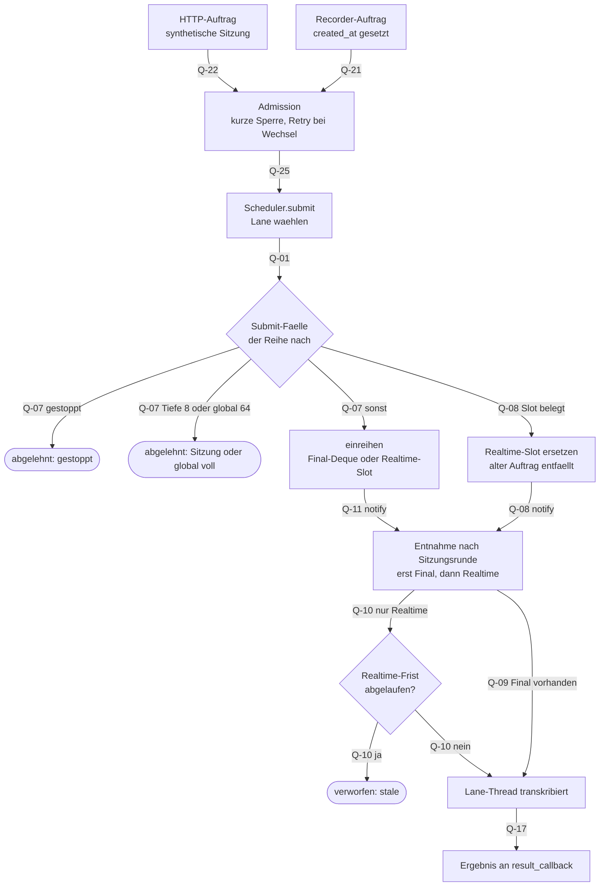
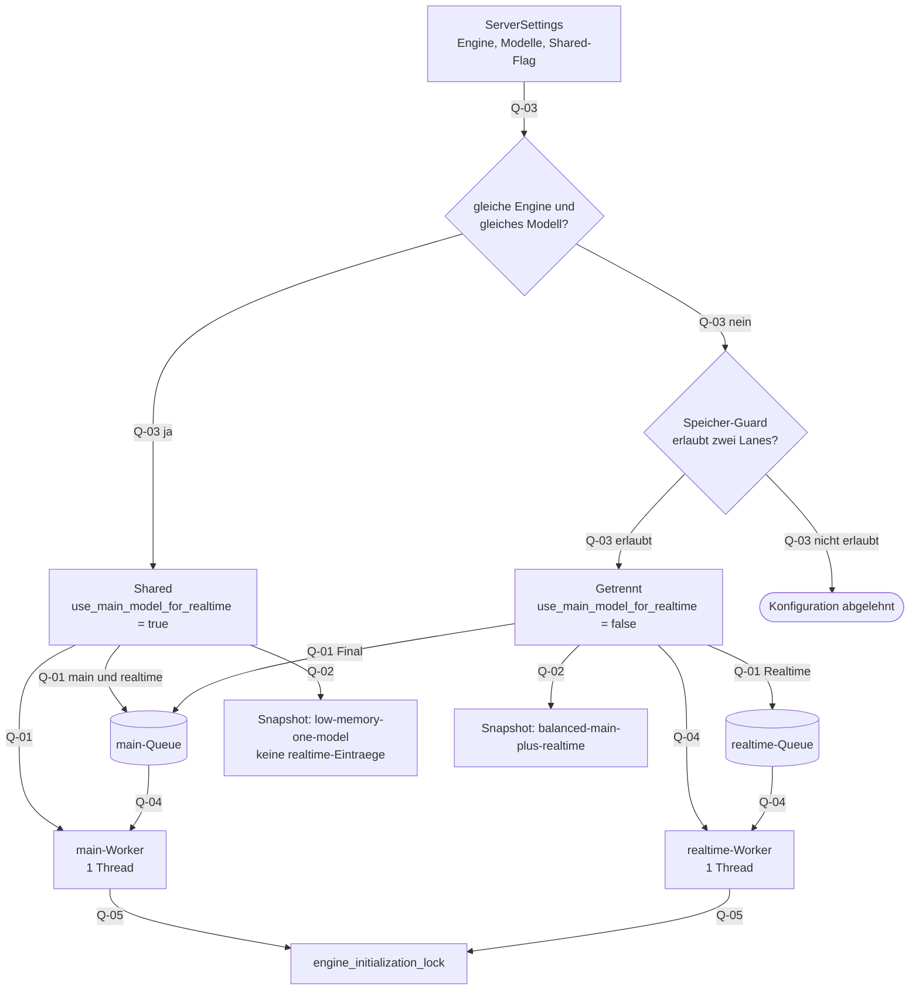
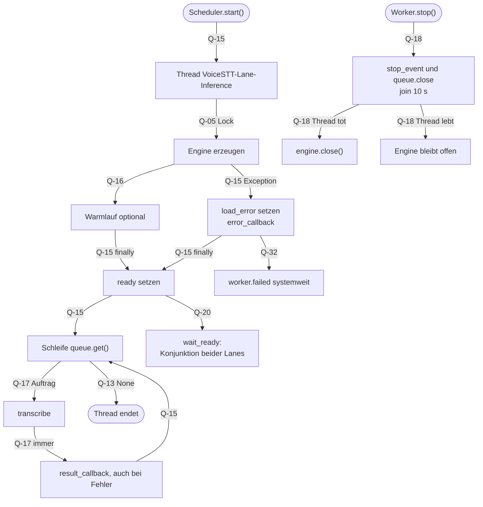
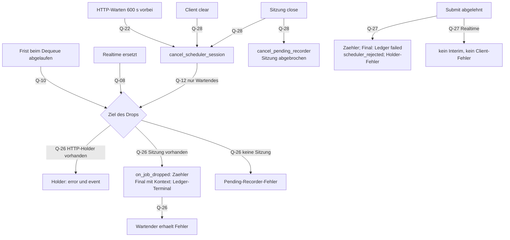

# 02.08 – Scheduler und Nebenläufigkeit

**Quellstand:** `a8993c5c68042d996eab680d84a5b138a214bb5d`
**Gültigkeit:** pro geladenem Scheduler (Neubau bei Modellwechsel); Aussagen zu Lanes, Queues und Workern. Ergebnisrouting, Drops am Ledger und Publikation stehen in [02.05 Transcription](./02.05-transcription.md).
**Faktenbasis:** `workflow/research/02.08.json` (Q-01…Q-37, N-01…N-06, U-01…U-04)

## 1. Worum geht es?

Drei Menschen sprechen gleichzeitig in ihre Mikrofone, eine vierte Person lädt eine Audiodatei hoch. Auf dem Server gibt es dafür nicht drei oder vier Inferenzmaschinen, sondern **einen Scheduler** mit **einer Main-Lane** und optional **einer zweiten Lane für die Vorschau** (Q-01). Jede Lane besitzt genau eine Warteschlange und genau einen Arbeits-Thread; die eigentliche Engine gehört der Lane, nicht der Sitzung (Q-04). Das ist die zentrale Tatsache dieses Kapitels: **Die Sitzungen sind voneinander isoliert, die Rechenzeit ist es nicht.**

Daraus entstehen sofort drei Fragen, die dieses Kapitel beantwortet:

1. **Wer darf zuerst?** Nicht der mit der höchsten Priorität – Zahlenprioritäten gibt es nicht (Q-09, N-01). Es gilt eine feste Struktur: Final vor Realtime innerhalb einer Sitzung, danach Round-Robin über die Sitzungen, und eine Vorschau pro Sitzung wird ersetzt statt gestapelt (Q-08, Q-09, Q-11).
2. **Wie lange darf etwas warten?** Nur die Vorschau hat eine Frist: 1500 ms ab Erzeugung (Q-21). Ist sie beim Entnehmen älter, wird sie verworfen, ohne je inferiert zu werden (Q-10). Für Final-Aufträge gibt es **keine** Frist; sie werden ausgeführt, egal wie lange sie warten.
3. **Was passiert, wenn es nicht mehr geht?** Die Queue hat harte Grenzen: **8** wartende Finals je Sitzung, **64** wartende Aufträge global (Q-07). Was darüber kommt, wird abgelehnt und – bei vollem Grund – als `scheduler.overloaded` sichtbar gemacht (Q-25). Was wartend verdrängt wird, bekommt genau einen benannten Ausgang (Q-26).

Für Anwender und Client-Entwickler heißt das: „Langsam“ ist fast immer eine Aussage über die **gemeinsame Lane**, nicht über die eigene Sitzung. Und „mein Text kommt nicht“ hat drei sehr verschiedene Ursachen – abgelehnt, verworfen oder fehlgeschlagen –, die man auseinanderhalten muss.

### 1.1 Fünf Begriffe, die hier immer wiederkehren

| Begriff | Bedeutung in diesem Kapitel | Beleg |
|---|---|---|
| **Scheduler** | Container aus einer Main-Lane und optional einer Realtime-Lane | Q-01 |
| **Lane** | Eine Queue + ein Worker + eine Engine; es gibt 1 oder 2 | Q-01, Q-04 |
| **Final-Auftrag** | Arbeit für den endgültigen Text eines Segments; keine Deadline | Q-10, Q-21 |
| **Realtime-Auftrag** | Arbeit für eine Vorschau; darf verworfen werden; eine Frist | Q-10, Q-21 |
| **Slot** | Genau ein Platz für die Vorschau **je Sitzung**; neue Vorschau ersetzt die alte | Q-06, Q-08 |

> **Kernsatz.** Der Scheduler ist eine gerechte Warteschlange, kein Prioritätssystem: Wer wartet, kommt der Reihe nach dran; was zu alt ist, wird weggeworfen; was nicht mehr hineinpasst, wird abgelehnt.

### 1.2 Wozu das Ganze? – die beobachtbaren Folgen

| Beobachtung | Wahrscheinliche Stelle | Beleg |
|---|---|---|
| Vorschau bleibt aus, Verbindung ist aber in Ordnung | Vorschau ersetzt, zu alt oder abgelehnt – kein Client-Fehler | Q-08, Q-10, Q-27 |
| Finaltext fehlt, aber ein Ereignis „failed/cancelled“ erscheint | Drop oder Submit-Ablehnung mit Ledger-Terminal | Q-26, Q-27 |
| HTTP-Anfrage endet mit Fehler „… voll“ | Queue-Grenze 8/64 | Q-07, Q-25 |
| Alle Sitzungen werden gleichzeitig langsamer | Lane gesättigt; `busyRatio`/`queueDelay` steigen | Q-19 |
| Server meldet „bereit“, aber jeder Auftrag scheitert | `ready` gesetzt, `healthy` falsch | Q-15, Q-20 |

## 2. Das Wesentliche auf einen Blick

- **Ein Scheduler, ein oder zwei Lanes.** Main-Lane immer; Realtime-Lane nur, wenn nicht dasselbe Modell geteilt wird (Q-01).
- **Ein OS-Thread pro Lane, eine Engine pro Lane.** Bei geteilter Queue gibt es folglich nur einen Worker – Final und Realtime sind dann **voll serialisiert** (Q-04).
- **Engine-Initialisierung ist prozessweit serialisiert**, auch über Lanes hinweg (Q-05).
- **Pro Sitzung: eine Final-Warteschlange (FIFO) und genau ein Realtime-Slot** (Q-06).
- **Annahme in fester Reihenfolge:** gestoppt → Sitzung voll (8) → global voll (64) → einreihen; Realtime ersetzt zuerst den belegten Slot (Q-07).
- **Nur Realtime koalesziert.** Der alte Auftrag fällt weg, die Gesamtzahl bleibt gleich (Q-08).
- **Keine Prioritäten, keine Deadline-Sortierung.** Final vor Realtime, FIFO je Sitzung, Round-Robin über Sitzungen (Q-09, N-01).
- **Staleness nur Realtime, nur beim Entnehmen:** `deadline_at < jetzt` → verworfen (Q-10).
- **Fairness in Einheiten, nicht in Zeit:** eine Sitzung ist pro Runde einmal dran (Q-11).
- **Kein Inferenz-Timeout.** Die 1500 ms sind eine **Altersgrenze der Vorschau**, keine Rechenfrist (Q-10, Q-21).
- **Shutdown ist kooperativ:** 10 s Join, kein Drain, kein Kill (Q-13, Q-18, N-03, N-06).

### 2.1 Der Weg eines Auftrags vom Aufrufer bis zum Ergebnis

**Erläuterung in Worten.** Der Aufrufer baut einen Auftrag – aus dem Recorder mit Erzeugungszeit und (nur bei Realtime) einer Frist, aus HTTP mit einer synthetischen Sitzung und ohne Frist (Q-21, Q-22). Die Einreichung passiert eine kurze Admission-Sektion; wird der Scheduler währenddessen ausgetauscht, wird sie wiederholt (Q-25). Danach entscheidet die Lane anhand der festen Fallreihenfolge: gestoppt, Sitzung voll, global voll, ersetzen oder einreihen (Q-07, Q-08). Die Entnahme geht reihum über die Sitzungen, innerhalb einer Sitzung zuerst Final (Q-09, Q-11). Nur eine Realtime, die beim Entnehmen schon zu alt ist, wird verworfen (Q-10). Der Lane-Thread inferiert und ruft **immer** den Ergebnis-Callback auf – auch bei Fehlern (Q-17).

**Textliche Alternative (falls Mermaid nicht rendert):** Recorder- oder HTTP-Auftrag → Admission → `Scheduler.submit` → Lane wählen → Fallprüfung (gestoppt / Sitzung voll / global voll / Realtime-Slot belegen / einreihen) → Benachrichtigung → Entnahme nach Sitzungsrunde, Final zuerst → optionale Stale-Prüfung nur für Realtime → Inferenz im Lane-Thread → `result_callback`.

### 2.2 Die drei Entscheidungen, die alles erklären

1. **Lane-Trennung statt Prioritätsnummern.** Wenn Vorschau und Final getrennt laufen sollen, bekommen sie getrennte Queues und Threads (Q-01). Wenn nicht, teilen sie sich eine Queue – dann ist alles nacheinander dran (Q-04). Eine numerische Priorität, die Finals vorziehen könnte, existiert nicht (N-01).
2. **Runden statt Rangliste.** Jede Sitzung ist pro Runde mit **einer** Arbeitseinheit dran (Q-11). Eine Sitzung mit acht wartenden Finals blockiert die anderen also nicht mit allen acht, sondern mit einer pro Runde.
3. **Ein Slot mit Verfallsdatum.** Pro Sitzung existiert höchstens eine wartende Vorschau; eine neue ersetzt die alte (Q-08). Und eine Vorschau, die 1500 ms nach ihrer Erzeugung noch wartet, wird nicht mehr inferiert (Q-10, Q-21).

### 2.3 Naheliegende Alternativen – und warum sie hier nicht gelten

| Erwartete Alternative | Tatsächliches Verhalten | Beleg |
|---|---|---|
| Zahlenprioritäten oder Gewichte je Auftrag | Es gibt kein `priority`-Feld; die Reihenfolge **ist** die Priorität | Q-09, N-01 |
| Sortierung nach Deadline | Keine Deadline-Sortierung; die Frist prüft nur Realtime beim Entnehmen | Q-10, N-01 |
| Laufende Inferenz abbrechen | Kein Cancel-Handle im Worker; Cancel leert nur Wartendes | Q-12, N-02 |
| Unbegrenzte Queue | 8 je Sitzung, 64 global, danach Ablehnung | Q-07 |
| Frist bei erneutem Einreihen verlängern | Frist ist bei Erzeugung eingefroren | Q-21 |
| Beim Shutdown restliche Aufträge abarbeiten | `close` drainiert nicht | Q-13, N-03 |
| Bei Überlast langsamer werden (Degradation) | Degradationsplanung ist nicht implementiert | Q-31, N-04 |
| Eine Engine je Sitzung | Eine Engine je Lane; Sitzungen teilen sie | Q-01, Q-04 |

## 3. Topologie: ein Scheduler, ein oder zwei Lanes

### 3.1 Die Main-Lane ist Pflicht, die Realtime-Lane ist optional

Der Scheduler erzeugt immer eine Main-Queue und einen Main-Worker. Die Realtime-Queue ist **dieselbe Queue** wie die Main-Queue, wenn `use_main_model_for_realtime` gesetzt ist; andernfalls entsteht eine eigene Queue, und nur dann gibt es einen zweiten Worker (Q-01). Das ist keine Stilfrage, sondern eine direkte Folge der Modellwahl: Ein gemeinsames Modell braucht keine zweite Engine, zwei verschiedene Modelle brauchen sie.

Praktisch bedeutet das:

- **Shared:** ein Worker. Ein laufender Final-Auftrag blockiert die Vorschau für seine gesamte Laufzeit (Q-04). Die Vorschau kann währenddessen altern und beim Entnehmen verworfen werden (Q-10).
- **Getrennt:** zwei Worker, zwei Engines. Die Vorschau kann weiterlaufen, während ein Final inferiert; dafür steigen Speicherbedarf und Initialisierungsaufwand (Q-03, Q-04).

### 3.2 Die Modusnamen stehen nur im Snapshot

Die Bezeichnungen `low-memory-one-model` und `balanced-main-plus-realtime` sind **Snapshot-Ausgaben**, keine Konfigurationswerte (Q-02). Im Shared-Modus enthält der Snapshot keine Realtime-Einträge; ohne geladenen Scheduler erscheint `unloaded` (Q-02). Wer den Modus prüfen will, liest also `metrics().scheduler.mode` und nicht die Einstellung.

| Modus | Queues im Snapshot | Worker im Snapshot | Bedeutung |
|---|---|---|---|
| `low-memory-one-model` | nur `main` | nur `main` | eine Engine, Final und Realtime serialisiert |
| `balanced-main-plus-realtime` | `main` und `realtime` | `main` und `realtime` | zwei Engines, zwei Threads |
| `unloaded` | leer | leer | kein Scheduler geladen |

### 3.3 Shared wird erzwungen, nicht nur empfohlen

`enforce_cpu_model_policy` prüft zuerst, ob Realtime-Engine und Realtime-Modell effektiv dieselben sind wie die der Main-Lane. Ist das der Fall, wird `use_main_model_for_realtime` **auf True gesetzt** (Q-03). Erst danach greift der Speicher-Guard für den getrennten Fall: Er erlaubt höchstens ein bzw. zwei Modelle bis Medium-Größe, abhängig von `allow_two_medium_models`; darüber wird die Kombination abgelehnt (Q-03).

Wichtig für Modellwechsel: Wird ein Modell oder eine Engine geändert, **ohne** das Shared-Flag ausdrücklich mitzugeben, setzt der Wechsel das Flag zunächst auf `False`; anschließend prüft die Politik erneut und kann Shared wieder erzwingen, wenn die Modelle nun gleich sind (Q-03). „Zurückgesetzt“ heißt also nicht automatisch „zwei Lanes“. Die Politik läuft beim Start, beim Wechsel und bei Settings-Patch bzw. Model-Route (Q-03); Details zum Wechsel in [02.07 Modelle und Modellverwaltung](./02.07-modelle-und-modellverwaltung.md).

### 3.4 Die Topologie im Bild

**Erläuterung in Worten.** Die Einstellungen laufen durch die Shared-Prüfung. Sind Engine und Modell gleich, bleibt nur die Main-Lane; die Realtime-Arbeit benutzt dieselbe Queue und denselben Worker. Sind sie verschieden, entscheidet der Speicher-Guard, ob eine zweite Lane erlaubt ist; andernfalls wird die Konfiguration abgelehnt. In beiden Fällen teilen sich die Worker denselben Initialisierungs-Lock (Q-05).

**Textliche Alternative:** Settings → gleiche Engine und gleiches Modell? → ja: Shared, eine Queue, ein Worker → nein: Speicher-Guard → erlaubt: zwei Queues, zwei Worker → nicht erlaubt: Ablehnung. Beide Varianten teilen den Init-Lock.

### 3.5 Ein Thread je Lane – und sonst keiner

Jeder Lane-Worker startet genau **einen** OS-Thread, als Daemon, mit dem Namen `VoiceSTT-<lane>-Inference` (Q-04). Die Engine wird **in diesem Thread** erzeugt (Q-04). Es gibt hier keine Sitzungs-Threads; die gehören zu Recorder und Sitzung und sind in [01.06](../01-grundlagen/01.06-serverweite-und-sitzungsbezogene-ressourcen.md) bzw. [02.01](./02.01-session-management.md) beschrieben.

Die praktische Konsequenz ist unangenehm, aber wichtig: Bei geteilter Queue gibt es nur einen Thread. Zwei Aufträge – Final und Vorschau – können dann nicht gleichzeitig laufen, egal wie viele Sitzungen warten (Q-04).

### 3.6 Die Initialisierung ist prozessweit serialisiert

Beide Worker teilen sich einen `engine_initialization_lock`, den der Scheduler an sie übergibt (Q-05). Die Engine-Erzeugung ist damit auch dann serialisiert, wenn die Lanes später parallel arbeiten. Die Begründung im Code: Native CPU-Engines können bei gleichzeitiger Konstruktion ihren Allocator-Zustand beschädigen (Q-05). Der zugehörige Test misst, dass nie mehr als ein Initialisierer gleichzeitig aktiv ist (Q-05).

Für den Betrieb heißt das: Der Start kann sich durch die Serialisierung verlängern, die Inferenz danach ist aber unabhängig. Und ein zweiter Worker ist kein zweiter Init-Thread.

## 4. Die Queue: ein Briefkasten je Sitzung

### 4.1 Aufbau

Jede Lane besitzt eine `FairInferenceQueue`. Ihr Zustand pro Sitzung ist ein kleines Postfach (Q-06):

- `final`: eine Deque, also FIFO – mehrere Finals stapeln sich.
- `realtime`: entweder `None` oder **genau ein** Auftrag – kein Stapel, sondern ein Slot.
- Dazu kommen die Reihenfolge der Sitzungen (`_ordered_sessions`), die Menge der bereits eingereihten Sitzungen, die Gesamtzahl und eine Condition (Q-06).

Das Postfach entsteht beim ersten Auftrag der Sitzung und verschwindet wieder, wenn keine Arbeit mehr darin liegt (Q-06, Q-11). Der Snapshot zeigt daher nur Sitzungen mit wartender Arbeit (Q-14).

### 4.2 Annahme: vier Fälle in fester Reihenfolge

`submit` prüft in dieser Reihenfolge (Q-07):

| # | Fall | Bedingung | Ergebnis | Zähler |
|---|---|---|---|---|
| 1 | Queue geschlossen | `closed` | abgelehnt: „Der Scheduler ist gestoppt“ | **kein** Zähler |
| 2 | Final, Sitzung voll | Final-Tiefe ≥ **8** | abgelehnt: „Die finale Warteschlange der Sitzung ist voll“ | `rejectedJobs` |
| 3 | Final, global voll | gesamt ≥ **64** | abgelehnt: „Die globale Inferenzwarteschlange ist voll“ | `rejectedJobs` |
| 4 | Final, sonst | – | anhängen, Gesamtzahl +1, benachrichtigen | – |
| 5 | Unbekannte Art | `kind` weder `final` noch `realtime` | abgelehnt: „Unbekannte Inferenzart: …“ | `rejectedJobs` |
| 6 | Realtime, Slot belegt | Slot ≠ `None` | **ersetzen**, alter Auftrag fällt weg | `coalescedRealtime` |
| 7 | Realtime, global voll | gesamt ≥ **64** | abgelehnt wie Fall 3 | `rejectedJobs` |
| 8 | Realtime, sonst | – | Slot belegen, Gesamtzahl +1, benachrichtigen | – |

Zwei Feinheiten sind praktisch relevant:

- Die **Sitzungsgrenze wird vor der globalen Grenze** geprüft (Q-07). Eine Sitzung kann also „voll“ sein, obwohl global noch Platz ist – das ist Absicht: Kein einzelner Client soll die globale Queue füllen.
- Ein **ersetzender** Realtime-Auftrag passiert die globale Grenze nicht, weil der Slot bereits belegt ist und die Gesamtzahl gleich bleibt (Q-07, Q-08). Eine Vorschau kann daher auch bei global vollem Puffer noch angenommen werden – sie verdrängt nur die eigene alte Vorschau.

### 4.3 Koaleszierung: die Vorschau ist ein Angebot

Nur Realtime koalesziert (Q-08). Ist der Slot belegt, wird der alte Auftrag durch den neuen ersetzt; der neue gilt als angenommen mit `coalesced=True`, der alte wird mit Grund `coalesced` verworfen. Die Gesamtzahl der wartenden Aufträge ändert sich nicht, weil der Slot weiterhin belegt ist (Q-08).

Wichtig für die Nebenläufigkeit: Der Drop-Callback läuft **außerhalb** des Queue-Locks; Fehler darin werden geloggt, nicht weitergereicht (Q-08, U-03). Das verhindert, dass ein langsamer oder fehlerhafter Callback die Queue blockiert – verschiebt aber die Frage, ob ein solcher Fehler einen Wartenden freigibt, in den Bereich „nicht untersucht“ (U-03).

### 4.4 Keine Prioritäten – auch nicht versteckt

`InferenceJob` hat **kein** Prioritätsfeld (Q-09). Die einzige Stelle, an der das Wort Priorität in der Nähe der CLI auftaucht, ist ein Hilfetext zu `recovery_priority`; der Scheduler liest ihn nicht (Q-09). Die Reihenfolge entsteht ausschließlich aus vier Regeln:

1. Final-FIFO je Sitzung,
2. Final vor Realtime innerhalb einer Sitzung,
3. Round-Robin über die Sitzungen,
4. Ersetzen statt Stapeln bei Realtime (Q-09).

Wer eine Prioritätssteuerung erwartet, sollte diese Erwartung explizit fallen lassen: Ein langer Final-Auftrag lässt sich weder durch eine höhere Priorität überholen noch durch eine Deadline verdrängen (N-01).

### 4.5 Staleness: nur Realtime, nur beim Entnehmen

Die Frist wird **nicht** beim Einreihen geprüft, sondern erst, wenn der Auftrag an der Reihe ist (Q-10). Bedingung: `deadline_at` ist gesetzt **und** kleiner als der aktuelle Zeitpunkt. Dann wird die Gesamtzahl reduziert, der Stale-Zähler erhöht, der Auftrag mit Grund `stale` verworfen, das Postfach aufgeräumt – und die Entnahme geht zur nächsten Sitzung weiter (Q-10).

Final-Aufträge haben kein Deadline-Feld; bei ihrer Erzeugung wird nur für Realtime eine Frist gesetzt (Q-10, Q-21). Eine Final-Arbeit kann daher beliebig lange warten.

Die praktische Falle: Wenn eine Sitzung zuerst ihre Finals abarbeitet, wartet ihre eigene Vorschau hinter diesen Finals – und kann dabei altern. Die Vorschau ist dann beim Entnehmen bereits tot (Q-09, Q-10).

### 4.6 Round-Robin: eine Einheit pro Sitzung und Runde

Die Fairness ist **strukturell**, nicht zeitbasiert (Q-11):

- Eine Sitzung steht höchstens einmal in der Reihenfolge-Deque.
- Bei der Entnahme wird die Sitzung entnommen und aus der Menge entfernt.
- Hat sie danach noch Arbeit, wird sie **hinten** wieder eingereiht; sonst wird ihr Postfach aufgeräumt (Q-11).

Ein nachvollziehbares Beispiel: Sitzung A stellt drei Finals ein, Sitzung B ein Final, Sitzung C eine frische Vorschau. Die Entnahme ergibt:

| Runde | Entnommene Sitzung | Auftrag | Deque danach |
|---|---|---|---|
| 1 | A | A-Final 1 | B, C, A |
| 2 | B | B-Final 1 | C, A |
| 3 | C | C-Realtime | A |
| 4 | A | A-Final 2 | A |
| 5 | A | A-Final 3 | – |

B kommt also **vor** A's zweitem Final zur Zuge – obwohl A zuerst und mit mehr Arbeit eingereiht hat. Genau das ist die Fairness-Zusage: eine Einheit pro Sitzung und Runde (Q-11). Acht Finals einer Sitzung verlängern die Wartezeit der anderen um höchstens eine Einheit pro Runde, nicht um acht.

Der Wartezustand hat eine Sicherheitsfrist von **0,2 s** (Q-11). Sie begrenzt, wie lange ein Worker ohne Signal schläft; im Normalfall weckt ihn die Benachrichtigung beim Einreihen. Die 0,2 s sind **keine** zugesagte Dequeue-Latenz und kein Anzeigetakt.

### 4.7 Cancel leert nur, was wartet

`cancel_session` entfernt das Postfach der Sitzung vollständig: alle Finals, den Realtime-Slot, senkt die Gesamtzahl entsprechend und benachrichtigt alle Wartenden; die Drop-Callbacks laufen danach außerhalb des Locks (Q-12). Eine **laufende** Inferenz wird nicht unterbrochen – der Worker hat kein Cancel-Handle (Q-12, N-02).

Das ist die wichtigste Grenze für alle Timeout-Erwartungen: Ein HTTP-Timeout oder ein Sitzungsende befreit die Queue von wartender Arbeit, aber nicht die Lane von der bereits laufenden Arbeit (Q-12, Q-22).

### 4.8 `close` drainiert nicht

Setzt der Scheduler `close`, wird die Queue geschlossen und alle Wartenden werden benachrichtigt. `get` liefert danach `None` – **ohne** die verbleibenden Aufträge abzuarbeiten und **ohne** Drop-Callbacks dafür (Q-13). Das ist ein bewusster Codepfad, kein Versehen (Q-13, N-03).

Folge für die Diagnose: Ein geschlossener Scheduler kann in seinem Snapshot weiterhin wartende Aufträge zählen; sie werden nur nie mehr ausgeführt. Wer nach dem Stopp auf `queued > 0` schaut, sieht Arbeit, die es nicht mehr gibt.

### 4.9 Der Snapshot einer Lane

Der Queue-Snapshot ist die zentrale Beobachtungsfläche (Q-14):

| Feld | Bedeutung |
|---|---|
| `name` | Lane-Name (`main` oder `realtime`) |
| `queued` | wartende Aufträge gesamt (Finals + belegte Slots) |
| `sessions` | Sitzungen mit Postfach |
| `perSession` | je Sitzung: `final`-Länge und `realtime` 0/1 |
| `coalescedRealtime` | ersetzte Vorschauen |
| `staleRealtimeDropped` | beim Entnehmen verworfene Vorschauen |
| `rejectedJobs` | abgelehnte Einreichungen (außer „gestoppt“) |

Der Scheduler-Snapshot bündelt `mode`, `queues` und `workers` und erscheint über `Service.metrics()` unter `scheduler` (Q-14). Einordnung der Metriken in [06.10 Monitoring und Metriken](../06-betrieb/06.10-monitoring-und-metriken.md), Feldkatalog in [08.14](../08-referenzen/08.14-metrik-katalog.md).

## 5. Der Worker: Lebenszyklus, Fehler, Stop

### 5.1 Vom Start bis zur Schleife

Der Worker wird angelegt, dann startet `start()` den Thread. Im Thread wird die Engine erzeugt (unter dem gemeinsamen Init-Lock), danach folgt der optionale Warmlauf. **`ready` wird im `finally` gesetzt – auch wenn die Initialisierung scheitert** (Q-15). Erst danach läuft die Schleife `queue.get()`.

Das führt zu einer wichtigen Unterscheidung: `wait_ready` kann `True` liefern, obwohl die Lane krank ist. „Bereit“ heißt hier nur „der Startversuch ist abgeschlossen“, nicht „die Engine funktioniert“ (Q-15, Q-20).

### 5.2 Warmlauf ist optional und still

Der Warmlauf läuft nur, wenn `model_warmup` gesetzt ist und eine Engine existiert; er verwendet `warmup_audio.wav` (Q-16). Fehler werden nur auf Debug-Level geloggt und geschluckt (Q-16). Ein fehlgeschlagener Warmlauf verhindert also weder `ready` noch den Betrieb – und er wird auch nicht als Latenzproblem gemessen (U-02).

### 5.3 Jeder Auftrag bekommt eine Antwort – auch der Fehlerfall

Ein Job-Fehler bricht die Lane **nicht** ab (Q-17):

- Ist die Engine `None`, wird ein `RuntimeError` erzeugt.
- Eine Exception aus der Transkription erhöht `failed_jobs`, setzt den Fehlertext und wird geloggt.
- **In jedem Fall** wird `result_callback` mit einem `InferenceResult` aufgerufen, inklusive `queue_delay`, `inference_duration`, `total_latency` und `audio_duration` (Länge geteilt durch Samplerate) (Q-17).

Die Lane läuft danach weiter und nimmt den nächsten Auftrag. Eine kaputte Engine führt also nicht zu einem stillen Stillstand, sondern zu einer Serie von Fehlerergebnissen – sichtbar an `failedJobs` (Q-17, Q-19).

Ein illustratives Zeitbeispiel (nur die Felder sind exakt, nicht die Sekunden):

| Zeitpunkt | Vorgang | Feld |
|---|---|---|
| 0,00 s | Auftrag erzeugt | `created_at` |
| 0,20 s | entnommen, Inferenz beginnt | `queue_delay = 0,20 s` |
| 1,10 s | fertig | `inference_duration = 0,90 s`, `total_latency = 1,10 s` |

`queue_delay` misst ab Erzeugung, enthält also die gesamte Wartezeit in der Queue (Q-17). `total_latency` ist Wartezeit plus Inferenz.

### 5.4 Stop ist kooperativ, nicht erzwingend

`stop` setzt das Stop-Event, schließt die Queue und wartet **10 s** auf den Thread (Q-18). Danach wird die Engine nur geschlossen, wenn der Thread tatsächlich beendet ist. Läuft er noch, bleibt die Engine offen; es gibt weder einen Kill noch einen zweiten Versuch (Q-18, N-06).

Praktisch heißt das: Ein hängender Inferenzauftrag kann einen Shutdown überleben. Der Thread ist ein Daemon, die Engine bleibt geöffnet. Wer in dieser Situation einen Modellwechsel anstößt, baut den nächsten Scheduler zusätzlich auf, statt den alten Zustand aufzulösen (Q-18, Q-20).

### 5.5 Messwerte einer Lane

Der Worker-Snapshot liefert (Q-19):

| Feld | Aussage |
|---|---|
| `ready` | Startversuch abgeschlossen |
| `healthy` | `load_error is None` |
| `completedJobs` / `failedJobs` | kumulativ seit Start |
| `busyRatio` | `min(1.0, busy/elapsed)` – Auslastung der Lane |
| `queueDelay` | Wartezeit-Verteilung |
| `inferenceDuration` | Rechenzeit-Verteilung |
| `totalLatency` | Gesamtzeit-Verteilung |

Die Verteilungen nutzen ein **Fenster von 256** Werten (Q-19). `busyRatio` zählt nur Inferenzzeit, nicht Wartezeit: Eine Lane kann nahe 1 liegen und trotzdem eine wachsende `queueDelay` zeigen – das ist der typische Überlastbefund (Q-17, Q-19).

### 5.6 Readiness ist eine Konjunktion

`wait_ready` wartet auf **beide** Lanes, sequenziell, mit einer **gemeinsamen** Deadline (Q-20). Verbraucht die Main-Lane den größten Teil der Frist, bleibt der Realtime-Lane nur der Rest. `healthy()` ist ebenfalls eine Konjunktion: Beide Lanes müssen fehlerfrei geladen sein (Q-20).

`ensure_models_loaded` startet einen Ersatz-Scheduler und verlangt **beides**: `wait_ready` **und** `healthy`. Scheitert eines, wird der Ersatz gestoppt und ein `RuntimeError` gemeldet (Q-20). Die Server-Readiness wird erst nach `wait_ready` gesetzt; das `server.ready`-Ereignis trägt das Healthy-Flag mit (Q-20).

### 5.7 Lebenszyklus und Stop im Bild

**Erläuterung in Worten.** Der Thread erzeugt die Engine unter dem Init-Lock, läuft optional warm und setzt `ready` in jedem Fall – auch nach einem Init-Fehler. Dann nimmt er Aufträge, inferiert und antwortet immer über den Callback. `stop` setzt Stop-Event und schließt die Queue, wartet 10 s und schließt die Engine nur bei totem Thread.

**Textliche Alternative:** Start → Thread → Engine unter Lock → Warmlauf optional → `ready` (finally) → Schleife → Auftrag/Ergebnis → bei `close`/`None` Ende; bei `stop`: Event + Queue zu, 10 s Join, Engine nur bei beendetem Thread schließen.

## 6. Wie Aufträge entstehen

### 6.1 Recorder-Aufträge: Deadline nur für Realtime

Der Recorder-Pfad setzt `created_at` und – **nur bei `kind == "realtime"`** – `deadline_at = jetzt + max_realtime_queue_age_ms / 1000` (Q-21). Der Default sind **1500 ms**, änderbar über die CLI (Q-21). Die Frist wird bei der Erzeugung eingefroren und beim Einreihen **nicht** erneuert (Q-21).

Daraus folgen zwei praktische Regeln:

- Ein Auftrag, der 1,5 s in der Queue verbracht hat, ist beim Entnehmen tot – auch wenn er gerade erst an die Reihe kommt (Q-10).
- Ein „neuer Versuch“ ist immer ein **neuer Auftrag** mit neuer Frist. Ob ein solcher entsteht, entscheidet der Aufrufer (Realtime-Schleife: [02.05](./02.05-transcription.md)), nicht der Scheduler.

`InferenceJob.sequence` ist bei beiden Erzeugungswegen **immer 0** und wird nur durchgereicht (Q-24). Die Queue sortiert nicht danach; sie nutzt Deque und Slots (Q-24, N-05). Wer `sequence` als Ordnungskriterium liest, interpretiert ein Feld, das keine Ordnung trägt.

### 6.2 HTTP-Aufträge: eine synthetische Sitzung, keine Deadline

Der HTTP-Pfad erzeugt für jede Anfrage eine synthetische Sitzung `openai-<id>`, setzt `kind` auf die Lane, **keine** Deadline und übernimmt `request_options` (Q-22). Gewartet wird mit `wait(timeout=timeout)`, Default **600,0 s** (Q-22).

Läuft diese Wartezeit ab, wird `cancel_scheduler_session` für die **synthetische** Sitzung aufgerufen, der Holder entfernt und ein `TimeoutError` geworfen (Q-22). Der Timeout trifft also nur wartende Arbeit dieser Anfrage; eine bereits laufende Inferenz läuft weiter (Q-12, Q-22). Routen ohne eigenes `timeout`-Argument verwenden den Default (Q-22). Jede HTTP-Anfrage erhält ihren eigenen Round-Robin-Slot (Q-22) – eine Datei-Transkription konkurriert daher fair mit Sitzungen, ohne eine Sitzung zu sein.

Was oberhalb dieser 600 s passiert (Proxy, ASGI-Server), ist nicht untersucht (U-01).

### 6.3 Blockierendes Warten beim Recorder

Der Recorder-Aufrufer wartet in einer Schleife mit `timeout=0.1` auf das Holder-Ereignis (Q-23). Währenddessen bricht er ab, wenn das Stop-Event gesetzt ist, die Sitzung verschwunden ist oder die Generation sich geändert hat – dann liefert er ein leeres `TranscriptionResult` zurück. Nach dem Aufwachen prüft er die Generation **erneut** (Q-23).

Wird die Einreichung abgelehnt, gibt es kein Warten: Der Aufrufer erhält sofort einen `RuntimeError` mit dem Ablehnungsgrund (Q-23). Das ist der Unterschied zwischen „abgelehnt“ und „verworfen“: Ablehnung sieht der Aufrufer sofort, Verwerfen erreicht ihn über den Drop-Pfad (Q-26).

## 7. Ablehnung, Drops und Multiuser-Verhalten

### 7.1 Drei Arten von „Nein“

| Art | Wann | Was der Aufrufer merkt | Beleg |
|---|---|---|---|
| **Abgelehnt** | Queue voll, geschlossen, unbekannte Art | sofortiger Fehler / `rejected` | Q-07, Q-23, Q-27 |
| **Verworfen** | ersetzt, zu alt, storniert | Drop-Pfad: Holder-Fehler, Zähler, Ledger-Terminal | Q-08, Q-10, Q-12, Q-26 |
| **Fehlgeschlagen** | Engine fehlt oder Inferenz-Exception | Fehlerergebnis über den Callback | Q-17 |

Diese drei dürfen nicht vermischt werden: Ein abgelehnter Final ist ein benanntes Terminal, ein verworfener Final ebenfalls, ein fehlgeschlagener Final ist ein Fehlerergebnis (Q-26, Q-27).

### 7.2 Fünf Arten, wie Arbeit verschwindet

| Vorgang | Betroffene Arbeit | Was bleibt | Beleg |
|---|---|---|---|
| Koaleszierung | alte Realtime im Slot | neue Realtime, Gesamtzahl unverändert | Q-08 |
| Staleness | Realtime beim Entnehmen | nichts; nächste Sitzung | Q-10 |
| `cancel_session` | alle wartenden Finals + Slot | laufende Inferenz | Q-12 |
| `close` | gesamte Queue | nichts; kein Drain, keine Drop-Callbacks | Q-13 |
| Trim | Einträge der Recorder-Queue | Rest der Recorder-Queue | Q-29 |

Der Unterschied zwischen den ersten vier und dem Trim ist der Ort: Die ersten vier passieren **im Scheduler**, der Trim **davor**, in der Recorder-Queue der Sitzung (Q-29).

### 7.3 Die Überlast-Heuristik

Eine Ablehnung wird nur dann als Überlast gemeldet, wenn der Ablehnungsgrund den Text `voll` enthält (Q-25). Dann entstehen:

- ein Systemereignis `scheduler.overloaded` mit Schweregrad `warning` und den Feldern Sitzung, Client, Request, Transkriptions-ID, Lane und Grund,
- ein Performance-Ereignis `queue.limit_reached` mit denselben Bezügen (Q-25).

Die drei „voll“-Gründe (Sitzung, global, Final-/Realtime-Fall) lösen das aus; „Der Scheduler ist gestoppt“ und „Unbekannte Inferenzart“ nicht (Q-07, Q-25). Das ist ausdrücklich eine **Heuristik über deutschen Meldungstext** und ein Implementierungsdetail: Ändert sich der Wortlaut, verschwindet das Ereignis, ohne dass sich am Verhalten etwas ändert (Q-25). Für Monitoring sollte man sich daher nicht allein auf `scheduler.overloaded` verlassen, sondern auch `rejectedJobs` lesen (Q-14).

Die Einreichung selbst läuft durch eine kurze Admission-Sektion; wird der Scheduler dabei ausgetauscht, wird der Auftrag erneut eingereicht (Q-25). Ein Auftrag während eines Modellwechsels landet so auf dem neuen Scheduler, statt zu verschwinden.

### 7.4 Wohin ein Drop geht

**Erläuterung in Worten.** Ein Drop hat genau ein Ziel, in dieser Reihenfolge: zuerst der HTTP-Holder, sonst die Sitzung, sonst der wartende Recorder (Q-26). Die Sitzung führt Zähler und, bei Finals mit Segmentkontext, ein Ledger-Terminal. Parallel dazu räumt ein Sitzungsende die wartende Arbeit selbst ab (Q-28). Eine Submit-Ablehnung ist ein eigener Pfad (Q-27).

**Textliche Alternative:** Drop → HTTP-Holder? ja: Fehler + Event → nein: Sitzung? ja: Zähler, ggf. Ledger-Terminal, Wartender-Fehler → nein: Pending-Recorder-Fehler. Sitzungsende räumt zusätzlich Pending-Holder. Submit-Ablehnung: Zähler, Final-Ledger `failed`, bei Realtime still.

Die Zielwahl im Detail (Q-26):

1. **HTTP zuerst.** Existiert ein API-Holder, bekommt er den Fehler `"<kind> transcription was <reason>"` und das Ereignis wird gesetzt; die Anfrage endet mit einem Fehler (Q-26).
2. **Sonst Sitzung.** `on_job_dropped` zählt `coalesced`, `stale` oder `cancelled`. Bei einem Final **mit** Segmentkontext entsteht ein Ledger-Terminal: `cancelled` bei Grund `cancelled`, sonst `failed` mit `scheduler_<reason>` (Q-26).
3. **Sonst Pending-Recorder.** Ohne Sitzung erhält der wartende Recorder-Aufrufer einen Fehler (Q-26).

**Exactly once:** Ein Segment bekommt genau ein Terminal. Der Test führt sogar eine Ablehnung und danach einen Drop für dasselbe Segment herbei und erwartet genau ein `failed`, null `cancelled` (Q-26). Ein zweiter Pfad läuft ins Leere. Die Ledger-Seite dieses Vertrags – Reihenfolge, Drain, Terminals – steht in [02.05](./02.05-transcription.md).

### 7.5 Submit-Ablehnung: benannt oder unsichtbar

Wird eine Einreichung abgelehnt, unterscheidet die Sitzung nach Art (Q-27):

- **Realtime:** `realtime_rejected++`. Der Aufrufer fängt die Exception und liefert `None`; die Vorschau wird übersprungen. Für den Client bedeutet das: **ein Interim bleibt aus, kein Fehler** (Q-27).
- **Final:** `final_rejected++`. Mit Segmentkontext entsteht ein Ledger-Terminal `failed` mit `scheduler_rejected: <Grund>`, und der wartende Recorder erhält einen Fehler (Q-27).

Ein abgelehnter Final ist damit nie ein stilles Ausbleiben, sondern ein benanntes Terminal. Ein abgelehnter Realtime-Auftrag ist bewusst unsichtbar, weil die Vorschau ein Angebot ist (Q-27, [02.05](./02.05-transcription.md)).

### 7.6 Sitzungsende räumt beide Ebenen

`close` einer Sitzung erhöht die Generation, setzt den Status `closed`, storniert das Ledger (`cancel_all`), ruft `cancel_scheduler_session`, bricht wartende Recorder-Aufrufe mit „Die Sitzung wurde abgebrochen“ ab, deaktiviert den Sprecher und fährt den Recorder herunter (Q-28). `clear` arbeitet analog (Q-28).

Der Test schließt eine Sitzung mit zwei offenen Segmenten und erwartet **beide** als `cancelled`, mit `pendingSegmentCount == 0` (Q-28). Genau einmal – keine doppelten Terminals, keine Leiche im Ledger.

Die Generation ist dabei der Schutz gegen späte Ergebnisse: Ein Ergebnis, das nach dem Close eintrifft, gehört zu einer alten Generation und wird nicht mehr als gültig behandelt (Q-23, Q-28).

### 7.7 Rückstau vor der Queue: der Trim

Bevor die Recorder-Queue in die Final-Verarbeitung übergeht, wird sie auf die Final-Tiefe gekürzt: `max(0, int(max_final_queue_depth_per_session))` (Q-29). Jeder entfernte Eintrag mit Segmentkontext erhält ein Ledger-Terminal `discarded` mit Grund `recorded_audio_queue_trimmed`; die Zähler `dropped_recorded_segments` und `final_rejected` steigen, und der Client bekommt eine Warnung (Q-29).

Die Tests belegen: Aus drei Einträgen wird einer, zwei gelten als verworfen; der Kontext des verworfenen Eintrags bleibt korrekt zugeordnet; und mit Tiefe **0** wird auch der letzte Eintrag verworfen (Q-29). Der Trim ist damit die einzige Backpressure-Stelle **vor** dem Scheduler; er verhindert, dass eine Sitzung mehr Finals vorbereitet, als der Scheduler je aufnehmen würde.

### 7.8 Limits zur Laufzeit

Die Queue- und Worker-Objekte halten eine Referenz auf **dasselbe** Settings-Objekt. Änderungen werden per `setattr` auf dieses Objekt geschrieben und wirken damit **ab der nächsten Entscheidung**, ohne Neubau (Q-30). Betroffen sind unter anderem Final-Tiefe, globale Tiefe, Realtime-Alter und der Degradationsschwellwert (Q-30).

Praktisch: Eine Erhöhung der globalen Tiefe wirkt beim nächsten Submit; eine Absenkung **verdrängt nichts** – sie verhindert nur weitere Annahmen. Die veröffentlichten Grenzen erscheinen in `limits` mit den Namen `maxSessions`, `maxActiveSpeakers`, `maxAudioQueueSecondsPerSession`, `maxRealtimeQueueAgeMs`, `maxFinalQueueDepthPerSession`, `maxGlobalInferenceQueueDepth` und `realtimeDegradationThresholdMs` (Q-30). Wirksamkeitszeitpunkt allgemein: [03.09](../03-konfiguration/03.09-wirksamkeitszeitpunkt.md), Runtime-Änderungen: [03.08](../03-konfiguration/03.08-runtime-aenderungen.md).

### 7.9 Ein Schalter ohne Wirkung

`realtime_degradation_threshold_ms` existiert als Definition, steht in den aktiven Runtime-Einstellungen, wird in `limits` veröffentlicht und hat einen CLI-Parameter – aber **keine** Lesestelle in Queue, Worker, Scheduler oder Planung (Q-31). Eine Degradationsplanung ist nicht implementiert (Q-31, N-04). Wer den Wert ändert, ändert nur die Anzeige. Diese Ehrlichkeit ist wichtig, weil der Name eine Funktion verspricht, die es nicht gibt.

### 7.10 Wenn eine Lane stirbt

Ein Fehler bei der Lane-Initialisierung erzeugt ein serverweites Ereignis `worker.failed` mit Schweregrad `error`, Komponente `<lane>_engine`, Fehlertyp und Fehlertext (Q-32). Zusätzlich wird der Fehler in `startup_errors` abgelegt und über `publish_all` an die V1-Verbindungen verteilt (Q-32).

Die Lane bleibt dabei formal „bereit“ (`ready` ist gesetzt), aber `healthy` ist falsch; jeder Auftrag endet als Fehlerergebnis (Q-15, Q-17, Q-20). Die richtige Diagnose ist daher `healthy` und `startupErrors`, nicht `ready`.

### 7.11 Multiuser in einem Durchlauf

Drei Sitzungen, ein Scheduler:

- **A** stellt schnell viele Finals ein. Nach **8** wartenden Finals wird der nächste Final abgelehnt, obwohl global noch Platz wäre; `rejectedJobs` steigt, bei Grund „voll“ erscheint `scheduler.overloaded` (Q-07, Q-25).
- **B** spricht und erzeugt Vorschauen. Ihre Vorschau wird bei jeder neuen ersetzt; `coalescedRealtime` steigt. Zwischendurch kann eine Vorschau zu alt werden und als `stale` verschwinden (Q-08, Q-10).
- **C** wartet auf seinen Final. A's acht Finals verzögern ihn um höchstens eine Einheit pro Runde, nicht um alle acht; B's Vorschauen kommen erst nach C's Final dran, wenn C in dieser Runde zuerst gezogen wird (Q-09, Q-11).
- **Der Upload** hat eine eigene synthetische Sitzung und damit einen eigenen Round-Robin-Slot. Ist die globale Queue voll, bekommt er sofort einen Fehler statt 600 s zu warten (Q-07, Q-22).

Das ist die praktische Bedeutung von „Fairness ohne Prioritäten“: Niemand kann sich mit Menge durchsetzen, und niemand wird dauerhaft ausgeschlossen.

### 7.12 Diagnose in fünf Zahlen

1. `rejectedJobs`: Wie oft wurde abgelehnt? (Q-14)
2. `coalescedRealtime`: Wie oft wurde eine Vorschau ersetzt? (Q-08, Q-14)
3. `staleRealtimeDropped`: Wie oft war eine Vorschau beim Entnehmen zu alt? (Q-10, Q-14)
4. `perSession.final` und `queued`: Wie nah an 8 bzw. 64? (Q-06, Q-14)
5. `busyRatio`, `queueDelay`, `totalLatency`: Ist die Lane gesättigt oder nur die Queue lang? (Q-17, Q-19)

Dazu `healthy` und `startupErrors` prüfen (Q-19, Q-32). Ein hoher `coalescedRealtime`-Wert ist nicht automatisch ein Fehler – er bedeutet, dass Vorschauen schneller erzeugt als verarbeitet werden, was der Slot-Mechanismus bewusst toleriert (Q-08).

## 8. Tests als Belege – und was sie nicht belegen

### 8.1 Deterministische Queue-Tests

Die Queue wird direkt importiert und ohne Engine geprüft (Q-33). Die Tests belegen:

- **Koaleszierung:** Zwei Realtime-Aufträge derselben Sitzung, dazwischen ein Final. Ergebnis: erst das Final, dann die **zweite** Vorschau; die erste wird mit Grund `coalesced` verworfen (Q-33).
- **Round-Robin:** A stellt zwei Finals ein, B eines. Ergebnis: A, B, A (Q-33).
- **Stale-Drop:** Ein Auftrag mit abgelaufener Deadline wird beim Entnehmen verworfen; der frische Auftrag der anderen Sitzung kommt durch (Q-33).

Diese Tests sind deterministisch und laufen in der Unit-Suite. Sie belegen die **Semantik** der Queue, nicht ihr Timing unter Last.

### 8.2 Der echte Fairness-Test ist standardmäßig übersprungen

Es gibt einen Real-Engine-Test mit mehreren parallelen Sitzungen und Referenz-WAV (Q-34). Er läuft nur, wenn eine Gate-Umgebungsvariable gesetzt ist (`VOICESTT_RUN_FASTAPI_MULTI_USER_ASR` oder `..._PERF`), und ist sonst übersprungen (Q-34). Er prüft unter anderem:

- `finalCompleted > 0` je Sitzung,
- eine Fairness-Schranke: `max(p95) - min(p95) <= max_latency_skew_ms`, Default **30000 ms**, per Umgebung überschreibbar (Q-34),
- im Test gesetzte Grenzen: global `max(64, clients × 16)`, Final **8**, Realtime **1500 ms** (Q-34).

**Das ist eine Messung, keine Produktionsgarantie.** Die 30 000 ms sind eine großzügige Testschwelle, kein zugesagter Fairness-Wert. Und weil der Test im Normalfall übersprungen wird, sagt ein grüner CI-Lauf nichts über Multiuser-Fairness aus (Q-34, Q-36).

### 8.3 Das Test-Double beschreibt den Vertrag

Der Test verwendet ein Scheduler-Double, das genau den genutzten Umfang nachbildet: `start`, `stop`, `wait_ready`, `healthy`, `submit`, `cancel_session`, `snapshot` (Q-35). Der Auto-Scheduler antwortet asynchron; die Produktionsimplementierung bleibt `InferenceScheduler` (Q-35).

Für Erweiterungen ist das die relevante Schnittmenge: Wer den Scheduler ersetzen will, muss diese sieben Aufrufe erfüllen (Q-35). Ein Test-Double beweist dabei nur die Vertragsform, nicht die Fairness-Semantik.

### 8.4 CI und CLI

Die CI führt die Unit-Suite (`tests/unit`, `tests/compatibility`) und das Packaging aus; einen Sonderlauf für den Integrations-/Fairness-Test gibt es nicht (Q-36). Das CLI-Parsing der Queue-Parameter ist getestet: `--max-realtime-queue-age-ms 900`, `--max-final-queue-depth-per-session 2`, `--max-global-inference-queue-depth 17`, `--use-main-model-for-realtime` und `--no-model-warmup` landen in den erwarteten Feldern (Q-37).

| Test | Belegt | Belegt nicht |
|---|---|---|
| Queue-Tests (Q-33) | Koaleszierung, Reihenfolge, Stale | Latenz unter Last |
| Drops/Trim/Cancel-Tests (Q-26–Q-29) | genau ein Terminal, Kontexttreue, 3→1 | Fairness |
| Init-Test (Q-05) | nie zwei Initialisierer gleichzeitig | Laufzeitverhalten |
| Real-Fairness (Q-34) | eine Messung mit Schranke | Garantie, CI-Abdeckung |
| Test-Double (Q-35) | Aufruf-Vertrag | Semantik |
| CLI-Test (Q-37) | Feldzuordnung | Wirkung zur Laufzeit |

## 9. Grenzen und ehrliche Lücken

| ID | Grenze | Praktische Bedeutung |
|---|---|---|
| N-01 | Keine numerischen Prioritäten, Gewichte oder Deadline-Sortierung | Ein langer Final-Auftrag lässt sich nicht überholen; nur die Rundenstruktur begrenzt Monopole |
| N-02 | Kein Abbruch laufender Inferenz | Cancel und HTTP-Timeout leeren nur Wartendes; die Lane bleibt ggf. beschäftigt |
| N-03 | Kein Queue-Drain beim Shutdown | Wartende Aufträge verschwinden ohne Drop-Callback; Zähler können sie noch zeigen |
| N-04 | Keine Degradationsplanung | `realtime_degradation_threshold_ms` ist wirkungslos |
| N-05 | Keine Sequenz-/Ordering-Auswertung | `sequence` ist immer 0; nicht als Reihenfolge lesen |
| N-06 | Kein erzwungenes Beenden hängender Worker | `stop` kann mit lebendem Thread und offener Engine zurückkehren |

| ID | Offener Punkt | Was das für Aussagen bedeutet |
|---|---|---|
| U-01 | Ablehnung/Timeout oberhalb der 600-s-HTTP-Wartezeit (Proxy/ASGI) | Keine Aussage über das Verhalten jenseits der Anwendungsschicht |
| U-02 | Warmlauf-Fehlschlag vs. spätere Latenz | Fehler wird geschluckt; ein Zusammenhang ist nicht gemessen |
| U-03 | Ausnahme im Drop-Callback | Wird nur geloggt; ob ein Wartender dann freigegeben wird, ist nicht geklärt |
| U-04 | Branch-Zugehörigkeit des Commits | Im Shallow-Checkout sind keine Refs vorhanden; verifiziert ist der Commit, die Branch-Angabe stammt vom Orchestrator |

Die schärfste Grenze für Betreiber ist die Kombination aus N-02 und N-06: Ein hängender Auftrag blockiert seine Lane, überlebt einen Stop und wird nicht geschlossen. Weder die 1500 ms noch die 600 s lösen dieses Problem – sie betreffen nur die Vorschau bzw. den wartenden HTTP-Aufrufer (Q-10, Q-21, Q-22).

Die zweite scharfe Grenze ist N-03: Ein Shutdown ist kein geordnetes Abarbeiten. Wer beim Herunterfahren auf vollständige Terminals hofft, wird enttäuscht; die Queue wird geschlossen, nicht geleert (Q-13).

## 10. Siehe auch / Nachweise

**Faktenakte:** `workflow/research/02.08.json`, Commit `a8993c5c68042d996eab680d84a5b138a214bb5d`.

| ID | Thema | Codebeleg |
|---|---|---|
| Q-01 | Main-Lane + optionale Realtime-Lane; geteilte Init | `server.py` `InferenceScheduler.__init__` 2111–2149 |
| Q-02 | Modusnamen nur im Snapshot; `unloaded` | `snapshot` 2190–2204; `metrics` 7685–7695 |
| Q-03 | Shared erzwungen, Speicher-Guard, Reset bei Wechsel | `enforce_cpu_model_policy` 8764–8801; 8843, 8074, 9067; Reset 8066–8073 |
| Q-04 | Ein Thread je Lane, Engine im Thread | `SharedEngineWorker.start` 1973–1979; `_worker` 2012–2022 |
| Q-05 | Serialisierte Engine-Init, Test max. 1 | `_worker` 2014–2022; Locks 2123, 2137, 2148; Test 170–206 |
| Q-06 | Postfach je Sitzung, Reihenfolge, Zähler, Condition | `FairInferenceQueue.__init__` 1756–1769 |
| Q-07 | Annahme-Reihenfolge, Grenzen 8/64, Zähler | `submit` 1771–1818 |
| Q-08 | Koaleszierung, Drop außerhalb des Locks | `submit` 1799–1806, 1817; `_notify_drops` 1932–1939 |
| Q-09 | Keine Priorität; Ordnung als Priorität | `InferenceJob` 1618–1634; `get` 1828–1861; CLI-Hilfetext 10450 |
| Q-10 | Staleness nur Realtime, nur beim Dequeue | `get` 1838–1850; Erzeugung 8298–8302 |
| Q-11 | Round-Robin, eine Einheit/Runde, 0,2 s Wartefrist | `_ensure` 1917–1920; `get` 1828–1831, 1857–1860, 1922–1930; `wait` 1867 |
| Q-12 | Cancel leert nur Wartendes | `cancel_session` 1876–1891; Worker 2012–2099 |
| Q-13 | `close` ohne Drain | `close` 1893–1896; `get` 1869–1870 |
| Q-14 | Queue-Snapshot und Wege in `metrics` | `snapshot` 1898–1915; 2190–2204; 7685–7695 |
| Q-15 | `ready` im `finally`, auch bei Fehler | `_worker` 2012–2035 |
| Q-16 | Warmlauf optional, Fehler geschluckt | `_warmup` 2101–2108; Asset 141–146 |
| Q-17 | Kein Lane-Abbruch; immer Callback; Zeitfelder | `_worker` 2042–2099 |
| Q-18 | Kooperativer Stop, 10 s, Engine nur bei totem Thread | `stop` 1981–1996 |
| Q-19 | Worker-Snapshot, `busyRatio`, Fenster 256 | `snapshot` 1998–2010; `RunningStats` 1580–1615 |
| Q-20 | Readiness/Healthy als Konjunktion; Ersatzprüfung | `wait_ready` 2161–2171; `healthy` 2173–2178; `ensure_models_loaded` 7393–7456; `_ready_worker` 8521–8530 |
| Q-21 | Realtime-Deadline 1500 ms, eingefroren | `transcribe_for_recorder` 8283–8302; Default 491; CLI 10489 |
| Q-22 | HTTP synthetisch, 600 s, Cancel bei Timeout | `transcribe_openai` 8362–8413; Routen 341–350, 469–477 |
| Q-23 | Blockierendes Warten 0,1 s, Generationsprüfung | `transcribe_for_recorder` 8307–8325 |
| Q-24 | `sequence` immer 0 | Job 1627; 8295, 8393; 2080 |
| Q-25 | Admission, Stale-Retry, `scheduler.overloaded` | `_submit_scheduler_job` 7458–7526 |
| Q-26 | Drop-Ziele, Ledger-Terminal, Exactly-once | `_on_scheduler_drop` 8613–8627; Sitzung 3050–3068; Test 742–776 |
| Q-27 | Submit-Ablehnung, Realtime unsichtbar | `on_submit_result` 3070–3091; `realtime.py` 285–295, 318–334 |
| Q-28 | Sitzungsende räumt beide Ebenen | `close` 2895–2932; `clear` 2984–2996; `cancel_pending` 8505–8515; Test 803–825 |
| Q-29 | Trim der Recorder-Queue, Kontexttreue, Tiefe 0 | `_trim_recorded_audio_queue` 6087–6130; Tests 1266–1284, 718–740 |
| Q-30 | Live-Limits, nächstes Entscheiden, `limits`-Namen | `setattr` 7879–7892; `limits_dict` 7702–7711; 178–221 |
| Q-31 | Degradationsschwelle ohne Lesestelle | Definition 494; 217; 7710; CLI 10756 |
| Q-32 | Lane-Fehler als `worker.failed` + `startup_errors` | `_on_scheduler_error` 8629–8645 |
| Q-33 | Deterministische Queue-Tests | Protokoll-Tests 630–677, 720–733 |
| Q-34 | Real-Engine-Fairness, standardmäßig übersprungen, Schranke 30 000 ms | ASR-Integration 683–864 |
| Q-35 | Test-Double = genutzter Vertrag | Multi-User-Tests 202–231, 256–264; Service 7377–7387 |
| Q-36 | CI: Unit + Compatibility + Packaging | `ci.yml` 188, 191 |
| Q-37 | CLI-Parsing der Queue-Parameter | Test 327–351 |

**Gliederungsabdeckung:** Inferenz-Lanes/Worker §3, §5 · Shared Resources/Session-Isolation §3.1, §7.11 (Details [01.06](../01-grundlagen/01.06-serverweite-und-sitzungsbezogene-ressourcen.md)) · Fairness/Backpressure §2.2, §4.6, §7.7 · Queue-Limits/Prioritäten §4.2, §4.4, §7.8 · Staleness/Cancel/Timeout §4.5, §4.7, §6.1, §6.2 · Multiuser-Verhalten §7.11, §8.2.

**Verwandte Kapitel:** [01.04 Gesamter Datenfluss](../01-grundlagen/01.04-gesamter-datenfluss.md) · [01.06 Serverweite und sitzungsbezogene Ressourcen](../01-grundlagen/01.06-serverweite-und-sitzungsbezogene-ressourcen.md) · [02.01 Session-Management](./02.01-session-management.md) · [02.05 Transcription](./02.05-transcription.md) · [02.06 Engines](./02.06-engines.md) · [02.07 Modelle und Modellverwaltung](./02.07-modelle-und-modellverwaltung.md) · [03.06 Server-Einstellungen](../03-konfiguration/03.06-server-einstellungen.md) · [03.08 Runtime-Änderungen](../03-konfiguration/03.08-runtime-aenderungen.md) · [03.09 Wirksamkeitszeitpunkt](../03-konfiguration/03.09-wirksamkeitszeitpunkt.md) · [04.10 OpenAI-kompatible API](../04-schnittstellen/04.10-openai-kompatible-api.md) · [06.10 Monitoring und Metriken](../06-betrieb/06.10-monitoring-und-metriken.md) · [06.11 Performance/Ressourcen](../06-betrieb/06.11-performance-ressourcen.md) · [06.12 Fehlerdiagnose](../06-betrieb/06.12-fehlerdiagnose.md) · [07.05 Testarchitektur](../07-entwicklung/07.05-testarchitektur.md) · [07.09 CI](../07-entwicklung/07.09-ci.md) · [08.01 Event-Katalog](../08-referenzen/08.01-event-katalog.md) · [08.03 Settings-Katalog](../08-referenzen/08.03-settings-katalog.md) · [08.06 Timing-Katalog](../08-referenzen/08.06-timing-katalog.md) · [08.12 CLI-/Env-Katalog](../08-referenzen/08.12-cli-env-katalog.md) · [08.14 Metrik-Katalog](../08-referenzen/08.14-metrik-katalog.md)

**Grenzen der Darstellung.** Alle Zeiten außer 1500 ms, 600 s, 10 s, 0,2 s und 0,1 s sind illustrativ. Die Fairness-Zusage ist strukturell (eine Einheit pro Sitzung und Runde), nicht zeitlich; der 30-000-ms-Wert ist eine Testschwelle. `sequence` trägt keine Ordnung. Die 0,2 s sind eine Wartefrist, keine Latenzzusage.

---
