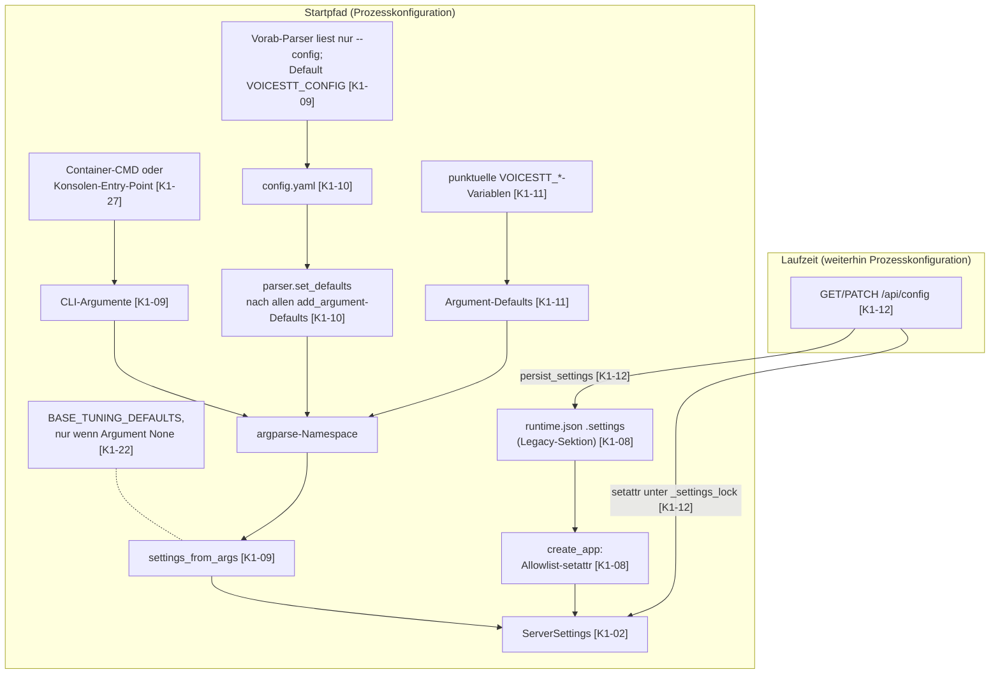
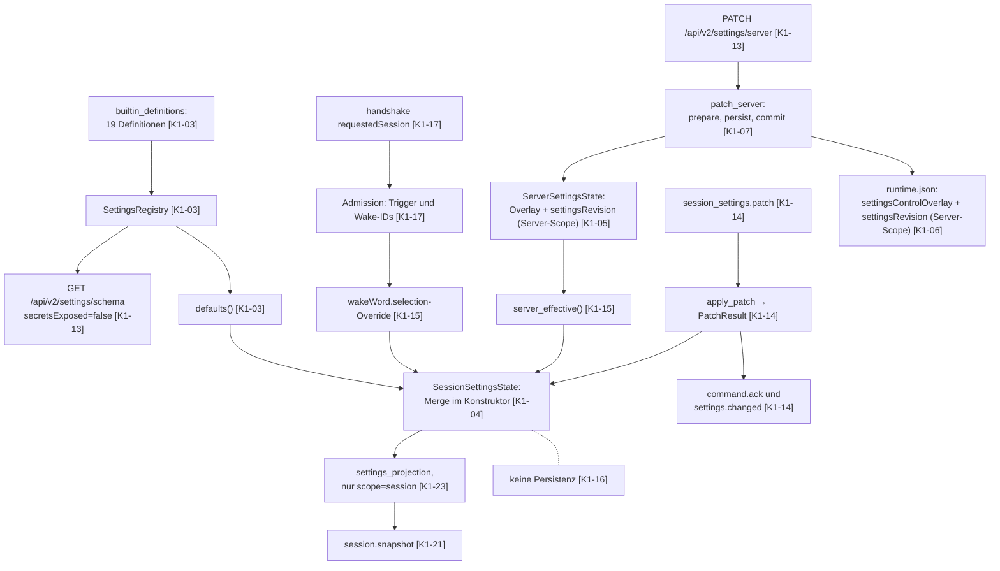
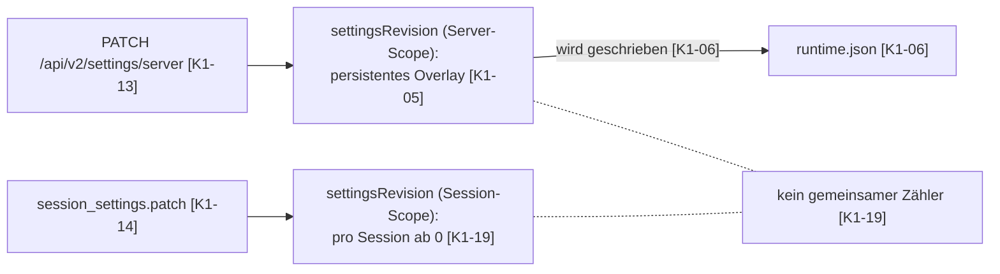

# 03.01 – Konfigurationsarchitektur

*Faktenbasis: `workflow/research/03.01.json` (K1-01…K1-27, N-01…N-06, U-01…U-05). Commit `a8993c5c68042d996eab680d84a5b138a214bb5d` (K1-01).*

**Abgrenzung:** Dieses Kapitel beschreibt die **Ebenen und Zuständigkeiten** der Konfiguration: welche Welten es gibt, wer sie besitzt, wo Werte herkommen und wo sie niemals hingehen. Die Scope-Semantik im Detail steht in [03.02 Scopes](./03.02-scopes.md), die vollständige Quellenpriorität in [03.05 Quellen und Prioritäten](./03.05-quellen-und-prioritaeten.md), die Einzelwerte der Server- und Session-Einstellungen in [03.06](./03.06-server-einstellungen.md) und [03.07](./03.07-session-einstellungen.md), Patch-Mechanik und Apply-Policies in [03.08 Runtime-Änderungen](./03.08-runtime-aenderungen.md), Wirksamkeitszeitpunkte in [03.09](./03.09-wirksamkeitszeitpunkt.md), Dateiformat und Ladepfad in [03.10 Persistenz](./03.10-persistenz.md). Die Trennung von Einstellungs-Patch und Katalog-Refresh ist in [02.07 Modelle und Modellverwaltung](../02-funktionsweise/02.07-modelle-und-modellverwaltung.md) beschrieben (M2-30); Kataloge: [08.03](../08-referenzen/08.03-settings-katalog.md), [08.04](../08-referenzen/08.04-api-endpunkt-katalog.md), [08.12](../08-referenzen/08.12-cli-env-katalog.md).

## 1. Worum geht es?

Zwei Fragen klingen gleich und sind grundverschieden:

- „Wo stelle ich den **Port** ein?"
- „Wo stelle ich die **Wake-Word-Empfindlichkeit** ein?"

Die erste betrifft den **Prozess**: Wie startet dieser Server, auf welchem Interface lauscht er, wo liegen seine Daten, welche Zugangsdaten hat er? Die zweite betrifft eine **verwaltete Einstellung**: einen Wert, den der Server als Vertrag mit Schema, Gültigkeitsbereich, Validierung und Revision kennt.

Der Voice-STT-Server beantwortet diese beiden Fragen in **zwei getrennten Welten**:

1. **Prozesskonfiguration** – die Klasse `ServerSettings`. Sie enthält Deployment-Fakten (Host, Port, Modell, Gerät, Rechenart, Logging, Limits, Datenwurzel, Secrets), wird beim Start aus CLI, YAML, Umgebungsvariablen und Tuning-Defaults gebaut und über `GET`/`PATCH /api/config` zur Laufzeit verändert (K1-12).
2. **Settings-Domäne** – die Registry mit ihren `SettingDefinition`s (`activation.*`, `wakeWord.*`, `kroko.forceCommunity`, `runtimeSuppression.*`), das persistente Server-Default-Overlay und der Session-Zustand (K1-03, K1-05, K1-04).

Die Trennung ist keine Formsache. Sie bedeutet unterschiedliche Nummernräume, unterschiedliche Revisionszähler, unterschiedliche Speicherregeln und unterschiedliche APIs (K1-23).

### 1.1 Das Ebenenmodell

Die folgenden Ebenen sind **Arten** von Konfiguration, keine Rangliste. Die Rangfolge innerhalb des Startpfads behandelt §5; die vollständige Prioritätsmatrix steht in [03.05](./03.05-quellen-und-prioritaeten.md).

| Ebene | Was dort steht | Wer sie liest | Belege |
|---|---|---|---|
| Code-Defaults | Feld-Defaults von `ServerSettings`; die 19 Registry-Definitionen | Prozess, Domäne | K1-02, K1-03 |
| Startdatei und Tuning | `config.yaml`, Tuning-Profil | Start | K1-10, K1-22 |
| Env | punktuelle `VOICESTT_*`-Variablen; Modellwurzeln | Start, Discovery | K1-11, K1-24 |
| CLI | Argumente, höchste Startpriorität | Start | K1-09 |
| Gespeicherte Werte | eine `runtime.json` mit zwei Sektionen | Start, Admin-Patch | K1-06, K1-08 |
| Domänen-Zustand | `ServerSettingsState`, `SessionSettingsState` | API, Wire | K1-05, K1-04 |
| API/Wire | REST v2, `session_settings.patch`, `/api/config` | Admin, Client | K1-13, K1-14, K1-12 |

## 2. Das Wesentliche auf einen Blick

| Frage | Kurzantwort | Belege |
|---|---|---|
| Wie viele Konfigurationswelten? | Zwei: Prozesskonfiguration und Settings-Domäne, strikt getrennt | K1-23 |
| Wem gehört der Port? | `ServerSettings` – nicht der Registry | K1-02 |
| Wem gehört `wakeWord.sensitivity`? | Der Settings-Domäne – nicht `ServerSettings` | K1-03 |
| Wie viele Registry-Keys? | 19 Definitionen in vier Namensräumen | K1-03 |
| Was schlägt was beim Start? | CLI > YAML > Env-Default > Argument-Default; Tuning darunter; gespeicherte Legacy-Sektion danach | K1-09, K1-10, K1-11, K1-22, K1-08 |
| Wie viele Dateien? | Genau eine `runtime.json`, zwei Schreibfamilien | K1-06 |
| Wird eine Session gespeichert? | Nein, nie | K1-16 |
| Wie viele `settingsRevision`? | Zwei – Server-Scope und Session-Scope, gleicher Feldname | K1-19 |
| Wo sieht man Prozessfelder? | `GET /api/config`, nicht im v2-Schema | K1-12, K1-23 |

### 2.1 Fünf Begriffe, die nicht verwechselt werden dürfen

| Begriff | Was er ist | Was er nicht ist |
|---|---|---|
| `ServerSettings` | Prozess-/Deployment-Konfiguration mit eigener Pfadableitung und `public_dict` (K1-02) | Kein Settings-Schema, keine Registry |
| `SettingDefinition` / `SettingsRegistry` | Read-only-Vertrag der 19 serververwalteten Keys (K1-03) | Kein Wertespeicher; ändert sich nicht durch Patches |
| `ServerSettingsState` | Das **admin-verwaltete Server-Default-Overlay** samt eigenem Revisionsstrom (K1-05) | Keine Prozesskonfiguration – trotz des ähnlichen Namens |
| `SessionSettingsState` | Der Session-Zustand: angefordert, effektiv, eigene Revision, nie persistiert (K1-04, K1-16, K1-19) | Kein globaler Zustand |
| `settingsRevision` | Ein Zähler – aber **welcher**? Immer mit Scope nennen (K1-19) | Kein universeller Revisionszähler |

Der Namensfallstrick ist real: `ServerSettings` und `ServerSettingsState` unterscheiden sich um ein Wort und gehören zu verschiedenen Welten.

### 2.2 Der Startpfad (A)



**Was das Diagramm sagt:** Ein Vorab-Parser liest zuerst nur `--config`; dessen Default ist `VOICESTT_CONFIG` (K1-09). Erst danach wird eine YAML-Datei geladen und per `set_defaults` **nach** allen `add_argument`-Defaults gesetzt (K1-10). Damit gilt effektiv: explizites CLI-Argument > YAML-Wert > Env-Default > Argument-Default (K1-09). Tuning-Defaults greifen nicht als Namespace-Merge, sondern pro Feld in `settings_from_args`, nur wo das Argument `None` ist (K1-22). `settings_from_args` gießt den Namespace in `ServerSettings` (K1-09). Beim App-Aufbau wird zusätzlich die Legacy-Sektion `settings` aus `runtime.json` über eine Allowlist angewendet (K1-08). Zur Laufzeit liest und schreibt `PATCH /api/config` dasselbe Objekt und persistiert in dieselbe Sektion (K1-12).

**Textalternative:** `--config` bestimmen → YAML als Defaults laden → CLI/Env/Tuning zu einem Namespace mischen → `ServerSettings` bauen → gespeicherte Legacy-Werte anwenden. Laufzeitänderungen gehen über `/api/config` und dieselbe Sektion zurück.

### 2.3 Der Domänenpfad (B)



**Was das Diagramm sagt:** Die Registry ist der Vertrag (K1-03) und speist sowohl das Schema als auch die Defaults (K1-13). Der Server-Zustand hält das Overlay und liefert `server_effective()` (K1-05, K1-15). Beim Session-Aufbau werden Registry-Defaults, Server-Overlay und Session-Anforderung **im Konstruktor** zusammengeführt (K1-04); die aufgelöste Wake-Auswahl aus dem Handshake überschreibt dabei `wakeWord.selection` (K1-15, K1-17). Patches laufen über `apply_patch` und antworten als `PatchResult` (K1-14). Die Projektion gibt nur session-scope Keys heraus (K1-23). Der Admin-Patch auf Server-Defaults schreibt über `patch_server` in die Datei (K1-07); für Sessionwerte existiert diese Kante nicht (K1-16).

**Textalternative:** Vertrag → Defaults + Overlay + Anforderung → Session-Zustand → Projektion/Snapshot. Admin-Patches ändern das Overlay und die Datei; Session-Patches ändern nur den Session-Zustand.

### 2.4 Warum zwei Welten? Die Alternativen

| Naheliegende Alternative | Warum sie hier nicht gewählt ist |
|---|---|
| Ein flaches Namensraum-Schema für alles | Prozessfelder brauchen Neustart, Secrets und Pfadableitung; die Domäne braucht Scope, Constraints und Revisionen. Das v2-Schema enthält deshalb ausschließlich Registry-Keys (K1-23) |
| Generisches Env-zu-Feld-Mapping | Es gibt nur explizit verdrahtete Variablen; ein generisches Mapping existiert nicht (K1-11, N-01) |
| Automatische Suche nach `config.yaml` | YAML wirkt nur mit `--config` oder `VOICESTT_CONFIG`; keine Auto-Discovery (K1-10, N-02) |
| Delta-Overlay statt Vollkopie | Die Bauform ist eine Vollkopie aller Server-Default-Keys (K1-05); die Folge (Pinning) ist als offener Punkt U-02 dokumentiert |
| Sessionwerte „zur Sicherheit" mitspeichern | Bewusst nicht: Sessions sind flüchtig, nur das Server-Overlay ist persistent (K1-16, N-05) |
| Ein gemeinsamer Revisionszähler | Zwei Ströme mit gleichem Wire-Namen; Konflikte werden je Strom geprüft (K1-19) |

## 3. Die Prozesskonfiguration: `ServerSettings`

### 3.1 Was drin ist

`ServerSettings` ist eine eigene Klasse mit eigenem Nummernraum und ausdrücklich **nicht** Teil der serververwalteten Settings-Domäne (K1-02). Sie bündelt Host/Port, Engine/Modell/Gerät/Rechenart, Logging/Diagnose, Limits, `data_root_path` und Secrets (Admin- und OpenAI-Key).

### 3.2 Was `__post_init__` ableitet

Beim Bau der Instanz leitet `__post_init__` **alle Datenpfade** aus `data_root_path` ab und setzt `runtime_config_path` auf `<data_root>/config/runtime.json` – ohne Datenwurzel auf `None` (K1-02). Zusätzlich validiert sie `realtime_log_detail` und `log_live_enabled` (K1-02).

Praktisch: Die Datenwurzel ist der Angelpunkt des Betriebs. Sie bestimmt, **ob** überhaupt persistiert wird. Fehlt sie, ist die Persistenz faktisch deaktiviert (K1-06).

### 3.3 Was `public_dict()` nicht zeigt

`public_dict()` entfernt die Engine-Optionen, **beide API-Keys**, die redigierten Kroko-Credentials und `_resolved_stt_models` (K1-02). Secrets tauchen dort nicht auf; Details in [03.11 Secrets](./03.11-secrets.md).

## 4. Der Registry-Vertrag

### 4.1 `SettingDefinition` – die Feldstruktur

Jede Definition trägt u. a. `key`, `scope`, `auth`, `type`, `constraints`, `default_value`, `apply_policy`, `has_server_default`, `writable`, `secret` und `description` (K1-03). Die Registry liefert daraus Defaults, Server-Default-Keys, Session-Keys und ein deterministisch sortiertes Schema-Payload (K1-03). Sie ist **kein** Wertespeicher.

### 4.2 Die 19 Keys im Überblick

| Namensraum | Keys | Scope |
|---|---|---|
| `activation.*` (6) | `activation.initialSpeechTimeoutMs`, `activation.followupTimeoutMs`, `activation.segmentWatchdogInitialMs`, `activation.segmentWatchdogRefreshMs`, `activation.segmentWatchdogWarningMs`, `activation.closingRecoveryTimeoutMs` | Session |
| `wakeWord.*` session (8) | `wakeWord.sensitivity`, `wakeWord.selection`, `wakeWord.minConsecutivePredictionFrames`, `wakeWord.cooldownMs`, `wakeWord.preRollMs`, `wakeWord.detectorGain`, `wakeWord.noiseSuppressionEnabled`, `wakeWord.vadThreshold` | Session |
| `wakeWord.*` server (2) | `wakeWord.inferenceBackend`, `wakeWord.globalDisabledIds` | **Server** |
| `kroko.*` (1) | `kroko.forceCommunity` | **Server** |
| `runtimeSuppression.*` (2) | `runtimeSuppression.manual`, `runtimeSuppression.wakeWord` | Session |

Damit sind 16 Keys session-scope und 3 server-scope (K1-03). Die drei Server-Keys erscheinen in keiner Session-Projektion (K1-23). Typen, Grenzen, Defaults und Wirkung stehen in [03.04](./03.04-datentypen-und-validierung.md), [03.06](./03.06-server-einstellungen.md), [03.07](./03.07-session-einstellungen.md) und im [Settings-Katalog](../08-referenzen/08.03-settings-katalog.md).

### 4.3 Das Schema-Payload

`schema_payload` erzeugt ein **deterministisch sortiertes** Schema (K1-03); die v2-Route liefert es mit `secretsExposed=false` (K1-13). **Offener Punkt U-05:** Die Redaktion für `secret=True` ist implementiert, aber keine eingebaute Definition setzt dieses Kennzeichen.

## 5. Die Start-Ebenen

### 5.1 CLI – die oberste Startpriorität

Zweistufiger Parser (K1-09): Ein **Vorab-Parser** (`add_help=False`, `parse_known_args`) liest ausschließlich `--config` (Default `VOICESTT_CONFIG`); danach wird der echte Parser gebaut und YAML-Werte per `set_defaults` gesetzt. Reihenfolge: **CLI > YAML > Env-Default > Argument-Default** (K1-09). `settings_from_args` überführt den Namespace in `ServerSettings`.

### 5.2 YAML – versioniert, eng, ohne Auto-Suche

`version` default 1, nur 1 erlaubt; `settings`-Objekt oder flache Payload; erlaubte Namen = Dataclass-Felder von `ServerSettings`. Abgelehnt: Secrets, abgeleitete Pfade, unbekannte Keys, `device` ungleich `cpu`, entfernte Tuning-Profile. Sonderfälle invertieren Dest/Namen (`model_warmup` → `no_model_warmup`, `vad_filter` → `no_vad_filter`) bzw. serialisieren Dicts als JSON (K1-10). **Keine automatische Suche nach `config.yaml`** (K1-10, N-02) – ohne `--config`/`VOICESTT_CONFIG` tut eine Datei im Arbeitsverzeichnis nichts.

### 5.3 Env – punktuell, nicht generisch

Nur explizit verdrahtete `VOICESTT_*`-Variablen werden als Argument-Defaults gebunden (K1-11); Boolesche akzeptieren `1/true/yes/on`. Kein generisches Mapping (N-01), kein dotenv-Loader (N-06); `.env` wirkt nur über Compose `env_file` (K1-27). **U-04:** YAML > Env-Default folgt nur aus der Code-Reihenfolge, nicht aus einem Test.

### 5.4 Tuning-Profil – unterhalb von YAML und CLI

Nur Profil `custom` (leere Einstellungen); `BASE_TUNING_DEFAULTS` liefert acht Werte nur bei `None`-Argument (K1-22). YAML gewinnt gegen das Profil, CLI gegen beide; entfernte Profile werden abgewiesen.

### 5.5 Modellwurzeln – zweite, unabhängige Env-Ebene

`VOICESTT_FASTER_WHISPER_MODEL_ROOT` / `VOICESTT_KROKO_MODEL_ROOT` nur als Fallback ohne explizite Wurzel (Parameter schlägt Env); **kein** Bestandteil von `ServerSettings` (K1-24). Details: [02.07](../02-funktionsweise/02.07-modelle-und-modellverwaltung.md).

### 5.6 Deployment – CLI und Env, keine vierte Datei

Container startet `python -m VoiceSTT_server.server` mit CMD-Argumenten; Compose setzt Env/`env_file`; `stt-server` zeigt auf dieselbe `main`-Implementierung; `--config` nur in der VPS-Compose (K1-27). **Warnung (U-03):** Die VPS-Compose nennt Build-Ziel `cpu`, das Root-Dockerfile kennt nur `builder`/`runtime` – nicht als Produktaussage verwenden, bis der Widerspruch geklärt ist.

## 6. Gespeicherte Werte: eine Datei, zwei Sektionen

### 6.1 Der Aufbau

Genau ein JSON-Dokument (`<data_root>/config/runtime.json`) mit zwei Schreibfamilien (`settings` und `settingsControlOverlay` + `settingsRevision`); unbekannte Top-Level-Felder bleiben erhalten; Lesen-Ändern-Schreiben unter modulweitem Lock, atomar per Temp-Datei + `os.replace` (K1-06). `load_control` ist **fail-fast** für vorhandene, aber ungültige Sektionen; nur fehlende defaulten auf `({}, 0)`. Ohne `data_root_path`: No-Op (K1-06).

### 6.2 Prepare – persist – commit

```text
# Schematisch – nicht wörtlicher Code
kandidat   = overlay.copy()
kandidat  += patch        # validieren: Scope, Typ, Constraints, Cross-Field
revision2  = revision + 1
persist(kandidat, revision2)             # atomar: Temp-Datei, dann os.replace
overlay, revision = kandidat, revision2 # Commit erst nach erfolgreichem Persist
```

Ein Persistenzfehler hinterlässt RAM und Revision unverändert (`internal_error`/`persistence_failed`, K1-07).

### 6.3 Die Legacy-Schicht `settings`

`create_app` liest Sektion `settings` und wendet erlaubte Werte per `setattr` an – ausgenommen abgeleitete Pfade, `admin_api_key`, `data_root_path`, `openai_api_key`; danach erneut `__post_init__` + `enforce_cpu_model_policy`. Rückschreiben über `persist_settings` mit Allowlist (ohne Secrets, Pfade, `device`, `host`, `port`) (K1-08).

### 6.4 Was nie gespeichert wird

Sessionwerte werden **nie** persistiert (K1-16, N-05). Neustart verwirft Session-Overrides; dauerhaft nur als **Server-Default**.

## 7. Die Settings-Domäne

### 7.1 Das Server-Default-Overlay

`ServerSettingsState` mit strikter Startvalidierung (Revision kein `bool`/`>= 0`, Overlay-Objekt, nur `has_server_default`-Keys, keine Secrets, Constraints, Cross-Field) und **Vollkopie** aller Server-Default-Keys statt Delta (K1-05). Schreiben nur über `patch_server`; `server_public` redigiert Secrets (K1-05, K1-13). **U-02:** Die Vollkopie pinnt beim ersten Server-Patch alle damaligen Registry-Defaults; spätere Default-Änderungen erreichen die Installation nicht – kein Migrations-Pfad.

### 7.2 Der Merge beim Session-Aufbau

Ausschließlich im Konstruktor, Reihenfolge Registry-Defaults < Server-Overlay < Session-Anforderung; kein Merge-Helper (K1-04). Zusätzlich: `server_effective()`, Wake-Override von `wakeWord.selection`, eigene Registry-Instanz, session-bezogener Validator (K1-15). **Spätere Server-Patches wirken nicht auf bestehende Sessions** (K1-15).

### 7.3 Zwei Revisionsströme



Zwei Zähler, zwei Scopes, zwei Prüfungen gegen `baseSettingsRevision`. Regel: **`settingsRevision` immer mit Scope nennen** (K1-19).

### 7.4 Warum nichts vermischt wird

v2-Schema nur Registry-Keys; Session-Projektionen ohne `scope != session`; Prozessfelder nur über `GET /api/config` (K1-23).

## 8. API und Wire

### 8.1 REST v2

| Route | Verhalten |
|---|---|
| `GET /api/v2/settings/schema` | sortiertes Schema, `secretsExposed=false` |
| `GET /api/v2/settings/server` | non-secret Serverwerte, Secrets redigiert |
| `PATCH /api/v2/settings/server` | admin-gated; `patch_server` unter Kroko-Policy-Lock; 200/409/422/500 |

Kein REST-Patch für Sessionwerte (K1-13).

### 8.2 Wire – `session_settings.patch`

Über `SettingsPort` (speichert nichts) in `apply_patch`, Antwort `PatchResult`; Projektionen `no_change`/`settings_revision_conflict`/`settings_rejected`/`applied`; Revision genau einmal gespiegelt; `settings.changed` deterministisch nach `POLICY_EVENT_ORDER` (K1-14). Kein Session-Patch erreicht `runtime.json` (K1-16).

### 8.3 Legacy `/api/config`

Drei Laufzeitmengen (`ACTIVE`/`NEW_SESSION`/`STARTUP_ONLY`) plus Modell-Management (`model_refresh`) und abgeleitete Pfade; Abweisung von `startup_only`/unbekannt; Typprüfung; `setattr` unter Lock; `appliesTo` aus `active_sessions`/`new_sessions`/`model_refresh`; Persistenz (K1-12). **Nicht** die `apply_policy`-Achse der Domäne.

### 8.4 Handshake – enge Eingaben

`requestedSession` (Trigger/Wake-IDs) + `runtimeSuppression`-Flags; Admission-Regeln (mindestens eine Triggerquelle, kein Wake-Auswahl ohne Wake-Trigger, Pflicht bei Wake-Trigger); atomare fail-closed Auflösung (K1-17).

### 8.5 Credentials

`admin_api_key` vor `VOICESTT_ADMIN_API_KEY`; `openai_api_key` vor `VOICESTT_API_KEY`. YAML-Verbot, nicht in `public_dict()`, `admin_api_key` startup-only/nicht persistiert (K1-18). Details: [03.11](./03.11-secrets.md).

## 9. Weitere Trennungen

### 9.1 Katalog vs. Settings

Settings besitzt `globalDisabledIds`/`inferenceBackend`; Katalog projiziert Verfügbarkeit mit eigener `catalogRevision`. `POST /api/v2/wake-words/refresh`: atomarer Swap, letzter guter Katalog bei Fehler, **keine** Settings-Revisions-/Sessionwirkung (K1-25; vgl. M2-30).

### 9.2 Scope-Abweisung (Abgrenzung)

Session-Patch lehnt `scope=server` mit `wrong_scope` ab; Server-Patch lehnt Keys ohne `has_server_default` mit `wrong_scope` und Secrets mit `read_only_runtime_authority` ab; `client_local` ungenutzt (K1-20, N-03). Semantik: [03.02](./03.02-scopes.md).

### 9.3 `effective` als Projektion (Hinweis)

`live`/`next_activation` aktualisieren `effective`, `next_session`/`server_restart` behalten den laufenden Wert; `requested` immer aktualisiert; `freeze_activation` latcht nur `next_activation`; Admission filtert `scope=session`; Suppression live überlagert (K1-21). Mechanik: [03.08](./03.08-runtime-aenderungen.md); Wirksamkeit: [03.09](./03.09-wirksamkeitszeitpunkt.md).

## 10. Grenzen und offene Punkte

| ID | Befund | Bedeutung |
|---|---|---|
| N-01 | Kein generisches Env-Mapping (K1-11) | Nur verdrahtete Variablen wirken |
| N-02 | Keine YAML-Auto-Suche (K1-10) | Nur mit `--config`/`VOICESTT_CONFIG` |
| N-03 | `client_local` nur Konstante (K1-20) | Kein client-lokaler Bereich |
| N-04 | Kein Reset/Unset von Server-Defaults (K1-26) | Nur manuelles Entfernen, ohne API-Pfad |
| N-05 | Sessionwerte nie persistiert (K1-16) | Neustart verwirft Overrides |
| N-06 | Kein dotenv-Loader (K1-11) | `.env` nur via Compose |
| U-01 | Branch-Ref nicht verifizierbar (K1-01) | Nur Commit belegt |
| U-02 | Overlay-Vollkopie pinnt Defaults (K1-05) | Kein Migrations-Pfad |
| U-03 | VPS-Compose vs. Dockerfile (K1-27) | Nicht als Produktaussage verwenden |
| U-04 | YAML > Env nur code-abgeleitet (K1-09) | Nicht testbelegt |
| U-05 | `secret=True` ohne eingebauten Key (K1-13) | Nur Custom-Registry |

## 11. Siehe auch und Nachweise

**Verwandt:** [03.02](./03.02-scopes.md) · [03.04](./03.04-datentypen-und-validierung.md) · [03.05](./03.05-quellen-und-prioritaeten.md) · [03.06](./03.06-server-einstellungen.md) · [03.07](./03.07-session-einstellungen.md) · [03.08](./03.08-runtime-aenderungen.md) · [03.09](./03.09-wirksamkeitszeitpunkt.md) · [03.10](./03.10-persistenz.md) · [03.11](./03.11-secrets.md) · [02.07](../02-funktionsweise/02.07-modelle-und-modellverwaltung.md) · [08.03](../08-referenzen/08.03-settings-katalog.md) · [08.04](../08-referenzen/08.04-api-endpunkt-katalog.md) · [08.12](../08-referenzen/08.12-cli-env-katalog.md) · [08.13](../08-referenzen/08.13-daten-persistenzschema.md)

**Gliederung:** Ebenen/Zuständigkeiten (1, 2) · Prozesskonfiguration (3) · Registry-Vertrag (4) · Start-Ebenen (5) · gespeicherte Werte (6) · Settings-Domäne (7) · API/Wire (8) · weitere Trennungen (9) · Grenzen (10).

**Faktenregister:** K1-01 Commit/Branch-Stand · K1-02 `ServerSettings`/Pfadableitung/`public_dict` · K1-03 Registry-Vertrag/19 Keys/Schema · K1-04 Konstruktor-Merge · K1-05 Overlay/Validierung/Revision · K1-06 ein Dokument/zwei Sektionen/atomar/fail-fast · K1-07 Prepare-persist-commit · K1-08 Legacy-`settings`-Schicht · K1-09 CLI-Reihenfolge · K1-10 YAML-Regeln · K1-11 punktuelle Env · K1-12 Legacy-Runtime-Klassen · K1-13 REST v2 · K1-14 Wire-Patch · K1-15 Session-Aufbau · K1-16 keine Session-Persistenz · K1-17 Handshake-Eingaben · K1-18 Credential-Fallback · K1-19 zwei Revisionsströme · K1-20 Scope-Abweisung/`client_local` · K1-21 `effective`-Fortschreibung · K1-22 Tuning-Profile · K1-23 Prozess/Domäne-Trennung · K1-24 Modellwurzel-Env · K1-25 Katalog-Trennung · K1-26 kein Reset · K1-27 Deployment · N-01…N-06/U-01…U-05 siehe §10.
