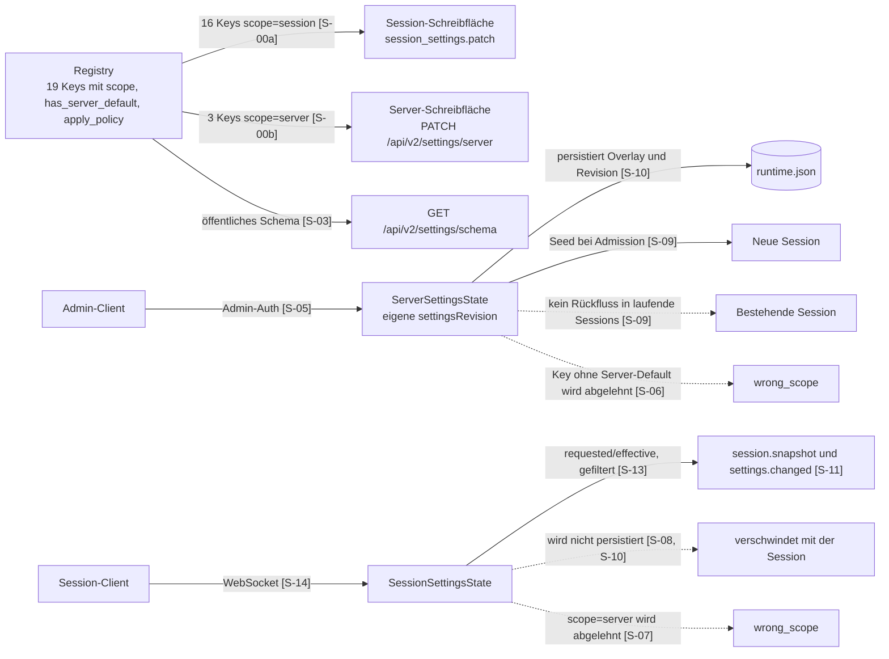
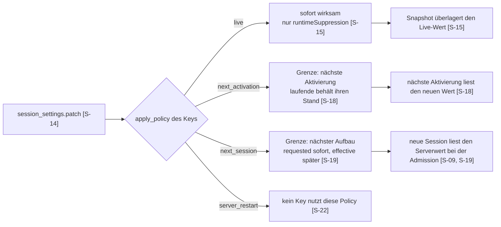

# 03.02 Scopes

*Faktenbasis: `workflow/research/03.02.json` (S-00a…S-27, N-1…N-6, U-1…U-3). Commit `a8993c5c68042d996eab680d84a5b138a214bb5d`.*

**Abgrenzung:** Die Ebenen selbst (Registry, Control Plane, Wire) stehen in [03.01 Konfigurationsarchitektur](./03.01-konfigurationsarchitektur.md); dieses Kapitel betrachtet nur die Gültigkeitsbereiche und ihre Grenzen.

## 1. Worum geht es?

Ein **Scope** ist der Gültigkeitsbereich einer Einstellung: Er beantwortet drei Fragen – *Wer darf den Wert schreiben? Wer sieht ihn? Wie lange lebt er?*

Der V2-Server benutzt zwei Bereiche: `session` und `server`. Eine dritte Konstante, `client_local`, existiert im Code, ist aber an keinen Schlüssel gebunden und damit **kein Feature** (S-01). Daneben gibt es zwei weitere Grenzen, die oft mit „Scope“ verwechselt werden, aber keine sind: die **Aktivierungsgrenze** und die **Aufbaugrenze** (S-18, S-19).

Praktisch heißt das: Ein Admin senkt serverseitig ein Nachfragefenster. Eine laufende Sitzung merkt davon nichts, die nächste startet mit dem neuen Startwert (S-09). Ein Client ändert während einer laufenden Aktivierung dasselbe Fenster – sichtbar wird das erst in der folgenden Aktivierung (S-18). Wer eine Server-Einstellung über die Sitzung schreiben will, bekommt eine saubere Ablehnung (S-06).

## 2. Das Wesentliche auf einen Blick

Es gibt genau zwei Schreibflächen (S-05, S-14), einen Katalog als einzige Schlüsselquelle (S-02), eine Vererbung ohne Rückfluss (S-09) und – bewusst – keine Persistenz der Sitzungswerte (S-08).



**Erklärung des Diagramms.** Die Registry liefert die 16 Sitzungsschlüssel (S-00a) und die 3 Serverschlüssel (S-00b) und veröffentlicht dieselben Metadaten als Schema (S-03). Der Admin schreibt über HTTP in den Serverzustand mit eigener Revision; Overlay plus Revision landen in `runtime.json` (S-05, S-10). Eine neue Sitzung wird bei der Admission **gesät** (S-09) – die gestrichelte Kante zu „Bestehende Session“ ist die ausdrücklich *nicht* vorhandene Rückwirkung (S-09). Die Sitzung schreibt ausschließlich über den WebSocket (S-14), ihre Werte erscheinen gefiltert im Snapshot (S-13) und werden nicht persistiert (S-08, S-10). Beide Sperrkanten enden in `wrong_scope`: Die Sitzung darf keine Server-Schlüssel schreiben (S-07), der Server keine Schlüssel ohne Server-Default (S-06).

**Textliche Alternative:** Die Registry definiert 19 Schlüssel (16 `session`, 3 `server`). Der Admin schreibt serverseitige Startwerte per HTTP; diese werden in `runtime.json` gespeichert und beim Aufbau einer neuen Sitzung als Startwerte übernommen. Bestehende Sitzungen bleiben unverändert. Sitzungswerte werden nur über den WebSocket geschrieben, erscheinen im Snapshot und gehen mit der Sitzung verloren. Beide Flächen lehnen Schlüssel des jeweils anderen Bereichs mit `wrong_scope` ab.

## 3. Inventar: 19 Schlüssel, zwei Bereiche

Die Registry enthält **19** Schlüssel: **16** mit Scope `session`, **3** mit Scope `server` (S-00a, S-00b, S-02). Kein Schlüssel nutzt `server_restart` (S-22). Konkrete Werte/Wertebereiche: [03.06](./03.06-server-einstellungen.md), [03.07](./03.07-session-einstellungen.md), [08.03](../08-referenzen/08.03-settings-katalog.md).

### 3.1 Sitzungsschlüssel (16)

| Schlüssel | Server-Default | apply_policy |
|---|---|---|
| `activation.initialSpeechTimeoutMs` | ja | `next_activation` |
| `activation.followupTimeoutMs` | ja | `next_activation` |
| `activation.segmentWatchdogInitialMs` | ja | `next_activation` |
| `activation.segmentWatchdogRefreshMs` | ja | `next_activation` |
| `activation.segmentWatchdogWarningMs` | ja | `next_activation` |
| `activation.closingRecoveryTimeoutMs` | ja | `next_activation` |
| `wakeWord.sensitivity` | ja | `next_activation` |
| `wakeWord.minConsecutivePredictionFrames` | ja | `next_activation` |
| `wakeWord.cooldownMs` | ja | `next_activation` |
| `wakeWord.preRollMs` | ja | `next_activation` |
| `wakeWord.detectorGain` | ja | `next_activation` |
| `wakeWord.selection` | nein | `next_session` |
| `wakeWord.noiseSuppressionEnabled` | ja | `next_session` |
| `wakeWord.vadThreshold` | ja | `next_session` |
| `runtimeSuppression.manual` | nein | `live` |
| `runtimeSuppression.wakeWord` | nein | `live` |

Verteilung: **11 × `next_activation`**, **3 × `next_session`**, **2 × `live`** (S-00a). Die `runtimeSuppression`-Schlüssel sind zusätzlich schreibgeschützt (S-15).

### 3.2 Serverschlüssel (3)

| Schlüssel | Server-Default | apply_policy |
|---|---|---|
| `wakeWord.inferenceBackend` | ja | `next_session` |
| `wakeWord.globalDisabledIds` | ja | `next_session` |
| `kroko.forceCommunity` | ja | `live` |

Verteilung: **2 × `next_session`**, **1 × `live`** (S-00b). **Summe: 19 Keys, 0 mit `server_restart`** (S-22).

## 4. Zwei Achsen, nicht eine

Der häufigste Lesefehler: `scope` und `has_server_default` als dasselbe zu behandeln (S-04). Es sind zwei unabhängige Achsen:

|  | `has_server_default = true` | `has_server_default = false` |
|---|---|---|
| **`scope = session`** (16) | 13 | 3 (`wakeWord.selection`, `runtimeSuppression.manual`, `runtimeSuppression.wakeWord`) |
| **`scope = server`** (3) | 3 | 0 |

Daraus folgt (S-04):

1. **Die Server-Oberfläche ist nicht die Menge `scope = server`.** `PATCH /api/v2/settings/server` akzeptiert die 16 Schlüssel mit Server-Default – darunter 13 Sitzungsschlüssel.
2. **Die Sitzungs-Oberfläche ist nicht die Menge mit Server-Default.** `session_settings.patch` akzeptiert die 16 Sitzungsschlüssel, also auch die drei ohne Server-Default.
3. **`auth` ist keine Zugriffskontrolle**, sondern ein Hinweis für Clients (S-26). Ein Schlüssel mit `auth = session` und Server-Default ist bewusst auf *beiden* Flächen schreibbar – als Sitzungswert und als administrativer Startwert.

`client_local` ändert daran nichts: definiert, aber ohne Schlüssel und ohne Schema-Eintrag (S-01).

## 5. Die zwei Schreibflächen

### 5.1 Server: Admin-HTTP

Einziger serverseitiger Schreibweg: `PATCH /api/v2/settings/server` mit Admin-Auth (siehe [05.03](../05-administration/05.03-admin-authentifizierung.md)) (S-05). Lesen ist öffentlich: Schema- und Server-Read brauchen keinen Schlüssel (S-03, S-05).

```text
# Schematisch – keine konkreten Werte
PATCH /api/v2/settings/server
{
  "baseSettingsRevision": <aktuelle Server-Revision>,
  "changes": { "<Key mit has_server_default>": <Wert> }
}
```

| Code | Bedeutung |
|---|---|
| `200` | `applied` oder `no_change` |
| `400` | Rumpf kein JSON-Objekt (`invalid_payload`) – nur dieser Fall; Envelope-Fehler (`baseSettingsRevision`/`changes`) laufen als 422 |
| `401` | fehlender/falscher Admin-Key (Funktion `admin_auth_error` in server.py, vor jeder anderen Prüfung; Payload `{"error":"Admin-Authentifizierung erforderlich."}`, kein Wire-Code `admin_auth_error`) |
| `403` | Remote ohne konfigurierten Key (`Die Remote-Verwaltung ist deaktiviert...`; kein Rollenmodell) |
| `409` | `settings_revision_conflict` – `baseSettingsRevision` veraltet |
| `422` | `settings_rejected` – u. a. unbekannter Key, `wrong_scope`, Wertebereich, Cross-Field |
| `500` | `internal_error` – insbesondere fehlgeschlagene Persistenz |

Der Patch ist **atomar** (ein fehlerhafter Schlüssel verwirft die Transaktion); die Persistenz läuft **vor** der Übernahme (S-05, S-10).

### 5.2 Sitzung: nur WebSocket

Genau ein Schreibpfad: `session_settings.patch` auf der V2-Verbindung (S-14). Kein HTTP-Endpunkt für Sitzungswerte. Der Port speichert nichts; er projiziert in `command.ack` und – bei echter Änderung – `settings.changed` (S-14, S-11).

### 5.3 Sperrkanten in beide Richtungen

Server-Schlüssel über die Sitzung → `wrong_scope` (S-07). Schlüssel ohne Server-Default über den Server → `wrong_scope` mit Sitzungshinweis (S-06). Keine stillen Korrekturen.

## 6. Vererbung ohne Rückfluss

Einbahnstraße (S-09): Beim Session-Aufbau liest der Server die aktuellen Startwerte (**Seed-Kante** Server → neue Session). Ein späterer Server-Patch schreibt **keine** bestehende Sitzung um; die nächste Sitzung erbt den neuen Startwert.

Ein Sitzungswert ist ein **lokaler Override**: nur diese Sitzung, kein Rückschreiben (S-08), **nicht persistiert** – nur Overlay + Server-Revision landen in der Datei (S-08, S-10).

Registry-Startwerte sind **nicht** aus `config.yaml` abgeleitet (S-21). Die Registry liefert Defaults, der Overlay ersetzt einzelne; `config.yaml` speist die klassischen Einstellungen/Engine-Optionen, aber keine Registry-Defaults.

## 7. Sichtbarkeit: Was wo auftaucht

**Schema.** Alle 19 Schlüssel mit Scope, `auth`, Typ, Constraints, `defaultValue`, `applyPolicy`, sortiert, ohne Geheimnisse (`secretsExposed: false`) (S-03).

**Projektion.** Strikt `scope = session`: `requestedSettings`/`effectiveSettings` im Snapshot enthalten nie Server-Schlüssel – auch nicht `inferenceBackend` (S-13, S-17).

**Zwei Revisionen.** Getrennte Zähler, beide ab 0 (S-11). Sitzungsrevision im Snapshot/`settings.changed`; Serverrevision in Server-Read/Persistenz. Nicht vergleichbar: Eine neue Sitzung startet bei 0, auch wenn der Server höher steht.

**Kein Server-Event.** Ein Server-Patch löst **kein** `settings.changed` aus (S-27). Zwei Hooks statt Eventstrom: `forceCommunity` → Lizenz-/Modell-Neubewertung, `globalDisabledIds` → Katalog-Neuprojizierung (S-27). Die Katalogänderung erscheint als `wakeword.availability_changed` – ein Katalog-, kein Settings-Ereignis (S-16, S-27). Admin-UIs müssen nach dem Schreiben per `GET` nachziehen.

## 8. Isolation: Woran ein Wert gebunden ist

Jedes V2-Kommando trägt `sessionId`; der Parser prüft sie gegen die Verbindungssitzung (S-12): fehlend/nicht-kanonisch → `invalid_payload`; wohlgeformt, aber fremd → **`stale_session`** ohne Wirkung, ohne Umdeutung (S-12).

Neue Verbindung = neue Sitzung: `hello` erzeugt eine neue ID; es gibt keinen Pfad zur Wiederbelebung beendeter Sitzungen samt Einstellungen (S-08, S-20). Reconnect ist Aufbau, kein Fortsetzen (siehe [04.08](../04-schnittstellen/04.08-reconnect.md), [02.01](../02-funktionsweise/02.01-session-management.md)).

**Ehrliche Testlücken (N-4…N-6):** kein dedizierter Zwei-Session-Wire-Test (Isolation via Code S-12/S-13 + `stale_session`-Test + Revisions-Unit-Test); kein Test für die Abwesenheit der Server-Keys in `requestedSettings`/`effectiveSettings`; kein Test für Serverdefault-Override lokal. Kein Widerspruch zu S-06/S-07/S-01/S-22/S-08/S-12/S-13 – nur fehlende Festnagelung; wer Scope-Sperren umbaut, zuerst unter Test stellen.

## 9. Sonderfälle mit eigener Gültigkeitslogik



Nur „ab wann gilt ein Wert“ – Mechanik in [03.09](./03.09-wirksamkeitszeitpunkt.md). `live` betrifft nur `runtimeSuppression` (S-15). `next_activation` friert beim Aktivierungsstart ein (S-18). `next_session` ändert den Wunsch sofort, den effektiven Wert erst beim Aufbau (S-19, S-17). `server_restart` deklariert, aber ungenutzt (S-22).

**`runtimeSuppression` lesbar, nicht schreibbar.** Patch → `read_only_runtime_authority` (S-15). Geschrieben wird über `trigger_suppression.set`; der Snapshot überlagert den Live-Wert ohne Revisionsänderung (S-15).

**Globale Sperrliste als Schranke.** `globalDisabledIds` → Katalog-Verfügbarkeit; Auswahl mit gesperrter ID wird bei Admission zurückgewiesen (S-16). Laufende Sitzungen werden nicht nachträglich beschnitten (S-16, S-09).

**Serverwerte bei Admission gelesen.** Backend pro Admission aus Serverzustand, defensiver Rückfall; dieselbe Lesestelle versorgt die Sperrlisten-Projektion (S-17). Server-Patch sofort für neue, nicht für bestehende Sessions spürbar.

**`next_session` braucht den Reconnect.** Wunsch sofort, Wirkung erst beim Aufbau – und der ist immer eine neue Sitzung (S-19, S-20).

## 10. Randknoten, die keine Scopes sind

Lane-Optionen der STT-Engines (Konfigurationsauflösung, [02.06](../02-funktionsweise/02.06-engines.md)) (S-23). OpenAI-Request-Optionen (eine HTTP-Anfrage, [04.10](../04-schnittstellen/04.10-openai-kompatible-api.md)) (S-24). Legacy `/api/config` (klassische Einstellungen, getrennt vom Overlay) (S-25). `server_restart` (Konstante + Reihenfolge, kein Key) (S-22).

## 11. Grenzen

**Nicht implementiert:** kein dritter Scope – `client_local` nur Konstante (S-01, N-1). Keine Lane-/Engine-/Segment-Scope in der Registry (S-02, S-23, N-2). `server_restart`-Pfad vorhanden, aber ohne Key ungenutzt (S-22, N-3).

**Unbekannt/nicht belegt (exakt wie in der Faktenakte):** U-1 – ob ServerSettings-/config.yaml-Werte die Registry-Defaults indirekt speisen, ist im Repo ohne Code-Pfad und außerhalb nicht abschließend prüfbar (S-21; betrifft [03.06](./03.06-server-einstellungen.md)/[03.07](./03.07-session-einstellungen.md)). U-2 – ob ein Client nach einem Server-Patch die Serverwerte pollen muss: serverseitig gibt es kein Event (S-27); Client-Verhalten liegt außerhalb des Repos. U-3 – Branch `feat/v2-release-cleanup` ist nicht verifizierbar (`.git/refs/heads` leer, kein `packed-refs`); verifiziert ist nur der Commit-Hash über `.git/HEAD`.

**Nicht Teil dieses Kapitels:** konkrete Werte ([03.06](./03.06-server-einstellungen.md), [03.07](./03.07-session-einstellungen.md)), Wirksamkeitsmechanik ([03.09](./03.09-wirksamkeitszeitpunkt.md)), Reconnect/Snapshot-Sync ([04.07](../04-schnittstellen/04.07-snapshot-synchronisierung.md), [04.08](../04-schnittstellen/04.08-reconnect.md)).

## 12. Siehe auch / Nachweise

**Verwandt:** [03.01](./03.01-konfigurationsarchitektur.md) · [03.05](./03.05-quellen-und-prioritaeten.md) · [03.06](./03.06-server-einstellungen.md) · [03.07](./03.07-session-einstellungen.md) · [03.09](./03.09-wirksamkeitszeitpunkt.md) · [03.10](./03.10-persistenz.md) · [03.11](./03.11-secrets.md) · [01.06](../01-grundlagen/01.06-serverweite-und-sitzungsbezogene-ressourcen.md) · [02.01](../02-funktionsweise/02.01-session-management.md) · [04.03](../04-schnittstellen/04.03-websocket-v2.md) · [08.03](../08-referenzen/08.03-settings-katalog.md) · [08.04](../08-referenzen/08.04-api-endpunkt-katalog.md)

**Faktenverweise:** S-00a 16 Session-Keys · S-00b 3 Server-Keys · S-01 zwei genutzte Scopes · S-02 Registry als Schlüsselquelle · S-03 Schema-Route · S-04 zwei Achsen · S-05 Server-Fläche/Codes/Atomarität · S-06 Server→Session-only-Ablehnung · S-07 Session→Server-Ablehnung (`wrong_scope`-Sperren) · S-08 lokaler Override/nicht persistiert · S-09 Seed/keine Rückpropagation · S-10 Overlay+Revision in `runtime.json` · S-11 zwei Revisionen · S-12 `sessionId`-Bindung/`stale_session` · S-13 Projektionsfilter · S-14 einziger Session-Schreibpfad · S-15 `runtimeSuppression` read-only/live · S-16 Sperrliste als Schranke · S-17 Admission-Reads · S-18 Aktivierungs-Latch · S-19 `next_session` · S-20 neue Verbindung/neue Session · S-21 Registry-Defaults nicht config.yaml · S-22 `server_restart` ungenutzt · S-23/S-24/S-25 Randknoten · S-26 `auth`-Metadatum · S-27 kein Server-Event/Hooks · N-1…N-6/U-1…U-3 siehe §8/§11.
