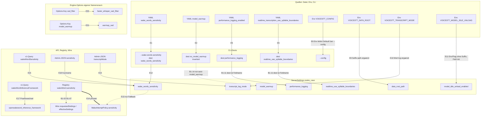
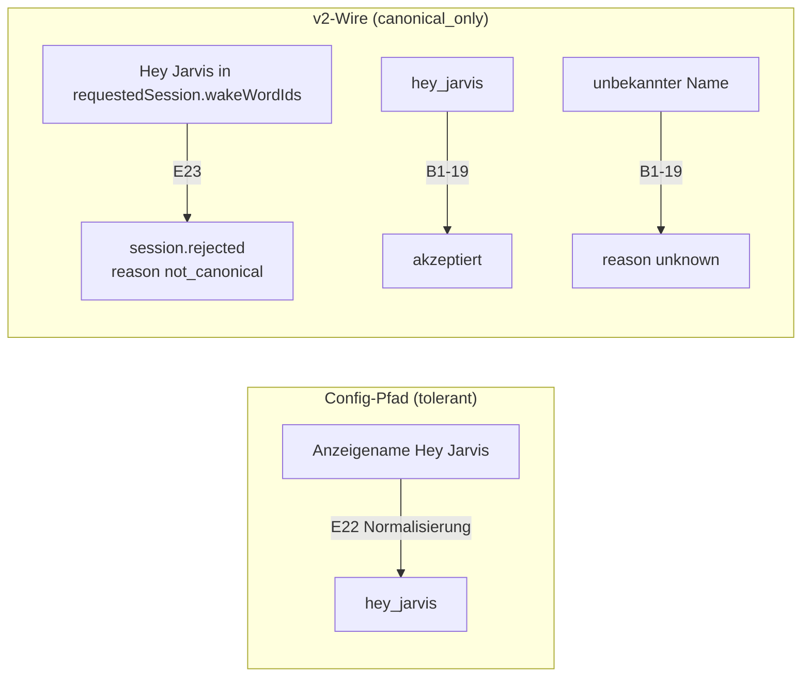

# 03.03 – Benennungskonventionen

*Faktenbasis: `workflow/research/03.03.json` (B1-01…B1-30, E1…E32, N-01…N-03, U-01…U-05, C-01…C-10). Commit `a8993c5c68042d996eab680d84a5b138a214bb5d`. Der Branchname ist nicht verifizierbar (Shallow-Checkout, detached HEAD), der Commit bindet (U-04).*

**Abgrenzung:** Ebenen und Zuständigkeiten stehen in [03.01 Konfigurationsarchitektur](./03.01-konfigurationsarchitektur.md), Gültigkeitsbereiche in [03.02 Scopes](./03.02-scopes.md). Hier geht es ausschließlich um Namen und ihre Zuordnung.

## 1. Worum es geht: ein Wert, viele Namen

Die Wake-Word-Empfindlichkeit heißt als Feld `wake_words_sensitivity`, auf der Kommandozeile `--wake-words-sensitivity`, in YAML ebenfalls `wake_words_sensitivity`, im alten Query-Pfad `wakeWordSensitivity`, im alten Admin-JSON kurz `sensitivity` und in der Control-Plane `wakeWord.sensitivity` (B1-01). Sechs Schreibweisen, ein Wert.

Die wichtigste Regel: **Es gibt keine Ableitungsregel, aus der man den Namen der nächsten Ebene berechnen könnte.** Die Zuordnungen sind an jeder Grenze als Tabelle im Code hinterlegt (B1-12, B1-07). Ein generischer Namens-Mapper existiert nicht (N-01).

Die teuerste Fehlannahme betrifft die Empfindlichkeit: `wake_words_sensitivity` und `wakeWord.sensitivity` sehen aus wie zwei Schreibweisen desselben Feldes, sind aber **zwei Autoritäten mit unterschiedlicher Wirkung** (B1-05). Das ist die zentrale Namensfalle (C-02, §4).

- **Beim Konfigurieren** zählt, welchen Namen die jeweilige Schnittstelle tatsächlich liest.
- **Beim Debuggen** muss man wissen, welcher Name in Log- und Fehlermeldungen auftaucht; die Texte mischen Query-, Feld- und Registry-Namen (B1-30).
- **Beim Weiterentwickeln** ist jede Umbenennung Handarbeit an mehreren Stellen (B1-03).

## 2. Das Wesentliche auf einen Blick

Fünf Namensfamilien über handgeschriebene Brücken:

1. **Datei- und Prozessquellen:** YAML-Keys und `VOICESTT_*`-Variablen; YAML = Feldnamen, Env oft verkürzt (B1-11, B1-15).
2. **Kommandozeile:** kebab-case-Flags, snake_case-`dest` – mit Abweichungen und drei Negationsstilen (B1-13, B1-14).
3. **`ServerSettings`:** snake_case-Feldmodell, gegen das YAML und CLI geprüft werden (B1-11).
4. **API-Sichten:** v1-Query, v1-Admin-JSON, v2-Registry-Keys – drei Vokabulare auf denselben Feldern (B1-08, B1-09, B1-02).
5. **Wire und Engine-Options:** camelCase-Literale im Protokoll, eigener Namensraum für Engine-Optionen (B1-07, B1-26).

**Lesart.** Hauptkette YAML → CLI-Ziel → Feld: `wake_words_sensitivity` 1:1 (E1, E12); `model_warmup` invertiert zu `no_model_warmup` (E2); `performance_logging_enabled` verliert `_enabled` (E5); `realtime_transcription_use_syllable_boundaries` verliert `transcription` (E6) (B1-12, B1-11). Env: `VOICESTT_CONFIG` = Default für `--config` (E8); `VOICESTT_DATA_ROOT` → `data_root_path` (E9); `VOICESTT_TRANSCRIPT_MODE` → `transcript_log_mode` (E10); `VOICESTT_MODEL_IDLE_UNLOAD` → CLI-`dest` `model_idle_unload` → Feld `model_idle_unload_enabled` (E11: Env/Flag ohne Suffix, Feld mit) (B1-15, B1-10). Rechts: Query `wakeWordSensitivity` (E15), Admin-Kurzname `sensitivity` (E18), `transcriptMode` (E19) (B1-08, B1-09, B1-10). Registry `wakeWord.sensitivity` speist die Policy **primär** (E14, fett), das Feld nur als Fallback (E13, gestrichelt) (B1-05). Engine-Options separat: `faster_whisper_vad_filter`, `warmup_vad` (E30, E31), ohne Bezug zu Server-Feldern (B1-26).

**Textliche Alternative:** YAML → CLI → Feld ist die Hauptkette; drei YAML-Keys invertiert, mehrere verlieren Suffix/Wort (vollständige Tabelle §5.1), Rest 1:1. Env = Default des CLI-Arguments, oft verkürzt. v1-Query/Admin-JSON greifen über eigene Tabellen zu. Registry (dotted camelCase) ist für die Empfindlichkeit maßgeblich, nicht das Feld.

## 3. Sechs Namen für einen Wert – und ein geschlossener Namensraum

| Schreibweise | Wo sie gilt | Auffälligkeit |
|---|---|---|
| `wake_words_sensitivity` | `ServerSettings`-Feld | snake_case, Referenzform für YAML |
| `wake_words_sensitivity` | YAML-Key | identisch zum Feld |
| `--wake-words-sensitivity` | Kommandozeile | kebab-case, **Plural** `words` |
| `wakeWordSensitivity` | v1-Query | camelCase, **Singular**, `Sensitivity` angehängt |
| `sensitivity` | v1-Admin-JSON | Kurzname ohne Kontext |
| `wakeWord.sensitivity` | Registry | dotted camelCase, Singular |

**Registry = geschlossene Menge:** 19 Keys (`activation.*` 6, `wakeWord.*` session 8, `wakeWord.*` server 2, `kroko.forceCommunity`, `runtimeSuppression.*` 2), exakte Mengen-Gleichheit im Test (B1-02). Einheiten-Suffix nur wo nötig (`…Ms`) (B1-29). Unbekannter Key = Schema-Verstoß, kein stiller Zusatz.

**Kein Auto-Mapping:** Control-Plane ohne `ServerSettings` konstruiert; Registry-Defaults + Overlay einzige Quelle (B1-03).

**Persistenz zweisprachig:** `runtime.json` mit `settings` (snake_case) + `settingsControlOverlay`/`settingsRevision` (camelCase, dotted Werte); beide Familien mutual erhalten (B1-04). Details: [03.10](./03.10-persistenz.md).

## 4. Die zentrale Falle: zwei Autoritäten für dieselbe Empfindlichkeit

`ServerSettings.wake_words_sensitivity` (CLI/YAML) vs. `wakeWord.sensitivity` (Registry, Session-Bundle): Detektion liest das Bundle; das Feld nur Fallback ohne Bundle (B1-05). Da `settings_state` pro Session immer gebaut wird, ist der Registry-Wert im Betrieb maßgeblich; CLI/YAML wirken **nicht** als Live-Override (B1-05, C-02). Kein Test sichert die Brücke (U-01).

Debug-Szenario: YAML/CLI-Wert gesetzt, Neustart, keine Änderung messbar – Name richtig, Ebene falsch. Wirksam: Overlay der Registry (`settingsControlOverlay` in `runtime.json`) (B1-04). Prioritäten: [03.05](./03.05-quellen-und-prioritaeten.md); Wirksamkeit: [03.09](./03.09-wirksamkeitszeitpunkt.md).

Gleiche Bauform: `model_warmup` (Feld) vs. `warmup_vad` (Options-Key) (B1-26).

## 5. Von YAML und Env zur Kommandozeile

### 5.1 YAML → CLI: Ausnahmetabelle (14 Einträge), sonst 1:1

| YAML-Key | CLI-`dest` | Behandlung |
|---|---|---|
| `model_warmup` | `no_model_warmup` | invertiert (`not`, E2) |
| `vad_filter` | `no_vad_filter` | invertiert (`not`, E3) |
| `openai_api_enabled` | `disable_openai_api` | invertiert (`not`, E4) |
| `performance_logging_enabled` | `performance_logging` | Suffix `_enabled` entfällt (E5) |
| `performance_log_mirror_enabled` | `performance_log_mirror` | Suffix `_enabled` entfällt |
| `system_event_logging_enabled` | `system_event_logging` | Suffix `_enabled` entfällt |
| `transcription_logging_enabled` | `transcription_logging` | Suffix `_enabled` entfällt |
| `request_logging_enabled` | `request_logging` | Suffix `_enabled` entfällt |
| `model_idle_unload_enabled` | `model_idle_unload` | Suffix `_enabled` entfällt |
| `model_memory_policy_enabled` | `model_memory_policy` | Suffix `_enabled` entfällt |
| `realtime_transcription_use_syllable_boundaries` | `realtime_use_syllable_boundaries` | Wort `transcription` entfällt (E6) |
| `transcription_engine_options` | `transcription_engine_options` | Dict → JSON-String |
| `realtime_transcription_engine_options` | `realtime_transcription_engine_options` | Dict → JSON-String |
| `openai_model_aliases` | `openai_model_aliases` | Dict → JSON-String |

Dicts → JSON-Strings (B1-12). Ende-zu-Ende: `model_warmup: false` → `no_model_warmup` → `False`. Inversionen ohne Test (U-02).

### 5.2 CLI-Muster, Aliase, Abweichungen

Grundmuster `--<feld-mit-bindestrichen>` (B1-13). Aliase: `--profile`/`--tuning-profile`, `--engine`/`--transcription-engine`, `--realtime-engine`/`--realtime-transcription-engine`. Abweichungen auf zwei Achsen: (a) Flag-Name ≠ `dest`, aber `dest` = Feld (z. B. `--data-root`→`data_root_path`, `--transcript-mode`→`transcript_log_mode`, `--stt-auto-download`→`stt_auto_download_enabled`, `--event-store`→`event_store_enabled`, `--log-live`→`log_live_enabled`); (b) `dest` ≠ Feld (z. B. `--model-idle-unload`→`model_idle_unload` vs. Feld `model_idle_unload_enabled`; `--performance-logging`→`performance_logging`, `--request-logging`→`request_logging`, `--transcription-logging`→`transcription_logging`, `--system-event-logging`→`system_event_logging`, jeweils ohne `_enabled` vs. Feld mit). Regulär (1:1) sind u. a. `--request-log-stdout` und `--log-calendar-timezone`.

### 5.3 Drei Negationsstile (B1-14, C-07)

(a) `--no-…`/`--disable-…` + `store_true` + `not`; (b) `BooleanOptionalAction` (auto `--no-<flag>`); (c) nur positive Form. Aus „es gibt `--no-x`“ folgt nichts für andere Felder.

### 5.4 Env-Verkürzungen (B1-15)

| Env | Ziel | Besonderheit |
|---|---|---|
| `VOICESTT_CONFIG` | `--config` | Env = Default |
| `VOICESTT_DATA_ROOT` | `data_root_path` | Feld ergänzt `_path` (E9) |
| `VOICESTT_TRANSCRIPT_MODE` | `transcript_log_mode` | Feld ergänzt `log` (E10) |
| `VOICESTT_MODEL_IDLE_UNLOAD` | `model_idle_unload_enabled` | Env/Flag ohne Suffix `_enabled`, Feld mit (E11); Kette: Env → CLI-`dest` `model_idle_unload` → Feld |
| `VOICESTT_API_KEY` | kein Feld | Request-Fallback |
| `VOICESTT_WAKEWORD_ASSET_ROOT` | kein Feld | Asset-Pfad |

Bool nur `1/true/yes/on`. Kein Env für `wake_words`, `wake_words_sensitivity`, `wakeword_backend`, `model`, `realtime_model`, `language`, `device` – nur CLI/YAML (N-03).

### 5.5 YAML-Normalisierung (B1-11)

Keys: `strip` + `-`→`_`, gegen Dataclass-Felder geprüft. `version`/`settings` übersprungen. Secrets/abgeleitete Pfade abgelehnt (`field(init=False)`); unbekannt → `SystemExit`; `device` nur `cpu`; `tuning_profile` validiert. Bindestrich-Toleranz: E7.

## 6. Query und Admin-JSON: Tabellen statt Regeln

v1-Query → Feld (B1-08):

| Query | Feld |
|---|---|
| `wakeWordSensitivity` | `wake_words_sensitivity` (E15) |
| `wakeWordActivationDelay` | `wake_word_activation_delay` |
| `wakeWordTimeout` | `wake_word_timeout` |
| `wakeWordBufferDuration` | `wake_word_buffer_duration` |
| `wakeWordFollowupWindow` | `wake_word_followup_window` |
| `wakeWordBackend` | `wakeword_backend` (E16, „w“-Verschiebung) |
| `wakeWords` | `wake_words` |
| `wakeWordInferenceFramework` | `openwakeword_inference_framework` (E17, Präfixwechsel) |
| `wakeWordEnabled` | abgeleitet `wake_word_enabled()` |

`wakeWord.inferenceBackend` kennt zusätzlich `auto` – v1-Query nur `onnx|tflite`, `auto` dort nicht erreichbar (C-03, U-05).

`GET /api/wake-word` mischt Kurznamen + camelCase im selben Objekt; PUT schreibt snake_case (`sensitivity`→`wake_words_sensitivity`, E18) (B1-09, C-04). Logging-REST eigene Tabelle (`enabled`→`request_logging_enabled`, `transcriptMode`→`transcript_log_mode` E19, u. a.); Unbekanntes abgelehnt – außer `/api/models/lifecycle` (camelCase UND snake_case, C-06) (B1-10).

**v1 ≠ v2:** Legacy-Namen kein V2-Vertrag; V2 nur Registry-Keys (B1-02, B1-23). Legacy: [04.12](../04-schnittstellen/04.12-legacy-v1.md); v2: [04.03](../04-schnittstellen/04.03-websocket-v2.md).

## 7. Normalisierung ohne Ebenenwechsel

### 7.1 Engine-Namen (B1-16, E20)

`strip/lower/-`→`_`; kanonisch `faster_whisper`, `kroko_onnx`; „no alias mapping“. Leer/`None` → Default nur Factory; `normalize_engine_name(None)` → `None`. Grenze: [02.06](../02-funktionsweise/02.06-engines.md).

### 7.2 Wake-Backend (B1-17, E21)

`openwakeword`/`open_wakeword`/`oww` → `openwakeword` (E21). v1-Query ungültig → `fallbacks[]`/`warnings[]` (weich); PUT → 400 (hart).

### 7.3 Wake-Word-Namen: tolerant (Config) vs. streng (Wire)

Normalisierung: NFKC, `strip`, Separatoren→`_`, `casefold` (B1-18). Manifest-`id` muss Normalform gleichen, sonst `WakeWordManifestError`; „exact after normalisation“, Kollisionen = Katalogfehler. v2-Wire nur kanonische IDs (`canonical_only`): Alias → `not_canonical`, unbekannt → `unknown`, Feld `requestedSession.wakeWordIds` (E23) (B1-19).

Clients: nur kanonische IDs senden. Textalternative: „Hey Jarvis“ → config `hey_jarvis`, wire `not_canonical`.

### 7.4 Vier Namen je Wake Word (B1-20, E24)

`id` (`hey_jarvis`, Wire) · `displayName` · `alias` · Artefaktdatei (kein API-Name). Kopf camelCase; Pflicht `id/displayName/artifactVersion/artifacts`. Katalog: [02.04](../02-funktionsweise/02.04-wake-word.md).

### 7.5 Modell-Token (B1-21)

Token: `strip/lower/_`→`-`, Basename, `models--X--Y`→`Y`, `faster-whisper-`→Rest (`faster-whisper-large-v3-turbo`→`large-v3-turbo`, E25). `resolve` auf id/name/folder/path (+alias), deterministisch. Modelle: [02.07](../02-funktionsweise/02.07-modelle-und-modellverwaltung.md).

### 7.6 OpenAI-Aliasse (B1-22)

`strip/lower`, `main`→`final` (E27), sonst `ValueError`. Eingebaut: `whisper-1`, `main`, `default`, `settings.model`, `realtime`, `settings.realtime_model` + Registry-Aliasse + `{whisper-1:final, fast:realtime}` (E26). Override nur bei `whisper-1`. Ohne Test (U-03). Details: [04.10](../04-schnittstellen/04.10-openai-kompatible-api.md).

## 8. Wire-Vokabular

camelCase-Literale, kein Konverter (B1-07, N-01): u. a. `supportedProtocolVersions`, `requestedSession`, `settingsRevision`, `requestedSettings`/`effectiveSettings`, `baseSettingsRevision`, `changes`, `changedKeys`, `applyPolicy`, `stateVersion`.

Drei Container für „wirksam“ (B1-23, C-05): REST `requestedValue`/`effectiveValue` · Snapshot-Maps · Result `values`/`effectiveValues`. Snapshot-Sync: [04.07](../04-schnittstellen/04.07-snapshot-synchronisierung.md).

Typen/Events/Codes dot-separiert, Segmente teils klein (`command.ack`), teils underscore (`trigger_suppression.set`, `wakeword.detected`); Codes/Phasen underscore-only, Aktionen nicht (B1-24). Domain→Wire per Tabelle (`trigger_disabled`/`trigger_suppressed`→`trigger_suppressed` E29; unbekannt → `UnmappedDomainReason`) (B1-25). Acks: [04.04](../04-schnittstellen/04.04-commands-acknowledgements.md).

Engine-Options-Rename: `vad_filter`→`faster_whisper_vad_filter` (E30), `model_warmup`→`warmup_vad` (E31) – nur Options-Map/`example_app` (B1-26).

`example_app`-Namensraum: nur `payload['example_app']`, flatten zu UPPER_SNAKE-Env, Dubletten → `ValueError`; eigenes Vokabular neben `settings:` (B1-27, C-10, E32).

`public_dict`: kuratierte Sicht – abgeleitetes `wake_word_enabled`, weg: `*_engine_options`, Keys, `_resolved_stt_models`; Pfade `field(init=False)` (B1-28, C-08).

`…Ms` = Millisekunden im Wire, `/1000.0` an zwei Stellen in `settings_control.py` (`activation_timings_seconds`, `activation_admission_settings`) (E28); `sensitivity` ohne Suffix (B1-29). Werte: [03.04](./03.04-datentypen-und-validierung.md).

Fehlermeldungen: Query-/Feld-/Registry-Namen je Pfad; keine stabile API, nicht parsen; Status-/Result-Codes nutzen (B1-30, C-09, mittel).

## 9. Aliasse und Historie (B1-06)

Methoden-Alias (`_wake_runtime_policy` = `_wake_attempt_policy`) · Property-Alias (`framework`→`backend`, `model_key` vs. `id`, mit Historienkommentar) · Config-Key-Alias (`paths`→`custom_paths`, lesend). Lesend ja, schreibend nein – neue Konfigurationen kanonisch.

## 10. Grenzen

### 10.1 Nicht implementiert

| ID | Grenze |
|---|---|
| N-01 | Kein generischer Namens-Mapper; manuelle Literale (B1-03, B1-07) |
| N-02 | Kein Diagrammbrief/keine inhaltlichen Notiz-Wünsche (Orga-Hinweis) |
| N-03 | Kein Env für `wake_words`, `wake_words_sensitivity`, `wakeword_backend`, `model`, `realtime_model`, `language`, `device` (B1-15) |

### 10.2 Unbekannt

| ID | Punkt |
|---|---|
| U-01 | CLI/YAML-`wake_words_sensitivity` → v2-Detektion unbelegt, nur Fallback (B1-05) |
| U-02 | Kein Test für YAML→CLI-Inversionen (B1-12) |
| U-03 | Kein Test für OpenAI-Alias-Tabelle (B1-22) |
| U-04 | Branch nicht verifizierbar; nur Commit bindet |
| U-05 | `inferenceBackend='auto'` v1-unerreichbar; Wire-Rückschreibung offen (B1-08) |

### 10.3 Widersprüche

| ID | Widerspruch |
|---|---|
| C-01 | Vier „Wake Word“-Schreibweisen (B1-01/02/08/24) |
| **C-02** | **`wake_words_sensitivity` vs. `wakeWord.sensitivity` – zwei Autoritäten (§4)** |
| C-03 | `openwakeword_inference_framework` vs. `wakeWord.inferenceBackend` (Wertebereich) |
| C-04 | `/api/wake-word` mischt Kurz + camelCase |
| C-05 | Drei Container für „wirksam“ |
| C-06 | Lifecycle Dual-Akzeptanz vs. harte Ablehnung anderswo |
| C-07 | Drei Negationsstile |
| C-08 | `public_dict` Sicht ≠ Schema |
| C-09 | Fehlertexte pfadabhängig |
| C-10 | `example_app` + Server-Vokabular in einer Datei |

## 11. Siehe auch / Nachweise

**Verwandt:** [03.01](./03.01-konfigurationsarchitektur.md) · [03.02](./03.02-scopes.md) · [03.04](./03.04-datentypen-und-validierung.md) · [03.05](./03.05-quellen-und-prioritaeten.md) · [03.09](./03.09-wirksamkeitszeitpunkt.md) · [03.10](./03.10-persistenz.md) · [02.04](../02-funktionsweise/02.04-wake-word.md) · [02.06](../02-funktionsweise/02.06-engines.md) · [02.07](../02-funktionsweise/02.07-modelle-und-modellverwaltung.md) · [04.03](../04-schnittstellen/04.03-websocket-v2.md) · [04.04](../04-schnittstellen/04.04-commands-acknowledgements.md) · [04.07](../04-schnittstellen/04.07-snapshot-synchronisierung.md) · [04.10](../04-schnittstellen/04.10-openai-kompatible-api.md) · [04.12](../04-schnittstellen/04.12-legacy-v1.md)

**Gliederung:** Namen/Zuordnung §1–§9; Ebenen→03.01, Scopes→03.02, Werte→03.04, Prioritäten→03.05; Aliasse 02.06/02.07 referenziert.

**Faktenregister:** B1-01 sechs Namen · B1-02 geschlossene 19 · B1-03 kein Auto-Mapping · B1-04 Persistenz-Namen · B1-05 Falle/Fallback-primär · B1-06 Aliasse · B1-07 camelCase-Wire · B1-08 Query-Tabelle · B1-09 Wake-Admin · B1-10 Logging-REST · B1-11 YAML-Normen · B1-12 Sonderfälle · B1-13 CLI · B1-14 Negationen · B1-15 Env · B1-16 Engine-Norm · B1-17 Backend · B1-18/B1-19 Wake-Toleranz/Strenge · B1-20 vier Namen · B1-21 Modell-Token · B1-22 OpenAI-Alias · B1-23 Container · B1-24 Typen/Events · B1-25 Domain→Wire · B1-26 Options-Rename · B1-27 example_app · B1-28 public_dict · B1-29 Ms/Sekunden · B1-30 Fehlermeldungen · E1…E32 Kanten §2/§8 · N-01…N-03/U-01…U-05/C-01…C-10 §10.
