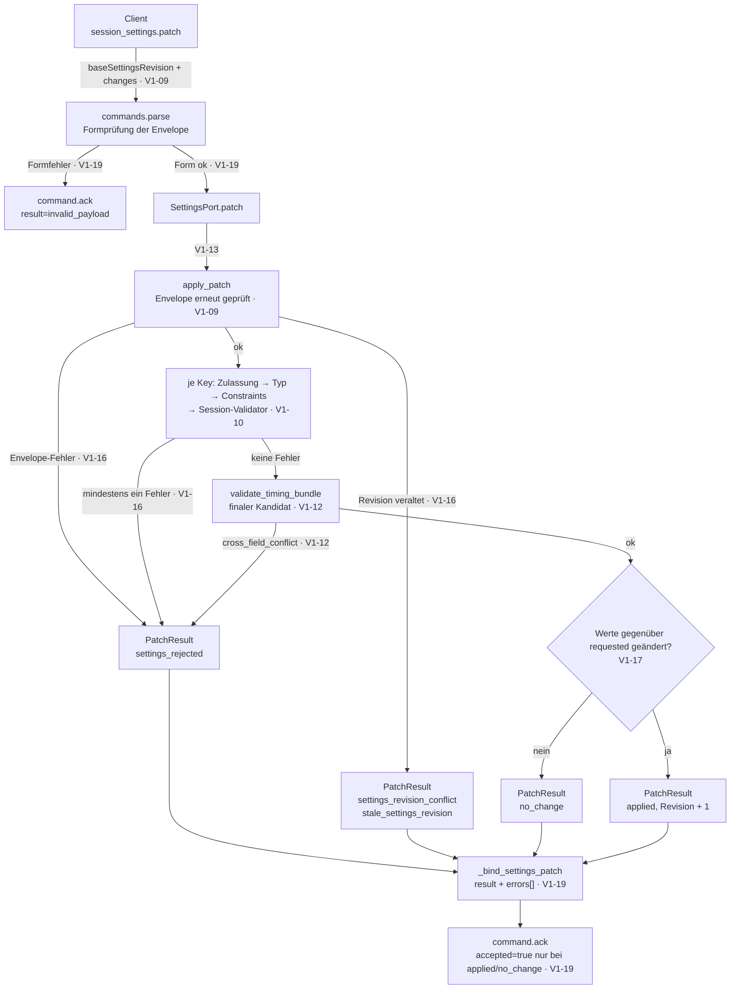
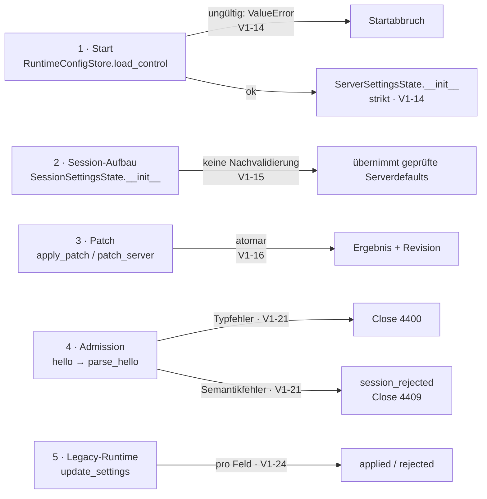
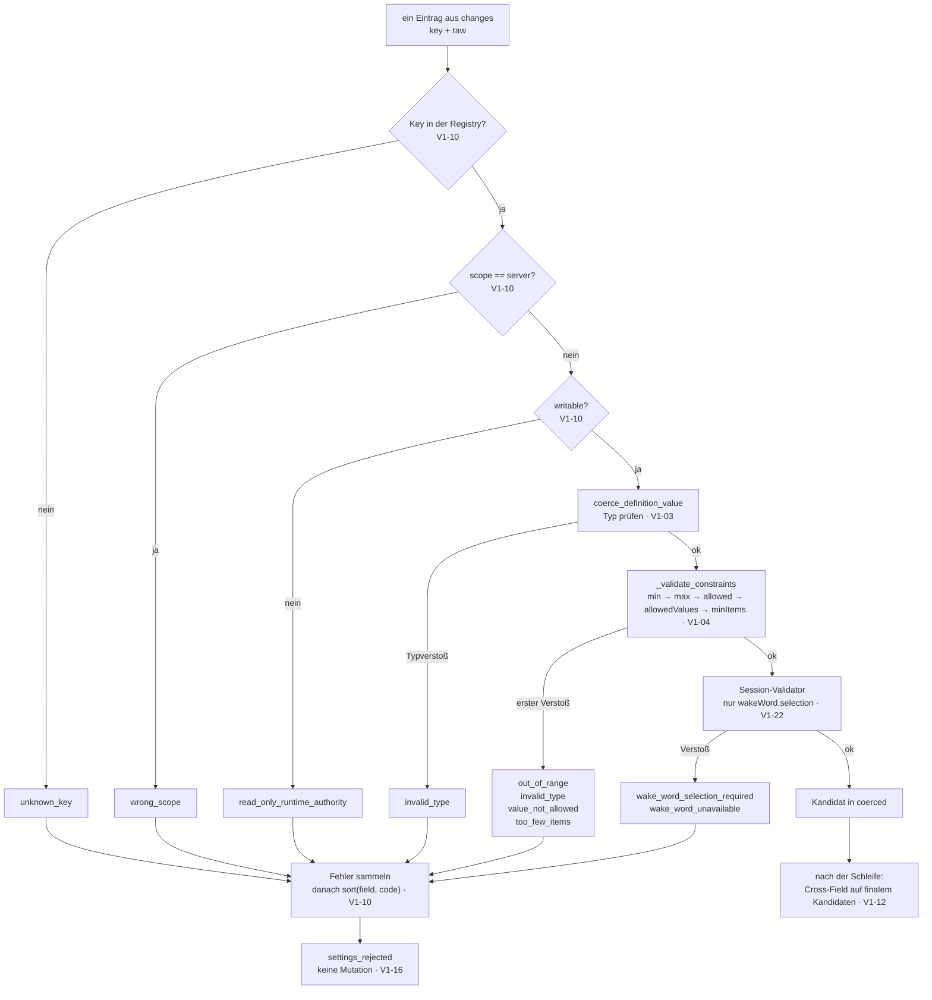
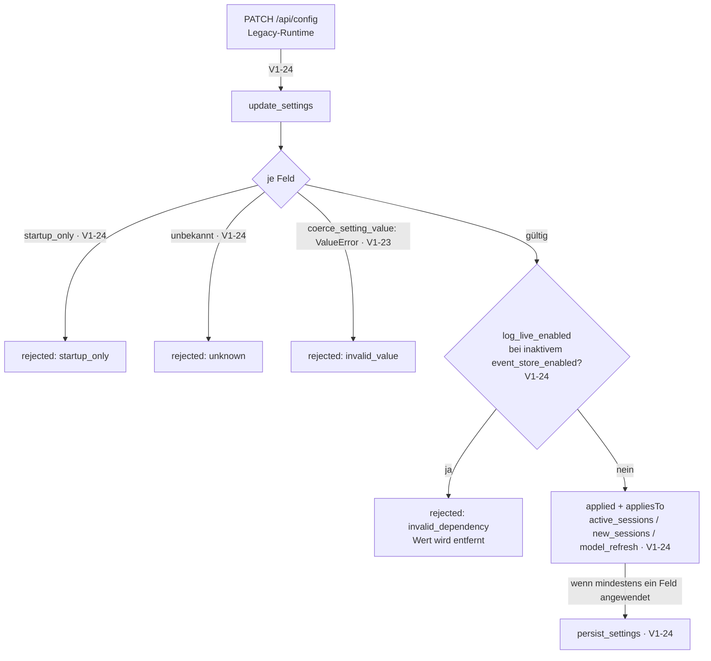

# 03.04 Datentypen und Validierung

Ein Einstellungswert ist mehr als ein JSON-Feld: Er ist ein kleiner Vertrag zwischen Client, Server und gespeichertem Zustand. Dieses Kapitel beschreibt, welche Form ein Wert haben muss, wann und in welcher Reihenfolge geprüft wird – und was mit dem Rest einer Änderung geschieht, wenn ein einziger Wert scheitert.

## 1. Worum es geht

Die praktische Ausgangsfrage ist unscheinbar: Darf ein Client `0.6` senden, oder muss es `"0.6"` sein? Darf er eine Ganzzahl als `3000.0` schicken? Was passiert, wenn von zwei Änderungen eine ungültig ist – wird die andere trotzdem übernommen?

Die Antworten sind bewusst streng. Ein stillschweigend akzeptierter String würde einen Client-Fehler verbergen; eine stillschweigend abgeschnittene Kommazahl könnte ein Timing verändern; eine halb angewendete Änderung würde die Revisionszählung und damit die Nebenläufigkeitskontrolle brechen. Deshalb gilt für die Settings-Domäne:

1. **Geschlossenes Typsystem.** Es gibt genau fünf Typen; ein unbekannter Typ ist ein Fehler und kein Passthrough (V1-02).
2. **Strikte Koerzierung.** Es wird nicht „irgendwie“ konvertiert: `int` bleibt `int`, `bool` ist nie eine Zahl, Strings müssen nicht leer sein (V1-03).
3. **Erster Fehler gewinnt – pro Schlüssel.** Innerhalb eines Schlüssels wird genau der erste Verstoß gemeldet; über alle Schlüssel werden die Fehler gesammelt und deterministisch sortiert (V1-10).
4. **Atomar oder pro Feld.** Die Registry arbeitet transaktional (alles oder nichts), die Legacy-Runtime bewusst feldweise mit Teil-Anwendung. Das sind zwei verschiedene Vertragsmodelle, kein Widerspruch (V1-16, V1-24).

Der beschriebene Stand ist Commit `a8993c5c68042d996eab680d84a5b138a214bb5d` (V1-01). Die einzelnen Werte und ihre fachliche Wirkung stehen in [03.06 Server-Einstellungen](03.06-server-einstellungen.md) und [03.07 Session-Einstellungen](03.07-session-einstellungen.md); Scope- und Auth-Semantik in [03.02 Scopes](03.02-scopes.md); die Herkunft der Werte in [03.05 Quellen und Prioritäten](03.05-quellen-und-prioritaeten.md).

## 2. Das Wesentliche auf einen Blick

Ein Patch durchläuft drei gedankliche Stationen: **Form** (ist die Envelope überhaupt ein Patch?), **Inhalt** (ist jeder einzelne Wert typ- und regelkonform?) und **Beziehung** (passen die Werte nach der Änderung noch zueinander?). Erst wenn alle drei bestehen, wird mutiert.

### 2.1 Der Weg eines Session-Patches



In Worten: Der Client schickt eine Envelope aus `baseSettingsRevision` und `changes`. Der Wire-Parser prüft nur deren Form und lehnt einen Formfehler sofort mit `result=invalid_payload` ab, ohne die Domäne zu rufen (V1-19). Die Domäne prüft die Envelope erneut, vergleicht die Revision und arbeitet dann Schlüssel für Schlüssel ab. Fehler werden gesammelt, sortiert und als `settings_rejected` zurückgegeben; erst wenn die Liste leer ist, läuft die Cross-Field-Regel gegen den finalen Kandidaten (V1-10, V1-12, V1-16). Das Ergebnis wird auf den `command.ack` projiziert; nur `applied` und `no_change` dürfen `accepted=true` tragen (V1-19).

Dass dieselben zwei Envelope-Felder an zwei Stellen geprüft werden, ist Absicht: Die Wire-Prüfung spart einen unnötigen Domänenaufruf, die Domänenprüfung bleibt die verbindliche Schranke für alle Aufrufer (V1-09, V1-19).

### 2.2 Fünf Validierungszeitpunkte



Das Diagramm ist eine Landkarte der Zeitpunkte, keine zeitliche Reihenfolge: Ein Prozess durchläuft beim Start immer den ersten Punkt, beim Session-Aufbau den zweiten, bei einer Änderung den dritten und bei einer Client-Anmeldung den vierten. Der fünfte Punkt gehört zur Legacy-Welt und läuft parallel zu deren eigener Persistenz (V1-13).

### 2.3 Warum diese Bauform – und was bewusst fehlt

Die Registry ist **kein** allgemeiner JSON-Schema-Validator. Es gibt keine generische Auswertung von Key-zu-Key-Regeln (N-01), keinen `enum`- und keinen Objekt-Typ (N-03) und keinen Dry-Run-Endpunkt (N-06). Die Prüfregeln sind Code; das veröffentlichte Schema wird daraus erzeugt. Das hält die 19 Schlüssel klein und deterministisch, bedeutet aber auch: Eine neue Regel muss als Code und als Test existieren, nicht nur als Schema-Eintrag.

Die zweite bewusste Entscheidung ist die **Ablehnung permissiver Koerzierung**. Ein `int`-Feld akzeptiert keine Zeichenkette und keine Kommazahl, weil sonst unklar wäre, ob `"3000"` Millisekunden, Sekunden oder eine ID bedeutet. Die Legacy-Welt ist an einzelnen Stellen toleranter – dazu mehr in Abschnitt 10.

## 3. Das Typsystem

### 3.1 Fünf Typen, keine sechzehn

Die Registry kennt exakt fünf Typen (V1-02):

| Typ | Akzeptierte Eingabe | Abgelehnt mit `invalid_type` | Normalisierung |
|---|---|---|---|
| `int` | `int`, aber nie `bool` | `bool`, `float`, `str`, `None`, Liste | `int(value)` |
| `float` | `numbers.Real` außer `bool`, also auch `int` | `bool`, `str`, `None` | `float(value)`, muss endlich sein |
| `bool` | ausschließlich `bool` | `0`, `1`, `"true"`, `None` | keine |
| `string` | nicht-leerer `str` | `""`, Zahlen, `None` | keine |
| `string_list` | `list` oder `tuple` aus nicht-leeren Strings | `str`, Liste mit `""` oder Nicht-String | `list(...)` |

Ein unbekannter Typ ist kein Passthrough, sondern erzeugt `invalid_type` mit der Meldung „besitzt einen unbekannten Typ“ (V1-02). Ein Tippfehler in einer künftigen Definition fällt damit sofort auf, statt Werte ungeprüft durchzureichen.

Es gibt keinen `enum`-Typ und keinen `object`-/`dict`-Typ. Enumerationen laufen über den Constraint `allowedValues` auf einem `string` (N-03); das ist der Grund, warum `wakeWord.inferenceBackend` als String mit Werte-Liste modelliert ist und nicht als eigener Typ.

### 3.2 Koerzierung: strikt, aber nicht kleinlich an der falschen Stelle

Die Regeln sind bewusst asymmetrisch (V1-03):

- **`int`** akzeptiert nur `int`. `bool` wird vorher ausgeschlossen, obwohl es in Python eine Unterklasse von `int` ist – ohne diesen Ausschluss würde `true` stillschweigend zu `1`.
- **`float`** akzeptiert jede reelle Zahl außer `bool`, also auch `1` und `1.0`, und castet nach `float`. Danach muss der Wert endlich sein: `NaN` und `Infinity` erzeugen `invalid_type`.
- **`bool`** akzeptiert nur `bool`. `1` ist kein Wahrheitswert.
- **`string`** verlangt einen nicht-leeren String. Die einzige Längenregel ist „nicht leer“; ob leere Strings fachlich sinnvoll wären, ist nicht kommentiert (U-04).
- **`string_list`** verlangt eine Liste oder ein Tupel aus nicht-leeren Strings und normalisiert auf eine Liste. Auf der Leitung ist ohnehin nur eine JSON-Liste möglich; die Tupel-Toleranz betrifft interne Aufrufer.

Erst **nach** der Typentscheidung laufen die Constraints. Diese Reihenfolge ist wichtig: Ein Constraint darf nie auf einem falschen Typ rechnen.

Zwei kleine Tabellen machen die praktischen Konsequenzen sichtbar:

| Eingabe für einen `int`-Key | Ergebnis |
|---|---|
| `3000` | akzeptiert |
| `3000.0` | `invalid_type` |
| `"3000"` | `invalid_type` |
| `true` | `invalid_type` |
| `null` | `invalid_type` |

| Eingabe für einen `float`-Key | Ergebnis |
|---|---|
| `1` | akzeptiert, wird `1.0` |
| `1.0` | akzeptiert |
| `"1.0"` | `invalid_type` |
| `true` | `invalid_type` |
| `NaN`, `Infinity` | `invalid_type` |

**Beispiel.** Ein Client will die Empfindlichkeit auf `1` setzen und sendet `{"wakeWord.sensitivity": 1}`. Das ist zulässig: `float` akzeptiert `int` und normalisiert auf `1.0`. Derselbe Client sendet für ein Timing `{"activation.followupTimeoutMs": 3000.0}` und erhält `invalid_type` – eine Kommazahl ist für ein Ganzzahlfeld kein „fast richtiger“ Wert, sondern die falsche Form.

### 3.3 Pflicht oder optional? Zwei verschiedene Ebenen

„Pflicht“ existiert in dieser Domäne auf zwei Ebenen, die man nicht verwechseln darf (V1-06):

**Definitionsebene.** Eine `SettingDefinition` hat Pflichtfelder ohne Default: `key`, `scope`, `auth`, `type`, `constraints`, `default_value`, `apply_policy`. Dazu kommen optionale Facetten mit Default: `description=''`, `has_server_default=False`, `writable=True`, `secret=False`. `constraints` ist immer ein JSON-sicheres Dict, auch leer, nie `None`.

**Wertebene.** Es gibt **kein** `required`-Flag pro Schlüssel (N-02). Jeder Schlüssel besitzt einen `default_value`; ein als Pflicht markierter Wert existiert nicht. Ein Patch darf daher eine beliebige Teilmenge der Schlüssel enthalten – fehlende Schlüssel bleiben unangetastet. Dass ein Patch nicht leer sein darf, ist keine Pflichtfeld-Regel, sondern eine Envelope-Regel (V1-09).

Praktisch heißt das: Ein Client muss nie fragen „welche Felder sind Pflicht?“. Er fragt nur „welche Felder will ich ändern?“. Die Registry beantwortet die andere Frage: „Welchen Wert hat ein Schlüssel, wenn ihn niemand setzt?“ – nämlich seinen Default.

`has_server_default` ist ein von `scope` unabhängiges Merkmal. Es bedeutet „es gibt einen admin-verwalteten Serverdefault für diesen Schlüssel“ und ist die Zulassungsschranke des Server-Patches (V1-11). Daraus folgt eine Feinheit: `wakeWord.selection` ist ein Session-Schlüssel **ohne** Serverdefault, aber trotzdem patchbar. „Kein Serverdefault“ heißt also nicht „nicht setzbar“, sondern „nicht admin-verwaltbar“.

### 3.4 Das Constraint-Vokabular ist geschlossen

Es gibt genau fünf prüfende Constraints, und sie werden in fester Reihenfolge geprüft; der erste Verstoß gewinnt (V1-04):

| Reihenfolge | Constraint | Prüfung | Fehlercode |
|---|---|---|---|
| 1 | `min` | `value < min` | `out_of_range` |
| 2 | `max` | `value > max` | `out_of_range` |
| 3 | `allowed` | `value not in allowed` | `invalid_type` |
| 4 | `allowedValues` | `value not in allowedValues` | `value_not_allowed` |
| 5 | `minItems` | `len(value) < minItems` | `too_few_items` |

Nur die tatsächlich vorhandenen Constraints werden ausgewertet. Die Grenzen sind **inklusiv**: `min` und `max` selbst sind erlaubt, weil nur `<` beziehungsweise `>` abgelehnt wird. `wakeWord.sensitivity = 1.0` ist also gültig, `1.0001` nicht; `0.0` ist gültig, `-0.001` nicht.

Zwei Namen teilen sich eine Semantik, enden aber in unterschiedlichen Codes: `allowed` und `allowedValues` prüfen beide eine Membership, melden aber `invalid_type` beziehungsweise `value_not_allowed`. Das ist eine Doppelsemantik, die im Code nicht begründet ist (U-09). Für die Praxis zählt: `allowed` ist implementiert, wird aber von keiner eingebauten Definition genutzt; `allowedValues` nutzt nur `wakeWord.inferenceBackend` (V1-04). `minItems` tritt bei den beiden Listen-Schlüsseln auf, jeweils mit `0` – eine veröffentlichte Untergrenze, die nie ablehnen kann, weil eine Länge nicht negativ ist.

Das Vokabular ist geschlossen: Es gibt keine Eindeutigkeitsprüfung, keine Muster-/Regex-Prüfung und keine Querbezüge als generische Constraints. Was nicht in dieser Liste steht, wird nicht geprüft – auch dann nicht, wenn es im Schema als Metadatum erscheint (nächster Abschnitt).

### 3.5 Metadaten, die nicht prüfen

Ein Teil dessen, was in `constraints` steht, ist reine Veröffentlichung (V1-05):

- `lessThanKeys` nennt im Schema die Watchdog-Fristen, gegen die die Warnung kleiner sein soll. Der Constraint-Validator liest diesen Schlüssel jedoch nie. Die Regel wird stattdessen über die Modulkonstante `WATCHDOG_WARNING_LESS_THAN_KEYS` im Cross-Field-Schritt durchgesetzt (V1-12).
- `unit` ist Anzeige-Metadatum (Millisekunden, Prediction-Frames) ohne Rechenwirkung.
- `calibration` und `calibrationTraceabilityIds` markieren vorläufige Leitplanken und ihre Herkunft, ohne zu prüfen oder zu rechnen.

Alle diese Felder werden über `to_schema_dict` unverändert an Clients ausgeliefert. Das ist bewusst: Das Schema ist auch ein Dokumentationsvertrag. Die Spannung besteht darin, dass ein Client `lessThanKeys` für eine generisch erzwungene Regel halten könnte. Sie ist es nicht: Eine zweite Definition mit `lessThanKeys` würde nicht geprüft (N-01). Ob das absichtlich nur Dokumentation ist, ist im Code nicht kommentiert (U-03).

**Merksatz.** `unit`, `calibration` und `lessThanKeys` erklären, was ein Wert bedeutet – sie erzwingen nichts. Erzwungen wird nur, was in Abschnitt 3.4 steht, plus die eine Cross-Field-Regel aus Abschnitt 6.

### 3.6 Vier `int`-Schlüssel ohne Obergrenze – zwei begründet, einer relational, einer Zählregel

`wakeWord.cooldownMs` und `wakeWord.preRollMs` tragen `min 0` und bewusst **kein** `max` (V1-08). Der Code begründet das explizit: Aus dem Receptive Field des Classifiers (1960 beziehungsweise 3400 ms) wird keine Bereichsgrenze abgeleitet, weil diese Zahlen nur Diagnosewerte sind und kein kalibrierter Betriebsbereich. Die Pre-Roll wird zur Laufzeit gegen die real vorhandene Audiohistorie geklemmt; die wirksame Obergrenze liegt damit außerhalb dieser Domäne.

Ein dritter Schlüssel hat ebenfalls kein `max`: `activation.segmentWatchdogWarningMs` (V1-07). Dort übernimmt die Cross-Field-Regel die Begrenzung – die Warnung muss strikt kleiner sein als jede wirksame Watchdog-Frist. Das ist keine absolute Obergrenze, sondern eine relationale.

Ebenfalls kein `max` trägt `wakeWord.minConsecutivePredictionFrames` (`min 1`, Zählregel ohne obere Schranke; kein kalibrierter Bereich, vgl. WW-18) (V1-07, V1-08).

Praktisch bedeutet das: Ein Wert innerhalb von `min`/`max` ist **nicht automatisch** fachlich sinnvoll. Die Abwesenheit einer Obergrenze ist kein Freibrief, sondern eine ehrliche Aussage darüber, wo die Verantwortung liegt – bei der Laufzeit beziehungsweise bei der relationalen Regel.

## 4. Die 19 Registry-Schlüssel als Vertragsartefakt

Die folgende Tabelle ist der vollständige Vertrag der Settings-Domäne in Code-Reihenfolge (V1-07). „Code“ ist die Autorität; die Zeilenangaben beziehen sich auf `api_fastapi_server/settings_control.py`. Die Defaults sind Vertragswerte, keine Betriebsempfehlung – die fachliche Einordnung steht in 03.06/03.07.

| # | Schlüssel | Typ | Prüfende Constraints | Default | `apply_policy` | `scope`/`auth` | HSD¹ | Code |
|---|---|---|---|---|---|---|---|---|
| 1 | `activation.initialSpeechTimeoutMs` | int | min 100, max 3600000 | 15000 | next_activation | session/session | ja | 286–298 |
| 2 | `activation.followupTimeoutMs` | int | min 100, max 60000 | 3000 | next_activation | session/session | ja | 299–312 |
| 3 | `activation.segmentWatchdogInitialMs` | int | min 60000, max 3600000 | 600000 | next_activation | session/session | ja | 313–323 |
| 4 | `activation.segmentWatchdogRefreshMs` | int | min 30000, max 600000 | 180000 | next_activation | session/session | ja | 324–337 |
| 5 | `activation.segmentWatchdogWarningMs` | int | min 5000, kein max, `lessThanKeys` [initial, refresh] | 30000 | next_activation | session/session | ja | 338–355 |
| 6 | `activation.closingRecoveryTimeoutMs` | int | min 1000, max 30000 | 5000 | next_activation | session/session | ja | 356–366 |
| 7 | `wakeWord.sensitivity` | float | min 0.0, max 1.0 | 0.5 | next_activation | session/session | ja | 367–381 |
| 8 | `wakeWord.selection` | string_list | minItems 0 | `[]` | next_session | session/session | nein | 382–395 |
| 9 | `runtimeSuppression.manual` | bool | – | `false` | live | session/session | nein | 396–409, `writable=false` |
| 10 | `runtimeSuppression.wakeWord` | bool | – | `false` | live | session/session | nein | 410–423, `writable=false` |
| 11 | `wakeWord.minConsecutivePredictionFrames` | int | min 1 | 1 | next_activation | session/session | ja | 424–448 |
| 12 | `wakeWord.cooldownMs` | int | min 0, kein max | 0 | next_activation | session/session | ja | 449–472 |
| 13 | `wakeWord.preRollMs` | int | min 0, kein max | 0 | next_activation | session/session | ja | 473–498 |
| 14 | `wakeWord.detectorGain` | float | min 0.0, max 3.0 | 1.0 | next_activation | session/session | ja | 499–519 |
| 15 | `wakeWord.noiseSuppressionEnabled` | bool | – | `false` | next_session | session/session | ja | 520–534 |
| 16 | `wakeWord.vadThreshold` | float | min 0.0, max 1.0 | 0.0 | next_session | session/session | ja | 535–557 |
| 17 | `wakeWord.inferenceBackend` | string | `allowedValues` [`auto`, `onnx`, `tflite`] | `"auto"` | next_session | server/admin | ja | 558–576 |
| 18 | `wakeWord.globalDisabledIds` | string_list | minItems 0 | `[]` | next_session | server/admin | ja | 577–590 |
| 19 | `kroko.forceCommunity` | bool | – | `false` | live | server/admin | ja | 591–608 |

¹ HSD = `has_server_default` (V1-06): ob ein admin-verwalteter Server-Default für den Schlüssel existieren darf.

**Metadaten zu dieser Tabelle** (nicht prüfend, V1-05): `unit` steht auf `ms` bei 1–6, 12 und 13 sowie auf `predictionFrames` bei 11. `lessThanKeys` steht nur bei 5. `calibration: pending` mit `calibrationTraceabilityIds` tragen die Schlüssel 11, 12, 13, 14 und 16 (WW-18, WW-19). Diese Angaben erscheinen unverändert im Schema.

Drei Beobachtungen zum Vertrag:

- **16 Session-Schlüssel, 3 Server-Schlüssel.** Von den 16 Session-Schlüsseln haben 13 einen Serverdefault; ohne Serverdefault sind nur `wakeWord.selection` und die beiden `runtimeSuppression`-Schlüssel.
- **Policy und Schreibbarkeit sind verschieden.** `runtimeSuppression.*` sind `live`, aber `writable=false`; ihre Schreibautorität ist `trigger_suppression.set`, nicht der Settings-Patch (V1-10). `kroko.forceCommunity` ist ebenfalls `live`, aber admin-verwaltet.
- **Kein Schlüssel nutzt `server_restart`.** Die Konstante existiert, wird aber von keiner eingebauten Definition verwendet; `requiresRestart` bleibt für das ausgelieferte Registry immer `false` (N-04, V1-18).

## 5. Prüfreihenfolgen

### 5.1 Die Envelope zuerst

Die Patch-Envelope hat zwei Pflichtfelder mit zwei unterschiedlichen Fehlercodes (V1-09):

- `baseSettingsRevision` muss `int`, nicht `bool` und `>= 0` sein. Sonst `invalid_type` beziehungsweise `out_of_range`, Feld `baseSettingsRevision`.
- `changes` muss ein nicht-leeres Dict sein. Sonst `invalid_type`, Feld `changes`.

Beides wird vor jeder Wertprüfung geprüft. Die Domäne gibt einen Envelope-Fehler als `settings_rejected` zurück; der Wire-Parser lehnt dieselbe Form vorher mit `result=invalid_payload` ab (V1-16, V1-19). Die beiden Codes stehen also für zwei Stufen, nicht für zwei Meinungen.

### 5.2 Der Session-Patch: Zulassung vor Inhalt

Die Reihenfolge pro Schlüssel ist strikt (V1-10):

```text
PSEUDOCODE (nicht ausführbar; aus V1-10/V1-12 abgeleitet)
für jeden Key in changes:
    wenn Key nicht in der Registry:      melde unknown_key; weiter
    wenn scope == server:                melde wrong_scope; weiter
    wenn writable == False:              melde read_only_runtime_authority; weiter
    (wert, fehler) = coerce_definition_value(...)      # Typ, dann Constraints
    wenn fehler:                          melde fehler; weiter
    wenn Session-Validator vorhanden:
        melde dessen Fehler; wenn Fehler zum Key: weiter
    kandidat[key] = wert

wenn keine Fehler:
    proposal = effective + kandidat
    prüfe validate_timing_bundle(proposal)

wenn Fehler:
    sortiere nach (field, code); Ergebnis = settings_rejected
```



Die Zulassung kommt vor dem Inhalt: Ein Server-Schlüssel im Session-Patch wird als `wrong_scope` abgelehnt, bevor jemand seinen Typ prüft. Ein nicht patchbarer Laufzeit-Schlüssel wird als `read_only_runtime_authority` abgelehnt, bevor ein Wert überhaupt angesehen wird. Das ist diagnosefreundlich: Der Client erfährt zuerst, dass er an der falschen Stelle schreibt, nicht dass zufällig auch der Wert falsch wäre.

Pro Schlüssel wird nur der **erste** Verstoß gemeldet (N-09). Über alle Schlüssel werden die Fehler gesammelt und nach `(field, code)` sortiert – nicht in Eingabereihenfolge (V1-10). Das macht Fehlerlisten stabil und diffbar.

**Beispiel.** Ein Patch mit `{"wakeWord.sensitivity": 0.6, "activation.followupTimeoutMs": 999999}` bei Revision 4: `followupTimeoutMs` verletzt `max 60000` und erzeugt `out_of_range`. Die gültige Empfindlichkeit wird **nicht** angewendet; die Revision bleibt 4; es gibt kein `settings.changed`. Die Fehlerliste enthält genau einen Eintrag, sortiert nach Feld.

### 5.3 Der Server-Patch: andere Schranke, dieselbe Mechanik

Der Server-Patch prüft nicht `scope`, sondern `has_server_default`; fehlt die Facette, folgt `wrong_scope`. Danach prüft er `secret` und lehnt mit `read_only_runtime_authority` ab. Dann laufen dieselbe Typ-/Constraint-Prüfung und dieselbe Cross-Field-Regel – diesmal gegen `overlay + coerced` (V1-11).

Die Reihenfolge ist damit: `unknown_key` → `wrong_scope` (kein Serverdefault) → `read_only_runtime_authority` (Secret) → Typ/Constraints → Cross-Field. Die `writable`-Prüfung des Session-Pfads gibt es hier nicht; die Zulassung läuft über die Serverdefault-Facette.

Kein eingebauter Schlüssel hat `secret=true`; der Secret-Zweig ist implementiert, im ausgelieferten Registry aber ungenutzt und nur über eine synthetische Test-Definition belegt (N-05). Praktisch begegnet er einem Client heute nicht.

**Beispiel.** Ein Admin patcht `wakeWord.selection` über `PATCH /api/v2/settings/server`. Der Schlüssel existiert, hat aber keinen Serverdefault – die Antwort ist `settings_rejected` mit `wrong_scope`, nicht etwa „unbekannt“. Der Schlüssel ist bekannt, nur nicht auf dieser Ebene verwaltbar.

### 5.4 Der sessionbewusste `selection`-Validator

Der einzige Session-Validator betrifft `wakeWord.selection` und arbeitet fail-closed (V1-22):

- Ist Wake Word für die Session konfiguriert und die Auswahl leer, folgt `wake_word_selection_required`.
- Sind IDs unbekannt, global deaktiviert oder nicht auflösbar, folgt **ein** `wake_word_unavailable` mit den unbekannten IDs.
- Ein Katalog-/Lookup-Fehler wird ebenfalls zu `wake_word_unavailable`, ohne Exception-Leak.
- Ein leeres Ergebnis ist zulässig, wenn Wake Word nicht konfiguriert ist.

Der Validator läuft nach der Typ-/Constraint-Prüfung und vor der Cross-Field-Regel. Er kann also nur dann greifen, wenn die Auswahl formal eine gültige String-Liste ist.

Eine dokumentierte Divergenz: Der Wire-Port akzeptiert laut Modul-Docstring nur kanonische IDs, der Session-Validator nutzt dagegen den toleranteren `catalog.resolve`. Die Divergenz ist im Code dokumentiert, aber nicht durch einen gemeinsamen Test abgesichert (U-05). Sie ist als offener Punkt zu führen, nicht als Widerspruch zu behaupten.

## 6. Cross-Field: die eine Regel über den finalen Kandidaten

Die Settings-Domäne hat genau eine Cross-Field-Regel (V1-12): `activation.segmentWatchdogWarningMs` muss **strikt kleiner** sein als `activation.segmentWatchdogInitialMs` und als `activation.segmentWatchdogRefreshMs`. Sie läuft, sobald irgendeiner der drei Schlüssel in einer Transaktion vorkommt – auch dann, wenn nur ein anderer der drei geändert wird.

Verglichen wird der **finale Kandidat**: das vollständig angewendete Proposal aus effektiven Werten plus den koerzierten Änderungen, nicht die Eingabereihenfolge und nicht ein Zwischenstand. Gleichheit wird abgelehnt, weil die Prüfung `warning >= deadline` als Konflikt wertet. Der Fehler wird auf das Feld `activation.segmentWatchdogWarningMs` mit Code `cross_field_conflict` gemeldet; der Text nennt beide Werte.

**Beispiel 1 – einzelner Wert.** Bei den Defaults (Warnung 30000, Refresh 180000, Initial 600000) wird `{"activation.segmentWatchdogWarningMs": 200000}` abgelehnt: Der Wert ist zwar `>= min 5000` und hat kein `max`, ist aber nicht kleiner als 180000.

**Beispiel 2 – kein Bypass über zwei Patches.** Nach einem akzeptierten Patch auf 150000 (Revision `n+1`) wird `{"activation.segmentWatchdogRefreshMs": 120000}` mit Basis `n+1` abgelehnt: Der finale Kandidat hat Warnung 150000 und Refresh 120000, also `150000 >= 120000`. Die Frist lässt sich damit nicht unter eine bereits akzeptierte Warnung senken.

**Beispiel 3 – finaler Kandidat statt Reihenfolge.** Ein Patch mit `{"activation.segmentWatchdogRefreshMs": 120000, "activation.segmentWatchdogWarningMs": 100000}` ist gültig, obwohl die Frist zuerst genannt wird: Der finale Kandidat ist in sich konsistent. Die Reihenfolge der Schlüssel im JSON spielt keine Rolle.

**Beispiel 4 – Gleichheit.** `{"activation.segmentWatchdogWarningMs": 180000}` bei Default-Refresh 180000 wird abgelehnt, weil „kleiner“ strikt gemeint ist.

Die Regel ist nicht generisch. `lessThanKeys` im Schema wird nicht gelesen; die Durchsetzung hängt an der Konstante `WATCHDOG_WARNING_LESS_THAN_KEYS` (V1-05, N-01). Eine zweite Key-zu-Key-Regel müsste als Code ergänzt werden. Die Regel läuft auch beim Start über das gespeicherte Overlay (V1-13, V1-14).

## 7. Wann wird geprüft – und was bei einem Fehler geschieht

| Zeitpunkt | Auslöser | Geprüft wird | Verhalten bei Fehler | Fakten |
|---|---|---|---|---|
| 1. Start | `RuntimeConfigStore.load_control`, danach `ServerSettingsState.__init__` | Revision, Overlay-Form, Key-Zulassung, `has_server_default`, `secret`, Typ/Constraints, Cross-Field | `ValueError` mit Präfix `Invalid settingsControlOverlay: ...`, Startabbruch | V1-13, V1-14 |
| 2. Session-Aufbau | `SessionSettingsState.__init__` | **keine** Nachvalidierung; defensive Kopie der bereits geprüften Serverdefaults | negative Revision wird still auf 0 geklemmt | V1-13, V1-15 |
| 3. Patch | `apply_patch` (Session) beziehungsweise `patch_server` (Server) | Envelope, Revision, pro Key, Cross-Field | atomar: `settings_rejected` oder `settings_revision_conflict`, keine Mutation | V1-16, V1-18 |
| 4. Admission | `hello` → `parse_hello`, danach `admit_requested_session` | Typen des Hello, Semantik der angeforderten Session | Close 4400 beziehungsweise `session_rejected` + Close 4409 | V1-21 |
| 5. Legacy-Runtime | `update_settings` | pro Feld: `startup_only`, unbekannt, Typ, eine Abhängigkeit | Feld ablehnen, übrige Felder anwenden, dann persistieren | V1-24 |

### 7.1 Start: fail-fast, kein Repair

Die Startprüfung ist bewusst nicht normalisierend (V1-14). Folgendes führt jeweils zu `ValueError` und damit zum Startabbruch: `settingsRevision` als `bool`, negative Revision, Overlay ungleich Objekt, unbekannter Key, `has_server_default == false`, `secret == true`, Typ-/Constraint-Verstoß und Cross-Field-Konflikt. Nur fehlende Sektionen defaulten auf `({}, 0)`; unlesbares JSON ist ebenfalls ein Fehler.

Es gibt keinen Repair-, Quarantäne- oder Backup-Pfad (N-07). Dass die fehlerhafte Datei unverändert bleibt, ist aus dem rein lesenden Code ableitbar, aber nicht getestet (U-06). Praktisch heißt das: Eine kaputte `runtime.json` ist ein Betriebsproblem, kein selbstheilender Zustand.

### 7.2 Session-Aufbau: keine zweite Prüfung – und eine Asymmetrie

`SessionSettingsState.__init__` prüft die eingesetzten Werte nicht erneut; es kopiert sie defensiv (V1-15). Die Begründung im Code: Serverdefaults und Request stammen aus bereits validierten Quellen, und die Session-Revision wird nicht persistiert.

Dabei gibt es eine bewusste Asymmetrie: Eine negative Session-Revision wird still auf 0 geklemmt, während `ServerSettingsState` in derselben Situation wirft (V1-15). Gleicher Feldname, zwei Strategien – der Unterschied folgt dem Scope: Die Session-Revision ist ein flüchtiger Zähler, die Server-Revision ein persistierter Vertrag. Das ist keine Inkonsistenz, aber ein Punkt, den ein Client kennen sollte, wenn er Revisionen vergleicht.

### 7.3 Kein Dry-Run

Validierung ist immer an Start, Patch oder Admission gebunden; einen Validate-only-Endpunkt gibt es nicht (N-06). Wer wissen will, ob ein Patch akzeptiert würde, muss ihn senden – und erhält im Erfolgsfall `applied` oder `no_change`, im Fehlerfall die Fehlerliste. Das ist der Preis für einen kleinen, revisionsgebundenen Vertrag.

## 8. Ergebnisse: abgelehnt, unverändert oder angewendet

### 8.1 `settings_rejected`: nichts wird mutiert

Bei mindestens einem Fehler gilt (V1-16):

- `accepted=false`, `result=settings_rejected`
- `settingsRevision` unverändert
- `values`, `effectiveValues`, `changedKeys` leer
- keine `settings.changed`-Events, keine Revisionserhöhung
- `errors[]` ist die sortierte `FieldError`-Liste; die Wire-Schicht reicht genau diese Liste in `command.ack.errors` weiter.

Jeder Fehler ist ein Tripel aus `field`, `code` und `message`. Die Sortierung nach `(field, code)` macht die Liste deterministisch, unabhängig von der JSON-Reihenfolge.

**Ein unerreichbarer Zweig, ehrlich benannt.** In `apply_patch` gibt es nach der Fehlerprüfung einen Zweig „`not coerced` → `invalid_payload`“ (V1-16). Er ist nach Codeanalyse nicht erreichbar: Die Envelope-Prüfung weist leere `changes` vorher ab, und jeder Schlüssel erzeugt entweder einen Fehler oder landet in `coerced`. Der Zweig ist ein defensiver Rest; beobachtbar ist er nicht (U-02). Er darf deshalb **nicht** als Beleg dafür gelesen werden, dass die Domäne „nichts änderbar“ mit `invalid_payload` meldet. `invalid_payload` ist auf Wire-/HTTP-Ebene beobachtbar (V1-19, V1-20), nicht als Domänenergebnis dieses Zweigs.

### 8.2 `no_change`: akzeptiert, aber ohne Wirkung

Sind alle geprüften Werte identisch zum bisherigen `requested` (Session) beziehungsweise zum Server-Overlay, lautet das Ergebnis `accepted=true`, `result=no_change`, Revision unverändert, `changedKeys=()` und es wird kein `settings.changed` erzeugt (V1-17).

Praktisch ist das die idiomatische Antwort für idempotente Retries: Ein Client, der nach einem Timeout denselben Patch erneut sendet, erzeugt keine Revisionslawine und keine Doppel-Events.

### 8.3 `applied`: Revision und Events

Bei einer echten Änderung wird die Revision um 1 erhöht, `changedKeys` sortiert zurückgegeben und die Wire-Schicht spiegelt die Revision sowie die `settings.changed`-Events (V1-17, V1-19). Die Event-Gruppierung nach Policy ist Thema von [03.08 Runtime-Änderungen](03.08-runtime-aenderungen.md); hier zählt nur: Die Änderung ist ein bestätigter Schnitt, kein Zwischenzustand.

### 8.4 Server-Patch: Prepare → Persist → Commit

Der Server-Patch baut den nächsten Zustand als Kopien und persistiert ihn **vor** jeder RAM-Mutation (V1-18). Scheitert der Store, bleiben `overlay`, `server_effective` und Revision unverändert; das Ergebnis ist `accepted=false`, `result=internal_error`, `errors[0]` mit Feld `persistence` und Code `persistence_failed`. Ein Retry mit derselben `baseSettingsRevision` ist danach erfolgreich, die Revision bleibt lückenlos.

**Beispiel.** Ein Server-Patch auf Revision 7 scheitert beim Schreiben. Die Antwort ist HTTP 500 mit `internal_error` und `persistence_failed`; die Revision bleibt 7. Ein unmittelbarer Retry mit Basis 7 wird angewendet und ergibt Revision 8. Der Client muss also nicht „neu synchronisieren“, sondern kann denselben Patch wiederholen.

`requiresRestart` wird nur gesetzt, wenn ein geänderter Schlüssel `server_restart` trägt. Da kein eingebauter Schlüssel das tut, bleibt es im ausgelieferten Registry immer `false` (N-04). Der Server-Patch arbeitet auf einem vollständigen Overlay-Snapshot, nicht auf einem Delta (03.01/K1-05); Session-Patches persistieren nie (03.01/K1-16).

## 9. Wire, REST und Admission

### 9.1 Wire: Formfehler vor Domäne

Die Wire-Vorstufe prüft vor jeder Domänenprüfung dieselben zwei Envelope-Felder (V1-19). Bei einem Formfehler gibt es ein `command.ack` mit `result=invalid_payload` und **ohne** Domänenaufruf. Erst danach läuft `SettingsPort.patch` → `apply_patch`, und `_bind_settings_patch` projiziert `applied`, `no_change`, `settings_revision_conflict` und `settings_rejected` (mit `errors[]`) in den Ack.

Der Ack-Ergebnissatz ist geschlossen (`RESULT_CODES`); `accepted=true` ist nur für `applied` und `no_change` erlaubt (V1-19). Das ist eine nützliche Invariante für Clients: `accepted=true` bedeutet immer „der Zustand entspricht jetzt dem, was du wolltest“ – nicht „die Anfrage war formal okay“.

### 9.2 REST: eine Stufung, nicht ein Widerspruch

`PATCH /api/v2/settings/server` ist admin-gated (401 ohne oder mit falschem Key) und mappt die Ergebnisse so (V1-20):

| Ergebnis | HTTP-Status |
|---|---|
| `applied`, `no_change` | 200 |
| `settings_revision_conflict` | 409 |
| `settings_rejected` | 422 |
| `internal_error` | 500 |

Ein Nicht-Objekt-Body wird bereits vor der Domäne mit 400 und `result=settings_rejected`, `errors[0]={field: body, code: invalid_payload}` beantwortet. Ein leerer `changes`-Wert ist dagegen ein Domänen-Envelope-Fehler und ergibt 422 mit `invalid_type` auf `changes`.

Damit existieren drei Stufen für „die Form stimmt nicht“:

| Stufe | Eingabe | Ergebnis | Status | Feldcode |
|---|---|---|---|---|
| v2-Wire-Parser | Revision ungültig oder `changes` leer/kein Objekt | `result=invalid_payload`, kein Domänenaufruf | – | – |
| Admin-REST, Body | Body ist kein Objekt | `settings_rejected` | 400 | `invalid_payload` (Feld `body`) |
| Admin-REST, Envelope | Objekt, aber Revision ungültig oder `changes` leer | `settings_rejected` | 422 | `invalid_type`/`out_of_range` |

Das ist eine bewusste Stufung: 400 sagt „ich konnte den Body nicht als Patch lesen“, 422 sagt „ich habe den Patch gelesen und inhaltlich abgelehnt“. Ob die Wahl 400 versus 422 bei gleichem `result` bewusst so getroffen wurde, ist nicht kommentiert (U-10). Einen REST-Patch für Sessionwerte gibt es nicht (Konsistenz 03.01/K1-13).

### 9.3 Admission: Typen und Semantik sind zwei Türen

Der v2-Handshake trennt strikt (V1-21):

**Tür 1 – Typen.** Der `hello`-Parser prüft `supportedProtocolVersions` (nicht-leere Liste von `int`), `clientVersion`/`clientCommit` (nicht-leere Strings), `clientRunId` (kanonische UUID), `requestedSession` (Objekt), `trigger.manual`/`trigger.wakeWord` (beide `bool`), `wakeWordIds` (Liste nicht-leerer, nicht-whitespace-only Strings – `strip()`-geprüft) und `runtimeSuppression.manual`/`wakeWord` (beide `bool`). Jede Verletzung führt zu Close 4400 mit Grund.

**Tür 2 – Semantik.** `admit_requested_session` prüft mindestens eine Triggerquelle (`activation_trigger_required`), Auswahl nur mit Wake-Trigger (`wake_word_selection_not_allowed`), Auswahl Pflicht bei Wake-Trigger (`wake_word_selection_required`) und die Katalogauflösung (`wake_word_unavailable`). Das Ergebnis ist eine `session_rejected`-Nachricht mit `reason=invalid_requested_session` und `errors[]`, gefolgt von Close 4409.

Die Semantikprüfung sammelt ihre Befunde und lehnt die Session als Ganzes ab; sie ist keine Folge einzelner Feldänderungen. In der Admission geht es nicht um die 19 Registry-Werte, sondern um die Form des Hello und die Semantik der angeforderten Session. 4400 und 4409 sind daher zwei verschiedene Antworten auf zwei verschiedene Fragen: „Kann ich das lesen?“ und „Kann diese Session so existieren?“

### 9.4 v1-Session-Aufbau: hart und weich im selben Bau

Der v1-Session-Aufbau über Query-Parameter nutzt zwei unterschiedliche Strategien pro Feldgruppe (V1-26):

- **Hart:** Activation-Flags und Timings. Ein nicht parsebares Flag erzeugt `invalid_activation_flag`; Timings müssen endlich und in `[0.01, 3600.0]` liegen, sonst `invalid_activation_timing`. Beides sind `SessionConfigurationError` mit Feld und Wert.
- **Weich:** Wake-Word-Tuningfelder. Ungültige Werte werden auf den Serverwert zurückgesetzt und als `fallbacks[{reason: invalid_value}]` plus `warnings[{code: session_config_value_fallback}]` gemeldet, ohne Abbruch.

Die Grenzen sind bewusst weit und delegieren die Vertragsbereiche an die Settings-Control-Plane. Doppelte Felder sind Fehler (`duplicate_session_config_field`, `duplicate_wake_word_enabled`). Die Trigger-Semantik erzwingt im kontrollierten Modus mindestens eine Quelle (`activation_trigger_required`) und lehnt nur-Wake ohne Profil ab (`activation_wake_word_unavailable`); fehlen beide Flags, bleibt der Legacy-Modus. Ergibt das aufgelöste Profil kein aktives Wake Word, folgt `incomplete_wake_word_profile`.

Zwei praktische Stolpersteine: Die v1-Timings sind in **Sekunden** mit weiten Grenzen, die Registry-Timings in **Millisekunden** mit engeren Vertragsbereichen. Und hart/weich liegen im selben Aufbau nebeneinander – das darf nicht mit der atomaren v2-Admission vermischt werden. Ein `wakeWordSensitivity=2.0` bricht die Session nicht ab, sondern fällt auf den Serverwert zurück; ein `manualTriggerEnabled=maybe` bricht sie ab.

## 10. Das Gegenmodell: Legacy

### 10.1 Drei Prüfkulturen, zwei Vertragsmodelle

| | Registry (v2) | Legacy-Runtime | v1-Session-Aufbau |
|---|---|---|---|
| Einheit | Transaktion | Feld | Feldgruppe |
| Ablehnung | alles oder nichts | Teil-Apply | hart: Abbruch; weich: Fallback |
| Revision | ja | nein | nein |
| Fehlerform | `FieldError`-Liste | `applied`/`rejected` | `SessionConfigurationError` beziehungsweise `fallbacks`/`warnings` |
| Persistenz | nur Serverdefaults | ja, nach Apply | nein |

Der bewusste Gegensatz ist **atomar versus pro Feld**. Die Registry schützt einen Konsistenzpunkt: Eine Änderung ist nur dann sinnvoll, wenn alle Werte zusammenpassen und die Basisrevision stimmt. Die Legacy-Runtime schützt die Betriebsfähigkeit eines laufenden Prozesses: Ein einzelnes falsches Feld soll nicht alle anderen blockieren. Beide Modelle sind in sich stimmig; sie dürfen nur nicht als dasselbe versprochen werden.

### 10.2 Legacy-Typprüfung über Namensmengen

`coerce_setting_value` arbeitet ohne `SettingDefinition`-System über Namensmengen (V1-23):

| Menge | Regel |
|---|---|
| `BOOL_SETTINGS` | strikt `bool` |
| `INT_SETTINGS` | `int`, `bool` verboten; `*_max_bytes > 0`, `*_backup_count >= 0`, `*_retention_days >= 0`; Sonderfall `event_log_queue_size >= 100` |
| `FLOAT_SETTINGS` | `int`/`float`, `bool` verboten, Cast nach `float` |
| `TUPLE_FLOAT_SETTINGS` | Liste → Tupel; Elemente werden mit `float(...)` konvertiert |
| `DICT_SETTINGS` | Dict oder `None` |
| `OPTIONAL_STRING_SETTINGS` | String oder `None` |
| sonst | String |

Sonderfälle: `log_level` wird auf den Level-Namen normalisiert, `realtime_log_detail` liegt in `{off, summary, events}`, `transcript_log_mode` in `{none, final, full}`, `log_calendar_timezone` wird gegen `resolve_calendar_timezone` geprüft. Verstöße erzeugen `ValueError` mit deutschem Klartext.

Es gibt keine generische Schema-/Constraint-Datei für diese Felder; die Regeln sind Code (Namensendungen, Sonderfälle). Für `FLOAT_SETTINGS` existieren keine generischen Min/Max-Regeln (N-08); Bereichsgrenzen liegen an einzelnen Aufrufstellen. Das ist der wichtigste Unterschied zur Registry: Dort ist der Vertrag zentral und vollständig, hier ist er über Namenskonventionen und Sonderfälle verteilt.

### 10.3 Teil-Apply ist Absicht



Die Reihenfolge ist: `startup_only` → unbekannt → koerzieren → Abhängigkeit → anwenden → persistieren (V1-24). Eine Cross-Field-Abhängigkeit wird punktuell nachgezogen: `log_live_enabled` mit inaktivem `event_store_enabled` ergibt `rejected{reason: invalid_dependency}`, und der Wert wird aus den Änderungen entfernt. Es gibt keine atomare Gesamtablehnung und keine Revisions-/Konflikterkennung auf dieser Achse (N-10).

**Beispiel.** Ein `PATCH /api/config` mit `{"log_level": "DEBUG", "does_not_exist": 1, "event_log_queue_size": 50, "log_live_enabled": true}` bei inaktivem Event-Store ergibt: `log_level` wird angewendet; `does_not_exist` wird als `unknown` abgelehnt; `event_log_queue_size` wird als `invalid_value` abgelehnt (unter 100); `log_live_enabled` wird als `invalid_dependency` abgelehnt. Die übrigen Werte werden angewendet und persistiert. Die Antwort enthält `applied` und `rejected` getrennt; es gibt keinen 409 und keine Revision.

### 10.4 Prozesskonfiguration: eigene Start- und Cross-Field-Regeln

Die Prozesskonfiguration hat ein drittes Regelwerk (V1-25): `ServerSettings.__post_init__` leitet Pfade ab, normalisiert `realtime_log_detail` und wirft bei ungültigem Wert; `log_live_enabled=true` ohne `event_store_enabled` ist ein Fehler. Nach dem Anwenden persistierter Legacy-Werte laufen `__post_init__` und `enforce_cpu_model_policy` erneut.

`enforce_cpu_model_policy` erzwingt `device=cpu`, die unterstützten Engines `faster_whisper` und `kroko_onnx`, `tuning_profile == custom` (einziger Wert) und setzt `use_main_model_for_realtime` bei identischer Engine und identischem Modell. Die Modellgrößen-Richtlinie erlaubt maximal Rang 3 und höchstens zwei beziehungsweise einen Medium-äquivalenten Eintrag, je nach `allow_two_medium_models`. Verstöße erzeugen `ValueError`.

Die Rangfolge und die Modellnamen-Aliase sind String-Matching-Heuristik, keine harte Norm (U-08). Ein anderer Tuning-Profilwert ist kein stiller Default, sondern ein Fehler. Die Details der Prozesswerte gehören zu 03.05/03.06.

## 11. Fehlercode-Inventar

Fehlercodes treten in vier Rollen auf, die man auseinanderhalten muss: als `code` eines `FieldError` (Diagnose), als `result` eines `PatchResult` beziehungsweise Ack (Transaktionsausgang), als `reason` einer Admission-/Legacy-Ablehnung (semantische Ursache) und als HTTP-Status (Transport). Ein String kann in mehreren Rollen vorkommen: `invalid_payload` ist Feldcode **und** Wire-Result; `settings_rejected` ist Result, nie Feldcode.

### 11.1 Domäne (`FieldError.code`)

| Code | Bedeutung | Quelle |
|---|---|---|
| `unknown_key` | Key nicht in der Registry | `settings_control.py` Z. 153 |
| `invalid_type` | falscher Typ, leerer String, `NaN`/`Inf`, `bool` für Zahl, `allowed`-Verstoß | Z. 154 |
| `out_of_range` | `min`/`max`-Verstoß oder negative `baseSettingsRevision` | Z. 155 |
| `too_few_items` | `minItems`-Verstoß | Z. 156 |
| `cross_field_conflict` | Watchdog-Warnung `>=` Frist (finaler Kandidat, auch Start) | Z. 157 |
| `wrong_scope` | falsche Ebene oder fehlende Serverdefault-Facette | Z. 158 |
| `stale_settings_revision` | `baseSettingsRevision !=` aktuelle Revision | Z. 159 |
| `read_only_runtime_authority` | `writable=false` oder `secret=true` | Z. 160 |
| `invalid_payload` | Formfehler; im Domänenpfad unerreichbar | Z. 161 |
| `wake_word_selection_required` | Session-Validator: Wake aktiv, Auswahl leer | Z. 162 |
| `wake_word_unavailable` | Session-Validator: ID unbekannt/deaktiviert/Katalogfehler | Z. 163 |
| `persistence_failed` | Server-Patch: Store-Fehler | Z. 164 |
| `value_not_allowed` | `allowedValues`-Verstoß | Z. 165 |

Der String lautet vollständig `read_only_runtime_authority`, nicht `read_only`. `invalid_type` wird auch für einen `allowed`-Verstoß verwendet – eine Doppelsemantik, die im Code nicht begründet ist (U-09).

### 11.2 Ergebnis-Codes

| Code | Bedeutung | Quelle |
|---|---|---|
| `applied` | Änderung bestätigt, Revision erhöht | Z. 62 |
| `no_change` | akzeptiert, aber nichts geändert | Z. 63 |
| `settings_revision_conflict` | Basisrevision passt nicht | Z. 64 |
| `settings_rejected` | Sammel-Ergebnis jeder inhaltlichen Ablehnung | Z. 65 |
| `internal_error` | Persistenz-/Unerwartet-Fehler | Z. 66 |
| `invalid_payload` | zusätzlich Wire-Result des Parsers | `schema.py` Z. 116, 134 |

`accepted=true` ist ausschließlich für `applied` und `no_change` zulässig (`schema.py` Z. 143).

### 11.3 Admission

| Code/Status | Bedeutung |
|---|---|
| Close 4400 | Typfehler im Hello (`schema.py` Z. 202) |
| Close 4409 | semantisch abgelehnte Session (`schema.py` Z. 205) |
| `activation_trigger_required` | keine Triggerquelle |
| `wake_word_selection_required` | Wake-Trigger ohne Auswahl |
| `wake_word_selection_not_allowed` | Auswahl ohne Wake-Trigger |
| `wake_word_unavailable` | ID nicht auflösbar |
| `invalid_requested_session` | `reason` der `session_rejected`-Nachricht |
| `session_limit_reached` | Session-Limit (Admission, `connection.py`) |

### 11.4 v1-Session-Aufbau

| Code | Bedeutung |
|---|---|
| `invalid_activation_flag` | Flag nicht parsebar |
| `invalid_activation_timing` | Timing nicht endlich oder außerhalb `[0.01, 3600.0]` |
| `duplicate_session_config_field` | Feld doppelt angegeben |
| `duplicate_wake_word_enabled` | `wakeWordEnabled` doppelt |
| `incomplete_wake_word_profile` | aufgelöstes Profil ohne aktives Wake Word |
| `activation_wake_word_unavailable` | nur-Wake ohne Profil |
| `activation_trigger_required` | kontrollierter Modus ohne Triggerquelle |
| `session_config_value_fallback` | Warnung bei weichem Fallback |
| `invalid_value` | `reason` des Fallbacks |

### 11.5 Legacy-Runtime (`rejected.reason`)

| Reason | Bedeutung |
|---|---|
| `startup_only` | Feld erfordert Neustart |
| `unknown` | unbekannte/nicht unterstützte Einstellung |
| `invalid_value` | `coerce_setting_value` hat geworfen |
| `invalid_dependency` | `log_live_enabled` ohne aktiven Event-Store |

Es gibt keinen zentralen Code-Enum für `SessionConfigurationError`; die Codes sind String-Literale an den Raise-Stellen (N-11). Das ist ein Pflege-, kein Laufzeitproblem – solange die Strings nicht umbenannt werden. Für Clients gilt: exakte Strings verwenden, nicht auf Überschriften oder Übersetzungen verlassen.

## 12. Grenzen und offene Punkte

### 12.1 Nicht implementiert

| ID | Befund | Konsequenz |
|---|---|---|
| N-01 | `constraints.lessThanKeys` wird nicht generisch ausgewertet | Die Watchdog-Regel gilt nur über die Konstante; eine zweite Definition mit `lessThanKeys` bliebe ungeprüft |
| N-02 | kein `required`-Flag | „Pflicht“ existiert nur auf Definitionsebene; jeder Key hat einen Default |
| N-03 | kein `enum`-, kein `object`-Typ | Enumerationen nur über `allowedValues` auf `string` |
| N-04 | `APPLY_SERVER_RESTART` ungenutzt | `requiresRestart` bleibt immer `false` |
| N-05 | kein `secret=true` in Builtins | Secret-Zweig nur synthetisch getestet |
| N-06 | kein Dry-Run/Validate-only | Prüfung nur an Start, Patch, Admission |
| N-07 | kein Repair/Quarantäne/Backup | ungültiges Overlay bricht den Start ab |
| N-08 | keine generischen Min/Max für Legacy-Floats | Grenzen nur an Aufrufstellen |
| N-09 | kein Sammeln aller Fehler eines Keys | Nach dem Fix kann der nächste Fehler sichtbar werden |
| N-10 | Legacy nicht atomar | Teil-Apply mit per-Feld-`rejected` |
| N-11 | kein zentraler Enum für v1-Codes | String-Literale an Raise-Stellen |

### 12.2 Offene Punkte

| ID | Offen | Umgang |
|---|---|---|
| U-01 | Branch-Zugehörigkeit des Commits nicht nachweisbar (detached HEAD, keine `refs/heads`) | Commit-Hash als bindend behandeln |
| U-02 | Zweck des unerreichbaren `invalid_payload`-Zweigs | als defensiven Rest dokumentieren, nicht darauf bauen |
| U-03 | ob `lessThanKeys` absichtlich nur Schema-Dokumentation ist | als Metadatum behandeln |
| U-04 | ob leere Strings fachlich zulässig wären | Regel „nicht leer“ gilt; keine weitere Längenregel |
| U-05 | Divergenz kanonische IDs (Wire) vs. tolerantes `catalog.resolve` (Validator) | als dokumentierte Divergenz führen; kein gemeinsamer Test |
| U-06 | ob die ungültige `runtime.json` unverändert bleibt | aus rein lesendem Code ableitbar, nicht getestet |
| U-07 | kalibrierte Betriebswerte der fünf `calibration: pending`-Keys | keine Zielwerte erfinden; EVIDENCE_BLOCKED |
| U-08 | Modellgrößen-Rang/-Aliase sind String-Heuristik | nicht als harte Norm darstellen |
| U-09 | warum `allowed` auf `invalid_type`, `allowedValues` auf `value_not_allowed` abbildet | beschreiben, nicht bewerten |
| U-10 | ob 400 versus 422 bei gleichem `result` bewusst gewählt ist | als Stufung erklären |

### 12.3 Divergenzen, die im Kapitel bewusst stehen bleiben

- **V1-05 versus V1-12.** Das Schema nennt `lessThanKeys`; die Durchsetzung nutzt eine Konstante. Die Regel ist real, aber nicht generisch (N-01, U-03).
- **V1-22 versus U-05.** Der Wire-Port erwartet kanonische IDs, der Session-Validator nutzt den toleranteren Katalog. Die Divergenz ist dokumentiert, aber nicht durch einen gemeinsamen Test abgesichert.
- **V1-04 versus U-09.** Zwei Enum-Constraints, zwei Fehlercodes. Kein Fehler, aber eine Erklärungslücke.
- **V1-20 versus U-10.** 400 für die Bodyform, 422 für den Inhalt. Gleiches `result`, unterschiedliche Stufe.
- **V1-16 versus U-02.** Ein unerreichbarer Zweig bleibt im Code. Er ist kein Vertragsbestandteil.
- **V1-14 versus U-06.** Der Startabbruch ist belegt; die Unverändertheit der Datei ist nur ableitbar.

Die wichtigste Grenze für Leser: Dieses Kapitel beschreibt den **Contract**, nicht den optimalen Betriebswert. Die Defaults der fünf kalibrierungspendingen Schlüssel sind neutrale Startwerte, keine Empfehlung (U-07).

## 13. Siehe auch / Nachweise

**Verwandte Kapitel**

- [03.01 Konfigurationsarchitektur](03.01-konfigurationsarchitektur.md) – Settings-Domäne, Revisionsströme (K1-19), Persistenzgrenze der Session (K1-16), Serverdefault-Overlay als vollständiger Snapshot (K1-05)
- [03.02 Scopes](03.02-scopes.md) – Scope-/Auth-Semantik, `wrong_scope`-Fälle (S-04, S-06, S-07)
- [03.03 Benennungskonventionen](03.03-benennungskonventionen.md) – Schlüsselnamen und Konventionen
- [03.05 Quellen und Prioritäten](03.05-quellen-und-prioritaeten.md) – Defaults, Dateien, Env, CLI, gespeicherte Werte
- [03.06 Server-Einstellungen](03.06-server-einstellungen.md) und [03.07 Session-Einstellungen](03.07-session-einstellungen.md) – fachliche Einzelwerte
- [03.08 Runtime-Änderungen](03.08-runtime-aenderungen.md) – Patch-Mechanik und `settings.changed`
- [03.09 Wirksamkeitszeitpunkt](03.09-wirksamkeitszeitpunkt.md) – `apply_policy` in der Wirkung
- [03.10 Persistenz](03.10-persistenz.md) – Persistenzformat und `os.replace`
- [04.04 Commands und Acknowledgements](../04-schnittstellen/04.04-commands-acknowledgements.md), [04.12 Legacy V1](../04-schnittstellen/04.12-legacy-v1.md)
- [08.03 Settings-Katalog](../08-referenzen/08.03-settings-katalog.md), [08.09 Fehlerkatalog](../08-referenzen/08.09-fehlerkatalog.md)
- [09.03 V1-/V2-Unterschiede](../09-anhaenge/09.03-v1-v2-unterschiede.md)

**Faktenbasis**

V1-01 (Stand/Commit), V1-02 (fünf Typen), V1-03 (Koerzierung), V1-04 (Constraint-Vokabular), V1-05 (Metadaten), V1-06 (Pflicht/Optional), V1-07 (19 Keys), V1-08 (kein `max`), V1-09 (Envelope), V1-10 (Session-Reihenfolge), V1-11 (Server-Reihenfolge), V1-12 (Cross-Field), V1-13 (fünf Zeitpunkte), V1-14 (Start fail-fast), V1-15 (Asymmetrie), V1-16 (atomare Ablehnung), V1-17 (`no_change`), V1-18 (Prepare-Persist-Commit), V1-19 (Wire-Vorstufe), V1-20 (HTTP-Map), V1-21 (Admission), V1-22 (`selection`-Validator), V1-23 (Legacy-Namensmengen), V1-24 (Legacy-Teil-Apply), V1-25 (Prozesskonfiguration), V1-26 (v1 hart/weich), V1-27 (Fehlercodes).

N-01 bis N-11 und U-01 bis U-10 sind in Abschnitt 12 vollständig aufgeführt.

**Code- und Testbelege**

`api_fastapi_server/settings_control.py` (Typen, Koerzierung, Constraints, Envelope, `apply_patch`, `patch_server`, Registry), `api_fastapi_server/protocol_v2/commands.py` (Wire-Vorstufe), `api_fastapi_server/protocol_v2/connection.py` (`_bind_settings_patch`, Admission), `api_fastapi_server/protocol_v2/schema.py` (Result-Codes, Close-Codes), `api_fastapi_server/protocol_v2/handshake.py` (`parse_hello`, `admit_requested_session`), `api_fastapi_server/server.py` (`coerce_setting_value`, `update_settings`, `__post_init__`, `enforce_cpu_model_policy`, v1-Session-Aufbau), `VoiceSTT_server/operations.py` (`load_control`, `_write_merged`).

Tests: `tests/unit/test_settings_control_plane.py`, `tests/unit/test_protocol_v2_settings.py`, `tests/unit/test_protocol_v2_e2e.py`, `tests/unit/test_wakeword_root_findings_c2.py`, `tests/unit/test_wakeword_root_findings_c3.py`, `tests/unit/test_settings_runtime_persistence.py`, `tests/unit/test_fastapi_server_protocol.py`.
