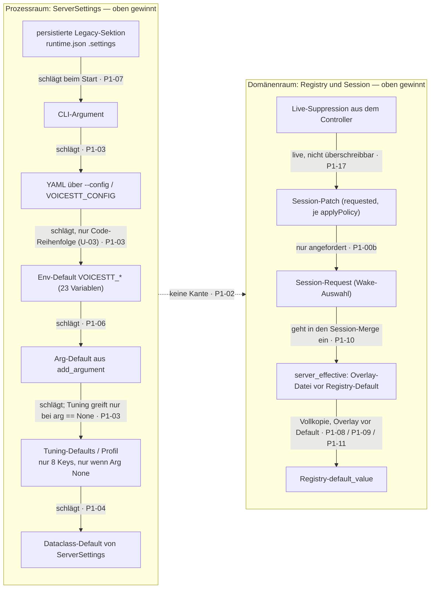
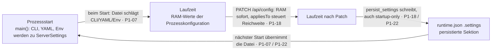

# 03.05 – Quellen und Prioritäten

*Geprüft gegen Commit `a8993c5c68042d996eab680d84a5b138a214bb5d` (P1-01). Ein Branch-Ref ist in diesem Klon nicht vorhanden; die Bindung gilt dem Commit, nicht einem Branchnamen (U-04).*

*Faktenbasis: `workflow/research/03.05.json` (P1-00a…P1-23, N-01…N-06, U-01…U-04, C-01…C-04).*

**Abgrenzung:** Welche Ebenen es gibt und wofür sie zuständig sind, steht in [03.01 Konfigurationsarchitektur](./03.01-konfigurationsarchitektur.md); hier geht es ausschließlich um die **Rangfolge** und um die Frage, was daraus im Betrieb folgt.

## 1. Worum geht es?

Ein und derselbe Schalter lässt sich an vielen Stellen setzen: als Kommandozeilenargument, in einer YAML-Datei, über eine Umgebungsvariable, in einer gespeicherten Datei, über die Settings-API eines Clients. Sobald mehrere dieser Stellen gleichzeitig etwas sagen, entsteht die eigentliche Frage dieses Kapitels: **Welcher Wert gilt?**

Die naheliegende Antwort – „der zuletzt gesetzte gewinnt“ – ist falsch. Der Server hat kein globales „zuletzt“, sondern zwei getrennte Ordnungen, die zu unterschiedlichen Zeitpunkten entstehen.

| Prozessraum (`ServerSettings`) | Domänenraum (je Session) |
|---|---|
| **CLI** schlägt YAML, schlägt Env-Default, schlägt Arg-Default | **Live-Suppression** schlägt Session-Patch |
| darunter: Tuning-Defaults und Dataclass-Default | schlägt Session-Request, schlägt `server_effective` (Overlay-Datei vor Registry-Default) |
| Beim Start setzt sich die persistierte Sektion über alle diese Quellen | Die Reihenfolge entsteht einmal beim Aufbau der Session |

Zwischen den beiden Spalten verläuft eine **Lücke**: Es gibt keine Kante (P1-02). Diese Lücke ist keine Auslassung, sondern eine Aussage über den Entwurf – und sie ist die Ursache für die meisten Überraschungen im Betrieb.

Drei Fragen beantwortet das Kapitel damit konkret:

- Warum wirkt ein Kommandozeilenargument nach einem Neustart manchmal nicht mehr?
- Warum sieht eine neu aufgebaute Session einen anderen Wert als eine, die schon läuft?
- Warum kann ich ein Passwort nicht in die Konfigurationsdatei schreiben, und wo darf es stattdessen hin?

## 2. Das Wesentliche auf einen Blick

Innerhalb jeder Spalte gilt: **oben gewinnt**, jeder Pfeil bedeutet „schlägt die darunterliegende Quelle“. Die gestrichelte Verbindung zwischen den Spalten ist bewusst mit „keine Kante“ beschriftet – sie markiert genau die Verbindung, die es nicht gibt.

**Lesart in Worten.** Links: Ganz oben steht nicht die Kommandozeile, sondern die gespeicherte Datei – sie überschreibt beim Start CLI, YAML und Env (P1-07). Darunter CLI → YAML → Env-Default → Arg-Default (P1-03), ganz unten Tuning und Dataclass (P1-04). Rechts: Live-Suppression (P1-17), Session-Patch, Session-Request, `server_effective` (Overlay vor Registry-Default, P1-08/P1-09), Registry-Default. Die gestrichelte Linie ist der wichtigste Teil: keine Konfigurationswerte zwischen den Räumen (P1-02). Was trotzdem ankommt, sind benannte Einzel-Lesepfade (§5).

**Textliche Alternative:** Linke Leiter (oben→unten): gespeicherte Sektion, CLI, YAML, Env-Default, Arg-Default, Tuning-Default, Dataclass-Default. Rechte Leiter: Live-Suppression, Session-Patch, Session-Request, `server_effective` (Overlay vor Default), Registry-Default. Keine Verbindung zwischen beiden Leitern.

## 3. Die Prozessspalte: wer beim Start gewinnt

### 3.1 Die Startkette ist eine Default-Kette, keine Merge-Kette

Der Server baut zuerst einen Argumentparser mit allen Optionen; 23 Defaults sind aus Umgebungsvariablen gespeist (P1-06). Danach liest ein Vorab-Parser nur `--config`/`VOICESTT_CONFIG` und schiebt YAML-Werte per `set_defaults` in denselben Parser (P1-03, P1-05). Erst danach läuft `parse_args`. Folge: explizites CLI ersetzt Default immer; YAML ersetzt Default (als später gesetzter Default, gewinnt gegen Env); Env gewinnt gegen Arg-Default.

YAML benutzt denselben Mechanismus wie die Umgebung und kommt nur später dran. Nur Code-Reihenfolge + `argparse`-Semantik, kein Test (U-03).

### 3.2 Tuning-Defaults greifen nur in eine Lücke

Für acht Tuning-Felder ist der Arg-Default `None`; nur dann füllt `BASE_TUNING_DEFAULTS`/Profil (P1-03). YAML/CLI-Werte sind nicht `None` → Tuning kommt nicht zum Zug. Kein gleichberechtigter Teilnehmer, sondern Füllhorn für nicht gesetzte Felder.

### 3.3 Zwei Default-Autoritäten für dieselben Felder (C-01)

Arg-Defaults und Dataclass-Feld-Defaults, heute wertgleich, getrennt gepflegt. Über `main()` gewinnen Arg-Defaults (`settings_from_args` setzt jedes Feld); bei direktem `create_app(ServerSettings())` gelten Dataclass-Defaults (P1-04). Drift-Risiko: einseitige Änderung trennt beide Wege unbemerkt.

### 3.4 Was YAML darf – und was nicht

YAML optional, nur `--config`/`VOICESTT_CONFIG`, keine Auto-Suche; nur `fields(ServerSettings)`; `version` muss 1 sein; `settings`-Objekt oder flach. Abgelehnt (SystemExit): Secrets, abgeleitete Pfade, unbekannte Namen, `device != cpu` (P1-05). Abbildung YAML→CLI u. a. mit Inversionen/JSON: [03.03](./03.03-benennungskonventionen.md) (B1-12). **Grenzen:** kein Weg für Zugangsdaten, kein Weg in die Domäne – Domänen-Key in YAML = Startfehler (N-02).

### 3.5 Env ist punktuell, nicht generisch

Genau 23 `VOICESTT_*`-Variablen, überwiegend Modell-Leerlauf/Speicher und Logging (P1-06). Bool: `1/true/yes/on`. Kein generisches Mapping, kein dotenv-Lader; erfundene Variable wird ignoriert (N-01).

### 3.6 Die gespeicherte Sektion stellt sich über alles (P1-07)

`create_app` lädt `load()` und `setattr` jedes bekannte Feld – außer `DERIVED_DATA_PATH_SETTINGS`, `admin_api_key`, `data_root_path`, `openai_api_key`. Alles andere – auch CLI-Werte – wird überschrieben; danach `__post_init__` + `enforce_cpu_model_policy` (P1-07).

- **Unbekannte Namen werden still ignoriert** (nur `hasattr`-Prüfung). Overlay strenger (§4).
- **Typfehler brechen den Start ab** (`coerce_setting_value` → `ValueError`). Unterschied „unbekannt“ vs. „falsch“.

### 3.7 Pinning: der erste Patch schreibt die Datei fest (P1-22)

`persist_settings` schreibt `ACTIVE|NEW_SESSION|STARTUP_ONLY` minus Secrets/Pfade/`device`/`host`/`port` (P1-22). Auch `startup_only`-Werte (`model`, `language`, `batch_size`, `tuning_profile`) landen in der Datei. Ab dann: Datei schlägt CLI/Env/YAML für enthaltene Felder – „Sticky“-Wirkung (C-04).

### 3.8 Ohne Datenwurzel keine Dateiebene (P1-21)

Ohne `data_root_path` kein `runtime_config_path`; beide Store-Familien No-Ops (P1-21). Kette endet bei CLI/Env/YAML; Patches nur RAM, nicht über Neustart hinaus. Erklärt „Änderung nach Redeploy weg“.

## 4. Die Domänenspalte: Rangfolge je Session

### 4.1 Registry-Default und Overlay

Domäne beginnt beim Registry-Default; darüber `server_effective()` (Overlay-Datei, sonst Default). Overlay strikt validiert (Objekt, nur `has_server_default`-Keys, kein Secret, Typ/Constraints/Cross-Field, Revision ≠ bool und ≥ 0); Verstoß → Startabbruch; fehlende Sektion → Registry-Default (P1-08). Kein CLI/YAML-Eingang; Priorität nur Datei vor Default. Typen: [03.04](./03.04-datentypen-und-validierung.md).

### 4.2 Der Session-Merge entsteht einmal

Registry-Default < `server_effective()` < Session-Request, genau einmal im Konstruktor (P1-10). Späterer Server-Patch: bestehende Sessions unverändert, neue sehen ihn. Zwei parallele Sessions dürfen verschiedene effektive Werte haben – eine vor, eine nach dem Patch aufgebaut.

**Nicht im Merge:** `ServerSettings`-Werte. Registry-Defaults nicht gespeist, `server_defaults` nur aus `server_effective()`, `requested` nur aus Wake-Auswahl. CLI-Prozesswert für Wake-Empfindlichkeit ändert `wakeWord.sensitivity` (0.5) nicht (P1-09).

### 4.3 Das Overlay ist eine Vollkopie, kein Delta (P1-11)

Persistierter Server-Default enthält immer *alle* Keys; Patch schreibt ganze Kopie (P1-11). Ab erstem Server-Patch pinnt die Datei alle damaligen Defaults; spätere Code-Default-Wechsel werden überschrieben. Absicht undokumentiert, kein Migrationspfad (U-02). Dateiform: [03.10](./03.10-persistenz.md); zwei Ebenen, keine Feldüberlappung (P1-12).

### 4.4 Die Lücke ist Absicht (P1-02)

Keine Kante zwischen Räumen: Domäne nur Registry-Keys; Server-Patch nie in `ServerSettings` (P1-02). Grenze zu [03.01](./03.01-konfigurationsarchitektur.md) (K1-23). Wer in der falschen Datei sucht, findet den Wert nie – er konnte dort nie stehen.

## 5. Übergänge: wo Prozesswerte doch im Verhalten landen

Lesepfade einzelner Komponenten, keine Schreibkanten:

- **Wake-Policy (P1-13).** Aus effektiven Domänenwerten; Prozesswert nur Fallback bei fehlendem/nicht-numerischem Bundle-Key. Registry-Default immer vorhanden → Prozesswert erreicht v2-Erkennung praktisch nie (C-02).
- **Activation-Timings (P1-14).** v2 aus Domäne (atomar, Sekunden = ms/1000 → `activate`); v1 mit `timing_policy=None` → Konstruktorwerte aus Query/`DEFAULT_*`; nichts aus `ServerSettings` geerbt; laufende Activation behält Latch.
- **v1-Session-Aufbau (P1-15).** Kopie `replace(self.settings)`, dann feldspezifische Request-Overrides; fehlend → Serverwert; ungültig → Serverwert + `fallbacks`/`warnings` (`session_config_value_fallback`).
- **v2-Handshake (P1-16).** Nur Trigger, Wake-IDs, Suppression. Keine Timings/Sensitivitäten/Domänen-Keys. Wake-Auswahl atomar gegen Katalog – eine schlechte ID lehnt alles ab → `wakeWord.selection`-Override.
- **Suppression (P1-17).** Handshake-Suppression → Live-Override im Controller; schlägt `writable=False`-Defaults; Wire-Projektionen immer live aus Controller.

Muster: v1-Clients leben in der Prozessspalte, v2-Clients in der Domänenspalte. Wirksamkeit: [03.09](./03.09-wirksamkeitszeitpunkt.md); Protokollunterschiede: [09.03](../09-anhaenge/09.03-v1-v2-unterschiede.md).

## 6. Zur Laufzeit und beim nächsten Start

**RAM gewinnt, Datei folgt.** PATCH ändert sofort; `appliesTo` (`active_sessions`/`new_sessions`/`model_refresh`); `startup_only`/unbekannt/ungültig abgewiesen; Logging sofort rekonfiguriert, dann persistiert (P1-18).

`new_sessions`: bestehende Sessions halten Kopie (`replace(self.settings)` bei Admission); neue bekommen aktuelle Kopie. `active_sessions`: sofort an Live-Lesern (z. B. `SessionStore.reserve` liest `max_sessions` je Reservation) (P1-19).

Kreislauf (Pfeile = zeitliche Folge):

**Lesart:** Start liest Datei (schlägt alles). Laufzeit-Patch ändert RAM sofort, schreibt Datei (auch `startup_only`). Nächster Start liest Datei – Kreis schließt sich: Laufzeitwunsch konserviert.

Secrets ausgenommen: `admin_api_key`/`openai_api_key` nicht in YAML/Datei; nur CLI/Env. Gates: Prozesswert oder aktuelle Env (Env-Wechsel wirkt ohne Neustart; Prozesswert beim Start gewinnt dauerhaft) (P1-20). Details: [03.11](./03.11-secrets.md).

## 7. Leseflächen sind keine Quellen (P1-23)

`GET /api/config`, Schema-/Server-Reads, Snapshot = Projektionen, keine Priorität. `/api/config` zeigt mutierte Prozesskonfiguration; Domäne separat; Snapshot mischt Live-Werte (Latch/Suppression) (P1-23). Umkehrfalle: angezeigter Wert ≠ gespeichert; was beim Neustart gilt, steht in der Datei.

## 8. Praxisbeispiele

**1. Compose geändert, Wirkung bleibt aus.** CLI/Env im Container; nach erstem Patch liegt Sektion in Datei. Deploy ändert Compose – Wert bleibt alt (Datei > CLI/Env) (P1-07, P1-22). Diagnose: Datei hat Vorrang. Abhilfe: via API patchen oder Sektion entfernen; kein eingebautes Aufräumen (N-06).

**2. Operator korrigiert CLI – ohne Wirkung.** Nach Patch Startkommando geändert, Neustart – nichts passiert (P1-22). Ab erstem Patch ist die Datei stärker für enthaltene Felder (C-04).

**3. Host/Port-Vorsicht (U-01).** Der PATCH-Pfad nimmt Host/Port aus der Persistenz aus (P1-22); der Start-Lesepfad liest sie dagegen **aus** – ausgenommen sind nur die beiden Secrets, die Datenwurzel und die abgeleiteten Pfade (P1-07, siehe §3.6). Eine Datei mit Host/Port überschreibt daher das Startkommando. Solche Werte können nur via manuelle Altdaten in die Datei gelangen, **nicht** via `PATCH /api/config`, da `persist_settings` sie ausschließt. Die Konsequenz folgt nur aus der `main()`-Reihenfolge und ist nicht durch einen Test abgesichert. Nach einem Umzug „falscher Port“: zuerst Datei prüfen.

**4. Secret in YAML – Start bricht ab.** Admin-Key in YAML → Fehler (P1-05). Richtig: CLI/Env (P1-20). CLI-gesetzter Prozesswert gewinnt dauerhaft; Env-Fallback nur ohne Prozesswert.

**5. Zwei Sessions, zwei Werte.** A vor, B nach Server-Patch aufgebaut – verschiedene Defaults, kein Fehler (P1-10). Konsistenz nur via Neuaufbau.

## 9. Grenzen

### 9.1 Nicht implementiert

| ID | Was fehlt | Folge |
|---|---|---|
| N-01 | Kein generisches Env-Mapping | Nur 23 Variablen (P1-06) |
| N-02 | Kein YAML-Weg in Domäne | Domänen-Keys abgewiesen (P1-05, P1-09) |
| N-03 | Kein REST-Patch für Session-Settings | Nur Wire oder Server-Defaults (P1-02) |
| N-04 | Kein Reset/Unset von Server-Defaults | Nur `patch_server` (P1-11) |
| N-05 | Keine Session-Persistenz | Werte enden mit Session (P1-10) |
| N-06 | Kein Pruning persistierter Felder | Wegfallende Quelle bleibt in Datei (P1-22) |

### 9.2 Unsicherheiten

- **U-01:** Host/Port/Log-Level/Device aus Datei im Produktivstart nur aus `main()`-Reihenfolge abgeleitet, kein Test (P1-07).
- **U-02:** Vollkopie-Semantik beabsichtigt? Nicht dokumentiert, kein Migrationspfad (P1-11, P1-22).
- **U-03:** „YAML > Env-Default“ nur Code-Reihenfolge + `argparse`, kein Test (P1-03).
- **U-04:** Branch nicht verifizierbar; nur Commit gebunden (P1-01).

### 9.3 Konflikte

- **C-01 – doppelte Default-Autorität.** Arg- vs. Dataclass-Defaults, heute wertgleich; einseitige Änderung = stilles Driften (P1-03, P1-04).
- **C-02 – gleicher Name, keine Verbindung.** Prozess-Wake-Wert vs. `wakeWord.sensitivity`: Fallback, verdrängt vom Registry-Default; analog v1/v2-Timings (P1-13, P1-14).
- **C-03 – zwei Revisionsströme.** Keine gemeinsame Kante (P1-08, P1-10; K1-19 in [03.01](./03.01-konfigurationsarchitektur.md)).
- **C-04 – Sticky-Persistenz.** Datei überschreibt nach erstem Patch spätere CLI/Env/YAML (P1-22). Häufigste „Änderung wirkt nicht“-Ursache.

## 10. Siehe auch / Nachweise

**Weiterführend:** [03.01](./03.01-konfigurationsarchitektur.md) · [03.02](./03.02-scopes.md) · [03.03](./03.03-benennungskonventionen.md) · [03.04](./03.04-datentypen-und-validierung.md) · [03.06](./03.06-server-einstellungen.md) · [03.07](./03.07-session-einstellungen.md) · [03.08](./03.08-runtime-aenderungen.md) · [03.09](./03.09-wirksamkeitszeitpunkt.md) · [03.10](./03.10-persistenz.md) · [03.11](./03.11-secrets.md) · [03.13](./03.13-konfigurationsbeispiele.md)

**Nachweise (Faktenakte 03.05, Commit `a8993c5c68042d996eab680d84a5b138a214bb5d`):** P1-00a Prozessmatrix (`server.py` 10394-10656, 10684-10835, 403-514; `operations.py` 401-556) · P1-00b Domänenmatrix (`settings_control.py` 875-913, 278-609, 1171-1258; `server.py` 3173-3196, 2376, 3302-3348; `connection.py` 307-328) · P1-01 Commit-Bindung · P1-02 Trennung · P1-03 Startkette · P1-04 Doppel-Defaults · P1-05 YAML-Grenzen · P1-06 23 Env · P1-07 Datei>CLI · P1-08 Overlay fail-fast · P1-09 keine Speisung · P1-10 einmaliger Merge · P1-11 Vollkopie · P1-12 eine Datei/zwei Ebenen · P1-13 Wake-Fallback · P1-14 Timings v2/v1 · P1-15 v1-Request+Fallback · P1-16 Handshake-3 · P1-17 Suppression-live · P1-18 RAM>DATEI · P1-19 new_sessions-Kopie · P1-20 Secrets CLI/Env · P1-21 keine Dateiebene ohne Wurzel · P1-22 Pinning · P1-23 Projektionen · N-01…N-06/U-01…U-04/C-01…C-04 siehe §9.
