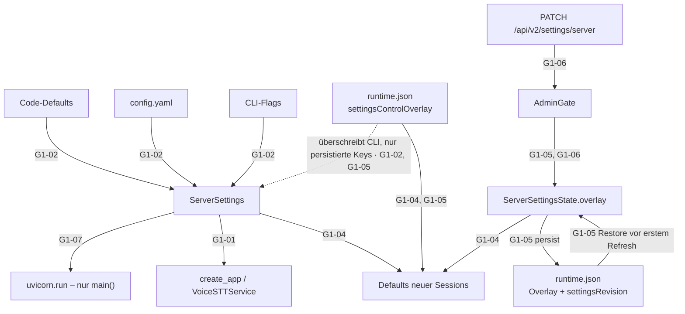
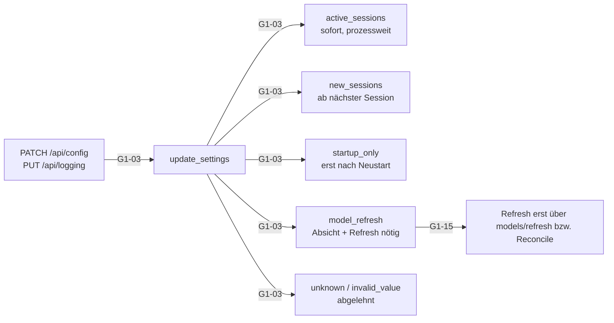
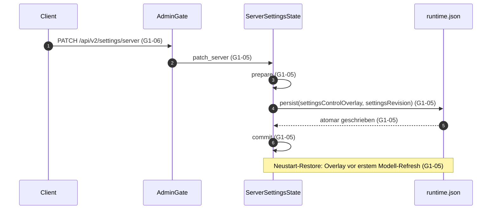

# 03.06 Server-Einstellungen

*Status: Intern abgenommen und integriert (INTEGRATED); externe ROOT-Freigabe ausstehend. Codebasis: Commit `a8993c5c68042d996eab680d84a5b138a214bb5d`. Faktenbasis: `workflow/research/03.06.json` (G1-01…G1-29, N-1…N-3, U-1…U-2, C-0…C-6).*

**Abgrenzung:** Typen/Validierungsregeln → [03.04](./03.04-datentypen-und-validierung.md); Quellen/Prioritäten → [03.05](./03.05-quellen-und-prioritaeten.md); Session-Overrides → [03.07](./03.07-session-einstellungen.md); Wirksamkeitszeitpunkt → [03.09](./03.09-wirksamkeitszeitpunkt.md); Persistenz → [03.10](./03.10-persistenz.md).

## 1. Worum geht es?

Server-Einstellungen legen fest, was **der Prozess als Ganzes** tut – Port, Gerät, Logs, Session-/Job-Limits – und sie liefern **Vorgaben, die neue Sessions erben**. Beides ist nicht dasselbe: Ein Port kann nicht pro Session gelten, ein Session-Default sehr wohl.

Zwei Fragen je Änderung:

1. **Wen betrifft sie?** Prozess, künftige Sessions, erst Neustart – oder zunächst niemanden (nur hinterlegte Absicht)?
2. **Wo gilt der Wert?** Server-Ebene, Server-Default für neue Sessions, oder Session-Override ([03.07](./03.07-session-einstellungen.md))?

Autorität: eine Dataclass `ServerSettings` – Felder, Defaults, abgeleitete Pfade, prozessweit für beide Transporte und HTTP (G1-01). Hier: **Gültigkeit und Wirkung**, nicht Typen ([03.04](./03.04-datentypen-und-validierung.md)) und nicht Namen ([03.03](./03.03-benennungskonventionen.md)).

Beispiel: `log_level` auf `DEBUG` wirkt sofort (G1-19). `warmup` abschalten greift erst nach Neustart (G1-14). Session-Einstellung als Server-Default: nur für danach entstehende Sessions (G1-04). Drei Änderungen, drei Konsequenzen.

## 2. Das Wesentliche auf einen Blick

### 2.1 Zwei Wirkungen, sauber getrennt

- **Erbe für neue Sessions:** 13 der 16 Registry-Keys mit Serverdefault sind Session-Einstellungen; Übernahme beim Anlegen, nie rückwirkend (G1-04).
- **Prozesssteuerung:** Netz-Bindung, CPU-Policy, Admin-/OpenAI-Zugang, Paketgrenzen, Engine-/Modellrichtlinie, Warmup, Logging-Senken, Session-/Queue-Limits, Wake-Backend, Kroko-Lizenz (G1-07…G1-29).
- **Änderungsklassen:** PATCH ≠ sofort wirksam; `update_settings` sortiert in `active_sessions`, `new_sessions`, `startup_only`, `model_refresh`, lehnt `unknown`/`invalid_value` ab (G1-03).

### 2.2 Ebenen und Präzedenz

**Lesart:** `ServerSettings` aus Code-Defaults, YAML, CLI (G1-02); persistiertes Overlay kann CLI-Werte überstimmen (G1-02, G1-05). Wege: Anwendung (G1-01), Prozessbindung nur `main()` (G1-07), Session-Defaults (G1-04). Admin-PATCH via Gate ins Overlay (G1-05, G1-06), persistiert, wirkt für neue Sessions.

**Textliche Alternative:** Code-Defaults von YAML, dann CLI überschrieben; Overlay kann beim Start CLI überstimmen. `ServerSettings` speist Anwendung, Bindung, Session-Defaults. Patches via Gate ins Overlay, persistiert, erst für neue Sessions wirksam.

### 2.3 Änderungsklassen

`host`/`port` in keiner Klasse (G1-03) – nur Prozessstart (G1-07).

**Textliche Alternative:** PATCH → eine von vier Klassen oder Ablehnung. `model_refresh` setzt nur Bedarf; Nachziehen erst via Refresh (G1-15).

| Änderung | Klasse | Folge |
|---|---|---|
| `log_level` → `DEBUG` | ACTIVE | Logger sofort umgestellt (G1-19) |
| `max_audio_queue_seconds_per_session` | NEW_SESSION | Nur neue Recorder (G1-23, G1-25) |
| `warmup` | STARTUP_ONLY | `startup_only` gemeldet; erst Neustart (G1-03, G1-14) |

### 2.4 Gruppen-Wirkungsketten

| Gruppe | Wirkt auf | Klasse | IDs |
|---|---|---|---|
| Netz/Prozess | `uvicorn.run`, Admin-Gate, OpenAI-Routen, Paketdecoder | STARTUP_ONLY / pro Paket | G1-07…G1-11 |
| Engine/Modell | Factory, Policy-Gate, Lanes, Lifecycle | STARTUP_ONLY / ACTIVE | G1-12…G1-16 |
| Logging | EventHub, vier Senken, SQLite, Logger | ACTIVE / STARTUP_ONLY | G1-17…G1-20 |
| Limits/Sessions | Admission, SessionStore, Recorder, globale Queue | ACTIVE / NEW_SESSION | G1-21…G1-26 |
| Wake | v1-Recorder, v2-Admission, Katalog | NEW_SESSION / NEXT_SESSION | G1-27, G1-28 |
| Lizenz | Policy-Lock, Grant-Invalidierung, Reconcile | APPLY_LIVE | G1-29 |

## 3. Grundmodell

### 3.1 Eine Autorität: `ServerSettings`

Dataclass mit Feldern, Defaults, abgeleiteten Pfaden (G1-01). Prozessweit, transportübergreifend – keine „zweite Wahrheit“ pro Transport. `__post_init__` prüft Zusammenhänge (z. B. `log_live_enabled ⊂ event_store_enabled`, G1-20). `public_dict` veröffentlicht nicht alles (keine Engine-Optionen/Secrets, G1-01/G1-09/G1-16). Merksatz: prozessweit oder für alle Clients → hier; pro Session unterschiedlich → [03.07](./03.07-session-einstellungen.md).

### 3.2 Defaults-Auszug

Nur Belegtes; Geratenes wäre schädlicher als eine Lücke.

| Feld | Belegter Wert | Wirkung | Beleg |
|---|---|---|---|
| `device` | `cpu` (erzwungen) | Start + Wechsel | G1-08 |
| `compute_type` | `int8` | Start | G1-08 |
| `tuning_profile` | `custom` (einzig zulässig) | Start | G1-02, G1-08 |
| `max_audio_packet_bytes` | 512 KiB | pro Paket, beide Transporte | G1-11 |
| `max_sessions` | 4 (Deployment: 8) | ACTIVE | G1-21, C-6 |
| `max_active_speakers` | 4 | ACTIVE, pro Versuch | G1-22 |
| `max_audio_queue_seconds_per_session` | 30.0 | NEW_SESSION | G1-23 |
| `max_final_queue_depth_per_session` | 8 | ACTIVE | G1-23 |
| `max_global_inference_queue_depth` | 64 | ACTIVE, pro Job | G1-24 |
| `max_realtime_queue_age_ms` | 1500 | ACTIVE, pro Job | G1-24 |
| `audio_queue_size` | 128 | NEW_SESSION | G1-25 |
| `pre_recording_buffer_duration` | 0.75 s | NEW_SESSION | G1-25 |
| `wakeword`-Sensitivität (v1) | 0.5 | NEW_SESSION, v1 | G1-27 |
| `openwakeword_inference_framework` | `onnx` | NEW_SESSION, v1 | G1-27 |
| `wakeWord.inferenceBackend` | `auto` | NEXT_SESSION | G1-28 |
| `wakeWord.globalDisabledIds` | `[]` | NEXT_SESSION, je Admission | G1-28 |

Für `host`/`port` gelten die Code-Defaults `0.0.0.0`/`8010` (server.py:405-406), Wirkungsort nur `main()`/`uvicorn.run` (G1-07, deployment-überschreibbar). Ebenso `log_level`: nur prozessweite, laufzeitänderbare Wirkung (G1-19).

**Code-Default ≠ Deployment-Default:** `config.yaml` kann abweichen – belegt: `max_sessions` 4 vs. 8, `warmup` true vs. false, `wake_words` leer vs. `hey_jarvis` (C-6). Runbooks müssen die Ebene nennen.

### 3.3 Startpräzedenz

Code-Default < YAML < CLI; danach persistierte Laufzeitwerte (erneut validiert) (G1-02). Nicht persistiert: `host`, `port`, `device`, `data_root_path`, Secrets (G1-02). Tuning: 8 Keys (`BASE_TUNING_DEFAULTS`), nur Profil `custom` (G1-02, G1-08). Persistierter Laufzeitwert „gewinnt“ gegen Flag (C-1, §10).

### 3.4 Die 16 Serverdefaults

13 Session-Einstellungen + 3 Server-Keys (`inferenceBackend`, `globalDisabledIds`, `forceCommunity`) (G1-04). Vorgaben für **neue** Sessions; bestehende unverändert. `selection`/`runtimeSuppression.*` ohne Serverdefault (G1-04). Serverdefault ändern ≠ Anlage ändern, sondern Erbe; laufende Sitzung bleibt stabil – gewollt.

### 3.5 Overlay, Revision und Persistenz

Overlay in `runtime.json`, **eigene `settingsRevision`**, atomar, ohne Legacy-Sektion zu überschreiben (G1-05). `patch_server`: `prepare` → `persist` → `commit` (G1-05). Overlay-Laden **vor** erstem Modell-Refresh (G1-05). Ungültige Keys → Startabbruch (G1-05).

**Textliche Alternative:** PATCH via Gate als `prepare` → `persist` → `commit`. Erst nach atomarem Schreiben aktiv. Neustart: Overlay vor erstem Refresh angewandt. „Erst schreiben, dann committen“: kein halb aktiver Zustand nach Absturz.

### 3.6 Drei API-Oberflächen

1. **Registry v2:** `GET`/`PATCH` Server-Settings.
2. **Legacy-Config/Logging:** `PATCH /api/config`, `PUT /api/logging` mit Klassen (G1-03).
3. **Validieren/Reload:** `/api/config/validate`, Reload-Pfad; ungültige Engine-Liste → 400 mit Liste (G1-12).

Alle Verwaltungsrouten am Admin-Gate (G1-06); ohne Key nur lokal, remote 403 (G1-09). Auth: [05.03](../05-administration/05.03-admin-authentifizierung.md), [05.10](../05-administration/05.10-fehler-zugriffsantworten.md).

## 4. Netz und Prozess

### 4.1 `host`/`port` – nur Prozessstart

Ausschließlich `main()` → `uvicorn.run`; `create_app` bindet nichts (G1-07). Aus Persistenz ausgenommen (G1-02), in keiner Änderungsklasse (G1-03). Embedding: Bindung Sache des Einbetters (N-1) – Trennung Anwendung/Prozess.

### 4.2 CPU-Only – Policy, keine Empfehlung

`device=cpu` erzwungen, `compute_type=int8`, nur Profil `custom` (G1-08). YAML `device != cpu` → SystemExit (G1-08). Greift bei Start und Modellwechsel (G1-08). Kein GPU-Pfad via Einstellung; V1-`device: cuda` → harter Abbruch, kein Fallback.

### 4.3 Admin-Key

Header/Bearer, `compare_digest` (G1-09). Ohne Key lokal erlaubt, remote 403 (G1-09). STARTUP_ONLY, nie persistiert/öffentlich (G1-09). Key-Wechsel = Neustart; meiste andere Änderungen live.

### 4.4 OpenAI-Oberfläche

- **`enabled`:** aus → 404. **Key:** falsch/fehlend → 401 (Fallback `VOICESTT_API_KEY`). **Limit:** +1 Byte gelesen, drüber → 413. **Aliasse:** Lane-Mapping (`main`→`final`), unbekannt → ValueError/404 (G1-10).
- STARTUP_ONLY, Secrets nie persistiert (G1-10). API: [04.10](../04-schnittstellen/04.10-openai-kompatible-api.md); Auth: [05.06](../05-administration/05.06-openai-api-authentifizierung.md).

### 4.5 Paketgrenzen

512 KiB Audio + 64 KiB Metadaten (fest) (G1-11). Überschreitung → `AudioPacketError`/Ablehnung, beide Transporte (G1-11). Pro Paket, ACTIVE.

## 5. Engine und Modell

### 5.1 Genau zwei Engines

`faster_whisper`, `kroko_onnx` (G1-12). Prüfung **vor** Import (G1-12). `/api/config/validate` → 400 mit Liste (G1-12). Wechsel via `models/active` (G1-12); Details: [02.07](../02-funktionsweise/02.07-modelle-und-modellverwaltung.md).

### 5.2 Modellrichtlinie, Ränge, Kroko-Identität

Ränge: kroko 2, large-v3-turbo 3, large 4, medium 3, small 2, base/tiny 1 (G1-13). Rang > 3 abgelehnt; max. 2|1 Medium-Äquivalente. Gleiche Engine+Modell → `use_main` erzwungen. Zwei Kroko-Modelle → ValueError, gemeinsame native Instanz (G1-13).

Beispiele: large-v3-turbo (3) + small (2) zulässig; large (4) abgelehnt; zwei Medium überschreiten Grenze (sofern Limit 1); zwei Kroko scheitern an Identität.

Prüfung bei Start, Wechsel, Lifecycle-PATCH; `allow_two` ACTIVE (G1-13). Lanes: [02.08](../02-funktionsweise/02.08-scheduler-und-nebenlaeufigkeit.md).

### 5.3 Warmup, Idle, Lazy-Reload

Warmup nur wenn true (G1-14). Idle-Worker alle `min(30, max(0.1, timeout/4))` s → `unload(idle_timeout)` (G1-14; Timeout selbst mindestens 0.1 s). Danach Lazy-Reload (G1-14). Warmup STARTUP_ONLY, Idle ACTIVE (G1-14). Kleines Timeout → häufigere Prüfung; Entladen = Sparmodus, nächste Anfrage zahlt Ladezeit.

### 5.4 `stt_*` = Absicht, nicht Aktion

`stt_auto_download`, `stt_engine_settings`, `stt_model_settings` → nur `model_refresh_required` (G1-15). Ohne Refresh/Reconcile nichts (N-2).

> **Warnkasten (N-2):** Erfolgreicher PATCH auf `stt_*` ≠ Modell geladen/heruntergeladen. Nur Absicht gespeichert + Bedarf markiert. Erfolg = Refresh + Ergebnis prüfen.

### 5.5 Lane-Optionen und Redaction

Auflösung: eigene Lane → andere Lane → `stt_engine_settings` (G1-16). Nicht öffentlich (G1-16). Kroko-Keys → Redaction (G1-16). STARTUP_ONLY (G1-16). Secrets: [05.09](../05-administration/05.09-schutz-von-daten-secrets.md).

## 6. Logging und Diagnose

### 6.1 Vier Kanäle, ein Eventstore

Kanäle `audit`/`performance`/`transcription`/`system` aus `data_root` + SQLite-Eventstore (G1-17). Hub je aktiviertem Kanal (G1-17). `save_audio_files` archiviert (G1-17). Logging-Key-Änderung → Audit-Rekonfiguration (G1-17). `event_store_enabled` STARTUP_ONLY; Pfade abgeleitet/gesperrt (G1-17) – keine freie Verzeichniswahl.

### 6.2 Filter vs. Erzeugung

`transcript_log_mode` **filtert** (none/final/kanalbezogen); `realtime_log_detail` steuert **Erzeugung** vor Hub (G1-18). `update_settings` synchronisiert Transcript-Keys (G1-18). Fehlendes Event: gefiltert oder nie erzeugt – nur Filter ändern hilft bei abgeschalteter Erzeugung nicht.

### 6.3 `log_level` prozessweit

Root-/Uvicorn-Logger, runtime-änderbar, `resolve_log_level` (G1-19). Schnellster Debug-Hebel ohne Neustart.

### 6.4 `log_live_enabled` ⊂ `event_store_enabled`

Widerspruch → `__post_init__` wirft; PATCH → `invalid_dependency`; persistierter Widerspruch → Startabbruch (G1-20). `event_store_enabled` ist STARTUP_ONLY, `log_live_enabled` dagegen ACTIVE (PATCH-fähig, Guard `invalid_dependency`) – beide werden persistiert (C-3).

> **Warnkasten (C-3):** Gültige Kombination kann nach Deploymentwechsel ungültig werden → Start verhindert. Reihenfolge: erst `event_store_enabled` an, dann `log_live_enabled`; abschalten umgekehrt.

## 7. Limits und Sessions

### 7.1 `max_sessions` + Reservierungen

Code 4 (G1-21). Sessions **+ Reservierungen** gezählt; `admit_session` reserviert vor Bau (G1-21). v2: `session_limit_reached`; Zähler in Metriken (G1-21). Beispiel: 3 aktiv + 1 im Aufbau = voll; fünfter abgewiesen.

### 7.2 Sprecherlimit

4 (G1-22). Nur **neue** Sprecher verworfen + Warnung; bestehende bleiben (G1-22). Pro Versuch, ACTIVE. Nicht destruktiv.

### 7.3 Audio-Queue und Trim (`max_audio_queue_seconds_per_session`, `max_final_queue_depth_per_session`)

30.0 s (`max_audio_queue_seconds_per_session`) → Force-Finalize + Warnung (G1-23). Tiefe 8 (`max_final_queue_depth_per_session`) → Trim `recorded_audio_queue` (discarded gezählt) + final-Job-Limit (G1-23). Erstere NEW_SESSION, letztere ACTIVE (G1-23). Sekunden = Latenzschutz, Tiefe = Speicherschutz.

### 7.4 Globale Queue und Stale-Drop

Tiefe 64: Final-Ablehnung (G1-24). 1500 ms Deadline: stale-Drop Realtime (G1-24). Vorhandener Job → Coalescing (G1-24). Überlast: Finals eher erhalten als Realtime – fehlendes Realtime-Update kann bewusste Verwerfung sein.

### 7.5 Recorder-Übergabe

128 + 0.75 s Pre-Roll → Recorder-Dict neuer Sessions; Pre-Roll in Timeline (G1-25). NEW_SESSION (G1-25). 0.75 s Puffer vor Auslöser = kein verlorener Silbenanfang.

### 7.6 Vier Felder ohne Consumer

> **Warnkasten (N-3):** `realtime_degradation_threshold_ms`, `realtime_min_audio_seconds`, `realtime_max_audio_seconds`, `vad_energy_threshold` – validiert, persistiert, veröffentlicht, aber **nie durchgesetzt**, nicht im Recorder-Dict (G1-26). Nicht als Grenzen dokumentieren.

Wichtigster „deklariert ≠ wirksam“-Fall.

## 8. Wake und Guard

### 8.1 Legacy-v1-Pfad

`wakeword_backend`, `wake_words`, 0.5, `onnx`, Timings (G1-27). `wake_word_enabled()` = Backend ∧ Wörter (G1-27). `--wake-words` erzwingt `openwakeword` (G1-27). Recorder-Dict + Capabilities (G1-27). NEW_SESSION (G1-27). UND-Falle: Backend ohne Wörter = nichts, Wörter ohne Backend = nichts.

### 8.2 v2-Registry-Keys

`wakeWord.inferenceBackend` (auto/onnx/tflite, NEXT_SESSION) + `wakeWord.globalDisabledIds` ([]) (G1-28). Je Admission gelesen (G1-28). Zulassung nur bei gemeinsamem gesundem Backend; Disable-Liste via Katalog-Verfügbarkeit (G1-28). PATCH → `apply_wake_word_global_disable` (G1-28). `catalogRevision` ≠ `settingsRevision` (G1-28). Nur v2-Admission; bestehende unverändert (G1-28).

### 8.3 Zwei Backend-Knöpfe

> **Warnkasten (C-4):** `openwakeword_inference_framework` (v1, `onnx`) vs. `wakeWord.inferenceBackend` (v2, `auto`) (C-4). Je nach Client-Pfad wirkt nur einer. Support: erst Pfad klären.

C-2: v1 Sekunden vs. v2 Millisekunden; nur v2 nutzt Registry (C-2). Nicht ineinander umrechnen.

## 9. Kroko-Lizenz

`kroko.forceCommunity` einziger Lizenz-Key (G1-29). Gesetzt → Community erzwungen, Pro-Nachweis synchron invalidiert, kein Netzcheck, `pro_enabled` false (G1-29). PATCH unter Policy-Lock + `apply_kroko_force_change` (G1-29); nur Absicht persistiert (G1-29). APPLY_LIVE, prozessweit; blockiert neue Pro-Jobs; Scheduler-Reconcile (G1-29). Doppelt gesichert: Lock + synchrone Invalidierung. Hintergründe: [05.07](../05-administration/05.07-kroko-lizenzierung.md), [05.08](../05-administration/05.08-native-guard.md).

## 10. Grenzen und offene Punkte

### 10.1 Nicht implementiert

| ID | Bedeutung | Konsequenz |
|---|---|---|
| N-1 | `host`/`port` nur `main()` | Embedding bindet selbst |
| N-2 | `stt_*` nur Bedarf | PATCH ≠ Provisionierung |
| N-3 | Vier Felder ohne Consumer | Keine Grenzen |

### 10.2 Unbekannt

| ID | Bedeutung | Umgang |
|---|---|---|
| U-1 | `VOICESTT_OPENWAKEWORD_MODEL_ROOT` nur in Compose, nie in `*.py` gelesen | Nicht als Python-Feature erklären |
| U-2 | Client-Interpretation ungenutzter Limits | Repo nein, Client offen |

### 10.3 Konflikte

| ID | Konflikt | Bedeutung |
|---|---|---|
| C-0 | Branch-Ref unbelegbar | Nur Commit belegt |
| C-1 | Datei schlägt CLI-Flags | „Flag ignoriert“-Erklärung |
| C-2 | Zwei Timing-Familien | Pfadabhängig dokumentieren |
| C-3 | store STARTUP_ONLY + live ACTIVE, beide persistiert | Widerspruch = Startabbruch |
| C-4 | Zwei Wake-Backend-Knöpfe | Pfad kennen |
| C-5 | `language` STARTUP_ONLY, aber `PUT /api/language` direkt | Zwei Wege, Wirkung angeben |
| C-6 | Code- vs. Deployment-Defaults | Ebene nennen |

> **Warnkasten (C-1):** Persistierte Werte über CLI gelegt (G1-02). Flag scheinbar wirkungslos → zuerst Overlay in `runtime.json` prüfen.

> **Warnkasten (C-5):** `language` STARTUP_ONLY, aber `PUT /api/language` schreibt direkt (C-5). Zwei Wege, zwei Wirkungen – Weg angeben.

> **Warnkasten (C-6):** `max_sessions` 4 vs. 8, `warmup` true vs. false, `wake_words` leer vs. `hey_jarvis` (C-6). Ohne Ebene nicht belastbar.

## 11. Siehe auch / Nachweise

**Verwandt:** [03.01](./03.01-konfigurationsarchitektur.md) · [03.02](./03.02-scopes.md) · [03.03](./03.03-benennungskonventionen.md) · [03.04](./03.04-datentypen-und-validierung.md) · [03.05](./03.05-quellen-und-prioritaeten.md) · [03.07](./03.07-session-einstellungen.md) · [03.08](./03.08-runtime-aenderungen.md) · [03.09](./03.09-wirksamkeitszeitpunkt.md) · [03.10](./03.10-persistenz.md) · [03.11](./03.11-secrets.md) · [02.07](../02-funktionsweise/02.07-modelle-und-modellverwaltung.md) · [02.08](../02-funktionsweise/02.08-scheduler-und-nebenlaeufigkeit.md)

**Faktennachweise (Commit `a8993c5c…`):** G1-01 `server.py:403-517, 519-543, 545-556` · G1-02 `server.py:10394-10656, 10333-10391, 8827-8843` · G1-03 `server.py:178-221, 223-254, 256-285, 287-291, 1211-1216, 7826-7957` · G1-04 `settings_control.py:278-609, 640-661, 1233-1240` · G1-05 `operations.py:414-417, 451-516; settings_control.py:1355-1405; server.py:6283-6293` · G1-06 `server.py:9235-9292, 8907-8937, 9383-9430, 9849-9868, 9870-9892; security/admin.py:24-46` · G1-07 `server.py:405-406, 10409-10410, 10830-10835, 7964-7968` · G1-08 `server.py:417-418, 407, 10453, 10379-10380, 8704-8707, 8767` · G1-09 `security/admin.py:1-46; server.py:508, 10521, 551, 7915` · G1-10 `server.py:506-513, 10519-10526, 8455-8484; openai_routes.py:93-103, 147-154; security/openai.py:10-35` · G1-11 `server.py:449, 7653-7655; protocol.py:7, 61-62; connection.py:186-190; server.py:3011-3012` · G1-12 `server.py:412-413, 8744-8761` · G1-13 `server.py:499-502, 447, 8711-8741, 8764-8801; kroko_runtime.py:54-73` · G1-14 `server.py:498-500, 2101-2108, 7599-7639` · G1-15 `stt_model_management.py:173-236, 258-269, 666-686; server.py:287-291, 503-505, 7893-7894, 7956` · G1-16 `server.py:414-415, 1276-1305, 545-553; protocol.py:20-23, 26-37` · G1-17 `server.py:450-484, 519-527, 7936-7942; event_logging.py:697-893; operations.py:343-362` · G1-18 `event_logging.py:118-186, 144-155; server.py:455-456, 480, 5205-5237, 7895-7904` · G1-19 `server.py:450, 1219-1221, 7943-7944, 10816-10834; event_logging.py:276-302` · G1-20 `server.py:481, 484, 540-543, 7865-7877, 8827-8843` · G1-21 `server.py:487, 6133-6237, 7349-7350; connection.py:247-252` · G1-22 `server.py:488, 6201-6208, 5314-5327` · G1-23 `server.py:489, 492, 6000-6109, 1783-1785` · G1-24 `server.py:491, 493, 1771-1818, 8298-8302` · G1-25 `server.py:448, 490, 2775-2834, 1460-1476` · G1-26 `server.py:217, 239-240, 244, 494-497, 7702-7711, 2751-2834` · G1-27 `server.py:438-446, 555-556, 10473-10481, 10734-10737, 2799-2806, 7716-7737, 9138-9194` · G1-28 `settings_control.py:93, 99, 558-590; server.py:7183-7212, 7256-7264, 9281-9286; wakeword_catalog.py:542-609, 1320-1332` · G1-29 `settings_control.py:93, 591-608; server.py:6386-6396, 6711-6776, 9259-9280; security/kroko.py:95-145; license_state.py:42-107`

**Grenzen:** Branch-Ref unbelegbar (C-0); Client-Interpretation ungenutzter Grenzen unbekannt (U-2); `VOICESTT_OPENWAKEWORD_MODEL_ROOT` außerhalb Python unbekannt (U-1).
