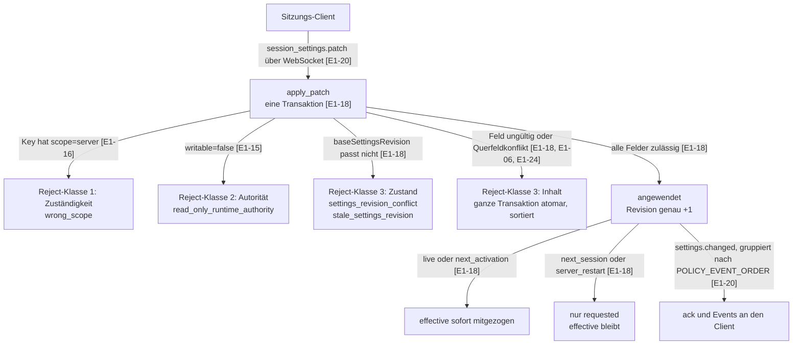
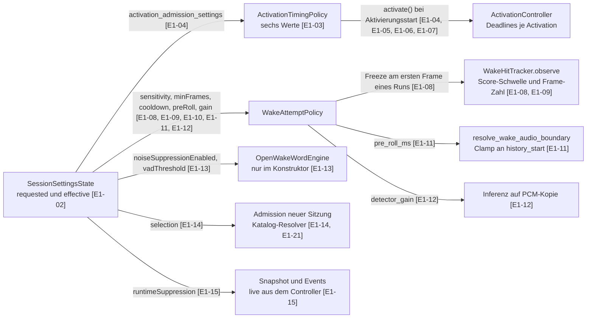
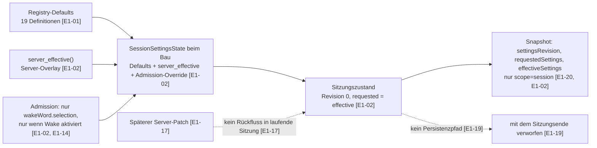

# 03.07 – Session-Einstellungen

*Faktenbasis: `workflow/research/03.07.json` (E1-01…E1-24, N-01/N-02, U-01…U-03, C-01). Commit `a8993c5c68042d996eab680d84a5b138a214bb5d`.*

## 1. Worum geht es?

Eine Sitzung besitzt einen eigenen Einstellungsraum: Genau **16 Schlüssel** dürfen je Verbindung einen eigenen Wert tragen (E1-01): sechs Zeitgeber der Aktivierung, acht Werte der Wake-Erkennung und zwei Anzeigewerte für Unterdrückungszustände. Alles darüber hinaus ist serverweit und für die Sitzung nicht schreibbar (E1-16).

Der Nutzen: Zwei Clients hängen am selben Server. Der eine soll empfindlicher auf sein Wake-Word reagieren, der andere bei den Standardwerten bleiben. Der zweite Client darf davon nichts merken. Genau das leisten diese 16 Werte: Sie sind **lokale Overrides** – sie gelten nur in ihrer Sitzung, sie schreiben nichts zurück, und sie überleben das Sitzungsende nicht (E1-19).

Drei Fragen bestimmen den Rest:

1. **Wer darf schreiben?** Nur die Sitzung, nur über den WebSocket, nur ihre 16 Schlüssel (E1-16, E1-20).
2. **Wann wird ein Wert wirksam?** Nicht sofort, sondern nach der Policy – `live`, `next_activation` oder `next_session` (E1-18).
3. **Was passiert bei Fehlern?** Die ganze Transaktion fällt – atomar und sortiert –, nicht ein einzelnes Feld (E1-18).

Systematik: Scope-Modell [03.02](./03.02-scopes.md), Typ-/Prüfmechanik [03.04](./03.04-datentypen-und-validierung.md), Rangfolge [03.05](./03.05-quellen-und-prioritaeten.md), „ab wann gilt ein Wert“ [03.09](./03.09-wirksamkeitszeitpunkt.md). Hier stehen die 16 Einzelwerte und ihr Verhalten.

Zwei Begriffe:

- **requested** – der Wunsch der Sitzung (zuletzt akzeptierter Satz).
- **effective** – womit die laufende Sitzung tatsächlich arbeitet.

Beim Aufbau gleich; sie laufen auseinander, sobald ein `next_session`-Schlüssel geändert wird (E1-02, E1-18).

## 2. Das Wesentliche auf einen Blick

### 2.1 Patch: drei Türen, ein atomares Ergebnis



**Erklärung.** Ein Sitzungs-Patch ist eine Transaktion: Entweder er besteht vollständig – Revision +1, Werte je Policy nach `effective` – oder nicht – Zustand unverändert, auch bei nur einem fehlerhaften Feld (E1-18). Türen: Zuständigkeit (falscher Scope = Programmierfehler), Autorität (`read_only` = Leseobjekt), Zustand/Inhalt (Revision/Typ/Regel). Der Client erfährt das Ergebnis über Ack und `settings.changed`-Events (E1-20).

**Textliche Alternative:** Patch = Transaktion. Besteht er, +1 Revision, Werte je Policy nach `effective`; besteht er nicht, keine Änderung. Ergebnis via Ack; akzeptierte Änderungen via gruppierte `settings.changed`-Events.

### 2.2 Verbraucher und Freeze-Punkte



**Erklärung.** Alle Verbraucher lesen denselben Zustand, aber zu verschiedenen Zeitpunkten: Aktivierungsstart (Timings → Deadlines, dann fest), erster Erkennungsframe (Wake-Werte eingefroren), Engine-Bau (nur dort: Suppression-Engine-Keys), Sitzungs-Admission (`selection`), live (Suppression). „Wert geändert“ ≠ „Wert wirkt“.

**Textliche Alternative:** Sechs Ablagefächer: Aktivierungsstart, erster Frame, akzeptierter Treffer, Engine-Bau, Sitzungsaufbau, Live-Anzeige. Der Patch füllt nur den Wunsch; das Fach entscheidet die Policy.

### 2.3 Seeding und Isolation



**Erklärung.** Basis einmalig im Konstruktor: Registry-Defaults, darüber `server_effective()`, darüber ggf. Wake-Auswahl (E1-02). Danach eigenständig: kein Rückfluss (E1-17). Nach außen nur eigene Keys (E1-20, E1-02). Kein Persistenzpfad → Ende mit der Sitzung (E1-19).

**Textliche Alternative:** Formular mit 16 Feldern, beim Öffnen einmal ausgefüllt (Werkswerte → Server-Overlay → Wake-Auswahl). Danach schreibt nur der Client. Server-Drehungen ändern nur das nächste Formular.

## 3. Inventar: die 16 Sitzungsschlüssel

Jede Definition trägt `type`, `constraints`, `default_value`, `apply_policy`, `has_server_default`, `writable` (E1-01); Metadaten: [03.02](./03.02-scopes.md), [08.03](../08-referenzen/08.03-settings-katalog.md).

| # | Schlüssel | Typ | Default | Bereich | Policy | Server-Default | writable |
|---|---|---|---|---|---|---|---|
| 1 | `activation.initialSpeechTimeoutMs` | int (ms) | 15000 | 100–3600000 | `next_activation` | ja (E1-03) | ja |
| 2 | `activation.followupTimeoutMs` | int (ms) | 3000 | 100–60000 | `next_activation` | ja (E1-03) | ja |
| 3 | `activation.segmentWatchdogInitialMs` | int (ms) | 600000 | 60000–3600000 | `next_activation` | ja (E1-03) | ja |
| 4 | `activation.segmentWatchdogRefreshMs` | int (ms) | 180000 | 30000–600000 | `next_activation` | ja (E1-03) | ja |
| 5 | `activation.segmentWatchdogWarningMs` | int (ms) | 30000 | min 5000, kein Max; nur `lessThanKeys` | `next_activation` | ja (E1-03) | ja |
| 6 | `activation.closingRecoveryTimeoutMs` | int (ms) | 5000 | 1000–30000 | `next_activation` | ja (E1-03) | ja |
| 7 | `wakeWord.sensitivity` | float | 0.5 | 0.0–1.0 | `next_activation` | ja [a] | ja |
| 8 | `wakeWord.minConsecutivePredictionFrames` | int | 1 | min 1, kein Max | `next_activation` | ja [a] | ja |
| 9 | `wakeWord.cooldownMs` | int (ms) | 0 | min 0, kein Max | `next_activation` | ja [a] | ja |
| 10 | `wakeWord.preRollMs` | int (ms) | 0 | min 0, kein Max | `next_activation` | ja [a] | ja |
| 11 | `wakeWord.detectorGain` | float | 1.0 | 0.0–3.0 | `next_activation` | ja [a] | ja |
| 12 | `wakeWord.noiseSuppressionEnabled` | bool | false | – | `next_session` | ja [a] | ja |
| 13 | `wakeWord.vadThreshold` | float | 0.0 | 0.0–1.0; 0.0 = Gate aus | `next_session` | ja [a] | ja |
| 14 | `wakeWord.selection` | string_list | `[]` | minItems 0 | `next_session` | nein (E1-14) | ja |
| 15 | `runtimeSuppression.manual` | bool | false | – | `live` | nein (E1-15) | nein (E1-15) |
| 16 | `runtimeSuppression.wakeWord` | bool | false | – | `live` | nein (E1-15) | nein (E1-15) |

- [a] `has_server_default`: 13 der 16 Session-Keys besitzen einen Serverdefault; ohne sind nur `selection` und die beiden Suppression-Keys (E1-14, E1-15; vgl. 03.02 S-00a: 13 Session-Keys mit Serverdefault). Damit gilt „ja“ für alle Wake-Keys 7–13.
- Verteilung: **11 × `next_activation`**, **3 × `next_session`**, **2 × `live`**; kein Schlüssel nutzt `server_restart` (E1-23, N-01).
- Server-Keys (`wakeWord.inferenceBackend`, `wakeWord.globalDisabledIds`, `kroko.forceCommunity`) nicht in Tabelle: Patch → `wrong_scope` (E1-16); Semantik: [03.06](./03.06-server-einstellungen.md).

## 4. Die Aktivierungs-Zeitgeber im Einzelnen

Alle sechs `int`, öffentlich Millisekunden, intern `/1000.0` (E1-03).

| Schlüssel | Setzt | Besonderheit |
|---|---|---|
| `initialSpeechTimeoutMs` | `INITIAL_SPEECH_DEADLINE = now + timeout` in `waiting_first_speech` (E1-04) | Refresh dort `invalid_phase` (E1-04) |
| `followupTimeoutMs` | `FOLLOWUP_DEADLINE = now + followup_timeout` (E1-05) | Refresh ersetzt, nicht kumulativ (E1-05) |
| `segmentWatchdogInitialMs` | `SEGMENT_WATCHDOG_DEADLINE` bei Segmentstart (E1-06) | – |
| `segmentWatchdogRefreshMs` | `= max(now + refresh, Deadline)` (E1-06) | nie verkürzt (E1-06) |
| `segmentWatchdogWarningMs` | `warning_after` an beiden Deadlines (E1-06) | strikt kleiner als beide Fristen (E1-06) |
| `closingRecoveryTimeoutMs` | Recovery-Deadline in `closing_input` (E1-07) | Ablauf → `closing_recovery_due` (E1-07) |

```text
# Schema (Pseudocode), keine Codeabschrift
INITIAL_SPEECH_DEADLINE   = now + initialSpeechTimeoutMs      # waiting_first_speech   [E1-04]
FOLLOWUP_DEADLINE         = now + followupTimeoutMs           # ersetzt, nicht addiert [E1-05]
SEGMENT_WATCHDOG_DEADLINE = now + segmentWatchdogInitialMs    # Segmentstart           [E1-06]
warning_after             = segmentWatchdogWarningMs          # an beiden Deadlines    [E1-06]
RECOVERY_DEADLINE         = now + closingRecoveryTimeoutMs    # closing_input          [E1-07]
REFRESH: FOLLOWUP = now + followup; SEGMENT = max(now + refresh, DEADLINE)  # nie kürzer [E1-05, E1-06]
```

**Einfrieren statt Nachziehen.** Über `activation_admission_settings` in die Policy, je Activation gültig; Patch mitten in laufender Activation ändert Deadlines nicht (E1-04, E1-06). Laufende Aktivierung wechselt ihr Zeitverhalten nicht mitten im Dialog.

**Querfeldregel – strikt.** Warnung < Initial UND < Refresh; geprüft am finalen Kandidaten, sobald einer der drei Keys in Transaktion; `warning >= deadline` → `cross_field_conflict`, ganze Transaktion fällt (E1-06, E1-18). Defaults konsistent (30000 < 180000, 600000) (E1-03). `200000` scheitert an Refresh 180000; `180000` scheitert (strikt); nur-Refresh-Senkung kann akzeptierte Warnung verletzen (E1-06). Mechanik: [03.04](./03.04-datentypen-und-validierung.md); einzige Key-zu-Key-Bedingung (E1-06).

## 5. Die Wake-Werte im Einzelnen

### 5.1 `sensitivity` – Schwelle, eingefroren pro Versuch

`float` 0.0–1.0, Default 0.5, `next_activation` (E1-08). Frame qualifiziert bei `score >= sensitivity` (E1-08). Gelesen via `_wake_attempt_policy`, **Freeze am ersten Frame eines Runs** (E1-08). Patch während Utterance → erst nächster Versuch. Kein Versuch verschiebt mitten in der Auswertung seine Messlatte.

### 5.2 `minConsecutivePredictionFrames` – wie viele Frames zählen

`int`, min 1, kein Max, Default 1, `next_activation`, Kalibrierung offen (WW-18) (E1-09). Nur echte neue Prediction-Frames, keine Recorder-Chunks (E1-09). Default 1 = neutraler Startwert, **kein kalibrierter Betriebspunkt** (E1-09).

### 5.3 `cooldownMs` – Bedienpause nach Treffer

`int`, min 0, kein Max, Default 0, `next_activation`, WW-18 (E1-10). `_cooldown_until = timestamp + ms/1000`; Offers bis Ablauf verworfen (E1-10). Nicht die interne Gruppierung desselben Trefferbereichs (E1-10).

### 5.4 `preRollMs` – Vorlauf vor Treffer

`int`, min 0, kein Max, Default 0, `next_activation`, WW-19 (E1-11). `release = max(history_start, zero_point - pre_roll)` (E1-11); aus Versuchs-Snapshot; Clamp an vorhandene Historie (E1-11); keine receptive-field-Obergrenze (E1-11). Großer Wunsch: geklemmt, nicht abgelehnt.

### 5.5 `detectorGain` – lauteres Hören ohne lauteres Speichern

`float` 0.0–3.0, Default 1.0, `next_activation` (E1-12). Linear, nur PCM-Kopie für Inferenz, sättigend int16-Clip; Original unverändert (E1-12). Pro Versuch via `engine.process(gain=...)`; Engine-Startwert aus `_wake_engine_options()` (E1-12).

### 5.6 `noiseSuppressionEnabled` / `vadThreshold` – nur beim Engine-Bau

`bool` false / `float` 0.0–1.0 (0.0 = Gate aus), beide `next_session` (E1-13). Nur Konstruktor (`enable_speex_noise_suppression`, `vad_threshold`); keine Setter, keine Umschaltung laufend (E1-13). Patch zulässig (Wunsch), Wirkung erst neue Session/Engine; kein Rebuild-Pfad in Session (E1-13, N-02) – zentrale Einschränkung, offene Grenze (§10).

## 6. `wakeWord.selection`

`string_list`, minItems 0, Default `[]`, `next_session`, **kein Server-Default** (E1-14). Kanonische Modell-IDs. Zwei Wege: Admission-Override (nur wenn Wake aktiviert, E1-02/E1-14) und Sitzungs-Patch.

**Fail-closed:** leer bei konfiguriertem Wake → `required`; unbekannt/deaktiviert/unladbar → `unavailable`; Katalogfehler → dieselbe Familie (E1-14). Kein „irgendetwas“ hinterlegbar.

**Kanonisch:** Validator löst via Katalog-Resolver auf und verlangt Verfügbarkeit (E1-21). Global deaktivierte (Server-Key, projiziert) nicht wählbar (E1-21). Handshake nur kanonische IDs, kein Alias (E1-21).

**Wirksamkeit:** `next_session` → `requested` sofort, `effective` bleibt (E1-14, E1-18). Neue Auswahl erst nächste Sitzung hörbar – Erkennung arbeitet mit Bau-Auswahl, kein Umbau (N-02).

**Offene Kante (E1-22, C-01):** Patch prüft tolerant (Alias via Resolver), speichert unveränderten Eingabewert – keine Kanonisierung (E1-22). Alias könnte in `requestedSettings` erscheinen, obwohl Wire kanonisch fordert (E1-22). Kein Test; Detection-Wirkung ohnehin erst `next_session` (E1-22). Nicht als „wird normalisiert“ beschreiben (E1-22, U-01, U-03).

## 7. Suppressionswerte

`manual`/`wakeWord`: `bool` false, `live`, **kein Server-Default, nicht schreibbar** (E1-15). Patch → `read_only_runtime_authority` (E1-15). Einzige Autorität: `ActivationController.set_runtime_suppression` via `trigger_suppression.set` (E1-15). Gated nur Admission neuer Trigger; ändert/beendet keine laufende Activation; nicht im Freeze; nie persistiert (E1-15). Snapshot/Events: Live-Overlay aus Controller (E1-15). Snapshot-`true` = Zustand, nicht Wunsch. Schreibversuch = Kategorienverwechslung, kein Rechteproblem.

## 8. Schranken im Zusammenhang

### 8.1 Zuständigkeit: `wrong_scope`

Server-Keys im Session-Patch → `wrong_scope`: `wakeWord.inferenceBackend` (auto/onnx/tflite, next_session, admin), `wakeWord.globalDisabledIds` ([], next_session, admin), `kroko.forceCommunity` (false, live, admin) (E1-16). Nur via `PATCH /api/v2/settings/server` (Admin-Guard), eigener Revisionsstrom (E1-16). Server-Seite: [03.06](./03.06-server-einstellungen.md).

### 8.2 Keine Rückwirkung

Server-Default-Änderung schreibt bestehende Session nicht um (Seeding nur Konstruktor) (E1-17). Neue erben neu, laufende behalten. Parallele Sessions dürfen differieren (E1-17; Rangfolge [03.05](./03.05-quellen-und-prioritaeten.md)).

### 8.3 Policy-Auflösung und Atomarität

| Policy | `requested` | `effective` |
|---|---|---|
| `live` | sofort | sofort (E1-18) |
| `next_activation` | sofort | sofort (E1-18) |
| `next_session` | sofort | unverändert (E1-18) |
| `server_restart` | sofort | unverändert (E1-18) |

`changedKeys` nur echte Änderungen; `no_change` bumpt nicht; Revision genau +1 pro akzeptierter Transaktion; Mismatch → `conflict`/`stale`; ungültiges Feld → ganze Transaktion atomar sortiert (E1-18).

### 8.4 Isolation und kein Persist

Eigene monotone `settingsRevision` je Sitzung; nie persistiert (kein Callback) (E1-19). Nur Overlay (`settingsControlOverlay`/`settingsRevision`) in Datei (E1-19). Session-Ende = Zustands-Ende (E1-19). Persistenz: [03.10](./03.10-persistenz.md).

### 8.5 Nur WebSocket, und nur projiziert

`session_settings.patch` → Ack (`rejected`/`conflict`) + `settings.changed`-Events gruppiert nach `POLICY_EVENT_ORDER` (live, next_activation, next_session, server_restart), Keys sortiert; nur erstes Event erhöht `stateVersion` (E1-20). Snapshot: `settingsRevision`/`requestedSettings`/`effectiveSettings` aus atomarer Projektion (E1-20). **Kein HTTP** für Session-Settings; HTTP nur Schema/Server-Reads (E1-20).

Intern `_requested` über alle Registry-Keys (auch Server als Basiskopie); Wire filtert `scope != session` → Server-Keys nie auf Oberfläche (E1-02). Server-Key intern sichtbar = Zwischenschicht, kein Fehler.

### 8.6 Kanonische IDs

Handshake kanonisch; deaktiviert/unbekannt → `wake_word_unavailable` (E1-21). Schranke gegen nicht ladbare Wahl.

### 8.7 Offene Kante: Alias (E1-22, C-01)

Tolerante Prüfung, unveränderte Speicherung, keine Normierung, kein Test (E1-22). U-01 (kanonisch in requestedSettings?), U-03 (Handshake-kanonisch vs. Patch-tolerant, keine gemeinsame Regel).

### 8.8 `server_restart` deklariert, ungenutzt

Konstante + Zweig vorhanden; kein Builtin-Key nutzt sie (E1-23, N-01). Zeile vorhanden, kein produktiver Fall (E1-18, E1-23).

### 8.9 Typ-Schranken – nur benannt

`bool` nie Zahl, `float` endlich, `string` nicht leer, Listen nur nicht-leere Strings, inklusiv, `allowedValues` → `value_not_allowed`, `minItems` → `too_few_items` (E1-24). Mechanik: [03.04](./03.04-datentypen-und-validierung.md).

## 9. Verbraucher-Matrix

| Schlüssel | Leser | Zeitpunkt |
|---|---|---|
| `activation.*` (6) | Policy via `activation_admission_settings` (E1-03, E1-04) | Admission, je Activation eingefroren (E1-04) |
| `sensitivity` | `_wake_attempt_policy` → Tracker (E1-08) | erster Frame, Freeze (E1-08) |
| `wakeWord.minConsecutivePredictionFrames` | Tracker-Qualifikation (E1-09) | je Versuch, echte Frames (E1-09) |
| `wakeWord.cooldownMs` | Evaluator → `_cooldown_until` (E1-10) | nach Treffer bis Ablauf (E1-10) |
| `wakeWord.preRollMs` | Boundary-Resolver (E1-11) | je Treffer, Clamp (E1-11) |
| `wakeWord.detectorGain` | `engine.process(gain)` PCM-Kopie (E1-12) | je Versuch (E1-12) |
| `noiseSuppressionEnabled` | Engine-Konstruktor (E1-13) | nur Bau (E1-13, N-02) |
| `vadThreshold` | Engine-Konstruktor (E1-13) | nur Bau (E1-13, N-02) |
| `selection` | Admission + Resolver (E1-14, E1-21) | neue Sitzung (E1-14) |
| `runtimeSuppression.*` | Controller, Snapshot/Events (E1-15) | live (E1-15) |

## 10. Grenzen und offene Punkte

- **N-01 – `server_restart` ohne Schlüssel.** Zweig ohne produktiven Fall (E1-23).
- **N-02 – kein Umbau im Betrieb.** `next_session`-Keys nur neue Sitzung/Engine; kein Rebuild-Pfad (E1-13, E1-14). Laufende Sitzung faktisch unveränderlich.
- **U-01 – Alias in `requestedSettings`.** Kanonisch? Nicht spezifiziert, keine Normierung/Tests (E1-22).
- **U-02 – kein Close-Test.** Verwerfen folgt aus Lebenszyklus ohne Persistenzpfad (E1-19).
- **U-03 – zwei Alias-Regime.** Handshake-kanonisch vs. Patch-tolerant, keine gemeinsame Regel (E1-14, E1-21, E1-22).
- **C-01 – Alias-Kante.** Tolerante Prüfung vs. unveränderte Speicherung = offene Kante, keine Funktion (E1-22).
- **Kalibrierung.** `wakeWord.minConsecutivePredictionFrames`/`wakeWord.cooldownMs`/`wakeWord.preRollMs`: WW-18/WW-19 offen. Defaults 1/0 = neutral, **keine Betriebsempfehlung** (E1-09, E1-10, E1-11).
- **Nicht abgedeckt:** Server-Key-Semantik, Typmechanik, exakte Wirksamkeit nur verwiesen (E1-16, E1-24; [03.06](./03.06-server-einstellungen.md), [03.04](./03.04-datentypen-und-validierung.md), [03.09](./03.09-wirksamkeitszeitpunkt.md)).

## 11. Siehe auch / Nachweise

**Verwandt:** [03.02](./03.02-scopes.md) · [03.04](./03.04-datentypen-und-validierung.md) · [03.05](./03.05-quellen-und-prioritaeten.md) · [03.06](./03.06-server-einstellungen.md) · [03.08](./03.08-runtime-aenderungen.md) · [03.09](./03.09-wirksamkeitszeitpunkt.md) · [03.10](./03.10-persistenz.md) · [02.01](../02-funktionsweise/02.01-session-management.md) · [02.03](../02-funktionsweise/02.03-activation.md) · [02.04](../02-funktionsweise/02.04-wake-word.md) · [08.03](../08-referenzen/08.03-settings-katalog.md)

**Faktenverweise (Faktenakte 03.07, Commit `a8993c5c68042d996eab680d84a5b138a214bb5d`):** E1-01 19 Keys/16 session · E1-02 ein State/Basis/Projektion · E1-03 sechs Timings · E1-04 initial · E1-05 followup · E1-06 Watchdog-Trio/Querfeld · E1-07 closingRecovery · E1-08 sensitivity/Freeze · E1-09 minFrames · E1-10 cooldown · E1-11 preRoll/Clamp · E1-12 gain-Kopie · E1-13 next_session-Engine-Keys · E1-14 selection fail-closed/Override · E1-15 Suppression read-only/live · E1-16 Server-Keys `wrong_scope` · E1-17 kein Rückfluss · E1-18 Policy/Revision/Atomarität · E1-19 Isolation/kein Persist · E1-20 Wire-only/Ack/Events/Projektion · E1-21 kanonisch/deaktiviert · E1-22 Alias-Kante · E1-23 server_restart ungenutzt · E1-24 Typ-Schranken · N-01/N-02/U-01/U-02/U-03/C-01 siehe §10.
