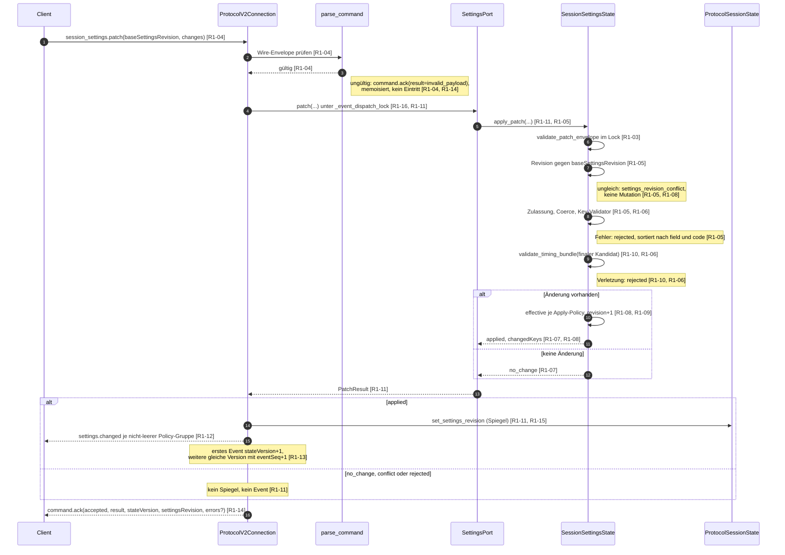
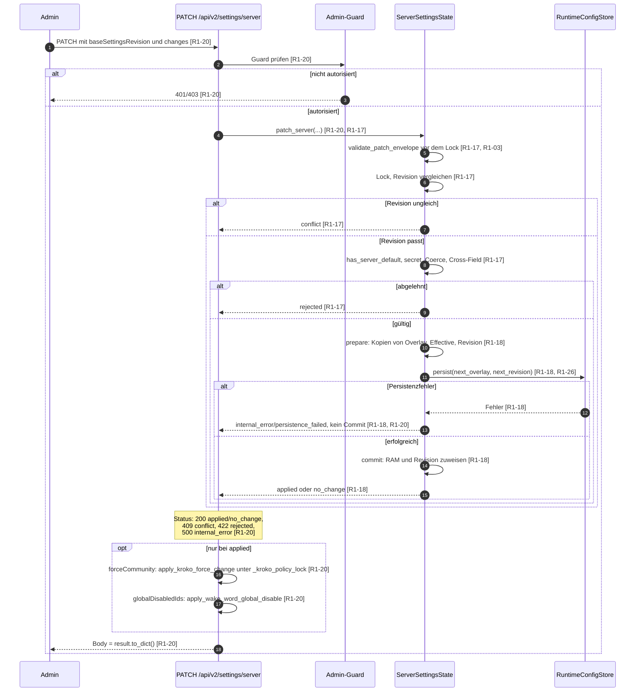
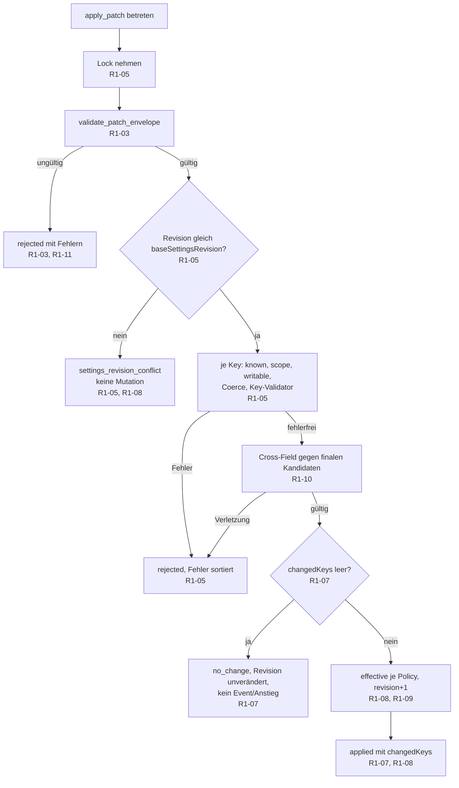

# 03.08 Runtime-Änderungen

*Stand: Commit `a8993c5c68042d996eab680d84a5b138a214bb5d` · Intern abgenommen und integriert (INTEGRATED); externe ROOT-Freigabe ausstehend. Faktenbasis: `workflow/research/03.08.json` (R1-01…R1-26).*

## 1. Worum geht es?

Zur Laufzeit ändern sich Einstellungen nicht nur beim Serverstart. Clients passen Session-Einstellungen über die V2-WebSocket-Verbindung an, Administratoren ändern Server-Defaults über eine REST-Route, und daneben existiert die ältere Admin-Oberfläche unter `/api/config`. Drei Wege, technisch getrennt.

Wie prüft der Server Änderungen, wann übernimmt er sie, wie meldet er Ablehnungen/Konflikte, und warum weiß ein Client danach genau, auf welchem Stand er ist? Drei Gedanken:

1. **Zwei Revisionsströme.** Session und Server haben getrennte `settingsRevision`-Zähler; Server-Patch erhöht keine Session-Revision (R1-01).
2. **Strikter Ablauf.** Erst prüfen, dann anwenden – im Server-Pfad erst nach Persistenz committen. Abgelehnt = keine halben Zustände (R1-05, R1-06, R1-18).
3. **Deterministische Projektion.** Genau ein Ack und – bei echter Änderung – geordnete `settings.changed`-Events; `stateVersion` steigt genau einmal pro Transaktion (R1-11…R1-14).

Legacy `PATCH /api/config` außerhalb dieses Modells: feldweise, keine `settingsRevision`, keine V2-Events, kein V2-Ack (R1-23). Wirksamkeit: [03.09](./03.09-wirksamkeitszeitpunkt.md); Typ-/Werteregeln: [03.04](./03.04-datentypen-und-validierung.md).

## 2. Das Wesentliche auf einen Blick

### 2.1 Session-Patch: Wire-Kommando zum Ack



**In Worten:** Client sendet Basisrevision + Änderungen. Ungültige Hülle → sofort `invalid_payload` ohne Sessionzustand (R1-04). Sonst Patch unter Dispatch-Lock (R1-16): Hülle erneut (R1-03), Revision (R1-05), Keys + Querfeld (R1-05, R1-10). Nur fehlerfrei + echte Änderung → `requested`/`effective`/Revision (R1-06, R1-08). Dann Spiegel + Events, zuletzt Ack (R1-11…R1-15).

Keine Kante Session-Patch → Persistenz: Session-Werte nicht in Datei; nur Server-Overlay (R1-18, R1-26).

### 2.2 Server-Patch: prüfen, persistieren, committen



**In Worten:** Guard zuerst (R1-20). Hülle vor Lock (R1-17), Lock + Revision + Schranken (R1-17). Gültig → Kopien (R1-18) → atomar persistieren → erst dann commit; Fehler → alter Zustand + `internal_error` (R1-18, R1-26). Nur bei `applied` die zwei Seiteneffekte (R1-20).

Kein `settings.changed` aus Server-Patch: Event nur Session-Pfad, hart `scope='session'` (R1-12, R1-N3; vgl. 03.02/S-27).

### 2.3 apply_patch als Entscheidungsbaum



**In Worten:** Lock → Hülle → Revision → Keys → Querfeld (finaler Kandidat) → `no_change` oder Commit (R1-05…R1-10). `no_change` kein Fehler (R1-07). Nur `applied` erhöht Revision + Events.

### 2.4 Warum diese Bauform?

- **Getrennte Revisionen** statt globalem Zähler: Server-Patch zieht Session nicht mit (R1-01). Basisrevision = lokale Session-Angelegenheit.
- **Revision statt ETag/Zeitstempel:** kein ETag, kein Zeitstempel, kein Auto-Retry (R1-08).
- **Persistenz vor Commit:** Kopien → schreiben → zuweisen; Fehler lässt Alten unangetastet (R1-18).
- **Ein Event pro Policy-Gruppe** (fest geordnet, sortiert) statt pro Key (R1-12).
- **Zwei Prüfschichten:** Wire-Parser `invalid_payload` früh (R1-04); Control-Hülle nochmals, als Ablehnung (R1-03, R1-11). REST nutzt Control-Hülle direkt (R1-03).

## 3. Revisionsräume

### 3.1 Session-Revision beginnt bei 0

`hello.accepted` initialisiert Spiegel mit Port-Revision (= Session-Revision, Start 0); Port speichert nichts (R1-02). Frische Session → erster Patch mit Basis 0 → danach 1; `no_change`/Konflikt/Ablehnung ändern nichts (R1-06, R1-07).

### 3.2 Server-Revision aus Dokument

Aus persistiertem Zustand geladen (R1-22, R1-26). Erfolgreich +1; Fehler unverändert (R1-18). Server-Patch erhöht Session-Revision nicht (R1-01). Neue Sessions aus `server_effective` gespeist (Startwerte), Revision trotzdem 0 (R1-01).

| Raum | Start | Fortschritt | Autorität |
|---|---|---|---|
| Session | 0 bei Admission (R1-02) | +1 pro `applied` (R1-08) | Sessionzustand; Port liest (R1-02) |
| Server | Dokument; fehlend 0 (R1-22, R1-26) | +1 pro `applied` (R1-18) | `ServerSettingsState` + Persistenz (R1-01, R1-26) |

Clients: Session-`baseSettingsRevision` keine globale Serverversion; Admin-Patch macht Client-Basis nicht automatisch veraltet (R1-01). Betreiber: Server-Patch dauerhaft, Session-Patch nicht; nur Overlay persistiert (R1-18, R1-26).

## 4. Vorstufen

### 4.1 Control-Hülle (`validate_patch_envelope`)

Nur Form: `baseSettingsRevision` int/nicht-bool/≥ 0 (sonst `invalid_type`/`out_of_range`, Feld `baseSettingsRevision`); `changes` nicht-leeres Objekt (sonst `invalid_type`, Feld `changes`). Keine Schlüssel/Werte (R1-03). In `apply_patch` im Lock, in `patch_server` vor Lock (R1-03). Kein eigener Validate-Endpunkt (R1-N1).

### 4.2 Wire-Vorstufe (`parse_command`)

Strenger: ungültige Hülle → `RESULT_INVALID_PAYLOAD` → `invalid_payload`, vor Sessionzustand; Ack + Replay-Memo trotzdem (R1-04). Frühfilter; REST nutzt Control-Hülle (R1-04).

| Schicht | Prüft | Fehler | Gültigkeit |
|---|---|---|---|
| Wire-Parser | Nachrichtenform Session-Patch | `invalid_payload` + Memo-Ack (R1-04) | nur V2-Wire |
| Control-Hülle | `baseSettingsRevision`, `changes` | `invalid_type`/`out_of_range` (R1-03) | Session + Server |
| Key/Wert | Keys, Typen, Werte | `unknown_key`, `wrong_scope`, … (R1-05) | Session + Server; Typen = 03.04 |

Inhaltliche Typ-/Werteregeln: [03.04](./03.04-datentypen-und-validierung.md).

## 5. `apply_patch`

### 5.1 Reihenfolge

Lock → Hülle im Lock → Revision (Konflikt ohne Mutation) → pro Key (unbekannt→`unknown_key`, server→`wrong_scope`, unwritable→`read_only`, Coerce, Key-Validator) → fehlerfrei → Cross-Field finaler Kandidat → Fehler sortiert `(field, code)` → `rejected` (R1-05). Konflikt vor Keys; Querfeld vor Schreiben (R1-05, R1-10).

### 5.2 Atomarität + ehrlicher Restzweig

`_requested`/`_effective`/`_revision` erst fehlerfrei gemeinsam; Revision +1; Ablehnung weder Mutation noch Erhöhung (R1-06). Zweig `if not coerced → invalid_payload` praktisch unerreichbar (Erreichbarkeit nicht belegt, R1-06/R1-N6/C-03) – kein regulärer Zustand, kein Diagrammzweig.

### 5.3 `changedKeys`, `no_change`, Revision

`changedKeys` = coercte vs. `_requested` (nicht `_effective`), sortiert (R1-07). Keine Änderung → `accepted`/`no_change`, Revision unverändert, `changed_keys=()`, kein Event/Anstieg (R1-07). Revision +1 pro `applied`; RLock serialisiert (gleiche Basis → ein applied + ein Konflikt); lückenlos; kein ETag/Zeitstempel/Retry (R1-08).

| Ergebnis | Wann | Wirkung |
|---|---|---|
| `applied` | Änderung + bestanden | aktualisiert, `changedKeys` (R1-06, R1-08) |
| `no_change` | gültig, kein Unterschied | unverändert, kein Event (R1-07) |
| `settings_rejected` | Key-/Cross-Field-Fehler | keine Mutation (R1-05, R1-06) |
| `settings_revision_conflict` | Basis veraltet | keine Mutation (R1-05, R1-08) |

### 5.4 Policy-Auflösung + Freeze

`live`/`next_activation` → `next_effective`; `next_session`/`server_restart` → laufend bleibt (R1-09). `freeze_activation` nur `next_activation`, nie `live` (R1-09). Praktische Wirkung: [03.09](./03.09-wirksamkeitszeitpunkt.md).

### 5.5 Cross-Field

Läuft bei einem der drei Timing-Keys in `changes`; vergleicht Warnung strikt (`<`) gegen finale Fristen; `warning >= deadline` → `cross_field_conflict` (R1-10). Bool/Nicht-Int übersprungen. Gilt Patch (Session + Server) und Startup (R1-10). Summe, nicht Einzel-Key.

## 6. Ack und Events

### 6.1 1:1-Projektion

| Fachlich | Ack | Spiegel/Events |
|---|---|---|
| `applied` | `applied` | `set_settings_revision` + `settings.changed` (R1-11, R1-15) |
| `no_change` | `no_change` | nichts (R1-11) |
| `conflict` | `conflict` | nichts (R1-11) |
| `rejected` | `rejected` | nichts (R1-11) |
| `internal_error` | – | nur Server (R1-11, R1-18) |

### 6.2 Gruppierung `POLICY_EVENT_ORDER`

`live`, `next_activation`, `next_session`, `server_restart`; Keys sortiert; pro nicht-leerer Gruppe genau ein Event (`settingsRevision`, `scope='session'`, `changedKeys`, `applyPolicy`); leere → keins (R1-12). Scope hart `'session'`; server-scoped Event existiert nicht (R1-12, R1-N3; 03.02/S-27). `server_restart`-Gruppe mit Registry unerreichbar (R1-12, R1-19).

Beispiel: zwei Policy-Gruppen → zwei Events, gleiche `settingsRevision`; erstes `stateVersion`+1, zweites gleiche Version, `eventSeq`+1 (R1-12, R1-13).

### 6.3 Genau ein `stateVersion`-Anstieg

Nur erstes `settings.changed` mit `state_change=True`; Rest gleiche Version, `eventSeq`+1; Ack aktuelle Version; rejected/no_change kein Anstieg (R1-13). Ein Patch = mehrere Events möglich, aber ein Versionssprung. Events gehören zusammen.

### 6.4 Ack-Form (schematisch, keine Beispielwerte)

```text
command.ack (schematisch, Felder u. a.)
├─ type, protocolVersion, sessionId, commandId
├─ accepted, result
├─ activationId, inputPhase
├─ stateVersion, settingsRevision
└─ errors?  [{ field, code, message }]
```

`accepted=true` nur `applied`/`no_change`. `errors` = sortierte Fehler bei Ablehnung (R1-14). Replay → memoisiertes Ack verbatim, kein zweites Event; `commandId`-Konflikt wirkungslos (R1-14). Retry-Zustellung: [04.04](../04-schnittstellen/04.04-commands-acknowledgements.md), [04.06](../04-schnittstellen/04.06-eventtransport.md) (R1-N7).

### 6.5 Spiegel ≠ Projektion

Spiegel nur bei `applied` (nur bei Änderung); sonst unverändert (R1-15). Snapshot aus **einer atomaren Projektion** (nicht Spiegel); Spiegel nur für Acks (R1-15). Latch + Suppression nach Projektion überlagert (R1-15). `snapshot.request` → Ack + zusätzlicher Snapshot (R1-15). Wahrheit = Projektion, nicht rekonstruierte Acks; Sync: [04.07](../04-schnittstellen/04.07-snapshot-synchronisierung.md).

### 6.6 Linearisierung

Patch-Block (Mutation, Spiegel, Events) + Snapshot-Bau unter `_event_dispatch_lock` (RLock, Reentrancy beabsichtigt) (R1-16). Kein Snapshot zwischen Commit N+1 und Spiegel/Event N; kein Überholen (R1-16). Pro Verbindung. Kein „halber“ Zustand nach Ack+Snapshot.

## 7. `patch_server`

### 7.1 Schranken + Hüllen-Reihenfolge

Hülle **vor** Lock (anders als apply_patch) (R1-17, R1-03). Im Lock: unbekannt → `unknown_key`; !`has_server_default` → `wrong_scope`; secret → `read_only`; Coerce; Cross-Field gegen Overlay-Kopie (R1-17). `selection`/Suppression nicht patchbar; `activation.*` als Server-Default patchbar (R1-17). Wirkung: [03.09](./03.09-wirksamkeitszeitpunkt.md).

### 7.2 Prepare → Persist → Commit

Kopien → `persist` in try/except → Fehler: `accepted=False`/`internal_error`/`persistence_failed` (Feld persistence), RAM+Revision unverändert → erst dann Zuweisung (R1-18). `next_effective` ohne `server_restart` (R1-18). Retry gleiche Basis möglich, lückenlos (R1-18). Format: [03.10](./03.10-persistenz.md) (R1-18, R1-26).

### 7.3 Status-Mapping

| Situation | Status | Body |
|---|---|---|
| `applied`/`no_change` | 200 | `result.to_dict()` (R1-20) |
| Konflikt | 409 | `conflict` (R1-20) |
| abgelehnt | 422 | `rejected` (R1-20) |
| Persistenzfehler | 500 | `internal_error`/`persistence_failed` (R1-18, R1-20) |
| Guard verweigert | 401/403 | vor Patch (R1-20) |

`400` **kein regulärer Ausgang**: Zweig wegen `payload: dict` praktisch unerreichbar (R1-20, R1-N6, C-03).

### 7.4 Nur bei `applied`: zwei Seiteneffekte

`forceCommunity` → `apply_kroko_force_change` (unter Policy-Lock); `globalDisabledIds` → `apply_wake_word_global_disable` (R1-20). Fachwirkung: [03.09](./03.09-wirksamkeitszeitpunkt.md) + Fachkapitel.

### 7.5 Lesen ohne Key

`GET /api/v2/settings/schema` (Versionen, `secretsExposed: false`, sortierte Liste) und `GET /api/v2/settings/server` (`settingsRevision`, je Eintrag Key/Metadaten/`requestedValue`/`effectiveValue`/`applyPolicy`, Secrets `redacted: true`) (R1-21). Mutieren nichts, keine Events (R1-21). Diagnose/Anzeige, kein Schreibweg.

### 7.6 Startup: fail fast

`ValueError` bei: Revision Bool/negativ, Overlay kein Objekt, unbekannt/!has_server_default, secret, Coerce-Fehler + Code, Cross-Field Defaults+geladen (R1-22). Danach Auffüllen aus `server_default_keys()` (R1-22). Beschädigt = kein Start statt halb konfiguriert. Format: [03.10](./03.10-persistenz.md).

### 7.7 `requiresRestart`: implementiert, unerreichbar

Mechanik ja; kein Builtin-Key mit `APPLY_SERVER_RESTART` → nie im Body, Gruppe nie belegt (R1-19, R1-N2). Nicht als Kante gezeichnet. Wer es erwartet: Grenze kennen (C-03).

## 8. Legacy: PATCH, Validate, Reload

Legacy = ältere Admin-Oberfläche `/api/config`, **nicht** V2-Revisions/Eventmodell. Prioritäten/Rolle: [03.05](./03.05-quellen-und-prioritaeten.md).

### 8.1 `PATCH /api/config` → `update_settings`

Feldweise (R1-23): STARTUP_ONLY → `startup_only`; unbekannt → `unknown`; Coerce-Fehler → `invalid_value`; `log_live` ohne `event_store` → `invalid_dependency` (entfernt). Erfolg: `{value, appliesTo}` (`model_refresh`/`active_sessions`/`new_sessions`). Antwort `{applied,rejected,settings,runtimeSettings,modelRefreshRequired}`; 400 bei Ablehnungen, sonst 200; Nicht-Objekt → 400 (R1-23). Bei `applied` persistiert + auditiert. **Keine** Revision/Events/Ack – zentraler Unterschied (R1-23).

### 8.2 `POST /api/config/validate`

Kandidat: `replace(settings)`, `hasattr` (unbekannt → ValueError), `DERIVED` verboten, Coerce, `__post_init__`, `enforce_cpu_model_policy`. 200 `{valid:true,settings:public_dict}` / 400 `{valid:false,error}` (R1-24). Keine Zuweisung/Persistenz/Revision. Legacy-Modell, nicht Registry (R1-24). Kein dedizierter Test in gesichteten Dateien (Evidenz B, R1-24).

### 8.3 `POST /api/config/reload`

`load()` → `model_updates` (feste Menge) + `runtime_updates` (Schnitt ACTIVE|NEW_SESSION) + `skipped` Rest; `update_settings(runtime)` läuft immer (leeres Dict = No-op mit `applied={}`); `to_thread(switch_models, model)` nur wenn nicht leer. Antwort `{runtime,models,skipped}`; Fehler → 400. Nur Legacy-Sektion, nicht Overlay (R1-25). Kein Test gefunden (B, R1-N5).

### 8.4 Abgrenzung

Kein Revisionsstrom, keine deterministische Ack/Event-Projektion – eigener Admin-Weg mit feldweiser Rückmeldung + eigener Persistenz (R1-23…R1-25).

## 9. Persistenz-Rand

Randthema (nur Server-Pfad); Formatautorität [03.10](./03.10-persistenz.md). **Ein** Dokument, **zwei** Familien (`OVERLAY_FIELD`, `REVISION_FIELD`); Read-modify-write unter Modul-Lock, atomar temp→`os.replace`; Exception → Temp weg, Original bleibt, Reraise (R1-26). Laden: unlesbar/Nicht-Objekt/falscher Typ/Revision-Bool/negativ → ValueError; fehlend → `({}, 0)`. Save normalisiert Revision (Bool→0, <0→0) (R1-26). Server-Patch entweder dauerhaft oder gar nicht; Session-Patch erreicht Datei nicht (R1-18, R1-26).

## 10. Grenzen und offene Punkte

### 10.1 Nicht implementiert

| ID | Grenze |
|---|---|
| R1-N1 | Kein `POST /api/v2/settings/validate`; nur interne Vorstufen + Legacy-Validate. |
| R1-N2 | `requiresRestart`/`server_restart` codiert, von keinem Key ausgelöst. |
| R1-N3 | Kein server-scoped `settings.changed`. |

### 10.2 Offen / nicht belegt

| ID | Punkt |
|---|---|
| R1-N4 | Branch nicht nachweisbar; nur Commit. |
| R1-N5 | Kein Test für Legacy-Reload gefunden. |
| R1-N6 | `if not coerced` + Nicht-Objekt-Body: Code da, Erreichbarkeit nicht belegt. |
| R1-N7 | Retry-Wiederauslieferung erzeugter Events offen (04.04/04.06). |
| R1-N8 | `ports.py`-Kommentar historisch; Code gebunden. |

### 10.3 Konflikte

| ID | Konflikt |
|---|---|
| C-01 | Branch vs. detached `FETCH_HEAD`: nur Commit verifizierbar. |
| C-02 | Historischer Vor-Bindungs-Kommentar nicht zitieren. |
| C-03 | Unerreichbare Pfade nicht als Zustände zeichnen. |

### 10.4 Ausdrücklich nicht behauptet

- Keine Kante Server-Patch → `settings.changed` (R1-12, R1-N3).
- Keine Kante Session-Patch → Persistenz (R1-18, R1-26).
- `requiresRestart` kein regulärer Ausgang (R1-19, R1-N2).
- `400` kein regulärer V2-Server-PATCH-Ausgang (R1-20, C-03).
- Typen/Werte: [03.04](./03.04-datentypen-und-validierung.md). Apply-Wirkung: [03.09](./03.09-wirksamkeitszeitpunkt.md). Format: [03.10](./03.10-persistenz.md).

## 11. Siehe auch / Nachweise

**Verwandt:** [03.02](./03.02-scopes.md) (S-27) · [03.04](./03.04-datentypen-und-validierung.md) (V1-09…V1-20) · [03.05](./03.05-quellen-und-prioritaeten.md) · [03.06](./03.06-server-einstellungen.md) · [03.07](./03.07-session-einstellungen.md) · [03.09](./03.09-wirksamkeitszeitpunkt.md) · [03.10](./03.10-persistenz.md) · [04.04](../04-schnittstellen/04.04-commands-acknowledgements.md) · [04.06](../04-schnittstellen/04.06-eventtransport.md) · [04.07](../04-schnittstellen/04.07-snapshot-synchronisierung.md) · [08.03](../08-referenzen/08.03-settings-katalog.md) · [08.04](../08-referenzen/08.04-api-endpunkt-katalog.md)

**Fakten (R1-01…R1-26):** Revisionströme (R1-01, R1-02) · Hüllen (R1-03, R1-04) · apply_patch (R1-05…R1-10) · Ack/Events (R1-11…R1-16) · patch_server (R1-17…R1-22) · Legacy (R1-23…R1-25) · Persistenz-Rand (R1-26) · N/R1-N/U R1-N4…R1-N8/C-01…C-03 siehe §10.

**Codebelege:** `settings_control.py` (State, Hülle, Cross-Field, POLICY_ORDER, patch_server) · `connection.py` (apply/bind/emit/ack/memoise, Lock, Snapshot) · `ports.py`/`session.py` (Port/Spiegel/mint) · `commands.py` (Parser, is_accepted) · `schema.py`/`snapshot.py` (Codes, Projektion) · `server.py` (Routen, Projektion, update/validate/reload) · `operations.py` (Store).
