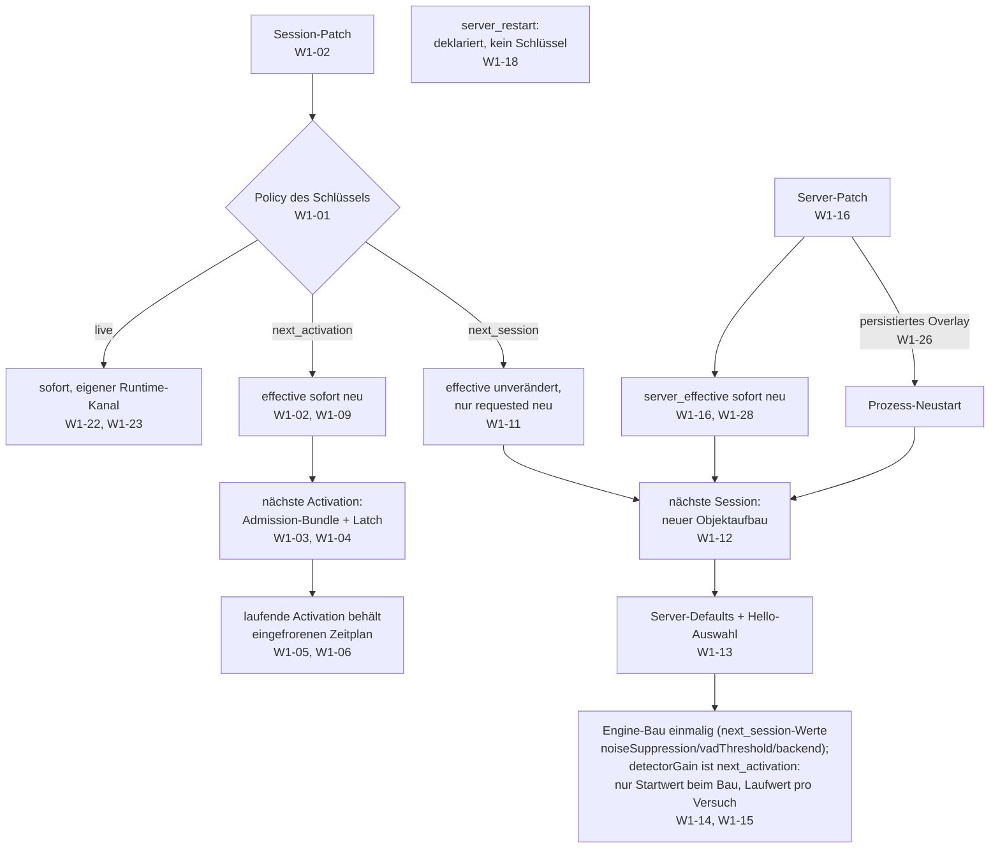
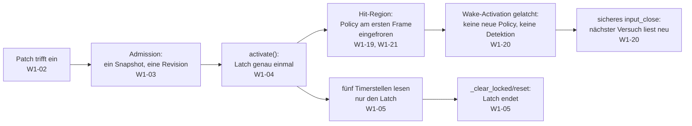
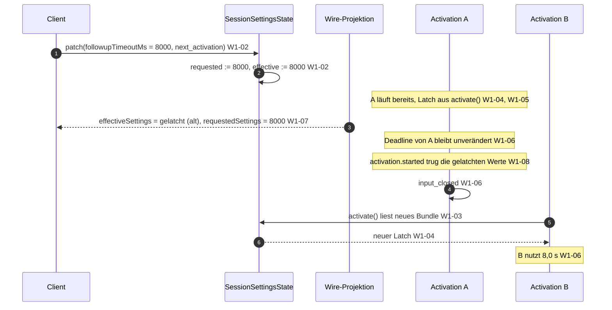

# 03.09 – Wirksamkeitszeitpunkt

*Stand: Commit `a8993c5c68042d996eab680d84a5b138a214bb5d` · Intern abgenommen und integriert (INTEGRATED); externe ROOT-Freigabe ausstehend. Faktenbasis: `workflow/research/03.09.json` (W1-01…W1-28).*

## 1. Worum geht es?

Wer eine Einstellung ändert, fragt „ab wann gilt das?“ – je nach Schlüssel und Situation gibt es unterschiedliche Antworten:

1. **Sofort heißt nicht „überall sofort“.** Wirklich sofort: Runtime-Suppression einer Session (W1-22) und `kroko.forceCommunity` (W1-23). Eigene Wirkungspfade, keine allgemeinen Patch-Bahnen.
2. **Nächste Activation = Latch-Grenze.** `next_activation`-Patch setzt Zustand sofort neu – laufende Activation behält eingefrorenen Zeitplan bis Ende (W1-02, W1-05, W1-06). Im Wake-Pfad zusätzlich: Hit-Region friert Policy am ersten Prediction-Frame ein (W1-19).
3. **Nächster Aufbau = Objektgrenze.** `next_session`-Werte werden nicht hochgezogen; kein Promotions-/Commit-/Rebuild-Pfad; erst neu konstruierte Session liest neue Werte – inkl. einmaligem Wake-Engine-Bau (W1-11…W1-14). Server-Defaults: `server_effective` sofort neu, bestehende Sessions erben erst beim Aufbau (W1-16, W1-17).

Neustart rettet nur persistiertes Server-Overlay; Session-Einstellungen überleben nicht (W1-26). Politik `server_restart` deklariert, aber ohne eingebauten Schlüssel (W1-18) – kein Alltags-Werkzeug.

**Fehlannahme:** „`followupTimeoutMs` auf 8.000 ms gesetzt, aber laufende Activation wartet mit altem Wert.“ Korrekt so: Zustand kennt Neues, offene Activation immun, erst nächste Activation latcht Neues. Draht-Erkennung: §4.

Nicht hier: Patch-Prüfung/Quittierung ([03.08](./03.08-runtime-aenderungen.md)), Typen/Wertebereiche ([03.04](./03.04-datentypen-und-validierung.md)), Einzelwerte ([03.06](./03.06-server-einstellungen.md), [03.07](./03.07-session-einstellungen.md)).

## 2. Das Wesentliche auf einen Blick

### 2.1 Wirksamkeits-Zeitlinie

**In Worten:** Jeder angenommene Session-Patch schreibt `requested` fort (W1-02); `live`-Keys und falscher Scope werden abgewiesen und schreiben nichts (W1-22, E1-15/E1-16). `live` → eigener Kanal (Session nicht patchbar, W1-22; Server: synchrone Freigabe-Invalidierung, W1-23). `next_activation` → `effective` sofort (im Idle direkt für nächste Activation, W1-09); offene Activation liest gelatchten Snapshot (W1-05). `next_session` → `effective` steht (W1-11); neuer Objektaufbau mit Defaults + Hello-Auswahl (W1-12, W1-13), Engine-Bau einmalig (W1-14). Server-Patch → `server_effective` sofort neu außer `server_restart` (W1-16); bestehende unverändert, neue erben (W1-17). Neustart trägt nur Overlay (W1-26).

`server_restart` bewusst **ohne Pfeil**: deklariert, kein Schlüssel nutzt sie (W1-18). Ebenso fehlen bewusst: Rebuild-Pfeil Patch→laufende Session (nicht existent, W1-12), `freeze_activation()`-Aufruf (produktiv ungenutzt, W1-10).

### 2.2 Freeze-Punkte

**In Worten:** Eingefroren wird an benannten Punkten: Admission (ein Snapshot: Revision + Effective + Zeiten, W1-03); `activate()` latcht genau einmal (W1-04), alle Timer lesen nur Snapshot (W1-05); Hit-Region friert Policy am ersten Prediction-Frame (W1-19, W1-21); gelatchte Wake-Activation: keine neue Policy/Detektion (W1-20); erst `input_close` gibt frei (W1-20).

Konsequenz: Wake-Schwelle mitten im Versuch ändern = keine Wirkung mittendrin – gewollt, sonst halb-alte/halb-neue Bewertung.

## 3. Vier Policies – Auflösung nur benannt

Genau vier öffentliche Politiken, ohne Synonyme: `live`, `next_activation`, `next_session`, `server_restart` (W1-01). Reihenfolge fixiert (Event-Gruppierung, W1-01, W1-27).

| Politik | Grenze | Session-Patch | Server-Patch |
|---|---|---|---|
| `live` | eigener Runtime-Kanal | nicht patchbar; Suppression nächste Admissions (W1-22) | Freigabe synchron invalidiert, Abgleich ggf. deferred (W1-23) |
| `next_activation` | nächste Activation | `effective` sofort; offene gelatcht (W1-02, W1-05) | – |
| `next_session` | nächster Objektaufbau | nur `requested`, `effective` bleibt (W1-11) | teils sofort (W1-28) |
| `server_restart` | Prozessneustart | deklariert, kein Schlüssel (W1-18) | ebenso; Neustart trägt nur Overlay (W1-26) |

Auflösung (`live`/`next_activation` → sofort effective; Rest → nur requested): W1-02. Wie Politik zum Schlüssel kommt, Hüllenvalidierung: [03.08](./03.08-runtime-aenderungen.md); Typen/Werte: [03.04](./03.04-datentypen-und-validierung.md); Quellen: [03.05](./03.05-quellen-und-prioritaeten.md).

## 4. Nächste Activation: Schnappschuss, Latch, fünf Timer

### 4.1 Atomarer Lesezeitpunkt nötig

Activation braucht Werte + Revision + Zeiten gleichzeitig. Nacheinander lesen → Patch dazwischen → Revision alt, Zeiten neu. Admission-Bundle verhindert das: ein Lock-Snapshot (`settingsRevision`, `effectiveSettings`, `timing_seconds` ms→s), nie zwei Revisionen gemischt (W1-03). Race-Tests prüfen genau das.

### 4.2 Drei Wege, ein Latch

Drei Aufrufer bauen Eingaben über denselben Helfer: Bundle → Overlay → `ActivationTimingPolicy` (W1-04). Controller latcht genau einmal in `activate()` (W1-04). Danach alle fünf Timerstellen nur Snapshot; Latch-Ende `_clear_locked`/Reset (W1-05).

Legacy: v2 an kanonische IDs gebunden; Legacy-Zweig → Konstruktor-Defaults (W1-04). Kein automatisches v2-Timing-Erben.

### 4.3 Beleg: A bleibt, B lernt

Patch 8000 ms während A: Zustand kennt neu (W1-02), Draht zeigt gelatcht + Wunsch 8000 (W1-07). A endet alt (W1-06); `activation.started` + Ledger trugen Latch-Werte (W1-08). B latcht neu 8,0 s (W1-03, W1-04, W1-06). Zahlen = Testwerte; Ausgang = zuvor gelatcht. Weitere Timings: [08.06](../08-referenzen/08.06-timing-katalog.md).

### 4.4 Leerlauf einfach

Keine offene Activation → `next_activation` sofort `effective`, gilt nächste (W1-09). Wert, Effective-Sicht, Freeze-Zeit stimmen überein.

### 4.5 Naht nicht zeichnen

`freeze_activation()` + `activation_timings_seconds()` produktiv ungenutzt (nur Tests); real: `activation_admission_settings` (W1-10). Tot – keine Diagrammkante.

### 4.6 Wake: feinere Grenze

Erkenner friert Attempt-Policy am ersten Prediction-Frame (Threshold, Min-Frames, Gain, Cooldown, Pre-Roll, W1-19). Pre-Roll aus Snapshot; Recorder-Wert nur Startwert (W1-21). Gelatchte Wake-Activation: keine neue Policy/Detektion; erst sicheres `input_close` öffnet (W1-20). Details: [02.04](../02-funktionsweise/02.04-wake-word.md).

## 5. Nächster Aufbau: neue Session, keine Nachziehung

### 5.1 `next_session` in Session

Nur `requested` neu; `effective` bleibt Session-Leben lang (W1-11). Kein Promotions-/Commit-/Rebuild-Pfad; Stream-Stop/Start baut nichts neu – Recorder einmalig (W1-12). „Nächste Session“ = neues Objekt, wörtlich.

### 5.2 Keine Erbschaft

Neue Session erbt Vorgänger-Patches nicht: Server-Defaults + Hello-Auswahl (W1-13). Nie persistiert. `next_session`-Patch wirkt nur bei Wiederholung im neuen `hello`; sonst Fallback auf Defaults – definiert, kein Fehler. Lebenszyklus/Hello: [02.01](../02-funktionsweise/02.01-session-management.md), [04.03](../04-schnittstellen/04.03-websocket-v2.md).

Testbeispiel: Auswahl `hey_jarvis` → `requested`, `effective` leer (W1-11); erst nächste Session mit Hello wirksam.

### 5.3 Engine-Bau einmalig

`next_session`-Wake-Werte nur Engine-Bau aus Effective-Sicht der Admission (W1-14). Kein Rebuild nach Patch. `detectorGain` ist `next_activation`, nicht `next_session`: nur Startwert beim Bau gelesen, Laufwert pro Versuch aus eingefrorenem Snapshot (W1-15). Laufzeit-Gain-Änderung ≠ laufende Erkennung; Startwert nächsten Baus + nächster Versuch. Engine: [02.06](../02-funktionsweise/02.06-engines.md).

### 5.4 Server-Defaults sofort, aber nicht rückwirkend

Server-Patch: `server_effective` sofort neu (außer `server_restart`, W1-16). Bestehende unverändert; neue erben (W1-17). Nur Keys mit Server-Default-Charakter.

### 5.5 Sonderfall Server-`next_session` teils sofort

`globalDisabledIds` → sofort Katalog + live angekündigt; `inferenceBackend` → pro Admission gelesen; nur Engine wartet Session-Bau (W1-28). Aus `next_session` folgt nicht „nichts vor nächster Session“ – dokumentierte Spannung, nicht wegdefiniert.

## 6. Live: wirklich sofortige Pfade

### 6.1 Session-Suppression

Kein Patch-Schlüssel, eigene Autorität (W1-22). Nur nächste Admissions; beendet keine laufende Activation. Kein `settings.changed`; Advance im Verbindungszustand (W1-22). Auch via Hello mitgebbar.

Laufende Aufnahme „sofort“ beenden ≠ Suppression (nur nächster Trigger). Beenden: Activation-Controller ([02.03 Activation](../02-funktionsweise/02.03-activation.md)).

### 6.2 `kroko.forceCommunity`

Server-`live`: synchrone Pro-Freigabe-Invalidierung im Patch (Lock), Reconcile im Daemon, bei Arbeit aufgeschoben (W1-23). „Sofort“ = Freigabe-Entscheidung, nicht jeder Modellwechsel. Lizenz: [05.07](../05-administration/05.07-kroko-lizenzierung.md).

## 7. Modellwechsel und Neustart

### 7.1 STT-Wechsel: Wunsch sofort, Aktivierung via Refresh

Gehört zu `model_refresh`, nicht zu den vier Session-Politiken: Wunsch sofort gespeichert, Aktivierung erst `POST /api/models/refresh` und nur ohne laufende Arbeit; dann Scheduler-Tausch (W1-24). Bei Arbeit Abbruch + Rollback (W1-24). Lifecycle: [02.07](../02-funktionsweise/02.07-modelle-und-modellverwaltung.md); Route: [08.04](../08-referenzen/08.04-api-endpunkt-katalog.md).

Offen: idle v2-Session nach Tausch garantiert neues Modell? Code deutet an, kein Test (W1-24 UNKNOWN).

### 7.2 Neustart: nur Overlay überlebt

Prozessneustart lädt nur Server-Overlay (+Revision); validiert (W1-26). Session-Einstellungen nie persistiert. Formate: [03.10](./03.10-persistenz.md).

### 7.3 `server_restart` kein Betriebswerkzeug

Implementiert, kein Builtin-Schlüssel; `requiresRestart` unerreichbar (W1-18). Nicht auf Hinweis warten; keine „wird erst nach Neustart wirksam“-Kante annehmen (W1-18).

## 8. Legacy: drei Mengen, ein Etikett

Parallel Registry: `activeSessionSafe`, `newSessionOnly`, `startupOnly` (W1-25). `appliesTo` nur Label: sofort ins gemeinsame Objekt geschrieben; Session kopiert bei Konstruktion (W1-25). Aus `startupOnly` folgt „erst nach Neustart“ nicht – aus Etikett abgeleitet, nicht aus Pfad.

Sonderfall: `stt_*` in Legacy-Menge UND Modellverwaltung → Antwort `model_refresh` hat Vorrang (W1-25). Abgrenzung: [04.12](../04-schnittstellen/04.12-legacy-v1.md), [03.08](./03.08-runtime-aenderungen.md).

## 9. Draht-Sicht

`settings.changed` nach Politik gruppiert, fest; eine Transaktion = genau ein `stateVersion`-Anstieg, alle Events gleiche Revision (W1-27). Ein Patch-Gruppen als ein Zustandswechsel verarbeiten.

| Beobachtung | Bedeutung |
|---|---|
| `requested` neu, `effective` alt bei offener Activation | gelatcht; immun (W1-07) |
| `activation.started.effectiveSettings` weicht ab | Event trägt Latch, nicht Live (W1-08) |
| Mehrere Policy-Gruppen, gleiche `stateVersion` | eine Transaktion, gruppiert (W1-27) |
| `requested` neu, `effective` dauerhaft alt | `next_session`; erst neues Objekt (W1-11, W1-12) |

Hülle/Reihenfolge: [04.06](../04-schnittstellen/04.06-eventtransport.md), [08.01](../08-referenzen/08.01-event-katalog.md).

## 10. Grenzen und Konflikte

**Nicht implementiert (keine Kante):** kein `next_session→effective`-Seam (auch Stream-Stop/Start baut nichts, W1-12); keine Vererbung in nächste Session/nie persistiert (W1-13); kein Engine-Rebuild nach Patch (W1-14); kein `server_restart`-Schlüssel (W1-18); `freeze_activation()` produktiv ungenutzt (W1-10).

**Unbekannt:** idle v2-Session nach Scheduler-Tausch garantiert neues Modell? angedeutet, kein Test (W1-24). Branch nicht als Ref verifizierbar; nur Commit (META-branch).

**Spannungen (dokumentiert):** `stt_*` zwei Zuständigkeiten, Vorrang `model_refresh` (W1-25). Server-`next_session` ungleich: Katalog sofort + angekündigt, Backend pro Admission, Engine erst Bau (W1-28).

## 11. Siehe auch / Nachweise

**Verwandt:** [03.08](./03.08-runtime-aenderungen.md) · [03.04](./03.04-datentypen-und-validierung.md) · [03.05](./03.05-quellen-und-prioritaeten.md) · [03.06](./03.06-server-einstellungen.md) · [03.07](./03.07-session-einstellungen.md) · [03.10](./03.10-persistenz.md) · [02.01](../02-funktionsweise/02.01-session-management.md) · [02.03](../02-funktionsweise/02.03-activation.md) · [02.04](../02-funktionsweise/02.04-wake-word.md) · [02.07](../02-funktionsweise/02.07-modelle-und-modellverwaltung.md) · [08.03](../08-referenzen/08.03-settings-katalog.md) · [08.06](../08-referenzen/08.06-timing-katalog.md)

**Fakten (W1-01…W1-28):** Politiken (W1-01, W1-02) · Admission/Bundle/Latch (W1-03, W1-04) · Immunität (W1-05) + A/B-Beleg (W1-06) · Draht-Latch (W1-07, W1-08) · Idle (W1-09) · tote Naht (W1-10) · Aufbau (W1-11…W1-15) · Server-Seite (W1-16…W1-18) · Wake-Freeze (W1-19…W1-21) · Live (W1-22, W1-23) · Wechsel/Neustart (W1-24, W1-26) · Legacy (W1-25) · Events (W1-27) · Server-nuanciert (W1-28).

**Gliederung:** §1 Einordnung/drei Grenzen · §2 Zeitlinie/Freeze (W1-01, W1-02, W1-05…W1-11, W1-13…W1-23, W1-26, W1-28; Draht-Latch W1-07, gelatchte Events W1-08, tote Naht W1-10) · §3 Politiken (W1-01, W1-02) · §4 nächste Activation (W1-03…W1-10, W1-19…W1-21) · §5 nächster Aufbau (W1-11…W1-17, W1-28) · §6 Live (W1-22, W1-23) · §7 Wechsel/Neustart (W1-18, W1-24, W1-26) · §8 Legacy (W1-25) · §9 Events (W1-27) · §10 Grenzen.
