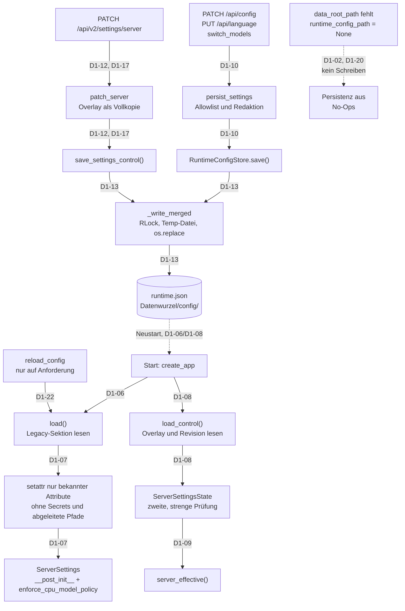
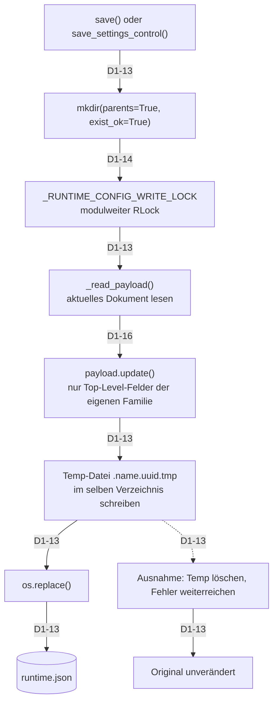

# 03.10 Persistenz

*Stand: Commit `a8993c5c68042d996eab680d84a5b138a214bb5d` · Intern abgenommen und integriert (INTEGRATED); externe ROOT-Freigabe ausstehend. Faktenbasis: `workflow/research/03.10.json` (D1-01…D1-24).*

## 1. Worum geht es?

Der Server kann Einstellungen über einen Neustart hinweg behalten. Dafür gibt es genau **eine Datei**: `runtime.json` im Datenverzeichnis. Zwei Familien teilen sie:

- **Legacy-Sektion** `settings` – via `PATCH /api/config`, `PUT /api/language`, Modellwechsel;
- **V2-Server-Overlay** `settingsControlOverlay` + `settingsRevision` – via `PATCH /api/v2/settings/server`.

Beide teilen ein Dokument, müssen einander stehen lassen. Kern: kleine JSON-Datei, zwei Schreiber, zwei Lesepfade, sehr unterschiedliche Strenge.

Praxisrelevanz:

1. **Nach Neustart** entscheidet die Datei, was gilt – und ob gestartet wird.
2. **Im Container** hängt Überleben am Bind-Mount; ohne Datenwurzel keine Persistenz.
3. **Im Fehlerfall** kann kaputte Datei Start blockieren; zur Laufzeit kaputte wird beim Schreiben still ersetzt.

Weg: **Ort → Form → Laden → Speichern → Konflikte → Fehler → Grenzen.** Log-Retention/SQLite nicht hier – nur Konfigurationsdatei. Ebenen/Prioritäten: [03.05](./03.05-quellen-und-prioritaeten.md); V2-Mechanik: [03.08](./03.08-runtime-aenderungen.md).

## 2. Das Wesentliche auf einen Blick

### 2.1 Lebenszyklus der Datei



**In Worten:** Start: zwei Lesepfade – `load()` → `ServerSettings`-Anwendung; `load_control()` → streng validierter `ServerSettingsState` (D1-06…D1-09). Laufzeit: zwei Familien – Legacy via `persist_settings`/`save()`, V2 via `patch_server`/`save_settings_control()` (D1-10…D1-12, D1-17). Beide enden in `_write_merged` (D1-13). Neustart beginnt von vorn.

Nicht im Bild: Kante Session→Datei (existiert nicht, D1-18); Cross-Prozess-Lock; Migration/Pruning (gibt es nicht, D1-15, N1-04, N1-05).

### 2.2 Gemeinsamer Schreibpfad



**In Worten:** Verzeichnis anlegen, unter RLock Dokument lesen, eigenes Top-Level-Feld mergen, Temp im selben Verzeichnis schreiben, `os.replace()` macht sichtbar. Fehler → Temp weg, Fehler weiter, Original bleibt (D1-13). Kein `fsync` – Sichtbarkeits-Atomik, keine Crash-Dauerhaftigkeit (N1-02).

### 2.3 Zwei Schreibfamilien

| Familie | Geschriebene Felder | Schreiber | Bewahrt |
|---|---|---|---|
| Legacy | `settings`, `version`, `updatedAt` | `save()` via `persist_settings` (D1-10) | Overlay, Revision, unbekannte Felder (D1-16) |
| V2-Server | `settingsControlOverlay`, `settingsRevision`, `version`, `updatedAt` | `save_settings_control()` via `patch_server` (D1-12) | Legacy, unbekannte Felder (D1-16) |

### 2.4 Alternativen – nicht gebaut (Einordnung, keine Empfehlung)

- Getrennte Dateien je Familie (Kollisionen von vorn vermieden). Belegt: eine Datei, zwei Sektionen (D1-04).
- Datei-Lock/CAS (Mehrprozess absichern). Belegt: nur prozessinterner RLock (D1-14, D1-15, N1-01).
- `fsync` vor `os.replace` (Absturz-Dauerhaftigkeit). Belegt: Verzicht (D1-13, N1-02).
- Schema-Datei/Migration (`version` als Zusicherung). Belegt: nur geschrieben (D1-05, N1-04, N1-07).
- Datei-Watcher (externe Änderungen übernehmen). Belegt: nur Reload auf Anforderung (D1-22, N1-06).

## 3. Ort: eine Datei unter der Datenwurzel

Pfad abgeleitet (`init=False`): `<data_root_path>/config/runtime.json` (D1-02). Fehlt `data_root_path` (Default None, CLI `VOICESTT_DATA_ROOT`) → Pfad None → alle vier Store-Funktionen No-Ops (D1-02). Patch „gelingt“ dann, nur ohne Datei (D1-20).

Container: `VOICESTT_DATA_ROOT=/var/lib/voicestt`, Bind-Mount `${VOICESTT_DATA_PATH:-./data}` → `/var/lib/voicestt` (D1-03). Datei überlebt Container-Neuerstellung; Lebenszyklus am Host-Verzeichnis. `config/` erst beim ersten Schreiben (`mkdir parents exist_ok`, D1-03, D1-13) – vorher vergeblich suchen.

**Beispiel:** Container mit `./data`-Bind-Mount, Sprache via `PUT /api/language` → `data/config/runtime.json` existiert. Nach `up -d --force-recreate` liest Prozess Sprache aus Datei. Ohne `VOICESTT_DATA_ROOT` wäre Änderung nach Neustart weg – ohne Fehlermeldung (D1-02, D1-03, D1-20). Backup = diese Datei sichern; Diagnose = hineinseheu.

## 4. Form: ein Dokument, zwei Sektionen, zwei Metadaten

Ein JSON-Objekt, fünf Namen: `version`, `updatedAt`, `settings`, `settingsControlOverlay`, `settingsRevision` (D1-04). Schematisch mit Platzhaltern:

```json
{
  "version": 1,
  "updatedAt": "<UTC-ISO-8601, Millisekunden, Z>",
  "settings": { "<Name>": "<Wert>" },
  "settingsControlOverlay": { "<Name>": "<Wert>" },
  "settingsRevision": "<ganzzahlig>"
}
```

Pseudocode für Form, keine Beispielwerte. Geschrieben `json.dumps(indent=2, ensure_ascii=False)`: eingerückt, Umlaute bleiben (D1-04).

**Unbekannte Top-Level-Felder bleiben erhalten.** Schreibpfad liest Dokument, aktualisiert nur eigene Namen (D1-04, D1-13, D1-16). Tolerant gegen Werkzeuge/ältere Fassungen – aber Ballast räumt nie auf (N1-05).

`version`/`updatedAt` **nur schreibend**: keine Prüfung, keine Schema-Datei, kein Migrationszweig (D1-05, N1-04, N1-07). `version: 1` keine Zusicherung für Externe; `updatedAt` kein Konfliktkriterium (U1-03).

## 5. Laden: tolerant bei Legacy, streng beim Overlay

**Legacy `load()` (D1-06):** fehlt Pfad/Datei → `{}`; sonst `json.loads` UTF-8 **ohne** try (Syntaxfehler propagieren); `payload.get("settings", payload)` – verschachtelt UND flach; Nicht-Objekt → `ValueError`.

**Anwendung `create_app` (D1-07):** per `setattr` nur bei `hasattr`; ausgenommen abgeleitete Pfade + Secrets; jedes via `coerce_setting_value`; danach `__post_init__` + `enforce_cpu_model_policy`. Jeder `ValueError` bricht Start ab (kein try). Unbekannte Namen **still ignoriert** (Gegensatz Overlay).

**Overlay `load_control()` fail-fast (D1-08):** fehlt → `({}, 0)`; unlesbar/`OSError` → `ValueError`; Nicht-Objekt → `ValueError`; Overlay nicht-dict → `ValueError`; Revision bool/nicht-int → `ValueError`; negativ → `ValueError`. Gelesen mit `errors='replace'` (defekte Bytes ersetzt, D1-08).

**Zweite Stufe `ServerSettingsState` (D1-09):** Form (`load_control`) vs. Semantik (State): Revision kein bool/≥ 0; Overlay Objekt; jeder Key bekannt + `has_server_default`; kein Secret; jeder Wert coerce; Cross-Field vs. Defaults+geladen. Verstoß → `ValueError`. Danach **Vollkopie aller Server-Default-Keys** – Pinning-Grundlage (§7).

| Situation | Legacy `load()` | Overlay `load_control()` |
|---|---|---|
| Datei/Pfad fehlt | `{}` (D1-06) | `({}, 0)` (D1-08) |
| JSON unlesbar | Fehler propagiert (D1-06) | `ValueError` (D1-08) |
| kein Objekt | `ValueError` (D1-06) | `ValueError` (D1-08) |
| unbekannter Name | still ignoriert (D1-07) | Startabbruch (D1-09) |
| flaches Dokument | als `settings` gelesen (D1-06, D1-24) | nicht vorgesehen |

**Beispiel:** Tippfehler im Overlay → Startabbruch (Key/Registry-Mismatch, D1-09). Derselbe in Legacy → still verworfen, Start mit Default (D1-07). Hand-Editoren: Asymmetrie kennen.

## 6. Speichern: Allowlist, Redaktion, Vollkopie, ein atomarer Weg

### 6.1 Legacy `save()`

Dataclass → `asdict`, sonst dict; Secrets via `redact_kroko_credentials(drop=True)` entfernt – auch verschachtelt (D1-10). Geschrieben nur sortierte Allowlist-Auswahl + `version`/`updatedAt`. Sektion **als Ganzes ersetzt**, kein Key-Merge; außerhalb Allowlist verschwindet (D1-10).

Allowlist = `(ACTIVE|NEW_SESSION|STARTUP_ONLY)` minus `admin_api_key`, `data_root_path`, `openai_api_key`, `runtime_config_path`, `device`, `host`, `port` (D1-11). STARTUP_ONLY mitgeschrieben – Startwerte bleiben erhalten. Aufrufer: `update_settings` (nur applied), `switch_models` (2×), `PUT /api/language` (D1-11).

### 6.2 Overlay `save_settings_control()`

`{version, updatedAt, settingsControlOverlay: dict(overlay or {}), settingsRevision: int(revision)}` (D1-12). Revision still normalisiert: `bool`→0, negativ→0 – Gegensatz zu `load_control`-`ValueError` (D1-08, D1-12, C1-03). Keine Redaktion; Schutz via Registry-Validierung (D1-12). Legacy/unbekannt unangetastet (D1-12, D1-16).

### 6.3 Atomar schreiben

Beide → `_write_merged` (D1-13): mkdir; Temp `.<name>.<uuid4hex>.tmp` im selben Verzeichnis; unter Lock `_read_payload()`-Basis, `payload.update()` Top-Level, schreiben; `os.replace()`. Ausnahme → Temp weg + re-raise; Original bleibt (D1-13). Kein `fsync` (N1-02): Sichtbarkeit, keine Crash-Dauerhaftigkeit.

### 6.4 Lock

Modulweiter RLock, jede Instanz teilt ihn (D1-14). Threads – z. B. `PUT /api/language` + V2-Patch – serialisiert. Zweiter Schreiber liest aktualisierte Datei unter Lock, bewahrt fremde Sektion (D1-14, D1-16).

**Beispiel:** A schreibt Sprache (`settings`), B patcht Server-Default. B liest aktualisierte Datei unter Lock, fügt Overlay/Revision hinzu, lässt `settings` stehen. Umgekehrt bewahrt A Overlay (D1-14, D1-16).

## 7. Konflikte: prozessintern geordnet, darüber offen

### 7.1 Nur Threads, keine Prozesse

Kein Datei-Lock, keine Revisionsprüfung im Store; nur RLock (D1-15, N1-01). Zwei Prozesse/Container auf Volume **nicht** geordnet: lesen, ersetzen nacheinander; zweiter überschreibt ersten (Sektionsverlust möglich, D1-15, U1-01). Negativbefund: kein `fcntl`/`flock` (nur kroko/artifacts, D1-15).

### 7.2 Revision ≠ Datei-CAS

Konflikterkennung nur eine Ebene höher: `baseSettingsRevision` → 409 (D1-15). Nur Overlay, nur Prozess. Weder Legacy-Sektion noch zwei Prozesse. Mechanik/Status: [03.08](./03.08-runtime-aenderungen.md); Persistenzfehler-Kante nur Rand (R1-18).

### 7.3 Beidseitige Bewahrung

Merge-Mechanismus gegen Sektionsverlust prozessintern: `save()` erhält Overlay/Revision/unbekannt; `save_settings_control()` erhält Legacy/unbekannt; Basis unter Lock gelesen (D1-16). Familien wissen nichts voneinander – nur eigene Top-Level-Namen (D1-16).

### 7.4 Overlay-Vollkopie pinnt Defaults

Keine Delta-Liste: **Vollkopie aller Server-Default-Keys** (D1-17). Start baut Vollkopie (D1-09); Patch schreibt vollständig zurück. Nie gepatchte Keys wirken als gesetzt; spätere Code-Defaults unwirksam. Kein Migrations-/Reset-Pfad (D1-17, N1-04, U1-02). Absicht unentscheidbar (U1-02); Spannung Vollkopie-vs-Delta: C1-01.

### 7.5 Session nie persistiert

Kein persist-Parameter, kein Store-Aufruf in `apply_patch` (D1-18). Nur Overlay via Callback. RAM, Ende mit Session. Details: [03.07](./03.07-session-einstellungen.md).

### 7.6 Flache Dokumente mehrdeutig

`load()` fällt aufs Ganze zurück ohne `settings` (D1-06). Nur-via-`save_settings_control` geschriebenes Flaches trägt Top-Level-Metadaten + Overlay/Revision (D1-24). `load()` liefert Ganzes als `settings` (unbekannt still verworfen, D1-07). Späterer `save()` legt `settings` an – alte Top-Level dauerhaft ignoriert, nie entfernt (kein Pruning, D1-24, N1-05). C1-02: zwei Lesefälle ohne Kennzeichen, stiller Verlust.

**Beispiel:** Hand-flaches `runtime.json` mit gültigem Namen oben → als `settings` gelesen, wirkt. Nach erstem V2-Patch Overlay/Revision daneben. Nach erstem `save()` `settings`-Sektion; alter Top-Level bleibt Leiche, nie gelesen (D1-24).

## 8. Fehler: kein Halbcommit, aber stille Verluste

### 8.1 Persistenzfehler → 500 ohne Halbcommit

Kopien → `_persist` in try/except (D1-19). Fehler → `accepted:false`, `internal_error`/`persistence_failed` (Feld persistence); RAM + Revision unverändert. Retry gleiche Basis lückenlos (keine Erhöhung). REST 500, ohne Exception/Secrets (D1-19). Mechanik: [03.08](./03.08-runtime-aenderungen.md); hier: Datei↔Speicher konsistent.

### 8.2 Fehlender Pfad → stiller Nicht-Persist

`runtime_config_path` None → `save_settings_control()` → None statt werfen; `patch_server` akzeptiert (nur Exception-Prüfung) (D1-20). Overlay/Revision nur RAM, nach Neustart weg – ohne Fehlersignal (D1-20). Tückischster Betrieb: alles erfolgreich bis Neustart.

### 8.3 Kaputte Datei: Abbruch oder stilles Ersetzen

Start heilt nichts: `load()` roher `JSONDecodeError`, `load_control()` deutscher `ValueError`; Datei bleibt (D1-21). Server startet erst nach Reparatur/Entfernen.

Laufend tolerant: `_read_payload()` → `{}` bei unlesbar; nächster Schreibvorgang ersetzt Dokument (D1-21). Kein `.bak`, keine Quarantäne, keine Rotation (N1-03). Beschädigung im Betrieb → andere Sektion beim nächsten Speichern verloren (leere Merge-Basis). Bemerkt → vor nächstem Patch sichern.

### 8.4 Kein Watcher, Reload nur auf Anforderung

`reload_config` liest Legacy (`load()`), meldet `{runtime,models,skipped}`; Fehler → 400 (D1-22). Kein Datei-Watcher. Overlay-Betriebsänderung nur Neustart (D1-22, N1-06). Hand-Änderung ≠ Server bemerkt es.

### 8.5 Asymmetrie `device`/`host`/`port`

Nie geschrieben (nicht Allowlist, D1-11). Beim Laden nicht ausgenommen (nur 7 Pfade + 3 Secrets, D1-23). Hand-Datei überschreibt beim Start; `enforce_cpu_model_policy` kann `device != cpu` ablehnen (D1-23). C1-04: nicht speicherbar, aber ladbar. Praxis: weglassen (D1-23).

## 9. Grenzen und offene Punkte

### 9.1 Nicht implementiert

| ID | Beobachtung | Konsequenz |
|---|---|---|
| N1-01 | Kein Datei-/Cross-Prozess-Lock, nur RLock | Mehrprozess nicht serialisiert (D1-15) |
| N1-02 | Kein `fsync`/`fdatasync` | Nur Sichtbarkeits-Atomik (D1-13) |
| N1-03 | Kein Backup/Rotation/Quarantäne | Still überschrieben (D1-21) |
| N1-04 | Keine Migration/Downgrade/Schema-Prüfung | `version` konstant/unbenutzt (D1-05) |
| N1-05 | Kein Pruning | Abfall bleibt (D1-10, D1-24) |
| N1-06 | Kein Watcher/Hot-Reload | Overlay Neustart, Legacy reload (D1-22) |
| N1-07 | Keine JSON-Schema-Datei | Form nur Code |
| N1-08 | Keine CI-Definition | Belege aus Tests, kein CI-Lauf |

### 9.2 Ungeklärt

| ID | Frage |
|---|---|
| U1-01 | Zwei Prozesse/Container auf Volume: Sektionsverlust möglich (D1-15) |
| U1-02 | Vollkopie-Absicht unentscheidbar; kein Migrations-Pfad (D1-17) |
| U1-03 | `version`/`updatedAt` extern zugesichert? nicht belegt (D1-05) |
| U1-04 | Branch nicht verifizierbar; nur Commit (D1-01) |

### 9.3 Spannungen

| ID | Spannung |
|---|---|
| C1-01 | Vollkopie vs. Delta: jeder Patch alle Keys, Code-Defaults unwirksam (D1-17) |
| C1-02 | Zwei Lesefälle ohne Kennzeichen; Mischdateien verlieren still (D1-24) |
| C1-03 | Normalisierung gegenläufig: save klemmt, load/State werfen (D1-08, D1-12) |
| C1-04 | Load/Save-Asymmetrie device/host/port (D1-23) |

### 9.4 Betriebsregeln

Eine Datenwurzel setzen (sonst keine Persistenz, D1-02/D1-20); **einen Prozess pro Volume** (kein Cross-Lock, D1-15/U1-01); **Datei sichern** (kein Backup, N1-03); **im Fehlerfall reparieren/entfernen** (kein Selbstheilen, D1-21). Hand-Änderungen: Overlay-Keys exakt (D1-09), `device`/`host`/`port` weglassen (D1-23).

## 10. Siehe auch / Nachweise

**Verwandt:** [03.01](./03.01-konfigurationsarchitektur.md) · [03.04](./03.04-datentypen-und-validierung.md) · [03.05](./03.05-quellen-und-prioritaeten.md) · [03.06](./03.06-server-einstellungen.md) · [03.07](./03.07-session-einstellungen.md) · [03.08](./03.08-runtime-aenderungen.md) · [03.09](./03.09-wirksamkeitszeitpunkt.md) · [03.11](./03.11-secrets.md)

**Faktenakte:** `workflow/research/03.10.json`, Commit `a8993c5c68042d996eab680d84a5b138a214bb5d` (D1-01): D1-02 Ort/No-Ops · D1-03 Compose/Mount · D1-04 Form/Pretty · D1-05 nur schreibend · D1-06 load · D1-07 create_app · D1-08 load_control · D1-09 State-Validierung/Vollkopie · D1-10 save/Redaktion · D1-11 Allowlist/Aufrufer · D1-12 Overlay-Normierung · D1-13 atomar/kein fsync · D1-14 RLock · D1-15 kein Cross-Lock · D1-16 Bewahrung · D1-17 Pinning · D1-18 Session nie · D1-19 500/kein Halbcommit · D1-20 Pfad-None still · D1-21 kaputt Abbruch/Ersetzen · D1-22 kein Watcher/nur reload · D1-23 Asymmetrie · D1-24 flach-Ambiguität · N/U/C siehe §9.
