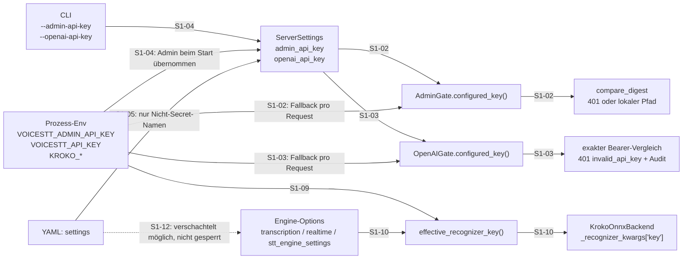
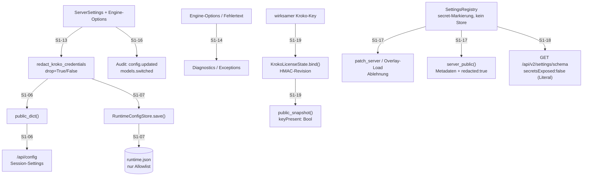
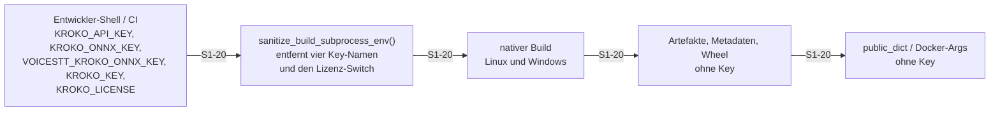
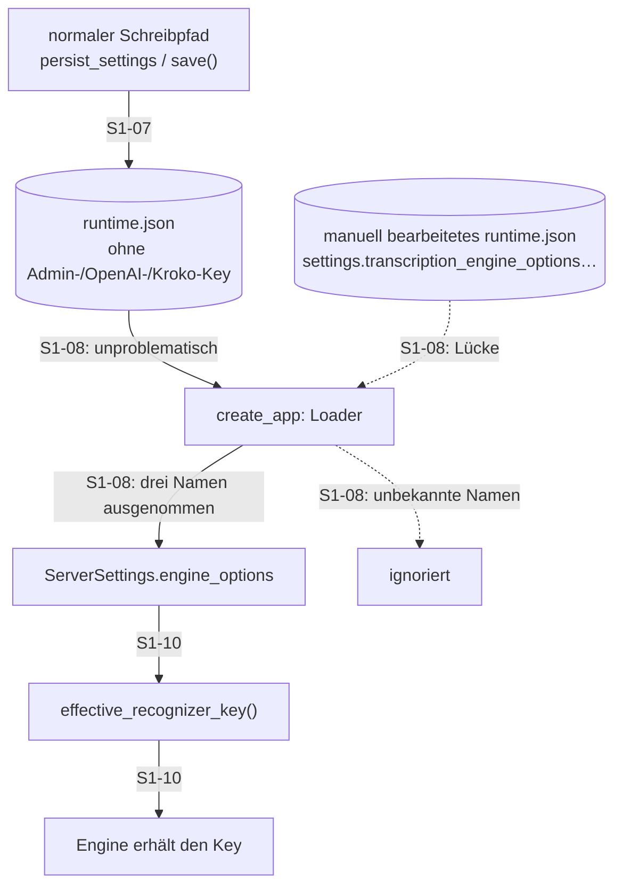

# 03.11 Secrets

*Stand: Commit `a8993c5c68042d996eab680d84a5b138a214bb5d` · Intern abgenommen und integriert (INTEGRATED); externe ROOT-Freigabe ausstehend. Faktenbasis: `workflow/research/03.11.json` (S1-01…S1-21).*

## 1. Worum geht es?

Der Server unterscheidet nicht durch einen eigenen Datentyp zwischen „Einstellung“ und „Zugangsdaten“. Er unterscheidet durch **Felder, Namen und Projektionen**: Ein Secret ist ein Wert, der an einer bekannten Stelle liegt und auf jedem Weg nach außen entfernt oder ersetzt wird.

Vier Familien:

| Familie | Wo der Wert liegt | Wer ihn liest | Besonderheit |
|---|---|---|---|
| **Admin** | `ServerSettings.admin_api_key` | `AdminGate` pro Request | `STARTUP_ONLY`; Env beim Start übernommen (S1-01, S1-04) |
| **OpenAI** | `ServerSettings.openai_api_key` | `OpenAIGate` pro Request | `STARTUP_ONLY`; Env bleibt Request-Fallback (S1-01, S1-04) |
| **Kroko** | Engine-Options der STT-Lane | `effective_recognizer_key()` → Backend | **Kein** `ServerSettings`-Feld; Key reist in Options-Dicts (S1-01, S1-09, S1-10) |
| **Log-Token** | flüchtig, pro Session (`LogTokenAuthority`, kein Settings-Feld, keine Datei/DB) | `LogGate` (HTTP-Scope/WebSocket-Scope) | volatil: 24 h, sitzungsgebunden, Neustart ungültig; Header `x-voicestt-log-token` bzw. Bearer-Fallback |

Kein Secret-Store, keine Secret-Registry, kein eigener Typ. Schutz = Feldklassifikation + Projektionen (S1-01, S1-13).

**Name vs. Wert:** Namen dürfen sichtbar sein (`startupOnly`-Liste, Schema, `redacted: true`); Werte nie (S1-06, S1-17, S1-18).

**Praxis:** `GET /api/config` zeigt *dass* Admin-Auth aktiv ist (`adminAuthRequired`) und nennt Startfeld-Namen – nicht die Schlüssel (S1-06). Kroko-Lizenz-Snapshot nur `keyPresent: true/false` (S1-19).

## 2. Das Wesentliche auf einen Blick

### 2.1 Quellen, Settings und Gates



**In Worten:** Admin-/OpenAI-Key via CLI/Env in `ServerSettings`, gelesen von den Gates (S1-01…S1-04). Admin-Env beim Parsen kopiert; OpenAI-Env bleibt Request-Fallback (S1-04). Kroko vorbei an `ServerSettings`: Key in Lane-Options, `effective_recognizer_key()`, Backend-`key` (S1-09, S1-10). Gestrichelt = Lücke: YAML prüft nur zwei Top-Level-Namen (S1-05, S1-12). Kein `.env`-Loader (S1-21), kein Secret-Store (S1-01); Gate-Details: [05.03](../05-administration/05.03-admin-authentifizierung.md), [05.06](../05-administration/05.06-openai-api-authentifizierung.md).

### 2.2 Projektionen und Redaktion



**In Worten:** Alle Ausgaben via Projektion. `public_dict()` rekursiv + `drop`, entfernt `*_engine_options`/Keys (S1-06). Persistenz: Allowlist + `drop` (S1-07). Audit/Diagnostik separat redigiert (S1-14, S1-16). Lizenz nur `keyPresent`-Bool (S1-19). Registry: nur Markierung, Ablehnung in Patch/Overlay; `server_public()` Metadaten + `redacted:true` (S1-17). Schema-Flag Literal (S1-18).

### 2.3 Build-Isolation



Shell-Key zum Testen okay; Build sieht ihn nie – vier Namen + `KROKO_LICENSE`-Switch entfernt (S1-20). `KROKO_LICENSE` kein Secret, aber isoliert (kein versehentliches „pro“, S1-20).

### 2.4 Nicht gebaut (Einordnung)

- Zentraler Secret-Store/Vault: Gegenteil belegt (S1-01, N-01).
- Secret-Registry als Speicher: nur Markierung (S1-17, N-07).
- `.env`-Loader: keiner; Env-Datei = Deployment (S1-21, N-02).
- Löschen statt Redigieren im Intent: Intent hält Rohwerte; redigiert wird Diagnose (S1-15).
- YAML-Generalsperre: nur zwei Namen (S1-05, S1-12).

## 3. Admin und OpenAI

### 3.1 Zwei Felder

Genau `openai_api_key` + `admin_api_key`, optional Strings, beide `STARTUP_ONLY`, `OPTIONAL_STRING_SETTINGS`; kein Typ/Store (S1-01). Reichweite: [03.06](./03.06-server-einstellungen.md).

### 3.2 Admin-Gate

`configured_key()` = Settings oder `VOICESTT_ADMIN_API_KEY`; `compare_digest` (S1-02). Ohne Key nur lokal; extern 403. Falsche Eingabe 401 ohne Key im Body (S1-02). Header/Loopback: [05.03](../05-administration/05.03-admin-authentifizierung.md).

### 3.3 OpenAI-Gate

`configured_key()` = Settings oder `VOICESTT_API_KEY`; ohne Key offen. Sonst exakt `Bearer <key>`, sonst 401 `invalid_api_key` + Audit (S1-03). Mechanik: [05.06](../05-administration/05.06-openai-api-authentifizierung.md).

### 3.4 Asymmetrie: Env-Snapshot vs. Request-Fallback

- `--admin-api-key` Default = `os.getenv(...)`: Env wird **beim Parsen** Prozesswert (S1-04).
- `--openai-api-key` Default = `None`: Env erst **pro Request** im Gate (S1-04).

### 3.5 Log-Token (vierte Familie, volatil)

Kein `ServerSettings`-Feld, keine Datei/DB: `LogTokenAuthority.issue()` erzeugt pro Session `uuid4hex+uuid4hex` (64 Hex), Lifetime 24 h (`TOKEN_LIFETIME_SECONDS`), nur Speicher; Prüfung in `LogGate.http_scope()`/`websocket_scope()` über `x-voicestt-log-token` bzw. Bearer-Fallback (security/logs.py:16-60; Erzeugung server.py:7801). Abgrenzung: kein Env-Secret, keine Rotation per Neustart-Persistenz – Neustart entwertet. Mechanik: [05.05](../05-administration/05.05-log-authentifizierung.md) · [04.11](../04-schnittstellen/04.11-logzugriff.md).

Folgen: Admin-Env-Änderung laufend wirkungslos (Startwert gewinnt); ohne Admin-Startwert liest Gate Env je Request. OpenAI-Env wirkt immer, solange CLI nichts setzte. Nur leerer Fall getestet (S1-04, U-03, C-01).

```text
Start:  VOICESTT_ADMIN_API_KEY=alt   VOICESTT_API_KEY=alt
        → settings.admin_api_key = "alt"   (Snapshot)
        → settings.openai_api_key = None    (Fallback im Gate)
später: Env beide = "neu"
Ergebnis: Admin prüft weiter "alt"; OpenAI prüft "neu".
```

Env laufend kaum änderbar; relevant bei Neustart/Containern/Tests. Rotation: Neustart planen (C-01).

## 4. Wo Secrets nicht stehen dürfen

### 4.1 YAML: zwei Namen gesperrt

`YAML_CONFIG_SECRET_KEYS` = genau die zwei Keys. Vorkommen → `SystemExit`, Meldung verweist auf Env-Datei (S1-05). **Namenssperre**, keine Wertprüfung. Hinweis = Deployment-Vertrag, kein Loader (S1-05, S1-21). Verschachtelte Lücke: §6.4.

### 4.2 Öffentliche Projektionen

`public_dict()`: `redact_kroko_credentials(drop=True)` + entfernt `*_engine_options`, beide Keys. Versorgt `/api/config` + Session (S1-06). `runtimeSettings.startupOnly` nennt Namen, `adminAuthRequired` nur Bool (S1-06). Client sieht *dass* Auth aktiv ist und *welche* Startfelder – nie Werte (C-06).

### 4.3 Persistenz: Allowlist + Redaktion

`persist_settings()`: ACTIVE|NEW_SESSION|STARTUP_ONLY minus Secrets/Pfade/device/host/port (S1-07). `save()` redigiert `drop=True`, schreibt nur Allowlist. Tests: Keys fehlen, Nicht-Secrets bleiben (S1-07). Format: [03.10](./03.10-persistenz.md). `runtime.json` kein Secret-Backup; manuell Eingefügtes wird beim Speichern entfernt (S1-07). Ausnahme beim Laden: §5.

### 4.4 Registry/Schema: Markierung ohne Speicher

`secret` nur Flag: `patch_server` → `read_only_runtime_authority`; Overlay mit Secret → `ValueError`; `server_public()` nur Metadaten + `redacted:true` (S1-17). **Keine produktiven `secret=true`-Definitionen**; Admin/OpenAI keine Registry-Keys; `forceCommunity` Policy-Key (S1-17, N-07). `schema_payload()`/`to_schema_dict()` filtern **nicht**: künftige Definition erschiene mit Key/Typ/Default (S1-17, C-03).

`GET /api/v2/settings/schema`: `secretsExposed:false` = Literal, nicht berechnet; Tests: keine Werte/`"field"`-Namen in Schema/Server-Read/Patch/Wake (S1-18). Aktuell sauber, künftig nicht garantiert (C-03).

### 4.5 Projektionsmatrix

| Projektion | Sichtbar | Nicht sichtbar |
|---|---|---|
| `/api/config`, Session | Nicht-Secrets, `startupOnly`-Namen, `adminAuthRequired` | Werte, `*_engine_options` (S1-06) |
| `runtime.json` | Allowlist-Nicht-Secrets | Admin-/OpenAI-Key, Kroko-Credentials (S1-07) |
| Audit/Event/Performance | Ereignis + Kontext | Secret-Felder, Bearer/Label-Werte (S1-16) |
| Diagnostics/Exceptions | Fehlerkontext | Options-/Env-Werte (S1-14) |
| Schema | Metadaten, `secretsExposed:false` | aktuell nichts; Mechanik ungefiltert (S1-17, S1-18) |
| Server-Read | Metadaten, `redacted:true` | Werte (S1-17) |
| Lizenz-Snapshot | `keyPresent`-Bool | Key, Fingerprint (S1-19) |
| Build-Artefakte | Ergebnis | Key in Env/Metadaten/Wheel/Docker-Args (S1-20) |

## 5. Startup-Lücke: Laden ohne Re-Redaction

Schreibpfad streng, Ladepfad nicht: `create_app` übernimmt bekannte, nicht-abgeleitete, nicht-ausgenommene Namen – **Engine-Options ohne Re-Redaction** (S1-08).



Reguläre Datei = sauber (S1-07). Hand-/Fremdstand mit Kroko-Key unter Options → unverändert übernommen (S1-08) → Engine via `effective_recognizer_key()` (S1-10). Kein Test. Regel: Verzeichnis schützen, `runtime.json` nicht hand-editieren, Backups prüfen ([03.10](./03.10-persistenz.md)). Lücke C-04.

## 6. Kroko: Key in Engine-Options

### 6.1 Präzedenz (vier Stufen)

1. `recognizer.key` – auch leer → unterdrückt Env,
2. nichtleeres top-level `key`,
3. erste nichtleere Env aus `KROKO_API_KEY`, `KROKO_ONNX_KEY`, `VOICESTT_KROKO_ONNX_KEY`, `KROKO_KEY`,
4. sonst `""` (S1-09). Env je Aufruf aus `os.environ` (S1-09).

Test ohne Key: nicht weglassen (Env griffe), sondern explizit leeres `recognizer.key` (einzige Stelle, wo leer Env unterdrückt, S1-09).

### 6.2 Pfade

Final-Lane `transcription_engine_options`, Realtime-Lane `realtime_transcription_engine_options`, generisch `stt_engine_settings.<engine>.engine_options|options` (S1-10). `resolved_engine_options()` lane-spezifisch; `_kroko_lane_options()` Final-Lane; Backend `key=effective_recognizer_key(options)` (S1-10). Kein `ServerSettings`-Feld. `referralcode` mitgegeben, nicht als Secret klassifiziert (S1-10).

CLI: `--engine-options '{"key": "<...>"}'`, `--realtime-engine-options`, `--stt-engine-settings` (JSON je Engine, S1-11). YAML: `transcription_engine_options`, `realtime_transcription_engine_options`, `stt_engine_settings` (S1-11).

```yaml
settings:
  stt_engine_settings:
    kroko_onnx:
      engine_options:
        key: "<KROKO-KEY>"
```

Möglich, aber nicht empfohlen (S1-12, C-02).

### 6.3 Wirksamkeitsfalle direktes `api_key`

Key **direkt** unter `stt_engine_settings.kroko_onnx` (nicht `engine_options`/`options`): redigiert, aber von `resolved_engine_options()` **nicht** zurückgegeben; wirksam nur Unterbaum (S1-11). Verschwindet aus Ausgabe, kommt nie bei Engine an. Kein Pfad gefunden, der ihn doch übergibt (U-04). C-05.

### 6.4 YAML-Lücke

Prüfung nur Top-Level; Dict-Settings akzeptieren beliebige Nester. Kroko-Key unter `stt_engine_settings...engine_options.key` oder `transcription_engine_options.key` möglich, obwohl Meldung Generalsperre suggeriert (S1-12, C-02). Kein Test. Nicht annehmen, der Loader habe abgelehnt.

## 7. Redaktion

### 7.1 Struktur-Redaction

Rekursiv über Mapping/Liste/Tuple. Mengen: Credential-Namen (`apikey`, `kroko*`) + Options-Kontexte (`engineoptions`, `sttenginesettings`, `kroko`, …). Blankes `key` nur im Kontext Secret; außerhalb Business-Key. `drop=True` entfernt, sonst `[REDACTED]` (S1-13).

`transcription_engine_options.key` (Kontext) weg; `api_key` weg; `model.key` bleibt (Business-Key). Namensbasiert: unbekannte Feldnamen nicht erkannt (N-06); neue Felder aufnehmen (S1-13).

### 7.2 Text-Redaction (Kroko/Engine-Kontext)

`kroko_credential_values()` sammelt Options-/STT-Secrets; `redact_secret_text` ersetzt diese plus aktuelle Env-Werte (längste zuerst) und redigiert Label-Muster `key:`/`api_key:`/`kroko*key=` per Regex (S1-14). Via `_safe_stt_error`/`redact_secret_text` verschwinden Options-/Env-Secrets aus Meldungen (S1-14). Nur **aktuelle** Env-Werte: rotierter alter ohne `extra_values` nicht ersetzt (S1-14).

`Kroko key=abc123 abgelehnt` → `Kroko key=[REDACTED] abgelehnt`; Options-Vorkommen ohne Label ebenfalls ersetzt (S1-14). `password:`/`Bearer`-Maskierung gehört nicht hierher, sondern in die Log-Schicht (S1-16, §7.4).

### 7.3 Intent: Projektion, keine Löschung

Intent kopiert `stt_engine_settings` in `engines` + `redaction_values` (`repr=False`). `status()` ohne Intent-Engines; Diagnostics redigiert. Rohwerte im Speicher möglich (S1-15). `repr`-Logging nicht gefunden, kein `__repr__`-Schutz (U-05). Redaktion schützt Ausgabe, nicht Speicher (S1-15).

### 7.4 Logs/Audit

`event_logging`: `_SECRET_KEYS` + Suffixe, Bearer/Label-Redaktion inkl. `password:`/`Bearer`-Maskierung (S1-16). `config.updated`/`models.switched`/Performance via öffentliche Projektion (S1-16). Patch mit Key: Feld+Vorgang sichtbar, Wert nicht.

## 8. Lizenz/Build

### 8.1 Snapshot ohne Key

Kein Key gespeichert; `_key_revision` HMAC-SHA256 mit Prozess-Secret (Wechselerkennung ohne Behalten, S1-19). `public_snapshot()`: status/generation/scope/proEnabled/modelUuid/keyPresent(Bool)/forceCommunity/reasonCode – kein Key/Fingerprint (S1-19). Support: „hinterlegt?“ via `keyPresent`. Wechsel → neue Revision, Nachweis invalidiert (S1-19). Mechanik: [05.07](../05-administration/05.07-kroko-lizenzierung.md).

### 8.2 Build-Isolation

`sanitize_build_subprocess_env()`: vier Key-Namen + `KROKO_LICENSE` raus (Linux+Windows); `linux_build_env` nutzt das (S1-20). Tests: Keys fehlen, Secret fehlt in Metadaten/Wheel/`public_dict`/Docker-Args. `KROKO_LICENSE` kein Secret, aber isoliert (kein versehentliches „pro“, S1-20). Hintergrund: [07.12](../07-entwicklung/07.12-buildketten-sicherheit.md).

### 8.3 Kein `.env`-Loader

Kein `load_dotenv` im Server; `os.environ` direkt (S1-21). YAML-Fehlermeldung = Deployment-Vertrag, kein Loader. `.env` neben Start wird nicht gelesen; Key leer → Gate als ob kein Key (S1-21, N-02).

## 9. Grenzen

### 9.1 Nicht implementiert

| ID | Beobachtung | Konsequenz |
|---|---|---|
| N-01 | Kein Secret-Typ/Store | Schutz via Projektionen (S1-01) |
| N-02 | Kein `.env`-Loader | Env vom Deployment (S1-21) |
| N-03 | Keine YAML-Sperre verschachtelt | Nur zwei Namen (S1-12) |
| N-04 | Keine Schema-Filterung `secret` | Künftige Definition sichtbar (S1-17) |
| N-05 | Keine Load-Redaction Engine-Options | Injizierbar via Datei (S1-08) |
| N-06 | Keine Redaction unbekannter Namen | Namensbasiert (S1-13) |
| N-07 | Keine produktiven `secret=True` | Keys keine Registry-Keys (S1-17) |

### 9.2 Ungeklärt

| ID | Frage |
|---|---|
| U-01 | Branch nicht verifizierbar; nur Commit (S1-01) |
| U-02 | Env-Datei-Mechanismus (Compose/Shell/systemd) (S1-21) |
| U-03 | Admin-Rotation laufend; Snapshot-Logik (S1-04) |
| U-04 | Direkt-Key doch wirksam? Kein Pfad gefunden (S1-11) |
| U-05 | `repr`-Logging durch Dritte; kein Schutz (S1-15) |
| U-06 | Externe Lizenz-API; nicht hier (S1-19) |

### 9.3 Spannungen

| ID | Spannung |
|---|---|
| C-01 | Admin-Env Snapshot vs. OpenAI-Request-Fallback (S1-04) |
| C-02 | YAML-Meldung vs. nur zwei Namen (S1-05, S1-12) |
| C-03 | `secretsExposed:false` vs. ungefiltertes Schema (S1-17, S1-18) |
| C-04 | Schreiben redigiert vs. Laden injizierbar (S1-08) |
| C-05 | Direkt-Key redigiert, aber unwirksam (S1-11) |
| C-06 | Namen sichtbar, Werte nie (S1-06) |

> **⚠️ C-01 – Admin-Env Snapshot, OpenAI-Env nicht.** `--admin-api-key` kopiert Env beim Parsen; `--openai-api-key` bleibt `None` → Gate liest Env je Request (S1-04). Env-Änderung laufend: OpenAI sofort, Admin nur ohne Startwert. Nur leerer Fall getestet. Rotation: Neustart einplanen.

> **⚠️ C-02 – YAML-Sperre keine Generalsperre.** Nur `admin_api_key`/`openai_api_key` oben; verschachtelter Kroko-Key möglich (S1-05, S1-12).

> **⚠️ C-04 – Redigiert beim Schreiben, injizierbar beim Laden.** `save()` entfernt Keys (S1-07); Loader nimmt Engine-Options ohne Re-Redaction (S1-08). Regulär sauber; manipulierte Datei injiziert. Kein Test. Verzeichnis schützen, nicht hand-editieren.

### 9.4 Betriebsregeln

1. Keys nur Env/CLI, nie YAML (S1-05); Env lädt Startmechanismus, nicht Server (S1-21).
2. Kroko in Env oder bewusst in `engine_options`/`options`; nicht direkt unter Engine-Namen (S1-10, S1-11).
3. Nach Rotation neu starten (Admin-Snapshot, S1-04, C-01).
4. `runtime.json` schützen, nicht hand-editieren, Backups prüfen (S1-08, C-04).
5. Antworten prüfen: Namen/Bools ok, Werte nie (S1-06, S1-18, S1-19).

## 10. Siehe auch / Nachweise

**Verwandt:** [03.01](./03.01-konfigurationsarchitektur.md) · [03.05](./03.05-quellen-und-prioritaeten.md) · [03.06](./03.06-server-einstellungen.md) · [03.07](./03.07-session-einstellungen.md) · [03.08](./03.08-runtime-aenderungen.md) · [03.09](./03.09-wirksamkeitszeitpunkt.md) · [03.10](./03.10-persistenz.md) · [03.12](./03.12-abhaengigkeiten.md) · [05.03](../05-administration/05.03-admin-authentifizierung.md) · [05.05](../05-administration/05.05-log-authentifizierung.md) · [05.06](../05-administration/05.06-openai-api-authentifizierung.md) · [05.07](../05-administration/05.07-kroko-lizenzierung.md) · [05.09](../05-administration/05.09-schutz-von-daten-secrets.md) · [04.11](../04-schnittstellen/04.11-logzugriff.md) · [02.06](../02-funktionsweise/02.06-engines.md) · [07.12](../07-entwicklung/07.12-buildketten-sicherheit.md) · [08.12](../08-referenzen/08.12-cli-env-katalog.md)

**Faktenakte:** `workflow/research/03.11.json`, Commit `a8993c5c68042d996eab680d84a5b138a214bb5d`: S1-01 Felder/kein Store · S1-02 Admin · S1-03 OpenAI · S1-04 Asymmetrie · S1-05 YAML-2-Namen · S1-06 Projektionen · S1-07 Persistenz · S1-08 Loader-Lücke · S1-09 Präzedenz · S1-10 Pfade · S1-11 Direkt-Key-Falle · S1-12 YAML-Lücke · S1-13 Struktur · S1-14 Text · S1-15 Intent · S1-16 Logs · S1-17 Registry · S1-18 Schema-Literal · S1-19 Snapshot · S1-20 Build · S1-21 kein dotenv. Grenzen N/U/C §9.
