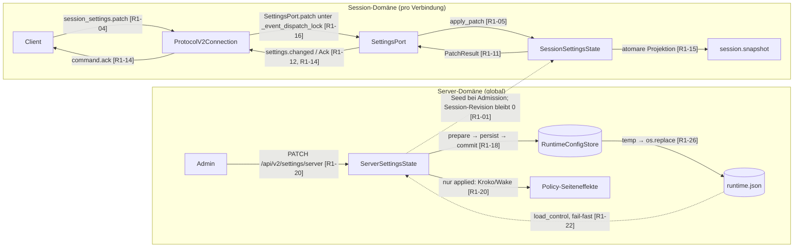
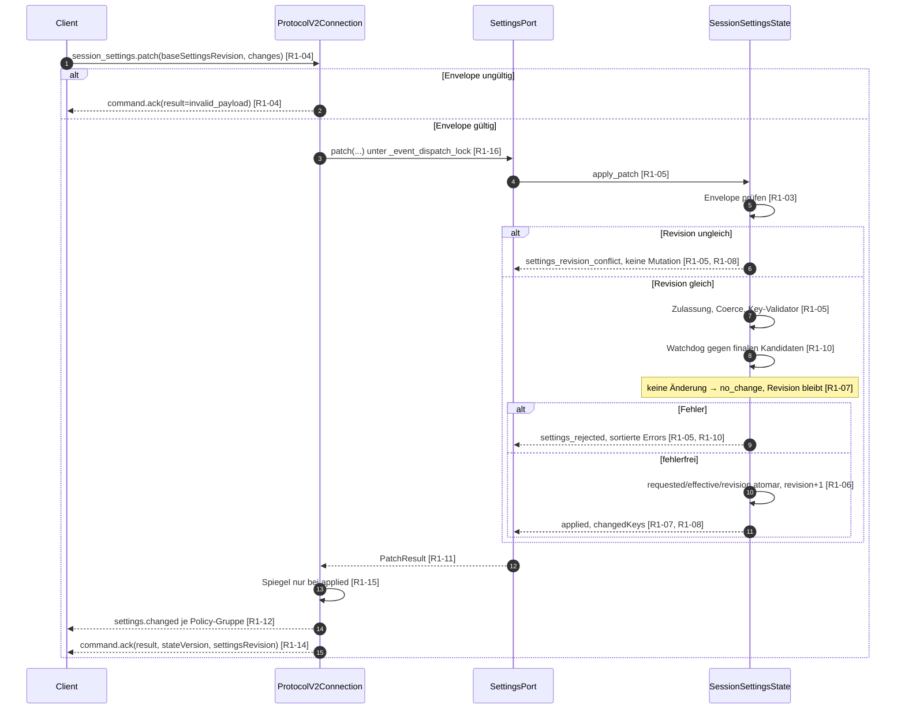

# 03.12 Abhängigkeiten

> **Geltungsbereich:** Commit `a8993c5c68042d996eab680d84a5b138a214bb5d`. Der im Registry-Eintrag genannte Branch `feat/v2-release-cleanup` ist im Checkout nicht verifizierbar (detached `FETCH_HEAD`; C-01/R1-N4). Alle Aussagen sind am Code dieses Commits verifiziert; die Faktenakte R1-01…R1-26 dient als Referenz.

## 1. Worum geht es?

Ein Admin ändert eine Timing-Frist, ein Client patcht gleichzeitig seine Session, und der Server startet neu. Drei unabhängige Vorgänge – sie treffen sich an wenigen, entscheidenden Stellen: Eine Änderung darf erst sichtbar werden, wenn sie atomar committed ist; ein Wert wird aus einem Wunschwert abgeleitet; zwei Schreibvorgänge dürfen sich nicht überholen; und ein Feld kann ein anderes bedingen.

Drei Regeln behalten:

1. **Das Watchdog-Trio** (R1-10) – einzige echte Kreuzfeld-Wertregel: drei Timing-Schlüssel, immer gegen finalen Kandidaten, in Session-Patch, Server-Patch und Start.
2. **Zwei Revisionsströme** (R1-01, R1-02): Session startet bei 0, Server-Revision aus persistierter Datei. Keiner zieht den anderen mit.
3. **Ein Dokument, zwei Familien** (R1-26): Server-Overlay + Revision in derselben Datei; lesend-modifizierend unter Modul-Lock, atomar via `os.replace`.

Alles andere ist **Zwangskante** (B erst nach A), **Ableitungskante** (B aus A berechnet) oder **Sperre** (A/B schließen sich aus). Einzige Feld-auf-Feld-Abhängigkeit außerhalb des Watchdogs steht im Legacy-Pfad: `log_live_enabled` ohne `event_store_enabled` → `invalid_dependency` (R1-23). Ausdrücklich **keine v2-Regel**, nicht verallgemeinern.

> **Begriffe:** **Zwangskante:** Reihenfolge zwingend (erst persistieren, dann committen, R1-18). **Ableitungskante:** Wert/Ereignis berechnet (Effective aus Requested je Policy, R1-09). **Sperre:** Ausschluss (RLock pro Zustand R1-08; Admin-Guard vor Payload R1-20). **Wertregel:** Wert beschränkt Wert (Warnfrist < Endfrist, R1-10).

## 2. Das Wesentliche auf einen Blick

Landkarte mit zwei Domänen, zwei Kopplungen (gestrichelt).

**Lesart.** Durchgezogen = innerhalb einer Domäne. Session: Patch einreichen (R1-04), unter Lock verarbeiten (R1-16), `apply_patch`-Kette (R1-05), zurückbinden (R1-11), Events/Ack (R1-12, R1-14); Snapshot aus atomarer Projektion, nicht Spiegel (R1-15). Server: Admin-Patch (R1-20), persistieren (R1-18, R1-26), erst danach Seiteneffekte (R1-20).

Gestrichelt = einzige Kopplungen: Start liest + validiert fail-fast (R1-22). Neue Session nimmt Server-Effektive als Ausgang; Revision bleibt 0 (R1-01). **Werte** übernommen, **Zähler** nicht.

**Keine Kanten:** Server-Patch → `settings.changed` (existiert nicht, R1-12/R1-N3). Session-Patch → Persistenz (nicht, R1-18/R1-26). Server-Revision → Session-Revision (nicht, R1-01).

**Warum diese Aufteilung – Alternativen (nicht implementiert):** globale Revision (koppelte Sessions, trüge Konflikte); zentraler Abhängigkeitsgraph mit Ausdruckssprache (nur Watchdog + Legacy-Sonderregel belegt); ETag/Retry (keine, R1-08); tolerantes Laden mit Überspringen (v2 fail-fast R1-22; Legacy-`skipped` R1-25).

## 3. Einzige echte Kreuzfeldregel: der Watchdog

Drei Timing-Schlüssel; sobald **einer** in `changes`, läuft Prüfung (R1-10).

1. Geprüft wird **finale Kandidat** (Zustand nach allen Änderungen), nicht Eingesendetes (R1-10).
2. Vergleich **strikt**: Warnung echt kleiner als Endfrist; Gleichstand = Konflikt (R1-10).
3. Verletzung → `cross_field_conflict` (R1-10).
4. Bool/Nicht-int übersprungen; dafür Typ/Coerce/Key-Validatoren (R1-05).

Gilt Session-Patch, Server-Patch, Startup-Validierung (R1-10, R1-22).

**Warum „finaler Kandidat“ zählt.** Warnung bereits gesenkt; später Patch senkt nur Endfrist. Kandidat enthält alte Warnung → ggf. abgelehnt. **Aufteilen hilft nicht.** Konsistentes Bundle senden (Test `TestSequentialCrossFieldBypass`, R1-10).

**Was er nicht ist.** Kein allgemeiner Prüfer. Keine nachträgliche Query-/Controller-Prüfung; Lese-Routen ändern nichts, erzeugen keine Events (R1-21). Kein eigener Validate-Endpunkt (R1-N1); Prüfung erst beim Schreiben. Clients können nicht vorab testen (Lücke). Legacy `POST /api/config/validate` prüft anderes Modell, kein Ersatz (R1-24).

**Fehlerantwort:** Session → `settings_rejected` sortiert (R1-05, R1-11); Server → 422 (R1-20); Start → `ValueError` (R1-22).

## 4. Zwei Revisionsströme, zwei Wahrheiten

| Strom | Start | Autorität | Erhöhung | Sichtbar in |
|---|---|---|---|---|
| Session | immer 0 | `SessionSettingsState` | +1 pro `applied` (R1-06, R1-08) | Ack/Snapshot (R1-14, R1-15) |
| Server | Dokument (R1-01, R1-26) | `ServerSettingsState` | +1 pro persistiertem `applied` (R1-18) | Antwort/Server-Read (R1-20, R1-21) |

**Keine Vermischung.** Server-Patch zieht Session nicht mit; neue Session erbt keine Server-Revisionsnummer (R1-01). Admission: `ProtocolSessionState` mit `SettingsPort.revision` (Session-Autorität, kein gespeicherter Port-Wert, R1-02).

**Beispiel.** Server 12, Session 3. Patch mit Basis 3 korrekt. Basis 12 = falsche Domäne → Konflikt ohne Mutation (R1-05, R1-08). Server-Patch braucht Datei-Revision (R1-01).

**Konfliktauflösung.** RLock pro Zustand: gleiche Basis → ein applied + ein Konflikt, +1 exakt, lückenlos. Kein Zeitstempel/ETag/Retry (R1-08).

**Spiegel ≠ Projektion.** Spiegel nur bei `applied` (nur bei Änderung, R1-15). Snapshot aus **einer** atomaren Projektion, nicht Spiegel; Latch/Suppression danach (R1-15). `snapshot.request` → Ack + Zusatz-Snapshot (R1-15). Snapshot = Autorität; Spiegel nur Ack-Projektion.

## 5. Transaktionskette eines Session-Patches

**Stufen:** 1. Wire-Envelope (`invalid_payload` statt rejected, Ack + Memo, nur v2, R1-04). 2. Kontroll-Envelope (R1-03; im Lock (Session) bzw. vor Lock (Server)). 3. Lock (R1-16, RLock reentrant). 4. Revisionsvergleich (Konflikt ohne Mutation, R1-05/08). 5. Key-Zulassung/Coerce/Validator (unbekannt→`unknown_key`; scope=server→`wrong_scope`; unwritable→`read_only_runtime_authority`; Typregeln = 03.04, R1-05). 6. Watchdog finaler Kandidat (R1-10). 7. Atomarer Commit (nur gemeinsam, +1; Ablehnung nichts, R1-06). 8. Änderungserkennung (coerced vs. `_requested`, sortiert; `no_change` ohne Revision/Event, R1-07). 9. 1:1-Bindung (nur `applied` → Spiegel + Events; `internal_error` nur Server, R1-11). 10. Projektion (Gruppen, 1× `stateVersion`, Ack; Replay verbatim ohne Zweiteffekt, R1-12…R1-14). 11. Spiegel vs. Projektion; Latch/Suppression danach; `snapshot.request` Ack + Snapshot (R1-15). 12. Linearisierung unter Lock (R1-16).

**Beispiele:** gültig+ungültig → `rejected`, nichts übernommen (R1-05/06). Gleiche Basis, zwei Clients → ein applied + Konflikt, +1 exakt (R1-08). `next_session`-Wunsch = Ist-Wert → `no_change` trotz Differenz zu effective (R1-07, R1-09).

**Reihenfolge-Grund:** Wire schützt Zustand vor Müll (R1-04). Revision vor Inhalt (kein Konflikt mit Mutation, R1-05). Watchdog nach Einzelprüfungen (Bundle-Sicht, R1-10). Persist im Server-Pfad vor Commit (kein Halbzustand, R1-18).

## 6. Ableitungskanten: Policy → Effective → Event (Session-Patch)

| Apply-Policy | Effective (Session-`apply_patch`) | Ereignisgruppe | Erreichbarkeit |
|---|---|---|---|
| `live` | folgt Wunsch | `live` | regulär |
| `next_activation` | folgt nächster Stufe; freeze nur hier | `next_activation` | regulär |
| `next_session` | laufend bleibt | `next_session` | regulär |
| `server_restart` | laufend bleibt | `server_restart` | unerreichbar (R1-19, R1-N2) |

Gruppierung nach `POLICY_EVENT_ORDER`, Keys sortiert, ein Event pro nicht-leerer Gruppe (`settingsRevision`, `scope='session'`, `changedKeys`, `applyPolicy`); leere → keins (R1-12). Mixed-Patch (live + next_session) → **zwei** Events.

Gegenstück Server-Patch: dort gilt `next_effective` für **alle** Policies außer `server_restart` (R1-18) – „laufend bleibt“ kennt nur die Session-Achse (R1-09); `server_restart` bleibt überall unverändert (R1-12, R1-19). `stateVersion` +1 genau einmal (erstes Event `state_change`), Rest gleiche Version + `eventSeq` (R1-13). `rejected`/`no_change`: kein Anstieg.

**Client-Regel:** Zwei Events ≠ zwei Zustandswechsel. `stateVersion` zählt Zustände, `eventSeq` Reihenfolge.

**`requiresRestart`:** codiert, aber ohne Builtin-Key unerreichbar; nie im Body, Gruppe leer (R1-19, R1-N2). Nicht als Regelast zeichnen.

## 7. Server-Achse: Overlay, Datei, Commit

**Eingang/Sperren.** Admin-Guard zuerst (401/403), dann Payload (R1-20). Hülle **vor** Lock (anders als Session, R1-17/03). Im Lock: unbekannt, `!has_server_default` → `wrong_scope`, secret → `read_only_runtime_authority`, Coerce, Cross-Field gegen Overlay-Kopie (R1-17). `selection`/Suppression nicht patchbar; `activation.*` als Server-Default patchbar (R1-17).

**Prepare/Persist/Commit.** Kopien → `persist` in try/except → Fehler: `accepted:false`, `internal_error`/`persistence_failed` (Feld persistence), RAM+Revision unverändert → erst dann Zuweisung (R1-18). `next_effective` ohne `server_restart` (R1-18). Retry gleiche Basis lückenlos (R1-18).

**Ein Dokument, zwei Familien.** Overlay + Revision in **einem** Dokument (R1-26). `save`/`save_settings_control` read-modify-write unter Modul-Lock, atomar temp→`os.replace`; Exception → Temp weg, Original bleibt (R1-26). Keine Familie überschreibt andere. Format: [03.10](./03.10-persistenz.md).

**Start fail-fast.** Revision bool/negativ, Overlay kein dict, unbekannt/!has_server_default, secret, Coerce/Cross-Field → ValueError; danach Auffüllen aus `server_default_keys()` (R1-22). Fehlerhaftes Overlay = Startstopp, kein Überspringen (Legacy-Reload kennt `skipped`, R1-25).

**Nur bei `applied`:** `forceCommunity` → `apply_kroko_force_change` (Policy-Lock); `globalDisabledIds` → `apply_wake_word_global_disable` (R1-20). Einbahnstraßen: keine Revision/Session-Sicht. Kroko/Engine/Modell: [02.06](../02-funktionsweise/02.06-engines.md), [02.07](../02-funktionsweise/02.07-modelle-und-modellverwaltung.md); Wirkung: [03.09](./03.09-wirksamkeitszeitpunkt.md).

**Lesen.** Schema + Server-Read öffentlich, ohne Key, ohne Mutation/Events (R1-21): `protocolVersion/serverVersion/serverCommit/secretsExposed:false` + sortierte Liste; Server-Sicht mit `settingsRevision`, je Key `requestedValue`/`effectiveValue`/`applyPolicy`, Secrets `redacted:true` (R1-21).

**Status:** Session: Envelope ungültig → `invalid_payload` (Ack+Memo, R1-04); Konflikt → `settings_revision_conflict` (R1-05/11); Fehler → `settings_rejected` sortiert (R1-05/10); keine Änderung → `no_change` (R1-07). Server: 200/400 (Body-Ast im Code vorhanden, per `payload: dict`-Signatur praktisch unerreichbar, C-03)/409/422/500 (R1-20); Persistenzfehler → 500 ohne Commit (R1-18). Legacy: 400 bei irgendeiner Ablehnung, `{applied, rejected}` (R1-23); Validate 200/400 ohne Wirkung (R1-24).

> **Zum 409-Zweig.** Vorhanden (R1-20), Befund kein Versprechen: kein ETag/Retry (R1-08). Persistenzfehler ≠ Konflikt → 500 (R1-18/20). Fehler/Antworten: [05.10](../05-administration/05.10-fehler-zugriffsantworten.md).

## 8. Legacy: Sonderregel + andere Welt

Neben v2-Registry: `PATCH /api/config` feldweise, Antwort `{applied, rejected, settings, runtimeSettings, modelRefreshRequired}`; 400 bei nicht-leerem `rejected`, sonst 200; bei `applied` persistiert + auditiert. **Keine `settingsRevision`, keine Events, kein Ack** (R1-23).

> **Nur Legacy: `invalid_dependency`.** `log_live_enabled` ohne `event_store_enabled` → `invalid_dependency`, Wert verworfen, Rest angewendet (R1-23). Ausschließlich Legacy-Pfad. Keine v2-Regel ableiten.

**Teilweise Übernahme möglich:** manche Felder applied + 400 zugleich (R1-23) – Gegensatz zu v2-atomar (R1-06).

**Validate/Reload.** `POST /api/config/validate`: Kandidat (`replace`), `DERIVED` verboten, Coerce, `__post_init__`, Policy; 200 `{valid:true,…}` / 400 `{valid:false,…}`; keine Zuweisung/Persistenz/Revision (R1-24). `POST /api/config/reload`: nur Legacy-Sektion; Split runtime/model/skipped; `update_settings` + ggf. `switch_models`; `{runtime,models,skipped}`; Fehler 400 (R1-25).

Legacy vs. v2 laufen auseinander: Legacy bewegt keine Server-Revision; v2 schreibt keine Legacy-Sektion. Beide mischen: [03.05](./03.05-quellen-und-prioritaeten.md).

## 9. Grenzen und offene Punkte

| ID | Art | Bedeutung |
|---|---|---|
| R1-N1 | nicht implementiert | Kein `POST /api/v2/settings/validate`; nur Legacy + interne Vorstufen. |
| R1-N2 | nicht implementiert | `requiresRestart`/`server_restart` codiert, von keinem Key ausgelöst. |
| R1-N3 | nicht implementiert | Kein server-scoped `settings.changed`; `scope` hart `session`. |
| R1-N4 | unbekannt | Branch nicht nachweisbar; nur Commit. |
| R1-N5 | unbekannt | Kein Test für Legacy-Reload gefunden. |
| R1-N6 | unbekannt | `if not coerced` + Nicht-Dict-Body: Code da, Erreichbarkeit nicht belegt. |
| R1-N7 | unbekannt | Retry-Wiederauslieferung erzeugter Events (04.04/04.06). |
| R1-N8 | unbekannt | `ports.py`-Kommentar historisch; Code gebunden. |
| C-01 | Konflikt | Branch vs. detached `FETCH_HEAD`; nur Commit verifizierbar. |
| C-02 | Konflikt | Alter Ports-Text vs. gebundener Code; nicht zitieren. |
| C-03 | Konflikt | Unerreichbare Pfade nicht als Zustände zeichnen. |

**Nicht als Kante/Zustand:** Server-Patch → `settings.changed`; Session-Patch → Persistenz; Server-Revision → Session-Revision; regelmäßiges `requiresRestart`; 400-Ast v2-Server-PATCH. Nicht vorhanden bzw. unerreichbar (R1-N2, R1-N3, C-03).

**Evidenz:** R1-24/R1-25 = B; R1-19 = C; Rest A. Unsicherheiten nicht als Verhalten lesen.

## 10. Siehe auch / Nachweise

**Weiterführend:** [03.02](./03.02-scopes.md) · [03.04](./03.04-datentypen-und-validierung.md) · [03.05](./03.05-quellen-und-prioritaeten.md) · [03.06](./03.06-server-einstellungen.md) · [03.07](./03.07-session-einstellungen.md) · [03.09](./03.09-wirksamkeitszeitpunkt.md) · [03.10](./03.10-persistenz.md) · [03.11](./03.11-secrets.md) · [04.04](../04-schnittstellen/04.04-commands-acknowledgements.md) · [04.06](../04-schnittstellen/04.06-eventtransport.md) · [04.07](../04-schnittstellen/04.07-snapshot-synchronisierung.md) · [05.10](../05-administration/05.10-fehler-zugriffsantworten.md) · [08.03](../08-referenzen/08.03-settings-katalog.md) · [08.06](../08-referenzen/08.06-timing-katalog.md) · [08.09](../08-referenzen/08.09-fehlerkatalog.md)

**Fakten (R1-01…R1-26):** Ströme/Admission (R1-01, R1-02) · Hüllen (R1-03, R1-04) · apply_patch-Kette (R1-05…R1-10) · Ack/Events/Spiegel/Linearisierung (R1-11…R1-16) · patch_server (R1-17…R1-22) · Legacy (R1-23…R1-25) · Persistenz-Rand (R1-26) · Grenzen (R1-N1…N8, C-01…C-03).

**Code:** `settings_control.py` (State, Hülle, Cross-Field, POLICY_ORDER, patch_server, to_dict) · `connection.py` (apply/bind/emit/ack/memoise, Lock, Snapshot) · `ports.py`/`session.py` (Port/Spiegel/mint) · `commands.py` (Parser, is_accepted) · `schema.py`/`snapshot.py` (Codes, Projektion) · `server.py` (Routen, Projektion, update/validate/reload) · `operations.py` (Store).

**Status:** Intern unabhängig geprüft und integriert; externe ROOT-Freigabe ausstehend.
