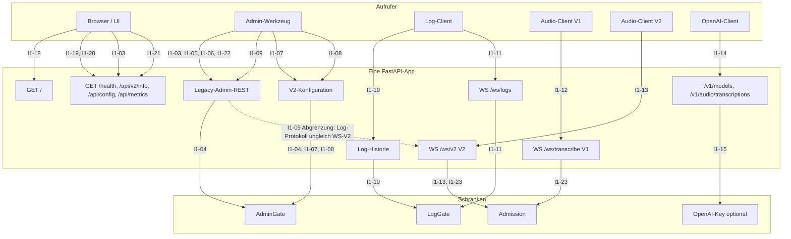

# 04.01 – Schnittstellenübersicht

*Status: INTEGRATED (intern abgenommen) – externe ROOT-Freigabe ausstehend. Codebasis: Commit `a8993c5c68042d996eab680d84a5b138a214bb5d`. Faktenbasis: `workflow/research/04.01.json` (I1-01…I1-25, N1…N4, U1…U3, C1…C5).*

**Abgrenzung:** Dieses Kapitel ist die Landkarte der Zugänge. Request-/Response-Formate, Feldlisten, Defaults und Zeitwerte stehen in [04.02 (HTTP-Grundlagen)](04.02-http-grundlagen.md), [04.03 (WebSocket V2)](04.03-websocket-v2.md), [04.10 (OpenAI-kompatible API)](04.10-openai-kompatible-api.md), [04.11 (Logzugriff)](04.11-logzugriff.md) und [04.12 (Legacy V1)](04.12-legacy-v1.md). Die vollständige Routenliste führt [08.04 (API-Endpunkt-Katalog)](../08-referenzen/08.04-api-endpunkt-katalog.md).

## 1. Worum geht es?

Der Voice-STT-Server ist keine Sammlung loser Dienste, sondern **eine** FastAPI-App mit **einem** Routeninventar (I1-01). Genau deshalb ist die Schnittstellenübersicht keine Formsache: Jede Fähigkeit des Servers hängt an einer anderen Tür, und jede Tür hat einen anderen Vertrag.

Für die Praxis sind drei Fragen entscheidend:

1. **Welche Tür ist für meine Aufgabe vorgesehen?** Ein Dashboard liest andere Routen als ein Audio-Client, und ein Admin-Werkzeug schreibt wieder andere.
2. **Welchen Schlüssel braucht diese Tür?** „Öffentlich“, „Admin“, „Sitzungstoken“ und „OpenAI-Key“ sind vier verschiedene Antworten (I1-04, I1-10, I1-15).
3. **In welchem Versionsraum spreche ich?** Der Server kennt mehrere Räume, die ähnlich heißen, aber nichts miteinander zu tun haben (I1-09, I1-13, I1-14).

Die teuersten Fehler sind Türverwechslungen:

- **`/v1` ist die OpenAI-Kompatibilität, nicht VoiceSTT V1.** VoiceSTT V1 heißt `/ws/transcribe`; `/api/v1/*` oder `/ws/v1` gibt es nicht (I1-12, I1-14, I1-17, N1).
- **Zwei verschiedene „2“.** `protocolVersion 2` ist das Audio-/Ereignisprotokoll; `logProtocolVersion 2` ist der Log-Versionsraum. Das eine schaltet nicht das andere um (I1-07, I1-09, I1-13).
- **Admin-Key und OpenAI-Key sind getrennte Schlüsselräume.** Ein Admin-Key öffnet keine OpenAI-Route, ein OpenAI-Key keine Admin-Route (I1-04, I1-15).

## 2. Das Wesentliche auf einen Blick

- **Eine App, 37 Routen.** 34 HTTP- und 3 WebSocket-Routen; dazu FastAPI-Defaults `/openapi.json`, `/docs`, `/redoc` (I1-01, I1-25).
- **Öffentlich heißt ohne Schlüssel – nicht harmlos.** `GET /api/config` und `GET /api/metrics` sind auch remote lesbar (I1-03, I1-21, C5).
- **AdminGate schützt 21 HTTP-Routen**, aber nicht `/v1/*` und nicht `/ws/logs` (I1-04).
- **Logs haben ein eigenes Gate.** LogGate akzeptiert Admin-Identität **oder** ein Sitzungstoken; ohne Scope 401 (I1-10).
- **WebSocket-Audio kennt keine Identität.** Admission regelt Kapazität, nicht Berechtigung (I1-23).
- **V1 und V2 unterscheiden sich am ersten Paket.** V1: Server-hello zuerst. V2: Client-hello zuerst, dann `hello.accepted` (I1-12, I1-13).
- **OpenAI ist eine eigene Schicht** mit genau zwei Pfaden und optionalem Key-Gate (I1-14, I1-15).

### Zugangslegende

| Kürzel | Bedeutung | Typische Ablehnung | Fakten |
|---|---|---|---|
| öffentlich | kein Gate | keine | I1-03, I1-18, I1-19, I1-20, I1-21 |
| AdminGate | Admin-Key oder Loopback | 401 + `WWW-Authenticate` bei Key; sonst 403 außerhalb Loopback | I1-04 |
| LogGate | Admin-Identität **oder** Sitzungstoken | 401 ohne Scope | I1-10 |
| OpenAI-Key optional | wenn konfiguriert: Bearer; sonst offen | 401 `invalid_api_key` + Audit | I1-15 |
| Admission | nur Kapazität, keine Identität | V1: Fehler + Close 1013; V2: 4400/4406/4408/4409 | I1-13, I1-23 |

### Die Landkarte der Zugänge



**In Worten:** Links die Rollen, in der Mitte die Türen derselben App (I1-01), rechts die Schranken. Die gestrichelte Kante ist eine Abgrenzung: `logProtocolVersion 2` schaltet nicht das WebSocket-Protokoll um (I1-09).

## 3. Nachgewiesene Funktionsweise

### 3.1 Eine App, ein Routeninventar

`create_app()` erzeugt die einzige FastAPI-Instanz (nur `title`, `version`, `lifespan`); der OpenAI-Router wird ohne Präfix eingehängt (I1-01). Inventur: **37 Routen (34 HTTP + 3 WS)** plus `/openapi.json`, `/docs`, `/redoc` als Defaults ohne URL-Override (I1-01, I1-25). Die drei WebSockets: `/ws/transcribe` (V1), `/ws/v2` (V2), `/ws/logs` (I1-11, I1-12, I1-13). Ein Testkommentar nennt nur zwei WebSockets; `/ws/v2` ist trotzdem registriert (C3, I1-13).

### 3.2 Offene Flächen

- `GET /` liefert die gebündelte UI pro Anfrage als HTML; kein Static-Mount (I1-18, N4).
- `GET /health` aggregiert `ok`, `ready`, Zähler, Scheduler/Modelle, Startfehler, Event-Store; `ok` nur bei bereiten Metriken und ggf. bereitem Store (I1-20).
- `GET /api/v2/info` liefert die Identitätsprojektion mit `no-store` (I1-19).
- `GET /api/config` liefert die öffentliche Projektion inkl. `adminAuthRequired` (I1-03).
- `GET /api/metrics` ohne Guard, auch remote (I1-21).

Offenheit (U2) ist ein Befund; Bewertung in [05.02](../05-administration/05.02-serverzugriff.md) und [05.10](../05-administration/05.10-fehler-zugriffsantworten.md).

### 3.3 AdminGate

Key aus `settings.admin_api_key` oder `VOICESTT_ADMIN_API_KEY`. Reihenfolge: `x-voicestt-admin-key`, `Authorization: Bearer`, `x-admin-key` (I1-04). Mit Key: falsch/fehlend → 401 + `WWW-Authenticate`. Ohne Key: nur Loopback (`127.0.0.1`, `::1`, `localhost`, `testclient`), sonst 403 (I1-04). Schützt **21 Admin-HTTP-Routen**, aber nicht `/v1/*` und nicht `/ws/logs` (I1-04). Schlüsselräume getrennt (I1-04, I1-15).

### 3.4 V2-Konfiguration und Wake-Katalog

`GET /api/v2/settings/schema` und `GET /api/v2/settings/server` öffentlich (Projektionen ohne Secrets, `protocolVersion` 2; Revision nur bei `/server`); `PATCH /api/v2/settings/server` Admin mit u. a. 200/400/409/422/500 (I1-07). `GET /api/v2/wake-words` öffentlich (ohne Pfade, mit Revision/Verfügbarkeit); `POST /api/v2/wake-words/refresh` Admin (200/422, letzter guter Katalog bleibt) (I1-08).

### 3.5 Logs

Drei REST-Routen unter LogGate (Admin **oder** Sitzungstoken); ohne Scope 401; Nicht-Admin-Scope beschnitten; Antwort nennt Scope (I1-10). `WS /ws/logs`: erste Nachricht muss `subscribe` mit Token sein; danach Replay + Live. Fehler: Live aus → `log_live_disabled`/1008; kein Store → `event_store_unavailable`/1011; falsches Token → `not_authorized`/1008; Cursor negativ → `invalid_cursor`; voraus → `cursor_ahead` (I1-11). Kein Loopback-Admin am WS (C4, I1-11). LogAccess kommt aus Hello/`hello.accepted`, nur Speicher, 24 h, Neustart ungültig (I1-24). Logging-Konfiguration eigener Versionsraum `logProtocolVersion 2`, Pfade abgeleitet, direktes Setzen → 400 + Feldliste (I1-09). Nicht das WS-Protokoll V2.

### 3.6 Audio V1/V2

**V1 `/ws/transcribe`:** Query-Admission, kein Client-Handshake, Server-hello zuerst, 32-Hex-IDs, Limit → Fehler + Close 1013 (I1-12). **V2 `/ws/v2`:** technisch annehmen, nichts admittieren bis Client-hello; dann `hello.accepted` mit Version, kanonischer UUID, Snapshot, LogAccess; nur Version 2; nicht im gemeinsamen ConnectionManager; 4400/4406/4408/4409 (I1-13; 4408 = Handshake-Timeout). Admission einzige WS-Kontrolle, keine Identität (I1-23).

### 3.7 OpenAI

Genau zwei Routen ohne Präfix: `GET /v1/models`, `POST /v1/audio/transcriptions` (I1-14). Auth optional, nicht AdminGate: mit Key → Bearer-Pflicht, sonst 401 `invalid_api_key` + Audit; ohne Key offen (I1-15). `openai_api_enabled` (Default true) nur Transkription → 404 mit OpenAI-Fehlerobjekt; Models ignoriert Flag (I1-16; Pfad ohne Testabdeckung, siehe §5.2).

### 3.8 Versionsräume

| Raum | Träger | Bedeutung | Fakten |
|---|---|---|---|
| VoiceSTT V2 | `/ws/v2`, Settings-Schema | aktueller Vertrag, `protocolVersion 2` | I1-07, I1-13 |
| Log-Protokoll 2 | Logging-Config, LogAccess | eigener Raum, `logProtocolVersion 2` | I1-09, I1-24 |
| OpenAI `/v1` | `/v1/*` | Kompatibilität, nicht VoiceSTT-V1 | I1-14, I1-17 |
| VoiceSTT V1 | `/ws/transcribe` | Legacy-Audio | I1-12, I1-17 |

`/v1` ist ein Pfadpräfix der OpenAI-Schicht, keine VoiceSTT-Version (I1-14, I1-17).

## 4. Praxisbeispiel oder Ablauf

**Orientierung ohne Schlüssel:** `GET /api/v2/info`, `GET /health`, `GET /api/config` (`adminAuthRequired`), `GET /api/metrics` – alle ohne Key (I1-03, I1-19, I1-20, I1-21, C5). **Admin schreiben:** `PATCH /api/config` mit `x-voicestt-admin-key`; ohne Key bei Key → 401; ohne Key remote ohne Key → 403; abgelehnt → 400 (I1-03, I1-04). **Audio V2:** `/ws/v2` verbinden → Client-hello → `hello.accepted` (Version, ID, Snapshot, LogAccess) (I1-13, I1-24). **Historie:** mit LogAccess `GET /api/logs/events` oder `WS /ws/logs` + `subscribe` (I1-10, I1-11). **OpenAI getrennt:** `/v1/models`, `/v1/audio/transcriptions` mit OpenAI-Key; Admin-Key hilft nicht (I1-14, I1-15).

```text
V1 /ws/transcribe:  verbinden -> Server-hello -> Audio senden
V2 /ws/v2:          verbinden -> Client-hello -> hello.accepted -> Audio senden
```

| Beobachtung | Tür | Bedeutung | Fakten |
|---|---|---|---|
| 401 + `WWW-Authenticate` Admin | AdminGate | Key konfiguriert, fehlt/falsch | I1-04 |
| 403 Admin remote | AdminGate | kein Key, nicht Loopback | I1-04 |
| 200 Config/Metrics remote | öffentlich | offene Projektion, kein Admin | I1-03, I1-21, C5 |
| 401 `invalid_api_key` `/v1/*` | OpenAI-Key | Bearer fehlt/falsch | I1-15 |
| 404 OpenAI-Fehler Transkription | OpenAI-Flag | deaktiviert; Models antwortet trotzdem | I1-16 |
| Close 1013 `/ws/transcribe` | Admission V1 | Limit | I1-12, I1-23 |
| Close 4400/4406/4408/4409 `/ws/v2` | V2 | Ablehnung (4408 = Handshake-Timeout) | I1-13 |
| Close 1008 `/ws/logs` | LogGate | aus/falsch/Cursor | I1-11 |
| Close 1011 `/ws/logs` | Store | kein Store | I1-11 |
| 401 `/api/logs/*` | LogGate | kein Scope | I1-10 |
| 404 `/api/v1/*`, `/ws/v1` | keine Tür | existiert nicht | I1-17, N1 |

## 5. Grenzen, Fehlerfälle und Hinweise

### 5.1 Was es nicht gibt

- Kein `/api/v1/*`, kein `/ws/v1`; V1 = `/ws/transcribe` (I1-17, N1).
- Nur zwei OpenAI-Pfade; kein `translations`/`chat`/`realtime`/`models/{id}` (I1-17, N2).
- Kein `/api/sessions`, kein `/api/wake-words` ohne `v2` (I1-17, N3).
- Kein Static-Mount; UI nur `GET /` (I1-18, N4).

### 5.2 Offene Punkte

- U1: `/docs`/`/redoc` nur Defaults, keine Zusage (I1-25).
- U2: offene Leseflächen Absicht oder fehlender Guard – nicht begründet.
- U3: `root_path` nicht gesetzt; Proxy-Präfix außerhalb Repo.
- I1-16: deaktivierter OpenAI-Pfad (`openai_api_enabled=false`) ohne Testabdeckung.

### 5.3 Konflikte

| ID | Beobachtung | Auflösung | Fakten |
|---|---|---|---|
| C1 | „v1“ doppelt | `/v1` = OpenAI; V1 = `/ws/transcribe` | I1-12, I1-14, I1-17 |
| C2 | drei „2“-Räume | getrennt behandeln | I1-07, I1-09, I1-13 |
| C3 | Kommentar nur zwei WS | Registrierung hat `/ws/v2`; Kommentar keine Zusage | I1-01, I1-13 |
| C4 | Loopback-Asymmetrie | HTTP-Logs vs WS-Logs getrennt testen | I1-10, I1-11 |
| C5 | Admin 403, Leseflächen 200 | öffentlich ungleich Admin-Freigabe | I1-03, I1-21 |

### 5.4 Sicherheitshinweise

Leseflächen remote erreichbar (C5); Audio ohne Identität (I1-23); AdminGate schützt 21 Routen, nicht `/v1/*`/`/ws/logs` (I1-04). Bewertung in [05.02](../05-administration/05.02-serverzugriff.md), [05.03](../05-administration/05.03-admin-authentifizierung.md), [05.10](../05-administration/05.10-fehler-zugriffsantworten.md).

## 6. Quellen und Referenzbelege

Faktenakte `workflow/research/04.01.json`, Commit `a8993c5c68042d996eab680d84a5b138a214bb5d`: I1-01 Factory/37 · I1-02 Legacy · I1-03 Config · I1-04 AdminGate · I1-05 Modelle · I1-06 Sprache/Wake · I1-07 V2-Settings · I1-08 Katalog · I1-09 LogConfig · I1-10 Historie · I1-11 WS-Logs · I1-12 V1 · I1-13 V2 · I1-14 OpenAI · I1-15 OpenAI-Auth · I1-16 Flag · I1-17 Negativ · I1-18 UI · I1-19 Info · I1-20 Health · I1-21 Metrics · I1-22 Validate/Reload · I1-23 Admission · I1-24 LogAccess · I1-25 Framework. Grenzen N1…N4, U1…U3, C1…C5 in §5.

Verwandt: [04.02](04.02-http-grundlagen.md) · [04.03](04.03-websocket-v2.md) · [04.10](04.10-openai-kompatible-api.md) · [04.11](04.11-logzugriff.md) · [04.12](04.12-legacy-v1.md) · [04.13](04.13-integrationsbeispiele.md) · [05.03](../05-administration/05.03-admin-authentifizierung.md) · [05.06](../05-administration/05.06-openai-api-authentifizierung.md) · [08.04](../08-referenzen/08.04-api-endpunkt-katalog.md).
