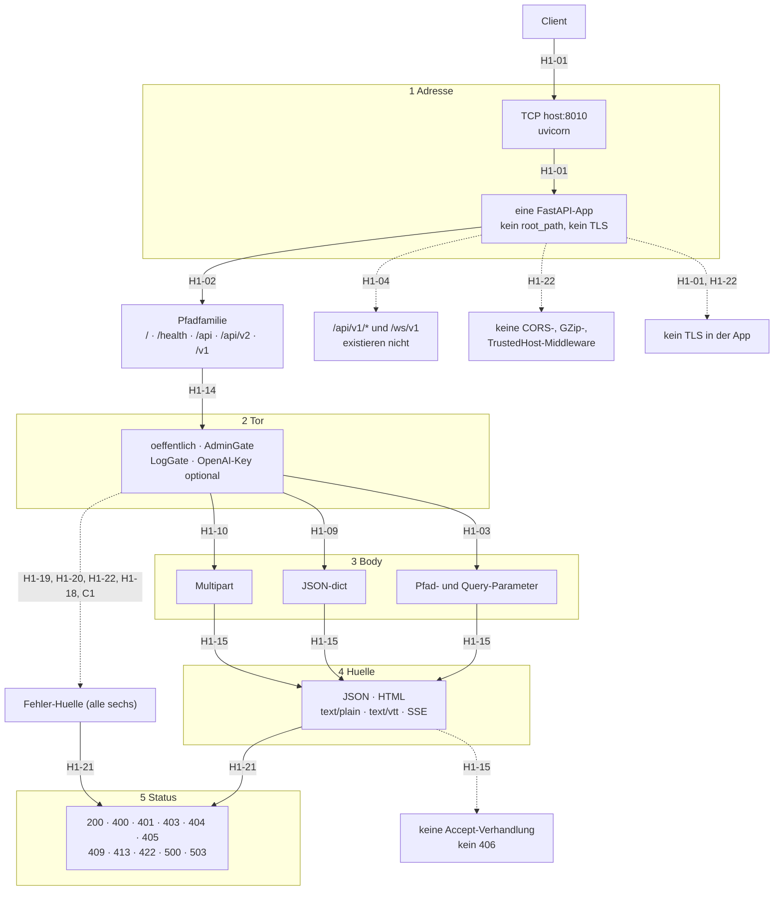

# 04.02 – HTTP-Grundlagen

*Status: INTEGRATED (intern abgenommen) – externe ROOT-Freigabe ausstehend. Codebasis: Commit `a8993c5c68042d996eab680d84a5b138a214bb5d`. Faktenbasis: `workflow/research/04.02.json` (H1-01…H1-22, N1…N8, U1…U6, C1…C6).*

**Abgrenzung:** Dieses Kapitel beschreibt den HTTP-Rahmen des Servers: wie eine Anfrage adressiert wird, welche Tore sie passiert, welche Body-Form sie haben darf, in welcher Hülle geantwortet wird und was ein Status bedeutet. Die Landkarte der Türen und Rollen steht in [04.01 (Schnittstellenübersicht)](04.01-schnittstellenuebersicht.md); die OpenAI-Formate im Detail in [04.10 (OpenAI-kompatible API)](04.10-openai-kompatible-api.md); die Log-Historie in [04.11 (Logzugriff)](04.11-logzugriff.md); Legacy-Audio in [04.12 (Legacy V1)](04.12-legacy-v1.md). Die vollständige Routenliste führt [08.04 (API-Endpunkt-Katalog)](../08-referenzen/08.04-api-endpunkt-katalog.md). Bewertungen der Zugriffs- und Fehlerantworten stehen in [05.03 (Admin-Authentifizierung)](../05-administration/05.03-admin-authentifizierung.md), [05.06 (OpenAI-API-Authentifizierung)](../05-administration/05.06-openai-api-authentifizierung.md) und [05.10 (Fehler- und Zugriffsantworten)](../05-administration/05.10-fehler-zugriffsantworten.md).

## 1. Worum geht es?

Eine HTTP-Anfrage an den Voice-STT-Server durchläuft fünf Schichten, und jede einzelne kann „Nein“ sagen:

1. **Adresse** – Erreiche ich den Prozess überhaupt? Der Server lauscht standardmäßig auf `0.0.0.0:8010`, ohne URL-Präfix und ohne TLS in der Anwendung (H1-01).
2. **Tor** – Darf ich diese Route aufrufen? Öffentlich, AdminGate oder optionaler OpenAI-Key (H1-11, H1-12, H1-13, H1-14).
3. **Body** – Versteht der Endpunkt meine Nutzlast? Meist ein untypisiertes JSON-Objekt, an genau einer Stelle Multipart (H1-09, H1-10).
4. **Hülle** – In welchem Format kommt die Antwort? JSON, HTML, Klartext, `text/vtt` oder SSE (H1-15).
5. **Status** – Was bedeutet die Zahl? Und welche der sechs Fehlerhüllen liegt vor? (H1-19, H1-20, H1-21, H1-22).

Diese Schichtung ist die schnellste Fehlerdiagnose. Ein `404` etwa hat in dieser App zwei Hüllen mit drei Ursachen: einen unbekannten Pfad, den FastAPI selbst beantwortet (H1-22); eine deaktivierte OpenAI-API (H1-12); oder ein nicht gefundenes OpenAI-Modell (H1-20, C3). Wer nur auf den Status schaut, sucht an der falschen Stelle.

Dazu kommt eine zweite Stolperstelle: Der Server hat **vier getrennte Versionsräume**, die ähnlich klingen (H1-05). `protocolVersion 2` ist das WebSocket-Protokoll, `logProtocolVersion 2` der Log-Versionsraum, `/api/v2` der HTTP-Pfad und `/v1` die OpenAI-Kompatibilität – nicht VoiceSTT V1. Zusätzlich meldet `/api/v2/info` ein `schemaVersion 1`. Diese Zahlen schalten einander nicht um; sie bezeichnen unterschiedliche Verträge.

Und schließlich: Die Fehlermeldungen sind **deutschsprachiger Implementierungstext**, keine zugesicherte API (H1-19, H1-20). Ein Client darf auf Status und Struktur reagieren, nicht auf den Wortlaut.

## 2. Das Wesentliche auf einen Blick

- **Eine App, eine Adresse.** `uvicorn.run(app, host, port, log_level)`, Defaults `0.0.0.0` und `8010`; kein `root_path`, kein URL-Prefix, keine TLS-Parameter (H1-01).
- **34 HTTP-Routen** in fünf Pfadfamilien plus **drei WebSocket-Routen**; dazu die FastAPI-Defaults `/openapi.json`, `/docs`, `/redoc` (H1-02).
- **Versionierung nur im Pfad:** `/api` unversioniert, `/api/v2` versioniert, `/v1` OpenAI; `/api/v1/*` und `/ws/v1` existieren nicht (H1-04).
- **Die 34 Routen verteilen sich auf 8 öffentliche, 21 AdminGate-Routen, 3 LogGate-Routen und 2 OpenAI-Routen** mit optionalem Key (H1-14).
- **Sechs Antwortformen im Fehlerfall:** App-`{error}`, Validate-`{valid:false}`, V2-PatchResult, OpenAI-Fehlerobjekt, Framework-`{detail}` und das SSE-Ereignis `error` (H1-19, H1-20, H1-22, C1, H1-18).
- **Schmale Statusmenge:** nur 200, 400, 401, 403, 404, 405, 409, 413, 422, 500, 503 – kein 201, 204, 206, 301, 304, 429, 502, 504 (H1-21, H1-22).
- **Antworten sind JSON** – außer `GET /` (HTML), OpenAI-`text`/`srt` (`text/plain`), `vtt` (`text/vtt`) und `stream=true` (`text/event-stream`) (H1-15).

### Der Weg einer Anfrage durch die fünf Schichten



**In Worten:** Der Client erreicht über TCP auf Port 8010 den uvicorn-Prozess, der genau eine FastAPI-App ohne Präfix und ohne eigene TLS-Terminierung hostet (H1-01). Die App ordnet den Pfad einer der fünf HTTP-Familien zu (H1-02); bevor der Handler arbeitet, entscheidet das Tor, ob der Aufruf zugelassen ist (H1-14). Danach wird entweder über Pfad-/Query-Parameter adressiert (H1-03), ein JSON-Objekt gelesen (H1-09) oder – nur bei der OpenAI-Transkription – Multipart verarbeitet (H1-10). Die Antwort wählt eine der Hüllen (H1-15) und endet in einem Status aus dem schmalen Inventar (H1-21). Fehler laufen über eine der sechs Hüllen (H1-19, H1-20, H1-22). Die gestrichelten Kanten halten fest, was bewusst fehlt: `/api/v1/*` und `/ws/v1` (H1-04), CORS-/GZip-/TrustedHost-Middleware (H1-22), TLS in der Anwendung (H1-01, H1-22) und Accept-Verhandlung (H1-15).

## 3. Adresse und Versionierung

### 3.1 Eine App, eine Adresse, kein Präfix

Der Server ist **eine** FastAPI-App, gestartet mit `uvicorn.run(app, host, port, log_level)`; Defaults `host 0.0.0.0`, `port 8010`, CLI `--host`/`--port` (H1-01). Kein `root_path`, kein URL-Prefix, keine `ssl_*`-Parameter. Die App hängt ungepräfixt im ASGI-Root; TLS terminiert – wenn überhaupt – davor (H1-01, H1-22, N7).

Docker-Compose bildet `${VOICESTT_PORT:-8010}:8010` ab und prüft `http://127.0.0.1:8010` auf `/health` (H1-01, H1-07). Ein Reverse Proxy kann die öffentliche URL abweichen lassen; das liegt außerhalb des Repositories (U3).

### 3.2 Fünf Pfadfamilien, 34 Routen

| Präfix | Bedeutung | Version | Fakten |
|---|---|---|---|
| `/` | gebündelte UI als HTML | – | H1-02, H1-15 |
| `/health` | Betriebsendpunkt | – | H1-02, H1-07 |
| `/api/*` | Legacy-REST | unversioniert | H1-02, H1-04 |
| `/api/v2/*` | versioniertes REST | 2 | H1-02, H1-04 |
| `/v1/*` | OpenAI-Kompatibilität | OpenAI-`v1`, nicht VoiceSTT-v1 | H1-02, H1-04, H1-05 |
| `/ws/*` | WebSocket, drei Routen | V1 unversioniert, V2 | H1-02, H1-04 |

Inventar: **34 HTTP-Routen** (32 in `server.py` + 2 OpenAI) + **3 WebSocket-Routen**; `/openapi.json`, `/docs`, `/redoc` als FastAPI-Defaults (H1-02). Kein StaticFiles-Mount; UI nur über `GET /` (H1-02, H1-15).

### 3.3 Versionierung nur im Pfad

Versioniert wird ausschließlich über den Pfad (H1-04). Keine Versionierung über Query, Header oder Media Type (H1-03). `/api/v1/*` und `/ws/v1` existieren nicht; VoiceSTT V1 = `/ws/transcribe`, V2 = `/ws/v2` (H1-04, N1). Wer `/api/v1/...` aufruft, erhält den Framework-404 (H1-22).

### 3.4 Vier Versionsräume

| Raum | Träger | Wert | Fakten |
|---|---|---|---|
| HTTP-Pfad V2 | `/api/v2` | 2 im Pfad | H1-04, H1-05 |
| WebSocket-Protokoll | `protocolVersion` | 2 | H1-05 |
| Log-Protokoll | `logProtocolVersion` | 2 | H1-05 |
| OpenAI-Kompatibilität | `/v1` | Kompatibilität | H1-04, H1-05 |
| Schema | `schemaVersion` in `/api/v2/info` | 1 | H1-05, H1-06 |

Die OpenAPI-`info.version` ist die App-Version (H1-05, H1-22). Beispiel: `curl -sS http://127.0.0.1:8010/api/v2/info` enthält `schemaVersion` und `protocolVersion` als **verschiedene** Felder (H1-05, H1-06).

## 4. Requests

### 4.1 Adressierung: Pfad oder Query

Pfadparameter nur bei der Log-Historie (`/api/logs/sessions/{session_id}`, `/api/logs/transcriptions/{transcription_id}`); `/api/logs/events` nutzt Query (`sessionId`, `transcriptionId`, `channels`, `events`, `from`, `to`, `afterCursor`, `limit` Default 200). Namen exakt, case-sensitiv (H1-03).

### 4.2 Methoden

| Methode | Bedeutung | Beispiele | Fakten |
|---|---|---|---|
| GET | nur lesen | UI, Health, Info, Projektionen, Logs, Modelle | H1-08 |
| PATCH | partiell aktualisieren | `/api/config`, `/api/v2/settings/server` | H1-08 |
| PUT | Sektion aktualisieren | `/api/language`, `/api/wake-word`, `/api/models/lifecycle`, `/api/models/active`, `/api/logging` | H1-08 |
| POST | Aktion auslösen | Refresh, Load/Unload, Validate/Reload, Transkription | H1-08 |
| DELETE | – | kommt nicht vor | H1-08, N2 |

`PUT` = Sektion setzen, `PATCH` = Felder ändern (H1-08). Kein DELETE (N2).

### 4.3 Bodies: untypisierte JSON-Objekte

Keine Pydantic-Request-Modelle, kein `response_model` (H1-09). `PATCH /api/config`: `{settings: {...}}` oder flaches Objekt. `PUT /api/language`, `/api/wake-word`: flache Felder, nur bekannte gelesen. `PUT /api/logging`, `/api/models/lifecycle`, `/api/models/active`, `POST /api/config/validate`: flache Felder, unbekannte → 400. `PATCH /api/v2/settings/server`: `{baseSettingsRevision: int, changes: {...}}`, unbekannte Keys → 422 (`settings_rejected`, PatchResult); 400 nur bei nicht-objektförmigem Body (`invalid_payload`).

```json
{
  "baseSettingsRevision": 42,
  "changes": {
    "<einstellung>": "<wert>"
  }
}
```

`baseSettingsRevision` = optimistische Nebenläufigkeit: veraltet → 409 statt blindem Überschreiben (H1-09, H1-21). Tippfehler können je nach Endpunkt laut scheitern oder still ignoriert werden (H1-09).

### 4.4 Der eine Multipart-Endpunkt

`POST /v1/audio/transcriptions` liest `request.form()` mit Pflicht `model` + Upload `file`. Endungen: `.flac`, `.mp3`, `.mp4`, `.mpeg`, `.mpga`, `.m4a`, `.ogg`, `.wav`, `.webm`. Limit `openai_max_file_bytes` Default **25 MiB**; darüber 413 `file_too_large` (H1-10, H1-20). Optional: `language`, `prompt`, `response_format`, `temperature`, `timestamp_granularities[]`, `stream`, `include[]`, `threshold`, `known_speaker_names[]`, `known_speaker_references[]`, `voicestt_model`/`model_override` (H1-10). Kein JSON-Body.

### 4.5 Was FastAPI selbst ablehnt

Unbehandelte Pfade/Methoden/Bodies: 404 `{detail: Not Found}`, 405 `{detail: Method Not Allowed}` + `Allow`-Header, 422 `{detail: [...]}` (H1-22). Kein `exception_handler`, keine `HTTPException`; Default-Bodies = Framework-Verhalten, Evidenz mittel (H1-22, U6).

## 5. Die Tore

### 5.1 AdminGate

Schlüssel aus `settings.admin_api_key` oder `VOICESTT_ADMIN_API_KEY` (H1-11). Präzedenz: `x-voicestt-admin-key` vor `Authorization: Bearer` vor `x-admin-key`; falscher erster Header wird nicht durch gültigen Bearer gerettet. Mit Key + fehlend/falsch → 401 + `WWW-Authenticate: Bearer`. Ohne Key: nur Loopback, sonst 403 (`secrets.compare_digest`, H1-11). Schützt **21 Admin-HTTP-Routen**, nicht `/v1/*`, nicht `/api/logs/*` (H1-11).

### 5.2 OpenAI-Key: optional und unabhängig

Key aus `settings.openai_api_key` oder `VOICESTT_API_KEY`. Mit Key: `Authorization` exakt `Bearer <key>`, sonst 401 OpenAI-Fehler (`invalid_api_key`) + `WWW-Authenticate` + Audit. Ohne Key: `/v1/*` offen (H1-12). `openai_api_enabled` (Default true) nur Transkription → deaktiviert 404; `GET /v1/models` ignoriert Flag (H1-12, C4). Getrennte Schlüsselräume (H1-11, H1-12).

### 5.3 LogGate

Drei Log-Routen; Admin bei Key-Treffer oder ohne Key von Loopback; sonst Sitzungstoken (`x-voicestt-log-token` oder Bearer, 24 h, sessiongebunden, nur Speicher). Ohne Scope → 401 **ohne** `WWW-Authenticate` (H1-13, C5). Nicht-Admins: nur `audit`/`performance`/`transcription` + eigene Session. Store weg → 503 `event_store_unavailable`; Query-Parsefehler → 400 (H1-13).

### 5.4 Scope-Matrix der 34 Routen

| Zugang | Anzahl | Fakten |
|---|---|---|
| öffentlich | 8 | H1-14 |
| AdminGate | 21 | H1-11, H1-14 |
| LogGate | 3 | H1-13, H1-14 |
| OpenAI-Key optional | 2 | H1-12, H1-14 |

`GET /api/v2/settings/server` öffentlich, `PATCH` Admin – Tür hängt an Operation, nicht nur Pfad (H1-14).

## 6. Responses

### 6.1 Hüllen und Content Types

| Antwort | Content-Type | Fakten |
|---|---|---|
| `GET /` | `text/html` | H1-15 |
| REST-Erfolg | `application/json` | H1-15 |
| OpenAI `text`/`srt` | `text/plain` | H1-15 |
| OpenAI `vtt` | `text/vtt` | H1-15 |
| OpenAI `stream=true` | `text/event-stream` | H1-15, H1-18 |
| Fehler | `application/json` | H1-15 |

Keine Accept-Verhandlung, kein 406, kein `response_model` (H1-15, N4). Formatwahl nur via `response_format` (H1-15).

### 6.2 Identität und Gesundheit

`GET /api/v2/info` öffentlich: `schemaVersion`, `protocolVersion=2`, `serverVersion`, `serverCommit`, `identityStatus`, `build`, `distribution`, `runtime`, `serverInstanceId`; `Cache-Control: no-store`; beim App-Bau eingefroren (H1-06). Einziger `no-store`-Endpunkt (H1-06).

`GET /health` öffentlich: `ok`, `ready`, Zähler, Scheduler/Modelle, Fehler, EventStore (H1-07). `ok` = `metrics.ok` UND (Live-Logging aus ODER Store available); `ready` separat aus `metrics.ready`. „Ok, aber nicht ready“ ist sinnvoll (H1-07).

### 6.3 `response_format`-Matrix

| `response_format` | Erfolgsbody | Fakten |
|---|---|---|
| `json` | JSON | H1-16 |
| `verbose_json` | JSON + `words` bei `timestamp_granularities=word` | H1-16 |
| `diarized_json` | JSON mit `segments[]`; bei `stream=true` zusätzlich Segment-Events + `transcript.text.done` | H1-16, H1-18 |
| `text` | `text/plain` | H1-15, H1-16 |
| `srt` | `text/plain` | H1-15, H1-16 |
| `vtt` | `text/vtt` | H1-15, H1-16 |
| `stream=true` | SSE, überschreibt Format | H1-16, H1-18 |

### 6.4 Header

Jede Transkriptionsantwort (Erfolg **und** Fehler): `X-Request-ID` (uuid4-Hex, 32 Zeichen) (H1-17). Nach Modellauflösung: `X-VoiceSTT-Requested-Model`, `-Resolved-Model`, `-Route` (`final`/`realtime`) + optionale Override-Header. Auch 404/401 tragen sie. `GET /v1/models`: **kein** `X-Request-ID` (H1-17).

### 6.5 SSE-Framing

`stream=true`: `data: ` + kompaktes JSON + `\n\n` (LF LF, H1-18). Typen: `transcript.text.delta`, `transcript.text.done`, `error`; bei `diarized_json` Segment-Objekte. **Kein** `[DONE]`-Sentinel, kein `event:`-/`id:`-Feld, keine Retry-Angabe. 0,1 s = interner Queue-Poll, kein Client-Timeout (H1-18). Wer auf `[DONE]` wartet, wartet vergeblich; Ende = `transcript.text.done` (H1-18).

## 7. Status und Fehler

### 7.1 Statusinventar

| Status | Bedeutung | Fakten |
|---|---|---|
| 200 | Erfolg | H1-21 |
| 400 | Eingabe/Ablehnung/Query/OpenAI-Request | H1-19, H1-20, H1-21 |
| 401 | Key/Token fehlt/falsch | H1-19, H1-20 |
| 403 | Admin remote ohne Key | H1-11, H1-21 |
| 404 | OpenAI deaktiviert/Modell unbekannt/Pfad unbekannt | H1-12, H1-20, H1-22 |
| 405 | Methode nicht erlaubt + `Allow` | H1-22 |
| 409 | Revision/Modell/Limit-Konflikt | H1-20, H1-21 |
| 413 | Datei zu groß (`file_too_large`) | H1-10, H1-20 |
| 422 | V2-Ablehnung/Wake-Refresh/Framework-Body | H1-21, H1-22, C2 |
| 500 | intern/Ladefehler/OpenAI-Ausnahme | H1-20, H1-21 |
| 503 | Eventstore nicht verfügbar | H1-13, H1-19 |

Keine 201/204/206/301/304/429/502/504 (H1-21).

### 7.2 Sechs Fehlerhüllen

| # | Hülle | Wo | Fakten |
|---|---|---|---|
| 1 | `{error: "<deutsch>"}` + optional `fields[]`/`unavailableWakeWords[]`/`code` | App-REST | H1-19 |
| 2 | `{valid: false, error}` / `{valid: true, settings}` | Validate | H1-19 |
| 3 | V2-PatchResult `{accepted, result, errors}` | 400/409/422/500 (Ablehnung typisch 422) | C1, H1-21 |
| 4 | `{error: {message, type, param, code}}` | `/v1/*` | H1-20 |
| 5 | `{detail: ...}` | FastAPI 404/405/422 | H1-22 |
| 6 | SSE-Ereignis `error` | `stream=true` | H1-18 |

Kein einheitliches Format, keine durchgängigen Codes, kein RFC 7807 (H1-19, N5). OpenAI-Hülle einzige mit strukturiertem Code (H1-20): `invalid_api_key` (401), `invalid_model_override` (400), `model_not_loaded` (409), `model_not_found` (404), `file_too_large` (413), `transcription_failed` (500, `server_error`); deaktiviert: `code` null (404); Feldfehler 400 ohne Code. Meldungen deutsch, Struktur OpenAI-kompatibel (H1-20). Text = Implementierungstext, keine stabile API.

### 7.3 404 zweifach (drei Ursachen), 422 dreifach

**404** (C3, zwei Hüllen, drei Ursachen): unbekannter Pfad → `{detail}` (H1-22); deaktivierte API → OpenAI-Fehler `code: null` (H1-12); Modell unbekannt → `model_not_found` (H1-20). **422** (C2): Framework-Body → `{detail}` (H1-22); V2-Ablehnung → PatchResult (C1); Wake-Refresh → App-Fehler (H1-21).

### 7.4 400, 422 und 409

- **400:** Eingabe für diesen Endpunkt nicht verwertbar (H1-09, H1-19, H1-21).
- **422 V2:** formal lesbar, inhaltlich abgelehnt (C1, H1-21); Framework-422: Body passte nicht zum Schema (H1-22).
- **409:** Zustand passt nicht (Revision/Modell/Limit); neu lesen, erneut versuchen (H1-20, H1-21).

### 7.5 Was ein 400 nicht verspricht

Ein 400 sagt Ablehnung, nicht Umfang einer Teilübernahme (H1-09, H1-21). Nach 400 Zustand per GET neu lesen; für V2 liefert PatchResult die bessere Grundlage als der Status (C1).

## 8. Grenzen, offene Punkte und Konflikte

### 8.1 Was es nicht gibt (N1–N8)

| ID | Befund | Fakten |
|---|---|---|
| N1 | `/api/v1/*`, `/ws/v1` fehlen; V1 = `/ws/transcribe` | H1-04 |
| N2 | kein DELETE; kein PATCH für Language/Wake/Logging (nur PUT) | H1-08 |
| N3 | keine CORS-/GZip-/TrustedHost-Middleware | H1-22 |
| N4 | keine ETag/Cache-Validierung, keine Accept-Negotiation, kein 406 | H1-15, H1-22 |
| N5 | kein einheitliches Fehlerformat, keine Codes, kein RFC 7807 | H1-19 |
| N6 | keine Scopes/Rollen/Client-Keys; nur Admin-/OpenAI-Key + Log-Token | H1-11–H1-13 |
| N7 | kein HTTPS/TLS in der App | H1-01, H1-22 |
| N8 | keine Pagination-Link-Header; Cursor nur JSON-Felder | H1-03 |

### 8.2 Offene Punkte (U1–U6)

| ID | Offen | Fakten |
|---|---|---|
| U1 | Framework-422 vor Admin-401 bei fehlendem JSON? ungetestet | H1-11, H1-22 |
| U2 | `/docs`/`/redoc` produktiv erreichbar? nur Defaults | H1-22 |
| U3 | Proxy-Präfix/`root_path`/TLS außerhalb Repo | H1-01 |
| U4 | HTTP/1.1 vs HTTP/2 unkonfiguriert | H1-01 |
| U5 | Key in Deployment gesetzt? Defaults `None` | H1-11, H1-12 |
| U6 | Framework-Bodytexte FastAPI-Version | H1-22 |

### 8.3 Konflikte (C1–C6)

| ID | Beobachtung | Umgang | Fakten |
|---|---|---|---|
| C1 | mehrere Fehlerformate | Body prüfen, nicht nur Status | H1-19, H1-20, H1-22 |
| C2 | 422 dreifach | Ursache am Body unterscheiden | C2, H1-21, H1-22 |
| C3 | 404 doppelt | `detail` = Framework, `error` = App | C3, H1-12, H1-20, H1-22 |
| C4 | OpenAI-Flag asymmetrisch | Transkription 404, Models ignoriert | C4, H1-12 |
| C5 | 401 mit/ohne `WWW-Authenticate` | gate-spezifisch | C5, H1-11–H1-13 |
| C6 | Statusmatrix mischt Auth/AuthZ/Konflikt/Validierung/Verfügbarkeit | 403 = „Remote ohne Key deaktiviert“, keine Rolle | C6, H1-11, H1-21 |

C6: 403 ist kein Rollenmodell, sondern Folge **nicht konfigurierten** Keys von außerhalb Loopback (H1-11). Wer 403 als „falsche Rolle“ deutet, sucht eine Rollenverwaltung, die es nicht gibt (N6).

## 9. Siehe auch und Nachweise

**Faktenakte:** `workflow/research/04.02.json`, Commit `a8993c5c68042d996eab680d84a5b138a214bb5d`.

- H1-01 eine App, Adresse `0.0.0.0:8010`, kein Präfix/TLS
- H1-02 34 HTTP-Routen, 3 WebSocket-Routen, Framework-Defaults
- H1-03 Pfad-/Query-Adressierung, `limit` Default 200
- H1-04 nur Pfad-Versionierung, `/api/v1/*`/`/ws/v1` fehlen
- H1-05 vier Versionsräume + `schemaVersion 1`
- H1-06 `GET /api/v2/info` und `no-store`
- H1-07 `GET /health` und `ok`-Logik
- H1-08 Methodensemantik, kein DELETE
- H1-09 untypisierte JSON-Bodies, Feldbehandlung
- H1-10 Multipart-Transkription, 25 MiB, 413
- H1-11 AdminGate, Präzedenz, 401/403
- H1-12 optionales OpenAI-Gate, Flag-Asymmetrie
- H1-13 LogGate, Token, 503
- H1-14 Scope-Matrix der 34 Routen
- H1-15 Content Types, keine Negotiation
- H1-16 `response_format`-Matrix
- H1-17 `X-Request-ID` und Modell-Header
- H1-18 SSE ohne `[DONE]`, interner 0,1-s-Poll
- H1-19 App-Fehlerhüllen
- H1-20 OpenAI-Codes
- H1-21 Statusinventar
- H1-22 Framework-Verhalten, fehlende Middleware

Grenzen N1–N8, U1–U6, C1–C6 in §8.

**Verwandt:** [04.01 Schnittstellenübersicht](04.01-schnittstellenuebersicht.md) · [04.03 WebSocket V2](04.03-websocket-v2.md) · [04.10 OpenAI-kompatible API](04.10-openai-kompatible-api.md) · [04.11 Logzugriff](04.11-logzugriff.md) · [04.12 Legacy V1](04.12-legacy-v1.md) · [04.13 Integrationsbeispiele](04.13-integrationsbeispiele.md) · [05.03 Admin-Authentifizierung](../05-administration/05.03-admin-authentifizierung.md) · [05.06 OpenAI-API-Authentifizierung](../05-administration/05.06-openai-api-authentifizierung.md) · [05.10 Fehler- und Zugriffsantworten](../05-administration/05.10-fehler-zugriffsantworten.md) · [08.04 API-Endpunkt-Katalog](../08-referenzen/08.04-api-endpunkt-katalog.md).
