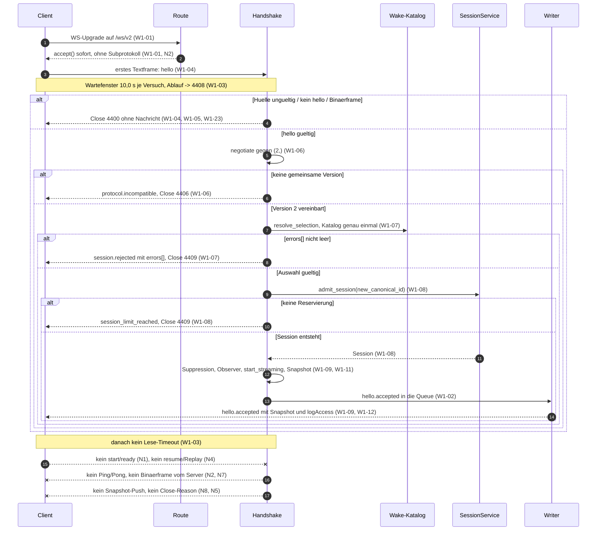

# 04.03 – WebSocket V2

*Status: INTEGRATED (intern abgenommen) – externe ROOT-Freigabe ausstehend. Codebasis: Commit `a8993c5c68042d996eab680d84a5b138a214bb5d`. Faktenbasis: `workflow/research/04.03.json` (W1-01…W1-23, N1…N8, U1…U6, C1…C6).*

**Abgrenzung:** Dieses Kapitel beschreibt den **Verbindungsaufbau** von `/ws/v2`: Route, `hello`, Versionsaushandlung, Admission und die erste Serverantwort. Was danach auf demselben Socket passiert, steht in [04.04 (Commands/Acknowledgements)](04.04-commands-acknowledgements.md), [04.05 (Audiotransport)](04.05-audiotransport.md), [04.06 (Eventtransport)](04.06-eventtransport.md), [04.07 (Snapshot-Synchronisierung)](04.07-snapshot-synchronisierung.md) und [04.08 (Reconnect)](04.08-reconnect.md). Die Legacy-Gegenprobe liefert [04.12 (Legacy V1)](04.12-legacy-v1.md), die Logseite [04.11 (Logzugriff)](04.11-logzugriff.md), die Routenlandkarte [04.01 (Schnittstellenübersicht)](04.01-schnittstellenuebersicht.md).

## 1. Worum geht es?

`/ws/v2` ist keine Variante von `/ws/transcribe`, sondern eine eigene Route mit eigenem Vertrag (W1-01). Der Unterschied beginnt beim ersten Frame: In V1 begrüßt der Server den Client; in V2 muss der **Client zuerst `hello` senden** (W1-04, W1-09). Bis dieses `hello` akzeptiert ist, existiert keine Session, kein Recorder und kein Audiopfad.

Für die Praxis hat das drei Konsequenzen:

1. **Die Verbindung allein bedeutet nichts.** Der Handler nimmt den Socket sofort an – ohne Subprotokoll und ohne Auth-Gate (W1-01, N2, N3). Erst das `hello` entscheidet, ob daraus eine Session wird.
2. **Der erste Frame entscheidet über drei Ablehnungsstufen.** Hülle ungültig → **4400**, Version nicht verhandelbar → **4406**, Session nicht admitierbar → **4409**; Schweigen → **4408** (W1-03, W1-04, W1-06, W1-07). Wer „einfach schon mal Audio schickt“, wird geschlossen, nicht bedient.
3. **Admission ist ein einzelner, atomarer Vorgang.** Wake-Katalog, Session-Anlage und Verarbeitungsstart greifen ineinander, ohne Zwischenzustand (W1-07, W1-08, W1-09, W1-11).

## 2. Das Wesentliche auf einen Blick

- **Eine Route, ein Socket, ein Writer.** `/ws/v2` getrennt von `/ws/transcribe` und `/ws/logs` (W1-01); alle Server-Nachrichten über genau einen Writer-Task, ausschließlich Textframes (W1-02).
- **Client zuerst.** Erstes Frame muss `hello` sein; alles andere – fremder Typ, kaputtes JSON, Binärframe – endet mit **4400** ohne Nachricht (W1-04, W1-05, W1-23).
- **10,0 Sekunden, dann 4408.** Vor `hello.accepted` Handshake-Timeout **10,0 s** je Empfangsversuch; danach app-seitig **kein** Lese-Timeout (W1-03).
- **Nur Version 2.** `hello` kennt kein `protocolVersion`-Feld; Version aus `supportedProtocolVersions` (W1-06).
- **Höchstens 4 Sessions.** Reservierung unmöglich (Default `max_sessions` **4**) → **4409** `session_limit_reached` (W1-08).
- **Kein `start`, kein `ready`.** Audio-Annahme ist Teil der Admission (W1-09, W1-11, N1).
- **`accepted` zweideutig.** `hello.accepted` = Handshake fertig; `command.ack.accepted` = Kommando angewendet (C1).
- **4400 und 4409 Sammelcodes.** Code allein nennt keine Ursache; bei 4409 unterscheidet `errors[].code` (C3, C4).

### Der Handshake als Sequenz



**In Worten:** Client öffnet Socket; Server nimmt sofort an (W1-01). Wartet auf erstes Textframe (10,0 s je Versuch). Ungültig → 4400 (W1-04). Gültig → Version aushandeln (W1-06); inkompatibel → 4406. Kompatibel → Katalog prüfen (W1-07); Fehler → 4409 mit `errors[]`. Gültig → Session anlegen (W1-08); voll → 4409 `session_limit_reached`. Erfolg → Session arbeitet bereits, wenn `hello.accepted` den Client erreicht (W1-09, W1-11). Gekreuzte Kanten = Negativaussagen (N1, N2, N4, N5, N7, N8).

### Alternative Verläufe

| Verlauf | Auslöser | Ergebnis | Fakten |
|---|---|---|---|
| Erstes Frame kein `hello` | z. B. Kommando vorab | Close 4400, keine Nachricht | W1-04 |
| JSON/Hülle kaputt | fehlende Pflichtfelder, `bool` statt `int` | Close 4400 | W1-04, W1-05 |
| Binärframe vor `accepted` | Audio zu früh | Close 4400 | W1-23 |
| Keine gemeinsame Version | nur 1 angeboten | `protocol.incompatible`, 4406 | W1-06 |
| Schweigen 10,0 s | kein `hello` | Close 4408 | W1-03 |
| Admission-Fehler | Trigger/Wake-Probleme | `session.rejected` + `errors[]`, 4409 | W1-07 |
| Keine Kapazität | 5. Session bei max 4 | `session_limit_reached`, 4409 | W1-08 |
| Unerwartete Ausnahme | außerhalb der Fälle | Close 1011 | W1-08, W1-20 |

## 3. Aufbau: Route, Writer und Zeitfenster

### 3.1 Route und Client-Kennung

Handler für `/ws/v2`: sofort `await websocket.accept()`, ohne Subprotokoll, ohne Auth (W1-01). Kennung aus Query `clientId` oder Header `x-voicestt-client-id`, normalisiert 1–128 Zeichen (Unicode-alphanumerisch plus `._:-`); sonst `client-<uuid4hex>` (W1-01). Verbindung **nicht** im gemeinsamen `ConnectionManager`; Session im `service.sessions`-Register, zählt in `/health` unter `activeSessions` (W1-01). `clientId` = Bezeichnung, keine Berechtigung (W1-01, N3).

### 3.2 Ein Writer, Textframes, escaptes JSON

Alle Nachrichten über thread-sichere Queue und **genau einen** Writer-Task (W1-02). Jede Nachricht Textframe, kompakt (`separators=(',',':')`); Nicht-ASCII als `\uXXXX`. `None` = schließen + `transport_close`. **Server sendet keine Binärframes** (W1-02, N7). Deutsch `Grüße` steht als `Gr\u00fc\u00dfe` auf der Leitung – für JSON-Parser gleichwertig, für Rohpuffer-Suche nicht. Binärkanal nur Client→Server (W1-23).

### 3.3 10,0 s vor `hello`, danach kein Lese-Timeout

Vor `hello.accepted`: **10,0 s** (`DEFAULT_HANDSHAKE_TIMEOUT_SECONDS`), `asyncio.wait_for` je Versuch; Ablauf → **4408** (W1-03). Nach Annahme: **kein** Lese-Timeout; Schleife wartet auf `receive()` **oder** `transport_close` (W1-03). Client darf nach `accepted` beliebig schweigen; Proxy-Idle-Timeouts außerhalb der App möglich (U3). Kein Ping/Pong-Keepalive (N2).

## 4. Das `hello`: Felder und Aushandlung

### 4.1 Pflichtfelder

Verstöße → **4400 ohne Nutzlast**; Client erfährt nicht, welches Feld fehlte (W1-05, C4). Namen case-sensitiv; Unbekanntes ignoriert (W1-05).

| Feld | Regel | Fakten |
|---|---|---|
| `type` | muss `hello` sein | W1-05 |
| `supportedProtocolVersions` | nichtleere Liste echter `int` (`bool` zählt nicht) | W1-05, W1-06 |
| `clientVersion` | nichtleerer String, kein Semver-Check | W1-05 |
| `clientCommit` | nichtleerer String | W1-05 |
| `clientRunId` | kanonische UUID | W1-05, W1-22 |
| `requestedSession` | Objekt | W1-05 |
| `requestedSession.trigger.manual` / `.wakeWord` | `bool` | W1-05, W1-07 |
| `requestedSession.wakeWordIds` | Liste nichtleerer Strings | W1-05, W1-07 |
| `runtimeSuppression.manual` / `.wakeWord` | `bool` | W1-05 |

```json
{
  "type": "hello",
  "supportedProtocolVersions": [2],
  "clientVersion": "1.4.0",
  "clientCommit": "abc1234",
  "clientRunId": "6f1c2f7a-3f0e-4a5f-9d7e-2b8c1a4d5e6f",
  "requestedSession": {
    "trigger": { "manual": true, "wakeWord": false },
    "wakeWordIds": []
  },
  "runtimeSuppression": { "manual": false, "wakeWord": false }
}
```

**Fehlt:** `protocolVersion` – wird nicht gesetzt, sondern ausgehandelt (W1-06). `clientRunId` ≠ Sessionwunsch; ID vergibt der Server (W1-08).

### 4.2 Aushandlung: höchste gemeinsame Version

`negotiate()` schneidet Client-Liste mit `(2,)`, nimmt Maximum (W1-06). Ohne Treffer: `protocol.incompatible` (`reason=no_common_protocol_version`, `serverVersion`, `serverCommit`, `supportedProtocolVersions=[2]`), **4406**, ohne `sessionId`/Session (W1-06).

| Client | Ergebnis | Fakten |
|---|---|---|
| `[2]` | Version 2 | W1-06 |
| `[1, 2]` | Version 2 (höchste) | W1-06 |
| `[1]` | `protocol.incompatible`, 4406 | W1-06 |
| `[]` | 4400 (kaputte Hülle) | W1-05 |

Leere Liste = Hüllenfehler (4400), nicht Versionskonflikt (W1-05, W1-06).

## 5. Admission und Session

### 5.1 Drei Prüfstufen, gesammelte Fehler

Feste Reihenfolge, **sammelt** Fehler (W1-07): (1) keine Triggerquelle → `activation_trigger_required`; (2) `wakeWord=true` ohne IDs → `wake_word_selection_required`; (3) IDs ohne `wakeWord=true` → `wake_word_selection_not_allowed`; (4) Katalogprüfung. Nichtleer → `session.rejected` (`reason=invalid_requested_session`, `errors[]`), **4409**, keine `sessionId` (W1-07). Mehrere Fehler zugleich = ein Korrekturdurchgang (W1-07).

### 5.2 Katalog genau einmal

`WakeWordPort.resolve_selection` **genau einmal, atomar** (W1-07). Unbekannt/deaktiviert/nicht-kanonisch/nicht-ladbar → **gesamte** Auswahl abgelehnt (u. a. `wake_word_unavailable`); keine Reduktion auf gültige (W1-07). Meldungen deutsch, nicht stabil (W1-07). Anlage erhält validierte Auswahl als `selection` durchgereicht, löst nicht erneut auf (W1-08).

### 5.3 Session anlegen, Limit, interner Fehler

Neue kanonische UUID (`new_canonical_id`) via `service.admit_session(..., canonical_ids=True)` (W1-08). Client bestimmt ID nicht; ≠ `clientRunId` (W1-08, W1-22).

| Ausgang | Bedingung | Reaktion | Fakten |
|---|---|---|---|
| Erfolg | Reservierung gelingt | Session mit neuer UUID | W1-08 |
| Voll | `max_sessions` erreicht (Default **4**) | `session_limit_reached`, 4409 | W1-08 |
| Config-Fehler | `SessionConfigurationError` | `invalid_requested_session` + field/code/message, 4409 | W1-08 |
| Unerwartet | andere Ausnahme | 1011 | W1-08, W1-20 |

Limit = Kapazität, keine Berechtigung (W1-01, N3). 4409 Sammelcode: `errors[].code` lesen (C3). Disconnect vor `accepted`: keine Session, kein Audit (W1-21).

### 5.4 `hello.accepted` und Reihenfolge

Einzige positive Antwort (W1-09): `type=hello.accepted`, `protocolVersion=2`, `sessionId`, `serverVersion`, `serverCommit`, `snapshot` (eingebettet ohne inneres `type`), `logAccess`. Reihenfolge: anlegen → Suppression → Observer → `start_streaming()` → Snapshot → senden (W1-09). `start_streaming()` nur Legacy-Status an `ConnectionManager`, nicht an V2-Observer (W1-11). **Kein** `start`/`ready`/server-`hello` (N1; W1-09, W1-11). Auf Freigabe warten = vergeblich.

## 6. Bootstrap: Snapshot und `logAccess`

### 6.1 Snapshot

Reine Projektion (W1-10): Identität/Version, Zähler (`stateVersion`, `lastEventSeq`, `settingsRevision`), `input{phase, activationId, primarySource, deadlineAtUnixMs, remainingMs, closeRequested}`, `pendingActivations[]` (nur `inputClosed=true`, sortiert), `trigger{configured, suppressed, effective}`, `audioAvailable`, `requestedSettings`, `effectiveSettings`, `wakeWordCapabilities`. idle: IDs/Deadline/`remaining` null, `closeRequested=false`. Zeiten: monotoner Deadline-Wert + Wanduhr-Anker (W1-10). Vektor ohne `requestedSettings`, Code sendet es immer (additiv, C2). Startwerte `0` unter Last ungetestet (U6).

### 6.2 `logAccess`

Pro akzeptierter Verbindung via `create_log_access(sessionId)` (W1-12): `available`, `websocketPath=/ws/logs`, `historyPath=/api/logs/events`, `sessionId`, `logProtocolVersion=2` (eigener Raum, **nicht** WS-Protokoll), `deliveryMode=sqlite_first`, `replayAvailable`, `serverInstanceId`, `oldestCursor`, `latestCursor`; mit Store + `accessToken`/`expiresAt`. Aus → `code=log_live_disabled`; nur Store weg → `event_store_unavailable`, ohne Token (W1-12). Token **64 Hex** (2× uuid4-hex), **24 h**, sessiongebunden, nur Speicher; Neustart ungültig (W1-12). Asymmetrie: `/ws/v2` ohne Auth (N3, C5), liefert aber Log-Token; Admin-Routen weiter mit Key. Details [04.11](04.11-logzugriff.md), [05.05](../05-administration/05.05-log-authentifizierung.md).

## 7. Danach: Kommandos, Acks, Replay, Events (Rahmen)

Nur Benutzung; Verträge in [04.04](04.04-commands-acknowledgements.md), [04.06](04.06-eventtransport.md).

### 7.1 Fünf Kommandotypen

Nach `accepted`: `activation.command`, `trigger_suppression.set`, `audio_availability.set`, `session_settings.patch`, `session.snapshot.request` (W1-13). Hülle: kanonische `commandId` Pflicht (sonst keine Antwort/kein Replay); `protocolVersion` exakt 2 (sonst `invalid_payload`); `sessionId` kanonisch (fremd-gültig → `stale_session` wirkungslos; nicht-kanonisch → `invalid_payload`). Unbekannte `type` still ignoriert (kein ack/Wechsel); zweites `hello` wirkungslos (W1-13).

### 7.2 `command.ack` und 15 Codes

Jede erkennbare Nachricht mit `commandId` genau eine `ack` (W1-15): `type`, `protocolVersion`, `sessionId`, `commandId`, `accepted`, `result`, `activationId`, `inputPhase`, `stateVersion`, `settingsRevision`, optional `errors[]`. `inputPhase` normiert (`idle`, `waiting_first_speech`, `segment_active`, `followup_wait`, `closing_input`). `accepted` nur bei `applied`/`no_change` (W1-15). Doppeldeutigkeit `accepted` (C1). 15 Codes (W1-15): Erfolg (`applied`, `no_change`); Zustand (`activation_locked`, `not_active`, `invalid_phase`, `closing_input`); Identität/Hülle (`stale_session`, `stale_activation`, `command_id_conflict`, `invalid_payload`); Trigger/Audio (`trigger_suppressed`, `audio_unavailable`); Settings (`settings_revision_conflict`, `settings_rejected`); intern (`internal_error`).

### 7.3 Replay

Schlüssel: `commandId` + typstabiler Freeze der Nutzlast ohne `commandId` (W1-16). Identisch → memoisierte `ack` ohne Re-Ausführung. Gleiche ID/andere Nutzlast → `command_id_conflict` wirkungslos. Abgelehnte behält Identität. Additiv-Unbekanntes ändert Antwort nicht (Regime A; W1-16). Pro Verbindung/Session; Reconnect neue Historie. Keine Wiederaufnahme (N4); Resync via `session.snapshot.request` (W1-13, [04.07](04.07-snapshot-synchronisierung.md)).

### 7.4 Events

`type`, `protocolVersion`, `sessionId`, `eventId`, `eventSeq`, `stateVersion`, `occurredAtUnixMs` (W1-17). `eventSeq` ab 1 strikt monoton lückenlos pro Verbindung; `stateVersion` ab 0 nur bei sichtbaren Änderungen. **18 Typen**; `watchdog.warning`, `activation.trigger_suppressed`, `transcription.interim` = `NON_STATE_EVENTS` ohne Anstieg (W1-17). Retry derselben Occurrence → gleiche `eventId`/`eventSeq` (W1-17). Projector Legacy→V2 (W1-18): `activation_started`→`started`, `refreshed`→Phase, `closed`→`input_closed`, `recording_started`/`ended`→Segment, `transcription_started`/`realtime_transcript`/`final_transcript`→`accepted`/`interim`/`completed`, `discarded`/`cancelled`→`discarded`, `failed`→`failed`, `watchdog_warning`→`warning`, `wakeword_detected`→`detected`, `availability_changed`→`changed`; `activation_drained`→`completed`/`cancelled`/`failed`; Unbekanntes verworfen; Phasenwechsel vorangestellt wo nötig; späte Interims nach Terminal verworfen (W1-18).

### 7.5 `session_settings.patch`

`baseSettingsRevision` int≥0 + nichtleeres `changes` (sonst `invalid_payload`) (W1-19). Erfolg: Revision gespiegelt, Keys nach Policy gruppiert (`live`, `next_activation`, `next_session`, `server_restart`), sortiert; pro Gruppe `settings.changed` (Revision, `scope=session`, `changedKeys`, `applyPolicy`). Nur erstes Event sichtbarer Sprung: +1 `stateVersion`, alle Events gleiche Revision (W1-19). Veraltet → `settings_revision_conflict`; abgelehnt → `settings_rejected` mit `errors[]`. Wirkung [03.09](../03-konfiguration/03.09-wirksamkeitszeitpunkt.md); Server via HTTP ([04.02](04.02-http-grundlagen.md)).

## 8. Ende: Close-Codes, Teardown, IDs, Binärkanal

### 8.1 Close-Tabelle

| Code | Bedeutung | Auslöser | Fakten |
|---|---|---|---|
| 4400 | invalid handshake | kein `hello`, unparsebar, Hülle kaputt, Binär vor `accepted` | W1-04, W1-05, W1-20, W1-23 |
| 4406 | `protocol.incompatible` | keine gemeinsame Version | W1-06, W1-20 |
| 4408 | handshake timeout | 10,0 s ohne `hello` | W1-03, W1-20 |
| 4409 | `session.rejected` | Admission/Limit/Katalog | W1-07, W1-08, W1-20 |
| 1011 | intern | unerwartete Admission-Ausnahme | W1-08, W1-20 |
| 1000 | Fallback | Close ohne Code | W1-20 |

Keine 1001/1008/1012/1013/4xxx-Zwischen, kein Shutdown (W1-20, N6). `close()` **ohne Reason-Text** (W1-20, N5). Grund aus Code + (bei 4409) `errors[]`; bei 4400 prinzipiell offen (C4). Proxy kann Codes verändern (W1-20).

### 8.2 Teardown

Deterministisch (W1-21): Code lesen → `request_close(code or 1000)` (first-wins, idempotent) → bis **5,0 s** auf Writer (sonst cancel) → `close_session()` (Observer weg, `remove_session`) → `websocket.close(code)` → nur mit Session Audit `session.closed` (sessionId, clientId, `transport=websocket_v2`). Wettlauf 4409 vs 1011: first-wins, ungetestet (U5).

### 8.3 IDs sind kanonische UUIDs

**36 Zeichen**, Bindestriche, lowercase, `str(uuid.UUID(...))` (W1-22). Kompakt/Groß abgelehnt ohne Umformatierung. `sessionId` erzeugt + validiert (sonst `ValueError`); `commandId` nur validiert. V1-kompakt nicht migriert (W1-22). Gilt für sessionId, clientRunId, commandId, activationId, eventId, segmentId.

### 8.4 Binärkanal

Nach `accepted`: `decode_audio_packet` + `ingest_audio_packet`, bool zurück (W1-23). Ungültig (`AudioPacketError`) geloggt/verworfen **ohne** Close/Wechsel; Unerwartetes ebenso (W1-23). Vor `accepted` jedes Binärframe → 4400 (W1-04, W1-23). Paketformat [04.05](04.05-audiotransport.md).

## 9. Grenzen, Fehlerfälle und Hinweise

### 9.1 Was es nicht gibt

| ID | Nicht vorhanden | Praxis |
|---|---|---|
| N1 | kein `start`/`ready`/server-`hello` | Annahme atomar mit `accepted` (W1-09, W1-11) |
| N2 | keine Subprotokoll-Aushandlung, kein Ping/Pong | Infra-Frage (W1-01) |
| N3 | kein Auth-/Admin-Gate | ohne Key/Token/Loopback; nur Kapazität (W1-01, W1-08) |
| N4 | keine Wiederaufnahme, kein Event-Replay | Resync via Snapshot-Request (W1-13, W1-16) |
| N5 | kein Close-Reason-Text | nur Code (W1-20) |
| N6 | kein 1001/1008/1012/1013, kein Shutdown | Fallback 1000 (W1-20) |
| N7 | keine Server-Binärframes | nur Text/JSON (W1-02) |
| N8 | kein Snapshot-Push | nur `accepted` + auf Anfrage (W1-09, W1-10) |

### 9.2 Offene Punkte

| ID | Offen |
|---|---|
| U1 | max. Text-/Binärgröße: kein App-Limit, Starlette/uvicorn-Default |
| U2 | fragmentierte Frames: nur fertige `receive()` behandelt |
| U3 | Proxy-Idle-Timeouts; app-seitig nach `hello` keines |
| U4 | Obergrenze `supportedProtocolVersions`/verschachtelter Objekte: keine Prüfung |
| U5 | Wettlauf konkurrierender Close-Codes: first-wins, ungetestet |
| U6 | Startwerte `stateVersion=0`/`lastEventSeq=0`: Feldnamen belegt, Garantie unter Last nicht |

### 9.3 Konflikte

| ID | Beobachtung | Auflösung | Fakten |
|---|---|---|---|
| C1 | `accepted` doppelt | Handshake vs Kommando-Ergebnis | W1-09, W1-15 |
| C2 | Idle-Vektor ohne `requestedSettings` | Code sendet immer; additiv, Teilmengen-Tests | W1-10 |
| C3 | 4409 dreifach | Admission/Limit/Katalog; nur `errors[].code` unterscheidet | W1-07, W1-08 |
| C4 | 4400 mehrfach | kein hello/unparsebar/Hülle/Binär; Code sagt nichts | W1-04, W1-05, W1-23 |
| C5 | Auth-Asymmetrie | ohne Auth, liefert Log-Token; Admin weiter mit Key | W1-01, W1-12 |
| C6 | Ablehnungen asymmetrisch | nur `session.rejected` hat `errors[]` | W1-06, W1-07 |

### 9.4 Betriebs- und Sicherheitshinweis

`/ws/v2` **unauthentifiziert** (N3, C5). Wer den Port erreicht, öffnet Session und belegt einen von 4 Plätzen (W1-08). Schranke = Admission (Kapazität, nicht Berechtigung, W1-01). Nicht öffentlich ohne Netz-/Proxy-Schutz; Bewertung [05.02](../05-administration/05.02-serverzugriff.md), [05.04](../05-administration/05.04-session-zugriff.md), [05.10](../05-administration/05.10-fehler-zugriffsantworten.md).

## 10. Siehe auch und Nachweise

**Faktenakte** `workflow/research/04.03.json`, Commit `a8993c5c68042d996eab680d84a5b138a214bb5d`: W1-01 Route/accept/clientId · W1-02 Writer/escaptes JSON · W1-03 10,0 s/kein Read-Timeout · W1-04 erstes Frame hello/4400 · W1-05 Pflichtfelder · W1-06 Verhandlung/4406 · W1-07 Admission/errors/Katalog · W1-08 UUID/Limit/1011 · W1-09 accepted/Reihenfolge · W1-10 Snapshot · W1-11 Suppression/Observer/start · W1-12 logAccess · W1-13 Kommandotypen/Hülle · W1-14 strikte Hülle · W1-15 ack/15 Codes · W1-16 Replay · W1-17 Events · W1-18 Projector · W1-19 settings.patch · W1-20 Closes · W1-21 Teardown/5,0 s · W1-22 UUIDs · W1-23 Binärkanal. Grenzen N/U/C in §9.

**Verwandt:** [04.01](04.01-schnittstellenuebersicht.md) · [04.02](04.02-http-grundlagen.md) · [04.04](04.04-commands-acknowledgements.md) · [04.05](04.05-audiotransport.md) · [04.06](04.06-eventtransport.md) · [04.07](04.07-snapshot-synchronisierung.md) · [04.08](04.08-reconnect.md) · [04.09](04.09-client-zustandsmodell.md) · [04.11](04.11-logzugriff.md) · [04.12](04.12-legacy-v1.md) · [02.01](../02-funktionsweise/02.01-session-management.md) · [03.07](../03-konfiguration/03.07-session-einstellungen.md) · [03.09](../03-konfiguration/03.09-wirksamkeitszeitpunkt.md) · [05.04](../05-administration/05.04-session-zugriff.md) · [05.05](../05-administration/05.05-log-authentifizierung.md) · [08.01](../08-referenzen/08.01-event-katalog.md) · [08.02](../08-referenzen/08.02-command-katalog.md) · [08.10](../08-referenzen/08.10-websocket-schema-referenz.md).
