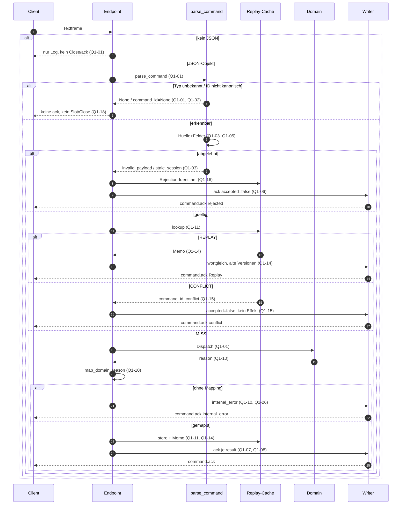

# 04.04 – Commands/Acknowledgements

*Status: INTEGRATED (intern abgenommen) – externe ROOT-Freigabe ausstehend. Codebasis: Commit `a8993c5c68042d996eab680d84a5b138a214bb5d`. Faktenbasis: `workflow/research/04.04.json` (Q1-01…Q1-27, N1…N9, U1…U7, C1…C8).*

**Abgrenzung:** [04.03](04.03-websocket-v2.md) endet mit `hello.accepted`. Dieses Kapitel ist der vollständige Vertrag des Kommandokanals danach: fünf Typen, Hülle, Feldregeln, `command.ack`, 15 Result-Codes, Reason-Mapping, Replay und Konflikt. Audio/Events/Snapshot/Reconnect in [04.05](04.05-audiotransport.md), [04.06](04.06-eventtransport.md), [04.07](04.07-snapshot-synchronisierung.md), [04.08](04.08-reconnect.md); Katalog/Schema [08.02](../08-referenzen/08.02-command-katalog.md), [08.10](../08-referenzen/08.10-websocket-schema-referenz.md); v1 getrennt [04.12](04.12-legacy-v1.md).

## 1. Worum geht es?

Nach der Admission ist der Socket ein **Auftragskanal**: Client steuert Aktivierung, Suppression, Audio-Verfügbarkeit, Session-Settings und Resync; Server antwortet mit Quittung.

1. **Geschlossene Menge.** Genau fünf Typen: `activation.command`, `trigger_suppression.set`, `audio_availability.set`, `session_settings.patch`, `session.snapshot.request` (Q1-01). Unbekannt = still verworfen, kein sechster Typ.
2. **`commandId` = Identität.** Kanonische UUID, 36 Zeichen; Replay/Konflikt beruhen darauf (Q1-02). Gleicher Inhalt → erste Antwort erneut, keine Re-Ausführung (Q1-14); anderer Inhalt → `command_id_conflict` (Q1-15).
3. **Genau eine Quittung – mit stillen Ausnahmen.** Erkennbar + brauchbare ID → genau eine `command.ack`, auch bei Ablehnung (Q1-18). Ohne → gar nichts: kein ack/Event/Close (Q1-18).

Kein RPC mit Timeout, kein Fortschritt, kein persistenter Auftrag (N2, N3, N5). Warten ohne Zeitgarantie (U7).

Beispiel: Push-to-Talk `activate`/`finish`; Doppelklick gleiche ID → Replay, keine zweite Aktivierung (Q1-14). Slider `session_settings.patch` mit Basisrevision; veraltet → `settings_revision_conflict` (Q1-20).

## 2. Das Wesentliche auf einen Blick

- **Fünf Typen** (Q1-01). Reale Namen `session_settings.patch`/`session.snapshot.request` (kein `settings.patch`, C1-01 Research).
- **Sechs Prüfstufen, zwei still.** Typ, ID, Version, Session-Kanonik, Zugehörigkeit, Validator. Stufe 1–2 still; ab 3 ack (Q1-03, Q1-18).
- **15 Codes, zwei „accepted“.** Nur `applied`/`no_change` accepted=true; Rest false (Q1-07, Q1-08).
- **26 Reasons → Codes**, 10 Nicht-Kommando; erschöpfend, vertragstestgeprüft (Q1-10).
- **Ein Cache, zwei Regime.** Semantisch (`activation.command`) vs roh (Rest); Zusatzfelder wirken unterschiedlich (Q1-12, C3).
- **Replay = erste ack wörtlich**, alte Versionen (Q1-14, C6).
- **Konflikt normal**, Session nutzbar (Q1-15).
- **Flüchtig.** Cache/Memo mit Session/Verbindung; Reconnect leer (Q1-27).

### Kommandopfad



**In Worten:** Kein JSON → Log/Drop (Q1-01). Typ/ID unbrauchbar → still (Q1-01, Q1-02). Erkennbar → Hülle; Ablehnung → Rejection im Cache + ack (Q1-03, Q1-06, Q1-16). Gültig → Cache: REPLAY Memo wörtlich (Q1-14), CONFLICT ohne Wirkung (Q1-15), MISS Domain→Mapping→ack+Store (Q1-10, Q1-11). Ohne Mapping → `internal_error` (Q1-26). Kreuz = Client erhält nichts.

### Verläufe

| Verlauf | Auslöser | Antwort | Fakten |
|---|---|---|---|
| Erfolg | gültig, MISS, `applied` | ack true, ggf. neue Version | Q1-08, Q1-19 |
| No-op | Reason `no_change` | ack true, keine Wirkung | Q1-08, Q1-10 |
| Replay | gleiche ID, gleicher Schlüssel | erste ack wörtlich, alte Versionen | Q1-14 |
| Konflikt | gleiche ID, anderer Schlüssel | `command_id_conflict`, keine Wirkung | Q1-15 |
| Hüllenfehler | Version/Session/Feld | `invalid_payload`, false | Q1-03..Q1-05 |
| Fremde Session | kanonisch-fremd | `stale_session`, false, aktuelle ID | Q1-03, Q1-06 |
| Still | Typ/ID/JSON/hello | nichts | Q1-01, Q1-02, Q1-18 |
| Ohne Mapping | Reason ungemappt | `internal_error` | Q1-10, Q1-26 |
| Ausnahme | außerhalb | Close 1011 **ohne** ack | Q1-26 |

## 3. Oberfläche und Hülle

### 3.1 Fünf Typen

| Typ | Zweck | Bearbeiter | Fakten |
|---|---|---|---|
| `activation.command` | Aktivierung (`activate`/`refresh`/`finish`/`cancel`) | Domain | Q1-04, Q1-12, Q1-25 |
| `trigger_suppression.set` | Suppression setzen | Verbindung | Q1-05, Q1-21 |
| `audio_availability.set` | Verfügbarkeit setzen | Domain | Q1-05, Q1-22 |
| `session_settings.patch` | Settings patchen | Settings-Port + `settings.changed` | Q1-05, Q1-20 |
| `session.snapshot.request` | Snapshot anfordern | ack + frischer Snapshot | Q1-05, Q1-23 |

Drahtnamen `session_settings.patch`/`session.snapshot.request`; `settings.patch`/`snapshot.request` treffen keinen Typ → still (Q1-01). Binär = kein Typ, Audiopfad [04.05](04.05-audiotransport.md).

### 3.2 Stillfälle

Kein Dict / Typ fehlt/nicht-String/unbekannt / ID fehlt/nicht-kanonisch / unparsebares JSON / zweites `hello` → nichts (Q1-01, Q1-02, Q1-18). **Kein** Fehler-ack (Q1-18, C4). Ohne ID kein Korrelationsschlüssel; andere Fehler → `invalid_payload` (Q1-02, Q1-03, C4). Vor `accepted` unparsebar = Handshake 4400 ([04.03](04.03-websocket-v2.md) W1-04); danach still (Q1-01).

### 3.3 Sechs Stufen

| Stufe | Prüfung | Verstoß | Fakten |
|---|---|---|---|
| 1 | Typ bekannt | still | Q1-01 |
| 2 | ID kanonisch | still | Q1-02 |
| 3 | Version echter int exakt 2 | `invalid_payload` | Q1-03 |
| 4 | Session-ID kanonisch | `invalid_payload` | Q1-03 |
| 5 | ID gehört Verbindung | `stale_session` | Q1-03, Q1-06 |
| 6 | Typvalidator | `invalid_payload` | Q1-04, Q1-05 |

Version 1 + fremde Session → `invalid_payload` (Stufe 3 zuerst, Q1-03). Kein Umschreiben (Q1-02).

### 3.4 `stale_session` vs `invalid_payload`

Version≠2 → `invalid_payload` (Q1-03). Session nicht-kanonisch → `invalid_payload` (Q1-03). Kanonisch-fremd → `stale_session` (Q1-03, Q1-06). „Stale“ = Nutzlast, nicht Transport (C8); ack trägt **aktuelle** Session-ID (Q1-06, Q1-07, C8). Ablehnung schließt nie: eine ack false, Session nutzbar, Version/Phase gleich (Q1-06).

## 4. Feldregeln

### 4.1 `activation.command`

| Aktion | Pflicht | Verboten | Fakten |
|---|---|---|---|
| `activate` | `source`=`"manual"` | `activationId` | Q1-04 |
| `refresh`/`finish`/`cancel` | kanonische `activationId` | `source` | Q1-04 |

`extend` existiert nicht → `invalid_payload` (Q1-04). Kein Wechsel/Close (Q1-04). `activate` neu (keine ID); Controls bestehend (ID, Quelle festgelegt). v1 ignorierte `source` bei Controls; v2 `invalid_payload` (C5). v1 in [04.12](04.12-legacy-v1.md).

### 4.2 Übrige Typen

`trigger_suppression.set`: `manual`+`wakeWord` echte bool. `audio_availability.set`: `audioAvailable` echte bool. `session_settings.patch`: `baseSettingsRevision` int≥0 (kein bool), `changes` nichtleeres Objekt. `session.snapshot.request`: kein Validator (Q1-05). Namen case-sensitiv; Unbekanntes ungeprüft, Verdikt gleich (Q1-05) – aber Replay-Schlüssel typabhängig (Q1-12, C3, §7.2). `true`≠`1` (Q1-03, Q1-05). Schlüssel-Semantik Settings [04.03](04.03-websocket-v2.md)/Q1-20.

### 4.3 Leitungsbeispiele

```json
{
  "type": "activation.command",
  "protocolVersion": 2,
  "sessionId": "<sessionId>",
  "commandId": "<commandId>",
  "action": "activate",
  "source": "manual"
}
```

```json
{
  "type": "activation.command",
  "protocolVersion": 2,
  "sessionId": "<sessionId>",
  "commandId": "<commandId>",
  "action": "cancel",
  "activationId": "<activationId>"
}
```

```json
{
  "type": "session_settings.patch",
  "protocolVersion": 2,
  "sessionId": "<sessionId>",
  "commandId": "<commandId>",
  "baseSettingsRevision": 7,
  "changes": { "<settingKey>": "<value>" }
}
```

Veraltet → `settings_revision_conflict` + `errors[]` (Q1-20).

## 5. `command.ack`

### 5.1 Felder

`type`=command.ack, `protocolVersion` 2, `sessionId` (Verbindung, nie fremd), `commandId`, `accepted` bool, `result` (1/15), `activationId`, `inputPhase` (fünf, sonst `idle`), `stateVersion`, `settingsRevision`; nur Settings-Ablehnungen + `errors[]` ({field,code,message}) (Q1-07, N6). ID/Domain-ack oder Controller-Snapshot. Menge normativ, Reihenfolge nicht (Q1-07). Phasen `idle`, `waiting_first_speech`, `segment_active`, `followup_wait`, `closing_input` (W1-15).

### 5.2 `accepted` ≠ wirksam

`accepted=true` = angenommen+beantwortet, **nicht** geändert. `no_change` true; nur `result` trennt No-op/`applied` (Q1-08, C1). `accepted` als Wirkungsnachweis = Fehldeutung.

### 5.3 15 Codes

| Result | accepted | Bedeutung | Fakten |
|---|---|---|---|
| `applied` | true | wirksam | Q1-09 |
| `no_change` | true | No-op | Q1-09 |
| `activation_locked` | false | offen | Q1-09 |
| `not_active` | false | kein Lauf | Q1-09 |
| `invalid_phase` | false | falsche Phase | Q1-09 |
| `closing_input` | false | schließt | Q1-09 |
| `stale_session` | false | fremde ID | Q1-03, Q1-09 |
| `stale_activation` | false | falsche activationId | Q1-09 |
| `command_id_conflict` | false | ID/Payload-Mix | Q1-09, Q1-15 |
| `invalid_payload` | false | Hülle/Feld | Q1-03, Q1-09 |
| `trigger_suppressed` | false | blockiert | Q1-09 |
| `audio_unavailable` | false | kein Audio | Q1-09, Q1-22 |
| `settings_revision_conflict` | false | Basis veraltet | Q1-09, Q1-20 |
| `settings_rejected` | false | fachlich abgelehnt | Q1-09, Q1-20 |
| `internal_error` | false | intern | Q1-09, Q1-10, Q1-26 |

Geschlossen, keine Erweiterung (Q1-08). Vertragstest: result∈Menge, accepted==(applied/no_change) (Q1-08).

```json
{
  "type": "command.ack",
  "protocolVersion": 2,
  "sessionId": "<sessionId>",
  "commandId": "<commandId>",
  "accepted": true,
  "result": "applied",
  "activationId": "<activationId>",
  "inputPhase": "waiting_first_speech",
  "stateVersion": 12,
  "settingsRevision": 7
}
```

### 5.4 `errors[]` nur Settings

Nur Settings: `errors[]` {field,code,message} (Q1-07, N6). Rest nur Code. Texte nicht stabil (Q1-09).

## 6. Reason → Code (26+10)

| Result | Reasons | Fakten |
|---|---|---|
| `applied` | `activated`, `refreshed`, `finished`, `cancelled`, `input_closing`, `applied` (6) | Q1-10 |
| `no_change` | `no_change`, `already_idle`, `already_recording` (3) | Q1-10 |
| 1:1 (6) | `activation_locked`, `not_active`, `invalid_phase`, `closing_input`, `stale_activation`, `command_id_conflict` | Q1-10 |
| `audio_unavailable` | `audio_unavailable` (1) | Q1-10 |
| `trigger_suppressed` | `trigger_disabled`, `trigger_suppressed` (2) | Q1-10 |
| `invalid_payload` | `invalid_payload`, `invalid_action`, `invalid_source`, `invalid_command_id`, `missing_command_id` (5) | Q1-10 |
| `internal_error` | `controlled_activation_disabled`, `session_closed`, `stream_not_started` (3) | Q1-10 |

6+3+6+1+2+5+3 = **26** (Q1-10). Mehrere Reasons fallen zusammen (C2). `internal_error` kein Sammelbecken: benannte Quellen (Q1-10, Q1-21, Q1-25, Q1-26); Rest → 1011 ohne ack (§8.9). `stale_session`/`invalid_payload` auch Hülle; Settings-Codes aus Settings-Pfad (Q1-03, Q1-20). Suppression eigener Handler (Q1-21). 10 NON_COMMAND nie in ack (Q1-10). Ohne Mapping: Log + `internal_error` (Q1-10).

## 7. Replay und Konflikt

### 7.1 Ein Cache pro Session

`CommandReplayCache` (RLock, ID→(key,result)) (Q1-11). Mit Session aufgebaut, nicht getrimmt, nur Close-Clear (Q1-11). `setdefault` (erste gewinnt). `MISS`/`REPLAY`/`CONFLICT` (Q1-11). v2 dieselbe Instanz (`protocol_replay_lookup/store`), kein zweiter Cache (Q1-11).

### 7.2 Zwei Regime, ein Cache

`activation.command` semantisch (activate+source / control+action+ID, source bei Controls ausgenommen); `audio_availability` (Wert); suppression/settings/snapshot + jede abgelehnte Nutzlast roh-Freeze ohne ID (Q1-12). Zusatzfeld: activation weiter REPLAY, layer-eigen CONFLICT (Q1-12, C3). `extend` ist weder in v2 noch in v1 eine bekannte Aktion → `invalid_payload`, keine Normalisierung auf `refresh` (Q1-04).

### 7.3 Freeze

Typstabil/hashbar: Dicts sortiert, list/tuple unterschieden, Typmarker, sonst (other,Typ) (Q1-13). Nie repr/Adresse (Q1-13). v1/v2 ein Import (Q1-13). Nur Vergleich, kein Wire-Format (Q1-13).

### 7.4 Memo

Erste ack Memo (`setdefault`, Kopie), nie überschrieben (Q1-14). REPLAY → Memo wörtlich inkl. alter Versionen (Q1-14). Keine Re-Ausführung (Q1-14). Memo Verbindung, Cache Session (Q1-11, Q1-14). Replay = Quittung erster Ausführung, kein Zustand (C6, §8.1).

### 7.5 Konflikt

Gleiche ID + anderer Schlüssel → `command_id_conflict` false, **ohne** Wirkung/Event/Eintrag/Memo; Ursprung autoritativ (Q1-15). Normal, nutzbar (Q1-15). activate→cancel gleiche ID: Phase bleibt; suppression/settings: Erste bleibt (Q1-15).

### 7.6 Abgelehnte Identität

Envelope-abgelehnt + brauchbare ID = Replay-Identität (Q1-16): identisch → gleiche `invalid_payload`-ack; andere Nutzlast → `command_id_conflict` (Q1-16). Verbotener source Teil des Schlüssels (Q1-16). Beide Formen ein Cache: erst raw, dann gültig gleiche ID → `command_id_conflict` (Q1-17). Eine Autorität = erster Eintrag (Q1-11, Q1-17).

### 7.7 Eine Antwort – oder keine

Erkennbar + brauchbare ID → genau eine ack, auch Ablehnung (Q1-18). Sonst nichts (Q1-18). Kein Fortschritt (N2). Wiederholung: gleich/gleich → Replay; gleich/anders → Konflikt; neu → neues Kommando (Q1-14, Q1-15, Q1-02, Q1-11).

## 8. stateVersion, Spezialkommandos, Reihenfolge, Fehlerpfad

### 8.1 `stateVersion` in ack

applied+Event = nach Events; closing-Eintritt = Eintrittsversion; wirksam-ohne-Event +1; No-op/Ablehnung/Konflikt gleich; Replay Memo-alt (Q1-19, Q1-21, Q1-22, Q1-14). Monoton pro Verbindung; Replay kleiner (Q1-19). Aktuell = Snapshot; ack = Quittung (Q1-23, C6).

### 8.2 `session_settings.patch`

Unter Dispatch-Lock: Basis+changes an Port (Q1-20). `no_change` (true, wirkungslos, alte Revision); veraltet `settings_revision_conflict`+errors; abgelehnt `settings_rejected`+errors; Erfolg: einmal spiegeln, pro Policy-Gruppe `settings.changed` (erstes Event Sprung, alle gleiche Revision); ack neue Revision (Q1-20). Gruppen `live`, `next_activation`, `next_session`, `server_restart` (W1-19). Nur Session; Server HTTP ([04.02](04.02-http-grundlagen.md)) (Q1-20). Wirkung [03.09](../03-konfiguration/03.09-wirksamkeitszeitpunkt.md), Persistenz [03.10](../03-konfiguration/03.10-persistenz.md).

### 8.3 `trigger_suppression.set`

Verbindung selbst, nicht Reason-Tabelle (Q1-21). Ohne Controller `internal_error` (Q1-21). Gleich → `no_change` true; Änderung → `applied` +1 (Pflicht-Snapshotfelder, kein Event) (Q1-21). Beendet keinen Lauf (Q1-21).

### 8.4 `audio_availability.set`

Domain: Änderung `applied`, gleich `no_change` (Q1-22). false bricht offenen Lauf via Barriere wie cancel ab; Session/Ledger bleiben (Q1-22). ID nur Replay/ack, nie `causedBy` (Q1-22). Neu bei false → `audio_unavailable` (Q1-22). Idempotent (Q1-22). `finish`/`cancel` mit `causedByCommandId` (Q1-22, Q1-25).

### 8.5 `session.snapshot.request`

Lesen: `applied`-ack (oder Replay) + **immer** frischer Snapshot (Q1-23). Resync gleiche ID: Memo + neuer Snapshot, keine Zweitwirkung (Q1-23). Inhalt [04.03](04.03-websocket-v2.md), [04.07](04.07-snapshot-synchronisierung.md).

### 8.6 Reihenfolge

Aktivierung: Events vor ack; Settings: `changed` vor ack; refused trigger: ack, dann diagnostisches Event; Snapshot: ack, dann Snapshot (Q1-23, Q1-24). Eine Queue, ein Writer (Q1-24). Codepfad, nicht je Typ getestet (U1).

### 8.7 `closing_input` / `trigger_suppressed` doppelt

`closing_input`: Result (abgelehnt, false) vs Phase (Zustand) vs Version (Eintritt, nicht danach) (Q1-07, Q1-09, Q1-19). `trigger_suppressed`: ack-Code (false) + Event **nach** ack ohne Anstieg (Q1-09, Q1-24, C7). ack = Auftrag; Event = Beobachter. Reasons `trigger_disabled`+`trigger_suppressed`→ein Code (Q1-10); Zustand im Snapshot ([04.03](04.03-websocket-v2.md)).

### 8.8 `cancel`

Ledger-Lock → Session-Lock → Controller/Status/Streaming → Cache (Q1-25). Vorbedingungen → `internal_error`, v2 nicht erreichbar (Q1-25). Barriere **vor** Speicherung; `finish`/`cancel` mit `causedByCommandId` (Q1-25). Vorbedingung vor Lookup: Replay-cancel nach Wechsel theoretisch `internal_error`, ungetestet (U5).

### 8.9 Fehlerpfad

Nur `UnmappedDomainReason` → Log + `internal_error` (Q1-26). Sonst Ausnahme → Endpoint → Close **1011 ohne ack** (Q1-26). `internal_error` kein Catch-all (C2). Close 1011 = Verbindungsverlust, [04.08](04.08-reconnect.md). Evidenz mittel (Q1-26).

## 9. Flüchtigkeit

Cache Session, Memo Verbindung; Close-Clear (Q1-11, Q1-14). Reconnect: neue ID, leerer Cache; alt+alt → `stale_session` (Q1-27). Keine Persistenz/Idempotenz; Neustart löscht (Q1-27, N5). Client: Replay nur gleiche Session; Resync via Snapshot-Request (Q1-27, Q1-23, [04.07](04.07-snapshot-synchronisierung.md)); neue Aufträge neue IDs (Q1-02, Q1-11). Settings-Persistenz [03.10](../03-konfiguration/03.10-persistenz.md) ≠ Kommando-Identität (Q1-27).

## 10. Grenzen

### 10.1 Nicht vorhanden

| ID | Befund | Fakten |
|---|---|---|
| N1 | unbekannt/ID/JSON still, kein Close | Q1-01, Q1-02, Q1-18 |
| N2 | kein Fortschritts-ack | Q1-18 |
| N3 | kein Timeout/Retry/Deadline | Q1-18, U7 |
| N4 | kein Cache-Limit/Eviction | Q1-11 |
| N5 | keine Persistenz/Idempotenz | Q1-27 |
| N6 | kein errors außer Settings | Q1-07 |
| N7 | kein Rate-Limit/Größe/Frequenz | Q1-18 |
| N8 | kein Typ-ack; v1 nur intern | Q1-07 |
| N9 | kein Audit/Log pro Kommando | Q1-10, Q1-26 |

### 10.2 Offen

| ID | Offen | Fakten |
|---|---|---|
| U1 | ack/Event-Reihenfolge nur Codepfad | Q1-24 |
| U2 | volle Queue unbegrenzt | Q1-24 |
| U3 | Wachstum Cache+Memo unbegrenzt | Q1-11, Q1-14 |
| U4 | Rennen: Empfang seq, Domain parallel | Q1-19, Q1-20 |
| U5 | Replay-cancel nach Wechsel | Q1-25 |
| U6 | Konflikt-Version unter Events | Q1-15, Q1-19 |
| U7 | Client-Timeout: kein Wert | Q1-18 |

### 10.3 Konflikte

| ID | Beobachtung | Auflösung | Fakten |
|---|---|---|---|
| C1 | accepted true auch no_change | ≠wirksam; nur result | Q1-08, Q1-09 |
| C2 | 15 vs 26 | Zusammenfall; 3 unerreichbar→internal | Q1-08, Q1-10, Q1-26 |
| C3 | zwei Regime, ein Cache | additiv: activation Replay, Rest Konflikt | Q1-12, Q1-16 |
| C4 | ID still, Rest invalid_payload | bewusst; kein Fehler-ack | Q1-02, Q1-03, Q1-18 |
| C5 | v1 tolerant, v2 streng | source Controls: v1 ignoriert, v2 invalid | Q1-04 |
| C6 | Replay alt | Quittung, nicht Zustand | Q1-14, Q1-19, Q1-23 |
| C7 | doppelt trigger_suppressed | ack + Event ohne Anstieg | Q1-24 |
| C8 | stale aktuelle ID | Nutzlast, nicht Transport | Q1-03, Q1-06 |

### 10.4 Clienthinweise

Keine Zeitgarantie (N3, U7). Kein Retry außer Replay gleiche Session (Q1-27). Kein Cache-Limit (N4, U3). Kein Audit (N9). Kein Fortschritt (N2, U7). errors nur Settings (N6, Q1-09). v1/v2 trennen (C5).

## 11. Siehe auch und Nachweise

Q1-01 Typen/Schweigen · Q1-02 ID/36 · Q1-03 Reihenfolge · Q1-04 activation.command · Q1-05 Rest · Q1-06 kein Close · Q1-07 Felder · Q1-08 accepted/15 · Q1-09 Bedeutungen · Q1-10 Mapping 26+10 · Q1-11 ein Cache · Q1-12 Regime · Q1-13 Freeze · Q1-14 Memo · Q1-15 Konflikt · Q1-16 abgelehnt-Identität · Q1-17 eine Autorität · Q1-18 eine/keine ack · Q1-19 Version · Q1-20 Settings · Q1-21 Suppression · Q1-22 Audio · Q1-23 Snapshot · Q1-24 Reihenfolge · Q1-25 cancel · Q1-26 Fehlerpfad · Q1-27 Flüchtigkeit. N/U/C §10. Gliederung IDs/ack/Replay/Konflikte §3–§9.

**Verwandt:** [04.01](04.01-schnittstellenuebersicht.md) · [04.02](04.02-http-grundlagen.md) · [04.03](04.03-websocket-v2.md) · [04.05](04.05-audiotransport.md) · [04.06](04.06-eventtransport.md) · [04.07](04.07-snapshot-synchronisierung.md) · [04.08](04.08-reconnect.md) · [04.09](04.09-client-zustandsmodell.md) · [04.12](04.12-legacy-v1.md) · [02.01](../02-funktionsweise/02.01-session-management.md) · [03.07](../03-konfiguration/03.07-session-einstellungen.md) · [03.09](../03-konfiguration/03.09-wirksamkeitszeitpunkt.md) · [03.10](../03-konfiguration/03.10-persistenz.md) · [08.02](../08-referenzen/08.02-command-katalog.md) · [08.05](../08-referenzen/08.05-zustands-phasenkatalog.md) · [08.09](../08-referenzen/08.09-fehlerkatalog.md) · [08.10](../08-referenzen/08.10-websocket-schema-referenz.md).
