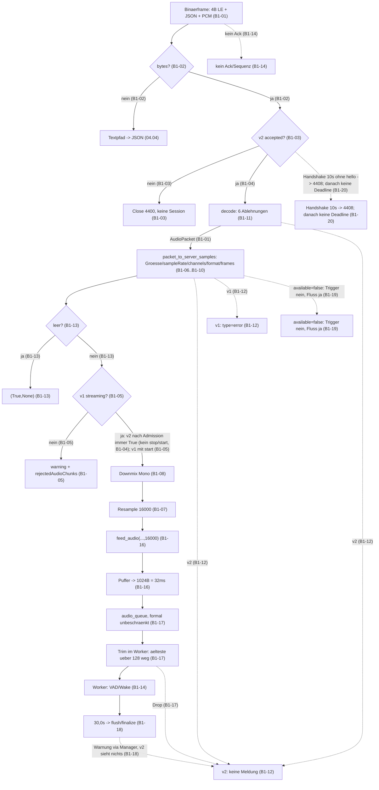

# 04.05 – Audiotransport

*Status: INTEGRATED (intern abgenommen) – externe ROOT-Freigabe ausstehend. Codebasis: Commit `a8993c5c68042d996eab680d84a5b138a214bb5d`. Faktenbasis: `workflow/research/04.05.json` (B1-01…B1-20, N1…N10, U1…U8, C1…C7).*

**Abgrenzung:** Weg der Audiodaten durch `/ws/v2` und `/ws/transcribe`: Frame-Layout, Weiche, Zulässigkeit, Felder, Grenzen, Verarbeitung bis Recorder-Puffer. Handshake [04.03](04.03-websocket-v2.md), Kommandos [04.04](04.04-commands-acknowledgements.md), Events [04.06](04.06-eventtransport.md). Recorder/VAD [02.02](../02-funktionsweise/02.02-audioverarbeitung.md), Transkription [02.05](../02-funktionsweise/02.05-transcription.md). Legacy [04.12](04.12-legacy-v1.md), Settings [03.06](../03-konfiguration/03.06-server-einstellungen.md).

## 1. Worum geht es?

Audio ist Fracht, kein Kommando: WebSocket-**Binärframe** = 4 Byte Länge (uint32 LE) + N Byte UTF-8-JSON + Rest PCM (B1-01). Kein Magic/Version/Flags. Ein Encoder/Decoder für beide Endpunkte (B1-01). Weiche: `message["bytes"]` nicht None → Audio, sonst Text→JSON; kein Base64; `b''` = Binär, scheitert Länge (B1-02). Audio **nicht quittiert**: keine ack/Sequenz/Zeit/Empfangsbestätigung; kein Version/Event-Anstieg; Ereignisse nur indirekt Recorder/VAD (B1-14). Client: Takt/Reihenfolge/Buchführung selbst; Server sagt in V2 nach Admission nichts bei Drop (B1-12).

```text
Offset 0            4              4+N                  Ende
┌───────────────────┬──────────────┬─────────────────────┐
│ uint32 LE = N     │ JSON, N Byte │ PCM, freie Länge    │
└───────────────────┴──────────────┴─────────────────────┘
                       │ N ≤ 65536  │ PCM ≤ 524288 (Default)
```

Beispiel: 512 Mono-Samples@16k = 1024 B PCM; `{"sampleRate":16000}` = 20 B → Frame `14 00 00 00` + 20 B JSON + 1024 B = 1048 B. 48k-Stereo 100ms: `{"sampleRate":48000,"channels":2,"frames":4800}` + 19200 B → 1600 Mono-Samples@16k (B1-07, B1-08).

- **Ein Format, zwei Endpunkte** (B1-01).
- **Bytes vor Text** (B1-02).
- **Audio stumm** (B1-14). Drop unsichtbar (B1-12).

## 2. Das Wesentliche auf einen Blick

- **4B LE + JSON + PCM**; kein Magic/Version/Flags (B1-01).
- **bytes≠None → Audio**; `b''` Binär, scheitert Länge (B1-02).
- **Decoder 6 Ablehnungen** (Rahmung/JSON); Felder/Format/Größe erst `packet_to_server_samples` (B1-11, C5).
- **65536 / 524288 / 589828**: Meta 64KiB, Audio 512KiB Default, größter Frame Summe (B1-10).
- **Ziel 16000 Hz mono**: Downmix vor Resample, kein zweites (B1-07, B1-08, B1-16).
- **32 ms/Block**: 1024 B aus 512 Samples@16k (B1-16).
- **128 Blöcke ≈ 4,096 s**, älteste verworfen, keine Meldung (B1-17).
- **30,0 s finalisiert**, nicht abgelehnt (B1-18).
- **V2 schweigt** nach Admission: DEBUG nur, keine Nachricht/Close (B1-12).

### Binärpfad



Lesart: Weiche → Tor (V2 4400 vor accepted, B1-03) → Decoder (B1-11) → Prüfungen (B1-06..B1-10) → leer→ok (B1-13) → Streaming-Tor (V2 immer True nach Admission, kein stop/start B1-04; V1 mit start B1-05) → Downmix (B1-08) → Resample (B1-07) → feed (B1-16) → 1024B-Blöcke (B1-16) → Queue → Trim im Worker (B1-17) → Worker → 30s-Finalize (Warnung nur V1-Manager, B1-18). Gestrichelt: V2-Fehler/Drop/fehlendes Ack (B1-12, B1-14, B1-17), Warnungs-Asymmetrie (B1-18), available-Fluss/Trigger (B1-19), Handshake-Deadline (B1-20). Wer auf Ack wartet, wartet vergeblich.

Alternative: viele kleine Frames (niedrige Latenz, Overhead; keine Kadenz vorgeschrieben, B1-15, U3) vs wenige große (bis 524288 B Nutzdaten, Overhead klein, Verlust größer). Eigene Buchführung nötig (Zeit/Segment), da Transport keine liefert (B1-14); Ausfälle nur via Transkript-Ereignisse erkennbar.

## 3. Anatomie und Weiche

### 3.1 Rahmen

| Teil | Größe | Prüfung |
|---|---|---|
| Präfix | 4 B uint32 LE = N | <4B Fehler (B1-11) |
| Metadaten | N B UTF-8-JSON-Objekt | N>65536 / unvollständig / kein JSON/kein Objekt Fehler (B1-10, B1-11) |
| Nutzdaten | Rest PCM | erst packet_to_server_samples (B1-10) |

Kein Magic/Version/Flags (B1-01); nur vier Metadatenfelder existent. Einzige Kodierung beide Endpunkte (B1-01).

### 3.2 Weiche bytes vor text

Nicht-None Binärteil → Audio; sonst Text→JSON (B1-02): kein Base64 (B1-02); `b''` Binär → Längenfehler (B1-02, B1-11); Weiche versionlos, Unterschied erst danach (B1-02, B1-03).

### 3.3 Decoder-Ablehnungen

Pseudocode (B1-11): kein Binärtyp / <4B / N>65536 / Rest<N / kein UTF-8-JSON / JSON kein Objekt → AudioPacketError. Leer (N=0) scheitert Parser; `{}` (N=2) gültig. Keine Feldprüfung (B1-11, C5). Texte gemischt de/en → nicht auf Text reagieren, sondern type/where (B1-12).

## 4. Zulässigkeit

V2: Binär vor accepted → **4400**, keine Session (B1-03). Nach Admission kein `start`: `start_streaming()` sofort, Audio ab accepted (B1-04); Startbefehl-Zweig unerreichbar (kein stop, B1-04). V1: ohne `start` → `type: warning`, rejectedAudioChunks+1, kein Close (B1-05); Text empfiehlt start (V2 sinnlos, B1-05, B1-04). Leer immer ok: `(True,None)` vor Streaming-Prüfung; auch gestoppt-V1 keine Warnung (B1-13). Tor V2 vor Decoder (kaputt vor accepted → 4400, B1-03); V1 Streaming nach Konvertierung (ungültig auch gestoppt = Paketfehler; leer ohne Warnung, B1-05, B1-13). Ungleiche Fehlerpolitik (C7).

## 5. Metadatenfelder

Reihenfolge: Größe, sampleRate, channels, format, Ausrichtung, frames (B1-06..B1-10).

| Feld | Pflicht | Regel | Default | Verstoß |
|---|---|---|---|---|
| `format` | nein | exakt `pcm_s16le` | `pcm_s16le` | Fehler (B1-06, C3) |
| `sampleRate` | ja | positiv int, kein bool; keine Min/Max | – | Fehler (B1-07) |
| `channels` | nein | positiv ≤8, kein bool | 1 | Fehler (B1-08) |
| `frames` | nein | positiv int; exakt frames*2*channels B | – | Fehler (B1-09) |

Fehlend format → still pcm_s16le; abweichend hart (B1-06, C3). sampleRate ohne Grenzen – auch 1 Hz formal ok; Verhältnis bestimmt Resampling (B1-07). channels>1 → Mittel Mono, unbemerkter Verlust (B1-08, C4); >8 Fehler; Länge Vielfaches 2*channels (B1-08). frames nur Konsistenz Eingangs-Frames vor Downmix/Resample (B1-09); fehlt nur Ausrichtung (B1-09). Name pcm_s16le LE, gelesen np.int16 nativ; LE-Hardware identisch; Big-Endian ungetestet (B1-06, C2, U4).

## 6. Grenzen: 64KiB / 512KiB / 589828

| Grenze | Wert | Wo | Änderbar |
|---|---|---|---|
| Metadaten | 65536 B | En-/Decoder | nein |
| Audio | 524288 B Default | packet_to_server_samples | ja (CLI-/laufzeitänderbar; keine Untergrenzenprüfung im Code gefunden) |
| Größter Frame | 589828 B | Summe 4+65536+524288 | folgt |

64KiB nur Meta, nicht Frame (B1-10). 589828 keine Prüfung, Summe (B1-10). Meta im Decoder, Audio in Domäne (B1-11, B1-10, C5); V1 where-Unterschied, V2 beides stumm (B1-12). Kein ws_max im Repo; uvicorn-Defaults unbelegt (N10, U1). Vierte Grenze zeitlich: 30,0 s → finalisiert, nicht abgelehnt (B1-18, §7.4).

## 7. Verarbeitung

### 7.1 Eine Schleife

Eine Empfangsschleife pro Verbindung, sequenziell Ankunftsreihenfolge, synchron (B1-15). Keine Endpunkt-Queue; Konvertierung inline Event-Loop; Recorder-Zeit zwischen receives (B1-15). Kein Benchmark (U2).

### 7.2 Downmix vor Resample

Ausrichtung → frames → Downmix (Mittel, int16) → resample_poly(gcd)/interp-Fallback/rint+Clip → Kopie bei 16000 (B1-07, B1-08). Billiger (ein Kanal) + Verlust unbemerkt (C4).

### 7.3 32-ms-Blöcke und Queue

`feed_audio(samples,16000)` (B1-16); Puffer → 512er (1024 B = 32ms@16k) → queue (B1-16). Kein zweites Resampling (B1-16). Queue formal unbeschränkt (B1-17); Worker trimmt auf `audio_queue_size` Default 128 (B1-17): 128*32ms = **4,096 s** Rückstand (131072 B); älteste weg, keine Meldung (B1-17).

| 128 Blöcke | 128*32ms | 4,096 s |
| Bytes | 128*1024 | 131072 (128KiB) |
| 30,0 s Samples | 30*16000 | 480000 (937,5 Blöcke) |

Schübe erreichen Grenze ohne ein zu großes Paket.

### 7.4 30,0 s: finalisieren statt ablehnen

Drüber Zwangs-Finalize (flush, trim, Sprecher-Deaktivierung); Paket accepted True, keine Ablehnung/Close/Fehler (B1-18). Warnung via V1-Manager; **V2 sieht nichts** (B1-18). Rückgabe immer None; Warnung aus Finalize-Pfad (B1-18, C6). V2: Aufnahme endet nach 30 s, neues Segment, Grund nur via Zustandswechsel (B1-18).

## 8. Fehler: V1 meldet, V2 schweigt

| Situation | V1 | V2 |
|---|---|---|
| Binär vor accepted | – | 4400, keine Session (B1-03) |
| Decoder-Fehler | `type:error where:audio_packet` | DEBUG, nichts, kein Close (B1-12) |
| Feld/Format-Fehler | `type:error where:audio_packet` (C5) | DEBUG (B1-12) |
| Sonstige Ausnahme | `type:error where:audio` | DEBUG/Exception, nichts (B1-12) |
| Ohne start | `warning`, rejectedAudioChunks+1, kein Close (B1-05) | unerreichbar (B1-04) |
| Leer | ok, keine Warnung (B1-13) | ok (B1-13) |
| Dauer erreicht | ok, finalisiert, Warnung Manager (B1-18) | ok, finalisiert, keine Warnung (B1-18) |

V1 Fehler = Ereignis (unterscheidbar, nutzbar, B1-12); V2 = Logeintrag (handle_binary fängt, False, Rückgabe ignoriert, B1-12). V2 kaputter Encoder unsichtbar ohne Monitoring (kein Transkript). Rat „sende start“ V2 falsch (B1-05, B1-04).

## 9. Steuerung und Flüchtigkeit

Kein Ack/Sequenz/Zeit; kein Version/Event-Anstieg; Ereignisse nur indirekt VAD (z.B. recording_started, B1-14). Kein Ack für Paket. `available=false` blockiert Pfad nicht: ingest prüft nicht, Frames konvertiert/Rekorder (B1-19); wirkt Trigger-Annahme (Wake/Manual nein) + Snapshot audioAvailable (B1-19). Nur Handshake-Deadline 10,0 s → 4408; danach keine Empfangs-/Audio-Deadline/Timeout/Ping (uvicorn ohne ws_*, B1-20). Leitung offen bis TCP/Proxy; Framework-Defaults unbelegt (U1). Kein Retry/Dedup/Wiederaufnahme; Reconnect neu, Queue weg ([04.08](04.08-reconnect.md)).

## 10. Grenzen

### 10.1 Nicht vorhanden (N1–N10)

| ID | Fehlt | Folge |
|---|---|---|
| N1 | Sequenz/Zeit | nur WebSocket-Zustellung (B1-14) |
| N2 | Quittung/Fehler v2 | Empfang unbemerkt (B1-12, B1-14) |
| N3 | Rate-/Mengenlimit | beliebig viele Frames |
| N4 | Codecs/Container | nur pcm_s16le (B1-06) |
| N5 | Prüfsumme/CRC | Bitfehler unerkannt |
| N6 | Fragmentierung | ein Frame = ein Paket (B1-10) |
| N7 | Retry/Dedup/Wiederaufnahme | Verlust bleibt |
| N8 | Jitter/Umsortierung | Ankunft schlägt durch |
| N9 | Client-Warnung Drops | nur audioAvailable, keine Zähler (B1-17, B1-19) |
| N10 | ws-Maximum | nur 64KiB+512KiB (B1-10, U1) |

### 10.2 Offen (U1–U8)

uvicorn-Defaults (U1); Latenz/Backpressure (U2); Kadenz (U3; Tests 0,2 s = Beobachtung); Big-Endian (U4); Resample-Fallback o. scipy (U5); Audio in closing (U6); CPU/Speicher klein/viel (U7); Trim-Ankunft Client (U8). Nicht als Vertrag lesen.

### 10.3 Widersprüche (C1–C7)

C1 Ursache zwei Oberflächen (B1-12). C2 LE vs nativ (B1-06, U4). C3 fehlend still/hart (B1-06). C4 >1 gemittelt (B1-08). C5 zwei Stufen (B1-11, B1-10). C6 Warnung immer None; nur V1 (B1-18). C7 vor hello 4400, danach still (B1-03, B1-12).

## 11. Siehe auch und Nachweise

**Weiterführend:** [04.01](04.01-schnittstellenuebersicht.md) · [04.02](04.02-http-grundlagen.md) · [04.03](04.03-websocket-v2.md) · [04.04](04.04-commands-acknowledgements.md) · [04.06](04.06-eventtransport.md) · [04.07](04.07-snapshot-synchronisierung.md) · [04.08](04.08-reconnect.md) · [04.12](04.12-legacy-v1.md) · [02.02](../02-funktionsweise/02.02-audioverarbeitung.md) · [02.05](../02-funktionsweise/02.05-transcription.md) · [03.06](../03-konfiguration/03.06-server-einstellungen.md).

**Fakten (B1-01…B1-20):** Rahmen/Weiche/Decoder B1-01/B1-02/B1-11 · Zulässigkeit B1-03/B1-04/B1-05/B1-13 · Felder B1-06…B1-09 · Grenzen B1-10/B1-18 · Verarbeitung B1-07/B1-08/B1-15/B1-16/B1-17 · Fehler B1-12 · Steuer B1-14/B1-19/B1-20. Grenzen N/U/C §10.
