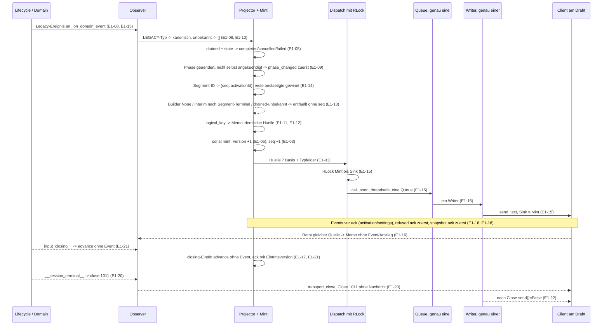

# 04.06 – Eventtransport

*Status: INTEGRATED (intern abgenommen) – externe ROOT-Freigabe ausstehend. Codebasis: Commit `a8993c5c68042d996eab680d84a5b138a214bb5d`. Faktenbasis: `workflow/research/04.06.json` (E1-01…E1-24, N1…N6, U1…U6, C1…C6).*

**Abgrenzung:** Wie der Server Domain-Ereignisse über `/ws/v2` verpackt, nummeriert, ordnet und zustellt. Handshake/Rahmen [04.03](04.03-websocket-v2.md), Kommandos/Quittungen [04.04](04.04-commands-acknowledgements.md), Audio [04.05](04.05-audiotransport.md), Snapshot als Folgeweg [04.07](04.07-snapshot-synchronisierung.md), Aktivierung [02.03](../02-funktionsweise/02.03-activation.md). Kein zweiter Ereignisstrom, keine Persistenz, kein Transportschutz.

## 1. Worum geht es?

Der Eventkanal ist der **Beobachterkanal** der Verbindung. Der Server meldet von sich aus Zustands- und Diagnoseereignisse durch **genau einen Funnel**: Lifecycle → Projector (V2-Vokabular) → Hülle (sieben Basis-Felder) → eine Zustellkette (E1-01, E1-08, E1-15). Kein zweiter Emitter. `activation.trigger_suppressed` und `settings.changed` nutzen dieselbe Mint-/Hüllenmaschinerie (E1-18, C1).

- **7 Basis-Felder** fest; Typfelder danach (E1-01).
- **`eventSeq` ab 1**, strikt monoton lückenlos pro Verbindung, auch parallel (E1-03, E1-04).
- **`stateVersion` +1** nur sichtbar; 3 NON_STATE tragen aktuelle ohne Anstieg (E1-05, E1-07).
- **Linearisiert**: 1 Linearisierungs-Lock (`_event_dispatch_lock`) Mint→Sink, Session-RLock innen, eine Queue, ein Writer; Draht = Mint-Reihenfolge (E1-15).

Client: Empfangsreihenfolge abarbeiten, Lücken via `eventSeq` erkennen – aber nicht über Verbindungen vergleichen/fortsetzen (neuer Handshake = Zähler ab 1, C5). Unveränderte Version ≠ fehlendes Feld (NON_STATE tragen Version, C2).

Beispiel: erster sichtbarer Wechsel `eventSeq=1`/`stateVersion=1`; `transcription.interim` danach `eventSeq=2` bei Version 1 (Vektor belegt, E1-07); nächstes sichtbares → Version 2. Typabfolge nicht garantiert; Zählerregeln + Ordnung schon.

## 2. Das Wesentliche auf einen Blick

- **Ein Funnel, kein zweiter Emitter** (E1-08, E1-15).
- **7 Basis-Felder** fest, Typfelder update danach (E1-01).
- **seq ab 1, lückenlos**, RLock auch parallel (E1-03, E1-04).
- **Version +1** sichtbar; NON_STATE ohne Anstieg (E1-05, E1-07).
- **18 Typen, 3 NON_STATE, 13 Projektor-Ziele, 4 Drops, 4 Memo-Schlüssel** (E1-06–E1-08, E1-11, E1-13).
- **1 Linearisierungs-Lock, 1 Queue, 1 Writer** pro Verbindung (E1-15; Session-RLock innen).
- **Events-vor-ack nur je Fall**; refused kehrt um (E1-16, C4).
- **1011 ohne Event/Nachricht** (E1-20, N6).



**Lesart:** Normalpfad links→rechts: übersetzen (Terminals, Phase, Segment-Memo, Drops) → minten (Version/seq, Hülle) → Dispatch unter Sperre → Queue → Writer → Draht (E1-15). Gestrichelt: Drops ohne seq, `__input_closing__` nur Version, `__session_terminal__` 1011 ohne Nachricht, Retry-Memo ohne Event, nach Close kein Senden.

**Alternative:** Zähler pro Typ oder direktes Senden aus Observer – gäbe typübergreifende Drahtordnung auf (zwei `wakeword.detected` unterscheidbar nur via `input_closed` dazwischen: first < closed < second, E1-24). Gemeinsamer Pfad = tragende Entscheidung.

## 3. Hülle: sieben Basis-Felder + Typfelder

| # | Feld | Bedeutung |
|---|---|---|
| 1 | `type` | kanonisch (18 Typen, §5) |
| 2 | `protocolVersion` | verhandelt, immer 2 (E1-02) |
| 3 | `sessionId` | kanonische UUID (E1-02) |
| 4 | `eventId` | frische UUID pro Mint; Retry aus Memo (E1-03, E1-11) |
| 5 | `eventSeq` | ab 1 pro Verbindung (E1-03) |
| 6 | `stateVersion` | sichtbarer Zustand (E1-05) |
| 7 | `occurredAtUnixMs` | ms beim Mint, nicht Senden (E1-19) |

Typfelder danach via update, nicht vermischt; Basis an einer Stelle (E1-01). Version aus Verhandlung (E1-02); nicht-kanonische sessionId → ValueError (E1-02).

```json
{
  "type": "activation.started",
  "protocolVersion": 2,
  "sessionId": "<uuid>",
  "eventId": "<uuid>",
  "eventSeq": 1,
  "stateVersion": 1,
  "occurredAtUnixMs": 1730000000000
}
```

`occurredAtUnixMs`: Legacy-timestamp Sekunden float → int(round(*1000)); fehlt/nicht konvertierbar → Verbindungsuhr time.time. Wanduhr, keine Monotonie; Ordnung = eventSeq (E1-19, U3).

## 4. `eventSeq` und `stateVersion`

**eventSeq**: Zähler ab 0, +1 vor Bau; erstes Event = 1; keine 0/Lücke (E1-03). Mint unter RLock → strikt monoton lückenlos auch parallel (25 → 1..25; 8×20 → 1..160, E1-04). Mint-Reihenfolge, nicht Wanduhr (E1-04).

**stateVersion**: ab 0, +1 vor Bau bei sichtbar; Event trägt neue Version (E1-05). `state_change`-Argument überschreibt (Settings-Gruppen, E1-05, E1-18). NON_STATE: keine Erhöhung, trägt aktuelle (E1-07). NICHT ActivationController.version; Ledger/No-op weichen ab (E1-05).

Beide **verbindungsgebunden/flüchtig** (C5): neuer Handshake neue ID/Zähler ab 1; keine globale Ordnung/Resume/Vergleich (C5, N1, N3).

Ack-Seite (E1-17): applied+Event = erhöhte Version; closing-Eintritt = Eintrittsversion (eigener advance, kein Event, E1-21); wirksam-ohne-Event (suppression/audio) +1; No-op/Ablehnung/Konflikt nichts; Recovery-Retry einmal.

## 5. Achtzehn Typen, drei NON_STATE

EVENT_TYPES geschlossen, 18 (E1-06). Draht nur diese + hello.accepted/ack/snapshot (E1-06). 18 ≠ 13 Projektor-Ziele: 3 Terminals aus drained-Fan-out, 2 verbindungsseitig (C1).

| Typ | Herkunft | Besonderheit |
|---|---|---|
| `activation.started` | `activation_started` | Phase hart waiting_first_speech (E1-08, E1-10) |
| `activation.phase_changed` | `activation_refreshed` + abgeleitet | nicht immer Wechsel (Deadline, E1-08, E1-09, C3) |
| `activation.input_closed` | `activation_closed` | Phase hart idle (E1-08, E1-10) |
| `activation.completed`/`cancelled`/`failed` | drained + state | Terminals (E1-08) |
| `activation.trigger_suppressed` | Verbindung (abgelehnter Trigger) | NON_STATE, Diagnose nach ack (E1-07, E1-16, C1) |
| `segment.recording_started`/`ended` | `recording_started`/`recording_ended` | Segment-Memo (E1-08, E1-14) |
| `transcription.accepted` | `transcription_started` | Annahme (E1-08) |
| `transcription.interim` | `realtime_transcript` | NON_STATE, seq ja (E1-07, E1-08) |
| `transcription.completed` | `final_transcript` | final (E1-08) |
| `transcription.discarded` | `final_transcript_discarded` ODER `final_transcript_cancelled` | 2→1 (E1-08) |
| `transcription.failed` | `final_transcript_failed` | Fehler (E1-08) |
| `watchdog.warning` | `watchdog_warning` | NON_STATE (E1-07, E1-08) |
| `wakeword.detected` | `wakeword_detected` | mehrfach möglich (E1-08, E1-24) |
| `wakeword.availability_changed` | `wakeword_availability_changed` | Wechsel (E1-08) |
| `settings.changed` | Verbindung (Settings-Transaktion) | erstes state_change=True (E1-18) |

**3 NON_STATE**: watchdog.warning, activation.trigger_suppressed, transcription.interim (E1-07). Kein Anstieg, aber seq + Feld vorhanden (nicht null) (E1-07, C2). „NON_STATE“ = kein Anstieg, nicht kein Feld (C2). Gleiche Version ok, nie gleiche seq (C2).

## 6. Legacy → Draht

Projector 1:1 (E1-08): siehe Tabelle §5 (13 Ziele aus 14 Eingängen; `final_transcript_discarded`+`final_transcript_cancelled` → discarded). drained → completed/cancelled/failed nach state (E1-08). Unbekannt → [] kein Event (E1-08, E1-13).

**phase_changed abgeleitet**: Phase geändert + Auslöser kündigt nicht selbst an → erst phase_changed, dann Auslöser, ein Block (E1-09). `_PHASE_ANNOUNCING` unterdrückt Selbst-Ankündiger; `_CATALOG_LEVEL` nie; nur INPUT_PHASES (E1-09). Nicht immer Wechsel: Deadline-Bestätigung previousPhase==inputPhase (C3). Nach Mint Phase nachgeführt: started→waiting_first_speech hart, input_closed→idle hart, sonst context.phase falls INPUT; Catalog ausgenommen (E1-10). Memo, keine Autorität (E1-10).

**Segment-Memo**: id→(seq, activationId); erste BESTÄTIGTE gewinnt, nie ersetzt; Widerspruch nur gezählt (E1-14). Ohne payload-activationId nie Vordergrund erfunden → kein Event (E1-14).

**4 stille Pfade** ohne seq/Lücke (E1-13): (1) unbekannter Legacy-Typ → [], (2) Builder None → nur ggf. phase_event, (3) interim nach Segment-Terminal → [] vor Mint, (4) drained mit unbekanntem state → []. Nach Segment-Terminal seq konstant; nächstes Interim +2 (dazwischen Folge-recording_started, Test). Kein genereller Stopp nach Aktivierungs-Terminal (drained mintet ohne Sperre). Drop endgültig, kein Marker (E1-13). Fehlende seq = Zustellproblem, kein Drop (Drops vor Nummerierung).

## 7. Wiederholung: Identität vs Inhalt

Genau 4 `logical_key` (E1-11): (input_closed, activationId), (transcription.terminal, segmentId), (activation.terminal, activationId), (settings.changed, revision, policy). Rest ohne Schlüssel frisch (E1-11). Gleicher Key → exakt gleiche Hülle inkl. IDs/Version, kein Zähler (8 Retries → 1 ID/Seq/Version, E1-11). Pro Verbindung (E1-11).

Nuance: Basis ohne Builder-Felder gespeichert (Literal-Kopie); Retry gleiche Identität, Felder neu aus payload/context – gleich nur bei gleicher Quelle (E1-12, C6). Tests: gleiche IDs/Version, Felder nur bei gleicher Quelle gleich. Retry = Domain-Wiederholung, keine Transport-Retransmission (N2). Key mit fehlender ID kollabiert auf 'None'; unbelegt (U5).

## 8. Zustellung und Reihenfolge

Pro Verbindung linearisiert (E1-15): 1 Linearisierungs-Lock (`_event_dispatch_lock`) Mint→Sink (Session-RLock innen); call_soon_threadsafe eine Queue; genau ein Writer; Sink = Mint; Blöcke zusammenhängend. Gleicher Lock Settings/Snapshot. Keine globale Ordnung (E1-15).

Event-vs-ack je Fall, nicht pauschal (E1-16, C4): (a) Aktivierung Events vor ack; (b) settings.changed vor ack; (c) refused Trigger ack zuerst, dann Diagnose-Event; (d) snapshot ack zuerst, dann Snapshot; (e) Replay Memo ohne Event/Anstieg. Umkehrung (c) beachten (E1-16). Codepfad, nicht je Typ getestet (E1-16, C4; vgl. 04.04).

Settings-Gruppe: Policy live/next_activation/next_session/server_restart, Keys sortiert; nur ERSTES state_change=True; Transaktion +1, alle gleiche Revision, seq +1 folgend (E1-18). Nur Session-Settings; Server via HTTP (E1-18).

Version ack §4 (E1-17). closing-Eintritt Ausnahme: advance ohne Event (E1-21). Konkurrenz: Lock linearisiert, Gewinner Scheduling unspezifiziert (U2).

## 9. 1011-Terminal, Close-Dichte, Terminals

**1011**: `__session_terminal__` vor Projektion abgefangen → nur request_close(1011) (E1-20). Keine Nachricht/neues Vokabular (E1-20, N6). Idempotent first-wins. Endpoint bricht via transport_close, schließt Code; Marker aus fail_closed_for_recovery-finally außer Locks (E1-20). Nur V2 (E1-20).

**Nach Close dicht**: send() _closed → False ohne Senden (E1-22). Projektionsausnahme nur geloggt (exception); offen, Block kann fehlen (E1-22). Codepfad, kein Test (E1-22).

**Terminals**: acceptedSegmentCount/terminalSegmentCount int; reason nur cancelled/failed (completed nicht). input_closed: reason/causedByCommandId/acceptedSegmentCount; causedBy null bei Timer/Watchdog/Device/Session/Recovery, nie aus availability-ID (E1-23). Snapshots [04.07](04.07-snapshot-synchronisierung.md).

**Wiederholung**: zwei wakeword.detected gleiche Namen; Ordnung via input_closed dazwischen (first < closed < second, E1-24). Argument für gemeinsame Sequenz.

## 10. Grenzen

**N**: N1 kein Resume/Backfill (nur snapshot.request); N2 kein Event-ACK/Retransmission/Flow (Retry = Domain); N3 keine Persistenz; N4 minted_event/forget_event tot; N5 kein Event closing-Eintritt/Suppression/audioAvailable (nur Versionssprung); N6 kein Close-Reason/keine Terminal-Nachricht.

**U**: U1 Verlust ohne Test (Block fehlt, seq weiter → Lücke Zustellung); U2 Konkurrenz-Gewinner Scheduling; U3 occurredAt-Qualität (Projektionszeit, keine Monotonie); U4 seq-Obergrenze; U5 Key-'None'-Kollaps; U6 Startwerte 0/0 + Vorspalte start_streaming→accepted ungetestet.

**C**: C1 18≠13+3+2; C2 NON_STATE=Anstieg-nein/Feld-ja; C3 phase_changed≠immer Wechsel; C4 Events-vor-ack nur Codepfad/umgekehrt refused; C5 flüchtig pro Verbindung; C6 Retry IDs-gleich/Felder-neu.

## 11. Siehe auch und Nachweise

**Verwandt:** [04.03](04.03-websocket-v2.md) · [04.04](04.04-commands-acknowledgements.md) · [04.05](04.05-audiotransport.md) · [04.07](04.07-snapshot-synchronisierung.md) · [02.03](../02-funktionsweise/02.03-activation.md).

**Faktenakte** `workflow/research/04.06.json`, Commit `a8993c5c68042d996eab680d84a5b138a214bb5d`: E1-01 Hülle 7 · E1-02 Version/Session · E1-03 eventId/seq ab 1 · E1-04 monoton/RLock · E1-05 Version+1/NON_STATE · E1-06 18 Typen · E1-07 3 NON_STATE · E1-08 Mapping+drained · E1-09 phase_changed abgeleitet · E1-10 Phase nachgeführt · E1-11 logical_key 4 · E1-12 Memo-Basis · E1-13 4 Drops · E1-14 Segment-Memo · E1-15 Lock/Queue/Writer · E1-16 Event/ack-Fälle · E1-17 ack-Versionen · E1-18 Settings-Gruppe · E1-19 occurredAt · E1-20 1011-Terminal · E1-21 input_closing · E1-22 Close-dicht · E1-23 Terminal-Felder · E1-24 Typ-Wiederholung. N/U/C §10.
