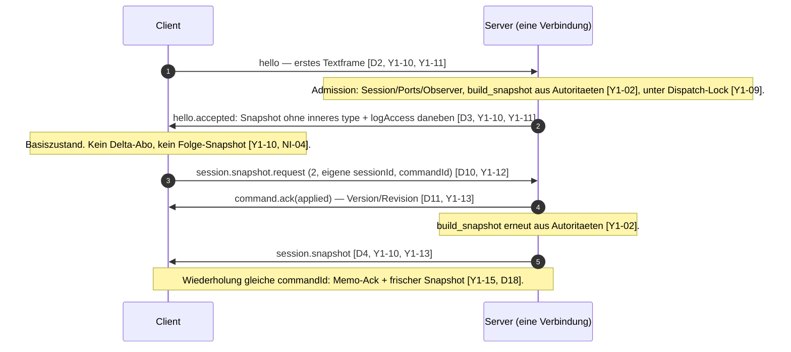
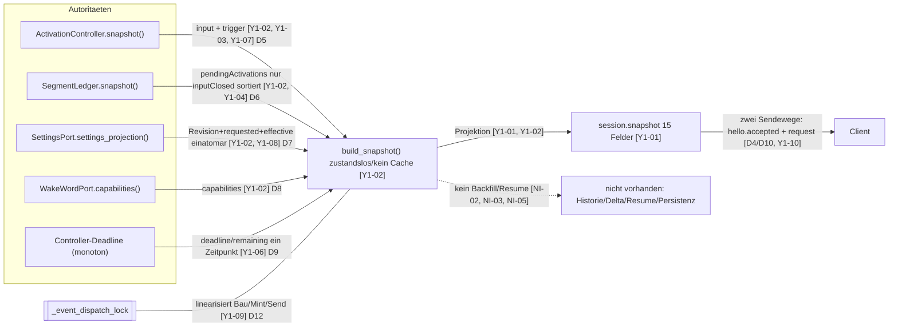

# 04.07 – Snapshot und Synchronisierung

*Status: INTEGRATED (intern abgenommen) – externe ROOT-Freigabe ausstehend. Codebasis: Commit `a8993c5c68042d996eab680d84a5b138a214bb5d`. Faktenbasis: `workflow/research/04.07.json` (Y1-01…Y1-25, D1–D18, NI-01…06, UN-01…04, CF-01…03).*

**Abgrenzung:** V2 (`/ws/v2`) only; V1 aussen. Ein Produzent, keine Persistenz, zwei Sendewege, kein Resume/Backfill. Handshake [04.03](04.03-websocket-v2.md), Kommandos [04.04](04.04-commands-acknowledgements.md), Events [04.06](04.06-eventtransport.md), Reconnect [04.08](04.08-reconnect.md), Reducer [04.09](04.09-client-zustandsmodell.md).

> **Kurz:** Genau eine vollständige Zustandsnachricht (`session.snapshot`), eine Funktion, nirgends gespeichert, zwei Sendewege. Frische Projektion – kein Protokoll, kein Delta, kein Wiederaufsetzpunkt. „Resync“ = Vollsnapshot auf Anforderung, keine Nachlieferung.

## 1. Worum geht es

Client braucht Startpunkt: laufende Activation? geschlossene/ungeschlossene Eingänge? angeforderte vs wirksame Settings? Wake-Fähigkeiten? Antwort: `session.snapshot`.

- **Ein Produzent:** nur `build_snapshot`; keine zweite Zusammensetzung.
- **Keine Persistenz:** In-Memory aus Autoritäten; kein gespeicherter Snapshot (NI-05).
- **15 Felder** (Y1-01). Eingebettet in `hello.accepted` fehlt nur inneres `type` (Y1-11).
- **Zwei Sendewege:** eingebettet bei Aufnahme; direkt auf Request. Kein periodischer/ereignisgetriebener/automatischer (Y1-10, NI-04).
- **Kein Resume/Backfill:** keine Lückenerkennung/Historie/alte Zähler (NI-01..03).

Verbindung verloren + neu = neue Session, neue Zähler; eingebetteter Snapshot aktuell, verpasste Events nicht nachgeliefert. Client baut Zustand aus Snapshot neu, führt Events ab dort weiter.

### 1.1 Projektion = frisch gelesen

Kein Cache, kein Zustand (Y1-02): input/trigger Controller; pendingActivations Ledger; settingsRevision/requested/effective einatomar Port; wakeWordCapabilities Wake-Port; stateVersion/lastEventSeq ProtocolSessionState; audioAvailable Session-Flag. Immer frisch, aber kein gemeinsamer Zeitpunkt (siehe §4).

### 1.2 Was Snapshot nicht ist

Keine Historie/Lückenerkennung (Server weiß nichts von verpassten Events). Kommentar „after event gap“ = Client-Absicht, keine Serverfunktion (CF-02); Diagrammschritt „Lücke erkannt“ falsch. `closeRequested` = Ableitung `phase==closing_input` (Y1-03, CF-03); Gründe/Kontext nicht im Snapshot.

## 2. Ablauf im Überblick

### 2.1 Resync-Roundtrip (D2/D3/D10/D11/D4)



1. Transport, keine Session: Upgrade akzeptiert Transport, keine Session (D1; Y1-10, Y1-12). Erst `hello` beginnt Session.
2. `hello.accepted`: Session/Ports/Observer, Snapshot eingebettet ohne `type`; logAccess daneben, kein Snapshot-Feld (Y1-11).
3. Request: `protocolVersion 2`, eigene kanonische sessionId, kanonische commandId (Y1-12).
4. Ack vor Snapshot, nie umgekehrt (Y1-13).
5. Wiederholung gleiche ID/Payload: Memo-Ack (alte Versionen) + frischer Snapshot (Y1-15).

### 2.2 Projektionskette (D5–D9, D12–D17)



Gestrichelt = Abgrenzung, keine Funktion. audioAvailable Session-Flag; Version/seq ProtocolSessionState (Y1-02). Tabelle: Controller→input/trigger; Ledger→pending; Port→Revision/requested/effective; Wake→capabilities; Deadline→deadline/remaining; State→Version/seq; Flag→audioAvailable.

## 3. Feldgruppen

| Gruppe | Felder | n |
|---|---|---|
| Hülle/Identität | type, protocolVersion, serverVersion, serverCommit, sessionId | 5 |
| Zähler | stateVersion, lastEventSeq, settingsRevision | 3 |
| Zustand | input, pendingActivations, trigger | 3 |
| Audio/Wake | audioAvailable, wakeWordCapabilities | 2 |
| Settings | requestedSettings, effectiveSettings | 2 |

15 (Y1-01); eingebettet ohne inneres type, Rest gleich (Y1-11).

### 3.1 input: fünf Phasen, keine Historie

Nur idle/waiting_first_speech/segment_active/followup_wait/closing_input; unbekannt→idle (Y1-03).

| Phase | Besonderheit |
|---|---|
| idle | IDs/deadline/remaining null; closeRequested false |
| waiting_first_speech/segment_active/followup_wait | IDs aus Controller |
| closing_input | closeRequested true |

closeRequested = Phase, keine Historie; closeReason/ByCommandId/ByAction nicht im Snapshot (CF-03). Daraus „Close angefordert“ lesen = Überinterpretation.

### 3.2 pendingActivations: nur geschlossen

Nur inputClosed==true (Y1-04). Offene Foreground in input, auch bei drainenden parallel. Eintrag: activationId, activationSequence, inputClosedReason, processingState (state/draining), acceptedSegmentCount, terminalSegmentCount; sortiert aufsteigend. Test drei Records (zwei geschlossen, eine offen) → pending [1,2], input.segment_active (Y1-05). idle-Foreground mit drainenden möglich (kein globaler Zeiger, Y1-05; nur Kommentar, UN-03 keine Limits/Pagination).

### 3.3 Deadline: ein Zeitpunkt

remainingMs = round(max(0, deadline-monotonic)*1000); deadlineAtUnixMs = round(wall*1000)+remainingMs; ein Messzeitpunkt (Y1-06). None → (None,None). Keine neue Timer-Autorität; Autorität monoton Controller. Anzeige, keine Planung über Snapshots.

### 3.4 trigger: 3×2 bool

configured/suppressed/effective × manual/wakeWord = sechs bool (Y1-07). Ohne Controller alle false. Sektionen getrennt lesen; konfiguriert≠effektiv (Suppression/Latch §4).

### 3.5 Audio/Wake

audioAvailable Session-Flag (nicht Wake-Fähigkeit). wakeWordCapabilities: catalogRevision + availableWakeWordIds (Katalog, nicht Schaltung). Wirksamkeit trigger.effective (Y1-02, Y1-07).

### 3.6 requested vs effective

Ein Bündel (projection→for_wire), keine gemischten Revisionen (Y1-08). Dürfen differieren: laufende Aktivierung latcht Fenster (Test requested 8000/effective 3000, Y1-08). settingsRevision sessionbezogen, nicht Server.

> **CF-01:** Immer requestedSettings; Vektor idle_snapshot + Prüfung führen es nicht (nur Teilmengen). Additiv, nicht frozen. Kein Schema aus Vektor ableiten.

### 3.7 Identität

sessionId UUID, protocolVersion 2, serverVersion (resolve_version), serverCommit (Build/env/„unknown“, kein Git-Laufzeit, Y1-01; identity.py:6-12,130-138). settingsRevision, stateVersion/lastEventSeq. Segmentkorrelation (id→(seq, activationId)) Memo Projektor, kein Snapshot-Feld (Y1-24).

## 4. Atomarität, Lock, Konsistenzgrenzen

Kein atomarer Gesamtzustand über 15 Felder. Eng: nur Settings-Basis einatomar (Y1-08).

### 4.1 Was Lock schützt

Bau unter _event_dispatch_lock; derselbe linearisiert Settings-Patch (Mutation+Spiegel+changed) und Mint/Send (Y1-09; connection.py:80-86,681-686). Kein Snapshot mitten in Transaktion/Block (Y1-09). Eine Queue/ein Writer pro Verbindung (siehe 04.06).

### 4.2 Was nicht

- Kein gemeinsamer Zeitpunkt: Felder aufeinanderfolgende Reads; nur Settings-Bündel garantiert. „Konsistenter Zeitpunkt“ unbelegt (C1-2).
- Eventlose closing-Erhöhung außerhalb Lock (advance_state), Snapshot hält Lock; Einzelwerte atomar, Enthaltensein ungetestet (UN-01).
- Latch/Suppression Overlays: laufendes Fenster (Y1-08); suppressed (Y1-07). Gleicher Projektion, kein zweiter Block (C1-3).
- Ack/Snapshot kein Paar: Ack vor Snapshot (Y1-13); Replay Memo-alt + frisch (Y1-15); Konflikt ack + Snapshot (Y1-16).

> Merksatz: frische Projektion, kein eingefrorener Zeitpunkt. Atomar nur Settings-Bündel.

### 4.3 Folge

Basiszustand ja, globale Ordnung nein. „Zuerst“ via eventSeq/stateVersion, nicht Snapshot-Annahme. Felder gleichzeitig erhoben = Überinterpretation.

## 5. Zwei Sendewege, Lesen

| Weg | Auslöser | Form | Besonderheit |
|---|---|---|---|
| 1. Aufnahme | Admission ok | eingebettet hello.accepted | ohne inneres type; logAccess daneben (Y1-11) |
| 2. Anforderung | snapshot.request | eigene Nachricht | Ack vor Snapshot (Y1-13) |

Kein dritter: kein periodisch/bei-Änderung/nach-Event (NI-04).

### 5.2 Eingebettet

hello.accepted einzige positive hello-Antwort. embedded_snapshot entfernt nur type (Y1-11). logAccess daneben, kein Feld, nicht autoritativ; später nicht wieder. Erste Zähler 0/0 möglich (kein mint vor Bau; Test fehlt, UN-02).

### 5.3 Request: streng/locker

Geschlossenes Command-Set, strikt: 2, eigene sessionId, commandId (Y1-12).

```json
{
  "type": "session.snapshot.request",
  "protocolVersion": 2,
  "sessionId": "<eigene UUID>",
  "commandId": "<UUID>"
}
```

Typ-Validator None: keine Pflicht/Prüfung; Zusatz erlaubt, ändert Replay-Key. Folgen: ohne brauchbare ID still (kein Ack/Snapshot); falsche Version/fremde Session nur Ack (Y1-12). Hülle exakt senden.

### 5.4 Ack vor Snapshot

Gültig/nicht-Replay/nicht-Konflikt: ack applied (Version/Revision), dann snapshot (Y1-13). Nie umgekehrt. Reihenfolge, keine Atomarität.

### 5.5 Read ohne Sprung

Lesevorgang: Version/Revision nicht +, kein seq/Event (Y1-14). Drei Requests verschiedene IDs identisch bei gleichem Zustand. Frisch gebaut, keine Mutation.

### 5.6 Replay: Memo + frisch

Gleiche ID/Payload: Memo-Ack (alte Versionen) + frischer Snapshot (Y1-15). Beispiel: R1 bei v5 → Ack5/Snap5; Event → v6; Retry R1 → Memo-Ack5 + Snap6; neu R2 → Ack6/Snap6. Unterschied kein Fehler. Neu lesen = neue ID; Retry = gleiche ID.

### 5.7 Konflikt + Snapshot

Gleiche ID/anderer Payload: command_id_conflict (false) + dennoch Snapshot (Versand außerhalb Cache, Y1-16). Code, kein Test (mittel). Client: fehlerhafte ID-Wiederverwendung; neu lesen neue IDs (UN-04 offen).

## 6. Zähler, Versionen, Reducer

### 6.1 Event-Hülle (Y1-17)

type/protocolVersion/sessionId/eventId/eventSeq/stateVersion/occurredAtUnixMs. seq State strikt monoton lückenlos (0, +1 Mint unter Lock). IDs eindeutig. Viele Events gleiche Version; Version nicht-fallend, nicht seq-gekoppelt.

### 6.2 Version ≠ seq

seq zählt jedes Event; Version nur sichtbare (Y1-18). NON_STATE (watchdog.warning, activation.trigger_suppressed, transcription.interim): seq ja, Version nein. Version < lastEventSeq möglich (Vektor 8/12); kein Abstand garantiert. Eventlos +1: Suppression, audioAvailable, closing-Eintritt (dedup (Id,Seq)); Settings nur erstes changed +1, alle gleiche Revision (Y1-19).

| seq +, Version = | NON_STATE |
| Version +, seq = | eventlos (Suppression/audio/closing) |
| Version < lastEventSeq | möglich, kein Aufholen |
| Version == lastEventSeq+1 | nur Finish-Zyklus (closing-Eintritt), keine Formel |

### 6.3 Vier Keys (Y1-20)

("activation.input_closed", activationId), ("transcription.terminal", segmentId), ("activation.terminal", activationId), ("settings.changed", revision, policy). Gleich → gleiche Hülle (ID/seq/Version), keine Zähler. Retry sendet Gleiches. Nur natürliche Identität; Rest frisch.

### 6.4 Fenster/Invarianten (Y1-25)

seq strikt/eindeutig, IDs eindeutig, Version nicht-fallend; Snapshot lastEventSeq ≥ letztes seq, Version ≥ dessen Version; Finish-Zyklus Version == seq+1 (genau eine eventlose: closing-Eintritt); parallel finish+request konsistent (Phase gültig, pending sortiert, idle→Id null). Gleichung nur Zyklus, nicht allgemein.

## 7. Projector kurz

Server-Reducer: Legacy→18 kanonisch, Unmapped verworfen (kein Legacy Leitung), drained→completed/cancelled/failed (Y1-21). 18 Namen: activation.started/phase_changed/input_closed/completed/cancelled/failed/trigger_suppressed, segment.recording_started/ended, transcription.accepted/interim/completed/discarded/failed, watchdog.warning, wakeword.detected/availability_changed, settings.changed. drained kein Wire-Typ (Y1-21).

phase_changed abgeleitet, nicht geliefert: Phase bewegt + gemapptes kündigt nicht selbst an → genau ein phase_changed (previousPhase/inputPhase/deadline/remaining). Refresh Deadline gleichphasig. Katalog nie. started→waiting_first_speech, input_closed→idle (Y1-22).

Spaet interim nach Terminal verworfen: keine ID/seq/Lücke; zweite quellferne Grenze; Folge lückenlos (Y1-23). Segment-Memo: erste bestätigte (Id→(seq,activationId)) autoritativ; Widerspruch gezählt; nur mit ID+Sequenz; Vordergrund nie erfunden (Y1-24). Kanten: D13 Funnel→Mint, D14 advance ohne Event, D15 Retry-Memo, D16 Terminal→Interim-Drop, D17 Segment-Memo.

## 8. Grenzen

### 8.1 NI

| ID | Befund |
|---|---|
| NI-01 | Keine Lückenerkennung/resyncRequired; nur Client. |
| NI-02 | Keine Historie/Replay-Puffer; Resync = Vollsnapshot. |
| NI-03 | Kein Resume: hello ohne sessionId/lastEventSeq; neu Session/Zähler. |
| NI-04 | Kein Auto-Snapshot; nur accepted + Anforderung. |
| NI-05 | Keine Persistenz; nur Memory. |
| NI-06 | Kein Resync-Code; Set ohne. |

### 8.2 UN

| ID | Offen |
|---|---|
| UN-01 | closing-Anstieg außerhalb Lock; Enthaltensein offen. |
| UN-02 | Startwerte 0/0 ungetestet. |
| UN-03 | Keine Limits/Pagination pending; viele drainende ungetestet. |
| UN-04 | Konflikt-Snapshot Client-Semantik weder Code noch Test. |

U1/U2 keine Garantien; nicht als Vertrag testen.

### 8.3 CF

| ID | Befund |
|---|---|
| CF-01 | Immer requestedSettings; Vektor/Prüfung ohne; nur Teilmengen; additiv. |
| CF-02 | „nach event gap“ Client-Absicht, keine Serverfunktion; kein Schritt „Lücke erkannt“. |
| CF-03 | closeRequested = Phase, kein Kontext; Gründe/By* nicht im Snapshot. |

### 8.4 Praxis

Reconnect → neu Session, neu aus Snapshot. Lücken Client. closeRequested Phase, kein Grund. logAccess Bootstrap, kein Feld. requestedSettings immer, trotz Vektor. Version≠seq; Finish-Gleichung kein Gesetz.

## 9. Siehe auch und Nachweise

Verwandt: [04.03](04.03-websocket-v2.md) · [04.04](04.04-commands-acknowledgements.md) · [04.06](04.06-eventtransport.md) · [04.08](04.08-reconnect.md) · [04.09](04.09-client-zustandsmodell.md).

Fakten Y1-01..Y1-25 §1–§7; NI/UN/CF §8. Quellstand a8993c5c. Intern unabhängig geprüft und integriert; externe ROOT-Freigabe ausstehend.
