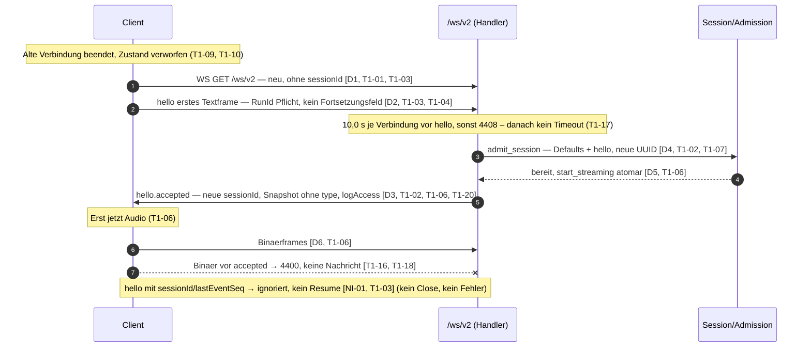
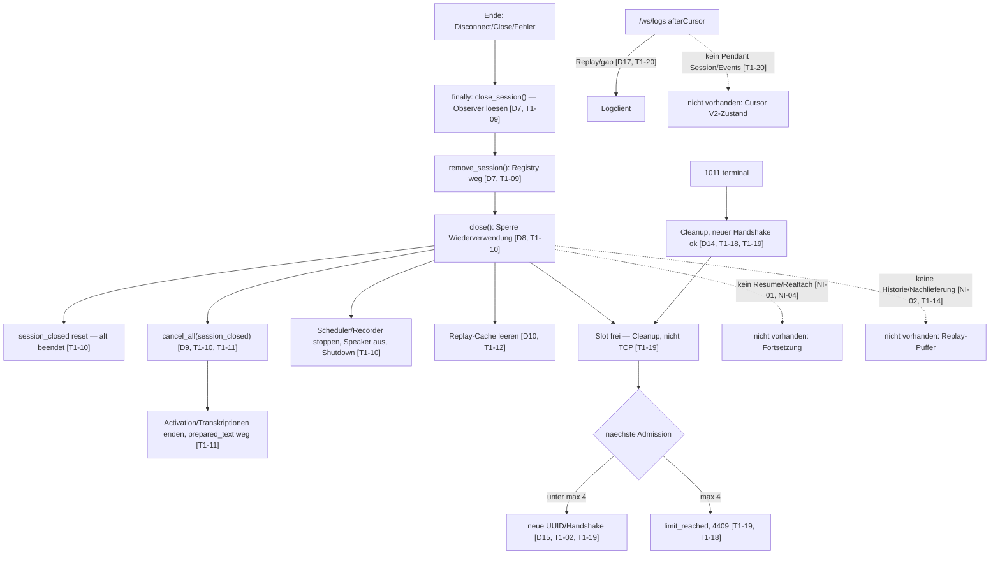
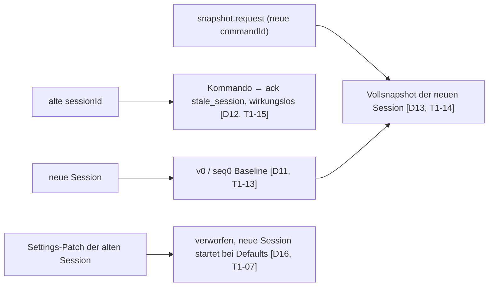

# 04.08 – Reconnect

*Status: INTEGRATED (intern abgenommen) – externe ROOT-Freigabe ausstehend. Codebasis: Commit `a8993c5c68042d996eab680d84a5b138a214bb5d`. Faktenbasis: `workflow/research/04.08.json` (T1-01…T1-20, D1–D17, NI-01…07, UN-01…05, CF-01…05).*

**Abgrenzung:** Was nach dem Ende einer `/ws/v2`-Verbindung geschieht und wie ein Client wieder anfängt. Aufbau [04.03](04.03-websocket-v2.md), Kommandos/ack [04.04](04.04-commands-acknowledgements.md), Audio [04.05](04.05-audiotransport.md), Events [04.06](04.06-eventtransport.md), Snapshot [04.07](04.07-snapshot-synchronisierung.md), Log [04.11](04.11-logzugriff.md), V1 [04.12](04.12-legacy-v1.md), Clientmodell [04.09](04.09-client-zustandsmodell.md).

> **Kurz:** „Reconnect“ ist kein Protokollvorgang, sondern ein Neuanfang. Neue Verbindung, neues `hello`, **neue Session mit neuer `sessionId`**. Genau ein Transfer: eingebetteter Snapshot in `hello.accepted`. Alte Session nicht fortgesetzt, nichts nachgeliefert/zusammengeführt (T1-01, T1-03, T1-06, NI-01, NI-02).

## 1. Worum geht es

Verbindungen brechen: WLAN wechselt, Proxy startet neu, Laptop schläft. Clientfrage: Wie mit gültigem Zustand weiter? V2: nicht Wiedereinstieg, sondern Neustart + Resync:

- **Neue Identität.** Je Verbindung höchstens eine Session; sessionId frisch serverseitig (T1-01, T1-02).
- **Kein Fortsetzungsfeld.** hello ohne sessionId/lastEventSeq/Cursor (T1-03, NI-01).
- **Ein Transfer.** Snapshot in hello.accepted = kompletter Startzustand neuer Session (T1-06).
- **Alter Zustand endet.** Activation, Transkriptionen, Patches, Idempotenz alt gegenstandslos (T1-07, T1-10, T1-11, T1-12).

Client darf nicht „weiterlaufen“, sondern ersetzt Zustand aus neuem Snapshot. Dazwischen Verpasstes holt Server nicht nach (NI-02, CF-05).

**Beispiel.** Abbruch 3 s während Activation: keine Abschlussnachricht. Neuaufbau andere sessionId; Snapshot = neue Session – alte Activation beendet, nicht aufgenommen (T1-02, T1-10, T1-11). Kommando alte ID → nur stale_session (T1-15).

## 2. Das Wesentliche auf einen Blick

- **1:1.** Session erst durch hello; nie über Verbindung wiederverwendet (T1-01).
- **ID serverseitig.** Kanonische UUID bei Admission, hello nicht setzbar (T1-02).
- **clientRunId Pflicht, keine Identität.** Validiert/abgelegt, sonst ungenutzt; gleich/neu ändert nichts (T1-04, CF-02).
- **clientId Metadatum.** Optional normalisiert (Session/Audit/Logs); keine Dedup; gleiche ID = unabhängige Sessions (T1-05).
- **Kein Audio vor accepted.** Binär davor → **4400 ohne JSON** (T1-16).
- **10,0 s bis hello.** Danach **4408**; nach accepted kein Lese-Timeout/kein Ping-Pong (T1-17, NI-06).
- **Slot bis Cleanup.** Nicht TCP-Abbau gibt frei, sondern finally; über **max 4** → **4409** limit_reached (T1-19).
- **Nur Log knüpft an.** /ws/logs afterCursor → Replay/gap; Session/Events kein Pendant (T1-20).

### 2.1 Neuhandshake (D1–D6)

Neu bei null – ohne Kennung/Zähler (D1). hello = Neuantrag: Identität + Sessiontyp, kein Anknüpfen (D2, T1-03). Neu: Defaults + hello, ID selbst, Settings Defaults+hello (D4). Annahme+Audio ein Vorgang, keine Startnachricht (D5, T1-06). accepted einzige positive Antwort: Snapshot + logAccess (D3). Audio erst danach (D6). Kreuze: zu früh Binär still-4400 (T1-16); hello-Fortsetzung nicht existent (NI-01).

### 2.2 Teardown, Slot, Log (D7–D10, D14, D15, D17)

Oben→unten: finally Observer lösen → Registry weg → close() (D7). close() Barriere: reset, Ledger-Abbruch, Stopps, Cache-leer (D8–D10). Slot erst danach; früher Neuaufbau evtl. Limit (T1-19). 1011 gleicher Cleanup, dann neu möglich (D14). Log daneben: einziger Strom mit Cursor/Replay (D17); Session/Events weder Cursor noch Puffer (NI-01, NI-02).

### 2.3 Identität, Zähler und Resync in der neuen Session (D11–D13, D16)

Lesart: Zähler und Identität beginnen neu (D11); alte IDs sind nur noch Ablehnungsgrund (D12); Resync holt den Vollsnapshot der neuen Session (D13); alte Einstellungen gelten nicht weiter (D16).

### 2.4 Warum kein „Resync-Entwurf“

Typisch: alte ID + Sequenz → fehlende nachliefern. Fehlt alles: hello-Fortsetzung (T1-03, NI-01); Historie/Puffer (T1-14, NI-02); Erkennung (RunId validiert, clientId Metadatum, T1-04, T1-05, NI-03); Politik (NI-04). Entwurf: frische Session/Snapshot, Clientverantwortung dazwischen.

## 3. Neue Session statt Fortsetzung

### 3.1 1:1

Pro Socket ein Connection; Session erst hello (T1-01). ConnectionManager führt keine Session – Anker Verbindung. Kein „Umzug“, keine „Weiterverwendung“. Neuaufbau = neue Admission (T1-01, T1-02).

### 3.2 Kennungen

| Feld | Herkunft | Bedeutung | Beleg |
|---|---|---|---|
| `sessionId` | Server, new_canonical_id Admission | einziger Registry-Schlüssel; hello nicht setzbar | T1-02 |
| `clientRunId` | Client, Pflicht UUID | nur validiert/abgelegt; kein Speichern/Vergleich | T1-04, CF-02 |
| `clientId` | Client, optional Query/Header | normalisiertes Metadatum; keine Dedup | T1-05 |

Gleiche RunId/ID → keine Wiedererkennung. Zwei gleiche Werte = zwei Sessions/IDs (T1-05, NI-03, CF-02).

### 3.3 hello ohne Fortsetzung

Identität (Version/Commit/RunId/Liste), Sessiontyp (manual/wakeWord/IDs), Suppression. Kein sessionId/lastEventSeq/Cursor (T1-03). Fünf Typen, kein Resume (T1-03, NI-01). Nur neue Session.

### 3.4 hello.accepted

Einzige positive Antwort: neue sessionId, Version/Commit, eingebetteter Snapshot ohne type (kein session.snapshot-Objekt, T1-06, CF-03), logAccess daneben nicht Feld (T1-06, T1-20). Keine Übertragung alter Session. Audio Teil Annahme (start_streaming), kein späterer Schritt (T1-06).

### 3.5 Settings/Suppression neu

Je Admission Server-Defaults + hello-Anforderung. Alter Patch weg; Revision neu (T1-07, D16). Test: neu sieht Defaults, bestehende nicht umgeschrieben (T1-07). Suppression je Admission aus hello, kein persistierter Zustand; nach Wechsel nur neues hello (weg = neues hello, T1-08).

### 3.6 Vorher/nachher

| Aspekt | vorher | nachher |
|---|---|---|
| sessionId | alt | neu (T1-02) |
| Settings | gepatcht | Defaults + neu hello (T1-07, D16) |
| Suppression | gesetzt | nur neu hello (T1-08) |
| Segmente/Zähler | alt | v0/seq0 neu (T1-13) |
| Idempotenz | alter Cache | leer; alte ID unbrauchbar (T1-12) |

## 4. Teardown

### 4.1 finally: Observer vor Registry

Ende → finally: close_session löst Observer, dann remove_session (Registry + close) (T1-09). Teardown-Events (z.B. activation_closed) erreichen sterbenden Socket nicht. Keine Abschlussnachricht erwarten (T1-09).

### 4.2 close() Sperre

Geteilter Teardown, auch V2 (T1-10): session_closed-Reset (nie alte Activation wiederbeleben), Ledger-cancel_all session_closed, Scheduler/Recorder-Abbruch, Speaker aus, Recorder-Shutdown, Replay-leer. Harte Grenze: alt nicht fortsetzbar (T1-10). Nicht „genau einmal“ formulieren (Aufrufzahl unbelegt, T1-10; Test V1 CF-01).

### 4.3 Was nicht überlebt

Activation/nicht-gedraente Transkriptionen: Ledger cancelled session_closed, prepared_text weg (T1-11). Audio live Client (use_microphone false); kein Puffer fürs Loch (T1-11). Gesprochenes nicht nachverarbeitet erwarten.

## 5. Flüchtigkeit

### 5.1 Idempotenz sessiongebunden

Cache Session, close() leert (T1-12). Nach Wechsel neue ID nötig. Alter Konflikt unmöglich. Vgl. 04.04 Q1-27.

### 5.2 Zähler null [D11]

Frisch: v0/seq0, leeres Minted; accepted-Snapshot Baseline (T1-13). Alt bedeutungslos. Startwerte nur initialisiert, ungetestet (UN-01).

### 5.3 Kein Puffer [D13]

Minted nur Retry-Identität, keine Nachlieferung (T1-14). Resync = Vollsnapshot Request; nach Wechsel nur neue Session. Verpasstes nicht „nachfordern“ – Zustand lesen, ab dort weiter (T1-14, NI-02, 04.07).

### 5.4 Alte ID [D12]

Fremd/alt kanonisch → ack stale_session (false, wirkungslos, kein Close) (T1-15). hello nach accepted still ignoriert; keine Re-Aushandlung (T1-15). Neue ID aus accepted verwenden.

### 5.5 Slot/Cleanup

Registry weg im finally, nicht TCP. Freigabetest ≤10 s bis alt weg, dann neu andere ID (T1-19). Über max 4 (Default) → 4409 limit_reached (T1-19). Zu früh evtl. abgewiesen; keine Wartezeit (NI-04). Cancellation-Freigabe (UN-04), schnell nahe Limit (UN-05) ungetestet.

## 6. Closes, Timeouts, V1, Log

### 6.1 Close-Set

| Code | Bedeutung | Auslöser | Beleg |
|---|---|---|---|
| 4400 | invalid handshake | kein hello/unparsebar/Hülle/Binär-vorher | T1-16, T1-18 |
| 4406 | kein Stand | Liste ohne gemeinsam, mit incompatible | T1-18 |
| 4408 | timeout | 10,0 s ohne hello | T1-17, T1-18 |
| 4409 | rejected | Fehler/limit/Katalog | T1-18, T1-19 |
| 1011 | intern/terminal | Ausnahme/terminal | T1-18 |
| 1000 | Fallback | ohne Code | T1-18 |

Kein Resync/Ablauf-Code (T1-18, NI-07). Falle: Binär vor accepted → 4400 ohne JSON (Test leer, T1-16). Nach Neuaufbau sofort Audio = Verlust ohne Erklärung. Auf accepted warten.

### 6.2 10,0 s, dann Stille

Handshake 10,0 s Default (Connection konfigurierbar) → 4408 (T1-17). Danach kein Lese-Timeout; kein ping/pong (5 Typen) (T1-17, NI-06). Halboffen nicht beendet; ASGI/Proxy nicht Code (UN-02).

### 6.3 1011 danach

Intern/terminal → 1011 (T1-18). Gleicher Cleanup; neuer Handshake möglich (T1-18, T1-19, D14). Wie jedes Ende behandeln.

### 6.4 V1-Warnung

Einziger „Reconnect“-Test V1: Teardown-Garantie, nicht V2-Folge (CF-01, UN-03). Nicht als V2-Beleg zitieren. V2 Pfad+Handshake belegt, kein E2E „alt nicht wiederbelebt“ (UN-03).

### 6.5 Log-Kontrast

/ws/logs einziger wiederanlauffähiger Strom: afterCursor → Replay, Retention-unterschritten log.gap (T1-20). logAccess pro Admission neu; Bootstrap, kein Fortsetzungs-Token; sessiongebunden flüchtig 24 h (T1-20, CF-04). V2-Zustand kein Pendant: kein Cursor/Replay/gap (T1-20, NI-02). Logverhalten ≠ Sessionverhalten.

## 7. Grenzen

### 7.1 NI

| ID | Befund | Praxis |
|---|---|---|
| NI-01 | Kein Resume/Reattach; hello ohne ID/seq/Cursor | neu Session (T1-03) |
| NI-02 | Keine Historie/Puffer; nur Vollsnapshot | nichts nachgeliefert (T1-14) |
| NI-03 | Keine Erkennung; RunId validiert, clientId Metadatum | keine Korrelation (T1-04, T1-05) |
| NI-04 | Kein Reconnect/Retry/Backoff/Going-away | Client entscheidet neu |
| NI-05 | Keine Persistenz Ende/Neustart | alles sessiongebunden (T1-10, T1-13) |
| NI-06 | Kein Keepalive/Idle-Timeout nach accepted | halboffen unerkannt (T1-17) |
| NI-07 | Kein Resync-/Ablauf-Code | 4400/4406/4408/4409/1011 + 1000 (T1-18) |

### 7.2 UN

| ID | Offen |
|---|---|
| UN-01 | Startwerte 0/0 nur initialisiert (T1-13) |
| UN-02 | Halboffen ASGI; Defaults nicht Code (T1-17) |
| UN-03 | reconnect-Test V1; V2-E2E fehlt (CF-01) |
| UN-04 | Slot bei Cancellation (T1-19) |
| UN-05 | Schnell nahe max (T1-19) |

### 7.3 CF

| ID | Klarstellung |
|---|---|
| CF-01 | Reconnect-Test V1: Teardown, nicht Wire (T1-10) |
| CF-02 | RunId funktionslos (nur Validierung) (T1-04) |
| CF-03 | Eingebettet ohne type; kein Snapshot-Objekt (T1-06) |
| CF-04 | logAccess Bootstrap, kein Token (T1-20) |
| CF-05 | Lücken nur Client; keine Deltas (T1-14) |

### 7.4 Clientregeln

1. Neu Socket, hello ≤10,0 s (T1-17).
2. accepted abwarten, dann Audio (T1-06, T1-16).
3. Snapshot als Basis; alt ID/Zähler/IDs verwerfen (T1-02, T1-12, T1-13).
4. 4409 limit evtl. vorübergehend; keine Wartezeit (T1-19, NI-04).

## 8. Siehe auch und Nachweise

Verwandt: [04.03](04.03-websocket-v2.md) · [04.04](04.04-commands-acknowledgements.md) · [04.05](04.05-audiotransport.md) · [04.06](04.06-eventtransport.md) · [04.07](04.07-snapshot-synchronisierung.md) · [04.09](04.09-client-zustandsmodell.md) · [04.11](04.11-logzugriff.md) · [04.12](04.12-legacy-v1.md).

T1-01 1:1 · T1-02 ID · T1-03 hello · T1-04 RunId · T1-05 clientId · T1-06 accepted/Snapshot · T1-07 Settings · T1-08 Suppression · T1-09 finally · T1-10 close · T1-11 Ende · T1-12 Cache · T1-13 Zähler · T1-14 Puffer · T1-15 stale · T1-16 Audio-vorher · T1-17 10s/kein Timeout · T1-18 Closes · T1-19 Slot/Limit · T1-20 Log/logAccess. Kanten D1–D6 §2.1; D7–D10/D14/D15/D17 §2.2; D11–D13/D16 §2.3. N/U/CF §7. Stand a8993c5c. Intern unabhängig geprüft und integriert; externe ROOT-Freigabe ausstehend.
