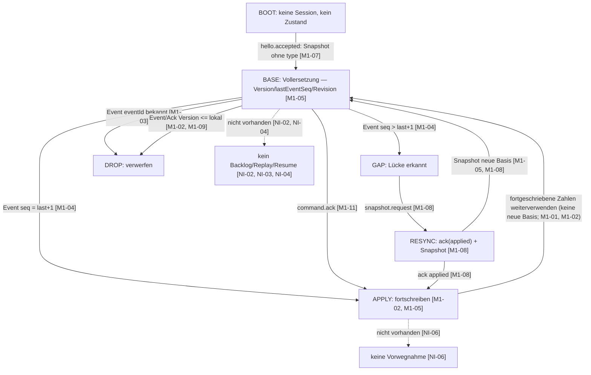

# 04.09 – Client-Zustandsmodell

*Status: INTEGRATED (intern abgenommen) – externe ROOT-Freigabe ausstehend. Codebasis: Commit `a8993c5c68042d996eab680d84a5b138a214bb5d`. Faktenbasis: `workflow/research/04.09.json` (M1-01…M1-17, R1–R10, NI-01…06, UN-01…04, CF-01…05).*

**Abgrenzung:** Zustandsvertrag für einen V2-Client (`/ws/v2`). Beschreibt **keinen ausgelieferten Client-Code** – im Commit existiert keiner (M1-17, NI-01). Handshake [04.03](04.03-websocket-v2.md), Kommandos/Acks [04.04](04.04-commands-acknowledgements.md), Audio [04.05](04.05-audiotransport.md), Events [04.06](04.06-eventtransport.md), Snapshot [04.07](04.07-snapshot-synchronisierung.md), Reconnect [04.08](04.08-reconnect.md), Log [04.11](04.11-logzugriff.md), V1 [04.12](04.12-legacy-v1.md), Beispiele [04.13](04.13-integrationsbeispiele.md).

> **Kurz:** Zwei Zähler, ein Reducer. `eventSeq` sagt, ob nichts fehlt; `stateVersion` sagt, ob das Bild aktuell ist. Beide laufen auseinander, weil Änderungen ohne Ereignis geschehen. Wahrheit liefern **Snapshot und Ack**, nicht Mitzählen.

## 1. Worum geht es

Eine Oberfläche will wissen: Phase? offene Activations? angeforderte vs wirksame Settings? Audio da? Trigger konfiguriert/unterdrückt/wirksam? Server streamt Ereignisse; Client faltet zu **einem** Zustand (Reducer).

Zwei Annahmen falsch: „Jedes Ereignis +1 Version“ (manche Änderungen ohne Ereignis, CF-01); „seq == Version“ (Interim seq ja, Version nein, CF-02).

**Kein V2-Client im Repo.** Einziges Beispiel spricht V1, wertet weder seq/Version/Snapshot aus (M1-17, NI-01). Kapitel = **Soll-Vertrag** („muss gelten“) aus Serververhalten. „Der Client muss“ = Anforderung, keine Codebeschreibung.

Relevant: erstes Bild nach Aufbau (§3), Fortführen aus Ereignissen (§4, §5), Acks/Lücken (§6). Nach Reconnect alles null: neue Verbindung/Session/Zähler ([04.08](04.08-reconnect.md); M1-01).

## 2. Das Wesentliche auf einen Blick

- **Ein Bootstrap:** nur eingebetteter Snapshot in hello.accepted; logAccess daneben, nicht darin (M1-07).
- **eventSeq:** 0, +1 je Ereignis, pro Verbindung lückenlos unter Lock mit Senden (M1-01, M1-04).
- **stateVersion:** 0, +1 nur wire-sichtbar; Diagnose ausgenommen (M1-01, M1-02).
- **18 Typen** gleiche Hülle; nur Änderung trägt Version (M1-03).
- **Snapshot ersetzt**, merged nicht; neue Basis Version+seq (M1-05, M1-08).
- **Lücke → snapshot.request.** Keine Nachlieferung (M1-08, NI-02).
- **Ack Antwort, kein Ereignis.** accepted nur applied/no_change (M1-11).
- **Fünf Phasen**, kein finalizing (M1-12, CF-04).
- **Schließen:** Ack Eintrittsversion, nicht spätere (M1-13, CF-05).
- **Keine Vorwegnahme:** nur Ack+Ereignis (NI-06).

### 2.1 Reducer-Fluss

Nur Übergang nach BASE = Snapshot (hello.accepted M1-07, Resync M1-08). Wege: Anwenden schreibt seq/Version fort (M1-01, M1-02), Lücke (M1-04), Verwerfen (bekannte ID/alte Version), Ack (Version/Revision nachführen, M1-03, M1-09, M1-11). GAP nur → snapshot.request. Resync: Ack + neuer Snapshot, Basis neu (M1-08). Gestrichelt nicht existent: kein Backlog/Replay/Resume/Vorwegnahme (NI-02..NI-04, NI-06).

Textlich: 1) Snapshot, Basis merken. 2) Ereignis: bekannt → weg; kleiner → weg; größer → Lücke→Snapshot; genau → anwenden. 3) Ack übernehmen; Erstanwendung monoton, Replay-Memo liefert Originalwerte (ggf. älter, kein Rückschritt — R6, M1-09). 4) Nach Snapshot bei 1. 5) Kein „fehlende nachladen“.

## 3. Bootstrap

### 3.1 Was ankommt

Erster Zustand nur eingebetteter Snapshot hello.accepted. Exakt Felder wie session.snapshot, ohne inneres type (M1-07, M1-05). logAccess Geschwisterfeld daneben, kein Snapshot-Feld, nur hier, nicht in Resyncs (M1-07). Resync erneuert Log-Zugang nicht ([04.11](04.11-logzugriff.md)).

Snapshot = Projektion: Phase/Trigger Controller, offene Ledger, Revision+requested+effective eine Projektion, Wake Wake-Port, Zähler State, Audio Flag (M1-05). Nichts zwischengespeichert.

### 3.2 Was Client tun muss

Vollständig übernehmen, Basis Version/lastEventSeq/Revision (M1-05). Nichts mergen/ergänzen – requested/effective/Revision enthalten (M1-05). Davor kein Zustand; Lieferung erste nach Handshake (M1-07). Nie halb-patch: Bau/Mint/Senden ein Lock, eine Projektion (M1-06).

Beispiel: Push-to-Talk Start: phase idle, IDs/deadline/remaining null, closeRequested false, v0/seq0, pending [] (M1-05). Vollständig, sofort rendern.

### 3.3 Was nicht mitkommt

Keine Historie/Cursor außer lastEventSeq/Delta-Abo/Folge-Snapshot (NI-02). Keine Lückenerkennung Server. Clientaufgabe (§6, R4).

## 4. Zwei Zähler

### 4.1 eventSeq: Zeilennummer

0, +1 je Wire-Ereignis, nur State unter Lock (M1-01). Erzeugen+Ausliefern linearisiert: Lock Mint→Sink/Queue, Writer nach Freigabe (M1-04). Pro Verbindung 1,2,3…; übergreifend nichts (M1-04). Erstes = 1 (0→+1, M1-01, M1-03). Hülle je Event: type/protocolVersion/sessionId/frische kanonische eventId/seq/Version (Feld immer vorhanden; Inkrement nur bei sichtbarer Änderung)/occurredAtUnixMs (M1-03). Alle 18 Typen sofern projiziert (M1-02, M1-03).

### 4.2 stateVersion: Revisionsnummer

0, +1 nur wire-sichtbar (M1-01, M1-02). NICHT Controller-Version (M1-02). Diagnose/revisionell ausgenommen: watchdog.warning, activation.trigger_suppressed, transcription.interim → seq ja, Version nein (M1-02). Version in Snapshot/Ack/Ereignis (M1-05, M1-11, M1-03).

### 4.3 Gegenüberstellung

| Zähler | Start | Schritt | Träger | Frage |
|---|---|---|---|---|
| eventSeq | 0 | +1 je Ereignis | jedes Ereignis | Fehlt mir etwas? |
| stateVersion | 0 | +1 je sichtbarer Änderung | Snapshot/Ack/Zustandsereignis | Aktuell? |
| settingsRevision | Projektion | eigener Stand | Snapshot/Ack | Welcher Settings-Stand? |

Gleichsetzen = falsche Bilder zwangsläufig.

### 4.4 Beispiel seq 2 / Version 1

Vektor: started seq1/Version1 (M1-03). Interim seq2/Version1 (CF-02). Fortgeführt:

| Nr. | Ereignis | seq | Version | Wirkung |
|---|---|---|---|---|
| 1 | started | 1 | 1 | Wechsel |
| 2 | interim | 2 | 1 | nur Text |
| 3 | phase_changed | 3 | 2 | Wechsel |

Nach drei: lastEventSeq 3, Version 2. Version aus Anzahl = falsch (CF-01, CF-02). **Nie austauschbar.**

### 4.5 protocolVersion

Hülle protocolVersion = Nachricht (M1-03). Nicht mit Version/seq verrechnen. serverVersion/Commit Snapshot = Metadaten (M1-05).

### 4.6 settingsRevision-Klammer

Ein Patch mehrere changed, genau eine Erhöhung; Revision eine Projektion unter Lock (M1-06). Aus Ack/Snapshot übernehmen, nicht aus changed-Anzahl. Ein Revisionsschritt, nicht n.

## 5. Stumme +1 ohne Ereignis

### 5.1 Drei Quellen

Version ohne zustandstragendes Ereignis (CF-01): 1) Suppression (sichtbarer Trigger; Diagnose nur seq, M1-02). 2) audioAvailable (Feld, kein Ereignis, CF-01, M1-05). 3) closing-Eintritt (kein Lifecycle, M1-13).

### 5.2 Schließfall

Observer versioniert genau einmal je (activationId, activationSequence), auch Retry (M1-13). Späterer Close evtl. erneut, ohne Ereignis. Ack bei closing = Eintrittsversion, nicht spätere (M1-13, CF-05). input_closed genau einmal ein Trichter; ohne akzeptiertes finish/cancel causedBy null (M1-14). Fehlendes causedBy ≠ Fehler – kein Kommando-Ursprung.

### 5.3 Folgen

Nicht zählen (CF-01). Ack/Snapshot Autorität. Sprünge normal. Snapshot zeigt Endzustand, auch ohne Meldung (M1-05). Beispiel: v11/closing → Snapshot v12 bei gleicher seq: kein Widerspruch – zweite Erhöhung (Schließung) ohne Ereignis (CF-01, CF-05). Kein „Rückschritt“/„verloren“ reparieren.

### 5.4 Übersicht

| Auslöser | Sichtbar | Ereignis? | Beleg |
|---|---|---|---|
| Suppression | suppressed/effective | Diagnose seq, ohne Version | M1-02, CF-01 |
| Audio | audioAvailable | nein | CF-01, M1-05 |
| closing-Eintritt | phase/closeRequested | nein; je (activationId, activationSequence) einmal | M1-13, CF-01 |
| patch | requested/effective/Revision | ja n×changed, eine Erhöhung | M1-06 |
| input_closed | pending | ja, genau einmal Trichter | M1-14 |

Ankündigungswege, keine Ereignisliste.

## 6. Ack, Resync, Regeln R1–R10

### 6.1 Ack

Hülle + Ergebnis + Zustand (M1-11). accepted nur applied/no_change; result 15 geschlossen; inputPhase 5 normiert idle-fallback (M1-11). Momentaufnahme Version/Revision; Wahrheit input.phase Snapshot.

### 6.2 Genau ein Ack – oder keins

Erkennbar + kanonisch = genau ein Ack. Sonst still, kein Ack/Wechsel (M1-10). Kein Code/Frist. Kein Erfolg ableiten, kein Timeout erfinden.

### 6.3 Resync lesen

request = einziger Resync: applied-Ack + neuer Snapshot, Domäne unverändert, kein Anstieg, Wiederholung zweitwirkungslos (M1-08). Resync keine Spur. Ohne kanonische ID unbeantwortet (M1-10).

### 6.4 Memo/Konflikt

Erste Antwort gemerkt. Gleiche ID/gleich Payload byte-gleich inkl. alte Versionen. Gleiche ID/anderer Payload conflict. Replay nie Version+ (M1-09). Cache alle fünf Typen sitzungsweit (M1-09). Memo-alt ≠ Rückschritt, sondern Beleg (R6).

### 6.5 R1–R10

| Regel | Muss gelten | Beleg |
|---|---|---|
| R1 | Ordnung seq. Nur seq=last+1 anwenden; Rest Lücke/Duplikat. | M1-01, M1-03, M1-04 |
| R2 | Version Serverautorität. Diagnose ändert nicht. | M1-02 |
| R3 | Snapshot ersetzt; Basis Version/seq. | M1-05, M1-07, M1-08 |
| R4 | Lücke → request. Keine Nachlieferung. | M1-08, NI-02 |
| R5 | Duplikate weg: ID bekannt / seq≤last. | M1-03, M1-09 |
| R6 | Kein Rückschritt: alt liefert Daten, senkt nie Version/Revision. | M1-02, M1-09 |
| R7 | Interim Text: nur Segmenttext, nie Phase/Version. | M1-15, M1-02 |
| R8 | Ack übernehmen; closing = Eintrittsversion. | M1-11, M1-13, CF-05 |
| R9 | Konflikt kein Wechsel; erste Fassung gültig. | M1-09 |
| R10 | Fünf Phasen, kein finalizing; phase_changed abgeleitet voraus. | M1-12, CF-04 |

### 6.6 Segmente/Interim/Zuordnung

Spätes Interim nach Terminal verworfen: keine ID/seq/Lücke; terminal danach (M1-15). Zuordnung erster bestätigter Kontakt, kein Vordergrund-Erfinder; Widerspruch nur Zähler (M1-16). Lückenlose seq ≠ jedes Interim da. Vordergrund keine Sortierregel.

### 6.7 Lücke+Resync

Bei 41, dann 43: 43 nicht als Anschluss (M1-04). Request neue kanonische ID (M1-08, M1-10). Ack applied + Version/Revision (M1-08, M1-11). Snapshot: Basis ersetzen, lastEventSeq evtl. >43 (M1-05, M1-08). Resync keine Mutation (M1-08). Puffern/verwerfen dazwischen Vertrag-offen; Snapshot heilt (NI-03).

### 6.8 Schließen

phase closing + v11. finish applied, inputPhase closing, v11 (M1-11, M1-13). Schließung → v12 ohne Ereignis (CF-05). Ack als „neueste“ + Snapshot v12 als Rückschritt verwerfen = dauerhaft falsch. R8.

## 7. Grenzen

### 7.1 NI

| ID | Fehlt | Folge |
|---|---|---|
| NI-01 | Reducer/UI/Selektoren/Persistenz | Vertrag ohne Referenz; nur V1-Beispiel |
| NI-02 | Backlog/Replay nach seq | „schick 42“ unheilbar |
| NI-03 | Lückenpuffer | Erkennung Client (R4) |
| NI-04 | Resume/Reattach | neu Session/Zähler |
| NI-05 | Deadline-Countdown | Momentaufnahme, keine Planung |
| NI-06 | Vorwegnahme | nur Ack+Ereignis; Replay/Konflikt dagegen |

### 7.2 UN

UN-01 Abbruch-Fortsetzung offen. UN-02 Mint-Sink-Verlust unbelegt; Snapshot heilt, keine Garantie. UN-03 Reset/Überlauf unspezifiziert; ab 0 monoton. UN-04 pending-Darstellung nicht definiert (Server sortiert nach activationSequence).

### 7.3 Zahlen

5 Phasen (M1-12). 15 Codes (M1-11). 18 Typen (M1-03). 10,0 s hello Serverfrist (04.03/04.08). Keine Client-Fristen/Timeouts/Defaults.

### 7.4 Doku kein Beleg

Reducer-Prosa vorhanden, aber kein Client-Code (M1-17). Kein Implementierungsbeleg, hier nicht Quelle (CF-03). Prüfen = Server/Schemata/Vektoren.

## 8. Siehe auch und Nachweise

| ID | Satz | Abschnitt |
|---|---|---|
| M1-01 | Zwei Zähler ab 0, nur Lock | 4.1, 4.2 |
| M1-02 | Version≠Controller; Diagnose nur seq | 4.2, 5.1 |
| M1-03 | Hülle frische ID/seq/Version-nur-Änderung | 4.1, 4.5 |
| M1-04 | Mint+Auslieferung linearisiert | 4.1, 6.7 |
| M1-05 | Snapshot Projektion alle Felder | 3.1, 3.2 |
| M1-06 | Snapshot+Settings ein Lock, eine Projektion | 3.2, 4.6 |
| M1-07 | hello eingebettet ohne type; logAccess nur dort | 3.1 |
| M1-08 | request lesen ohne Anstieg | 6.3, 6.7 |
| M1-09 | Memo byte-gleich, Konflikt abweichend | 6.4 |
| M1-10 | Genau ein Ack, sonst still | 6.2 |
| M1-11 | Ack-Felder, accepted, 15/5, idle-Fallback | 6.1 |
| M1-12 | Fünf Phasen, kein finalizing, phase_changed voraus | 6.5, 7.3 |
| M1-13 | closing je (activationId, activationSequence) einmal; Ack Eintritt | 5.2, 6.8 |
| M1-14 | input_closed Trichter genau einmal | 5.2 |
| M1-15 | Spätes Interim verworfen lückenlos | 6.6 |
| M1-16 | Zuordnung erster Kontakt, keine Erfindung | 6.6 |
| M1-17 | Kein V2-Reducer; Beispiel V1 | 1, 7.4 |

Verwandt: [04.03](04.03-websocket-v2.md) · [04.04](04.04-commands-acknowledgements.md) · [04.05](04.05-audiotransport.md) · [04.06](04.06-eventtransport.md) · [04.07](04.07-snapshot-synchronisierung.md) · [04.08](04.08-reconnect.md) · [04.11](04.11-logzugriff.md) · [04.12](04.12-legacy-v1.md) · [04.13](04.13-integrationsbeispiele.md) · [08.01](../08-referenzen/08.01-event-katalog.md) · [08.02](../08-referenzen/08.02-command-katalog.md) · [08.05](../08-referenzen/08.05-zustands-phasenkatalog.md) · [08.06](../08-referenzen/08.06-timing-katalog.md) · [08.10](../08-referenzen/08.10-websocket-schema-referenz.md) · [09.04](../09-anhaenge/09.04-client-migration.md) · [09.08](../09-anhaenge/09.08-dokumentationsstand.md).

Intern unabhängig geprüft und integriert; externe ROOT-Freigabe ausstehend.
