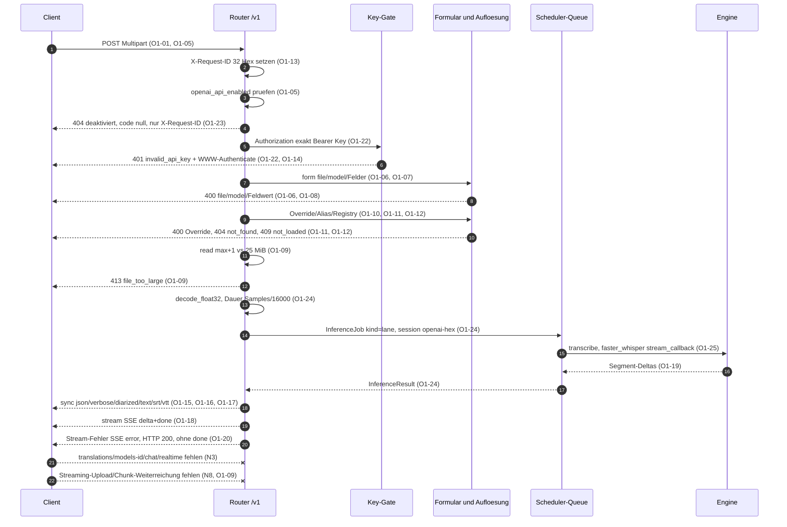
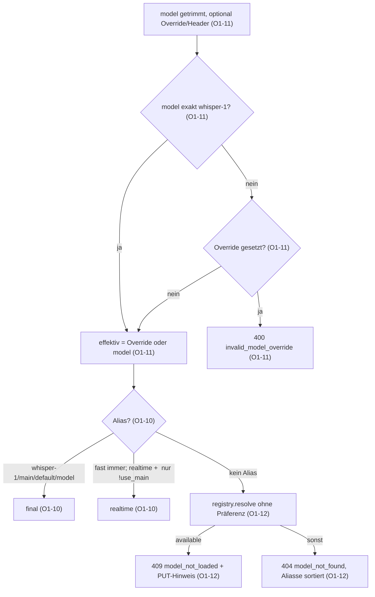

# 04.10 – OpenAI-kompatible API

*Status: INTEGRATED (intern abgenommen) – externe ROOT-Freigabe ausstehend. Codebasis: Commit `a8993c5c68042d996eab680d84a5b138a214bb5d`. Faktenbasis: `workflow/research/04.10.json` (O1-01…O1-25, N1…N8, U1…U7, C1…C6).*

**Abgrenzung:** Die zwei OpenAI-förmigen HTTP-Routen: Modellliste und Datei-Transkription. HTTP-Rahmen [04.02](04.02-http-grundlagen.md) (Multipart H1-10, Formen H1-15, response_format H1-16, Header H1-17, SSE H1-18, Fehlerhülle H1-20). Landkarte [04.01](04.01-schnittstellenuebersicht.md) (I1-14…I1-16). Live-Weg [04.03](04.03-websocket-v2.md), Audio [04.05](04.05-audiotransport.md), Events [04.06](04.06-eventtransport.md). Auth [05.06](../05-administration/05.06-openai-api-authentifizierung.md); Fehler/Zugriff [05.10](../05-administration/05.10-fehler-zugriffsantworten.md).

## 1. Worum geht es?

Werkzeuge „sprechen“ OpenAI-Transkription: fertige Audiodatei als Multipart-POST an `/v1/audio/transcriptions`, Text/Untertitel/JSON zurück; manche fragen `/v1/models` vorher. Genau diese zwei Türen – **ohne Präfix** an der Wurzel (O1-01):

```text
http://<host>:8010/v1/models
http://<host>:8010/v1/audio/transcriptions
```

Zielgruppe: **Datei-Transkription nachträglich** (Mitschnitte, Stapel) und Werkzeuge nur dieser Form. Kein Live-Mikro (WebSocket [04.03](04.03-websocket-v2.md)), keine Übersetzung/Chat/Realtime/Modell-Einzelabruf (N3, O1-01).

„Kompatibel“ = **Form, nicht Parität**: 1) Liste = Katalog, keine Bestandsanzeige; Ablehnung erst beim Transkribieren (O1-03, C2). 2) Genau ein Sprecher; diarized/Sprecherlisten keine echte Trennung (N1, O1-15). 3) Fehlertexte deutscher Implementierungstext, keine stabile API (O1-14). Struktur prüfen (Status, error.code/param, response_format), nie Wortlaut/Sprechertrennung.

## 2. Das Wesentliche auf einen Blick

- **Zwei Routen, kein Präfix:** GET /v1/models, POST /v1/audio/transcriptions; Router ohne prefix (O1-01).
- **Liste offen:** nur Key-Gate, **kein** enabled-Blick, **keine** X-Request-ID, keine Pagination/Query (O1-02, N7).
- **Streng geordnet:** 14 Schritte fest; 404-deaktiviert **vor** 401 (O1-05, O1-23).
- **Multipart-Pflicht:** file + model; **9 Endungen**; **25 MiB**/413 (O1-06, O1-09).
- **Sechs Formate** + Streaming: json/verbose_json/diarized_json/text/srt/vtt (O1-15…O1-17).
- **Auflösung drei Ausgänge:** 400 Override, 404 nicht gefunden, 409 nicht geladen (O1-10…O1-12).
- **Jede POST-Antwort X-Request-ID** (32 Hex); Modell-Header erst nach Auflösung (O1-13).

| Route | Zweck | Tor | enabled | Antwort | Header |
|---|---|---|---|---|---|
| GET /v1/models | Katalog | Key-Gate | ignoriert (C1) | JSON-Liste | keine (O1-02, N7) |
| POST /v1/audio/transcriptions | Datei-Transkription | erst enabled, dann Gate | 404 bei false | JSON/Text/VTT/SSE | X-Request-ID + VoiceSTT-Header (O1-13, O1-23) |

### Upload-Weg



In Worten: Multipart-POST (O1-01, O1-05). Zuerst Request-ID (O1-13), dann Schalter (O1-05); aus → 404 mit ID, ohne Modell-Header (O1-23). Dann Gate (O1-22). Formular (O1-06, O1-07), Override/Auflösung (O1-10…O1-12), Größe (O1-09), Dekodierung (O1-24). Job in gleiche Queue wie WS (O1-24); nur faster_whisper Segmenttexte (O1-19, O1-25). Antwort Dokument (O1-15…O1-17) oder SSE (O1-18); Fehler HTTP-200+error (O1-20). Gestrichelt = Terminierung (eine Antwort). Kreuze = Abwesenheiten (N3, N8).

Textlich: (1) POST, ID setzen. (2) deaktiviert? 404. (3) Key falsch? 401. (4) Formular; file/model fehlt? 400. (5) Endung. (6) Felder. (7) Override/Auflösung → 400/404/409. (8) Größe → 413. (9) Dekodieren. (10) Queue, Inferenz warten. (11) SSE oder Dokument.

## 3. Zwei Endpunkte, optionales Tor

### 3.1 Zwei Routen ohne Präfix

Fabrik `create_openai_router(...)` → APIRouter ohne prefix; server.py include ohne prefix (O1-01). Injektion vermeidet Zyklus, testbar; Aufrufer: Pfade blank an Wurzel. Proxy muss /v1/... durchreichen. Genau zwei: translations/models-{id}/chat/realtime fehlen (N3, 04.01 I1-17). /v1 = OpenAI-Kompatibilität, nicht VoiceSTT-V1 (04.02 H1-04).

### 3.2 Key-Gate exakt, optional

Unabhängig AdminGate (04.01 I1-15, 04.02 H1-12). Key aus settings.openai_api_key oder VOICESTT_API_KEY: keiner → frei ohne Audit (O1-22). Sonst Authorization exakt `Bearer <key>` (keine Toleranz, keine Alt-Header, O1-22). Abweichung 401 + WWW-Authenticate Bearer + code invalid_api_key + Audit authentication.failed (transport http, normalisierte ID, Pfad) + transcription.rejected warning authentication_failed (O1-22). Client-ID aus X-VoiceSTT-Client-ID normalisiert; ungültig client-<uuid>, fehlend null (O1-22). Audit ohne Header ohne sprechende ID.

### 3.3 Schalter openai_api_enabled

Default true, CLI --disable-openai-api, STARTUP_ONLY (kein PATCH /api/config laufzeit, O1-23). false → nur Transkription 404 „OpenAI-kompatible API deaktiviert.“ (invalid_request_error, param/code null), X-Request-ID ja, keine VoiceSTT-Header, nur Hub-Event transcription.rejected/warning/api_disabled, kein Audit-Event (O1-23).

### 3.4 Asymmetrie

enabled vor Gate (O1-05):

| Zustand | GET /v1/models | POST |
|---|---|---|
| enabled true, kein Key | 200 Liste, ohne Audit | 200, ohne Auth-Audit, aber mit accepted/started/completed-Audit/Events |
| enabled true, Key falsch/fehlend | 401 | 401 invalid_api_key |
| enabled false, Key ok | 200 Liste | **404** deaktiviert |
| enabled false, Key falsch | 401 (Gate zuerst) | **404**, nicht 401 |

Ohne Key gegen abgeschaltete Instanz: 404 („falsche URL“ falsch). Monitoring nur models merkt Abschaltung nie (C1, O1-02, O1-23).

## 4. Request: Reihenfolge = Verhalten

### 4.1 Vierzehn Schritte

| # | Schritt | Verstoß |
|---|---|---|
| 1 | ID/Client/Start/Header | – |
| 2 | enabled | 404 (O1-23) |
| 3 | Gate | 401 invalid_api_key (O1-22) |
| 4 | form() | – (Framework U1) |
| 5 | file Upload-Objekt | 400 file (O1-06) |
| 6 | Endung | 400 file (O1-06) |
| 7 | Felder parsen | 400 model/Feld (O1-06, O1-08) |
| 8 | Override | 400 invalid_model_override (O1-11) |
| 9 | Auflösung | 404/409 (O1-12) |
| 10 | Größe read(max+1) | 413 file_too_large (O1-09) |
| 11 | Archiv optional | – (O1-24) |
| 12 | Dekodieren/Dauer/Sprache | → 500-Pfad (O1-21) |
| 13 | Audit/Events | – (O1-24) |
| 14 | Stream/Sync | 200/SSE/500 (O1-15…O1-21) |

Überraschungen: deaktiviert-vor-Auth (O1-05, O1-23). Datei-vor-Modell: beide fehlen → 400 file. Modell-vor-Größe: 30 MiB unbekanntes Modell → 404, nicht 413 (O1-05, O1-09).

### 4.2 Multipart Pflicht

Nur request.form() (O1-06). JSON-Body → 400 file. file Upload-Objekt mit read() (Textfeld ungenügend, O1-06). model Pflicht getrimmt (O1-06, O1-07).

```bash
curl -sS http://127.0.0.1:8010/v1/audio/transcriptions \
  -H "Authorization: Bearer $VOICESTT_API_KEY" \
  -F "file=@aufnahme.mp3" \
  -F "model=whisper-1" \
  -F "language=de" \
  -F "response_format=verbose_json" \
  -F "timestamp_granularities[]=word"
```

(Adresse/Port 04.02 H1-01; ohne Key kein Header.)

### 4.3 Neun Endungen

Nur Dateiname case-insensitiv: .flac .mp3 .mp4 .mpeg .mpga .m4a .ogg .wav .webm (O1-06). Kein Sniffing/Content-Type (O1-06): .aac/.opus → 400 file; umbenannt passiert Endung, Dekodierung evtl. 500 (O1-21). Fehlender Name → 'audio' ohne Endung → 400 file (O1-06).

### 4.4 Felder/Defaults

| Feld | Pflicht | Default | Werte | Fakten |
|---|---|---|---|---|
| model | ja | – | Alias/Kandidaten-ID getrimmt | O1-07 |
| language | nein | settings.language (de) | Code | O1-07 |
| prompt | nein | – | Freitext | O1-07 |
| response_format | nein | json | sechs §6.1 | O1-07, O1-15 |
| temperature | nein | 0.0 | 0..1 | O1-07 |
| threshold | nein | 0.5 | 0..1, VoiceSTT | O1-07 |
| stream | nein | false | true/false/1/0/yes/no/on/off | O1-07 |
| include | nein | – | nur logprobs | O1-07 |
| timestamp_granularities | nein | [segment] | segment, word | O1-07 |
| known_speaker_names | nein | – | max 4 | O1-07 |
| known_speaker_references | nein | – | gleiche Länge names | O1-07 |
| voicestt_model/model_override/X-VoiceSTT-Model | nein | – | Override nur whisper-1 | O1-11 |

Ohne language → de (settings.language). threshold/Sprecher keine offiziellen OpenAI-Felder (O1-07). Listen: name, name[], JSON-Array, Komma (Referenzen ohne Split), dedup (O1-07).

### 4.5 400-Matrix

param gesetzt, code null; Texte deutsch instabil (O1-08, O1-14): file fehlt/kein Upload 400 file (O1-06); Endung falsch 400 file (O1-06); model fehlt 400 model (O1-06); unbekanntes format 400 (O1-08); unbekannte Granularität 400 (O1-08); ≠[segment] ohne verbose_json 400 (O1-08); unbekanntes include 400 (O1-08); >4 Namen 400 (O1-08); Längen-Mismatch 400 (O1-08); stream nicht-bool 400 (O1-08); temp/thresh ausser 0..1/nicht-numerisch 400 (O1-08); Override bei model≠whisper-1 400 invalid_model_override/voicestt_model (O1-11). word nur mit verbose_json; mit json → 400 (O1-08).

### 4.6 25 MiB / 413

read(max+1); länger → 413 file_too_large/file (O1-09). Default 25*1024*1024 = 26214400 B (25 MiB), Settings + CLI --openai-max-file-bytes (O1-09). Ganzer Upload im Speicher; kein Framework-Multipart-Limit (form() ohne max, U1). n parallel = n×Datei RAM. Bytes nicht Sekunden: 16k-Mono-16bit WAV 32000 B/s → 25 MiB ≈819 s; MP3 länger. 413 code-belegt ungetestet (U7).

## 5. Modellauflösung

### 5.1 Liste ≠ Verfügbarkeit

GET {object:list, data:[...]} (O1-02). Eintrag sieben Felder id/object/created/owned_by/engine/loaded/lanes (O1-02, O1-03). Serializer verwirft available/eligible/validationState/problems/path/folder; kein enabled (O1-03). Quelle list_models() alle Kandidaten (Ladung/Validierung egal, O1-03); lanes final/realtime via Alias-Schnittmengen; loaded aus Lanes+Scheduler (O1-03). Fehlt whisper-1 → synthetisch Index 0 {whisper-1, model, 0, voicestt, routing_alias, true, [final]} (O1-02).

```json
{
  "object": "list",
  "data": [
    {"id": "whisper-1", "object": "model", "created": 0, "owned_by": "voicestt", "engine": "routing_alias", "loaded": true, "lanes": ["final"]}
  ]
}
```

(Schema: synthetisch belegt; weitere gleiche Form, owned_by local, IDs datenabhängig – O1-02..O1-04, C5.) C2: auch ungeladene/unverfügbare Kandidaten; keine Zusage – Ablehnung POST 404/409 (O1-03, O1-12). loaded/lanes lesen oder 404/409 einplanen. created immer 0; owned_by local vs voicestt (C5). Kein X-Request-ID/Pagination/Query (O1-02, N7).

### 5.2 requested/effective/resolved

Rückgabe lane/requested/override/overrideSource/effective/resolved (O1-10): requested gesendet; override ggf.; effective Override-oder-model (O1-11); resolved aufgelöst; lane final/realtime; overrideSource multipart.voicestt_model/header.x-voicestt-model (O1-11). Präzedenz voicestt_model > model_override > Header (O1-11). Nur model case-insensitiv exakt whisper-1 → Override; sonst 400 invalid_model_override/voicestt_model (O1-11). C6: Liste-IDs direkt vs whisper-1+Override – ungleiche Wege.

### 5.3 Zwei Alias-Regime

whisper-1/main/default/settings.model → final; Haupt-Aliasse Registry → final. fast → realtime (Default {whisper-1:final, fast:realtime}). Aliasse `realtime` und `<realtime_model>` (zwei Schlüssel) + Realtime-Aliasse → realtime nur bei use_main=false (O1-10). Ziele nur final/realtime/main; ungültig ValueError → 500 (O1-10). C4: fast → realtime auch bei use_main aktiv; realtime/<model> dann kein Alias. Lane im Header X-VoiceSTT-Route prüfen (O1-10, O1-13).

### 5.4 400/404/409



Zuerst Override-Erlaubnis (nur whisper-1 → 400 sonst). Dann Alias → Lane. Kein Alias → Registry ohne Präferenz: available → 409 (+PUT /api/models/active Hinweis); unbekannt → 404 (Aliasse sortiert, O1-12). Beide code-belegt ungetestet (U7). loaded=false → 409 kein 404 (C2, O1-12). fast = Lane-Alias kein Modellname (O1-10).

## 6. Antworten

### 6.1 Formatmatrix

response_format wählt (O1-15, O1-17):

| format | Content-Type | Inhalt |
|---|---|---|
| json | application/json | text, usage; logprobs nur include=logprobs |
| verbose_json | application/json | task transcribe, language, duration, text, segments, usage; words nur granularities=word |
| diarized_json | application/json | task, duration, text, segments[], usage, compatibility |
| text | text/plain | nur result.text |
| srt | text/plain | Blöcke |
| vtt | text/vtt | WEBVTT-Datei |

Keine Negotiation: kein Accept/406; nur Formfeld (O1-17, N4). Charset Framework nicht Repo (O1-17). logprobs Approximation avg_logprob/Whitespace – keine Token-Probs (U6). Nur json/done, nicht text/srt/vtt (N5).

### 6.2 usage/duration

usage immer {type:duration, seconds:ceil} – aufgerundet: 1,2s → 2 (O1-15). duration verbose/diarized aus Samples/16000 (O1-15, O1-24). usage ≠ duration (gerundet vs genau).

### 6.3 diarized = Single-Speaker

seg: type transcript.text.segment, id seg_001…, start/end/text/speaker (O1-15). speaker erster Name oder A. compatibility {diarization:single_speaker, reason} (O1-15). Genau ein Sprecher, egal wieviele Namen (max 4, O1-07). Keine Trennung (N1); names nicht als Diarisierung.

### 6.4 srt/vtt

Aus Segmenten (O1-16): text result.text; srt `n\nHH:MM:SS,mmm --> ...\n<text>` Leerzeile, \n nur mit Blöcken; vtt WEBVTT, '.'-Millis, Leerzeile, immer \n. Gerundet, 0 geklemmt. Ohne Segmente srt '' / vtt 'WEBVTT\n'.

```text
1
00:00:00,000 --> 00:00:02,480
Hallo und willkommen.
```

(Struktur belegt, Inhalt erfunden – O1-16.) Wortzeiten nicht in srt/vtt (N5); dafür verbose+word (O1-15).

### 6.5 Header

| Header | Wann | Inhalt |
|---|---|---|
| X-Request-ID | jede POST-Antwort inkl. 400/404/413/500; 401 nachträglich | 32 Hex uuid4 |
| X-VoiceSTT-Requested-Model | nach Auflösung | gesendet |
| X-VoiceSTT-Resolved-Model | nach Auflösung | aufgelöst |
| X-VoiceSTT-Route | nach Auflösung | final/realtime |
| Override-Model/Source | nur Override | Wert+Quelle |

GET models keine (O1-02, N7). Modell-Header erst nach Auflösung – 400-Feld/404-deaktiviert ohne (O1-13, O1-23).

### 6.6 Fehlerobjekt

{error:{message, type, param, code}} (O1-14):

```json
{"error": {"message": "…deutsch…", "type": "invalid_request_error", "param": null, "code": null}}
```

type default invalid_request_error; param/code null default (O1-14): 401 invalid_api_key (O1-22); 400 invalid_model_override (O1-11); 400 null Feld (O1-08); 404 model_not_found (O1-12); 404 null deaktiviert (O1-23); 409 model_not_loaded (O1-12); 413 file_too_large (O1-09); 500 transcription_failed type server_error sonst (O1-21). Deutsch instabil (O1-14). Status/code/param, nie Satz.

## 7. Streaming: SSE mit Deltas

### 7.1 stream vor Format

stream=true vor Formatwahl, überschreibt den Transport für alle response_format-Werte (immer SSE); diarized_json steuert nur zusätzliche Segment-Events vor done (O1-18). SSE event-stream + no-cache + X-Accel-Buffering no (O1-18).

### 7.2 Rahmen/Events

data: + kompaktes JSON (ensure_ascii=False, (,)) + LF LF (O1-18, 04.02 H1-18). Kein DONE/event/id/retry (N2). Ende = Schliessen nach done. Intern 0,1-s Poll, kein Client-Timeout (O1-18).

| Ereignis | Inhalt |
|---|---|
| transcript.text.delta | delta – Text eines Segments |
| text.done | text Gesamt, usage; logprobs nur include+vorhanden |
| Segment (nur diarized) | Segmentform §6.3 vor done |
| error | error-Objekt §7.4 |

```text
data: {"type":"transcript.text.delta","delta":"Hallo"}

data: {"type":"transcript.text.done","text":"Hallo und willkommen.","usage":{"type":"duration","seconds":3}}
```

(Rahmen belegt, Text/Dauer erfunden – O1-18.)

### 7.3 Deltas segmentweise

faster_whisper stream_callback je nicht-leerem Segment Segmenttext, nicht kumuliert (O1-19). Client hängt an, nicht ersetzt. done Gesamt Leerzeichen-verbunden (O1-19). Nur faster_whisper transcribe_with_options; andere (Kroko) kein Callback → nur done (O1-19, O1-25). Live-Anzeige Tag/Nacht, Korrektheit nicht.

### 7.4 Stream-Fehler

Inferenz-Ausnahme: SSE error type invalid_request_error/param/code null, ohne done; HTTP 200 (Header gesendet, O1-20). Vorher failed (Audit+Hub error/latencyMs, O1-20). HTTP 200 ≠ Erfolg: auf error achten, fehlendes done = Abbruch. C3: Stream invalid_request_error/null vs sync server_error/transcription_failed – je Modus (O1-20, O1-21).

## 8. Inferenzweg/Fehler

### 8.1 Queue-Weg

transcribe_openai → InferenceJob kind=lane, session openai-<hex>, use_prompt, request_options → Scheduler-Pfad Lazy-Load (O1-24). HTTP teilt Queues mit WS (O1-24). Kein Nebenläufer; keine HTTP-Priorität belegt. Dauer len/16000; Sprache language/settings.language (O1-24). Archiv nur save_audio_files false→None (O1-24).

### 8.2 Beobachtung/Performance

accepted/started (responseFormat/stream/archivedAudio)/completed/rejected/failed (O1-24). Performance http.first_text (timeToFirstTextMs)/http.completed/performance_summary; realtime_emitted nur realtime_log_detail events (O1-24). first_text vs completed = Vorlauf vs Gesamt.

### 8.3 Engine-Grenzen

| Feld | faster_whisper | andere (Kroko) |
|---|---|---|
| prompt | →initial_prompt | ignoriert (nur language+use_prompt) |
| temperature | →temperature | ignoriert |
| granularities word | →word_timestamps | ignoriert |
| threshold | →vad.threshold (nur vad_filter) | ignoriert |
| stream_callback | Segment-Callback | kein Callback → nur done |

Annahme+Validierung ohne Wirkung möglich (O1-25). Ob prompt/temp/thresh deployed wirken teils unbelegt (U3); Kroko voll ignoriert. stream gültig, nur done (O1-19). Engines [02.06](../02-funktionsweise/02.06-engines.md), [08.08](../08-referenzen/08.08-engine-referenz.md).

### 8.4 500-Pfade/600 s

OpenAIRequestError → Status (Default 400) Hülle. Sonst 500 server_error/transcription_failed + exception (O1-21): Scheduler-Submit RuntimeError (Lizenz-Revocation), Worker RuntimeError, 600-s TimeoutError transcribe_openai (O1-21). 600 s Wartezeit, kein Client-Timeout/keine Stunden-Zusage.

## 9. Grenzen/Vertrag

### 9.1 Nichts

| ID | Grenze |
|---|---|
| N1 | Ein Sprecher, single_speaker (O1-15) |
| N2 | Kein DONE/event/id/retry; Ende Schliessen nach done (O1-18) |
| N3 | Nur zwei Routen (O1-01) |
| N4 | Keine Negotiation/Schemata (O1-17) |
| N5 | Keine Wortzeiten srt/vtt (words nur verbose_json); logprobs nur json/done (O1-16, O1-18) |
| N6 | Kein Limit/Kontingent/Idempotency/Cancel/Fortschritt ausser usage.seconds |
| N7 | Kein ID/Header GET models (O1-02) |
| N8 | Komplett lesen (max+1), Speicher; kein Chunk (O1-09) |

### 9.2 Offen

| ID | Frage |
|---|---|
| U1 | Multipart-Framework-Grenzen vor 413 |
| U2 | Produkt-IDs/sichtbare IDs datenabhängig |
| U3 | prompt/temp/thresh je Engine Wirkung |
| U4 | Disconnect mitten SSE; Inferenz weiter? |
| U5 | Proxy-SSE trotz no-buffering |
| U6 | logprobs approximiert |
| U7 | Kein Test 404-disabled/413/404-Modell/409/SSE-error/diarized-Stream/srt-vtt |

### 9.3 Widersprüche

| ID | Widerspruch | Folge |
|---|---|---|
| C1 | GET ignoriert enabled, POST 404 | Monitoring Liste blind (O1-02, O1-23) |
| C2 | Liste ungeladen/unverfügbar ohne Hinweis | POST 404/409 (O1-03, O1-12) |
| C3 | 500 server_error/transcription_failed vs SSE invalid_request_error/null | nach Modus verzweigen (O1-20, O1-21) |
| C4 | fast→realtime auch use_main; Aliasse realtime + Realtime-Modell nur !use_main | Lane Header prüfen (O1-10) |
| C5 | local vs voicestt; created 0 | keine Zeiten, Herkunft inkonsistent (O1-02, O1-03) |
| C6 | Override nur whisper-1, Liste weitere IDs | zwei ungleiche Wege (O1-11) |

### 9.4 Keine Parität

Formkompatibel, nicht verhaltensgleich: keine Diarisierung (N1); logprobs approximiert (U6); Fehler deutsch instabil (O1-14); Liste unbenutzbar (C2); kein DONE (N2); Datei kein Stream (N8, O1-09).

## 10. Siehe auch und Nachweise

O1-01 Router/zwei/kein Prefix · O1-02 GET nur Gate/ohne Header/synthetisch · O1-03 Katalog ungefiltert/7/verworfen · O1-04 IDs datenabhängig · O1-05 14 Schritte/404-vor-401/Modell-vor-413 · O1-06 Multipart/file+model/9 Endungen/kein Sniffing · O1-07 Felder/Defaults/max4 · O1-08 400-Matrix · O1-09 25MiB/max+1/413/Speicher/CLI · O1-10 Aliasse/Regime/Rückgabe · O1-11 Override whisper-1/400 · O1-12 404/409 · O1-13 X-Request-ID/Modell-Header · O1-14 Hülle/Codes · O1-15 Matrix/usage/Single · O1-16 text/srt/vtt · O1-17 Media/keine Negotiation · O1-18 SSE/Deltas/kein DONE/0,1s · O1-19 Deltas/Kroko-done · O1-20 SSE-Fehler-200 · O1-21 500/600s · O1-22 Gate/Audit · O1-23 enabled/404/STARTUP_ONLY · O1-24 Queue/Job/Events/Performance · O1-25 Engine-Optionen. N/U/C §9.

Verwandt: [04.01](04.01-schnittstellenuebersicht.md) · [04.02](04.02-http-grundlagen.md) · [04.03](04.03-websocket-v2.md) · [04.04](04.04-commands-acknowledgements.md) · [04.05](04.05-audiotransport.md) · [04.06](04.06-eventtransport.md) · [04.11](04.11-logzugriff.md) · [04.12](04.12-legacy-v1.md) · [04.13](04.13-integrationsbeispiele.md) · [02.05](../02-funktionsweise/02.05-transcription.md) · [02.06](../02-funktionsweise/02.06-engines.md) · [02.07](../02-funktionsweise/02.07-modelle-und-modellverwaltung.md) · [02.08](../02-funktionsweise/02.08-scheduler-und-nebenlaeufigkeit.md) · [05.03](../05-administration/05.03-admin-authentifizierung.md) · [05.06](../05-administration/05.06-openai-api-authentifizierung.md) · [05.07](../05-administration/05.07-kroko-lizenzierung.md) · [05.10](../05-administration/05.10-fehler-zugriffsantworten.md) · [06.09](../06-betrieb/06.09-logging.md) · [06.12](../06-betrieb/06.12-fehlerdiagnose.md) · [08.01](../08-referenzen/08.01-event-katalog.md) · [08.03](../08-referenzen/08.03-settings-katalog.md) · [08.04](../08-referenzen/08.04-api-endpunkt-katalog.md) · [08.07](../08-referenzen/08.07-modell-katalog-referenz.md) · [08.08](../08-referenzen/08.08-engine-referenz.md) · [08.09](../08-referenzen/08.09-fehlerkatalog.md) · [08.12](../08-referenzen/08.12-cli-env-katalog.md) · [08.14](../08-referenzen/08.14-metrik-katalog.md) · [09.05](../09-anhaenge/09.05-kompatibilitaetsvertraege.md) · [09.06](../09-anhaenge/09.06-beispielszenarien.md) · [01.08](../01-grundlagen/01.08-technische-grenzen.md).
