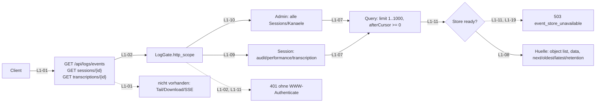
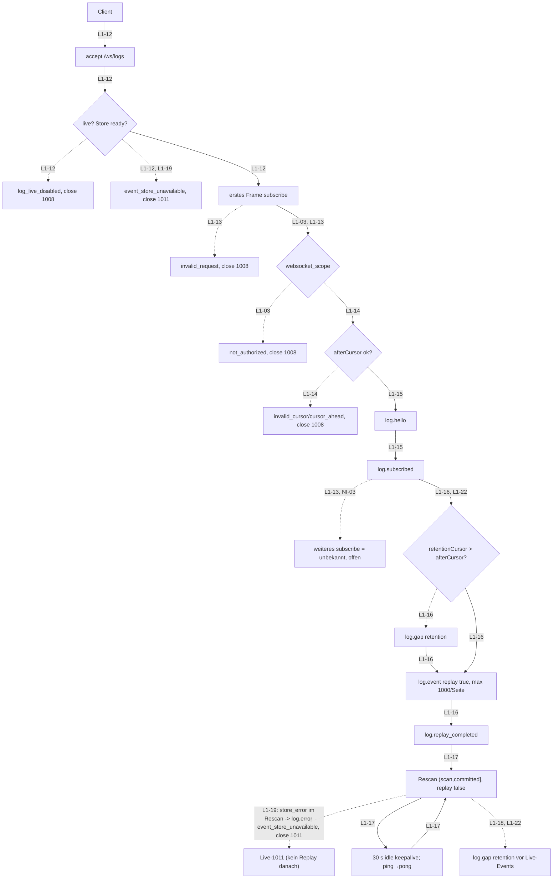

# 04.11 – Logzugriff

*Status: INTEGRATED (intern abgenommen) – externe ROOT-Freigabe ausstehend. Codebasis: Commit `a8993c5c68042d996eab680d84a5b138a214bb5d`. Faktenbasis: `workflow/research/04.11.json` (L1-01…L1-24, NI-01…NI-06, U1…U4, C1…C18).*

**Abgrenzung:** Eigener Log-Kanal: HTTP-Historie (drei Routen) + Live-Stream (/ws/logs). Kein V2-Event-Wire – dort keine log.*-Frames (NI-06); V2-Handshake nur logAccess-Bootstrap (§8). Landkarte [04.01](04.01-schnittstellenuebersicht.md), HTTP-Rahmen [04.02](04.02-http-grundlagen.md), V2-Wire [04.03](04.03-websocket-v2.md). Auth [05.05](../05-administration/05.05-log-authentifizierung.md); Routenliste [08.04](../08-referenzen/08.04-api-endpunkt-katalog.md).

## 1. Worum geht es?

Ereignisprotokoll mit global monotonem Cursor in einem Store, lesbar über eigenen Kanal (nichts mit V2-Wire):

- **Historie** – drei GET /api/logs/…: „Was ist passiert?“ stabile JSON-Hülle (L1-01, L1-08).
- **Live** – eine WS /ws/logs: „Was passiert ab jetzt?“ Abo mit Replay + Mitlesen (L1-01, L1-13, L1-16, L1-17).

Gleicher Store/gleiche Ordnung; anderes Zugriffsmodell: Historie abgeschlossene Anfrage + Status; Live langlebige Verbindung + Rahmen/Closes.

Drei Abgrenzungen: 1) V2-Wire keine Log-Ereignisse; Handshake nur logAccess-Objekt (L1-05, NI-06). Alte Audit-Behauptung „/ws/v2 liefere keinen logAccess“ falsch – Code Autorität (C1). 2) /api/logging = Config (Admin), keine Historie (L1-01, L1-24). 3) Historie tolerant, Live streng mit Close (L1-07 vs L1-14).

Praxis: Historie ohne Audio-Session lesbar; Client nach Reconnect ab Cursor (solange nicht pruned). Gap = wichtigste Semantik.

| Dimension | Historie (HTTP) | Live (WS) |
|---|---|---|
| Einstieg | GET events/sessions/{id}/transcriptions/{id} (L1-01) | WS /ws/logs (L1-01, L1-12) |
| Auth | Admin-Key, Loopback-ohne-Key (nur ohne gesetzten Key), Log-Token (L1-02) | Token/Admin-Key, **kein** Loopback-ohne-Key (L1-03) |
| Startpunkt | afterCursor Default 0 (L1-07) | subscribe afterCursor; 0 = ab ältestem (L1-14) |
| Seiten | limit Default 200, 1..1000 (L1-07) | 1000/Seite (L1-16, L1-17) |
| Gap-Signal | kein Frame; retentionCursor im Umschlag (L1-08) | log.gap retention (L1-16, L1-18) |
| Ende | leere Seite nextCursor null – kein Endsignal (L1-08) | Close 1008/1011 oder Abbruch; kein unsubscribe (L1-12, NI-03) |

## 2. Das Wesentliche auf einen Blick

- **Drei HTTP + ein WS** + Config-Route /api/logging; kein Sammel/Tail/Export/Download (L1-01, NI-05).
- **Ein Store, ein Cursor:** SQLite global monoton; latest stabil nach Löschung (L1-20, L1-21).
- **Zwei Familien:** Admin (Key/Loopback-ohne-Key nur ohne gesetzten Key) + Session-Token; HTTP beide, WS nur Token/Key (L1-02, L1-03).
- **Log-Token:** 64 Hex, 24 h, nur Prozess, eine Session, kein Widerruf (L1-04, NI-01, NI-02).
- **HTTP-Hülle stabil:** object/data/nextCursor/oldest/latest/retention/authorizationScope/allSessions/deliveryMode (L1-08).
- **WS:** subscribe → hello → subscribed → gap? → Replay 1000er → replay_completed → Live-Rescan (L1-13…L1-17).
- **Live kein Push:** payload-freier Wakeup → Rescan; verlorene Wakeups harmlos (L1-17).
- **Zwei Queues:** Abo-Queue `1000` vs Event-Log-Queue `10000` (L1-17, L1-24). **Zwei 30-s-Werte, verschiedene Dinge:** Keepalive `30 s` (L1-17) vs SQLite-`busy_timeout 30 s` (L1-20).
- **Zustand statt Vermutung:** available nur ready; Read heilt Write nicht (L1-19).
- **Retention Gaps:** Defaults alle 0 = unbegrenzt; positiv löscht (L1-22).

### HTTP-Weg



Lesart: Route (L1-01) → Gate Admin/Session oder 401 (L1-02, L1-11) → Scope (L1-09, L1-10) → Query klemmen (L1-07) → Store bereit? 503 (L1-11) → Hülle+Daten+4 Cursor (L1-08). Gestrichelt nicht existent (L1-01, NI-05). 401 schmucklos: kein code/Auth (L1-02, L1-11).

### WS-Weg



Lesart: accept dann prüfen; Client ohne Frame geschlossen möglich (L1-12). 1008 Policy, 1011 Daten (L1-12, L1-19). Erstes Frame subscribe sonst invalid_request/1008 (L1-13). Scope Token/Key (L1-03). Cursor validiert (L1-14). hello → subscribed (L1-15). Gap? Replay 1000er bis eingefrorenem latest → completed → Rescan (L1-16, L1-17). Keepalive; 1011 beendet (L1-19). Gestrichelt: zweites subscribe unbekannt (L1-13, NI-03).

Textlich: HTTP (1) Route → (2) Gate → (3) Scope → (4) Query → (5) Store → (6) Hülle/401/503/400 (L1-01/02/07/08/11). WS (1) accept → (2) live/Store → (3) subscribe → (4) Scope → (5) Cursor → (6) hello → (7) subscribed → (8) gap? → (9) Replay → (10) completed → (11) Rescan+Keepalive (L1-12…L1-17).

## 3. Routen und Historie

### 3.1 Drei Routen, ein Kern

GET /api/logs/events, /sessions/{id}, /transcriptions/{transcription_id} (L1-01). Drei Adressierungen eines Kerns: Pfad = Ausschnitt, Query = Filter. Gleiche Hülle, deliveryMode sqlite_first (L1-08). Kein Export/Tail/SSE (L1-01, NI-05).

### 3.2 Query/Defaults/Klemmung

sessionId/channels/events/transcriptionId/from/to/afterCursor/limit (L1-07). channels/events Komma-Listen getrimmt/leer-verworfen (L1-07). afterCursor=0, limit=200 Default (L1-07). Store: limit 1..1000 (negativer limit → 1), afterCursor>=0 (negativ→0 still) (L1-07). Nicht-numerisch → ValueError → 400 (L1-07, L1-11). from/to ISO-String-Vergleiche (L1-07). Tolerante Seite; WS streng (negativ→Fehler+Close, L1-14). Nicht gleiche Logik behandeln.

### 3.3 Hülle/Cursor

```json
{"object": "list", "data": ["…"], "nextCursor": 1042, "oldestCursor": 17, "latestCursor": 1200, "retentionCursor": 0, "authorizationScope": "admin", "allSessions": true, "deliveryMode": "sqlite_first"}
```

(Schema, Werte Beispiele.) nextCursor = letzter dieser Seite oder null – nicht latest (L1-08). latest High-Watermark stabil nach Löschung (L1-08, L1-21). oldest MIN verblieben, 0 leer (L1-08, L1-21). retention Lösch-Wasserzeichen Scope (L1-08, L1-22). Regeln: 1) null ≠ Ende (nur Seite leer). 2) retentionCursor>afterCursor = Gap-Hinweis; dazwischen gelöscht (L1-08, L1-22). authorizationScope admin|session; allSessions nur Admin ohne Filter true (L1-08, L1-10).

### 3.4 Fehler/Status

| Situation | Antwort | Beleg |
|---|---|---|
| Kein Key/Loopback/Token | 401 ohne code/Auth | L1-02, L1-11 |
| Falscher Key | 401, nicht 403 | L1-02 |
| Store weg (vor Query ohne Log; nach Query-Exception mit Log) | 503 event_store_unavailable | L1-11 |
| Typ/Wert Query | 400 roh | L1-07, L1-11 |
| afterCursor > latest | leere 200, kein Fehler | L1-11 |

Letzteres = HTTP-cursor_ahead: WS 1008, HTTP leer (L1-11 vs L1-14). 401 generisch (C5); keine Diagnose.

## 4. Auth/Tokens

### 4.1 HTTP drei Wege

LogGate.http_scope (L1-02): 1) Admin-Key X-VoiceSTT-Admin-Key/Bearer compare_digest. 2) Loopback-Admin ohne Key (127.0.0.1/::1/localhost/testclient) – nur wenn kein admin_api_key/VOICESTT_ADMIN_API_KEY gesetzt, sonst 401. 3) Token X-VoiceSTT-Log-Token/Bearer an sessionId. Kein Treffer 401 (L1-02). Falscher = 401 nicht 403 – keine Rollenantwort (C17).

### 4.2 Loopback-Asymmetrie/TestClient-Falle

WS: kein Loopback-Admin ohne Key (L1-03, C2). Kommentar historischer Vertrag. Test-Falle: TestClient = testclient-Loopback → HTTP-Historie automatisch Admin (L1-02). Grüner HTTP-Test ≠ Token-Pfad ok. WS immer Token/Key (L1-03, C6).

### 4.3 Token-Leben

issue: 64 Hex (2×uuid4), expiresAt jetzt+86400 (L1-04). Nur dict-Prozess; eine sessionId; validate Ablauf+Bindung; Aufräumen issue + ab 1024 validate. Neustart vernichtet (NI-02). Kein Widerruf/Logout/Refresh (NI-01). Kurzlebig sessiongebunden; zurückziehen = Ablauf/Neustart.

### 4.4 Scope

Token: sessionId fehlend = Token-Session; abweichend → validate → 401 (L1-09, C17). Kanäle audit/performance/transcription; Fremde still verworfen, nichts übrig → __not_authorized__ → 200 data:[] kein 403 (L1-09). system eigene Session unsichtbar (L1-09). Leer vs nicht-autorisiert ununterscheidbar (C4). Admin: ohne ID alle (allSessions true), mit genau diese; alle Kanäle/Namen; leer = kein Filter (L1-10). Form gleich, Scope admin (L1-08, L1-10).

## 5. WS-Ablauf

### 5.1 Annahme vor Prüfung

accept, dann (L1-12): live aus → log_live_disabled + 1008; Store nicht ready → event_store_unavailable + 1011. Vor subscribe; Client ohne Frame geschlossen möglich. 1008 Policy, 1011 Daten (L1-12, L1-19).

### 5.2 subscribe

Erstes Frame JSON {type:subscribe, accessToken, sessionId?, channels[], afterCursor?} (L1-13). Verstoß → invalid_request + 1008 (L1-13). Admin-Key alternativ; kein Loopback (L1-03). Admin ohne channels → leeres Set, allChannels true; Nicht-Admin ohne channels → Default {audit, performance, transcription}. Nicht-numerisches afterCursor → invalid_request (nicht invalid_cursor). Nur ein Abo/Socket: weiteres subscribe/unbekannt → log.error ohne code, offen (L1-13, NI-03). Kein unsubscribe/resubscribe (NI-03).

### 5.3 Cursor

negativ → invalid_cursor + 1008; >latest → cursor_ahead + afterCursor/latestCursor/serverInstanceId + 1008; 0 = ab ältestem (Gap gemeldet, L1-14). cursor_ahead mit Vergleichswerten: Cursor nur mit serverInstanceId interpretierbar (L1-21).

### 5.4 hello/subscribed

hello: schemaVersion 1, logProtocolVersion 2, deliveryMode sqlite_first, replayAvailable true hart, serverInstanceId, oldest/latest/retention (L1-15). subscribed: channels sortiert, sessionId, afterCursor, authorizationScope, allChannels, allSessions (L1-15). Erst subscribed = angewandte Filter/Scope. hello.replayAvailable hart true; logAccess abgeleitet (C3, L1-06, L1-15). logProtocolVersion 2 ≠ WS-v2 (C15; 04.02 §3.4).

## 6. Replay/Live/Keepalive

### 6.1 Replay

retentionCursor>afterCursor zuerst log.gap retention mit lostFromCursor/lostToCursor/oldestCursor/latestCursor (L1-16). Dann log.event replay:true 1000er-Seiten bis eingefrorenem latest, dann completed cursor:latestCursor count (L1-16). Eingefroren: langes Replay jagt nicht wanderndem latest; Neues via Rescan. Test 1005/zwei Seiten (L1-16). afterCursor 0 bereinigt: ab ältestem + Gap (L1-14, L1-16).

### 6.2 Live-Rescan/kein Push

Indirekt (L1-17): 1) Ereignis SQLite commit. 2) Wakeup Control. 3) Wakeup payload-frei. 4) latest/retention neu, Events (scan,committed] 1000er replay:false. 5) scan=committed. Wakeup verlierbar: Rescan findet seit scan (L1-17). Nach Commit: kein Ereignis vor Persistenz (L1-17). Abo-Queue 1000: normale Wakeups bei vollem Puffer verworfen, nur store_error verdrängt den ältesten Eintrag (L1-17). Kein Backpressure-Signal (U2). Event-Queue 10000 = Aufnahme, nicht Abo (L1-24).

### 6.3 Keepalive

30 s Leerlauf → keepalive; ping → pong (L1-17). Kein aktiver Ping/Idle-Abbau (NI-04). Keepalive hält, kein Heartbeat-Vertrag.

### 6.4 Retention live

Wasserzeichen vor scan → log.gap retention (lostFromCursor/lostToCursor/oldestCursor/latestCursor) vor neuen Events (L1-18). Gefilterte Kanäle/Session, nicht global (L1-18, L1-22). Nur-transcription-Abo sieht keinen request-Gap.

## 7. Store/Retention/Sanitizer/Config

### 7.1 Drei Zustände

disabled/ready/degraded; available nur ready (L1-19). Read heilt Write nicht; erst Append-Commit → ready. degraded → store_error; offene WS 1011. ready→recovered → Rescan. available:false keine Einzellesbarkeits-Aussage. disabled + Historie = 503 (L1-11, L1-19, C10, C11).

### 7.2 SQLite

<data_root>/logs/voicestt-events.sqlite3 (sonst logs/…), WAL, synchronous NORMAL, busy 30 s, check_same_thread False (L1-20). events(cursor PK AUTOINCREMENT, event_id UNIQUE, timestamp, channel, event_name, severity, server_instance_id, transport, client_id, session_id, request_id, transcription_id, segment_id, payload_json) + 6 Indizes; retention_watermarks(channel, session_id, cursor) (L1-20).

### 7.3 Cursor

Global monoton alle Kanäle/Sessions (L1-21). latest = MAX(MAX(cursor), sqlite_sequence.seq), stabil nach Löschung (L1-21). oldest MIN verblieben, 0 leer (L1-21). retention MAX gefiltert (L1-21). Nur mit serverInstanceId/Wasserzeichen interpretierbar (L1-21). Fremde Instanz = cursor_ahead (L1-14, L1-21). 0 = leer, nicht Anfang; bei unbereitem Store Zahlen unbelastbar (L1-11, L1-19, C18).

### 7.4 Retention/Prune

Pro Kanal Tage: audit (Setting request_*), performance, transcription, system (Setting system_event_*) (L1-22). Alle 0 = unbegrenzt; 0/negativ nichts (L1-22). Prune ≤1×/UTC-Tag beim ersten Append (L1-22). Löscht timestamp<now-days (L1-22). Pro (channel,session) MAX entfernter Cursor monoton watermarks; exakter Gap (L1-22). Pause → log.gap Grenzen (L1-16, L1-22).

### 7.5 Sanitizer

Vor Schreiben (L1-23): u.a. apiKey/authorization/cookie/credential/password/privateKey/secret/token verworfen (Beispiele, keine abschließende Liste); Audio-Rohfelder/Query-Strings verworfen; Bearer-/secret=... → [REDACTED]. Transkripte transcript_log_mode: none nie, final nur transcription.completed-Events, full nur Transkription; performance immer verworfen. Admin-Key nicht Historie (Test). Vor-Schreiben: Datei = redigiert wie API (L1-23).

### 7.6 Config/Health

Defaults event_store_enabled true, log_live_enabled true, event_log_queue_size 10000 (L1-24). CLI --[no-]event-store/--log-live/--event-log-queue-size (L1-24). live true + store false = Start-ValueError, Laufzeit invalid_dependency (L1-24). Store startup-only, Live active_runtime (L1-24). GET/PUT /api/logging (Admin) liveEnabled/replayAvailable/eventStore (L1-01, L1-24). /health eventStore; ok false wenn Live aktiv + Store weg (L1-24).

## 8. logAccess-Bootstrap

### 8.1 Wo

create_log_access(session_id) pro akzeptierter Verbindung (L1-05): V1 hello.logAccess; V2 hello.accepted.logAccess neben snapshot. V2 keine log.*-Frames; Bootstrap, nicht Resync (L1-05). V2-Kanal aus Handshake öffnen, nicht Event-Strom.

### 8.2 Felder

Immer: available, websocketPath /ws/logs, historyPath /api/logs/events, sessionId, logProtocolVersion 2, deliveryMode sqlite_first, replayAvailable, serverInstanceId, oldest/latestCursor (L1-06). available = live AND store.available. false → kein Token/expiresAt, sondern code log_live_disabled (Live aus) / event_store_unavailable (Store weg) + reason; replayAvailable/Cursor trotzdem (L1-06).

### 8.3 false ≠ gesperrt

available:false keine Sperr-Aussage (C13). HTTP-Historie ggf. Admin lesbar; 503 nur Store-weg (L1-06, L1-11). Token nur bei true – Session-Client dann nicht erreichbar. replayAvailable true trotz live-aus möglich (C14).

## 9. Grenzen

### 9.1 NI

| ID | Grenze |
|---|---|
| NI-01 | Kein Widerruf/Logout/Refresh; bis 24 h/Neustart (L1-04) |
| NI-02 | Keine Persistenz; Neustart vernichtet (L1-04) |
| NI-03 | Kein un-/re-subscribe; ein Abo/Socket (L1-13) |
| NI-04 | Kein Ping/Idle-Abbau; nur keepalive 30 s (L1-17) |
| NI-05 | Kein SSE/Streaming/Export/Download (L1-01) |
| NI-06 | Keine Log-Events V2-Wire; nur /ws/logs (L1-05) |

### 9.2 U

| ID | Offen |
|---|---|
| U1 | subscribe-Framegroesse/WS-Schutz nicht erkennbar |
| U2 | Abonnenten/Senden blockierend: 1000, kein Backpressure; ungetestet |
| U3 | Mehrprozess gleiche SQLite (busy 30 s) ungetestet |
| U4 | Token nach Sitzungsende: nur Ablauf/ID, nicht Existenz |

### 9.3 C1–C18

C1 Audit-Berichte vs Code logAccess V2. C2 Loopback-Asymmetrie. C3 replayAvailable hart/abgeleitet; sessionId erst subscribed. C4 system unsichtbar; leer vs nicht-autorisiert gleich. C5 Codes inkonsistent. C6 TestClient-Falle. C7 1008 vs 1011. C8 __not_authorized__ Filter/200. C9 (siehe C3). C10 lesbar≠verfügbar. C11 disabled→503. C12 HTTP kein Gap. C13 false≠gesperrt. C14 replay trotz live-aus. C15 logProtocol≠WS-v2. C16 Mirror nur nach Commit. C17 Fremd-ID 401 nicht 403. C18 Cursor/Lesefehler 0/degraded.

## 10. Siehe auch und Nachweise

L1-01 Routen/WS/Config · L1-02 Gate-HTTP/401 · L1-03 WS-kein-Loopback/not_authorized · L1-04 Token 64Hex/24h/Speicher/Bindung · L1-05 hello/hello.accepted/kein-V2-Wire · L1-06 Felder/available/Codes · L1-07 Query/Defaults/Klemmung · L1-08 Hülle/Cursor/Scopes · L1-09 Session-Scope/Beschnitt/__not_authorized__ · L1-10 Admin-Scope · L1-11 401/503/400/leere-200 · L1-12 accept-vorher/1008/1011 · L1-13 subscribe/invalid_request/ein-Abo · L1-14 Cursor invalid/ahead/0 · L1-15 hello/subscribed · L1-16 Gap/Replay-1000/completed/1005 · L1-17 Rescan/Wake/Queue/Keepalive/ping-pong · L1-18 live-Gap gefiltert · L1-19 ready/degraded/1011/Rescan · L1-20 SQLite/WAL/Indizes/Watermarks · L1-21 global-monoton/latest-stabil/Interpretation · L1-22 Retention-Tage/0/Prune/Wasserzeichen · L1-23 Sanitizer/Modi/Admin-Key-fehlt · L1-24 Defaults/CLI/ungültig/startup-only/Health. NI/U/C §9.

Verwandt: [04.01](04.01-schnittstellenuebersicht.md) · [04.02](04.02-http-grundlagen.md) · [04.03](04.03-websocket-v2.md) · [04.06](04.06-eventtransport.md) · [04.08](04.08-reconnect.md) · [05.05](../05-administration/05.05-log-authentifizierung.md) · [05.10](../05-administration/05.10-fehler-zugriffsantworten.md) · [08.04](../08-referenzen/08.04-api-endpunkt-katalog.md).

Intern unabhängig geprüft und integriert; externe ROOT-Freigabe ausstehend.
