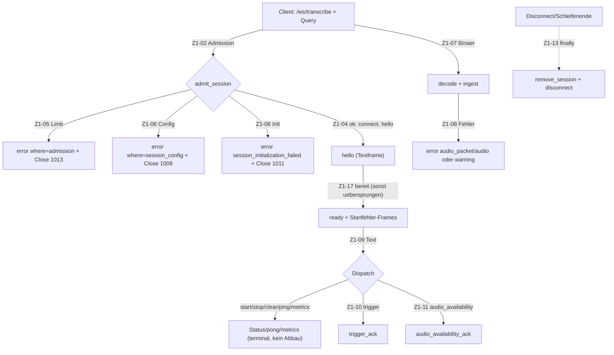

# 04.12 – Legacy V1

*Status: INTEGRATED (intern abgenommen) – externe ROOT-Freigabe ausstehend. Codebasis: Commit `a8993c5c68042d996eab680d84a5b138a214bb5d`. Faktenbasis: `workflow/research/04.12.json` (Z1-01…Z1-20, N1…N5, U1…U4, C1–C2).*

**Abgrenzung:** Nur alter WebSocket-Vertrag `/ws/transcribe`. V2 [04.03](04.03-websocket-v2.md) + Folgekapitel, Audio-Rahmen [04.05](04.05-audiotransport.md), Log-Anbindung [04.11](04.11-logzugriff.md). Decoder/Log nur referenziert, nicht wiederholt.

## 1. Worum geht es?

Neben `/ws/v2` bietet der Server `/ws/transcribe` – im Code als erforderlicher Kompatibilitätspfad markiert, kein Übergang der beim Refactoring verschwindet, sondern Vertrag für ältere Browser-Clients/Bestandsfrontends (Z1-01). Alter = Form des Gesprächs:

- **Kein Handshake.** Client meldet nichts an, keine Version; Server sendet von sich aus zuerst `hello` (Z1-01, Z1-04).
- **Keine Version im Protokoll.** Weder hello noch Antworten tragen protocolVersion (Z1-01, Z1-15).
- **Keine kodierten Ablehnungen.** Aufbau: Codes 1008/1011/1013 – V2-44xx kommen nicht vor (Z1-14, N2).
- **Keine Einstellungsänderung im Kanal.** Config aus Query, hello nur Anzeige; danach schreibgeschützt (Z1-02, Z1-16).
- **Keine kanonischen UUIDs.** 32 Hex ohne Bindestriche (Z1-03).

Altclient: verbinden → hello abwarten → start → Binäraudio → Status/Timeline/Transkripte → stop/schließen. V2-Gewohnheiten (Client-hello, command.ack, sessionId im Befehl) wirkungslos/Fehler (Z1-15). Relevant: Betreiber (Leistung/Ende Altpfad), Altclient-Debug/Migration V2, kein Serverfehler aus fehlendem Feld ableiten.

## 2. Das Wesentliche auf einen Blick

Vier Abschnitte: Query-Annahme, Server-hello, Befehls-/Audioschleife, Abbau. Nur erster scheitert, immer gleich: Textfehler, dann Schließen.



Lesart: Öffnen mit Query. Annahme oder Ablehnung (Text + `where`, dann Close, Z1-05, Z1-06). Erfolg: erstes Frame hello (direkt via Socket, nach connect, Z1-04). Bereit (sonst übersprungen): ready + Startfehler (Z1-17). Dann Text-Dispatch (Z1-09, terminal) + Audio (Z1-07). Audiofehler schließen nicht (Z1-08). Abbau nur bei Disconnect/Schleifenende via finally (Z1-13).

Textlich: 1) Verbinden mit Query (ID/Wake/Aktivierung/Timings). 2) Annahme; Limit/Config/Init → Text + Close 1013/1008/1011. 3) Registrieren + hello. 4) ggf. ready + Fehler-Frames. 5) start, Binäraudio, optional trigger/audio_availability. 6) stop/schließen; finally räumt auf.

Ein Satz: verbinden → hello → start → Audio → stop; Fehler Text mit `where`, nie 44xx.

## 3. Anmeldung und hello

### 3.1 Kein Handshake, Server zuerst

Asymmetrisch: accept, registrieren, sofort hello. Keine Empfangs-/Validierungsphase, kein protocolVersion (Z1-01). Test: hello erstes Frame ohne Vorlauf (Z1-01). Regeln: nicht auf Bestätigung warten; nichts vorausschicken – Client-hello = Unbekannter Befehl (Z1-09, Z1-15).

### 3.2 Config aus Query

Alles aus Query beim Aufbau; später keine Änderung (Z1-02, Z1-16).

| Gruppe | Felder | Verhalten (Z1-02) |
|---|---|---|
| Identität | clientId | Query `clientId` oder Header `x-voicestt-client-id`, sonst `client-<uuid4hex>` generiert; gültig 1–128 Zeichen aus alnum (Unicode) + `._:-` |
| Wake-Word | wakeWordEnabled (true/false/null/inherit), Backend, Wörter, Framework, Sensitivity, Delay, Timeout, Buffer, Followup | ungültiges wakeWordEnabled KEIN Fehler: Fallback + sessionConfig.warnings |
| Aktivierung | manualTriggerEnabled, wakeWordTriggerEnabled | strikt boolesch (true/1/yes/on bzw. false/0/no/off, sonst 1008 invalid_activation_flag); im kontrollierten Modus nicht beide false (Z1-02, Z1-06) |
| Timings | sechs floats | 0,01–3600 |
| Allgemein | doppelte Parameter | Fehler |

Query = Vertrag; ändern = neu verbinden (Z1-16). Nachsicht wakeWordEnabled Absicht (Tippfehler sperrt nicht aus; Hinweis in Warnungen, keine Ablehnung). Duplikate nur bei wakeWordEnabled=true hart (sonst letzter Wert/ignoriert).

### 3.3 32-Hex-IDs

uuid4().hex: 32 Zeichen, keine Bindestriche, keine kanonische Form (Z1-03). UUID-mit-Bindestrich-Prüfung hält jede gültige V1-Sitzung für ungültig. ID überall Bezug (hello/Status/Timeline/Fehler).

### 3.4 hello-Feldsatz exakt

Reihenfolge: manager.connect (accept) → Audit session.accepted → create_log_access → EIN Textframe type:hello (Z1-04):

```json
{"type": "hello", "clientId": "<id>", "sessionId": "<32-hex>", "settings": {}, "sessionConfig": {}, "activationConfig": {}, "sessionCapabilities": {}, "limits": {}, "supportedEngines": [], "runtimeSettings": {}, "logAccess": {}}
```

Schlüsselmenge/Reihenfolge belegt (Z1-04); innere Objekte gekürzt (eigene Kapitel). Stolperstellen: Schlüssel heißt sessionCapabilities, NICHT capabilities (Z1-04, C2). Kein protocolVersion (Z1-01, Z1-15). logAccess = Zugangsbeschreibung (/ws/logs, /api/logs/events, sessionId, logProtocolVersion 2, sqlite_first, Cursors; [04.11](04.11-logzugriff.md), Z1-04). hello direkt via Socket (nicht via publish_session), aber erst nach manager.connect (registriert) = garantiert erstes Frame (Z1-04, Z1-13).

## 4. Limits/Fehler beim Aufbau

Gleiche Muster: akzeptiert, lesbarer Textframe, dann Close. Kein nacktes Close (Z1-05, Z1-06).

| Situation | Frame | Close | Beleg |
|---|---|---|---|
| Limit | error where:admission + Meldung + limits | 1013 | Z1-05 |
| Query/Config ungültig | error where:session_config + code/message (+field/value) | 1008 | Z1-06 |
| Init unerwartet | error where:session_config code:session_initialization_failed | 1011 | Z1-06 |
| Normaler Abschied | – | kein expliziter Close | Z1-14 |

Limit 1013: kein hello, keine Registrierung – Sitzung existiert nicht (Z1-05). „Später noch einmal“, kein Client-Fehler. Config 1008: kein sessionId (keine Domäne, Z1-06) – Meldung ausgeben, nicht ID suchen. Init 1011: Serverproblem (Z1-06). Keine 44xx V1 (Z1-14, N2). Vorbehalt: 1013-Ankunft nur Code, kein Test (U1); Frame-vor-Close über ASGI/Proxy unbelegt (U2) – Grund ggf. serverseitig protokollieren.

## 5. Audio und Befehle

### 5.1 Decoder wie V2

Binärframes exakt dieselbe decode_audio_packet wie /ws/v2 (Z1-07). Rahmen/Zulässigkeit identisch – [04.05](04.05-audiotransport.md), nicht wiederholt (Z1-07). Danach: leer → (True,None), nichts; nicht-streaming → (False, Startbefehl-Text) + rejected_audio_chunks+1; sonst feed_audio(...,16000) (Z1-07). Häufigster Altclient-Fehler: ohne start keine Verarbeitung – nur Warnung, kein Abbruch (Z1-08).

### 5.2 where-Diskriminator

Textframes; genau fünf where-Werte: admission, session_config, audio_packet, audio, command (Z1-06, Z1-08, Z1-09).

| where | Auslöser | Reaktion |
|---|---|---|
| admission | Limit | Frame + Close 1013 (Z1-05) |
| session_config | Query/Init | Frame + Close 1008/1011 (Z1-06) |
| audio_packet | AudioPacketError | Fehlerframe, weiter (Z1-08) |
| audio | sonstige Audio-Ausnahme | Fehlerframe, weiter (Z1-08) |
| command | kaputtes JSON/kein Objekt/unbekannt | Fehlerframe, weiter (Z1-08, Z1-09) |

Nur erste zwei beenden. Kaputtes Paket/Tippfehler kosten höchstens ein Frame – Vorteil vs stummes V2-Audio (Z1-08; vgl. [04.05](04.05-audiotransport.md)).

### 5.3 Vokabular

JSON-Objekte Pflicht. Liste/String/kaputt → error where=command; kaputt „Ungültiges Befehls-JSON: …“ (Z1-09).

| type | Wirkung | Antwort |
|---|---|---|
| start | streaming wahr, wakeword_wait/listening | Statusframe |
| stop | idle, Puffer behandelt, Sprecher frei | Statusframe |
| clear | Zustand leeren | – |
| ping | Lebenszeichen | pong + sessionId + serverTime float |
| metrics | Momentaufnahme | metrics + session.snapshot() |
| trigger | Aktivierung | trigger_ack (§5.4) |
| audio_availability | Verfügbarkeit | audio_availability_ack (§5.5) |
| sonst | – | error Unbekannter Befehl where=command |

Zählhinweis: Akte N3 nennt „8 Typen“, Dispatch verzweigt sieben (start/stop/clear/ping/metrics/trigger/audio_availability). Maßgeblich Code (Z1-09). V2-Mitbringsel → Unbekannter Befehl (Z1-15, N4).

Pseudocode Altclient (sinngemäß, kein Repo-Code):

```text
verbinde /ws/transcribe?clientId=...&wakeWordEnabled=true&manualTriggerEnabled=true
warte auf hello                          # erstes Frame
sende {"type": "start"}                  # ohne start wird Audio verworfen
schleife: sende Binärframes (pcm_s16le)
sende {"type": "trigger", "commandId": "c-1", ...}
erwarte genau eine trigger_ack mit c-1
sende {"type": "stop"}
schließe                             # kein Close-Handshake nötig
```

### 5.4 trigger/trigger_ack

Genau eine trigger_ack je trigger (Z1-10):

```json
{"type": "trigger_ack", "commandId": "c-1", "accepted": true, "reason": "...", "activationId": "...", "phase": "...", "sessionId": "<32-hex>"}
```

Regeln: commandId Pflicht; fehlt/ungültig → keyless (missing/invalid_command_id, ID "") – keiner Zuordnung, immer mitschicken (Z1-10). Gültige ID immer Replay-Identität (auch abgelehnt); identisch → gespeicherte ack, gleiche ID anderer Payload → command_id_conflict wirkungslos (Cache Session, Z1-10). Ohne start: accepted false reason stream_not_started – reguläres Ack, kein error (Z1-10). pro Vorgang stabile ID; Retry gleiche ID gefahrlos, neue ID zweiter Vorgang.

### 5.5 audio_availability/ack

Muss bool (Z1-11):

```json
{"type": "audio_availability_ack", "commandId": "a-1", "accepted": true, "reason": "applied", "audioAvailable": false, "activationId": "...", "phase": "...", "sessionId": "<32-hex>"}
```

Gründe applied/no_change/Identitätsfehler (Z1-11). false kann offene Aktivierung via Publikationsbarriere wie Cancel schließen (Z1-11). Feld audioAvailable, nie causedByCommandId (Z1-11).

## 6. Vokabular/extend

Exakt vier Aktionen, zwei Quellen (Z1-12): activate/refresh/finish/cancel; manual/wake_word. extend NICHT implementiert → invalid_action (Z1-12, N5). Docstring „extend normalised to refresh“ vs Code (trim/lower) + Test Ablehnung → Code gilt (Z1-12, C1). Verlängern = refresh, nicht extend.

## 7. Manager/ready/Capabilities/nur-Text/kein-Subprotokoll

### 7.1 Manager Verteilstelle

Jede V1-Session genau einmal unter session_id; alles Publizierte (Status/Timeline/Transkripte/Acks) darüber. hello einziges direktes Frame (nach manager.connect registriert, aber direkt via Socket, nicht via publish). Fehler beim Senden → Selbstabmeldung; fremde Threads via run_coroutine_threadsafe an Schleife. finally: entfernen + abmelden (Z1-13). Status/Timeline kanalunabhängig gleich.

### 7.2 ready/Startfehler

Bereit → nach hello type:ready (sessionId/settings/sessionConfig/activationConfig/sessionCapabilities/limits/runtimeSettings/ok/models), dann je Startfehler ein Frame (Z1-17). Noch nicht bereit → entfallen; Zustand später via Status/Events (Z1-17). ready nicht Pflichtframe; Fehlen ≠ kaputt.

### 7.3 sessionCapabilities verspricht Implementiertes

WakeWord supported/backends [openwakeword]/availableWakeWords/queryParameters; activationTriggers supported true/version 2/sources/actions/commandType trigger/ackType trigger_ack/commandIdRequired true/commandIdIdempotent true/commandHistory session/activationIdValidated true/audioAvailabilityCommandType audio_availability + Ack/queryParameters (=Felder)/activationEvents [started, refreshed, closed, watchdog.warning] (Z1-18). Gekoppelt an Z1-10/11/12; keine deprecatedAliase/retiredQueryParameters (Z1-18). Selbstauskunft V1-verlässlich.

### 7.4 Nur Text

Server→Client nur JSON-Text inkl. Fehler/Warnungen; Binär nur Client→Server (Audio). Kein send_bytes/send_json; send_text bzw. Manager (Z1-19). Empfang nur Text parsen; binäre Antworten gibt es nicht.

### 7.5 Kein Subprotokoll

Keine Sec-WebSocket-Protocol-Aushandlung (Grep Server+Tests ohne Treffer); pfadbasiert /ws/transcribe V1 vs /ws/v2 (Z1-20). Angebot ändert nichts; Warten darauf blockiert selbst.

## 8. Abgrenzung V2

Kurzfassung; V2 [04.03](04.03-websocket-v2.md)/[04.04](04.04-commands-acknowledgements.md), Migration [09.04](../09-anhaenge/09.04-client-migration.md).

| Aspekt | V1 /ws/transcribe | V2 /ws/v2 |
|---|---|---|
| Erstes Frame | Server-hello | Client-hello → hello.accepted |
| Version | keine protocolVersion | Version 2 |
| Session-ID | 32 Hex | kanonische UUID |
| Quittungen | trigger_ack, audio_availability_ack | command.ack + Events |
| Settings ändern | nein, lesend hello | session_settings.patch |
| Audio-Verfügbarkeit | audio_availability | audio_availability.set |
| Suppression | nicht vorhanden | trigger_suppression.set |
| Snapshot | nicht vorhanden | session.snapshot.request |
| Fehlercodes | 1008/1011/1013 | 4400/4406/4408/4409 |
| Rückkanal | status + timeline | Events eventSeq/stateVersion |
| Manager | ja | bewusst nicht |
| Subprotokoll | keins | keins |

V2-Nachrichten auf V1 unbekannt: hello.accepted/command.ack/session_settings.patch/audio_availability.set/trigger_suppression.set/session.snapshot.request → Unbekannter Befehl (Z1-15, N4). Mitgesendete sessionId/protocolVersion wirkungslos (Antwort V1-ID). Keine V1-Antwort mit protocolVersion (Z1-15). Rückkanal status/timeline (type timeline, event activation.started…), kein eventSeq/stateVersion (Z1-15). Settings schreibgeschützt; HTTP-Config siehe [03.06](../03-konfiguration/03.06-server-einstellungen.md); Patch-Funktion nur V2 (Z1-16, N3). Registrierung: V1 Manager, V2 bewusst nicht (Z1-13).

## 9. Grenzen

### 9.1 N1–N5

| ID | Fehlt | Folge |
|---|---|---|
| N1 | Handshake/hello.accepted/Version | nichts anmelden/wählen (Z1-01) |
| N2 | 44xx | nur 1008/1011/1013; V2-Codes nicht zur Diagnose (Z1-14) |
| N3 | session_settings.patch/settings-Befehl | nur Aufbau; Reconnect (Z1-16) |
| N4 | suppression/snapshot/command.ack/audio_availability.set | Unbekannter Befehl (Z1-15) |
| N5 | extend/Alias | invalid_action (Z1-12) |

### 9.2 U1–U4

U1: 1013-Ankunft nur Code, kein Test (nur Frame getestet). U2: Frame-vor-Close über ASGI/Proxy unbelegt. U3: Doppel-start kein Fehlerpfad, nur Status; keine Idempotenz-Zusage. U4: maxSessions inkl. Reservierungen nebenläufig unbelegt. Keine Vertragsmerkmale; nicht darauf bauen.

### 9.3 C1–C2

C1: Docstring extend-normalisiert vs Code/Test invalid_action → Code (Z1-12). C2: Auftrag „capabilities“ real sessionCapabilities (kein capabilities-Feld); V2 „settings.patch“ real session_settings.patch (Z1-04, Z1-15).

## 10. Siehe auch und Nachweise

Weiter: [04.01](04.01-schnittstellenuebersicht.md) · [04.03](04.03-websocket-v2.md) · [04.04](04.04-commands-acknowledgements.md) · [04.05](04.05-audiotransport.md) · [04.11](04.11-logzugriff.md) · [04.13](04.13-integrationsbeispiele.md) · [09.04](../09-anhaenge/09.04-client-migration.md) · [03.06](../03-konfiguration/03.06-server-einstellungen.md).

Fakten Z1-01..Z1-20, Commit a8993c5c: Aufbau Z1-01..Z1-04 · Fehler Z1-05/Z1-06/Z1-14 · Audio/Befehle Z1-07..Z1-11 · Vokabular Z1-12 · Betrieb Z1-13/Z1-17..Z1-20 · Abgrenzung Z1-14..Z1-16. Grenzen N/U/C §9.

Intern unabhängig geprüft und integriert; externe ROOT-Freigabe ausstehend.
