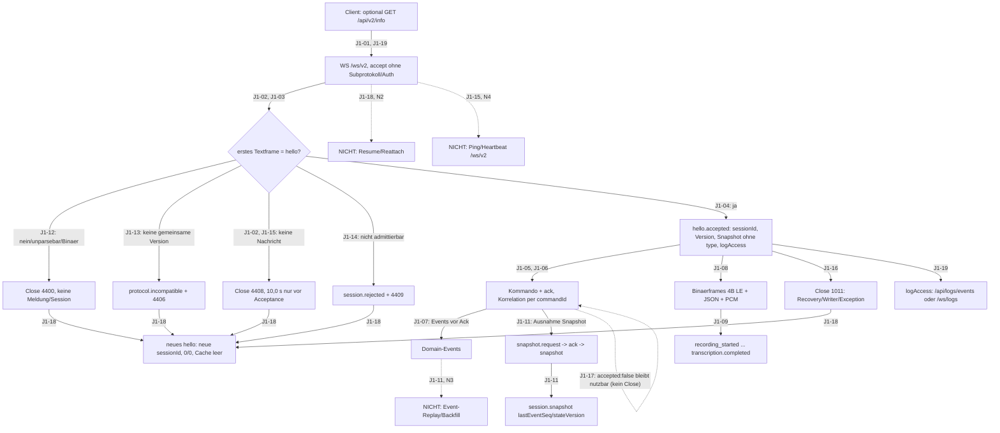

# 04.13 – Integrationsbeispiele

*Status: INTEGRATED (intern abgenommen) – externe ROOT-Freigabe ausstehend. Codebasis: Commit `a8993c5c68042d996eab680d84a5b138a214bb5d`. Faktenbasis: `workflow/research/04.13.json` (J1-01…J1-21, N1…N7, U1…U6, C1…C6).*

**Abgrenzung:** Vollständiger V2-Ablauf als Beispielkette; Details in [04.03](04.03-websocket-v2.md), [04.04](04.04-commands-acknowledgements.md), [04.05](04.05-audiotransport.md), [04.06](04.06-eventtransport.md), [04.07](04.07-snapshot-synchronisierung.md), [04.08](04.08-reconnect.md), [04.09](04.09-client-zustandsmodell.md), [04.11](04.11-logzugriff.md), [04.12](04.12-legacy-v1.md).

> **Wichtig:** Kein Client/SDK/Beispielcode im Repo (N1). Alle Blöcke schematisch mit Platzhaltern – keine SDK-Aufrufe, keine erfundenen Bibliotheken. Einzige reale Payload-Formen: Vertragsvektoren (J1-20); IDs illustrativ, nicht als echte Werte.

## 1. Worum geht es

V2-Client = Protokoll-Zustandsautomat. Kette: 1) optional Serverkontext, 2) /ws/v2 + hello, 3) hello.accepted (einzige Identitäts-/Token-Quelle), 4) Kommandos + ack per commandId, 5) Audio-Binärframes, 6) Events vor/nach Acks, 7) snapshot.request bei Bedarf, 8) Fehler 4400/4406/4408/4409/1011, 9) Neuaufbau statt Fortsetzung, 10) Logs separat wiederanlauffähig.

Eine Kette: Aufnahme → Transkript terminal → Reparatur/Log. Happy Path §§3-8; Fehler §§9-10; Logs §10.2. Payload-Formen = Vektoren (J1-20): hello_v2, manual_activate (+Replay), refresh_active_activation, activation_started_event, transcription_interim_event, idle_snapshot, wake_enabled_without_selection, client_claims_wake_word, activate_with_activation_id, refresh_without_activation_id, command_id_conflict. IDs Platzhalter, Tests binden lebend (_bind, J1-20).

## 2. Überblick

Landkarte (keine Sequenz): Wege, Enden, Nicht-Existentes (gestrichelt). Kanten J1-IDs.



Hauptpfad: accept → hello → accepted. Parallel: Kommandos/Acks, Audio (ohne Antwort), Events (dürfen vor Acks). Fehler vor Acceptance enden ohne Session; einziger serverinitiierter danach = 1011. Gestrichelt = Nicht-Funktionen (kein Resume/Replay/Heartbeat).

Kette: info (optional) → accept → hello → accepted {sessionId, Version, snapshot, logAccess} → activation.command → started (ggf. VOR ack) + ack applied → PCM → recording_started → interim (ohne Versionsanstieg) → finish → ack + input_closed → accepted/completed → Terminal completed|cancelled|failed → snapshot.request → ack → snapshot → logAccess → logs.

Zustandsmodell: drei Basen sessionId/lastEventSeq/stateVersion. Verloren → neuer Snapshot (Abschnitt 8) oder neue Session (Abschnitt 10).

## 3. Verbinden und Handshake

### 3.1 Route/Annahme

Eigne Route; weder /ws/transcribe (V1, [04.12](04.12-legacy-v1.md)) noch /ws/logs ([04.11](04.11-logzugriff.md)). Accept sofort, ohne Subprotokoll/Auth (J1-01). clientId optional (?clientId/Header), nur Metadatum, keine Identität (J1-01). Direkt senden; kein Sec-WebSocket-Protocol. Server nur Textframes kompaktes JSON; Client Text oder Binär (J1-01). Ein Writer + Queue: Erzeugungsreihenfolge = Ankunftsreihenfolge (J1-01, §5-Grundlage).

### 3.2 Sechs Ausgänge

Reihenfolge Hülle → Version → Session (J1-02).

| Ausgang | Empfang | Close | Session? |
|---|---|---|---|
| Erfolg | hello.accepted | – | ja |
| inkompatibel | protocol.incompatible | 4406 | nein |
| abgelehnt | session.rejected | 4409 | nein |
| Hülle/Format falsch | keine Nachricht | 4400 | nein |
| kein hello Frist | keine Nachricht | 4408 | nein |
| Admission-Fehler | keine Nachricht | 1011 | nein (Abbau) |

4400/4408/Admission-1011 senden nichts – nur Code. Keine Reason-Texte (N5); nicht auf Sätze warten.

### 3.3 hello-Regeln

hello erstes+einziges Vor-Accept-Kommando (J1-03): anderes erstes Textframe (auch activation.command) → 4400; unparsebar → 4400; Binärframe → 4400; zweites hello nach Acceptance wirkungslos (kein Ack/Version, J1-03).

```text
hello = {"type": "hello", "supportedProtocolVersions": [<Versionen>], "clientRunId": "<kanonische UUID4>", ...}
send_text(hello)
```

hello ohne protocolVersion; verhandelt via supportedProtocolVersions (J1-05). Leere/falsch-typisierte Liste = 4400, nicht 4406 (J1-13).

### 3.4 hello.accepted

Einzige Identitäts-/Token-Quelle (J1-04): protocolVersion, sessionId (nicht wählbar), serverVersion/serverCommit, Snapshot ohne type, logAccess. clientRunId nicht gespiegelt (J1-04). available:false → kein accessToken, sondern code (J1-04). Beides behandeln: Kanal da oder begründet nicht.

## 4. Kommandos/Acks

### 4.1 Hülle

```json
{"type": "<einer der fünf Typen>", "protocolVersion": 2, "sessionId": "<aktuelle>", "commandId": "<kanonische UUID4, 36, Bindestriche, lowercase>"}
```

Streng vor Ausführung: Version exakt 2 (bool zählt nicht); sessionId kanonisch+aktuell; commandId kanonisch (J1-05). Falsch/nicht-kanonisch/Feld → invalid_payload; fremd-gültig → stale_session (wirkungslos, Ack aktuelle ID); nicht-kanonische ID → gar keine Antwort (gefährlichste Falle, J1-05); unbekannter type still ignoriert (J1-05). Fünf Typen Details [04.04](04.04-commands-acknowledgements.md); erkennbar → genau ein Ack.

### 4.2 Korrelation commandId

Nach commandId, nie Position (J1-06): jedes erkennbare Kommando genau eine command.ack gleiche ID – auch abgelehnt/Replay (wortgleich inkl. alter Version). Parallel gleiche ID → identische Acks, eine Wirkung. Filtern (type==command.ack && commandId==X); nicht nächste-Nachricht-annehmen.

```text
offen = {}
sende_kommando(cmd): offen[cmd.commandId] = cmd; send_text(cmd)
schleife: msg = lies_textframe()
  wenn ack && ID in offen: verarbeite_ack(pop, msg)
  sonst: verarbeite_event_oder_snapshot(msg)
```

Ack = Antwort + Version/Revision (J1-09). Ablehnung schließt nicht (Abschnitt 9.3).

## 5. Events-vor-Ack, Snapshot-nach-Ack

Zwei Regeln (J1-07, J1-11): Regel A Domain: Events können VOR zugehörigem Ack eintreffen (publiziert während Ausführung, Ack danach Connection-Schicht). activation.started (phase_changed/input_closed) VOR command.ack derselben ID möglich (J1-07). Queue/Writer = harte Ordnung, kein Zufall. Ausnahme Snapshot: erst ack, dann session.snapshot (J1-11).

```text
activation.started   <- Event
command.ack           <- Ack derselben ID
session.snapshot.request -> ack applied -> snapshot (mit type)
```

Client: Ereignis-Schleife mischt Events/Acks + Pending-Tabelle pro commandId. Nie „senden, eine Antwort lesen“. Events [04.06](04.06-eventtransport.md); Zustand [04.09](04.09-client-zustandsmodell.md). Ordnung zwingend, kein dedizierter Socket-Test (U2).

## 6. Audio

### 6.1 Rahmen

Binärframe = uint32 LE Länge N + N Byte UTF-8-JSON + PCM (J1-08). Kein Magic/Version/Flags. JSON: sampleRate Pflicht positiv int; channels Default 1 (1-8, >1 gemittelt); format nur pcm_s16le (fehlt = pcm_s16le); frames optional exakt. Resample 16 kHz (J1-08).

```text
meta = utf8_json({"sampleRate": 16000, "channels": 1, "format": "pcm_s16le"})
frame = uint32_le(len(meta)) + meta + pcm_bytes
send_binary(frame)
```

### 6.2 Zeitpunkt/Fehler

Kein Startkommando V2 (Admission startet atomar); Audio ab hello.accepted (J1-08). Nie direkte Antwort. Fehler danach still: verworfen, kein Ack/Meldung/Close (J1-08). Fire-and-forget; Ankunft nur indirekt via recording_started/interim (§7). Details [04.05](04.05-audiotransport.md).

## 7. Referenz-Ablauf Aktivierung

Test-Vorlage, kein SDK (J1-09): hello → accepted → activate{source:manual} → started (waiting_first_speech, Id/Seq/Phase) + ack{applied, Id, Phase, Version, Revision} → PCM → recording_started{segmentId,Seq} → interim (ohne Versionsanstieg) → finish{activationId} → ack + input_closed{causedByCommandId} → accepted/completed (gleiche segment/activationId) → Terminal completed|cancelled|failed (aus drained).

Feldregeln: activate source manual, ohne activationId; finish/refresh/cancel kanonische activationId, source verboten; extend fehlt (J1-09). started Id/Seq/Phase; interim ohne Versionsanstieg (J1-09, J1-10); Terminale gleiche IDs (J1-09).

```text
accepted = warte("hello.accepted"); sid = accepted.sessionId  # nie setzen
log = accepted.logAccess
aid = "<kanonische UUID4>"; cid = "<frische kanonische UUID4>"
send_text({"type": "activation.command", "protocolVersion": 2, "sessionId": sid, "commandId": cid, "source": "manual"})
# Events und Ack verschraenkt lesen (J1-07); Audio parallel (Abschnitt 6)
finish_id = "<neue kanonische UUID4>"
send_text({"type": "<Finish-Typ>", "protocolVersion": 2, "sessionId": sid, "commandId": finish_id, "activationId": aid})
# danach: input_closed {causedByCommandId}, Transkriptions-Events, Terminal completed|cancelled|failed
```

Echtes completed-Socket nur Opt-in extern; Referenz, keine Garantie je Terminal (J1-09, U5).

## 8. Events lesen/Resync

### 8.1 Hülle/Zählung

18 kanonische + hello.accepted/ack/snapshot (J1-10). Hülle type/protocolVersion/sessionId/eventId/eventSeq/stateVersion/occurredAtUnixMs (J1-10, Beispiel seq 1/Version 0 Platzhalter). seq ab 1 strikt monoton lückenlos je Verbindung; Version nur sichtbar (NON_STATE: watchdog.warning, trigger_suppressed, interim) (J1-10). Legacy timeline/status/trigger_ack nie V2 (J1-10, N7).

seq = Lückenprüfung, Version = Zustandsbasis; getrennt (Interim sichtbar ohne Versionsanstieg).

### 8.2 Kein Backfill, Vollsnapshot

Kein Puffer/Replay (J1-11, N3). Vermutet Lücke/unsicher → snapshot.request frische kanonische ID → ack applied → Vollsnapshot (Version/seq/Revision/input/pending/trigger/audio/requested/effective/capabilities) (J1-11). Wiederholbar ohne Mutation; Basis = lastEventSeq/stateVersion; Events seq<=lastEventSeq verwerfen (J1-11). Kein Resume/resyncFrom (J1-11, N2). Snapshot Anker: regelmäßig nach Aufbau/Unsicherheit; kein Verlauf nötig. Details [04.07](04.07-snapshot-synchronisierung.md).

## 9. Fehleräste

### 9.1 Fünf Schließpfade

| Close | Auslöser | Empfang | Tun |
|---|---|---|---|
| 4400 | erstes Frame kein hello; unparsebar; Pflichtfeld falsch; Binär vorher | nichts | hello korrigieren; keine Meldung erwarten |
| 4406 | Hülle ok, keine Version z.B. [1,3] | incompatible + 4406 | Listen schneiden, gemeinsam neu |
| 4408 | 10,0 s kein hello | nichts | früher senden; danach keine Timeouts |
| 4409 | Hülle+Version ok, nicht admittierbar | rejected + 4409 | Ursache beheben (Config/Wake/Limit); keine halbe Session |
| 1011 | terminal/Writer/Exception | ggf. nichts | neu aufbauen (§10); Slot finally frei |

Leere Liste = 4400 Hüllenfehler, nicht 4406 (J1-13). 4409 zwei reasons: invalid_requested_session + errors[] field/code/message; session_limit_reached (C2). Codes activation_trigger_required, wake_word_* (J1-14). Keine sessionId/halbe Session.

### 9.2 Zeit danach

Vor Acceptance 10,0 s Default pro Connection → 4408 (J1-15). Danach kein Lese-Timeout/kein Ping/Heartbeat: Schleife receive() ODER Close-Signal (J1-15, N4). Halboffen nicht beendet; Erkennung Transport/Netz (U1). Keine weiteren Timeout/Backoff-Zahlen. Log-Kanal Keepalive/ping separat ([04.11](04.11-logzugriff.md)), nicht Session-Vorgabe.

### 9.3 Kommando-Fehler nie Close

invalid_payload/stale_session/stale_activation/command_id_conflict/activation_locked/not_active/invalid_phase/closing_input/trigger_suppressed/audio_unavailable/settings_revision_conflict/settings_rejected → accepted:false, nutzbar; Version/Phase unverändert (Ausnahme trigger_suppressed-Diagnose danach) (J1-17). Unparsebar/unbekannt/nicht-kanonische ID still; Audio still (J1-08, J1-17). Kein „keine Antwort = tot“.

## 10. Neuaufbau/Log

### 10.1 Neu = neu

Reconnect kein Resume (J1-18, N2): hello ohne ID/seq/Cursor → frische kanonische sessionId; Version/seq 0/0; Revision neu; Cache leer (alte ID kein Replay); Activation Teardown session_closed nicht fortsetzbar. Alte ID → stale_session aktuelle ID, wirkungslos (J1-18). Nach accepted neu ableiten, mit NEUEN IDs senden. Zu früh bei Limit → 4409 session_limit_reached (J1-18).

```text
hello (ohne sessionId/seq/Cursor) -> neue ID; v0/seq0; Revision neu; Cache leer
```

### 10.2 Log-Kanal (einzig wiederanlauffähig)

logAccess: websocketPath /ws/logs, historyPath /api/logs/events, sessionId, serverInstanceId, oldestCursor/latestCursor, ab available Token+expiresAt 24 h sessiongebunden (J1-19).

HTTP: GET events?sessionId= mit x-voicestt-log-token/Bearer → 200 object:list/data/nextCursor (scope session); falsch/fremd → 401 (J1-19). WS: subscribe{accessToken,sessionId,channels,afterCursor} → log.hello → log.subscribed (scope session) → log.event replay:true → log.replay_completed → log.event replay:false / log.keepalive (J1-19). Gap retention; Fehler error+1008 (not_authorized/invalid_cursor/cursor_ahead/log_live_disabled) bzw. 1011 (event_store) (J1-19). Kanäle Session: audit/performance/transcription (J1-19). Header real x-voicestt-log-token (oder Bearer); WS kein Loopback-Fallback (C4). Log cursorfähig; Session kein Pendant (J1-19, N2/N3).

## 11. Vektoren/Testkontext

### 11.1 Payload-Quelle

Einzige belegte Formen: hello_v2, manual_activate (+Replay), refresh_active_activation, activation_started_event, transcription_interim_event, idle_snapshot, wake_enabled_without_selection, client_claims_wake_word, activate_with_activation_id, refresh_without_activation_id, command_id_conflict (J1-20). IDs Platzhalter; Tests _bind lebend (J1-20). Datei byte-identisch Planung; VOICESTT_PROTOCOL_V2_VECTORS gesetzt → Drift hart (J1-20). Schema, nicht Literale.

### 11.2 Scope

Default pytest testpaths tests/unit (e2e/contract/races/terminal_recovery mit, J1-21). compatibility außerhalb, env-gated (ROOT/COMMIT+Checkout) → Standard skip (J1-21, C1). CI vorhanden: .github/workflows/ci.yml (Matrix ubuntu-24.04 + windows-latest; pytest tests/unit tests/compatibility; tests/packaging) plus Release-Workflows (J1-21). „Test läuft“ = lokal verifiziert; ob/wann CI läuft und grün ist, ist nicht Teil des Dokuments. Externes Produkt keine Doku/Beispielquelle (C1).

## 12. Grenzen

### 12.1 NI

| ID | Grenze | Folge |
|---|---|---|
| N1 | Kein Client/SDK/Beispiele | schematisch; APIs nicht erfinden |
| N2 | Kein Resume/Reattach | hello ohne ID/seq/Cursor; neu |
| N3 | Kein Replay/Puffer | nur Vollsnapshot |
| N4 | Kein Ping/Heartbeat/Timeout nach Acceptance | halboffen selbst erkennen |
| N5 | Kein Reason-Text | nur Zahlen |
| N6 | Keine CI-Aussage über Runner/Ergebnis | nur Definition (ci.yml) + lokaler Scope belegt |
| N7 | Kein warning/status/timeline V2 | nicht darauf warten |

### 12.2 U

| ID | Offen |
|---|---|
| U1 | Transport-Keepalive nicht konfiguriert; keine Werte erfinden |
| U2 | Event-vor-Ack zwingend, kein Socket-Test |
| U3 | CI-Lauf/Runner/Ergebnis unbelegt (nur Workflow-Definition + lokaler Scope) |
| U4 | Slot-Freigabe Latenz nur Warteschleifen, keine Zusage |
| U5 | completed Socket nur Opt-in extern |
| U6 | Client-Close-Erhalt ungetestet |

### 12.3 C

| ID | Einordnung |
|---|---|
| C1 | Keine Bibliotheken; Compatibility extern env-gated, keine Quelle |
| C2 | 4409 reasons getrennt; errors[] auswerten |
| C3 | 10,0 s nur vorher; danach nichts |
| C4 | Log-Header real; WS kein Loopback |
| C5 | Kein Widerspruch 04.08: Ablauf hier, Semantik dort |
| C6 | Docstrings stimmen |

## 13. Siehe auch und Nachweise

Verwandt: [04.01](04.01-schnittstellenuebersicht.md) · [04.02](04.02-http-grundlagen.md) · [04.03](04.03-websocket-v2.md) · [04.04](04.04-commands-acknowledgements.md) · [04.05](04.05-audiotransport.md) · [04.06](04.06-eventtransport.md) · [04.07](04.07-snapshot-synchronisierung.md) · [04.08](04.08-reconnect.md) · [04.09](04.09-client-zustandsmodell.md) · [04.10](04.10-openai-kompatible-api.md) · [04.11](04.11-logzugriff.md) · [04.12](04.12-legacy-v1.md) · [08.10](../08-referenzen/08.10-websocket-schema-referenz.md).

J1-01 Route/accept/Writer · J1-02 sechs Ausgänge/Reihenfolge · J1-03 hello-Regeln · J1-04 accepted/Inhalt · J1-05 Hülle/still-Fälle · J1-06 ID-Korrelation/Replay · J1-07 Events-vor-Ack/Snapshot-nach · J1-08 Audio-Rahmen/still · J1-09 Referenz-Ablauf/Feldregeln · J1-10 Events/Zählung · J1-11 Resync · J1-12 4400 · J1-13 4406/leer-4400 · J1-14 4409/reasons · J1-15 10s/danach-nichts · J1-16 1011/Abbau · J1-17 Kommando-Fehler · J1-18 Neuaufbau/stale/Limit · J1-19 Log/Token/Fehler/Kanäle · J1-20 Vektoren/_bind/Drift · J1-21 pytest-Scope/skip/nur-Definition-kein-Ergebnis. N/U/C §12. Stand a8993c5c. Intern unabhängig geprüft und integriert; externe ROOT-Freigabe ausstehend.
