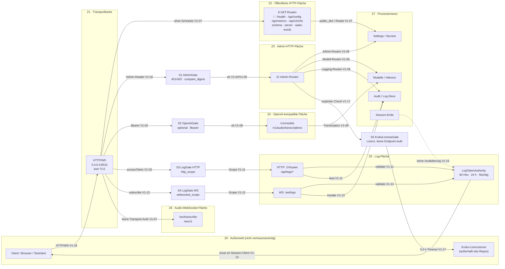
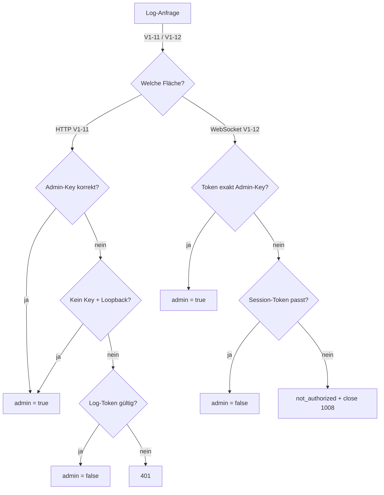

# 05.01 – Sicherheitsarchitektur

> **Kapitelstatus:** Intern abgenommen und integriert (INTEGRATED) – Stand Commit a8993c5c68042d996eab680d84a5b138a214bb5d; externe ROOT-Freigabe ausstehend
> **Geltung:** genau Commit `a8993c5c68042d996eab680d84a5b138a214bb5d` (V1-01). Ein Branch-Ref war im geprüften Checkout nicht vorhanden; die Aussagen gelten für diesen Commit, nicht für einen beweglichen Branch-Stand.
> **Faktenbasis:** V1-01 bis V1-20 aus `workflow/research/05.01.json`.

## 1. Worum geht es?

Die Sicherheitsarchitektur des Voice-STT-Servers lässt sich nicht mit dem Satz „Der Server ist authentifiziert“ beschreiben. Der Code bündelt **vier getrennte Mechanismen** in der Fassade `SecurityService`:

1. **Admin-HTTP:** ein Admin-Key für die 21 administrativen Routen,
2. **OpenAI-kompatible API:** ein optionaler OpenAI-Bearer für `/v1/models` und `/v1/audio/transcriptions`,
3. **Log-Zugriff:** sessiongebundene Log-Tokens für die Log-Fläche,
4. **Kroko:** eine externe Produktlizenz, die ausdrücklich **keine Endpoint-Authentifizierung** ist.

Der Docstring der Fassade verbietet die Gleichsetzung dieser Mechanismen ausdrücklich; die Fassade wird einmal pro `VoiceSTTService` mit einer Settings-Referenz konstruiert (V1-02). Daraus folgen zwei praktische Grundregeln:

- **Ein Ausweis gilt nur für seine Fläche.** Der Admin-Key ist kein OpenAI-Key und kein Log-Token. Ein Log-Token erteilt keine Admin-Rechte.
- **Es gibt keine zentrale Auth-Middleware, die pauschal alles prüft.** Die Prüfungen sitzen in den Gates und werden von den jeweiligen Routen aufgerufen (V1-02, V1-06, V1-08, V1-18).

Die wichtigste Konsequenz betrifft die Transkription: Wer den Port erreicht, kann `/ws/transcribe` und `/ws/v2` ohne Admin-Key und ohne OpenAI-Key öffnen (V1-07). Eine Transport-Authentifizierung vor der Admission gibt es nicht (N-5). **Der Admin-Key schützt die administrativen Routen, nicht die Audio-WebSockets und nicht die Transkription.**

### Begriffe, die in diesem Kapitel verwendet werden

| Begriff | Bedeutung |
|---|---|
| **Vertrauenszone** | Eine erreichbare Oberfläche mit eigenem Ausweis- und Fehlerverhalten, z. B. öffentliche HTTP-Routen, Admin-Routen, Log-Fläche. |
| **Schranke / Gate** | Eine Prüffunktion im Anwendungscode, keine Netzwerkfirewall. Sie entscheidet pro Anfrage über Zugriff und Scope. |
| **Admin-Key** | Gemeinsames Geheimnis für die Admin-Fläche; aus Settings oder Umgebung. |
| **Log-Token** | 64 Hexzeichen, 24 h gültig, optional an eine Session gebunden. |
| **Loopback** | Client-Host `127.0.0.1`, `::1`, `localhost` oder `testclient`. |
| **Scope** | Reichweite eines Ausweises: `admin` oder `session`. |

## 2. Das Wesentliche auf einen Blick

### 2.1 Vertrauenszonen und Schranken

**So ist das Diagramm zu lesen:** Ein Client kommt über die Transportkante `Z1` auf `0.0.0.0:8010`; TLS ist im Server nicht konfiguriert (V1-18). `Z2` und `Z6` haben **keine Schranke**: Die acht öffentlichen HTTP-Routen und beide Audio-WebSockets sind ohne Ausweis erreichbar (V1-07). `Z3`, `Z4` und `Z5` liegen hinter je eigenen Prüfstellen (S1–S4). `S5` ist keine Schranke vor einem Endpoint, sondern eine ausgehende Lizenzprüfung (V1-17). Das Prozessinnere `Z7` enthält Settings/Secrets, Modelle, Audit/Log-Store und das Session-Ende. Die gestrichelte Kante ist die belegte **Nicht-Invalidierung**: Das Session-Ende widerruft kein Log-Token (V1-15).

### 2.2 Die Zonen

| Zone | Inhalt | Beleg |
|---|---|---|
| **Z0** | Client, Browser, Testclient; Kroko-Lizenzserver außerhalb des Repos | V1-18, V1-17 |
| **Z1** | Transportkante: HTTP/WS auf `0.0.0.0:8010`, kein TLS | V1-18 |
| **Z2** | Öffentliche HTTP-Fläche: 8 GET-Routen ohne Key | V1-07 |
| **Z3** | Admin-HTTP-Fläche: 21 Routen | V1-06 |
| **Z4** | OpenAI-kompatible Fläche: `/v1/models`, `/v1/audio/transcriptions` | V1-08 |
| **Z5** | Log-Fläche: 3 HTTP-Routen unter `/api/logs/*`, WS `/ws/logs`, Token-Autorität | V1-10, V1-11, V1-12 |
| **Z6** | Audio-WebSocket-Fläche: `/ws/transcribe`, `/ws/v2` | V1-07 |
| **Z7** | Prozessinneres: Settings/Secrets, Modelle/Inferenz, Audit/Log-Store, Session-Ende | V1-06, V1-08, V1-10, V1-16 |

### 2.3 Die Schranken

| Schranke | Schützt | Prüft | Ergebnis | Beleg |
|---|---|---|---|---|
| **S1 AdminGate** | Z3, 21 Admin-Routen | Admin-Key aus drei Headern; ohne konfigurierten Key Loopback | 401 bei gesetztem Key und Fehler; 403 bei fehlendem Key und Remote; sonst Durchlass | V1-04, V1-05 |
| **S2 OpenAIGate** | Z4, OpenAI-Routen | optionaler OpenAI-Key, exakt `Bearer <configured>` | ohne Key offen; mit falschem Key 401 `invalid_api_key` + Audit; POST deaktiviert 404 vor Auth, GET ohne Enabled-Check | V1-08 |
| **S3 LogGate HTTP** | Z5, HTTP-Log-Historie | Admin-Key, Loopback ohne konfigurierten Key, sonst Log-Token | `admin` oder `session`; sonst 401 | V1-11 |
| **S4 LogGate WS** | Z5, `/ws/logs` | Token exakt Admin-Key oder sessiongebundenes Log-Token | `admin` oder `session`; sonst `log.error not_authorized` + Close 1008 | V1-12 |
| **S5 KrokoLicenseGate** | keine Endpoint-Fläche | modellbezogene Produktlizenz | Lizenzentscheidung, kein Endpoint-Zugriff | V1-17 |

### 2.4 Textliche Alternative zum Diagramm

Ein Client erreicht über die Transportkante ohne TLS fünf Oberflächen. Die acht öffentlichen HTTP-Routen und die beiden Audio-WebSockets haben keine Schranke. Die 21 Admin-Routen liegen hinter dem AdminGate, die OpenAI-Routen hinter dem OpenAIGate, die Log-Fläche hinter dem LogGate. Das Prozessinnere wird von Admin-Routen, öffentlichen Reads, OpenAI-Transkription und Log-Lesen berührt. Die Kroko-Prüfung ist eine ausgehende Lizenzabfrage, keine Schranke vor einem Endpoint. Das Session-Ende invalidiert kein Log-Token.

### 2.5 Was dieses Modell bewusst nicht behauptet

- Kroko-Lizenz → Endpoint-Auth (V1-17),
- Log-Token → Admin-Rechte (V1-11, V1-12),
- Loopback → Admin beim WebSocket-Log (V1-12),
- OpenAI-Key → Schutz von `/ws/transcribe` (V1-07, V1-08),
- Client → TLS/CORS (nicht implementiert; V1-18, N-1, N-2).

## 3. Admin-HTTP und OpenAI: zwei Flächen, zwei Ausweise

### 3.1 Admin-HTTP: 21 Routen hinter einem Gate

Der Admin-Key ist der Ausweis für die 21 administrativen Routen (V1-06). Im HTTP-Logscope kann derselbe Key zusätzlich Admin-Scope erteilen (V1-11). Für die OpenAI-Fläche gilt der separate OpenAI-Key (V1-08).

**Woher der Key kommt:** `configured_key()` liest pro Prüfung `settings.admin_api_key` oder die Umgebung `VOICESTT_ADMIN_API_KEY` (V1-03). Der CLI-Default für `--admin-api-key` ist der Env-Wert; `--openai-api-key` hat Default `None` (V1-03).

**Header-Priorität (V1-04):**

1. `x-voicestt-admin-key`
2. `Authorization: Bearer <key>`
3. `x-admin-key`

Der erste nicht-leere Träger entscheidet. Ein falscher erster Träger wird **nicht** durch einen gültigen zweiten gerettet. Ergebnis bei Fehler: **401** mit `WWW-Authenticate: Bearer`. Admin-Fehler werden nicht auditiert (V1-04).

**Ohne konfigurierten Key:** Loopback-Clients (`127.0.0.1`, `::1`, `localhost`, `testclient`) erhalten Admin-Zugriff; Remote-Clients erhalten **403** (V1-05). Geprüft wird ausschließlich `request.client.host`; `X-Forwarded-For` u. ä. kommen nicht vor (V1-05). Diese Regel gilt für Admin-HTTP und HTTP-Logs, **nicht** für `/ws/logs` (V1-05, V1-11, V1-12).

**Die 21 geschützten Routen (V1-06):** `PATCH /api/config`, `POST /api/config/validate`, `POST /api/config/reload`, `GET /api/models`, `GET /api/models/management`, `POST /api/models/refresh`, `GET/PUT /api/models/lifecycle`, `POST /api/models/load`, `POST /api/models/unload`, `GET/PUT /api/models/active`, `GET/PUT /api/language`, `GET/PUT /api/wake-word`, `POST /api/v2/wake-words/refresh`, `PATCH /api/v2/settings/server`, `GET/PUT /api/logging`, `POST /api/kroko/license/refresh`.

### 3.2 OpenAI-kompatible Fläche: optionaler zweiter Kreis (V1-08)

- **Ohne konfigurierten Key** ist die Fläche offen (sofern nicht `openai_api_enabled=false`), ohne Audit.
- **Mit Key** wird nur exakt `Authorization: Bearer <configured>` akzeptiert.
- **Falscher Key:** 401 mit `code: invalid_api_key`, `WWW-Authenticate` und Audit-Event `authentication.failed`.
- **Deaktiviert:** 404 **vor** der Authentifizierung – nur für `POST /v1/audio/transcriptions`; `GET /v1/models` hat keinen Enabled-Check.
- **Vergleich:** `==` auf dem gesamten Bearer-String, nicht konstante Zeit (V1-09).

## 4. Log-Autorität: 64 Hex, 24 h, zwei verschiedene Scopes

### 4.1 Der Token (V1-10)

Ein Log-Token besteht aus **64 Hexzeichen** (zwei UUID4-Werte), Lebensdauer **24 h**, Ablage nur in einem Prozess-Dict unter `RLock`, ohne Persistenz. Sweep beim Ausstellen unbedingt, beim Validieren nur ab **>1024** Einträgen.

### 4.2 HTTP-Logscope (V1-11)

1. Admin-Key korrekt → `admin: true` + angefragte Session.
2. Kein Admin-Key konfiguriert und Loopback → implizit `admin: true`.
3. Sonst gültiges Log-Token → `admin: false` + gebundene Session.
4. Sonst → **401**.

### 4.3 WebSocket-Logscope (V1-12)

**Keine Loopback-Ausnahme.** Endpoint akzeptiert zuerst, liest dann `subscribe`. Token exakt Admin-Key → `admin: true`; sessiongebundenes Token mit passender Session → `admin: false`; sonst `log.error not_authorized` + Close **1008**.

### 4.4 Kanalbeschnitt (V1-13)

Nicht-Admin sieht nur `audit`, `performance`, `transcription`. Fremde Kanäle werden verworfen; bleibt nichts übrig → `__not_authorized__` ohne Fehler: HTTP **200** mit leerer `data`, WS Count **0**. Admin behält alle Kanäle inkl. `system`.

### 4.5 Ausgabe, Lebensdauer, kein Widerruf (V1-14, V1-15)

Token nur bei `log_live_enabled` **und** verfügbarem Store; sonst `logAccess.available: false`. Ausgabe im v1-`hello` und v2-`hello.ack`; nicht in Resync-Snapshots. **Kein Widerruf:** gültig bis Ablauf (24 h) oder Sweep; Bindung ist der Scope (C-4).

## 5. Kroko-Gate ist keine Authentifizierung (V1-17)

`KrokoLicenseGate` prüft eine modellbezogene Produktlizenz, keine Endpoint-Auth. Netzwerk nur beim expliziten Check mit effektivem Key ohne `force_community`. Falsche `model_uuid` → `CHECK_FAILED`/`model_scope_mismatch`; veraltete Generation → `stale_generation`. Timeout **5,0 s**, ohne Retry. Admin-Route `POST /api/kroko/license/refresh` begrenzt auf (0; 60] s.

## 6. Offene Flächen, Loopback und Testclient

### 6.1 Acht öffentliche HTTP-Routen (V1-07)

`GET /`, `GET /health`, `GET /api/config` (liefert Feld `adminAuthRequired`, selbst ohne Key lesbar), `GET /api/metrics`, `GET /api/v2/info`, `GET /api/v2/settings/schema` (`secretsExposed: false`), `GET /api/v2/settings/server` (nur Non-Secrets), `GET /api/v2/wake-words`. Dazu `/ws/transcribe` und `/ws/v2` ohne Ausweis. `adminAuthRequired: false` heißt „kein Key konfiguriert“, nicht „Admin frei“ (C-3).

### 6.2 Loopback: nur HTTP-Admin und HTTP-Logs (V1-05, V1-11, V1-12, C-1)

Loopback-Menge: `127.0.0.1`, `::1`, `localhost`, `testclient`. Nur dort Vertrauenszone; nie für `/ws/logs`. Prüfung nur via `request.client.host` (U-1). `testclient` ist Testartefakt im Produktionscode.

### 6.3 Settings: lesen öffentlich, schreiben admin (V1-20)

19 Definitionen: 16 Session (`auth: session`), 3 Server (`auth: admin`). `auth=admin` ist zunächst Metadaten; durchgesetzt nur via Admin-Gate auf `PATCH /api/v2/settings/server`. Overlay weist Secret-Keys mit `secret_not_allowed` ab.

## 7. Deployment-Grenze: Was der Code nicht schützt (V1-18)

Bind `0.0.0.0:8010`, uvicorn ohne `ssl_*`, kein `add_middleware` (kein CORS/TrustedHost/Redirect/Cookie/CSRF/Origin-Prüfung). TLS/Origin/Segmentierung liegen außerhalb des Repos (U-2). Proxy-Risiko: nur `request.client.host` wird geprüft (U-1); `/ws/logs` bleibt unberührt (V1-12).

## 8. Redaktion, UI und Secrets (V1-16, V1-19)

`public_dict` redigiert Keys/Modelle/Engine-Optionen (`redact`, `drop=True`); Schema `secretsExposed: false`. YAML lehnt Admin-/OpenAI-Keys mit `SystemExit` ab; Persistenz/Reload schließen Keys und `data_root_path` u. a. aus. Secrets gehören in Umgebung/Settings, Details siehe 03.11. UI: `GET /` liefert `static/index.html` je Anfrage (`HTMLResponse`, kein Static-Mount); Key-Feld nur Arbeitsspeicher, Client-ID in `localStorage`; kein HTML-Verhalten als Vertrag (Evidenz B).

## 9. Was fehlt

| ID | Fehlt | Konsequenz |
|---|---|---|
| N-1 | TLS/HTTPS (uvicorn ohne `ssl_*`) | Klartext ohne externen Abschluss |
| N-2 | CORS/TrustedHost/Redirect/Origin-WS | keine Host-/Origin-Kontrolle |
| N-3 | Rate-Limit/Lockout | kein Schutz gegen Online-Versuche |
| N-4 | Widerruf von Log-Tokens | gültig bis 24 h/Sweep |
| N-5 | Transport-Auth `/ws/transcribe`, `/ws/v2` | größte offene Fläche |
| N-6 | Persistenz von Keys (bewusst) | erneut aus Settings/Env |

## 10. Grenzen der Aussagen

| ID | Befund | Bedeutung |
|---|---|---|
| C-1 | HTTP-Log Loopback-Admin, WS-Log nicht | „lokal“ nur für HTTP |
| C-2 | Admin `compare_digest`, OpenAI `==` | Inkonsistenz, kein belegter Exploit |
| C-3 | `adminAuthRequired: false` vs 403 | keine Freigabe |
| C-4 | Token überlebt Session-Ende (24 h) | Scope, nicht Lebensdauer |
| C-5 | 401/403 vs 401 | flächenspezifisch |

Offen: U-1 Proxy/127.0.0.1 (deploymentspezifisch), U-2 TLS/Segmentierung, U-3 Key gesetzt?, U-4 Cross-Site-WS ungetestet, U-5 Token-Map ohne harte Grenze.

Statuscodes: Admin-Key konfiguriert + Fehler → 401 + `WWW-Authenticate`; kein Key + remote → 403; Loopback → Durchlass. OpenAI falsch → 401 + Audit; POST deaktiviert → 404 vor Auth (GET ohne Enabled-Check). Log HTTP fehlt → 401; Log WS fehlt → close 1008; Nicht-Admin ohne Kanal → 200 leer / Count 0.

## 11. Siehe auch und Nachweise

Weiter: 05.02, 05.03, 05.05, 05.06, 05.07, 05.09, 05.10, 05.11, 03.11, 04.01, 04.02, 04.11, 08.04.

| ID | Kernaussage | Beleg |
|---|---|---|
| V1-01 | Commit-Bindung | `.git/HEAD`, `FETCH_HEAD`, `shallow` |
| V1-02 | Vier Autoritäten | `security/service.py` |
| V1-03 | Key-Quellen | `security/admin.py`, `server.py` CLI |
| V1-04 | Header-Priorität, compare_digest, 401 | `security/admin.py` |
| V1-05 | Loopback/403, nur client.host | `security/admin.py` |
| V1-06 | 21 Routen | `server.py` |
| V1-07 | 8 öffentliche Routen + 2 WS | `server.py` |
| V1-08 | OpenAI optional/exakt/401/404 | `security/openai.py`, `openai_routes.py` |
| V1-09 | compare_digest vs == | `security/openai.py`, `security/admin.py` |
| V1-10 | 64 Hex, 24 h, flüchtig | `security/logs.py` |
| V1-11 | HTTP-Scope | `security/logs.py`, `server.py` |
| V1-12 | WS-Scope ohne Loopback | `security/logs.py`, `server.py` |
| V1-13 | Kanalbeschnitt | `server.py` |
| V1-14 | Token-Ausgabe | `server.py`, `connection.py` |
| V1-15 | Kein Widerruf | `security/logs.py` |
| V1-16 | Redaktion/Persistenz | `server.py`, `credential_redaction` |
| V1-17 | Kroko keine Auth | `security/kroko.py`, `server.py` |
| V1-18 | 0.0.0.0:8010, kein TLS/Middleware | `server.py` |
| V1-19 | UI unauthentifiziert | `server.py` |
| V1-20 | 19 Settings | `settings_control.py`, `server.py` |
