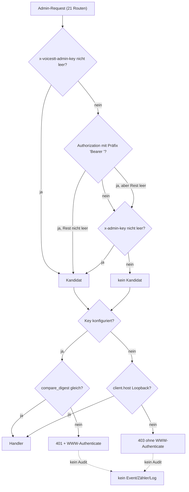

# 05.03 – Admin-Authentifizierung

> **Kapitelstatus:** Intern abgenommen und integriert (INTEGRATED) – Stand Commit a8993c5c68042d996eab680d84a5b138a214bb5d; externe ROOT-Freigabe ausstehend
> **Geltung:** genau Commit `a8993c5c68042d996eab680d84a5b138a214bb5d` (D3-01).
> **Faktenbasis:** D3-01 bis D3-24 aus `workflow/research/05.03.json`; C-1 bis C-5, U-1 bis U-4, N-1 bis N-7.

## 1. Worum geht es?

Die 21 administrativen HTTP-Routen verändern den laufenden Prozess. Für alle gibt es **einen einzigen Ausweis**: den Admin-Key – kein Konto, kein Rollenmodell, sondern ein gemeinsames Geheimnis für die gesamte Admin-Fläche (D3-17, C-5). Rechte unterscheiden sich nur zwischen Mechanismen (Admin/Log/OpenAI/Kroko), nicht zwischen Routen (D3-19).

Es gibt **keine Middleware**: Prüfung = Funktion `admin_auth_error → SecurityService.admin_http_error → AdminGate.http_error`, von jedem Handler als erste Anweisung aufgerufen (D3-02). Schutz entsteht durch den Aufruf, nicht durch eine Schicht (D3-02, D3-14). Der Key schützt die Administration, nicht den Serverzugang (Erreichbarkeit: 05.02).

| Begriff | Bedeutung |
|---|---|
| Admin-Key | Geheimnis für 21 Routen; Settings oder ENV (D3-03). |
| Gate | `AdminGate.http_error`, keine Firewall (D3-02). |
| Träger/Kandidat | Header bzw. gelesener Wert (D3-07). |
| Loopback | Peer aus `{127.0.0.1, ::1, localhost, testclient}` (D3-11). `testclient` ist nur ein Test-Hostname (kein Netz-Loopback); Realbetrieb braucht einen Key. |

## 2. Das Wesentliche auf einen Blick

| # | Kernaussage | Beleg |
|---|---|---|
| 1 | Prüfung pro Handler, keine Middleware. | D3-02 |
| 2 | Genau 21 Routen, auch lesende. | D3-14 |
| 3 | Settings vor ENV; keine Auto-Erzeugung. | D3-03 |
| 4 | Drei Träger: `x-voicestt-admin-key` → Bearer → `x-admin-key`; erster nicht-leerer gewinnt. | D3-07 |
| 5 | Mit Key nur Key (auch Loopback 401). | D3-12 |
| 6 | Ohne Key nur Peer: Loopback ja, sonst 403. | D3-10, D3-11 |
| 7 | 401 mit `WWW-Authenticate`, kein code/Echo/Audit. | D3-09, D3-16 |
| 8 | 403 ohne `WWW-Authenticate`, mit ENV-Hinweis. | D3-10 |
| 9 | Kein Rate-Limit/Lockout/Rotation/Ablauf/RBAC. | D3-17 |
| 10 | Kein Key in `public_dict`/`runtime.json`; nur `adminAuthRequired`. | D3-05, D3-21 |

### 2.1 Admin-Gate als Ablauf

Textalternative: Header lesen (erster nicht-leerer; leerer Bearer-Rest fällt weiter), bei Key nur vergleichen (401 sonst), ohne Key nur Peer (Loopback ja, sonst 403), beide Fehler ohne Audit.

### 2.2 Antwortmatrix

| Key konfiguriert | Kandidat | Peer | Ergebnis |
|---|---|---|---|
| ja | fehlt/falsch | egal (auch Loopback) | 401 + WWW-Authenticate |
| ja | richtig | egal | Handler |
| nein | egal | Loopback | Handler |
| nein | egal | sonst | 403 + ENV-Hinweis |

## 3. Key-Quellen (D3-03..D3-06)

Settings `admin_api_key` vor ENV `VOICESTT_ADMIN_API_KEY`; ENV wirkt live ohne Neustart solange kein Settings-Wert; keine Auto-Erzeugung (D3-03). Leer `""` = falsy (ENV greift), Whitespace `" "` = truthy gesetzt ungetrimmt (D3-04); doppelte Lesung pro Request ohne Snapshot (TOCTOU theoretisch). ENV-Rotation wirkt live (solange unset); nur gesetzter Settings-Wert erfordert Neustart / `PATCH /api/config` weist als startup_only ab; `PATCH /api/v2/settings/server` = unknown_key; keine API-Rotation (D3-06, D3-17). YAML-Key → SystemExit; kein Laden/Speichern in runtime.json; nicht in public_dict, nur `adminAuthRequired` bool (D3-05, D3-21).

## 4. Drei Träger (D3-07)

Priorität: `x-voicestt-admin-key` → `Authorization: Bearer <key>` (exakt `Bearer `) → `x-admin-key`. Erster nicht-leerer gewinnt; falsch-nicht-leer blockiert gültigen zweiten; leer fällt durch (auch leerer Bearer-Rest); Werte zeichenweise ohne Normalisierung, Namen case-insensitiv (D3-07, C-1).

## 5. Vergleich und Antworten (D3-08..D3-12)

`compare_digest(str, str)` nur bei Key+Kandidat; kein Trim/Case-Folding; nicht-ASCII → TypeError ungetestet (U-3). 401: Key konfiguriert + fehlt/falsch, mit `WWW-Authenticate`, kein code/Echo/Audit (D3-09, D3-16). 403: kein Key + remote, ohne `WWW-Authenticate`, mit ENV-Hinweis (D3-10). Mit Key nur Key (Loopback 401), ohne Key nur Host (403 sonst) (D3-12, C-3 beachten: Proxy-Verhalten nicht repo-belegt).

## 6. Position und Inventar (D3-13/D3-14)

Guard erste Anweisung vor Fachvalidierung → 401/403 statt 400/409/422 (Ausnahme Body-Decode 422-Reihenfolge unbelegt U-2). Genau 21 Aufrufstellen; auch lesende Routen geschützt; Liste autoritativ in 05.01 §3.1 / 08.04. Public/privat-Paar: `GET /api/config` public vs `PATCH` Admin; `GET /api/v2/settings/server` public vs `PATCH` Admin (D3-15/D3-06).

## 7. Offen ohne Key (D3-15)

`GET /`, `/health`, `/api/config` (mit `adminAuthRequired`, keine Freigabe), `/api/metrics`, `/api/v2/info`, `/api/v2/settings/schema|server` (ohne Secrets), `/api/v2/wake-words`. Außerhalb der 21 Routen, nicht „vergessen".

## 8. Was das Gate nicht tut (D3-16/D3-17)

Kein Audit bei 401/403 (kein Event/Zähler/Log/Client-ID; OpenAI auditiert dagegen). Kein Rate-Limit/Lockout/Rotation/Ablauf/Hash/Mehrfach-Keys/RBAC; ein Key = alle 21 Routen. Kein Selbst-Aussperren durch Fehlversuche; falsch konfigurierter Key (Whitespace) sperrt alle aus.

## 9. Abgrenzung (D3-18/D3-19)

| Fläche | Ausweis | Besonderheit |
|---|---|---|
| Admin-HTTP | Admin-Key 3 Header | 401+Auth, 403 ohne; Loopback nur ohne Key |
| Log | Admin-Primitive, eigene Politik | kein `x-admin-key`; HTTP-Loopback ja, WS nein; 401 ohne 403 |
| OpenAI | separater Key | auditiert Fehlversuche |
| Kroko | Lizenz | keine Endpoint-Auth |

Kein Ausweis öffnet fremde Fläche (Docstring). Fehler flächenspezifisch (05.10, 08.09).

## 10. Tests (D3-20..D3-22)

Gate-Semantik (alle Träger, falscher-erster, kein Echo, Loopback vs 203.0.113.7, ENV-Rotation); HTTP (401 ohne Header, 200 mit, 400 erst nach Auth, kein Key in runtime.json); v2-Patch (alle Träger, Leser public ohne Secrets). Lücken: nicht-ASCII, 422-Reihenfolge, Proxy, Frontend-Haltung.

## 11. Grenzen (N/U/C)

N-1 kein Audit; N-2 kein Limit/Lockout; N-3 keine API-Rotation; N-4 kein Ablauf; N-5 kein RBAC; N-6 kein Hashing; N-7 keine Auto-Erzeugung. U-1 Proxy/client.host; U-2 422-vs-401; U-3 nicht-ASCII; U-4 Frontend. C-1 nur-nicht-leer-gewinnt; C-2 Kontrast OpenAI; C-3 Proxy nicht belegt; C-4 Inventar deckungsgleich; C-5 kein RBAC.

## 12. Nachweise (alle D3-IDs)

D3-01 Commit · D3-02 Kette/keine Middleware · D3-03 Quellen/Rotation · D3-04 Doppel-Lesung/Leerwerte · D3-05 YAML-Exit/Persistenz-Ausschluss · D3-06 startup_only/unknown_key · D3-07 Priorität/Extraktion · D3-08 compare_digest · D3-09 401 · D3-10 403 · D3-11 Loopback/nur host · D3-12 Key-vs-Host · D3-13 erste Anweisung · D3-14 21 Routen · D3-15 8 public · D3-16 kein Audit · D3-17 kein Limit/RBAC · D3-18 Log-Abgrenzung · D3-19 Trennung · D3-20 Unit · D3-21 HTTP · D3-22 v2 · D3-23 Grenzen · D3-24 Hinweise. Stand a8993c5c. Intern unabhängig geprüft und integriert; externe ROOT-Freigabe ausstehend.
