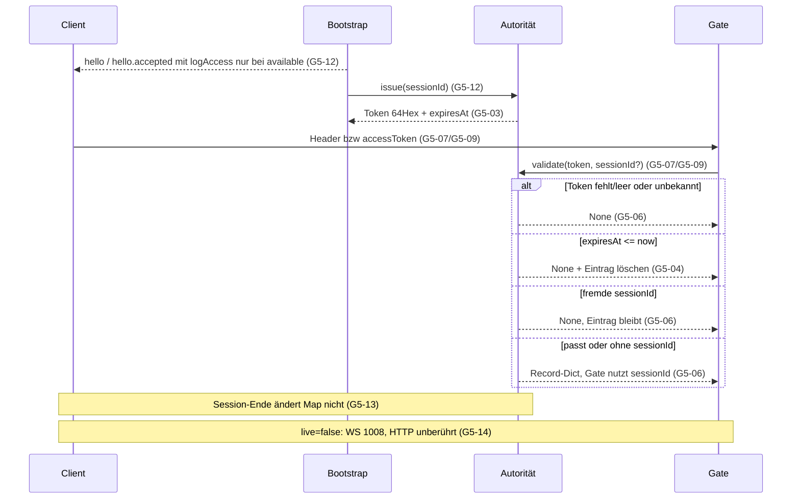

# 05.05 – Log-Authentifizierung

> **Kapitelstatus:** Intern abgenommen und integriert (INTEGRATED) – Stand Commit a8993c5c68042d996eab680d84a5b138a214bb5d; externe ROOT-Freigabe ausstehend
> **Geltung:** genau Commit `a8993c5c68042d996eab680d84a5b138a214bb5d` (G5-01).
> **Faktenbasis:** G5-01 bis G5-16 aus `workflow/research/05.05.json`; N-1..N-8, U-1..U-6, C-1..C-11.
> **Abgrenzung:** Nur Ausweis für den Log-Kanal. Routen/Hüllen/Cursor/Replay: 04.11. Admin-Key: 05.03. Token-Bindung als Trennung: 05.04. Zonen: 05.01.

## 1. Worum geht es?

Ein Gate, zwei Policen (`http_scope`, `websocket_scope`), drei Träger (Admin-Key, Loopback nur HTTP ohne Key, Log-Token) (G5-07..G5-09). Token = Zufallswert in prozessinterner Map mit Session + Ablauf (G5-02/G5-03/G5-06). Fragen: welche Session? noch nicht abgelaufen? Nicht: wie zurücknehmen (G5-13, N-1). Scoped = ID-Bindung, nicht Lebensdauer (C-2).

| Begriff | Bedeutung |
|---|---|
| Log-Token | 64 Hex, genau eine sessionId (G5-03/G5-06). |
| Autorität | Dict + RLock, injizierbare Uhr, keine Persistenz (G5-02). |
| Träger | Admin-Key / Loopback / Token (G5-07). |
| Policy | http_scope vs websocket_scope (G5-07/G5-09). |
| Bootstrap | hello / hello.accepted – einziger Ausgabeort (G5-12). |

## 2. Das Wesentliche

| # | Aussage | Beleg |
|---|---|---|
| 1 | Ein Gate, zwei Policen. | G5-07, G5-09 |
| 2 | Drei Träger; Loopback nur HTTP ohne Key. | G5-07, G5-08 |
| 3 | 64 Hex, 86400 s, ISO-Z. | G5-03 |
| 4 | Gültig nur expiresAt > now (<= löscht). Kein Sliding. | G5-04 |
| 5 | Genau eine sessionId; ohne ID keine Prüfung. | G5-06 |
| 6 | Nur Bootstrap; available = live AND Store. | G5-12 |
| 7 | Kein Widerruf/Rotation/Refresh/Logout. | G5-13 |
| 8 | Live-aus trifft nur WS; Tokens/HTTP bleiben. | G5-14 |
| 9 | Nicht-Admin nur audit/performance/transcription; sonst Filter: HTTP 200 data:[], WS log.hello (ohne Scope) + subscribed mit Scope + replay count 0. | G5-10/G5-11 |
| 10 | WS kein Loopback; sonst not_authorized + 1008. | G5-09 |

### 2.1 Lebensdauer (Mermaid, alle Kanten G5-belegt)

Textalternative: Bootstrap → issue (Prune) → Token+Frist → Verwendung → validate (Ablauf/Session) → Scope oder 401/1008. Kein Revoke/Refresh/Persistenz (N-1/N-2/N-4); kein Background-Sweeper/keine harte Grenze, nur Prune-immer + Sweep->1024 (G5-05, U-1).

## 3. Autorität/Format/Dauer (G5-02..G5-05)

Dict + RLock, injizierbare Uhr, keine Persistenz; einmal je Service; Neustart löscht alle (G5-02). 64 Hex (2×uuid4hex), 86400 s, ISO-Z ms+Z, kein Refresh (G5-03, C-3). Gültig nur > now, <= löscht, kein Sliding (G5-04, C-9). issue bereinigt immer O(n); validate nur bei len>1024 strikt; getroffener abgelaufener einzeln; keine harte Grenze/Sweeper; Threshold ungetestet (G5-05, U-1).

## 4. Bindung (G5-06)

Record {sessionId, expiresAt}; Token fehlt/leer → None; unbekannt → None; expiresAt <= now → None + löschen; fremde session → None (Eintrag bleibt); match oder ohne session → Record-Dict, Gate nutzt sessionId daraus; exakter str-Lookup, kein compare_digest/Format-Limit; mehrere Tokens pro Session möglich (G5-06).

## 5. HTTP-Scope (G5-07/G5-08)

Reihenfolge: 1) Admin-Key (admin-Header oder Bearer, falscher erster verdrängt) → admin+angefragt; 2) ohne Key + Loopback → admin+angefragt; 3) Token (log-token-Header vor Bearer) → admin false + Token-Session; 4) sonst None → 401 ohne WWW-Authenticate (G5-07). Admin-Key nicht via log-token-Header (C-7). Loopback nur HTTP ohne Key (127.0.0.1/::1/localhost/testclient), gewinnt über Token; mit Key Loopback ohne Ausweis 401; testclient Testartefakt (G5-08, C-11). 401 schmucklos (U-6).

## 6. WS-Scope (G5-09)

Kein Loopback-Admin (Kommentar). Nur Key-match (compare_digest) oder session-Token; None → not_authorized + 1008. Token nur aus erstem subscribe-Frame (kein Header/Query). Reihenfolge: accept → live? (sonst log_live_disabled+1008) → Store? (sonst 1011) → Form (sonst invalid_request+1008) → Auth (1008). Unautorisiert erfährt vorher live/Store.

## 7. Kanäle still (G5-10/G5-11)

Nicht-Admin genau audit/performance/transcription; Rest verworfen, leer → __not_authorized__ (Filter, kein Fehler): HTTP 200 data:[]; WS log.hello (ohne Scope) + log.subscribed mit authorizationScope + replay count 0. Ohne Feld alle drei; Admin beliebig inkl system. HTTP antwortet authorizationScope/allSessions/deliveryMode, WS-hello deliveryMode/Cursor/Instance ohne Scope, WS-subscribed mit authorizationScope/allChannels/allSessions (G5-10/G5-11/G5-15).

## 8. Ausgabe/Laufzeit/kein Revoke (G5-12..G5-14)

Nur Bootstrap (v1-hello, v2-hello.accepted); available = live AND Store; false → code + kein Token; true → Token+expiresAt + Pfade/Version/Cursor; nicht im Resync; degraded → false (G5-12). Kein Widerruf/Rotation/Refresh/Logout; Session-Ende ohne Wirkung; neues hello zusätzlich (G5-13, N-1/N-2). Live-aus berührt nur WS (1008), nicht Tokens/HTTP (nur Store 503) (G5-14, C-5).

## 9. Metadaten/Kollision (G5-15/G5-16)

authorizationScope/allSessions (HTTP: plus deliveryMode; WS-subscribed: plus allChannels; WS-hello: deliveryMode/Cursor/Instance ohne Scope) beschreiben Auslegung; Admin übernimmt angefragte ID ohne Existenzprüfung (leer ok, N-7); WS danach nur ping→pong + code-loser unbekannt, keine Re-Auth (N-8) (G5-15). Bearer dreifach getrennt: Admin compare_digest (admin-Header/Bearer), OpenAI == +Audit, Log Dict-Lookup; Admin-Key öffnet HTTP-Log-Admin via admin-Header/Bearer und WS-Log-Admin via accessToken, aber nie via log-token-Header; Log-Token nur via log-token-Header/Bearer (HTTP) bzw. accessToken (WS) (G5-16, C-7).

## 10. Grenzen (N/U/C)

N-1 kein Revoke; N-2 kein Refresh (nur neues hello); N-3 keine Lebensdauer-/Retention-Bindung; N-4 keine Persistenz; N-5 kein Format/Rate-Limit (Dict statt compare_digest); N-6 keine Obergrenze; N-7 keine Existenzprüfung; N-8 keine Re-Auth. U-1 Last >1024; U-2 Nutzung nach Ende; U-3 Lookup-Timing; U-4 Proxy-Loopback; U-5 401-fremd ohne Test; U-6 401-Body. C-1 nur vertiefen; C-2 scoped≠Leben; C-3 exakt 86400 s; C-4 asymmetrisch; C-5 live≠Schloss; C-6 Filter≠Fehler; C-7 Header-Regel; C-8 erster-verdrängt; C-9 <= ungültig; C-10 Code vor Berichten; C-11 testclient.

## 11. Nachweise (alle G5-IDs)

G5-01 Commit · G5-02 Dict/RLock/keine Persistenz · G5-03 64Hex/86400/ISO-Z · G5-04 >now/<=löscht · G5-05 Prune/Sweep-1024 · G5-06 eine session/ohne-kein-Check · G5-07 HTTP-Reihenfolge/401 · G5-08 Loopback-nur-HTTP/testclient · G5-09 WS-kein-Loopback/1008/Reihenfolge · G5-10 HTTP-Kanäle/200-leer · G5-11 WS-Schnitt/count-0 · G5-12 nur Bootstrap/available · G5-13 kein Revoke · G5-14 live-nur-WS · G5-15 Metadaten/keine Re-Auth · G5-16 Bearer-Trennung. Stand a8993c5c. Intern unabhängig geprüft und integriert; externe ROOT-Freigabe ausstehend.
