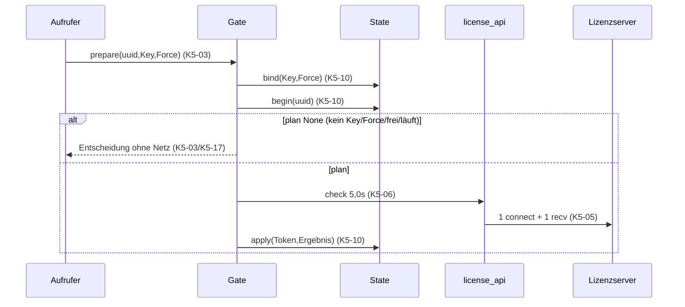
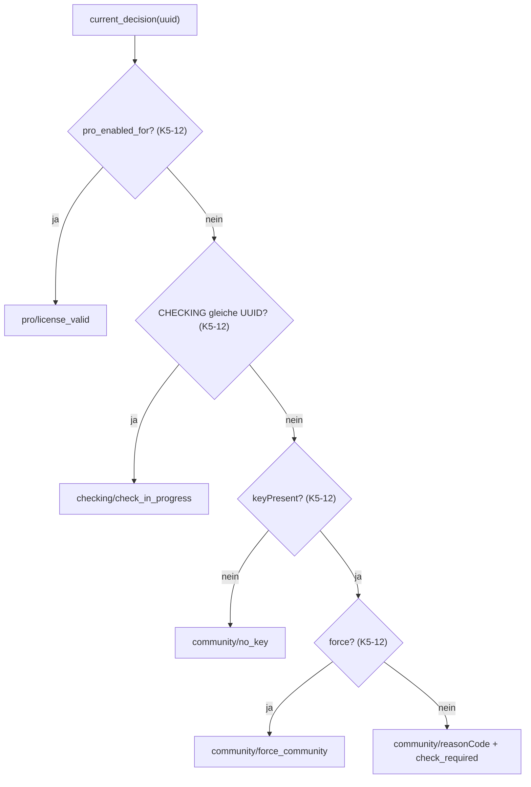

# 05.07 – Kroko-Lizenzierung

> **Kapitelstatus:** Intern abgenommen und integriert (INTEGRATED) – Stand Commit a8993c5c68042d996eab680d84a5b138a214bb5d; externe ROOT-Freigabe ausstehend
> **Geltung:** genau Commit `a8993c5c68042d996eab680d84a5b138a214bb5d` (K5-01).
> **Faktenbasis:** K5-01 bis K5-20 aus `workflow/research/05.07.json`; N-1..N-6, U-1..U-4, C-1..C-5.

## 1. Worum geht es?

Kroko Pro-Modell braucht Nachweis für genau diese Modelldatei, nur kurz. Gate = Produktfreigabe (Pro ja/nein), keine Endpoint-Auth, kein Loader, kein Entitlement fremder IDs (K5-01). Vier Mechanismen getrennt (Admin/OpenAI/Log/Kroko).

## 2. Das Wesentliche

1. Binden → begin → Netz (nur mit Key ohne force) → apply (K5-03/K5-10).
2. Bau/Entscheidung ohne Netz; Start NOT_CHECKED (K5-02).
3. Ein connect + ein recv, 5,0 s, kein Retry (K5-05/K5-06).
4. Typstreng fail-closed; VALID nur typisiert positiv, age=min(...,60) (K5-07).
5. Doppelte 60-s-Grenze; Ablauf monotonic → proof_expired (K5-08).
6. Fremde UUID → CHECK_FAILED/model_scope_mismatch, nie publiziert (K5-09, exakt C-1).
7. Generationen: bind/bind-Änderung +1 NOT_CHECKED; begin +1 CHECKING; apply nur Token==Generation + CHECKING, sonst stale_generation (K5-10).
8. Worker bindet nie; trägt Token/uuid/key; Callback sieht aktuellen Zustand (K5-11).
9. 5 Ausgänge fest: pro/license_valid; checking/check_in_progress; community/no_key; community/force_community; community/reasonCode+check_required (K5-12).
10. forceCommunity serverweit Default false APPLY_LIVE, als persistierte Betreiber-Absicht (Setting; nur Status/proEnabled flüchtig/nie persistiert), invalidiert sofort; nur server_effective, nie Session (K5-13/K5-14, K5-20).
11. POST /api/kroko/license/refresh: Admin zuerst, timeout Default 5,0 Bound (0,60] sonst 400, to_thread Policy, pro→to_thread models (409), Antwort decisions/management/license/runtime; Route ungetestet (K5-15, N-4).
12. Service-Pfad unter Lock: force/Engine-Optionen/Ziel; ohne Ziel bind+community; mit Ziel restart_conflict/native/Netz-vorbereitet; danach Generation+1; Exception→policy_error (K5-16).
13. Frischer Proof kein Doppel-WS (prepare None, run False) (K5-17).
14. Force-Patch sperrt synchron vor Return; Reconcile Daemon; Revocation lehnt nächsten Pro-Job ab (K5-18).
15. Snapshot modellbezogen ohne Key; proEnabled nicht global; Key nur HMAC mit flüchtigem Secret (K5-19). Status flüchtig, Neustart NOT_CHECKED (K5-20).

### Zeitachse (Mermaid, Kanten K5-belegt)

### Entscheidung (Mermaid)

## 3. Kein Netz ohne Anlass (K5-02/K5-03)

Bau netzfrei, NOT_CHECKED Generation 0 no_key. Check explizit (check_model/prepare/run/refresh), kein Start-/Lade-Nebeneffekt. Leer/force → NOT_CHECKED ohne Netz (no_key/force_community). prepare None bei frei/laufend/leer/force.

## 4. Key/Transport (K5-04/K5-05)

Gleicher Key wie Engine: recognizer.key (auch leer unterdrückt ENV) > options.key > ENV KROKO_API_KEY/KROKO_ONNX_KEY/VOICESTT_KROKO_ONNX_KEY/KROKO_KEY > "". URL wss://license.kroko.ai/ws/v1/{key}/{model}; 1 connect + 1 recv; Exception → CHECK_FAILED/transport_or_parse_error ohne Text (Key im Pfad, kein Log) (C-3); close finally.

## 5. Ein Versuch/Antwort/60s (K5-06..K5-08)

5,0 s Default (Gate/Service/Transport/Route; keine gemeinsame Konstante C-2), 1 Versuch kein Retry (B), ungültig → invalid_request, einziger Netzimport als lazy Funktions-Import in license_api (nicht im Gate). Typstreng: allowed exakt bool, error ""/"no", remaining/offline int>0 (True verworfen); sonst invalid_reply/invalid_freshness; VALID age=min(...,60). Doppelt 60 s (API + State); Ablauf monotonic → proof_expired; keine Verlängerung.

## 6. Bindung/Generationen/Worker (K5-09..K5-11)

Fremd-UUID → model_scope_mismatch (exakt, C-1), nie publiziert; apply nur LicenseCheckResult + gleiche UUID. bind-Änderung +1 NOT_CHECKED (Modell/expires leer); begin +1 CHECKING; apply nur Token==Generation + CHECKING sonst stale_generation ohne Publikation. Nur Aufrufer bindet synchron unter Lock; Worker trägt Token/uuid/key, bindet nie; Callback aktueller Zustand, Fehler geschluckt. _background_inflight nur gepflegt, nie gelesen (C-4, N-6).

## 7. Entscheidung/force (K5-12..K5-14)

5 Ausgänge fest (Tabelle §2). forceCommunity serverweit Default false APPLY_LIVE, als persistierte Betreiber-Absicht (Setting; nur Status/proEnabled flüchtig); nur Community, keine Prüfung, keine Pro-Freigabe, invalidiert bestehende. Nur server_effective, nie Session; Fehler → false (keine Freigabe/Sperre).

## 8. Recheck/Service/Doppel/Sperre (K5-15..K5-18)

POST: Admin zuerst; Nicht-Dict→{}; timeout float Default 5,0, Fehler 400, Bound (0,60] sonst 400; to_thread Policy; pro→to_thread models (409); Antwort decisions/management/license/runtime. Route ungetestet (N-4). Service unter Lock: force/Engine-Optionen/Ziel (pro_lane→nativ→lokal); ohne Ziel bind+community; mit Ziel restart_conflict/native/Netz-vorbereitet; Generation+1; Exception→policy_error. Frisch → prepare None/run False → kein Zweit-WS. Force-Patch unter Lock sofort invalidieren vor Return; Reconcile Daemon; Revocation lehnt nächsten Pro-Job ab.

## 9. Snapshot/Flüchtigkeit (K5-19/K5-20)

Snapshot: status/generation/scope=model/proEnabled/modelUuid/keyPresent/forceCommunity/reasonCode; proEnabled nur mit modelUuid; Key nur HMAC mit flüchtigem Secret. Flüchtig, keine Persistenz; Neustart NOT_CHECKED neu prüfen. Diagnose: keyPresent→Key (leerer recognizer.key!); force?; status/reason (rejected=Absage, transport=Netz, invalid=Form, expired=Frist); modelUuid vergleichen (mismatch!); runtime licenseEntitled/Source (provider/native/null), proAdmissionRevoked=Sperre.

## 10. Grenzen (N/U/C)

N-1 kein Retry; N-2 kein Widerruf/Push; N-3 keine Persistenz; N-4 Route ungetestet; N-5 keine Endpoint-Auth/fremde Freigabe; N-6 keine In-Flight-Dedup. U-1 Provider-Semantik; U-2 Parallel-Bestrafung; U-3 DNS/TLS-Klassen; U-4 Branch. C-1 model_scope_mismatch exakt; C-2 Timeout doppelt; C-3 Key im Pfad/nie geloggt; C-4 in-flight nur gepflegt; C-5 auth nur Metadatum.

## 11. Nachweise (alle K5-IDs)

K5-01 keine Auth · K5-02 ohne Netz/NOT_CHECKED · K5-03 explizit/leer-force · K5-04 gleicher Key · K5-05 WS-Pfad/1+1 · K5-06 5s/kein Retry · K5-07 typstreng · K5-08 60s/Ablauf · K5-09 mismatch · K5-10 Generationen/stale · K5-11 Worker bindet nie · K5-12 5 Ausgänge · K5-13 force Setting · K5-14 nur server_effective · K5-15 Recheck-Route · K5-16 Service-Pfad · K5-17 kein Doppel · K5-18 Force-Sperre · K5-19 Snapshot · K5-20 flüchtig. Stand a8993c5c. Intern unabhängig geprüft und integriert; externe ROOT-Freigabe ausstehend.

Verwandt: 05.01 Sicherheitsarchitektur · 05.03 Admin-Authentifizierung ([PATCH /api/v2/settings/server]) · 05.04 Session-Zugriff · 05.08 Native-Guard (restart_conflict/nativer Kontext) · 03.06 Server-Einstellungen · 03.09 Wirksamkeitszeitpunkt (APPLY_LIVE) · 02.06 Engines (Engine-Optionen) · 02.07 Modelle (Modellkatalog/Pro-Klasse) · 04.10 (keine OpenAI-Abhängigkeit) · 05.10 Fehler-/Zugriffsantworten (400/403/409) · 08.04 API-Endpunkt-Katalog (POST /api/kroko/license/refresh).
