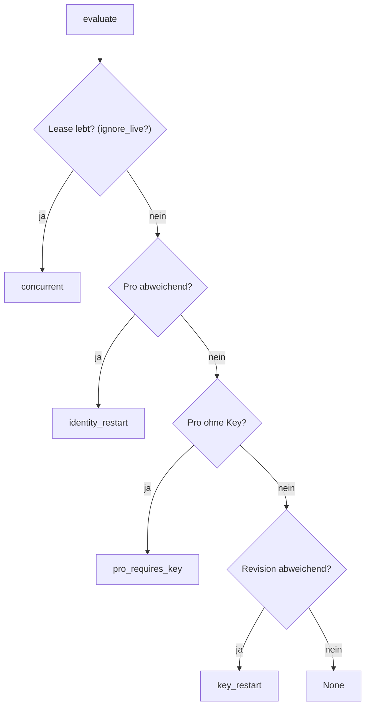
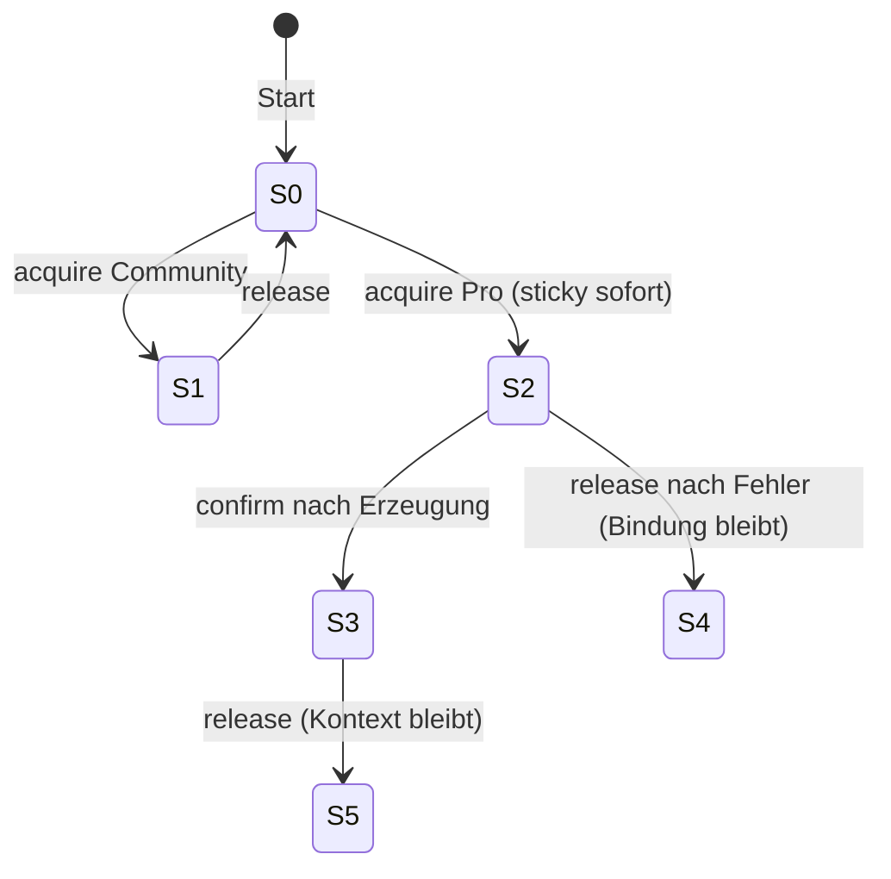

# 05.08 – Native-Guard

> **Kapitelstatus:** Intern abgenommen und integriert (INTEGRATED) – Stand Commit a8993c5c68042d996eab680d84a5b138a214bb5d; externe ROOT-Freigabe ausstehend
> **Geltung:** genau Commit `a8993c5c68042d996eab680d84a5b138a214bb5d` (G8-01).
> **Faktenbasis:** G8-01 bis G8-24 aus `workflow/research/05.08.json`; N-1..N-7, U-1..U-4, C-1..C-5.

## 1. Worum geht es?

Prozessweites Gedächtnis: welche native Kroko-Identität gebunden ist, mit welcher Key-Revision, ob ein Pro-Recognizer erzeugt wurde (G8-01/G8-06/G8-07). Bindet früh/klebrig, bestätigt erst nach Erzeugung, blockiert Community nie, nur neuer OS-Prozess setzt zurück (G8-06/G8-09). Keine Lizenzprüfung (05.07), sondern Kontinuitätsgrenze.

## 2. Das Wesentliche

Singleton pro OS-Prozess (Service/Engine/Status teilen; kein zweiter) (G8-01/G8-11). Kein Handle/Netz/Log/Key (nur HMAC lokal) (G8-01/N-4). 4 Codes, nur 2 restart (concurrent/pro_requires_key false; identity/key_restart true) (G8-02). Identität = tier (free-Flag; None nicht Pro) + ident (Header-UUID klein else normcase-Pfad); max 65536 Bytes (G8-03). evaluate-Reihenfolge: Lease→concurrent; Pro-abweichend→identity_restart; Pro-ohne-Key→pro_requires_key; Revision-abweichend→key_restart; sonst None; Community nie blockiert (G8-04). restart_conflict = evaluate(ignore_live) nur restart-Fälle (G8-05). acquire vergibt Lease + setzt bei Pro SOFORT Identität/Revision (sticky, auch bei Fehlschlag; beweist keine Lizenz) (G8-06). confirm_loaded nur bei Pro-Lease nach Recognizer-Erzeugung; Community nie; Exception→release (G8-07). confirmed nur bei _pro_confirmed AND Revision nichtleer AND ident==gebunden (ci) AND Revision==gebunden; überlebt release (G8-08). Nur Prozessende setzt zurück; kein Reset (test-only); Release nur Lease; Neustart = neuer OS-Prozess (G8-09/N-1/N-2). Status geheimnisfrei: liveNativeInstances, nativeProContextActive (=ident is not None, nicht läuft), nativeProLicenseConfirmed, nativeProModelUuid (=ident; kann Pfad sein) (G8-10).

### evaluate (Mermaid)

### Zustand (Mermaid)

## 3. Entitlement/Policy/Restart/Runtime/Force (G8-12..G8-16)

Hook: Nicht-Kroko True not_kroko; fehlende UUID False no_license_uuid; force False force_community; sonst proof ODER native; dann Restart zuerst; sonst True license_valid/native_license_context; unbekannt reasonCode; Exception policy_error (G8-12). Kein Doppel-Check bei nativem Kontext: nach Restart-Check, ohne force, bei confirmed → pro/native_license_context + bind_intent, kein prepare/run/Netz (G8-13). Restart-Konflikt: community + uuid + reason + check_required False + restart_required True; kein Grant (auch force, da vorher) (G8-14). Runtime: licenseEntitled = proof OR native; licenseSource provider_check vor native_context sonst null; licenseModelUuid aus Gate; native-Felder Guard; restartRequired/Reason (erstes kommerzielles sonst key_context); activeProPresent/proAdmissionRevoked/refreshPending/lastReconcile (G8-15, C-2/C-3 beachten). native_entitled = UUID AND nicht force AND bestätigt; force hebt Quelle auf ohne Guard zu löschen (G8-16).

## 4. Vorprüfungen/Settings/Engine/Community (G8-17..G8-20)

Scheduler-Preflight (>1 Identität/zwei Lanes ohne use_main → concurrent); Probe-Preflight evaluate; Switch assert restart-only; Reuse Live-Instanz (G8-17). Settings: zwei Modelle ValueError; zwei Lanes use_main-Zwang (G8-18). Engine letzte Linie: Lease nur echter Recognizer (kein Double); Fehler→release; Erfolg→confirm; weakref/close frei (G8-19). Community nach Pro erlaubt, setzt Kontext NICHT zurück; Status weiter aktiv (G8-20).

## 5. Admin/Force/Ziel/Exposition (G8-21..G8-24)

Einziger Setting-Schlüssel forceCommunity (SCOPE_SERVER/AUTH_ADMIN/TYPE_BOOL/APPLY_LIVE/Default False); Key kein Setting (Engine-Option/ENV) (G8-21). Force-Patch synchron unter Lock + sofort invalidieren + Reconcile-Daemon; Submit Revocation+Generation unter Lock; Guard unverändert (G8-22). Zielwahl respektiert Kontext (nur gebundene UUID, sonst pro_model_not_local; Evidenz B) (G8-23). Exposition: GET /api/models + GET /api/models/management mit krokoRuntime (beide admin); POST /api/kroko/license/refresh (admin) mit runtime/decisions/license/management vs POST /api/models/refresh (nur Refresh-Ergebnis); v2-Schema ohne Kroko; GET /api/config public ohne Secrets/Guard (G8-24).

## 6. Grenzen (N/U/C)

N-1 kein Auto-Neustart; N-2 kein Reset (test-only); N-3 keine Persistenz; N-4 kein Netz/Log/Key; N-5 kein Community-Guard (None nicht Pro); N-6 keine v2-Felder; N-7 keine CI/nativ opt-in Skip. U-1 Provider-Ablehnung beobachtet kein Vertrag; U-2 Build 1.12.9 nicht ableitbar; U-3 HTTP-Status Restart-Konflikt ungetestet; U-4 Branch. C-1 ident Pfad möglich; C-2 licenseEntitled modellbezogen nicht global; C-3 restartRequired auch ohne Wunsch/bei Force ungetestet; C-4 Wechsel 500 nicht maschinenlesbar; C-5 Branch.

## 7. Nachweise (alle G8-IDs)

G8-01 Singleton · G8-02 4 Codes/2 restart · G8-03 Identität/65536 · G8-04 Reihenfolge · G8-05 restart_conflict · G8-06 sticky · G8-07 confirm · G8-08 confirmed-Bedingungen · G8-09 nur Prozessende · G8-10 status/active≠läuft · G8-11 ein Guard · G8-12 Hook · G8-13 kein Doppel-Check · G8-14 Restart-Konflikt · G8-15 Runtime · G8-16 Force-Aufhebung · G8-17 Vorprüfungen · G8-18 Einzelidentität · G8-19 Engine-Linie · G8-20 Community-bleibt · G8-21 force Setting · G8-22 Force-Kopplung · G8-23 Zielwahl (B) · G8-24 Exposition. Stand a8993c5c. Intern unabhängig geprüft und integriert; externe ROOT-Freigabe ausstehend.

Verwandt: 05.07 Kroko-Lizenzierung (Gate/Proof/Force) · 05.03 Admin-Authentifizierung ([PATCH /api/v2/settings/server], POST /api/kroko/license/refresh) · 05.04 Session-Zugriff · 02.06 Engines · 02.07 Modelle · 03.06 Server-Einstellungen ([kroko.forceCommunity]) · 03.09 Wirksamkeitszeitpunkt · 05.10 Fehler-/Zugriffsantworten · 08.04 API-Endpunkt-Katalog.
