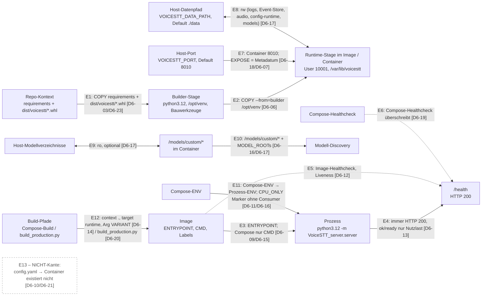

# 06.05 – Docker-Betrieb

> **Kapitelstatus:** Intern abgenommen und integriert (INTEGRATED) – Stand Commit a8993c5c68042d996eab680d84a5b138a214bb5d; externe ROOT-Freigabe ausstehend
> **Geltung:** genau Commit `a8993c5c68042d996eab680d84a5b138a214bb5d` (Branch nicht verifizierbar, U6-04)
> **Faktenbasis:** D6-01 bis D6-27 aus `workflow/research/06.05.json`; N6-01/N6-02, U6-01..U6-05, C6-01..C6-05.
> **Diagramm:** genau ein Mermaid-Flowchart mit belegten Kanten E1–E13; E13 als Nicht-Kante.
> **Abgrenzung:** Zahlen nur aus [06.01](06.01-systemvoraussetzungen.md); Pipeline in [06.02](06.02-installationskonzept.md); Host in [06.03](06.03-windows-installation.md)/[06.04](06.04-linux-installation.md).

## 1. Worum geht es?

Festgelegter Bau-/Laufzeitvertrag: **Builder** installiert fertiges Produkt-Wheel in Python-3.12-venv; **Runtime** übernimmt nur dieses venv, läuft als `voicestt` (UID 10001), startet via ENTRYPOINT (D6-01/D6-05/D6-06/D6-09). Kein Quellbaum, kein Kroko-Bau im Image (D6-03). Drei Ebenen: Image (Stages/Metadaten/Start), Container (Port 8010, `/var/lib/voicestt`, Modell-Mounts), Betrieb (öffentliches Compose Ein-Service **oder** offizieller Release-Build) (D6-07/D6-14/D6-17/D6-18/D6-20/D6-26). **Kein `config.yaml`-Erbe** (kein COPY/Mount; nur CLI/Env; `compose.py` nur Host-Env, keine Datei in Container) (D6-10/D6-25). Healthcheck = **Liveness**, nicht Bereitschaft: `/health` immer 200, `ok`/`ready` nur Nutzlast; Modell-Check bewusst nicht implementiert (D6-12/D6-13/N6-02).

## 2. Das Wesentliche

| Baustein | Kernaussage | Beleg |
|---|---|---|
| Image | `builder`/`runtime`, gleicher ubuntu:24.04-Digest; Autorität `build_production.py`, Test 2 FROM + Digest | D6-01 |
| Builder | Python-3.12-venv `/opt/venv`, Werkzeuge nur dort | D6-02 |
| Wheel | vorgebaut + Extras + requirements; kein Checkout/editable/Kroko-Bau; openwakeword --no-deps ohne tflite | D6-03 |
| CPU (Build) | CPU-Index, Constraint-Pin, cuda/hip-None, pip-Grep | D6-04 |
| Runtime | `voicestt` 10001 nologin, `/var/lib/voicestt`, nur Laufzeitlibs, Modelldirs fasterwhisper/kroko_asr | D6-05 |
| Übergang | nur `COPY --from=builder /opt/venv`; PATH | D6-06 |
| Layout | USER/WORKDIR/VOLUME `/var/lib/voicestt`, EXPOSE 8010 = Metadatum (Bindung via --host/--port) | D6-07 |
| Metadaten | Args unknown/unknown/pro/unknown → OCI-Labels + SERVER_COMMIT; KROKO_VARIANT nur Label | D6-08 |
| Start | ENTRYPOINT `python3.12 -m VoiceSTT_server.server`; CMD 0.0.0.0/8010/cpu/int8/local_files_only | D6-09 |
| Konfiguration | kein Erbe; `--config` default VOICESTT_CONFIG, ohne Wert `{}`; nur CLI/Env | D6-10 |
| Runtime-ENV | DATA_ROOT, Offline-Marker, CPU_ONLY=1 deklarativ ohne Consumer; HF/TRANSFORMERS ohne Consumer | D6-11 |
| Health (Image) | nur Liveness /health 200 (127.0.0.1:8010); 30s/10s/60s/5, urlopen 5s | D6-12 |
| /health | immer 200; ok/ready nur Nutzlast, kein Modell-Gate | D6-13 |
| Compose-Build | context ., target runtime, nur Arg VARIANT default free, image local; ohne Version/Commit/Datum → unknown | D6-14 |
| Compose-Start | nur CMD-Override (gleiche Flags) + restart unless-stopped + init; ENTRYPOINT bleibt | D6-15 |
| Compose-ENV | deklarativ (CPU/Offline/ROOT/Modellwurzeln/Keys/OMP/CT2) + optionales env_file (voicestt.env fehlt); Keys/Modellwurzeln belegt, OMP/CT2 nicht | D6-16 |
| Mounts | Datenwurzel rw + zwei Modellverzeichnisse ro optional | D6-17 |
| Ports | `${VOICESTT_PORT:-8010}:8010`; Container via CMD/command; EXPOSE Doku; Default 8010 | D6-18 |
| Compose-Health | gleiche Liveness/Parameter, überschreibt Image-Check | D6-19 |
| Offiziell | build_production.py (runtime, linux/amd64, 4 Args, Versions+Commit-Tags); nur pro, voice-stt-server; Label/Env-Validierung | D6-20 |
| Kontext | .dockerignore behält dist; Dockerfile/compose/build/.git/.env/data/logs/Caches aus; config.yaml/docs/tests/engineering/examples nicht aus, config nie kopiert | D6-21 |
| CPU-Prüfungen | Werkzeug vs Inline; Inline schwächer | D6-22 |
| Vorbedingung | kein dist/ im Commit → COPY scheitert ohne Pipeline-Wheel | D6-23 |
| Variante | aus Wheel (eingebettet/WHEEL-Tag); voice-stt-server erzwingt pro; Label ändert nichts | D6-24 |
| Host-Komfort | compose.py: config.yaml deployment → Compose-Env + `docker compose -p`; keine Datei im Container | D6-25 |
| Öffentlich | ein Service server, keine Marker, nur :-Defaults, kein nginx/browserclient | D6-26 |
| Secrets | keine Key-Build-Args; Keys nur Laufzeit Env/env_file; voicestt.env via *.env ignoriert | D6-27 |

Merksätze: EXPOSE = Metadatum. CPU_ONLY = Marker. free = Label-Default, keine Laufzeit. Ohne dist-Wheel kein Build. Liveness ≠ Bereitschaft.

## 3. Image (D6-01..D6-09)

Zwei Stages gleicher Digest, Autorität Release-Werkzeug, Test 2 FROM + Digest; Trennung Werkzeuge vs Laufzeit (D6-01). Builder: 3.12-venv `/opt/venv` (PATH vorn), nur dort Header/Compiler (D6-02). Installiert vorgebautes Wheel + Extras + requirements (kein Checkout/editable/Kroko-Bau); openwakeword --no-deps ohne tflite (D6-03) – Image verpackt Artefakt, baut es nicht. CPU inline: Index + Constraint + cuda/hip-None + pip-Grep (schwächer als Werkzeug, §10/C6-05) (D6-04). Runtime: voicestt 10001 nologin, `/var/lib/voicestt`, nur Laufzeitlibs, Modelldirs (D6-05); erhält nur `COPY --from=builder /opt/venv` (installiertes Ergebnis, kein pip-Schritt) (D6-06). Layout USER/WORKDIR/VOLUME + EXPOSE 8010 (Metadatum; Bindung --host/--port; ohne `-p`/Compose kein Erreichen; anonymes Volume ohne Bind) (D6-07). Args unknown/unknown/pro/unknown → Labels + SERVER_COMMIT; VARIANT nur Label, kein Schalter (D6-08/D6-24). ENTRYPOINT Delegator + CMD (0.0.0.0/8010/cpu/int8/local_files_only); Args nach Image ersetzen CMD, nicht ENTRYPOINT (Compose nutzt das) (D6-09/D6-15).

## 4. Konfiguration/ENV (D6-10/D6-11/D6-25)

Kein Erbe: `--config` default VOICESTT_CONFIG, ohne Wert `{}` (kein YAML); kein COPY/Mount (Datei im Kontext, nie kopiert D6-21); öffentliche Compose ohne --config/Mount (D6-10). Host-config.yaml wirkungslos ohne VOICESTT_CONFIG + eigenes Bringen (Betreiberentscheidung). Runtime-ENV: DATA_ROOT, Offline-Marker, CPU_ONLY=1 **deklarativ ohne Consumer** (Marker, keine Wirkung; Garantie aus Build D6-04) (D6-11); HF/TRANSFORMERS ohne Consumer (Fremdlibs, keine Repo-Garantie U6-01). compose.py = Host-Komfort (deployment → Env + `docker compose -p`); keine Datei in Container; kein Erbe aus 06.03/06.04 (D6-25/D6-10).

## 5. Compose (D6-14..D6-19/D6-26/D6-27)

Build: context ., target runtime, nur VARIANT default free, image local; ohne Version/Commit/Datum → unknown-Labels/unknown-Commit (lauffähig, Identität incomplete C6-04) (D6-14). Start: nur CMD-Override gleiche Flags + restart unless-stopped + init; ENTRYPOINT/PID1 bleibt (D6-15). ENV deklarativ (CPU/Offline/ROOT/Modellwurzeln/Keys/OMP-4/CT2) + optionales env_file (voicestt.env fehlt im Commit U6-05; via *.env aus Kontext D6-27); Keys/Modellwurzeln belegt, OMP/CT2 ohne Consumer (gesetzte Variable ≠ Wirkung) (D6-16/U6-01). Mounts: Datenwurzel `${VOICESTT_DATA_PATH:-./data}`→/var/lib/voicestt rw create_host_path (logs/Event-Store/audio/config-runtime/models) + zwei Modellverzeichnisse→/models/custom/* ro optional (leere gültig); UID-10001-Rechte beachten; Mount-Semantik unter Datenwurzel ungetestet U6-03 (D6-17). Ports `${VOICESTT_PORT:-8010}:8010` (Container via CMD/command; EXPOSE Doku; Default 8010); Host-Seite variabel, Container 8010 ohne CMD-Änderung (D6-18). Healthcheck gleiche Liveness/Parameter, überschreibt Image (D6-19) – weiterhin kein Bereitschafts-Gate. Ein Service server, portabel (nur :-Defaults, keine Marker/Netze/nginx/browserclient); Betreiberergänzungen nicht enthalten N6-01 (D6-26). Secrets nur Laufzeit (keine Key-Build-Args per Test; Env/env_file) (D6-27). Schemaskizze (kein wörtliches Abbild): services.server mit build(context ., target runtime, args VARIANT free=nur Label), ports, volumes (rw + 2× ro optional), env_file voicestt.env (fehlt), restart unless-stopped, init, healthcheck (Liveness wie Image).

## 6. Diagramm: belegter Container-Aufbau

Nur belegte Kanten E1–E13; keine Netz/Proxy/Ressourcen/Download-Knoten (N6-01/U6-01); keine Phasen-Dauern; Bereitschaft nie als Gate; E13 Nicht-Kante.

Legende: E1 Kontext→Builder (nur zwei COPY-Quellen; ohne Wheel scheitert COPY D6-23; dist im Kontext D6-21); E2 einziger Stage-Übergang (installiertes Ergebnis); E3 ENTRYPOINT→Prozess (Compose nur CMD); E4 immer-200/Nutzlast (kein Gate); E5 Image-Liveness (30s/10s/60s/5); E6 Compose überschreibt (gleich); E7 Host-Port→8010 (EXPOSE Metadatum); E8 Daten-rw (Inhalte); E9 Modelle-ro optional; E10 Mounts + MODEL_ROOTs → Discovery; E11 ENV→Prozess (CPU_ONLY Marker); E12 Build-Pfade→Image (Compose vs offiziell). **E13 Nicht-Kante** (kein COPY/Mount; Kontext ≠ Kopie). Nicht gezeichnet: Netz/Proxy (kein networks-Block), Limits (kein deploy), Download (`--stt-auto-download` default False), Dauern, Bereitschafts-Gate (N6-02), Secret-Build-Fluss (D6-27 Laufzeit).

## 7. Start/Health (D6-12/D6-13)

Liveness: `/health` auf 127.0.0.1:8010, nur 200 akzeptiert; 30s/10s/60s/5, urlopen 5s (D6-12); Compose gleich + Override (D6-19). `/health` immer 200; ok/ready Nutzlast; kein Modell-Gate (D6-13). healthy ≠ bereit (Modelle/Transkription unbewiesen); Hängen erkannt, Bereitschaft nicht; eigener Check = Betreiber (N6-02). Startwerte CMD = Compose-Flags (0.0.0.0/8010/cpu/int8/local_files_only); Port Host-seitig variabel (D6-09/D6-15/D6-18).

## 8. Offiziell-vs-Compose + Vorbedingung (D6-20/D6-23/D6-24)

Offiziell: target runtime, linux/amd64, 4 Args, Versions+Commit-Tags; nur pro (`voice-stt-server`); Label/Env-Validierung; Details → 06.02 (D6-20). Compose: context/target/Arg-only, unknown-Identität (incomplete, läuft) (D6-14/C6-04/U6-02). Vorbedingung: kein dist/ im Commit → COPY scheitert ohne Pipeline-Wheel (Artefakt, kein Quellfehler) (D6-23). Variante aus Wheel (eingebettet/WHEEL-Tag; pro erzwungen); free-Label bei Pro-Wheel möglich (offizielle Validierung greift im Compose nicht) (D6-24/C6-03).

## 9. Lücken (N/U)

N6-01 kein networks/deploy/user/read_only/secrets; N6-02 kein Bereitschafts-Check (bewusst). U6-01 HF/TRANSFORMERS/OMP/CT2 Fremdwirkung (keine Garantie); U6-02 Compose-vs-Release-Check nur Label-Differenz; U6-03 Mount-Semantik ungetestet (Code legt Wurzeln an); U6-04 Branch detached (nur Commit); U6-05 dist/voicestt.env fehlen (Vorbedingung).

## 10. Konflikte (C6-01..C6-05)

C6-01 dist/kroko-Kommentar überholt (kein Build-Input; Test verbietet); C6-02 Docstring-Drift (keine Folge); C6-03 free-Label/Pro-Laufzeit (Validierung nur offiziell); C6-04 unknown-Identität incomplete (läuft); C6-05 zwei CPU-Prüfungen (Inline schwächer; Reichweite trennen).

## 11. Nachweise (alle D6-IDs)

D6-01 Stages/Digest · D6-02 Builder-venv · D6-03 Wheel-ohne-Bau/tflite · D6-04 Inline-CPU · D6-05 Runtime-10001 · D6-06 venv-Übergang · D6-07 Layout/EXPOSE · D6-08 Args/Labels · D6-09 ENTRYPOINT/CMD · D6-10 kein-Erbe · D6-11 ENV-Marker · D6-12 Liveness · D6-13 immer-200 · D6-14 Compose-build · D6-15 CMD-Override · D6-16 ENV/env_file · D6-17 Mounts · D6-18 Ports · D6-19 Compose-Health · D6-20 offiziell · D6-21 Kontext · D6-22 zwei-Prüfungen · D6-23 dist-Vorbedingung · D6-24 Variante-aus-Wheel · D6-25 compose.py-Host · D6-26 ein-Service · D6-27 Secrets-Laufzeit. Kanten E1–E13 (E13 Nicht-Kante). Stand a8993c5c. Intern unabhängig geprüft und integriert; externe ROOT-Freigabe ausstehend.

Weiter: [06.01](06.01-systemvoraussetzungen.md) · [06.02](06.02-installationskonzept.md) · [06.04](06.04-linux-installation.md).
