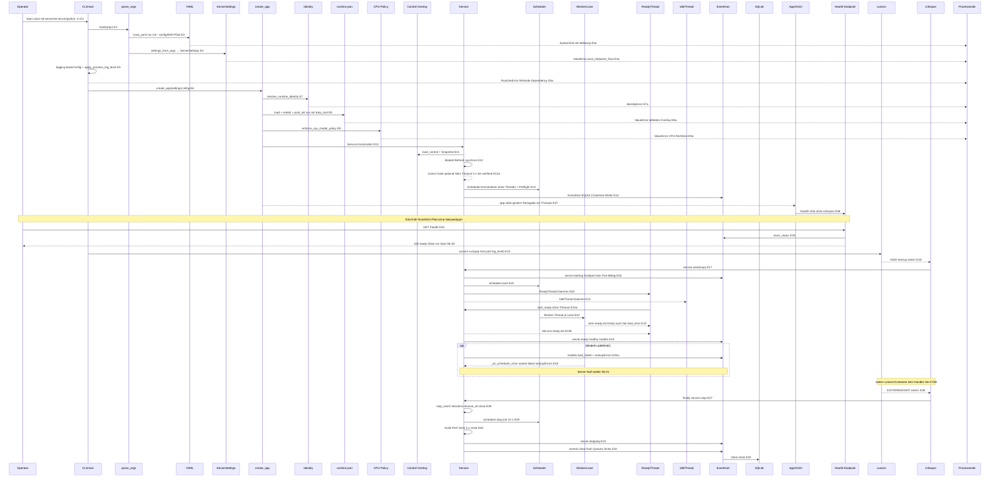

# 06.07 – Serverstart/-stopp

> **Kapitelstatus:** Intern abgenommen und integriert (INTEGRATED) – Stand Commit a8993c5c68042d996eab680d84a5b138a214bb5d; externe ROOT-Freigabe ausstehend
> **Geltung:** genau Commit `a8993c5c68042d996eab680d84a5b138a214bb5d`
> **Faktenbasis:** S6-01 bis S6-32 aus `workflow/research/06.07.json`; N1–N3, U1–U5, C1–C4.
> **Diagramm:** GENAU EIN sequenceDiagram (E1–E38); keine Zeitachse, nur belegte Kanten.
> **Abgrenzung:** Wege in [06.02](06.02-installationskonzept.md), [06.03](06.03-windows-installation.md), [06.04](06.04-linux-installation.md), [06.05](06.05-docker-betrieb.md); Ersteinrichtung [06.06](06.06-ersteinrichtung.md); YAML/Persistenz [03.05](../03-konfiguration/03.05-quellen-und-prioritaeten.md)/[03.06](../03-konfiguration/03.06-server-einstellungen.md)/[03.10](../03-konfiguration/03.10-persistenz.md); Overlay [05.09](../05-administration/05.09-schutz-von-daten-secrets.md); Health [06.10](06.10-monitoring-und-metriken.md)/[04.02](../04-schnittstellen/04.02-http-grundlagen.md); Recorder-Signale [07.03](../07-entwicklung/07.03-technische-schnittstellen.md).

## 1. Worum geht es?

Feste Kette: `parse_args` (Vor-Parser --config → YAML → Hauptparser) → `settings_from_args` → `ServerSettings.__post_init__` → Logging → `create_app` (Identität, runtime.json-Overlay, CPU-Policy, Service-Konstruktor mit Overlay/Refresh/Scheduler/EventHub) → `uvicorn.run` (fertige App, Einzelprozess) → Lifespan (Scheduler-Start, Ready-/Idle-Threads) → Betrieb (/health 200) → Lifespan-`finally: service.stop` (feste Reihenfolge) (S6-01..S6-30). **Eager vor Bind:** create_app vor uvicorn; Bind-vs-Lifespan-Reihenfolge U2 (kein „Port offen ab t"). **Korrektur C3:** Store/Refresh/Scheduler-Bau in create_app (S6-12/14/15), Lifespan nur Start/Stop. YAML-Fehler/Policy-Verstoß = Prozessende vor Dienst; fehlendes Modell = Zustand, kein Abbruch (S6-04/S6-11/S6-21).

Schema (nicht ausführbar): argv → parse_args [Vor-Parser --config → YAML (Fehler SystemExit) → Hauptparser + set_defaults (CLI>YAML>Default) → settings (ValueError möglich)] → logging.basicConfig → create_app [Identität → runtime.json → Policy → Service (Overlay, Refresh, Scheduler-Bau, Hub)] → uvicorn.run(app,host,port,log_level) → Lifespan service.start [Scheduler, Ready, Idle] → Betrieb (/health) → finally service.stop (Sessions, Scheduler, Joins, stopping, close).

## 2. Das Wesentliche

| Thema | Kernaussage | Beleg |
|---|---|---|
| Einstieg | voice-stt-server/stt-server/python -m → main; legacy ebenso | S6-01 |
| Parse | Vor-Parser --config → YAML → Hauptparser; set_defaults; CLI>YAML>Default | S6-02 |
| Kein Fallback | ohne --config/ENV keine YAML; Repo-config nur explizit | S6-03 |
| YAML-Fehler | fehlend/PyYAML/Syntax/Objekt/version/Secrets/abgeleitet/unbekannt/Wert/Device/Profil → SystemExit | S6-04 |
| Settings | Namespace → ServerSettings; Negationen/Wakeword/Transcript/JSON/Tupel; Float → SystemExit | S6-05 |
| post_init | 0.0.0.0/8010; 7 Pfade; ValueError realtime_log_detail + log_live-ohne-store (vor create_app) | S6-06 |
| Logging | basicConfig + Prozess-Level vor create_app | S6-07 |
| Deps | uvicorn/FastAPI fehlt → RuntimeError Exit 1 | S6-08 |
| Identität | leer/unknown → unknown; sonst 40 Hex, sonst IdentityError | S6-09 |
| Overlay | runtime.json nur mit data_root; setattr minus derived/Secrets/data_root; Re-post_init; defekt ValueError | S6-10 |
| Policy | device=cpu hart; Engines/Profil/Identity; max 2 Medium; Rank>3 ValueError | S6-11 |
| Konstruktion | feste Reihenfolge; Overlay+Snapshot in create_app (C3) | S6-12 |
| Lizenz | sync; Netz nur Pro+Key-ohne-Force; 5s; nie werfend | S6-13 |
| EventHub | SQLite + Cursor + 3 Daemon-Writer sofort; UUID; vor start schreibfähig | S6-14 |
| Scheduler | Bau ohne Threads; start/stop; Preflight werfbar | S6-15 |
| uvicorn | fertige App/host/port/level; kein reload/workers/timeout/lifespan → Einzelprozess | S6-16 |
| Lifespan | start try, stop immer finally (verschluckt) | S6-17 |
| start | starting-Event (kein Port-Beleg), Scheduler, Ready-/Idle-Daemons; wartet nicht | S6-18 |
| Worker | Daemon je Lane; ready.set finally (auch load_error); Join 10s | S6-19 |
| ReadyThread | wait_ready ohne Timeout → ready.set + server.ready + loaded/load_failed + startupErrors-Publish | S6-20 |
| Ladefehler | worker.failed + startupErrors; Server läuft weiter | S6-21 |
| Idle | Daemon; timeout=max(0.1), interval=min(30, max(0.1, timeout/4)); Laufzeit | S6-22 |
| Stop | stop_event → Sessions → scheduler.stop → Joins 5s → audit/perf → stopping → close; Wurf bricht Rest | S6-23/24 |
| Health | ready=Event; ok=ready+healthy+logging_ready; immer 200 | S6-25 |
| ready lebt | clear/set Wechsel; set ensure_models_loaded; kein clear unload | S6-26 |
| Signale | keine Handler; Delegation uvicorn/Container; kein STOPSIGNAL | S6-27/28 |
| Fehler | YAML/Float SystemExit; argparse 0/2; ValueError/IdentityError/RuntimeError Traceback 1 | S6-29 |
| App-vor-Threads | app.state vor Lifespan; /health//info ohne Lifespan ready=false | S6-30 |

## 3. Parse/Logging/start (S6-01..S6-08)

Drei Namen, eine main (S6-01): Aufrufname ändert nichts (Argumente/Umgebung zählen). Zweistufig: Vor-Parser nur --config (ENV-Default) → YAML → Hauptparser + set_defaults vor parse (CLI>YAML>Default; keine neuen Destinations) (S6-02). Kein Auto-Fallback: Repo-config.yaml ohne Pfad wirkungslos (S6-03). Beispiel: `voice-stt-server --config /etc/voicestt/config.yaml --data-root /srv/voicestt`. YAML-Fehler (fehlend/PyYAML/Syntax/Objekt/version≠1/kein-Settings/Secrets/abgeleitet/unbekannt/Wert/Device≠cpu/Profil) → SystemExit vor Dienst (Diagnose = Meldung, kein Health) (S6-04). settings_from_args: Negationen (vad/model/openai), wakeword/transcript-Defaults, JSON/Tupel, Float-SystemExit (S6-05). post_init: Defaults + 7 Pfade + 2 ValueError (realtime_log_detail, log_live-ohne-store ungetestet U5) – vor create_app, ungefangen Traceback/1 (S6-06). Logging basicConfig + Prozess-Level vor create_app (Baufehler bereits konfiguriert geloggt) (S6-07). Deps fehlen → RuntimeError Exit 1 (früh/laut, kein HTTP) (S6-08).

## 4. create_app (S6-09..S6-16)

Identität zuerst (load_fastapi + resolve_runtime_identity): leer/unknown → unknown, sonst 40 Hex, sonst IdentityError (+ weitere); Dockerfile aus Build-Arg; Checkout ohne Metadaten = unknown (nicht defekt) (S6-09). Overlay: nur mit data_root (load + setattr minus derived/admin/data_root/openai + Re-post_init); fehlend {} ok, defekt ValueError; Präzedenz Default<YAML<CLI<persistiert. **--config (YAML) ≠ runtime.json (JSON-Overlay): Format/Phase/Ausnahmen verschieden** (C2; Details → 03.10/05.09) (S6-10/S6-32). Policy: cpu hart, Engines/Profil/Identity, use_main bei identisch, max 2 Medium (Rank>3 Large ValueError), No-Op-Returns; vor uvicorn (CPU-only-Absicherung) (S6-11). Konstruktor: Security→Manager→Events→Store→Overlay→Registry→STTManager→Lizenz-sync→Refresh→Scheduler→EventHub→Audit/Perf→WakeWord; Overlay+Snapshot in create_app. **C3: Lifespan baut nichts** (S6-12). Lizenz sync (background=False), Netz nur Pro+Key-ohne-Force, 5s, nie werfend (→ community/policy_error); kein Startabbruch bei Unerreichbarkeit (S6-13). Hub: SQLite + Cursor + 3 Daemon-Writer + UUID (/api/v2/info); vor start schreibfähig (starting persistierbar) (S6-14). Scheduler Bau ohne Threads (start/stop steuern; Preflight werfbar) – E13 vs E19 trennen (S6-15). uvicorn.run fertige App (host/port/level), kein reload/workers/timeout/lifespan → Einzelprozess; Bind-vs-Lifespan U2 (S6-16).

## 5. Lifespan/Threads/Ready (S6-17..S6-22)

finally stop (verschluckt, kein Maskieren) – fehlgeschlagener Startup beendet geordnet mit Ursprungsfehler (S6-17). start: loop/bind/starting-Event (host/port, **kein Port-Beleg**)/monotonic+Speicher/Scheduler/Ready-/Idle-Daemons; wartet nicht auf Modelle; ASGI-Startup früh fertig (S6-18). Worker je Lane (Daemon): Engine+Warmup try, load_error+error_callback, **finally ready.set** – ready≠gesund (healthy prüft load_error); stop: stop_event/close/join 10s/engine.close-nur-beendet (S6-19). ReadyThread: **wait_ready ohne Timeout** (blockiert unbegrenzt) → ready.set + server.ready (healthy/models) + models.loaded/load_failed (reason startup) + startupErrors-Publish; Hängen = ready false dauerhaft, blockiert nichts (Daemon) (S6-20). Fehler → worker.failed (severity/component/Typ) + startupErrors; weiterlaufend = Zustand, kein Abbruch (S6-21). Idle Daemon: timeout=max(0.1), interval=min(30, max(0.1, timeout/4)), Ausstieg/skip/Unload/RuntimeError-verschieben – Laufzeit, gestrichelt (S6-22). Lifespan baut nichts (C3), keine Handler/Timeouts (S6-27/28).

## 6. Stop (S6-23/S6-24)

Reihenfolge: stop_event → Sessions remove_all/close → scheduler.stop → joins 5s (ready/idle) → audit/perf close → server.stopping → events.close (S6-23). Joins 5s / Scheduler 10s = Budgets, keine Garantie. **Wurf in scheduler.stop bricht Rest ab** (nur Lifespan-except): fehlende Abschluss-Events → Scheduler-Stop im Log prüfen. events.close idempotent: flush, _closed, Queues+Sentinel, joins 5s, Sinks, SQLite; Audit/Perf No-Ops (shared Hub) (S6-24).

## 7. Health/Ready/Fehler (S6-25/S6-26/S6-29/S6-30)

**ready ≠ ok:** ready = Event; ok = ready + healthy + logging_ready; Body scheduler/models/sttReady/sttModels/startupErrors/eventStore; **immer 200** (Liveness ≠ Bereitschaft; Tiefe → 06.10/04.02) (S6-25). ready lebt: clear/set Wechsel, set ensure_models_loaded, **kein clear unload** (ready bei unloaded; C4: Dienstübergang, Modell via sttReady/sttModels/startupErrors) (S6-26). Fehler: YAML/Float SystemExit (Meldung, Shell 1 interpreterabhängig U4); argparse 0/2; ValueError/IdentityError/RuntimeError Traceback 1; Modell-Laden nie fatal. Vor uvicorn → keine HTTP-Antwort (Terminal/Log) (S6-29). App vor Threads: app.state gesetzt; /health//info ohne Lifespan (ready=false) – Vertragstests, kein Netzwerkdienst-Beleg (S6-30).

## 8. Signale (S6-27/S6-28)

Keine eigenen signal/atexit/finalize (Negativ-Grep); Treffer nur Recorder-CLI (SIGINT-IGN/KeyboardInterrupt, nicht importiert) – Recorder-Signale ≠ Server (→ 07.03, N3) (S6-27). Delegation: keine install_signal/timeout-Params; kein STOPSIGNAL (Default SIGTERM); init:true (Tini); Health Liveness vs VPS ready+ok (C1) (S6-28). Ctrl+C/docker stop = Runtime-Signal; Nummern/Doppelsignal/Graceful U1, Tini U3, Bind-Reihenfolge U2. N1 kein Handler/atexit/Timeout/Flag; N2 kein STOPSIGNAL/Selbstneustart; U5 log_live-ungetestet.

## 9. Diagramm (E1–E38)

Legende: durchgezogen = belegter Aufruf; gestrichelt = Fehler-/Abbruch (X), extern (E16/E36), Laufzeit-Nebenpfad (E21/E12a); X = Prozessende; E-Nummern = Faktenakte; **keine Zeitachse** (nur Timeouts 5s/10s, 5.0s Lizenz, Idle-Formel).

Erklärung: oben Start-vor-App (E1-E5 + Abbruch E3a/E4a/E5a; E6 Eintritt create_app: E7 Identität, E8 Overlay, E9 Policy, E10-E14 Service/Hub/Scheduler-Bau; E37/E38 App-vor-Threads, E34/E35 Test-Health). Mitte Lifespan (E15/E16 extern, E17 start, E18 starting, E19-E22 Scheduler/Threads, E23-E26 Ready/Fehler ohne Abbruch; E24a = wait_ready-Aufruf, E24b = ready.set nach Rückkehr, gemeinsam E24/S6-20). Unten Stop (E27-E33; E36 extern). Nicht gesagt: Port-offen-Zeitpunkt, Signal-Handler, Graceful-Timeout, Store/Scheduler-Bau im Lifespan, Timeout für E24, Bereitschaft aus ready.

## 10. Lücken/Konflikte (N/U/C)

N1 kein Handler/atexit/Timeout/Flag; N2 kein STOPSIGNAL/Selbstneustart; N3 Recorder-Signale ≠ Server. U1 Signalnummern/Doppelsignal/Graceful (Dependency); U2 Bind-vs-Lifespan; U3 Tini; U4 Exit-Code interpreterabhängig; U5 log_live-ungetestet. C1 VPS (target cpu + KROKO_VARIANT inexistent; → 06.05); C2 zwei Configs (YAML-Defaults vs JSON-Overlay); C3 Bau-vs-Lifespan (Store/Refresh/Scheduler in create_app); C4 ready≠gesund (ok/sttReady zählen).

## 11. Nachweise (alle S6-IDs)

S6-01 Einstieg · S6-02 Parse · S6-03 kein-Fallback · S6-04 YAML-Exits · S6-05 settings_from_args · S6-06 post_init · S6-07 Logging · S6-08 Deps · S6-09 Identität · S6-10 Overlay · S6-11 Policy · S6-12 Konstruktor · S6-13 Lizenz · S6-14 Hub · S6-15 Scheduler · S6-16 uvicorn · S6-17 Lifespan · S6-18 start · S6-19 Worker · S6-20 ReadyThread · S6-21 Fehler · S6-22 Idle · S6-23 Stop · S6-24 close · S6-25 Health · S6-26 ready-lebt · S6-27 keine-Handler · S6-28 Delegation · S6-29 Fehlerklassen · S6-30 App-vor-Threads · S6-31 VPS · S6-32 zwei-Configs. Stand a8993c5c. Intern unabhängig geprüft und integriert; externe ROOT-Freigabe ausstehend.

Weiter: [06.01](06.01-systemvoraussetzungen.md) · [06.06](06.06-ersteinrichtung.md) · [06.10](06.10-monitoring-und-metriken.md) · [04.02](../04-schnittstellen/04.02-http-grundlagen.md).
