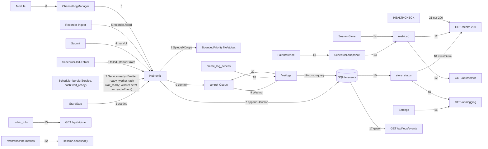

# 06.10 – Monitoring und Metriken

> **Kapitelstatus:** Intern abgenommen und integriert (INTEGRATED) – Stand Commit a8993c5c68042d996eab680d84a5b138a214bb5d; externe ROOT-Freigabe ausstehend
> **Geltung:** genau Commit `a8993c5c68042d996eab680d84a5b138a214bb5d`
> **Faktenbasis:** M6-01 bis M6-19 aus `workflow/research/06.10.json`; N6-01..N6-08, U6-01..U6-05, C6-01..C6-10.
> **Diagramm:** genau ein Mermaid-flowchart (Kanten 1–22, nur belegte Flüsse).
> **Abgrenzung:** Start/Stop [06.07](06.07-serverstart-stopp.md); Store/Daten [06.08](06.08-datenhaltung.md); Schalter [06.09](06.09-logging.md); Container [06.05](06.05-docker-betrieb.md).

## 1. Worum geht es?

Vier Lesewege + ein sitzungsbezogener: **/health** (Liveness 200 + Body ready/ok) (M6-01..M6-03), **/api/v2/info** (Identität, gecacht) (M6-10), **/api/metrics** (Aggregat-JSON, kein Prometheus) (M6-04..M6-09), **/api/logs + /ws/logs** (Historie/Live sqlite-first) (M6-14/M6-18); **WS-metrics** = Session-Snapshot ≠ Aggregat (M6-17). **Kein Prometheus/OpenMetrics, keine Zeitreihen/Histogramme, kein Alerting** (N6-01/03/07). **Zwei Queues trennen:** BoundedPriority (Sink-Spiegel) ≠ FairInference (Scheduler) (C1). ready≠healthy: ready finally, ok = ready AND healthy (+logging-Gate) (C2).

## 2. Das Wesentliche

| Thema | Kernaussage | Beleg |
|---|---|---|
| /health | immer 200, kein Auth; ok/ready/Sessions/Speakers/rejected/scheduler/models/sttReady/sttModels/startupErrors/eventStore | M6-01 |
| ready/ok | ready Service-Event (finally, auch bei Ladefehler); ok = ready+healthy+logging; Worker-/Scheduler-healthy nur bool; models.error-Textfeld ausgenommen (siehe §3) | M6-02 |
| Gate | logging_ready = !live \|\| available; nur /health, nicht /api/metrics | M6-03 |
| /api/metrics | JSON-Aggregat; kein Auth/Cache/Format; sync in async def (blockiert Loop) | M6-04 |
| Aggregat | Snapshots + ready/ok + scheduler + Modelle(Lifecycle+Readiness) + limits + startupErrors | M6-05 |
| limits | 4/4/30s/1500ms/8/64/1500ms; Laufzeit-Settings | M6-06 |
| scheduler | low-memory-one-model (shared) vs balanced-main-plus-realtime; main immer, realtime nur bei eigen | M6-07 |
| FairInference | name/queued/sessions/perSession/coalescedRealtime/staleRealtimeDropped/rejectedJobs; final-Ablehnung bei Tiefe; realtime ersetzt; stale bei Deadline; cancel; Callback kein System-Event | M6-08 |
| Worker | name/ready/healthy/completed/failed/busyRatio/Latenzen {count,avgMs,maxMs,p50Ms,p95Ms} (Ring 256, ms); Join 10s | M6-09 |
| /api/v2/info | Identität (schema1/protocol2/Version/Commit/Status/Build/Distribution/Runtime/instanceId); gecacht; no-store | M6-10 |
| startupErrors | [] initial; nur Scheduler-Init {type,message,where lane_engine} + worker.failed + publish + ready-Push; monoton, nie Reset | M6-11 |
| eventStore | enabled/path/state/disabled-ready-degraded/available/lastError/Transition/Cursor; getrennt geheilt | M6-12 |
| Sink-Queue | BoundedPriority file/stdout + control; maxsize queue_size (min 100); Verdrängung schlechter-nur-bei-besserem (Prio 0/1/2); Drops intern; SQLite vor Enqueue | M6-13 |
| /ws/logs | sqlite-first: 1008 live-aus/invalid/cursor_ahead; 1011 Store-fehlt/store_error; subscribe+Token+Scope; hello(v2/sqlite_first/Cursor)/subscribed; gap(retention); Replay-1000er/completed; live replay:false/keepalive/pong; finally unsubscribe; Pull | M6-14 |
| Events | starting (host/port), ready (healthy/models), stopping (nach Facade, vor close), worker.failed, overloaded (nur Voll + queue.limit_reached), recorder.failed; weiche still | M6-15 |
| Healthcheck | nur 200 (Docker 30s/10s/60s/5, urlopen 5s; Compose gleich); VPS ready and ok (Pfad nennen) | M6-16 |
| WS-metrics | session.snapshot() pro Session; queueDepth = Recorder, nicht Inferenz | M6-17 |
| Historie | Scope Admin/Token sonst 401; Nicht-Admin 3 Kanäle+eigene; Store-fehlt 503; Filter + limit 1-1000; data/Cursor/scopes/deliveryMode | M6-18 |
| Store | events (+6 Indizes) + watermarks; WAL/NORMAL; emit→Envelope→append→Cursor→commit→Spiegel; ohne Store In-Memory; Fehler None/degraded, kein Fallback; Hub einmal (Facades teilen) | M6-19 |

## 3. Health (M6-01..M6-03)

**Immer 200, kein Auth** (M6-01): Code = Liveness (Prozess antwortet), Body = Bereitschaft (ready/ok/Modelle/Fehler/Store). **ready = Event** (wait_ready, finally auch bei Ladefehler → ready-true/ok-false legitim); **ok = ready AND healthy AND logging_ready**; Worker-/Scheduler-healthy nur als Bool; Ladefehler-Text steht in `models.error` (Lifecycle) sowie startupErrors/worker.failed, nie als eigenes load_error-Feld (C2/C5-Ausnahme models.error; N6-05) (M6-02/M6-11). Beispiel: Lane-Init-Fehler → 200 + ready true + ok false + sttReady false + startupErrors-Eintrag (kein Restart; Container bleibt healthy). Gate: live-aus entkoppelt Store; live-an + degraded → ok false (ready separat); /api/metrics ohne Gate (C4) (M6-03).

## 4. Metriken (M6-04..M6-09)

**/api/metrics = JSON-Aggregat** (kein Prometheus: kein Scrape-Text, keine HELP/TYPE) (M6-04/N6-01); sync in async def (Loop-Blockade bei vielen Sessions C10/U6-01). Inhalt: Session-Snapshots (Sessions/Speaker/pending/rejected/sessions) + ready/ok + scheduler + Modelle (Lifecycle: state/loaded/error/Activity/Idle/Policy/active; Readiness: revision/state/readiness/minimumReady/provisioning/refresh/Kandidaten/Diagnostik) + limits + startupErrors (M6-05). limits Laufzeit-Settings (Defaults oben; aktuell ≠ Default beachten) (M6-06). Scheduler: Modi shared-vs-getrennt (main immer, realtime nur eigen; Aliase) (M6-07). FairInference (Felder queued/sessions/perSession/coalescedRealtime/staleRealtimeDropped/rejectedJobs): Ablehnung nur Tiefenüberschreitung (Session 8/Global 64); realtime-Ersetzung (coalesced, kein Fehler); stale-Verfall; cancel; Callback → Session-Zähler/pending-Beendigung (kein System-Event) (M6-08/C7). Worker: Momentaufnahme Ring-256 (Latenzen count/avgMs/maxMs/p50Ms/p95Ms, ms; keine Zeitreihe N6-03); p95≈max = Ausreißer in letzten 256; Join 10s (M6-09). Beispiel: queued steigt + busyRatio≈1 + coalesced wächst + rejected 0 = ausgelastet, keine Ablehnung; rejected steigt = Kapazitätsgrenze.

## 5. Identität/startupErrors/Store (M6-10..M6-12)

/api/v2/info: **Identität, kein Zustand** (gecacht beim Bau; kein Git/metrics/subprocess; no-store): Version/Commit/Status-Regel (complete nur vollständig, sonst incomplete → Deployment-Entscheidung U6-05)/Build/Distribution/Runtime/instanceId (M6-10). startupErrors: [] → nur Scheduler-Init {type,message,where} + worker.failed + publish_all + ready-Push; monoton, nie Reset (Wachstum U6-04), nicht persistiert (M6-11). /api/logging.eventStore: {enabled,path,state,available,lastErrorType,lastTransitionAt,oldestCursor,latestCursor}; disabled/ready/degraded; **getrennt geheilt** (Read heilt nur Read); live-an + degraded → ok false (M6-12).

## 6. Sink-Queue/trennen (M6-13/C1)

`BoundedPriority` = **Spiegel** (file/stdout + payload-freie control): maxsize = queue_size (min 100, startup-only); Verdrängung: schlechtester (höchste Prio/jüngste Seq) nur bei besserem neuem ersetzt; Prio 0 (audit/error-kritisch/terminale Transkription), 1, 2 (performance); Drops nur in-process (kein HTTP/WS N6-04/C8); **SQLite vor Enqueue** → Spiegel-Drop verliert nie Kanonik (M6-13). **C1: niemals mit FairInference verrechnen** (Logpuffer ≠ Inferenzstau; Drop ≠ rejected).

## 7. Live/Historie/Events (M6-14/M6-18/M6-15)

Historie sqlite-first: Scope (401 ohne), Nicht-Admin 3 Kanäle+eigene (system admin-only), Store-fehlt 503 (auch Query-Exception), Filter + limit→Store 1-1000, Antwort data/Cursor/scopes/deliveryMode, kein Datei-Fallback (M6-18). /ws/logs: accept → 1008 (live-aus)/1011 (Store-fehlt) → subscribe+Token+Scope → invalid_cursor/cursor_ahead 1008 → hello(v2/sqlite_first/Cursor)/subscribed → gap(retention) → Replay-1000er/replay_completed → live (replay:false)/keepalive/pong → store_error 1011 → finally unsubscribe; **Pull ab Cursor** (control weckt) (M6-14). Offline-2-Tage + retention-1-Tag → gap, bei hello-Cursor neu. Events system: starting (start), ready (healthy/models), stopping (nach Facade-vor-close), worker.failed (error), overloaded (**nur Voll** + queue.limit_reached; coalesced/stale/cancelled still), recorder.failed; stopping erreicht Store (shared Hub) (M6-15/C7/C9).

## 8. Container/Session (M6-16/M6-17)

Healthcheck **nur 200** (30s/10s/60s/5, urlopen 5s; Compose gleich); nie ready/ok/Modell (sonst Restart-Loop ohne Modell); VPS (`engineering/deployment/vps/docker-compose.yml`) `ready and ok` strenger mit start_period 180s statt 60s (Pfad nennen, C6) (M6-16). Client-Pollfrequenz unbelegt (nur Container-Intervalle U6-03). WS-metrics = **Session-Snapshot** (Recorder-Queues/Zähler/Ledger/Latenzen); queueDepth = Recorder-Audio, ≠ Inferenz-Tiefe; kein Aggregat (M6-17). Zwei hohe queueDepth = zwei Recorder-Staus, Scheduler evtl. idle (kein „Server überlastet"). /health ohne Inferenz-queueDepth (N6-08).

## 9. Store-Kanonik (M6-19)

Tabelle + 6 Indizes + Watermarks; WAL/NORMAL. emit: sanitisieren → Envelope (v1/ID/UTC/Kontext/data/meldung) → **append → Cursor → commit** → Spiegel; ohne Store In-Memory; Fehler → None + degraded, **kein JSONL-Fallback**. Hub einmal/Service (Facades teilen). Wahrheit = SQLite; fehlt dort = existiert nicht für Historie.

## 10. Diagramm (Kanten 1–22)

Quellen → Hub.emit (1-6) → Store (7) + Spiegel (8) + control (9); Store → status → Health/Logging (10/16); Aggregat → Health/Metriken (11/12) aus Scheduler (13) + Sessions (14); Identität→Info (15); Query→Historie (17); Token→/ws/logs (18) → Cursor/Query (19) + Weckruf (20); Healthcheck→/health (21); WS-metrics→Snapshot (22).

Legende: Kanten 1-6 Erzeuger→Hub; 7 kanonisch; 8 Spiegel (C1: getrennt von 13); 9 Weckruf (keine Nutzdaten); 10/16 Store→Health/Logging; 11/12 Aggregat→Health/Metriken; 13/14 Scheduler+Sessions→Aggregat; 15 Identität ohne Store; 17 Query→Historie; 18 Token; 19/20 Cursor-Pull/Weckruf; 21 nur-200 (C3/C6: Prod vs VPS); 22 Session≠Aggregat. Mehrteilige (6/9/10/13/16) in zwei Pfeilen, gleiche Nummer. **Nicht gezeichnet:** Port-Zeitpunkt, Phasen/Dauern, Signal-Handler, graceful-Timeout, Bereitschaft-aus-ok, Drops-als-Metrik, Prometheus.

## 11. Lücken/Konflikte (N/U/C)

N1 kein Prometheus; N2 keine Liveness/Readiness-Endpunkte; N3 keine Zeitreihen (256er-Ring); N4 keine Drop-Exposition; N5 kein load_error-Feld; N6 keine HTTP-Zähler; N7 kein Alerting; N8 keine queueDepth in /health. U1 sync-Absicht; U2 starting-ohne-Store; U3 Pollfrequenz; U4 startupErrors-Wachstum; U5 incomplete-Behandlung. C1 zwei Queues; C2 ready≠healthy; C3 ok-Body; C4 Gate-nur-health; C5 Text-nur-startupErrors; C6 Healthcheck-Pfade; C7 nur-Voll-Events; C8 Drops-intern; C9 stopping-Reihenfolge; C10 sync-Metriken.

## 12. Nachweise (alle M6-IDs)

M6-01 Health · M6-02 ready/ok · M6-03 Gate · M6-04 Route · M6-05 Aggregat · M6-06 limits · M6-07 scheduler · M6-08 FairInference · M6-09 Worker · M6-10 Info · M6-11 startupErrors · M6-12 eventStore · M6-13 Sink-Queue · M6-14 Live · M6-15 Events · M6-16 Healthcheck · M6-17 Session · M6-18 Historie · M6-19 Store. Stand a8993c5c. Intern unabhängig geprüft und integriert; externe ROOT-Freigabe ausstehend.

Weiter: [06.07](06.07-serverstart-stopp.md) · [06.08](06.08-datenhaltung.md) · [06.09](06.09-logging.md) · [06.11](06.11-performance-ressourcen.md) · [04.02](../04-schnittstellen/04.02-http-grundlagen.md).
