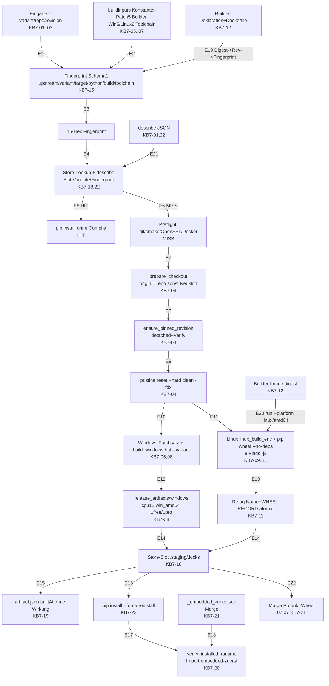

# 07.08 – Native-Kroko-Build

> **Kapitelstatus:** Intern abgenommen und integriert (INTEGRATED) – Stand Commit a8993c5c68042d996eab680d84a5b138a214bb5d; externe ROOT-Freigabe ausstehend
> **Geltung:** genau Commit `a8993c5c68042d996eab680d84a5b138a214bb5d` (Branch detached, U4)
> **Faktenbasis:** KB7-01 bis KB7-23 aus `workflow/research/07.08.json`; N1–N4, U1–U4, C1–C4
> **Hinweis:** Nichts gebaut/ausgeführt. Zahlen = Deklarationen (Revisionen/Pins/Flags/Schwellen), keine Messung. Beispiele schematisch.
> **Abgrenzung:** Merge [07.07](07.07-packaging.md) · CI [07.09](07.09-ci.md) · Tests [07.05](07.05-testarchitektur.md)/[07.06](07.06-testverfahren.md) · Gates [07.12](07.12-buildketten-sicherheit.md) · Install [06.02](../06-betrieb/06.02-installationskonzept.md) · Lizenz [05.07](../05-administration/05.07-kroko-lizenzierung.md)

## 1. Worum geht es?

Produkt-Wheel ohne Kroko-Gewichte/Runtime → separater nativer Build aus Upstream+Patch+Toolchain → plattformspezifisches Rad (Merge → 07.07). Ergebnis identifiziert nicht via Version, sondern **Fingerprint-Dekopplung**: Eingaben kanonisch → 16-Hex Fingerprint = Slot/Reuse/Provenienz (keine Version, keine Dateiliste KB7-15/U1).

Drei Eigenschaften: **zwei Einstiege eine Logik** (stt-install-kroko / python -m ENTRYPOINT; ohne --build SystemExit; fingerprint/describe ohne Compile KB7-01); **reuse-by-default** (Fingerprint+Lookup vor Preflight; HIT ohne Compile KB7-22); **Nachvollziehbarkeit** (artifact.json + verify; keine externen Hashes/Signaturen N2/N4).

Praxis: „Rad schon da" = Fingerprint+Slot+artifact.json prüfbar; „warum gebaut" = Patch/Toolchain/Revision/Variante geändert.

## 2. Das Wesentliche

| Baustein | Kern | Beleg |
|---|---|---|
| Einstiege | CLI + Builder-Modul; ohne --build Exit; fingerprint/describe ohne Compile | KB7-01 |
| Variante | free/pro case-insensitiv; Tag 1free/1pro | KB7-02 |
| Revision | Repo/Revision/Hint getrennt; Branch nur Start, detached+Verify | KB7-03 |
| Baum | Reuse nur bei origin==repo sonst Neuklon; reset --hard + clean -fdx | KB7-04 |
| Patchsatz | 4 Dateien Revision 5 Guard-Digest | KB7-05 |
| Builder-Rev | Win 5 / Linux 2 getrennt | KB7-06 |
| Win-Toolchain | voll deklariert offline hashbar | KB7-07 |
| Win-Kette | 3.12 x64/amd64 + docker version; build_windows.bat --variant; Suche cp312 win_amd64 | KB7-08 |
| Linux-Kette | CPU-only 8 Flags, -j2 | KB7-09 |
| Linux-Env | 4 Keys+KROKO_LICENSE ersetzt, Ambient gestrippt | KB7-10 |
| Retag | 1free/1pro Name+WHEEL RECORD neu atomar, Konflikt abgelehnt | KB7-11 |
| Builder-Image | digest apt/pip gepinnt COPY-Whitelist gemeinsam gehasht | KB7-12 |
| Container | --platform linux/amd64 Mounts store/work, describe ro vs Build | KB7-13 |
| Prod-Image | kein Compile/Keys, Abort statt Verschieben | KB7-14 |
| Fingerprint | kanonisch Schema1 16-Hex upstream/variant/target/python/build/toolchain | KB7-15 |
| IDs | Win gepinnt 8b6d../54b5.. (hist b28b../26d5..), Linux kein Pin | KB7-16 |
| Toolchain | Win deklariert hostunabhängig; Linux geprobt (Generator nicht) | KB7-17 |
| Store | Slots Variante/Fingerprint .staging/.locks Lock 1800/0.05 nie geloescht Retention 30/0 | KB7-18 |
| Provenienz | artifact.json Schema1 builtAt ohne Wirkung, kein fingerprint.json | KB7-19 |
| Verify | sammelt alle Fehler WHEEL Autorität embedded-zuerst | KB7-20 |
| Merge | _embedded_kroko.json Schema1 Notices byte-exakt BLOCKED | KB7-21 |
| Reuse | HIT ohne Compile MISS Kette rebuild/describe JSON | KB7-22 |
| Plattformen | nur Win/Linux sonst Error+Upstream-Hinweis | KB7-23 |

Merksatz: *Vier Dateien Patch, zwei Ketten, 16 Hex, ein Store – Version entscheidet nichts.*

## 3. Inputs/Pin/Härtung (KB7-02..07)

**Variante (KB7-02):** free/pro case-insensitiv; Tag 1free/1pro PEP427; Fingerprint+Store-Namespace. Wechsel = anderer Slot/Tag.

**Revision (KB7-03):** Repo/Revision/Hint getrennt; Branch Start, detached Verify sonst Error. Kein stiller Branch-Wechsel.

**Baum (KB7-04):** Reuse nur origin==repo normalisiert sonst scoped löschen+Neuklon; immer reset --hard + clean -fdx (ignorierte Artefakte weg).

**Patchsatz (KB7-05):** 4 Dateien (WebSocket/OpenSSL/Buildskript/Lizenz+Shutdown) Rev 5 Guard-Digest. Kommentar-Drift C2 (4 = Builder-Block); massgeblich 5+Digest. Ohne Rev-Bump = falscher Fingerprint.

**Builder-Rev (KB7-06):** Win 5 / Linux 2 getrennt; Win-Änderung invalidiert nur Win.

**Win-Toolchain (KB7-07):** Base-Digest apt-Snapshot Clang/NSIS CMake+xwin-SHA Channel/vsman SDK/CRT/CPython/Redist/OpenSSL/openfst/Packaging voll deklariert; Channel-Datei existiert. Hostunabhängig.

## 4. Zwei Ketten (KB7-08..14)

**Windows (KB7-08):** 3.12 x64 amd64 + docker version Gates; Patches + Manifest-Stage + build_windows.bat --variant; Suche release_artifacts/windows cp312 win_amd64 1free/1pro neuestes. 3.11 = Gate-Fehler; falscher Tag = nicht gefunden.

**Linux (KB7-09/10):** exakt 8 -D-Flags (GPU/PortAudio/TTS/Diarization/Binary OFF, WS ON, kein preinstalled ONNX; 7 genannt, CMAKE_BUILD_TYPE=Release bewusst unaufgeführt) + -j2. Env ersetzt (4 Keys+LICENSE, Ambient gestrippt) dann CMAKE/MAKE + LICENSE ON/OFF + OPENSSL_ROOT. Erbe würde Fingerprint lügen.

**Retag (KB7-11):** pip wheel . --no-deps → find → retag Name+WHEEL RECORD neu atomar replace; Konflikt abgelehnt. Tag bleibt Build-Tag.

**Builder-Image (KB7-12):** digest apt/pip gepinnt COPY-Whitelist; Deklaration+Dockerfile gemeinsam gehasht (Guard). Nur Buildrelevantes ändert Identität.

**Container (KB7-13):** --platform linux/amd64 Mounts store/work Env; describe ro vs build bei Miss; Host-Mapping; Gesamtlauf. Maßgeblich ist engineering/tools/build_production.py; tools/build_production.py nur Shim (C4).

**Prod-Image (KB7-14):** kein AS/kein --from/keine Keys; fehlt Rad = Abort. Klein/credential-frei; unvollständig fällt auf.

## 5. Fingerprint/Toolchain (KB7-15..17)

**Inhalt (KB7-15):** kanonisch sortiert/kompakt Schema1 16-Hex; upstream/variant/target/python/build/toolchain. Keine Version (U1 unbrauchbar), keine Dateiliste (sonst Neuaufbau bei Docs).

**Windows-IDs (KB7-16):** free 8b6d.. pro 54b5.. cp312/amd64 (hist b28b../26d5..). Commit-gebunden.

**Linux kein Pin (KB7-16/17):** Host-Toolchain geprobt (CMake/C/C++/OpenSSL Header/Lib SHA); Generator nicht (Lücke). Zwei gleiche Fingerprints = gleiche Binär-Erwartung; unterschiedliche Hosts = unterschiedliche Slots (korrekt).

| | Windows | Linux |
|---|---|---|
| Upstream-ID | gepinnt | kein Pin |
| Toolchain | deklariert | geprobt |
| Generator | enthalten | nicht geprobt |
| Stabilität | hostunabhängig | hostabhängig |

## 6. Store/Verify/Provenienz (KB7-18..21)

**Store (KB7-18):** ausserhalb Repo variant/fingerprint Slots .staging/.locks; OS-Lock crash-recoverable 1800s/0.05s nie geloescht; atomar Rollback/Purge; lookup lock-frei wenn gesund; Retention 30d 0=aus schützt aktuell+LKG.

**artifact.json (KB7-19):** Schema1 Fingerprint+Inputs+Repo/Revision/Variante/Ziel/Python/Flags/Toolchain/Wheel-Name/SHA/Bytes/Tags/BuildTag/builtAt (ohne Wirkung); kein fingerprint.json (N2).

**Verify (KB7-20):** sammelt alle (Schema/Fingerprint/Variante/Bytes/SHA/Tag/Inputs/Ziel/Arch/ABI/Plattform); WHEEL Autorität (Umbenennen nutzlos); installiert Import + embedded-zuerst sonst Build-Tag.

**Merge (KB7-21):** _embedded_kroko.json Schema1 Variante/Distribution/Version/Kroko-Details/Tags installed-distribution key-nur-Credential; Notices vs sources.json byte-exakt; BLOCKED. Details → 07.07.

## 7. Ablauf/Reuse (KB7-01, KB7-22, KB7-23)

Reuse-by-default: Fingerprint+Lookup vor Preflight; HIT installieren ohne Compile; MISS Preflight/Checkout/Build/Verify/Store/install; rebuild erzwingt; describe JSON.

Schematisch: stt-install-kroko --variant pro --repo URL --revision REV --build → Fingerprint→Lookup leer → Preflight → Checkout detached+Verify pristine → linux_build_env + pip wheel (8 Flags -j2) → Retag → Store artifact.json → install → verify. Zweiter Lauf gleich → HIT kein Compile.

Zerstört Treffer: Patch-Rev/Builder-Rev/Compiler/OpenSSL/Revision/Repo/Variante. Nicht: builtAt/Dateien ohne Relevanz/Branch-Name.

describe trocken (kein Compile). Nur Win/Linux sonst Error+Upstream (KB7-23, Evidenz B); Arch-Gate nur Win; linux/amd64; arm64 UNKNOWN N1.

## 8. Diagramm E1–E22

Nur belegte Kanten; keine Zeit/Erfolg/Signatur/Upload/Release; keine Phasen ohne Beleg.

Legende: E1 Eingabe→Dokument; E2 Konstanten→Dokument; E3→16-Hex; E4→Lookup; E5 HIT install; E6 MISS Preflight; E7→Checkout; E8→Pin; E9→pristine; E10 Win-Build; E11 Linux-Build; E12 Win-Artefakt; E13 Retag; E14→Slot (2x eine ID); E15→artifact.json; E16→install; E17→Prüfung; E18 embedded-zuerst; E19 Builder→Fingerprint; E20 Image→Linux; E21 describe→Entscheidung; E22→Merge. E14 doppelt (zwei Ketten ein Mechanismus).

Nicht gezeichnet: X→T (23. Kante ohne ID; Erzeugung Text/07.07); Prod-Image→Compile (existiert nicht KB7-14); Signatur/Attestation (N2); Retention/Lock/Rollback (Eigenschaften KB7-18); Freigabe/Upload/Release (07.09/07.11/07.12); aarch64-Gate (N1); Zeiten/Erfolge.

Textalternative: Fingerprint (E1-E3) → Lookup (E4) → HIT install (E5) / MISS Preflight (E6) Checkout (E7) Pin (E8) pristine (E9) → Win (E10/E12) / Linux (E11/E13) → Slot (E14) → artifact (E15) + install (E16) → Prüfung embedded-zuerst (E17/E18) → Merge (E22).

## 9. Lücken/Konflikte

N1 kein Linux-Arch-Gate (arm64 UNKNOWN) · N2 kein Fingerprint/Signatur (nur artifact.json) · N3 install_windows/linux nie main (nur Test) · N4 kein externer Hash (BLOCKED). U1 Version 1.12.9 nicht deklariert · U2 linux vs manylinux UNKNOWN · U3 Dauer/Quote/Speicher keine Quelle · U4 Branch detached. C1 XWIN_URL in __all__ undefiniert (BUNDLED/CACHE gilt) · C2 Patch-Kommentar-Drift (5+Digest gilt) · C3 Deutsch-Kommentare Stil · C4 Shim vs engineering (engineering zitieren). Klarstellung KB7-09: exakt 8 -D-Flags, sieben namentlich (CMAKE_BUILD_TYPE=Release bewusst unaufgeführt, keine Ergänzung).

## 10. Nachweise (alle KB7-IDs)

KB7-01 Einstiege · KB7-02 Varianten · KB7-03 Pin · KB7-04 Checkout · KB7-05 Patchsatz · KB7-06 Builder-Rev · KB7-07 Toolchain · KB7-08 Win-Kette · KB7-09 Flags · KB7-10 Env · KB7-11 Retag · KB7-12 Image · KB7-13 Container · KB7-14 kein Prod-Compile · KB7-15 Fingerprint · KB7-16 IDs · KB7-17 Toolchain · KB7-18 Store · KB7-19 Provenienz · KB7-20 Verify · KB7-21 embedded · KB7-22 Reuse · KB7-23 Plattformen. Stand a8993c5c. Intern unabhängig geprüft und integriert; externe ROOT-Freigabe ausstehend.

Weiter: [07.07](07.07-packaging.md) · [07.09](07.09-ci.md) · [07.12](07.12-buildketten-sicherheit.md).
