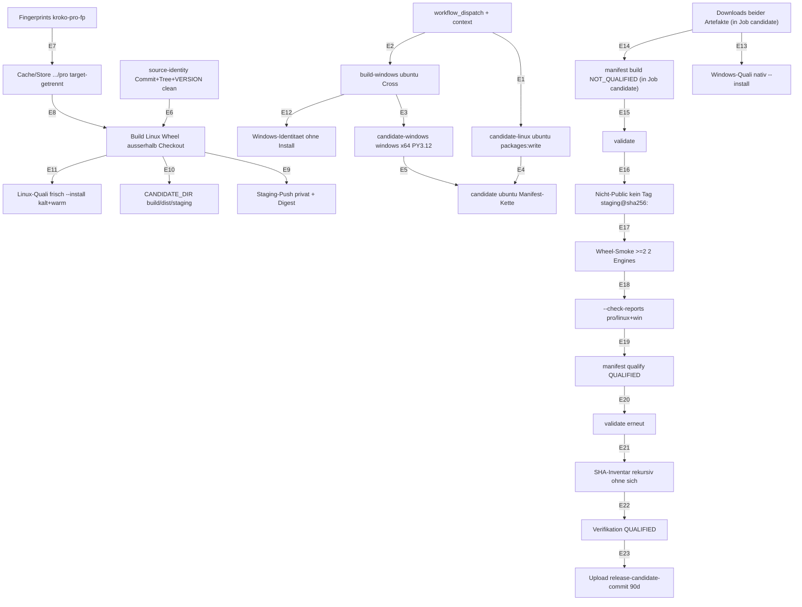

# 07.10 – Release Candidate

> **Kapitelstatus:** Intern abgenommen und integriert (INTEGRATED) – Stand Commit a8993c5c68042d996eab680d84a5b138a214bb5d; externe ROOT-Freigabe ausstehend
> **Geltung:** genau Commit `a8993c5c68042d996eab680d84a5b138a214bb5d` (detached HEAD; Branch nicht verifizierbar), VERSION 2.0.0
> **Faktenbasis:** RC7-01 bis RC7-21 aus `workflow/research/07.10.json`; N1–N5, U-01..U-04, C-01..C-03
> **Diagramm:** genau ein Mermaid-flowchart E1–E23 (Idee 1 umgesetzt)
> **Abgrenzung:** Verfahren [07.06](07.06-testverfahren.md) · Merge [07.07](07.07-packaging.md) · Kroko-Build [07.08](07.08-native-kroko-build.md) · CI [07.09](07.09-ci.md) · Publish [07.11](07.11-veroeffentlichung.md)

## 1. Worum geht es?

Private Qualifikationsstrecke: Sind diese Bytes auf diesen Plattformen installierbar/lauffähig? Kein Publish. Manifest NOT_QUALIFIED→QUALIFIED; nur privates Staging; 4 Jobs linux/build-win/win/candidate.

## 2. Das Wesentliche

| Baustein | Kern | Beleg |
|---|---|---|
| Auslöser | nur dispatch (+optional context); kein Tag/Zeitplan | RC7-01 |
| Concurrency | SHA ohne Abbruch | RC7-01 |
| Rechte | contents read; nur linux packages write (Staging); kein environment | RC7-03 |
| Graph | linux ∥ build-win → win → candidate (braucht beide) | RC7-02 |
| Runner | ubuntu-24.04/ubuntu-24.04/windows-latest/ubuntu-24.04 (Jobs candidate-linux/build-windows/candidate-windows/candidate); Win setup-python 3.12 arch x64 | RC7-03/10 |
| Identität | Commit+Tree (+VERSION in linux/candidate, build-win ohne); clean doppelt; --source-tree Abgleich | RC7-04 |
| Cache | kroko-pro-<fp> Pfad .../pro; Linux Container, Win store-unabhängig | RC7-05 |
| Staging | privat staging:<id> + Digest-Rücklesung; ohne Digest Abbruch | RC7-06/07 |
| Linux | 3 Manifeste + Wheel außerhalb Checkout (--no-manifest) | RC7-08 |
| Linux-Quali | Frisch-venv offline kalt+warm Health/WS; identity-qualification.json Schema1 | RC7-09 |
| Windows | Cross auf Linux mit Docker/Buildx, nur nativ qualifiziert; auf Win-Runner kein Docker/Buildx/release_candidate | RC7-10 |
| Kette | rc-manifest.json Schema 3 (1 pro-Eintrag, 2 Plattform-Räder linux_x86_64/win_amd64, cp312); build→validate→Nicht-Public→Smoke→check-reports→qualify→validate→Inventar→Verifikation (Quali-Berichte + embedded Schema 1) | RC7-11..16 |
| Umfang | 1 Variante pro, 2 Plattformen, 2 Engines, ≥2 Räder | RC7-13/14 |
| Artefakte | Zwischen 1 Tag, final 90 Tage, Fehlen=Fehler | RC7-17 |
| Grenzen | kein Tag/Public; QUALIFIED+ BLOCKED; keine Suite; kein candidateRun | RC7-18..21 |

Merksatz: *Vier Jobs, zwei Plattformen, ein privater Ort – Bytes werden Kandidat, nicht Release.*

## 3. Graph/Identität/Cache (RC7-01..05)

**Start (RC7-01/02):** nur dispatch (+context); Concurrency SHA kein Abbruch. Graph: linux ∥ build-win → win → candidate.

**Rechte/Runner (RC7-03):** read global; nur candidate-linux write (Staging); kein environment (kein Vier-Augen). Runner candidate-linux ubuntu-24.04 / build-windows ubuntu-24.04 / candidate-windows windows-latest / candidate ubuntu-24.04; Win setup-python 3.12 arch x64.

**Identität (RC7-04):** Workflow-Outputs linux/candidate Commit+Tree+VERSION, build-win Commit+Tree ohne VERSION; inhaltlich Dreifach-Bindung + clean via candidate_source/require_complete. Modifizierter Baum = kein Kandidat.

**Cache (RC7-05):** Fingerprint als Key kroko-pro-<fp> Pfad .../pro; target trennt; Linux Container, Win store-unabhängig. Miss-Sichtbarkeit = Actions-Semantik (U-03).

## 4. Build/Staging/Quali (RC7-06..10)

**Linux (RC7-08):** 3 Manifeste + Wheel außerhalb Checkout; validate vs Identität/Kroko; Packaging-Test vorher am Baum.

**Staging (RC7-06/07):** privat staging:<id> + imagetools Digest-Rücklesung (sha256 sonst Error); Record digest-gepinnt private true; GITHUB_TOKEN. Ohne Push kein Digest → Assembly fail-closed.

**Linux-Quali (RC7-09):** Frisch-venv außerhalb Checkout (Env bereinigt, offline, Constraint, install, pip/cpu check, INSTALLED_CHECK kalt+warm no-store complete Version/Commit/Dist/Runtime/Tree/Date/health/WS; 1 Marker; Schema1).

**Windows (RC7-10):** Cross auf Linux mit Docker/Buildx (Windows-Builder-Image) → Identität ohne Install → nativ --install auf Win-Runner (x64, dort kein Docker/Buildx/release_candidate.py); resolve nur Linux/amd64/cp312.

## 5. Manifest-Kette (RC7-11..17)

**Assembly NOT_QUALIFIED (RC7-11):** rc-manifest.json Schema 3 (genau 1 pro-Eintrag, 2 Plattform-Räder linux_x86_64/win_amd64, cp312); candidate-id run/attempt, tree, timestamp UTC, context, evidence run-url; nur Produzenten; fail-closed (Datei/Doppel/Name/Wheel/Commit/VERSION/dirty/Kroko). Abgrenzung: Quali-Berichte + embedded-Manifest Schema 1.

**Validate + Nicht-Public (RC7-12):** Struktur + kein Tag an HEAD + jedes staging -staging@sha256: + endet @digest.

**Smoke (RC7-13):** ≥2 Räder (kroko+voice_stt_server, variant==), Engines exakt [faster, kroko], kein engineering/; Bytes nicht Install; ungetestet (C-03).

**Reports (RC7-14):** {(pro,linux),(pro,win)} beide JSON Schema1 je 1 Wheel nativeImport complete Commit/Version/Dist/Runtime/Build frisch proven alle; rc bindet Bytes/Fingerprints.

**Qualify (RC7-15):** Option A evidence/context (kein --timestamp ⇒ Qualifikationszeitpunkt) + Re-Validate. Assembly-Zeit ersetzt (C-02).

**Inventar/Verifikation (RC7-16):** rekursiv posix bytes sha ohne sich; Verifikation existiert/bytes/sha/rc drin/QUALIFIED; Reihenfolge erzwungen.

**Uploads (RC7-17):** Zwischen 1d error, final release-candidate-<commit> 90d (rc/sha/build/dist/staging/quali/evidence/dist).

## 6. Grenzen (RC7-18..21)

Kein Tag/Public (statisch + HEAD-Check; Registry privat nur Feld U-01; Digest nur Prefix U-02). QUALIFIED+BLOCKED vereinbar (RC setzt nie VERIFIED N4). candidateRun {} (build_candidate befüllt; Divergenz C-01 N3). Keine Suite (nur packaging-Identität; Unit/Compat = CI).

## 7. Diagramm E1–E23

Legende E1 dispatch→linux · E2 dispatch→build-win · E3 build→win (needs) · E4 linux→candidate · E5 win→candidate · E6 Identität→Build · E7 Fingerprint→Cache/Store · E8 Cache→Build · E9 Build→Staging+Digest · E10 Build→CANDIDATE_DIR · E11 Build→Linux-Quali · E12 build-win→Identität/Upload · E13 Download→Win-Quali · E14 Downloads (in Job candidate)→manifest build · E15→validate · E16→Nicht-Public · E17→Smoke · E18→check-reports · E19→qualify · E20→validate · E21→Inventar · E22→Verifikation · E23→Upload 90d.

Nicht gezeichnet: DW/MB..UP laufen alle in Job candidate (E14-E23 ein Job, keine jobübergreifenden Kanten dazwischen); dispatch→win/candidate direkt (nur needs); linux→win (parallel); Staging→candidate direkt (via Manifeste); check-reports→validate ohne qualify; qualify→Inventar ohne validate; Inventar→Upload ohne Verifikation; Tag/Publish/Signatur/SBOM/Registry-ReVerify/Retry (nicht vorhanden N1/N2/N5).

## 8. Lücken/Konflikte

N1 keine Re-Verifikation · N2 keine Signatur/SBOM/Attestation · N3 kein candidateRun Workflow · N4 kein BLOCKED→VERIFIED · N5 kein Retry/Resume. U-01 privat nur Feld · U-02 Index vs Plattform · U-03 Miss-Sichtbarkeit · U-04 Win-Tools. C-01 candidateRun-Divergenz · C-02 Timestamp ersetzt · C-03 Smoke ungetestet.

## 9. Nachweise (alle RC7-IDs)

RC7-01 Auslöser · RC7-02 Graph · RC7-03 Runner/Rechte · RC7-04 Identität · RC7-05 Cache · RC7-06 Staging · RC7-07 fail-closed · RC7-08 Linux-Manifeste · RC7-09 Linux-Quali · RC7-10 Windows · RC7-11 Assembly · RC7-12 validate/Nicht-Public · RC7-13 Smoke · RC7-14 Reports · RC7-15 qualify · RC7-16 Inventar · RC7-17 Uploads · RC7-18 kein Tag/Public · RC7-19 QUALIFIED/BLOCKED · RC7-20 candidateRun · RC7-21 keine Suite. Stand a8993c5c. Intern unabhängig geprüft und integriert; externe ROOT-Freigabe ausstehend.

Weiter: [07.06](07.06-testverfahren.md) · [07.07](07.07-packaging.md) · [07.08](07.08-native-kroko-build.md) · [07.09](07.09-ci.md) · [07.11](07.11-veroeffentlichung.md).
